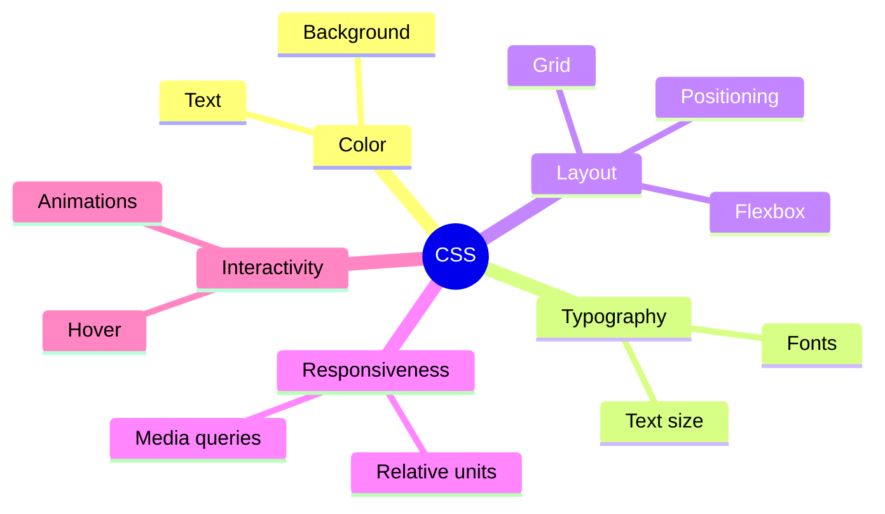
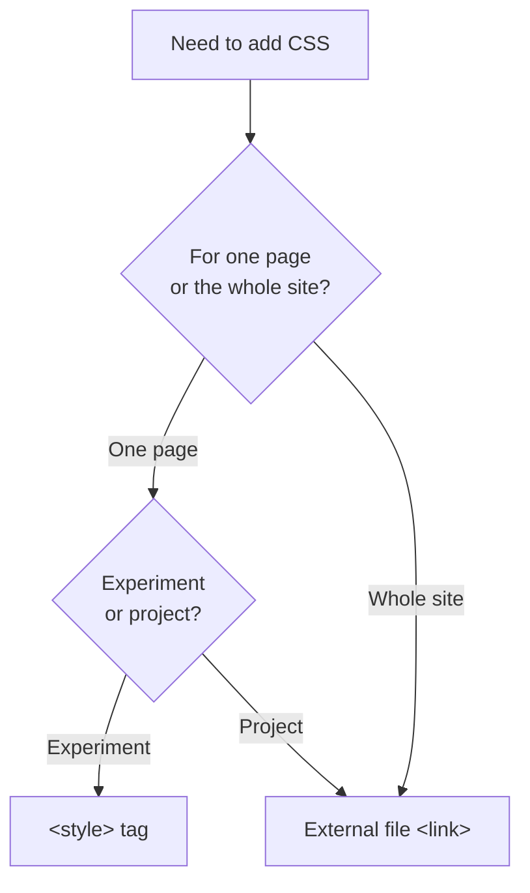

# Introduction to CSS. Syntax and linking

[Contents](../../README.md) · [← HTML course](https://github.com/JLearn-space/HTML) · [Next →](../../Lesson-2/en/Selectors%20and%20the%20cascade.md) · [RU](../ru/%D0%92%D0%B2%D0%B5%D0%B4%D0%B5%D0%BD%D0%B8%D0%B5%20%D0%B2%20CSS.%20%D0%A1%D0%B8%D0%BD%D1%82%D0%B0%D0%BA%D1%81%D0%B8%D1%81%20%D0%B8%20%D0%BF%D0%BE%D0%B4%D0%BA%D0%BB%D1%8E%D1%87%D0%B5%D0%BD%D0%B8%D0%B5.md) · [EN](Introduction%20to%20CSS.%20Syntax%20and%20linking.md) · [UZ](../uz/CSS%20ga%20kirish.%20Sintaksis%20va%20ulash.md)

> **Link to the HTML course:** in the "HTML in 10 lessons" course you built the frame of your pages: headings, lists, tables, forms - without a single color. Today we start dressing that frame.

---

## Why you need this

Open your page from the HTML course. Black text on a white background, the default font, everything pressed to the left edge. It works, but it looks like a document from 1995.

Now open any modern website. The difference is CSS. Today you will connect your first style file and make your page noticeably nicer in 10 minutes.

---

## What you will learn

- Explain how CSS differs from HTML.
- Connect styles in three ways and choose the right one.
- Write a rule following the pattern `selector { property: value; }`.
- Apply one rule to several tags with a comma.
- Leave comments in CSS.
- Try styles "live" in DevTools.

---

## Review: 3 questions from the HTML course

1. Which tag connects an external style file?
2. In which part of the document is it written: `<head>` or `<body>`?
3. How do you link to `style.css` in the `css` folder if the HTML sits next to that folder?

Answers are at the end of the lesson.

---

## Lesson plan

| Section | What we do |
| --- | --- |
| What CSS is | Body and clothes |
| Three ways to connect | A tag, a wardrobe in one room, a shared walk-in closet |
| Rule syntax | Instructions for a tailor |
| Mini-task 1 | The first rule |
| Groups and comments | One rule - many tags |
| DevTools | The fitting room |
| First styling | Connect the file to your page |
| Mini-task 2 | Styles for three tags |
| Independent work | IDE task and your own page |

---

## What CSS is

**In simple terms:** HTML is the body, CSS is the clothes. The same body can wear a formal suit or a tracksuit. The arms and legs stay where they are.

| Technology | Answers the question | Example |
| --- | --- | --- |
| **HTML** | **What** is it? | "This is a heading", "this is a list" |
| **CSS** | **How** does it look? | "The heading is blue, large, centered" |

**CSS** (Cascading Style Sheets) controls the whole appearance:

| What | Lesson |
| --- | --- |
| Selectors and the order styles apply in | 2 |
| Colors, fonts, sizes, background | 3 |
| Spacing, borders, block sizes | 4 |
| Layout: Flexbox and Grid | 5–6 |
| Positioning | 7 |
| Adapting to phones | 8 |
| Hover, smooth transitions, animations | 9 |



**How to read the diagram.** The branches are different jobs of CSS. Each of them has its own lesson in the course.

**The main rule:** meaning goes in HTML, appearance goes in CSS. Do not use `<h3>` for a small font or `<br>` for spacing - CSS does that now.

---

## Three ways to connect

| Way | Analogy | Where it is written | Affects |
| --- | --- | --- | --- |
| The `style` attribute | A tag on one shirt | Inside the tag | One element |
| The `<style>` tag | A wardrobe in one room | In the page's `<head>` | One page |
| A file via `<link>` | The house's shared closet | A separate `.css` file | Every page where it is connected |

### 1. The `style` attribute

```html
<p style="color: red; font-size: 20px;">Red large text</p>
```

**Downsides:** 20 identical paragraphs - 20 identical `style`s. Appearance is mixed with meaning. Such a style is stronger than almost everything else and gets in the way of changing it.

### 2. The `<style>` tag

```html
<head>
    <meta charset="UTF-8">
    <title>My page</title>
    <style>
        p {
            color: red;
        }
    </style>
</head>
```

**Upside:** one rule for all paragraphs on the page. **Downside:** only on this page. Five pages - five copies.

### 3. An external file via `<link>`

**File `css/style.css`:**

```css
p {
    color: red;
}
```

**File `index.html`:**

```html
<head>
    <meta charset="UTF-8">
    <title>My page</title>
    <link rel="stylesheet" href="css/style.css">
</head>
```

**Upsides:**
- one file for all pages: fix it once - it changes everywhere;
- HTML separately, styling separately - both files are easier to read;
- the browser downloads the file once and remembers it: the next pages open faster.

**Course rule:** in projects - an external file. The `<style>` tag is for experiments and for IDE tasks where everything is in one file.



**How to read the diagram.** The answer is almost always an external file. The `<style>` tag is only for a quick try on one page.

### Typical beginner mistakes

| Mistake | How to fix |
| --- | --- |
| All styles via `style=""` | Move them into `css/style.css` |
| No `rel="stylesheet"` on `<link>` | Without it the browser does not know these are styles |
| Wrong path in `href` | The path is from the HTML file: `css/style.css` |
| `<style>` in `<body>` | Write it in `<head>` |
| HTML tags inside a `.css` file | A style file holds only CSS |

---

## Rule syntax

```css
h1 {
    color: navy;
    font-size: 32px;
}
```

| Part | Name | What it does |
| --- | --- | --- |
| `h1` | **Selector** | Whom to apply it to: all `<h1>` |
| `{ ... }` | Declaration block | The list of changes |
| `color` | **Property** | What we change |
| `navy` | **Value** | What we change it to |
| `color: navy;` | **Declaration** | One "property: value" pair |

**Analogy:** you give a tailor instructions: "For all shirts (selector): blue collar (property: value), 60 cm sleeves (property: value)".

**What you will see:** all `<h1>` headings on the page become dark blue and 32 pixels in size.

### Code style in this course

```css
selector {
    property: value;
}
```

- The colon goes **right** after the property, then **one space**.
- A semicolon after **every** declaration, even the last one.
- Each declaration on its own line, indented by 4 spaces.

This makes code easier to read, and **this is how the IDE on the platform checks it**.

### Why `;` after the last declaration

```css
/* Mistake: forgot ; after font-size, then added a line */
h1 {
    color: navy;
    font-size: 32px
    font-weight: bold;
}
```

The browser reads `32px font-weight: bold` as one strange value and **skips both** declarations. With `;` at the end of every line this cannot happen.

### Try to break it

1. Remove the `;` after `color: navy` in a rule with several declarations. What disappeared?
2. Remove the closing `}`. What happened to the following rules in the file?
3. Write `colour` instead of `color`. The browser does not complain - it simply skips a property it does not understand. Open DevTools: the property is struck through with a warning icon.

---

## Mini-task 1

Without peeking, write a rule: all `<h2>` are blue (`blue`) and `28px` in size. Solution is in the "Answers" section.

---

## Groups and comments

### One rule for several tags

```css
h1, h2, h3 {
    font-family: Georgia, serif;
}
```

Selectors separated by commas - and there is no need to repeat the block three times. In this course we put a space after the comma.

### Comments

```css
/* Page headings */
h1 {
    color: navy; /* brand color */
}

p {
    color: #333333;
    /* font-size: 40px; - temporarily off */
}
```

| Language | Comment |
| --- | --- |
| HTML | `<!-- text -->` |
| CSS | `/* text */` |

A comment helps you:
- explain why a style is needed;
- temporarily switch off a declaration without deleting it.

---

## DevTools: the fitting room

**In simple terms:** DevTools is the fitting room in a shop. You can try on as much as you like, but you go home only with what you bought. Changes in DevTools disappear after F5.

1. Open the page and press F12.
2. On the **Elements** tab click an element.
3. On the right is the **Styles** panel: all the rules that apply to it.

| What you can do | How |
| --- | --- |
| Change a value | Click the value and type a new one |
| Add a property | Click an empty spot inside the rule |
| Switch a property off | Untick the checkbox on the left |
| Pick a color | Click the colored square next to the value |

**How to use it:** pick a background color in DevTools in 10 seconds and move the best option into the file.

A **struck-through property** in Styles means: another rule overrode it, or the browser did not understand the notation. Why one rule beats another - in Lesson 2.

---

## First styling of your page

**Step 1.** In the project folder from the HTML course, create a `css` folder with a `style.css` file in it.

**Step 2.** Type in:

```css
body {
    background-color: #f4f6fb;
    font-family: Arial, sans-serif;
}

h1 {
    color: #1e3a8a;
}

p {
    color: #333333;
    font-size: 18px;
}
```

**Step 3.** Check that the page's `<head>` has:

```html
<link rel="stylesheet" href="css/style.css">
```

**Step 4.** Open the page via Live Server.

**What you will see:** a light gray background, a dark blue heading, a sans-serif font, slightly larger paragraphs.

Nothing changed? Open DevTools → **Network** and reload the page. If `style.css` has status **404**, there is a mistake in the path or the file name.

`#f4f6fb` and `#1e3a8a` are color codes. How they work - in Lesson 3. For now you can take ready ones or write names: `navy`, `teal`, `beige`.

---

## Mini-task 2

Add a rule to your `style.css` that sets the `Georgia, serif` font on `h1`, `h2` and `h3` - in one rule. Then switch this declaration off with a comment and on again. Solution is in the "Answers" section.

---

## Lesson summary: cheat sheet

| Task | Notation |
| --- | --- |
| Connect a style file | `<link rel="stylesheet" href="css/style.css">` in `<head>` |
| Styles on one page | `<style>...</style>` in `<head>` |
| Rule | `selector { property: value; }` |
| Several tags | `h1, h2, h3 { ... }` |
| Comment | `/* text */` |
| Text / background color | `color` / `background-color` |
| Font / size | `font-family` / `font-size` |
| Check a style | DevTools → Elements → Styles |

---

## Independent work

### Part 1. IDE task (graded by the platform)

The editor contains a page without styling. Add a `<style>` tag to `<head>` and write rules:

1. `body`: a background color (`background-color`) and a font (`font-family`).
2. `h1, h2` **in one rule**: your own text color (`color`).
3. `p`: a font size in pixels (`font-size`), for example `18px`.
4. At least one comment `/* ... */`.

Write in the course style: `property: value;`. Do not use the `style=""` attribute.

What the platform checks: a `<style>` tag in the document, rules for `body`, the `h1, h2` group and `p`, the properties `background-color`, `font-family`, `color`, `font-size` with a value in `px`, a CSS comment, no `style=""` attribute.

### Part 2. Project on your computer

1. Connect `css/style.css` to your page from the HTML course.
2. Style `body`, the headings and the paragraphs.
3. Try three background colors in DevTools and move the best one into the file.
4. Connect the same file to a second page and make sure the styles apply there too.

### Acceptance criteria

- [ ] The IDE task is accepted.
- [ ] Styles are in an external file connected via `<link>`.
- [ ] In Network, `style.css` loads without 404.
- [ ] Every declaration ends with `;`.
- [ ] The headings are styled with one group rule.
- [ ] One style file works on two pages.

---

## Self-check questions

1. How do the jobs of HTML and CSS differ?
2. Name three ways to connect CSS.
3. Why is an external file chosen in a project?
4. What parts make up the rule `p { color: red; }`?
5. What is a declaration?
6. Why put `;` after the last declaration?
7. How do you apply one rule to `h1` and `h2`?
8. How is a comment written in CSS?
9. What happens to a change made in DevTools after F5?
10. What does a struck-through property in the Styles panel mean?

After the questions, take the **lesson test** on the platform: 12 questions, pass threshold 70%.

---

## What's next

So far you have styled whole tags: all `<p>` at once. In Lesson 2 we learn to pick specific elements - by class, `id`, nesting - and find out which rule wins when there are several.

---

## Answers

**Review**

1. `<link rel="stylesheet" href="...">`.
2. In `<head>`.
3. `css/style.css`.

**Mini-task 1**

```css
h2 {
    color: blue;
    font-size: 28px;
}
```

**Mini-task 2**

```css
h1, h2, h3 {
    font-family: Georgia, serif;
}
```

Switching off with a comment:

```css
h1, h2, h3 {
    /* font-family: Georgia, serif; */
}
```

**Self-check questions**

1. HTML describes what is on the page, CSS describes how it looks.
2. The `style` attribute, the `<style>` tag, an external file via `<link>`.
3. One file works on all pages, it is easier to maintain, and the browser remembers it.
4. The selector `p`, the property `color`, the value `red`.
5. A "property: value;" pair.
6. So that a line added later does not "stick" to the previous one.
7. `h1, h2 { ... }`.
8. `/* text */`.
9. It disappears: DevTools does not change the file.
10. Another rule overrode it, or the browser did not understand the notation.

---

[Contents](../../README.md) · [← HTML course](https://github.com/JLearn-space/HTML) · [Next →](../../Lesson-2/en/Selectors%20and%20the%20cascade.md) · [RU](../ru/%D0%92%D0%B2%D0%B5%D0%B4%D0%B5%D0%BD%D0%B8%D0%B5%20%D0%B2%20CSS.%20%D0%A1%D0%B8%D0%BD%D1%82%D0%B0%D0%BA%D1%81%D0%B8%D1%81%20%D0%B8%20%D0%BF%D0%BE%D0%B4%D0%BA%D0%BB%D1%8E%D1%87%D0%B5%D0%BD%D0%B8%D0%B5.md) · [EN](Introduction%20to%20CSS.%20Syntax%20and%20linking.md) · [UZ](../uz/CSS%20ga%20kirish.%20Sintaksis%20va%20ulash.md)
