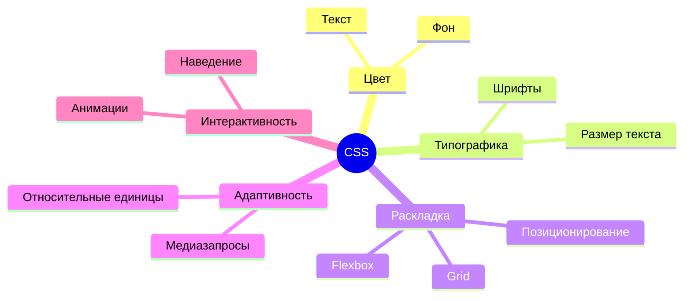
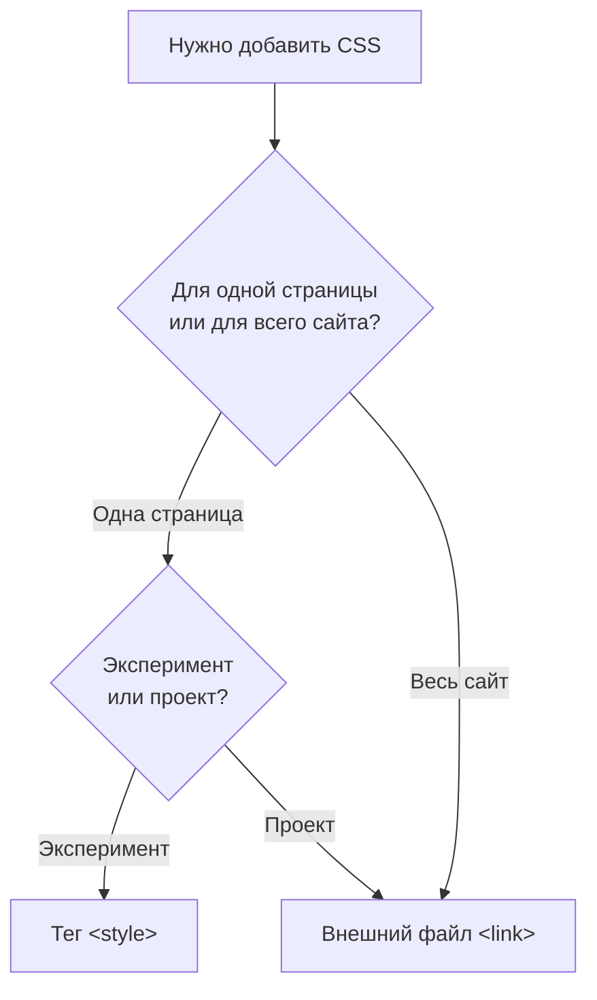

# Введение в CSS. Синтаксис и подключение

[Содержание](../../README.md) · [← Курс HTML](https://github.com/JLearn-space/HTML) · [Вперёд →](../../Lesson-2/ru/%D0%A1%D0%B5%D0%BB%D0%B5%D0%BA%D1%82%D0%BE%D1%80%D1%8B%20%D0%B8%20%D0%BA%D0%B0%D1%81%D0%BA%D0%B0%D0%B4.md) · [RU](%D0%92%D0%B2%D0%B5%D0%B4%D0%B5%D0%BD%D0%B8%D0%B5%20%D0%B2%20CSS.%20%D0%A1%D0%B8%D0%BD%D1%82%D0%B0%D0%BA%D1%81%D0%B8%D1%81%20%D0%B8%20%D0%BF%D0%BE%D0%B4%D0%BA%D0%BB%D1%8E%D1%87%D0%B5%D0%BD%D0%B8%D0%B5.md) · [EN](../en/Introduction%20to%20CSS.%20Syntax%20and%20linking.md) · [UZ](../uz/CSS%20ga%20kirish.%20Sintaksis%20va%20ulash.md)

> **Связь с курсом HTML:** в курсе «HTML за 10 уроков» вы построили каркас страниц: заголовки, списки, таблицы, формы - без единого цвета. Сегодня начинаем одевать этот каркас.

---

## Зачем это вам

Откройте свою страницу из курса HTML. Чёрный текст на белом фоне, стандартный шрифт, всё прижато к левому краю. Работает, но выглядит как документ из 1995 года.

Теперь откройте любой современный сайт. Разница - это CSS. Сегодня вы подключите первый файл стилей и за 10 минут сделаете свою страницу заметно приятнее.

---

## Чему вы научитесь

- Объяснять, чем CSS отличается от HTML.
- Подключать стили тремя способами и выбирать правильный.
- Писать правило по схеме `селектор { свойство: значение; }`.
- Применять одно правило к нескольким тегам через запятую.
- Оставлять комментарии в CSS.
- Пробовать стили «вживую» в DevTools.

---

## Повторение: 3 вопроса из курса HTML

1. Каким тегом подключают внешний файл стилей?
2. В какой части документа он пишется: `<head>` или `<body>`?
3. Как сослаться на файл `style.css` в папке `css`, если HTML лежит рядом с этой папкой?

Ответы - в конце урока.

---

## План урока

| Раздел | Что делаем |
| --- | --- |
| Что такое CSS | Тело и одежда |
| Три способа подключения | Бирка, шкаф в комнате, общий гардероб |
| Синтаксис правила | Инструкция для швеи |
| Мини-задание 1 | Первое правило |
| Группы и комментарии | Одно правило - много тегов |
| DevTools | Примерочная |
| Первая стилизация | Подключаем файл к своей странице |
| Мини-задание 2 | Стили для трёх тегов |
| Самостоятельная работа | Задание в IDE и своя страница |

---

## Что такое CSS

**Простыми словами:** HTML - тело, CSS - одежда. Одно и то же тело можно одеть в строгий костюм или в спортивный. Руки и ноги при этом остаются на месте.

| Технология | Отвечает на вопрос | Пример |
| --- | --- | --- |
| **HTML** | **Что** это? | «Это заголовок», «это список» |
| **CSS** | **Как** это выглядит? | «Заголовок синий, крупный, по центру» |

**CSS** (Cascading Style Sheets, каскадные таблицы стилей) управляет всем внешним видом:

| Что | Урок |
| --- | --- |
| Селекторы и порядок применения стилей | 2 |
| Цвета, шрифты, размеры, фон | 3 |
| Отступы, рамки, размеры блоков | 4 |
| Раскладка: Flexbox и Grid | 5–6 |
| Позиционирование | 7 |
| Адаптация под телефон | 8 |
| Наведение, плавные переходы, анимации | 9 |



**Как читать схему.** Ветви - разные задачи CSS. Каждой из них посвящён свой урок курса.

**Главное правило:** смысл - в HTML, внешний вид - в CSS. Не берите `<h3>` ради мелкого шрифта и `<br>` ради отступа - теперь для этого есть CSS.

---

## Три способа подключения

| Способ | Аналогия | Где пишется | Действует на |
| --- | --- | --- | --- |
| Атрибут `style` | Бирка на одной рубашке | Внутри тега | Один элемент |
| Тег `<style>` | Шкаф в одной комнате | В `<head>` страницы | Одну страницу |
| Файл через `<link>` | Общий гардероб дома | Отдельный `.css`-файл | Все страницы, где подключён |

### 1. Атрибут `style`

```html
<p style="color: red; font-size: 20px;">Красный крупный текст</p>
```

**Минусы:** 20 одинаковых абзацев - 20 одинаковых `style`. Внешний вид смешан со смыслом. Такой стиль сильнее почти всех остальных и мешает их менять.

### 2. Тег `<style>`

```html
<head>
    <meta charset="UTF-8">
    <title>Моя страница</title>
    <style>
        p {
            color: red;
        }
    </style>
</head>
```

**Плюс:** одно правило для всех абзацев страницы. **Минус:** только на этой странице. Пять страниц - пять копий.

### 3. Внешний файл через `<link>`

**Файл `css/style.css`:**

```css
p {
    color: red;
}
```

**Файл `index.html`:**

```html
<head>
    <meta charset="UTF-8">
    <title>Моя страница</title>
    <link rel="stylesheet" href="css/style.css">
</head>
```

**Плюсы:**
- один файл на все страницы: исправили раз - изменилось везде;
- HTML отдельно, оформление отдельно - оба файла легче читать;
- браузер загружает файл один раз и запоминает: следующие страницы открываются быстрее.

**Правило курса:** в проектах - внешний файл. Тег `<style>` - для экспериментов и для заданий в IDE, где всё в одном файле.



**Как читать схему.** Почти всегда ответ - внешний файл. Тег `<style>` - только для быстрой пробы на одной странице.

### Частые ошибки новичков

| Ошибка | Как исправить |
| --- | --- |
| Все стили через `style=""` | Перенесите в файл `css/style.css` |
| Нет `rel="stylesheet"` у `<link>` | Без него браузер не поймёт, что это стили |
| Неверный путь в `href` | Путь - от HTML-файла: `css/style.css` |
| `<style>` в `<body>` | Пишите в `<head>` |
| HTML-теги внутри `.css`-файла | В файле стилей - только CSS |

---

## Синтаксис правила

```css
h1 {
    color: navy;
    font-size: 32px;
}
```

| Часть | Название | Что делает |
| --- | --- | --- |
| `h1` | **Селектор** | Кому применить: всем `<h1>` |
| `{ ... }` | Блок объявлений | Список изменений |
| `color` | **Свойство** | Что меняем |
| `navy` | **Значение** | На что меняем |
| `color: navy;` | **Объявление** | Одна пара «свойство: значение» |

**Аналогия:** вы даёте швее инструкцию: «Всем рубашкам (селектор): воротник синий (свойство: значение), рукава 60 см (свойство: значение)».

**Что увидите:** все заголовки `<h1>` на странице станут тёмно-синими и размером 32 пикселя.

### Стиль записи в курсе

```css
селектор {
    свойство: значение;
}
```

- Двоеточие **сразу** после свойства, затем **один пробел**.
- Точка с запятой после **каждого** объявления, даже последнего.
- Каждое объявление на своей строке, с отступом в 4 пробела.

Так код легче читать, и **так его проверяет IDE на платформе**.

### Зачем `;` после последнего объявления

```css
/* Ошибка: забыли ; после font-size, потом дописали строку */
h1 {
    color: navy;
    font-size: 32px
    font-weight: bold;
}
```

Браузер прочитает `32px font-weight: bold` как одно странное значение и **пропустит оба** объявления. С `;` в конце каждой строки такое не случится.

### Попробуйте сломать

1. Удалите `;` после `color: navy` в правиле с несколькими объявлениями. Что пропало?
2. Удалите закрывающую `}`. Что стало со следующими правилами в файле?
3. Напишите `colour` вместо `color`. Браузер не ругается - он просто пропускает непонятное свойство. Откройте DevTools: свойство будет зачёркнуто со значком предупреждения.

---

## Мини-задание 1

Без подглядывания напишите правило: все `<h2>` синие (`blue`) и размером `28px`. Решение - в разделе «Ответы».

---

## Группы и комментарии

### Одно правило для нескольких тегов

```css
h1, h2, h3 {
    font-family: Georgia, serif;
}
```

Селекторы через запятую - и не нужно повторять блок три раза. В курсе пишем пробел после запятой.

### Комментарии

```css
/* Заголовки страницы */
h1 {
    color: navy; /* фирменный цвет */
}

p {
    color: #333333;
    /* font-size: 40px; - временно выключено */
}
```

| Язык | Комментарий |
| --- | --- |
| HTML | `<!-- текст -->` |
| CSS | `/* текст */` |

Комментарий помогает:
- объяснить, зачем нужен стиль;
- временно выключить объявление, не удаляя его.

---

## DevTools: примерочная

**Простыми словами:** DevTools - примерочная в магазине. Меряете сколько угодно, но домой уходите только с тем, что купили. Изменения в DevTools исчезают после F5.

1. Откройте страницу и нажмите F12.
2. Во вкладке **Elements** кликните по элементу.
3. Справа - панель **Styles**: все правила, которые к нему применяются.

| Что можно | Как |
| --- | --- |
| Поменять значение | Кликнуть по значению и ввести новое |
| Добавить свойство | Кликнуть по пустому месту внутри правила |
| Выключить свойство | Снять галочку слева |
| Выбрать цвет | Кликнуть по цветному квадратику рядом со значением |

**Как пользоваться:** подбираете цвет фона в DevTools за 10 секунд, а лучший вариант переносите в файл.

**Зачёркнутое свойство** в Styles означает: его перебило другое правило или браузер не понял запись. Почему одно правило побеждает другое - в уроке 2.

---

## Первая стилизация своей страницы

**Шаг 1.** В папке проекта из курса HTML создайте папку `css` и в ней файл `style.css`.

**Шаг 2.** Впишите:

```css
body {
    background-color: #f4f6fb;
    font-family: Arial, sans-serif;
}

h1 {
    color: #1e3a8a;
}

p {
    color: #333333;
    font-size: 18px;
}
```

**Шаг 3.** Проверьте, что в `<head>` страницы есть:

```html
<link rel="stylesheet" href="css/style.css">
```

**Шаг 4.** Откройте страницу через Live Server.

**Что увидите:** светло-серый фон, тёмно-синий заголовок, шрифт без засечек, абзацы чуть крупнее.

Ничего не изменилось? Откройте DevTools → **Network**, обновите страницу. Если у `style.css` статус **404** - ошибка в пути или имени файла.

`#f4f6fb` и `#1e3a8a` - коды цветов. Как они устроены - в уроке 3. Пока можно брать готовые или писать названия: `navy`, `teal`, `beige`.

---

## Мини-задание 2

Добавьте в свой `style.css` правило, которое делает заголовки `h1`, `h2` и `h3` шрифтом `Georgia, serif` - одним правилом. Затем выключите это объявление комментарием и включите снова. Решение - в разделе «Ответы».

---

## Итоги урока: шпаргалка

| Задача | Запись |
| --- | --- |
| Подключить файл стилей | `<link rel="stylesheet" href="css/style.css">` в `<head>` |
| Стили на одной странице | `<style>...</style>` в `<head>` |
| Правило | `селектор { свойство: значение; }` |
| Несколько тегов | `h1, h2, h3 { ... }` |
| Комментарий | `/* текст */` |
| Цвет текста / фона | `color` / `background-color` |
| Шрифт / размер | `font-family` / `font-size` |
| Проверить стиль | DevTools → Elements → Styles |

---

## Самостоятельная работа

### Часть 1. Задание в IDE (засчитывается платформой)

В редакторе страница без оформления. Добавьте в `<head>` тег `<style>` и напишите правила:

1. `body`: цвет фона (`background-color`) и шрифт (`font-family`).
2. `h1, h2` **одним правилом**: свой цвет текста (`color`).
3. `p`: размер шрифта в пикселях (`font-size`), например `18px`.
4. Хотя бы один комментарий `/* ... */`.

Пишите в стиле курса: `свойство: значение;`. Атрибут `style=""` не используйте.

Что проверяет платформа: тег `<style>` в документе, правила для `body`, группы `h1, h2` и `p`, свойства `background-color`, `font-family`, `color`, `font-size` со значением в `px`, комментарий CSS, отсутствие атрибута `style=""`.

### Часть 2. Проект на компьютере

1. Подключите `css/style.css` к своей странице из курса HTML.
2. Оформите `body`, заголовки и абзацы.
3. Подберите в DevTools три варианта цвета фона и перенесите лучший в файл.
4. Подключите тот же файл ко второй странице и убедитесь, что стили применились и там.

### Критерии готовности

- [ ] Задание в IDE засчитано.
- [ ] Стили во внешнем файле, подключённом через `<link>`.
- [ ] В Network файл `style.css` загружается без 404.
- [ ] Каждое объявление заканчивается `;`.
- [ ] Заголовки оформлены одним групповым правилом.
- [ ] Один файл стилей работает на двух страницах.

---

## Вопросы для самопроверки

1. Чем отличаются задачи HTML и CSS?
2. Назовите три способа подключения CSS.
3. Почему в проекте выбирают внешний файл?
4. Из каких частей состоит правило `p { color: red; }`?
5. Что такое объявление?
6. Зачем `;` после последнего объявления?
7. Как применить одно правило к `h1` и `h2`?
8. Как пишется комментарий в CSS?
9. Что будет с изменением в DevTools после F5?
10. Что значит зачёркнутое свойство в панели Styles?

После вопросов пройдите **тест урока** на платформе: 12 вопросов, порог 70%.

---

## Что дальше

Пока вы стилизовали теги целиком: все `<p>` сразу. В уроке 2 научимся выбирать конкретные элементы - по классу, `id`, вложенности - и разберёмся, какое правило побеждает, если их несколько.

---

## Ответы

**Повторение**

1. `<link rel="stylesheet" href="...">`.
2. В `<head>`.
3. `css/style.css`.

**Мини-задание 1**

```css
h2 {
    color: blue;
    font-size: 28px;
}
```

**Мини-задание 2**

```css
h1, h2, h3 {
    font-family: Georgia, serif;
}
```

Выключение комментарием:

```css
h1, h2, h3 {
    /* font-family: Georgia, serif; */
}
```

**Вопросы для самопроверки**

1. HTML описывает, что на странице, CSS - как это выглядит.
2. Атрибут `style`, тег `<style>`, внешний файл через `<link>`.
3. Один файл работает на всех страницах, его легче поддерживать, браузер его запоминает.
4. Селектор `p`, свойство `color`, значение `red`.
5. Пара «свойство: значение;».
6. Чтобы дописанная позже строка не «склеилась» с предыдущей.
7. `h1, h2 { ... }`.
8. `/* текст */`.
9. Исчезнет: DevTools не меняет файл.
10. Его перебило другое правило или браузер не понял запись.

---

[Содержание](../../README.md) · [← Курс HTML](https://github.com/JLearn-space/HTML) · [Вперёд →](../../Lesson-2/ru/%D0%A1%D0%B5%D0%BB%D0%B5%D0%BA%D1%82%D0%BE%D1%80%D1%8B%20%D0%B8%20%D0%BA%D0%B0%D1%81%D0%BA%D0%B0%D0%B4.md) · [RU](%D0%92%D0%B2%D0%B5%D0%B4%D0%B5%D0%BD%D0%B8%D0%B5%20%D0%B2%20CSS.%20%D0%A1%D0%B8%D0%BD%D1%82%D0%B0%D0%BA%D1%81%D0%B8%D1%81%20%D0%B8%20%D0%BF%D0%BE%D0%B4%D0%BA%D0%BB%D1%8E%D1%87%D0%B5%D0%BD%D0%B8%D0%B5.md) · [EN](../en/Introduction%20to%20CSS.%20Syntax%20and%20linking.md) · [UZ](../uz/CSS%20ga%20kirish.%20Sintaksis%20va%20ulash.md)
