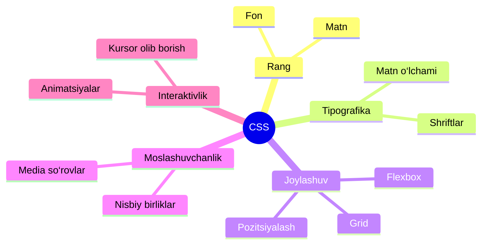
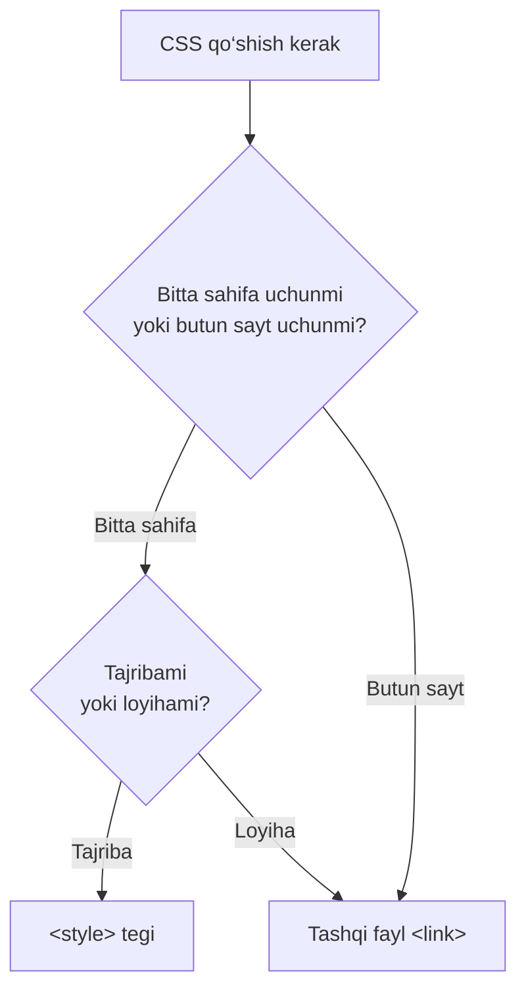

# CSS ga kirish. Sintaksis va ulash

[Mundarija](../../README.md) · [← HTML kursi](https://github.com/JLearn-space/JLearn-docs/tree/main/HTML) · [Keyingi →](../../Lesson-2/uz/Selektorlar%20va%20kaskad.md) · [RU](../ru/%D0%92%D0%B2%D0%B5%D0%B4%D0%B5%D0%BD%D0%B8%D0%B5%20%D0%B2%20CSS.%20%D0%A1%D0%B8%D0%BD%D1%82%D0%B0%D0%BA%D1%81%D0%B8%D1%81%20%D0%B8%20%D0%BF%D0%BE%D0%B4%D0%BA%D0%BB%D1%8E%D1%87%D0%B5%D0%BD%D0%B8%D0%B5.md) · [EN](../en/Introduction%20to%20CSS.%20Syntax%20and%20linking.md) · [UZ](CSS%20ga%20kirish.%20Sintaksis%20va%20ulash.md)

> **HTML kursi bilan bog‘liqlik:** «10 darsda HTML» kursida sahifalar karkasini qurdingiz: sarlavhalar, ro‘yxatlar, jadvallar, formalar - bitta ham rangsiz. Bugun shu karkasni kiyintirishni boshlaymiz.

---

## Bu sizga nima uchun kerak

HTML kursidagi sahifangizni oching. Oq fonda qora matn, standart shrift, hammasi chap chetga yopishgan. Ishlaydi, lekin 1995-yildagi hujjatga o‘xshaydi.

Endi istalgan zamonaviy saytni oching. Farq - bu CSS. Bugun birinchi uslublar faylini ulaysiz va 10 daqiqada sahifangizni ancha yoqimli qilasiz.

---

## Nimani o‘rganasiz

- CSS HTML dan nimasi bilan farq qilishini tushuntirish.
- Uslublarni uch usulda ulash va to‘g‘risini tanlash.
- Qoidani `selektor { xususiyat: qiymat; }` sxemasi bo‘yicha yozish.
- Bitta qoidani vergul orqali bir nechta tegga qo‘llash.
- CSS da izoh qoldirish.
- Uslublarni DevTools da «jonli» sinab ko‘rish.

---

## Takrorlash: HTML kursidan 3 savol

1. Tashqi uslublar fayli qaysi teg bilan ulanadi?
2. U hujjatning qaysi qismida yoziladi: `<head>` yoki `<body>`?
3. HTML `css` papkasi yonida tursa, shu papkadagi `style.css` fayliga qanday havola beriladi?

Javoblar - dars oxirida.

---

## Reja

| Bo‘lim | Nima qilamiz |
| --- | --- |
| CSS nima | Tana va kiyim |
| Ulashning uch usuli | Yorliq, xonadagi shkaf, umumiy kiyim xonasi |
| Qoida sintaksisi | Tikuvchiga ko‘rsatma |
| Mini-topshiriq 1 | Birinchi qoida |
| Guruhlar va izohlar | Bitta qoida - ko‘p teg |
| DevTools | Kiyib ko‘rish xonasi |
| Birinchi bezash | Faylni o‘z sahifangizga ulaymiz |
| Mini-topshiriq 2 | Uchta teg uchun uslublar |
| Mustaqil ish | IDE topshirig‘i va o‘z sahifangiz |

---

## CSS nima

**Oddiy qilib aytganda:** HTML - tana, CSS - kiyim. Bitta tanani rasmiy kostyumga ham, sport kiyimiga ham kiyintirish mumkin. Qo‘l va oyoqlar esa o‘z joyida qoladi.

| Texnologiya | Qaysi savolga javob beradi | Misol |
| --- | --- | --- |
| **HTML** | Bu **nima**? | «Bu sarlavha», «bu ro‘yxat» |
| **CSS** | Bu **qanday** ko‘rinadi? | «Sarlavha ko‘k, yirik, markazda» |

**CSS** (Cascading Style Sheets, kaskadli uslublar jadvallari) butun tashqi ko‘rinishni boshqaradi:

| Nima | Dars |
| --- | --- |
| Selektorlar va uslublarni qo‘llash tartibi | 2 |
| Ranglar, shriftlar, o‘lchamlar, fon | 3 |
| Chekinishlar, ramkalar, blok o‘lchamlari | 4 |
| Joylashuv: Flexbox va Grid | 5–6 |
| Pozitsiyalash | 7 |
| Telefonga moslashish | 8 |
| Kursor olib borish, silliq o‘tishlar, animatsiyalar | 9 |



**Sxemani qanday o‘qish kerak.** Shoxlar - CSS ning turli vazifalari. Ularning har biriga kursning alohida darsi bag‘ishlangan.

**Asosiy qoida:** ma’no - HTML da, tashqi ko‘rinish - CSS da. Mayda shrift uchun `<h3>` ni, chekinish uchun `<br>` ni olmang - endi buning uchun CSS bor.

---

## Ulashning uch usuli

| Usul | O‘xshatish | Qayerda yoziladi | Nimaga ta’sir qiladi |
| --- | --- | --- | --- |
| `style` atributi | Bitta ko‘ylakdagi yorliq | Teg ichida | Bitta element |
| `<style>` tegi | Bitta xonadagi shkaf | Sahifaning `<head>` ida | Bitta sahifa |
| `<link>` orqali fayl | Uyning umumiy kiyim xonasi | Alohida `.css` fayl | Ulangan barcha sahifalar |

### 1. `style` atributi

```html
<p style="color: red; font-size: 20px;">Qizil yirik matn</p>
```

**Kamchiliklari:** 20 ta bir xil abzats - 20 ta bir xil `style`. Tashqi ko‘rinish ma’no bilan aralashgan. Bunday uslub deyarli barcha boshqalaridan kuchli va ularni o‘zgartirishga xalaqit beradi.

### 2. `<style>` tegi

```html
<head>
    <meta charset="UTF-8">
    <title>Mening sahifam</title>
    <style>
        p {
            color: red;
        }
    </style>
</head>
```

**Afzalligi:** sahifaning barcha abzatslari uchun bitta qoida. **Kamchiligi:** faqat shu sahifada. Besh sahifa - besh nusxa.

### 3. `<link>` orqali tashqi fayl

**`css/style.css` fayli:**

```css
p {
    color: red;
}
```

**`index.html` fayli:**

```html
<head>
    <meta charset="UTF-8">
    <title>Mening sahifam</title>
    <link rel="stylesheet" href="css/style.css">
</head>
```

**Afzalliklari:**
- barcha sahifalar uchun bitta fayl: bir marta tuzatdingiz - hamma joyda o‘zgardi;
- HTML alohida, bezak alohida - ikkala faylni o‘qish osonroq;
- brauzer faylni bir marta yuklab, eslab qoladi: keyingi sahifalar tezroq ochiladi.

**Kurs qoidasi:** loyihalarda - tashqi fayl. `<style>` tegi - tajribalar va hammasi bitta faylda bo‘lgan IDE topshiriqlari uchun.



**Sxemani qanday o‘qish kerak.** Deyarli doim javob - tashqi fayl. `<style>` tegi - faqat bitta sahifada tez sinab ko‘rish uchun.

### Yangi o‘rganuvchilarning tipik xatolari

| Xato | Qanday tuzatish |
| --- | --- |
| Barcha uslublar `style=""` orqali | `css/style.css` fayliga ko‘chiring |
| `<link>` da `rel="stylesheet"` yo‘q | Usiz brauzer bu uslublar ekanini tushunmaydi |
| `href` da noto‘g‘ri yo‘l | Yo‘l HTML fayldan: `css/style.css` |
| `<body>` da `<style>` | `<head>` da yozing |
| `.css` fayl ichida HTML teglar | Uslublar faylida - faqat CSS |

---

## Qoida sintaksisi

```css
h1 {
    color: navy;
    font-size: 32px;
}
```

| Qism | Nomi | Nima qiladi |
| --- | --- | --- |
| `h1` | **Selektor** | Kimga qo‘llash: barcha `<h1>` larga |
| `{ ... }` | E’lonlar bloki | O‘zgarishlar ro‘yxati |
| `color` | **Xususiyat** | Nimani o‘zgartiramiz |
| `navy` | **Qiymat** | Nimaga o‘zgartiramiz |
| `color: navy;` | **E’lon** | Bitta «xususiyat: qiymat» jufti |

**O‘xshatish:** tikuvchiga ko‘rsatma berasiz: «Barcha ko‘ylaklarga (selektor): yoqasi ko‘k (xususiyat: qiymat), yenglari 60 sm (xususiyat: qiymat)».

**Nimani ko‘rasiz:** sahifadagi barcha `<h1>` sarlavhalar to‘q ko‘k va 32 piksel o‘lchamli bo‘ladi.

### Kursdagi yozuv uslubi

```css
selektor {
    xususiyat: qiymat;
}
```

- Ikki nuqta xususiyatdan **darhol** keyin, so‘ng **bitta bo‘shliq**.
- **Har bir** e’londan keyin nuqtali vergul, hatto oxirgisidan keyin ham.
- Har bir e’lon o‘z qatorida, 4 bo‘shliqli chekinish bilan.

Shunda kodni o‘qish osonroq va **platformadagi IDE uni aynan shunday tekshiradi**.

### Oxirgi e’londan keyin `;` nima uchun

```css
/* Xato: font-size dan keyin ; unutildi, keyin qator qo‘shildi */
h1 {
    color: navy;
    font-size: 32px
    font-weight: bold;
}
```

Brauzer `32px font-weight: bold` ni bitta g‘alati qiymat deb o‘qiydi va **ikkala** e’lonni **o‘tkazib yuboradi**. Har bir qator oxirida `;` bo‘lsa, bunday bo‘lmaydi.

### Buzib ko‘ring

1. Bir nechta e’lonli qoidada `color: navy` dan keyingi `;` ni o‘chiring. Nima yo‘qoldi?
2. Yopuvchi `}` ni o‘chiring. Fayldagi keyingi qoidalar bilan nima bo‘ldi?
3. `color` o‘rniga `colour` yozing. Brauzer xato bermaydi - u tushunarsiz xususiyatni shunchaki o‘tkazib yuboradi. DevTools ni oching: xususiyat ogohlantirish belgisi bilan chizilgan bo‘ladi.

---

## Mini-topshiriq 1

Qaramasdan qoida yozing: barcha `<h2>` ko‘k (`blue`) va `28px` o‘lchamli. Yechim - «Javoblar» bo‘limida.

---

## Guruhlar va izohlar

### Bir nechta teg uchun bitta qoida

```css
h1, h2, h3 {
    font-family: Georgia, serif;
}
```

Selektorlar vergul bilan - va blokni uch marta takrorlash shart emas. Kursda verguldan keyin bo‘shliq yozamiz.

### Izohlar

```css
/* Sahifa sarlavhalari */
h1 {
    color: navy; /* brend rangi */
}

p {
    color: #333333;
    /* font-size: 40px; - vaqtincha o‘chirilgan */
}
```

| Til | Izoh |
| --- | --- |
| HTML | `<!-- matn -->` |
| CSS | `/* matn */` |

Izoh yordam beradi:
- uslub nima uchun kerakligini tushuntirishga;
- e’lonni o‘chirmasdan vaqtincha o‘chirib qo‘yishga.

---

## DevTools: kiyib ko‘rish xonasi

**Oddiy qilib aytganda:** DevTools - do‘kondagi kiyib ko‘rish xonasi. Xohlaganingizcha kiyib ko‘rasiz, lekin uyga faqat sotib olganingiz bilan ketasiz. DevTools dagi o‘zgarishlar F5 dan keyin yo‘qoladi.

1. Sahifani ochib, F12 ni bosing.
2. **Elements** yorlig‘ida elementni bosing.
3. O‘ngda - **Styles** paneli: unga qo‘llanadigan barcha qoidalar.

| Nima qilish mumkin | Qanday |
| --- | --- |
| Qiymatni o‘zgartirish | Qiymatni bosib, yangisini kiritish |
| Xususiyat qo‘shish | Qoida ichidagi bo‘sh joyni bosish |
| Xususiyatni o‘chirish | Chapdagi belgini olib tashlash |
| Rang tanlash | Qiymat yonidagi rangli kvadratchani bosish |

**Qanday foydalanish:** fon rangini DevTools da 10 soniyada tanlaysiz, eng yaxshi variantni esa faylga ko‘chirasiz.

Styles dagi **chizilgan xususiyat** quyidagini bildiradi: uni boshqa qoida bosib ketgan yoki brauzer yozuvni tushunmagan. Nega bir qoida boshqasidan ustun keladi - 2-darsda.

---

## O‘z sahifangizni birinchi bezash

**1-qadam.** HTML kursidagi loyiha papkasida `css` papkasini va unda `style.css` faylini yarating.

**2-qadam.** Yozing:

```css
body {
    background-color: #f4f6fb;
    font-family: Arial, sans-serif;
}

h1 {
    color: #1e3a8a;
}

p {
    color: #333333;
    font-size: 18px;
}
```

**3-qadam.** Sahifaning `<head>` ida quyidagi borligini tekshiring:

```html
<link rel="stylesheet" href="css/style.css">
```

**4-qadam.** Sahifani Live Server orqali oching.

**Nimani ko‘rasiz:** och kulrang fon, to‘q ko‘k sarlavha, kertiksiz shrift, abzatslar biroz yirikroq.

Hech narsa o‘zgarmadimi? DevTools → **Network** ni oching, sahifani yangilang. `style.css` ning statusi **404** bo‘lsa - yo‘l yoki fayl nomida xato.

`#f4f6fb` va `#1e3a8a` - rang kodlari. Ular qanday tuzilgani - 3-darsda. Hozircha tayyorlarini olish yoki nomlarini yozish mumkin: `navy`, `teal`, `beige`.

---

## Mini-topshiriq 2

`style.css` ga `h1`, `h2` va `h3` sarlavhalarini `Georgia, serif` shrifti bilan - bitta qoida bilan - qiladigan qoida qo‘shing. Keyin shu e’lonni izoh bilan o‘chirib, yana yoqing. Yechim - «Javoblar» bo‘limida.

---

## Dars yakuni: shpargalka

| Vazifa | Yozuv |
| --- | --- |
| Uslublar faylini ulash | `<head>` da `<link rel="stylesheet" href="css/style.css">` |
| Bitta sahifadagi uslublar | `<head>` da `<style>...</style>` |
| Qoida | `selektor { xususiyat: qiymat; }` |
| Bir nechta teg | `h1, h2, h3 { ... }` |
| Izoh | `/* matn */` |
| Matn / fon rangi | `color` / `background-color` |
| Shrift / o‘lcham | `font-family` / `font-size` |
| Uslubni tekshirish | DevTools → Elements → Styles |

---

## Mustaqil ish

### 1-qism. IDE topshirig‘i (platforma hisoblaydi)

Muharrirda bezaksiz sahifa turibdi. `<head>` ga `<style>` tegini qo‘shing va qoidalarni yozing:

1. `body`: fon rangi (`background-color`) va shrift (`font-family`).
2. `h1, h2` **bitta qoida bilan**: o‘z matn rangingiz (`color`).
3. `p`: piksellardagi shrift o‘lchami (`font-size`), masalan `18px`.
4. Kamida bitta `/* ... */` izohi.

Kurs uslubida yozing: `xususiyat: qiymat;`. `style=""` atributini ishlatmang.

Platforma nimani tekshiradi: hujjatdagi `<style>` tegi, `body`, `h1, h2` guruhi va `p` uchun qoidalar, `background-color`, `font-family`, `color` xususiyatlari, `px` qiymatli `font-size`, CSS izohi, `style=""` atributi yo‘qligi.

### 2-qism. Kompyuterdagi loyiha

1. `css/style.css` ni HTML kursidagi sahifangizga ulang.
2. `body`, sarlavhalar va abzatslarni bezang.
3. DevTools da fon rangining uchta variantini tanlang va eng yaxshisini faylga ko‘chiring.
4. Xuddi shu faylni ikkinchi sahifaga ulang va uslublar u yerda ham qo‘llanganiga ishonch hosil qiling.

### Tayyorlik mezonlari

- [ ] IDE topshirig‘i qabul qilingan.
- [ ] Uslublar `<link>` orqali ulangan tashqi faylda.
- [ ] Network da `style.css` fayli 404 siz yuklanadi.
- [ ] Har bir e’lon `;` bilan tugaydi.
- [ ] Sarlavhalar bitta guruh qoidasi bilan bezatilgan.
- [ ] Bitta uslublar fayli ikki sahifada ishlaydi.

---

## O‘zini tekshirish uchun savollar

1. HTML va CSS vazifalari nimasi bilan farq qiladi?
2. CSS ni ulashning uch usulini ayting.
3. Nega loyihada tashqi fayl tanlanadi?
4. `p { color: red; }` qoidasi qaysi qismlardan iborat?
5. E’lon nima?
6. Oxirgi e’londan keyin `;` nima uchun kerak?
7. Bitta qoidani `h1` va `h2` ga qanday qo‘llash mumkin?
8. CSS da izoh qanday yoziladi?
9. F5 dan keyin DevTools dagi o‘zgarish bilan nima bo‘ladi?
10. Styles panelidagi chizilgan xususiyat nimani bildiradi?

Savollardan keyin platformada **dars testini** topshiring: 12 ta savol, o‘tish chegarasi 70%.

---

## Keyin nima

Hozircha teglarni butunlay bezadingiz: barcha `<p>` larni birdaniga. 2-darsda aniq elementlarni - sinf, `id`, ichma-ichlik bo‘yicha - tanlashni o‘rganamiz va bir nechta qoida bo‘lsa, qaysi biri ustun kelishini tushunib olamiz.

---

## Javoblar

**Takrorlash**

1. `<link rel="stylesheet" href="...">`.
2. `<head>` da.
3. `css/style.css`.

**Mini-topshiriq 1**

```css
h2 {
    color: blue;
    font-size: 28px;
}
```

**Mini-topshiriq 2**

```css
h1, h2, h3 {
    font-family: Georgia, serif;
}
```

Izoh bilan o‘chirish:

```css
h1, h2, h3 {
    /* font-family: Georgia, serif; */
}
```

**O‘zini tekshirish uchun savollar**

1. HTML sahifada nima borligini, CSS esa u qanday ko‘rinishini tasvirlaydi.
2. `style` atributi, `<style>` tegi, `<link>` orqali tashqi fayl.
3. Bitta fayl barcha sahifalarda ishlaydi, uni qo‘llab-quvvatlash oson, brauzer uni eslab qoladi.
4. `p` selektori, `color` xususiyati, `red` qiymati.
5. «xususiyat: qiymat;» jufti.
6. Keyinroq qo‘shilgan qator oldingisi bilan «yopishib» qolmasligi uchun.
7. `h1, h2 { ... }`.
8. `/* matn */`.
9. Yo‘qoladi: DevTools faylni o‘zgartirmaydi.
10. Uni boshqa qoida bosib ketgan yoki brauzer yozuvni tushunmagan.

---

[Mundarija](../../README.md) · [← HTML kursi](https://github.com/JLearn-space/JLearn-docs/tree/main/HTML) · [Keyingi →](../../Lesson-2/uz/Selektorlar%20va%20kaskad.md) · [RU](../ru/%D0%92%D0%B2%D0%B5%D0%B4%D0%B5%D0%BD%D0%B8%D0%B5%20%D0%B2%20CSS.%20%D0%A1%D0%B8%D0%BD%D1%82%D0%B0%D0%BA%D1%81%D0%B8%D1%81%20%D0%B8%20%D0%BF%D0%BE%D0%B4%D0%BA%D0%BB%D1%8E%D1%87%D0%B5%D0%BD%D0%B8%D0%B5.md) · [EN](../en/Introduction%20to%20CSS.%20Syntax%20and%20linking.md) · [UZ](CSS%20ga%20kirish.%20Sintaksis%20va%20ulash.md)
