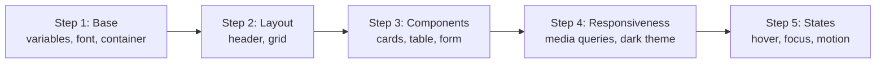
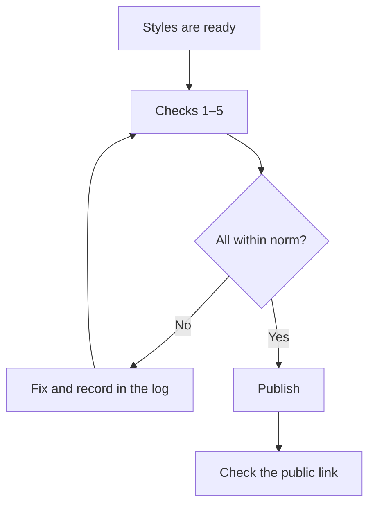

# Final project - full styling and publication

[Contents](../../README.md) · [← Back](../../Lesson-9/en/States%2C%20transitions%2C%20animations%20and%20variables.md) · [Project source code](../../final-project/README.md) · [RU](../ru/%D0%98%D1%82%D0%BE%D0%B3%D0%BE%D0%B2%D1%8B%D0%B9%20%D0%BF%D1%80%D0%BE%D0%B5%D0%BA%D1%82%20%E2%80%94%20%D0%BF%D0%BE%D0%BB%D0%BD%D0%B0%D1%8F%20%D1%81%D1%82%D0%B8%D0%BB%D0%B8%D0%B7%D0%B0%D1%86%D0%B8%D1%8F%20%D0%B8%20%D0%BF%D1%83%D0%B1%D0%BB%D0%B8%D0%BA%D0%B0%D1%86%D0%B8%D1%8F.md) · [EN](Final%20project%20-%20full%20styling%20and%20publication.md) · [UZ](../uz/Yakuniy%20loyiha%20-%20to%27liq%20bezash%20va%20nashr.md)

> **Link to previous lessons:** there are no new properties. You take the site from the HTML course's final project and style it completely: from variables to animations. Then you update the published version.

---

## Why you need this

In the HTML course you published a four-page site. It is correct, but it looks like a document. Today it becomes a site you are not ashamed to show: tidy on a computer, convenient on a phone, with a dark theme and lively buttons.

And all of it with one file, `css/style.css`, barely touching the HTML.

---

## What you will learn

- Start styling with variables: colors, rounding, shadows.
- Build styles in layers: base → layout → components → responsiveness → states.
- Style semantic tags without extra classes.
- Check the result: screen width, keyboard, contrast, dark theme, validator.
- Update the published site on GitHub Pages.

---

## Review: 3 questions from Lessons 8–9

1. Why are `min-width` media queries written from smaller to larger?
2. Where are CSS variables declared?
3. Why are animations put inside `@media (prefers-reduced-motion: no-preference)`?

Answers are at the end of the lesson.

---

## Lesson plan

| Section | What we do |
| --- | --- |
| Source code | Where the sample is |
| Styling plan | The palette before the brush |
| Steps 1–5 | Style layer by layer |
| Checking | Five checks before publishing |
| Publication | Update GitHub Pages |
| Independent work | IDE task |
| Independent final exam | Your own site |

---

## Project source code

The sample is in the [final-project](../../final-project/README.md) folder (the sample texts are in Russian):

```
final-project/
├── starter/          ← the site from the HTML course, empty style.css
├── steps/
│   ├── 01-base/
│   ├── 02-layout/
│   ├── 03-components/
│   ├── 04-responsive/
│   └── 05-states/    ← after step 5
└── final/            ← finished site
```

Only two things were added to the HTML: the class `skip-link` on the skip-menu link and the wrapper `<div class="cards">` around the projects. Everything else is styled through the semantic tags from the HTML course: `header`, `nav`, `main`, `article`, `table`, `form`.

**How to use it:** do a step on **your own** site, then compare your `style.css` with the step's file. Do not copy: compare and explain the difference.

---

## Styling plan

**In simple terms:** an artist first lays out the paints on the palette and only then picks up the brush. Decide in advance:

| What | Example from the sample |
| --- | --- |
| Primary color | `#1e3a8a` - dark blue |
| Accent for focus | `#f59e0b` - orange |
| Page and card background | `#f8fafc` and `#ffffff` |
| Text and secondary text color | `#1f2937` and `#475569` |
| Rounding and shadow | `12px`, a soft 8% shadow |
| Font | System: `"Segoe UI", Roboto, Arial, sans-serif` |

Check the contrast of every "text - background" pair: at least 4.5:1 (Lesson 3).



**How to read the diagram.** Each layer rests on the previous one. The style file follows the same order, and comments separate the layers.

---

## Step 1. Base

Variables, `box-sizing`, font, fluid images, a centered column:

```css
:root {
    --primary: #1e3a8a;
    --primary-dark: #172554;
    --accent: #f59e0b;
    --bg: #f8fafc;
    --surface: #ffffff;
    --text: #1f2937;
    --muted: #475569;
    --border: #cbd5e1;
    --radius: 12px;
    --shadow: 0 4px 12px rgb(0 0 0 / 8%);
}

* {
    box-sizing: border-box;
}

body {
    margin: 0;
    font-family: "Segoe UI", Roboto, Arial, sans-serif;
    font-size: 1rem;
    line-height: 1.6;
    color: var(--text);
    background-color: var(--bg);
}

h1 {
    font-size: clamp(1.75rem, 4vw + 1rem, 2.75rem);
}

img {
    max-width: 100%;
    height: auto;
}

main {
    max-width: 960px;
    margin: 0 auto;
    padding: 24px 16px 48px;
}
```

### The skip-menu link: visible only on focus

```css
.skip-link {
    position: absolute;
    left: 16px;
    top: -48px;
    padding: 8px 16px;
    background-color: var(--primary);
    color: white;
    z-index: 100;
}

.skip-link:focus {
    top: 8px;
}
```

**What you will see:** the link is not visible. Press Tab - it slides out in the top-left corner. This way the link does not bother mouse users and helps those who navigate with the keyboard (Lesson 8 of the HTML course).

Compare: `steps/01-base`.

---

## Step 2. Layout

A sticky header with Flexbox and a project grid with Grid - for the phone for now:

```css
body > header {
    position: sticky;
    top: 0;
    z-index: 10;
    display: flex;
    flex-direction: column;
    gap: 8px;
    padding: 12px 16px;
    background-color: var(--surface);
    box-shadow: var(--shadow);
}

nav ul {
    display: flex;
    flex-wrap: wrap;
    gap: 4px 16px;
    margin: 0;
    padding: 0;
    list-style: none;
}

.cards {
    display: grid;
    grid-template-columns: 1fr;
    gap: 24px;
}
```

**`body > header`** is only the site header, not a `<header>` inside articles.

Compare: `steps/02-layout`.

---

## Step 3. Components

Section cards, the table, the form, the button:

```css
section, article {
    margin-bottom: 24px;
    padding: 24px;
    background-color: var(--surface);
    border-radius: var(--radius);
    box-shadow: var(--shadow);
}

table {
    width: 100%;
    border-collapse: collapse;
}

th, td {
    padding: 8px 6px;
    border-bottom: 1px solid var(--border);
    text-align: left;
}

td a {
    overflow-wrap: anywhere;
}

input, textarea {
    width: 100%;
    padding: 10px 12px;
    border: 1px solid var(--border);
    border-radius: 8px;
    font: inherit;
}

button {
    padding: 12px 24px;
    border: none;
    border-radius: 8px;
    background-color: var(--primary);
    color: white;
    font: inherit;
    font-weight: 600;
    cursor: pointer;
}
```

| New | Why |
| --- | --- |
| `border-collapse: collapse` | Double cell borders merge into one |
| `overflow-wrap: anywhere` on links in the table | A long email wraps, and the table does not stick out of a phone screen |
| `font: inherit` on fields and the button | Form fields do not inherit the page font by default |
| `cursor: pointer` | A hand cursor over the button |

Compare: `steps/03-components`.

---

## Step 4. Responsiveness and dark theme

```css
@media (min-width: 600px) {
    body > header {
        flex-direction: row;
        justify-content: space-between;
        align-items: center;
        padding: 12px 24px;
    }

    .cards {
        grid-template-columns: repeat(2, 1fr);
    }

    th, td {
        padding: 8px 12px;
    }
}

@media (prefers-color-scheme: dark) {
    :root {
        --primary: #93c5fd;
        --primary-dark: #bfdbfe;
        --bg: #0f172a;
        --surface: #1e293b;
        --text: #e2e8f0;
        --muted: #94a3b8;
        --border: #334155;
    }
}
```

**This is why we set variables in step 1:** a dark theme is just new values for the variables. No rule has to be rewritten.

Compare: `steps/04-responsive`.

---

## Step 5. States and motion

```css
nav a:hover {
    color: var(--primary-dark);
}

button:hover {
    background-color: var(--primary-dark);
}

a:focus-visible, button:focus-visible, input:focus-visible, textarea:focus-visible {
    outline: 3px solid var(--accent);
    outline-offset: 2px;
}

.cards article:hover {
    transform: translateY(-4px);
    box-shadow: 0 12px 24px rgb(0 0 0 / 12%);
}

@media (prefers-reduced-motion: no-preference) {
    nav a, button, .cards article {
        transition: color 0.2s ease, background-color 0.2s ease, transform 0.2s ease, box-shadow 0.2s ease;
    }

    main {
        animation: fade-in 0.5s ease-out;
    }
}
```

`@keyframes fade-in` - as in Lesson 9. Motion goes only inside `no-preference`.

Compare: `steps/05-states` - this is the finished site.

---

## Checking before publishing

| № | What | How | Norm |
| --- | --- | --- | --- |
| 1 | Width | Device mode: 320, 390, 768, 1280px | No horizontal scrolling |
| 2 | Keyboard | Tab through every page | The skip link slides out, focus is visible everywhere |
| 3 | Contrast | DevTools palette or WebAIM, light and dark theme | ≥ 4.5:1 |
| 4 | Motion | DevTools → Rendering → `prefers-reduced-motion: reduce` | No animations |
| 5 | Validator | [Nu HTML Checker](https://validator.w3.org/nu/) with **CSS** ticked | No errors |

Lighthouse (Lesson 9 of the HTML course) - for the final Accessibility score.



**How to read the diagram.** The checks repeat until all five pass. After publishing, check the site once more via the public link.

---

## Publication: updating the site on GitHub Pages

The site was already published in the HTML course. To update it:

1. Open the site's repository on GitHub.
2. **Add file → Upload files**.
3. Drag in the `css` folder and the changed HTML files.
4. **Commit changes**.
5. After 1–3 minutes open the public link and reload the page bypassing the cache: Ctrl+Shift+R (on macOS: Cmd+Shift+R).

The styles did not appear? Check in Network that `css/style.css` has no 404, and that the letter case in the folder and file names matches.

---

## Independent work

### IDE task (graded by the platform)

Style **the contacts page of your own** club, study group or library in `<style>`:

1. `:root` with color variables; use them via `var()`.
2. `* { box-sizing: border-box; }` and `img { max-width: 100%; }`.
3. `main`: a centered `max-width` column.
4. The header `body > header`: Flexbox, `position: sticky`, a column on a phone, a row from 600px.
5. Table: `border-collapse: collapse`.
6. Fields: `width: 100%`, `font: inherit`; fields and the button get `:focus-visible` with `outline`.
7. A dark theme via `prefers-color-scheme: dark` and variables.
8. Motion only inside `prefers-reduced-motion: no-preference`.

What the platform checks: everything listed above, `@media (min-width: 600px)`, no `!important`, no `outline: none`, no `@media (max-width`, no `style=""` and none of the sample's text ("Aziz").

---

## Independent final exam

Style the site you made for the independent exam of the HTML course: a four-page club, library or study group. Your own design, not a copy of the sample.

**It must have:**
- variables for colors and a dark theme;
- a layout with Flexbox and Grid, mobile first;
- a styled table and form;
- `:hover` and `:focus-visible` on all links and buttons;
- one animation or smooth transitions, respecting `prefers-reduced-motion`;
- an updated publication on GitHub Pages.

**What to submit:** the link to the published site, the `style.css` file and the check log (the five checks from the table above).

| Criterion | Points |
| --- | ---: |
| Base and variables | 15 |
| Layout: Flexbox and Grid | 20 |
| Components: cards, table, form | 15 |
| Responsiveness and dark theme | 20 |
| States, focus and motion | 15 |
| Checks, publication and log | 15 |

**Pass:** 80 points or more out of 100. Required: no horizontal scrolling at 320px, focus visible on all interactive elements, body text contrast ≥ 4.5:1.

**Oral defense:** show how the site rearranges as the window narrows, go through a page with the keyboard and explain why the animations sit inside `no-preference`.

---

## Self-check questions

1. Why does styling start with variables?
2. In which order do the layers of the style file go?
3. Why `body > header` and not just `header`?
4. How do you hide the skip-menu link but show it on focus?
5. Why `font: inherit` on form fields?
6. What does `border-collapse: collapse` do?
7. How do you make a dark theme without rewriting rules?
8. What do you check at 320px width?
9. Why might the styles not appear after publishing?
10. How do you check that animations switch off for those who asked to reduce motion?

After the questions, take the **lesson test** on the platform: 12 questions, pass threshold 70%.

---

## Answers

**Review**

1. Otherwise the lower rule for a smaller width overrides the rule for a larger one.
2. In `:root`.
3. That way only those who did not ask to reduce motion get it, and there is no need to override animations by specificity.

**Self-check questions**

1. Colors and sizes are decided once, and a dark theme is simply new values.
2. Base, layout, components, responsiveness, states.
3. To style only the site header, not a `<header>` inside articles.
4. Move it past the top edge (`top: -48px`) and bring it back on `:focus` (`top: 8px`).
5. Form fields do not inherit the page font by default.
6. It merges the double borders of neighboring cells into one.
7. Redefine the variable values in `@media (prefers-color-scheme: dark)`.
8. No horizontal scrolling, readable text, tables and images not sticking out.
9. A 404 on `style.css`: a mistake in the path or letter case, or an old cache.
10. DevTools → Rendering → emulate `prefers-reduced-motion: reduce`.

---

[Contents](../../README.md) · [← Back](../../Lesson-9/en/States%2C%20transitions%2C%20animations%20and%20variables.md) · [Project source code](../../final-project/README.md) · [RU](../ru/%D0%98%D1%82%D0%BE%D0%B3%D0%BE%D0%B2%D1%8B%D0%B9%20%D0%BF%D1%80%D0%BE%D0%B5%D0%BA%D1%82%20%E2%80%94%20%D0%BF%D0%BE%D0%BB%D0%BD%D0%B0%D1%8F%20%D1%81%D1%82%D0%B8%D0%BB%D0%B8%D0%B7%D0%B0%D1%86%D0%B8%D1%8F%20%D0%B8%20%D0%BF%D1%83%D0%B1%D0%BB%D0%B8%D0%BA%D0%B0%D1%86%D0%B8%D1%8F.md) · [EN](Final%20project%20-%20full%20styling%20and%20publication.md) · [UZ](../uz/Yakuniy%20loyiha%20-%20to%27liq%20bezash%20va%20nashr.md)
