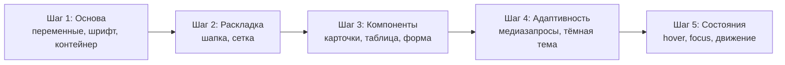
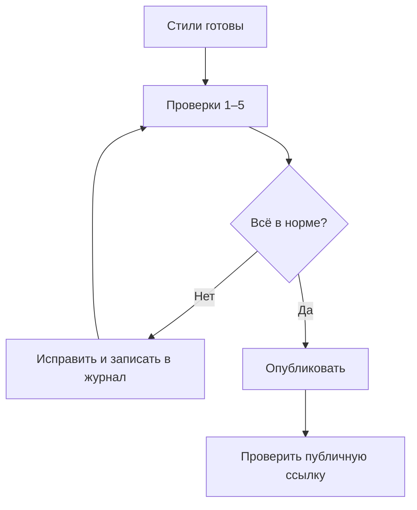

# Итоговый проект — полная стилизация и публикация

[Содержание](../../README.md) · [← Назад](../../Lesson-9/ru/%D0%A1%D0%BE%D1%81%D1%82%D0%BE%D1%8F%D0%BD%D0%B8%D1%8F%2C%20%D0%BF%D0%B5%D1%80%D0%B5%D1%85%D0%BE%D0%B4%D1%8B%2C%20%D0%B0%D0%BD%D0%B8%D0%BC%D0%B0%D1%86%D0%B8%D0%B8%20%D0%B8%20%D0%BF%D0%B5%D1%80%D0%B5%D0%BC%D0%B5%D0%BD%D0%BD%D1%8B%D0%B5.md) · [Следующий курс: JavaScript →](https://github.com/JLearn-space/JLearn-docs/tree/main/JavaScript) · [Исходный код проекта](../../final-project/README.md) · [RU](%D0%98%D1%82%D0%BE%D0%B3%D0%BE%D0%B2%D1%8B%D0%B9%20%D0%BF%D1%80%D0%BE%D0%B5%D0%BA%D1%82%20%E2%80%94%20%D0%BF%D0%BE%D0%BB%D0%BD%D0%B0%D1%8F%20%D1%81%D1%82%D0%B8%D0%BB%D0%B8%D0%B7%D0%B0%D1%86%D0%B8%D1%8F%20%D0%B8%20%D0%BF%D1%83%D0%B1%D0%BB%D0%B8%D0%BA%D0%B0%D1%86%D0%B8%D1%8F.md) · [EN](../en/Final%20project%20-%20full%20styling%20and%20publication.md) · [UZ](../uz/Yakuniy%20loyiha%20-%20to%27liq%20bezash%20va%20nashr.md)

> **Связь с прошлыми уроками:** новых свойств не будет. Вы возьмёте сайт из итогового проекта курса HTML и оформите его целиком: от переменных до анимаций. А потом обновите опубликованную версию.

---

## Зачем это вам

В курсе HTML вы опубликовали сайт из четырёх страниц. Он правильный, но выглядит как документ. Сегодня он станет сайтом, который не стыдно показать: аккуратным на компьютере, удобным на телефоне, с тёмной темой и живыми кнопками.

И всё это - одним файлом `css/style.css`, почти не трогая HTML.

---

## Чему вы научитесь

- Начинать оформление с переменных: цвета, скругления, тени.
- Собирать стили по слоям: основа → раскладка → компоненты → адаптивность → состояния.
- Оформлять семантические теги без лишних классов.
- Проверять результат: ширина экрана, клавиатура, контраст, тёмная тема, валидатор.
- Обновлять опубликованный сайт на GitHub Pages.

---

## Повторение: 3 вопроса из уроков 8–9

1. Почему медиазапросы с `min-width` пишут от меньшего к большему?
2. Где объявляют переменные CSS?
3. Почему анимации кладут внутрь `@media (prefers-reduced-motion: no-preference)`?

Ответы - в конце урока.

---

## План урока

| Раздел | Что делаем |
| --- | --- |
| Исходный код | Где лежит образец |
| План оформления | Палитра до кисти |
| Шаги 1–5 | Оформляем по слоям |
| Проверка | Пять проверок перед публикацией |
| Публикация | Обновляем GitHub Pages |
| Самостоятельная работа | Задание в IDE |
| Независимый итоговый экзамен | Свой сайт |

---

## Исходный код проекта

Образец - в папке [final-project](../../final-project/README.md):

```
final-project/
├── starter/          ← сайт из курса HTML, пустой style.css
├── steps/
│   ├── 01-base/
│   ├── 02-layout/
│   ├── 03-components/
│   ├── 04-responsive/
│   └── 05-states/    ← после шага 5
└── final/            ← готовый сайт
```

В HTML добавлены только две вещи: класс `skip-link` у ссылки пропуска меню и обёртка `<div class="cards">` вокруг проектов. Всё остальное оформлено по семантическим тегам из курса HTML: `header`, `nav`, `main`, `article`, `table`, `form`.

**Как пользоваться:** делаете шаг на **своём** сайте, затем сравниваете свой `style.css` с файлом шага. Не копируйте: сравнивайте и объясняйте разницу.

---

## План оформления

**Простыми словами:** художник сначала раскладывает краски на палитре, а потом берёт кисть. Решите заранее:

| Что | Пример из образца |
| --- | --- |
| Основной цвет | `#1e3a8a` - тёмно-синий |
| Акцент для фокуса | `#f59e0b` - оранжевый |
| Фон страницы и карточек | `#f8fafc` и `#ffffff` |
| Цвет текста и второстепенного текста | `#1f2937` и `#475569` |
| Скругление и тень | `12px`, мягкая тень 8% |
| Шрифт | Системный: `"Segoe UI", Roboto, Arial, sans-serif` |

Проверьте контраст каждой пары «текст - фон»: не меньше 4.5:1 (урок 3).



**Как читать схему.** Каждый слой опирается на предыдущий. Файл стилей идёт в том же порядке, а комментарии разделяют слои.

---

## Шаг 1. Основа

Переменные, `box-sizing`, шрифт, резиновые картинки, колонка по центру:

```css
:root {
    --primary: #1e3a8a;
    --primary-dark: #172554;
    --accent: #f59e0b;
    --bg: #f8fafc;
    --surface: #ffffff;
    --text: #1f2937;
    --muted: #475569;
    --border: #cbd5e1;
    --radius: 12px;
    --shadow: 0 4px 12px rgb(0 0 0 / 8%);
}

* {
    box-sizing: border-box;
}

body {
    margin: 0;
    font-family: "Segoe UI", Roboto, Arial, sans-serif;
    font-size: 1rem;
    line-height: 1.6;
    color: var(--text);
    background-color: var(--bg);
}

h1 {
    font-size: clamp(1.75rem, 4vw + 1rem, 2.75rem);
}

img {
    max-width: 100%;
    height: auto;
}

main {
    max-width: 960px;
    margin: 0 auto;
    padding: 24px 16px 48px;
}
```

### Ссылка пропуска меню: видна только в фокусе

```css
.skip-link {
    position: absolute;
    left: 16px;
    top: -48px;
    padding: 8px 16px;
    background-color: var(--primary);
    color: white;
    z-index: 100;
}

.skip-link:focus {
    top: 8px;
}
```

**Что увидите:** ссылки не видно. Нажмите Tab - она выезжает в левом верхнем углу. Так ссылка не мешает тем, кто пользуется мышью, и помогает тем, кто ходит клавиатурой (урок 8 курса HTML).

Сравните: `steps/01-base`.

---

## Шаг 2. Раскладка

Липкая шапка на Flexbox и сетка проектов на Grid - пока для телефона:

```css
body > header {
    position: sticky;
    top: 0;
    z-index: 10;
    display: flex;
    flex-direction: column;
    gap: 8px;
    padding: 12px 16px;
    background-color: var(--surface);
    box-shadow: var(--shadow);
}

nav ul {
    display: flex;
    flex-wrap: wrap;
    gap: 4px 16px;
    margin: 0;
    padding: 0;
    list-style: none;
}

.cards {
    display: grid;
    grid-template-columns: 1fr;
    gap: 24px;
}
```

**`body > header`** - только шапка сайта, а не `<header>` внутри статей.

Сравните: `steps/02-layout`.

---

## Шаг 3. Компоненты

Карточки разделов, таблица, форма, кнопка:

```css
section, article {
    margin-bottom: 24px;
    padding: 24px;
    background-color: var(--surface);
    border-radius: var(--radius);
    box-shadow: var(--shadow);
}

table {
    width: 100%;
    border-collapse: collapse;
}

th, td {
    padding: 8px 6px;
    border-bottom: 1px solid var(--border);
    text-align: left;
}

td a {
    overflow-wrap: anywhere;
}

input, textarea {
    width: 100%;
    padding: 10px 12px;
    border: 1px solid var(--border);
    border-radius: 8px;
    font: inherit;
}

button {
    padding: 12px 24px;
    border: none;
    border-radius: 8px;
    background-color: var(--primary);
    color: white;
    font: inherit;
    font-weight: 600;
    cursor: pointer;
}
```

| Новое | Зачем |
| --- | --- |
| `border-collapse: collapse` | Двойные рамки ячеек сливаются в одну |
| `overflow-wrap: anywhere` у ссылок в таблице | Длинный email переносится, и таблица не вылезает за экран телефона |
| `font: inherit` у полей и кнопки | Поля формы по умолчанию не наследуют шрифт страницы |
| `cursor: pointer` | Курсор-рука над кнопкой |

Сравните: `steps/03-components`.

---

## Шаг 4. Адаптивность и тёмная тема

```css
@media (min-width: 600px) {
    body > header {
        flex-direction: row;
        justify-content: space-between;
        align-items: center;
        padding: 12px 24px;
    }

    .cards {
        grid-template-columns: repeat(2, 1fr);
    }

    th, td {
        padding: 8px 12px;
    }
}

@media (prefers-color-scheme: dark) {
    :root {
        --primary: #93c5fd;
        --primary-dark: #bfdbfe;
        --bg: #0f172a;
        --surface: #1e293b;
        --text: #e2e8f0;
        --muted: #94a3b8;
        --border: #334155;
    }
}
```

**Вот зачем переменные с шага 1:** тёмная тема - это просто новые значения переменных. Ни одно правило переписывать не нужно.

Сравните: `steps/04-responsive`.

---

## Шаг 5. Состояния и движение

```css
nav a:hover {
    color: var(--primary-dark);
}

button:hover {
    background-color: var(--primary-dark);
}

a:focus-visible, button:focus-visible, input:focus-visible, textarea:focus-visible {
    outline: 3px solid var(--accent);
    outline-offset: 2px;
}

.cards article:hover {
    transform: translateY(-4px);
    box-shadow: 0 12px 24px rgb(0 0 0 / 12%);
}

@media (prefers-reduced-motion: no-preference) {
    nav a, button, .cards article {
        transition: color 0.2s ease, background-color 0.2s ease, transform 0.2s ease, box-shadow 0.2s ease;
    }

    main {
        animation: fade-in 0.5s ease-out;
    }
}
```

`@keyframes fade-in` - как в уроке 9. Движение - только внутри `no-preference`.

Сравните: `steps/05-states` - это и есть готовый сайт.

---

## Проверка перед публикацией

| № | Что | Как | Норма |
| --- | --- | --- | --- |
| 1 | Ширина | Режим устройства: 320, 390, 768, 1280px | Нет горизонтальной прокрутки |
| 2 | Клавиатура | Tab по каждой странице | Ссылка пропуска выезжает, фокус виден везде |
| 3 | Контраст | Палитра DevTools или WebAIM, светлая и тёмная тема | ≥ 4.5:1 |
| 4 | Движение | DevTools → Rendering → `prefers-reduced-motion: reduce` | Анимаций нет |
| 5 | Валидатор | [Nu HTML Checker](https://validator.w3.org/nu/) с отметкой **CSS** | Ошибок нет |

Lighthouse (урок 9 курса HTML) - для итоговой оценки Accessibility.



**Как читать схему.** Проверки повторяются, пока все пять не пройдут. После публикации проверьте сайт ещё раз по публичной ссылке.

### Попробуйте сломать

Каждый опыт ломает одну из проверок 1–5. Посмотрите, как поломка выглядит, и верните код:

1. Удалите `* { box-sizing: border-box; }`. Поля формы с `width: 100%` вылезают за правый край карточки: к ширине прибавились `padding` и рамка.
2. Удалите `img { max-width: 100%; }` и выберите в режиме устройства ширину 320px. Появилась горизонтальная прокрутка - проверка 1 не пройдена.
3. Замените `.skip-link:focus` на `.skip-link:hover`. Нажмите Tab: фокус на ссылке пропуска, но её не видно - проверка 2 не пройдена.
4. У `button` замените `var(--primary)` на `#1e3a8a`. Включите тёмную тему (DevTools → **Rendering** → `prefers-color-scheme: dark`). Страница перекрасилась, а кнопка - нет.
5. Вынесите `transition` из блока `no-preference` и включите `prefers-reduced-motion: reduce`. Карточки всё равно плавно поднимаются - проверка 4 не пройдена.
6. Удалите `font: inherit` у `input, textarea`. Текст в полях стал другим шрифтом и мельче, чем на странице.

### Частые ошибки новичков

| Ошибка | Что получится | Как исправить |
| --- | --- | --- |
| `href="style.css"`, а файл лежит в папке `css/` | Страница без оформления, в Network `404` | `<link rel="stylesheet" href="css/style.css">` |
| Цвета записаны прямо в правилах, мимо переменных | Тёмная тема перекрашивает страницу только частично | Все цвета - через `var(--...)` |
| `header { position: sticky; }` вместо `body > header` | Липкими становятся и `<header>` внутри статей | `body > header` |
| Нет `box-sizing: border-box` | Поля с `width: 100%` шире карточки | `* { box-sizing: border-box; }` |
| Нет `overflow-wrap: anywhere` у ссылок в таблице | Длинный email растягивает таблицу, на 320px появляется горизонтальная прокрутка | `td a { overflow-wrap: anywhere; }` |
| `outline: none` у ссылок и кнопок | Пользователь клавиатуры не видит фокус; платформа не засчитает задание | `:focus-visible` с `outline: 3px solid var(--accent)` |
| `transition` и `animation` вне `no-preference` | Движение видят и те, кто просил его уменьшить | Внутри `@media (prefers-reduced-motion: no-preference)` |
| `@media (max-width: 600px)`: сначала широкий экран | Правила перебивают друг друга; платформа не засчитает задание | Mobile-first: `@media (min-width: 600px)` |
| Опечатка в свойстве: `colr: red;` | DevTools зачёркивает строку и пишет `Unknown property name` | Исправьте имя свойства |

---

## Публикация: обновить сайт на GitHub Pages

Сайт уже опубликован в курсе HTML. Обновить его:

1. Откройте репозиторий сайта на GitHub.
2. **Add file → Upload files**.
3. Перетащите папку `css` и изменённые HTML-файлы.
4. **Commit changes**.
5. Через 1–3 минуты откройте публичную ссылку и обновите страницу с очисткой кэша: Ctrl+Shift+R (на macOS: Cmd+Shift+R).

Стили не появились? Проверьте в Network, нет ли 404 у `css/style.css`, и совпадает ли регистр букв в имени папки и файла.

---

## Самостоятельная работа

### Задание в IDE (засчитывается платформой)

Оформите **страницу контактов своего** клуба, кружка или библиотеки в `<style>`:

1. `:root` с переменными цветов; используйте их через `var()`.
2. `* { box-sizing: border-box; }` и `img { max-width: 100%; }`.
3. `main`: колонка `max-width` по центру.
4. Шапка `body > header`: Flexbox, `position: sticky`, на телефоне столбиком, от 600px в ряд.
5. Таблица: `border-collapse: collapse`.
6. Поля: `width: 100%`, `font: inherit`; у полей и кнопки - `:focus-visible` с `outline`.
7. Тёмная тема через `prefers-color-scheme: dark` и переменные.
8. Движение - только внутри `prefers-reduced-motion: no-preference`.

Что проверяет платформа: всё перечисленное, `@media (min-width: 600px)`, отсутствие `!important`, `outline: none`, `@media (max-width`, `style=""` и текста образца («Азиз»).

---

## Независимый итоговый экзамен

Оформите сайт, который вы сделали на независимом экзамене курса HTML: клуб, библиотека или кружок из четырёх страниц. Свой дизайн, не копия образца.

**Что должно быть:**
- переменные для цветов и тёмная тема;
- раскладка на Flexbox и Grid, mobile-first;
- оформленные таблица и форма;
- `:hover` и `:focus-visible` у всех ссылок и кнопок;
- одна анимация или плавные переходы, с уважением к `prefers-reduced-motion`;
- обновлённая публикация на GitHub Pages.

**Что сдать:** ссылку на опубликованный сайт, файл `style.css` и журнал проверок (пять проверок из таблицы выше).

| Критерий | Баллы |
| --- | ---: |
| Основа и переменные | 15 |
| Раскладка: Flexbox и Grid | 20 |
| Компоненты: карточки, таблица, форма | 15 |
| Адаптивность и тёмная тема | 20 |
| Состояния, фокус и движение | 15 |
| Проверки, публикация и журнал | 15 |

**Зачёт:** от 80 баллов из 100. Обязательно: нет горизонтальной прокрутки на 320px, фокус виден на всех интерактивных элементах, контраст основного текста ≥ 4.5:1.

**Устная защита:** покажите, как сайт перестраивается при сужении окна, пройдите страницу клавиатурой и объясните, почему анимации лежат внутри `no-preference`.

---

## Вопросы для самопроверки

1. Почему оформление начинают с переменных?
2. В каком порядке идут слои файла стилей?
3. Зачем `body > header`, а не просто `header`?
4. Как спрятать ссылку пропуска меню, но показать её при фокусе?
5. Зачем `font: inherit` у полей формы?
6. Что делает `border-collapse: collapse`?
7. Как сделать тёмную тему, не переписывая правила?
8. Что проверить на ширине 320px?
9. Почему стили могли не появиться после публикации?
10. Как проверить, что анимации выключаются у тех, кто просил уменьшить движение?

После вопросов пройдите **тест урока** на платформе: 12 вопросов, порог 70%.

---

## Ответы

**Повторение**

1. Иначе нижнее правило для меньшей ширины перебьёт правило для большей.
2. В `:root`.
3. Так движение получают только те, кто не просил его уменьшить, и не нужно перебивать анимации по специфичности.

**Вопросы для самопроверки**

1. Цвета и размеры решаются один раз, а тёмная тема - это просто новые значения.
2. Основа, раскладка, компоненты, адаптивность, состояния.
3. Чтобы оформить только шапку сайта, а не `<header>` внутри статей.
4. Сдвинуть за верхний край (`top: -48px`), а в `:focus` вернуть (`top: 8px`).
5. Поля формы по умолчанию не наследуют шрифт страницы.
6. Сливает двойные рамки соседних ячеек в одну.
7. Переопределить значения переменных в `@media (prefers-color-scheme: dark)`.
8. Нет ли горизонтальной прокрутки, читается ли текст, не вылезают ли таблицы и картинки.
9. 404 у `style.css`: ошибка в пути или регистре букв, либо старый кэш.
10. DevTools → Rendering → эмуляция `prefers-reduced-motion: reduce`.

---

[Содержание](../../README.md) · [← Назад](../../Lesson-9/ru/%D0%A1%D0%BE%D1%81%D1%82%D0%BE%D1%8F%D0%BD%D0%B8%D1%8F%2C%20%D0%BF%D0%B5%D1%80%D0%B5%D1%85%D0%BE%D0%B4%D1%8B%2C%20%D0%B0%D0%BD%D0%B8%D0%BC%D0%B0%D1%86%D0%B8%D0%B8%20%D0%B8%20%D0%BF%D0%B5%D1%80%D0%B5%D0%BC%D0%B5%D0%BD%D0%BD%D1%8B%D0%B5.md) · [Следующий курс: JavaScript →](https://github.com/JLearn-space/JLearn-docs/tree/main/JavaScript) · [Исходный код проекта](../../final-project/README.md) · [RU](%D0%98%D1%82%D0%BE%D0%B3%D0%BE%D0%B2%D1%8B%D0%B9%20%D0%BF%D1%80%D0%BE%D0%B5%D0%BA%D1%82%20%E2%80%94%20%D0%BF%D0%BE%D0%BB%D0%BD%D0%B0%D1%8F%20%D1%81%D1%82%D0%B8%D0%BB%D0%B8%D0%B7%D0%B0%D1%86%D0%B8%D1%8F%20%D0%B8%20%D0%BF%D1%83%D0%B1%D0%BB%D0%B8%D0%BA%D0%B0%D1%86%D0%B8%D1%8F.md) · [EN](../en/Final%20project%20-%20full%20styling%20and%20publication.md) · [UZ](../uz/Yakuniy%20loyiha%20-%20to%27liq%20bezash%20va%20nashr.md)
