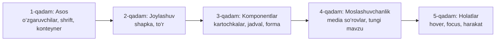
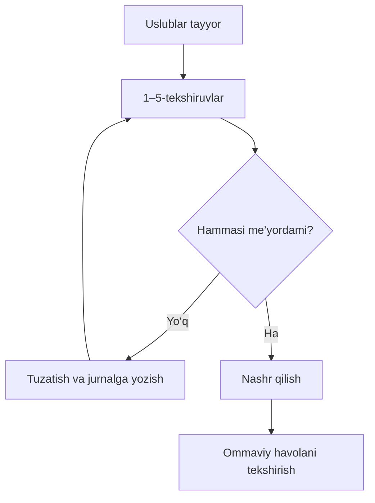

# Yakuniy loyiha - to‘liq bezash va nashr

[Mundarija](../../README.md) · [← Orqaga](../../Lesson-9/uz/Holatlar%2C%20o%27tishlar%2C%20animatsiyalar%20va%20o%27zgaruvchilar.md) · [Keyingi kurs: JavaScript →](https://github.com/JLearn-space/JLearn-docs/tree/main/JavaScript) · [Loyihaning boshlang‘ich kodi](../../final-project/README.md) · [RU](../ru/%D0%98%D1%82%D0%BE%D0%B3%D0%BE%D0%B2%D1%8B%D0%B9%20%D0%BF%D1%80%D0%BE%D0%B5%D0%BA%D1%82%20%E2%80%94%20%D0%BF%D0%BE%D0%BB%D0%BD%D0%B0%D1%8F%20%D1%81%D1%82%D0%B8%D0%BB%D0%B8%D0%B7%D0%B0%D1%86%D0%B8%D1%8F%20%D0%B8%20%D0%BF%D1%83%D0%B1%D0%BB%D0%B8%D0%BA%D0%B0%D1%86%D0%B8%D1%8F.md) · [EN](../en/Final%20project%20-%20full%20styling%20and%20publication.md) · [UZ](Yakuniy%20loyiha%20-%20to%27liq%20bezash%20va%20nashr.md)

> **Oldingi darslar bilan bog‘liqlik:** yangi xususiyatlar bo‘lmaydi. HTML kursi yakuniy loyihasidagi saytni olib, uni butunlay bezaysiz: o‘zgaruvchilardan animatsiyalargacha. Keyin esa nashr qilingan versiyani yangilaysiz.

---

## Bu sizga nima uchun kerak

HTML kursida to‘rt sahifali saytni nashr qildingiz. U to‘g‘ri, lekin hujjatga o‘xshaydi. Bugun u ko‘rsatishga uyalmaydigan saytga aylanadi: kompyuterda ozoda, telefonda qulay, tungi mavzu va jonli tugmalar bilan.

Va bularning hammasi - HTML ga deyarli tegmasdan, bitta `css/style.css` fayli bilan.

---

## Nimani o‘rganasiz

- Bezashni o‘zgaruvchilardan boshlash: ranglar, yumaloqlashlar, soyalar.
- Uslublarni qatlamma-qatlam yig‘ish: asos → joylashuv → komponentlar → moslashuvchanlik → holatlar.
- Semantik teglarni ortiqcha sinflarsiz bezash.
- Natijani tekshirish: ekran kengligi, klaviatura, kontrast, tungi mavzu, validator.
- GitHub Pages dagi nashr qilingan saytni yangilash.

---

## Takrorlash: 8–9-darslardan 3 savol

1. Nega `min-width` li media so‘rovlar kichikdan kattaga yoziladi?
2. CSS o‘zgaruvchilari qayerda e’lon qilinadi?
3. Nega animatsiyalar `@media (prefers-reduced-motion: no-preference)` ichiga qo‘yiladi?

Javoblar - dars oxirida.

---

## Reja

| Bo‘lim | Nima qilamiz |
| --- | --- |
| Boshlang‘ich kod | Namuna qayerda |
| Bezash rejasi | Mo‘yqalamdan oldin palitra |
| 1–5-qadamlar | Qatlamma-qatlam bezaymiz |
| Tekshiruv | Nashrdan oldin beshta tekshiruv |
| Nashr | GitHub Pages ni yangilaymiz |
| Mustaqil ish | IDE topshirig‘i |
| Mustaqil yakuniy imtihon | O‘z saytingiz |

---

## Loyihaning boshlang‘ich kodi

Namuna - [final-project](../../final-project/README.md) papkasida (namuna matnlari rus tilida):

```
final-project/
├── starter/          ← HTML kursidagi sayt, bo‘sh style.css
├── steps/
│   ├── 01-base/
│   ├── 02-layout/
│   ├── 03-components/
│   ├── 04-responsive/
│   └── 05-states/    ← 5-qadamdan keyin
└── final/            ← tayyor sayt
```

HTML ga faqat ikki narsa qo‘shilgan: menyuni o‘tkazib yuborish havolasidagi `skip-link` sinfi va loyihalar atrofidagi `<div class="cards">` o‘rami. Qolgan hammasi HTML kursidagi semantik teglar bo‘yicha bezatilgan: `header`, `nav`, `main`, `article`, `table`, `form`.

**Qanday foydalanish:** qadamni **o‘z** saytingizda bajarasiz, keyin `style.css` ingizni qadam fayli bilan solishtirasiz. Ko‘chirmang: solishtiring va farqni tushuntiring.

---

## Bezash rejasi

**Oddiy qilib aytganda:** rassom avval bo‘yoqlarni palitraga teradi, keyin mo‘yqalamni oladi. Oldindan hal qiling:

| Nima | Namunadan misol |
| --- | --- |
| Asosiy rang | `#1e3a8a` - to‘q ko‘k |
| Fokus uchun urg‘u | `#f59e0b` - to‘q sariq |
| Sahifa va kartochkalar foni | `#f8fafc` va `#ffffff` |
| Matn va ikkinchi darajali matn rangi | `#1f2937` va `#475569` |
| Yumaloqlash va soya | `12px`, 8% li yumshoq soya |
| Shrift | Tizim shrifti: `"Segoe UI", Roboto, Arial, sans-serif` |

Har bir «matn - fon» juftining kontrastini tekshiring: kamida 4.5:1 (3-dars).



**Sxemani qanday o‘qish kerak.** Har bir qatlam oldingisiga tayanadi. Uslublar fayli ham shu tartibda boradi, izohlar esa qatlamlarni ajratadi.

---

## 1-qadam. Asos

O‘zgaruvchilar, `box-sizing`, shrift, elastik rasmlar, markazdagi ustun:

```css
:root {
    --primary: #1e3a8a;
    --primary-dark: #172554;
    --accent: #f59e0b;
    --bg: #f8fafc;
    --surface: #ffffff;
    --text: #1f2937;
    --muted: #475569;
    --border: #cbd5e1;
    --radius: 12px;
    --shadow: 0 4px 12px rgb(0 0 0 / 8%);
}

* {
    box-sizing: border-box;
}

body {
    margin: 0;
    font-family: "Segoe UI", Roboto, Arial, sans-serif;
    font-size: 1rem;
    line-height: 1.6;
    color: var(--text);
    background-color: var(--bg);
}

h1 {
    font-size: clamp(1.75rem, 4vw + 1rem, 2.75rem);
}

img {
    max-width: 100%;
    height: auto;
}

main {
    max-width: 960px;
    margin: 0 auto;
    padding: 24px 16px 48px;
}
```

### Menyuni o‘tkazib yuborish havolasi: faqat fokusda ko‘rinadi

```css
.skip-link {
    position: absolute;
    left: 16px;
    top: -48px;
    padding: 8px 16px;
    background-color: var(--primary);
    color: white;
    z-index: 100;
}

.skip-link:focus {
    top: 8px;
}
```

**Nimani ko‘rasiz:** havola ko‘rinmaydi. Tab ni bosing - u chap yuqori burchakda chiqib keladi. Shunday qilib havola sichqonchadan foydalanuvchilarga xalaqit bermaydi va klaviatura bilan yuradiganlarga yordam beradi (HTML kursining 8-darsi).

Solishtiring: `steps/01-base`.

---

## 2-qadam. Joylashuv

Flexbox dagi yopishqoq shapka va Grid dagi loyihalar to‘ri - hozircha telefon uchun:

```css
body > header {
    position: sticky;
    top: 0;
    z-index: 10;
    display: flex;
    flex-direction: column;
    gap: 8px;
    padding: 12px 16px;
    background-color: var(--surface);
    box-shadow: var(--shadow);
}

nav ul {
    display: flex;
    flex-wrap: wrap;
    gap: 4px 16px;
    margin: 0;
    padding: 0;
    list-style: none;
}

.cards {
    display: grid;
    grid-template-columns: 1fr;
    gap: 24px;
}
```

**`body > header`** - maqolalar ichidagi `<header>` emas, faqat sayt shapkasi.

Solishtiring: `steps/02-layout`.

---

## 3-qadam. Komponentlar

Bo‘lim kartochkalari, jadval, forma, tugma:

```css
section, article {
    margin-bottom: 24px;
    padding: 24px;
    background-color: var(--surface);
    border-radius: var(--radius);
    box-shadow: var(--shadow);
}

table {
    width: 100%;
    border-collapse: collapse;
}

th, td {
    padding: 8px 6px;
    border-bottom: 1px solid var(--border);
    text-align: left;
}

td a {
    overflow-wrap: anywhere;
}

input, textarea {
    width: 100%;
    padding: 10px 12px;
    border: 1px solid var(--border);
    border-radius: 8px;
    font: inherit;
}

button {
    padding: 12px 24px;
    border: none;
    border-radius: 8px;
    background-color: var(--primary);
    color: white;
    font: inherit;
    font-weight: 600;
    cursor: pointer;
}
```

| Yangi | Nima uchun |
| --- | --- |
| `border-collapse: collapse` | Kataklarning qo‘sh ramkalari bittaga qo‘shiladi |
| Jadvaldagi havolalarda `overflow-wrap: anywhere` | Uzun email ko‘chiriladi va jadval telefon ekranidan chiqmaydi |
| Maydonlar va tugmada `font: inherit` | Forma maydonlari sukut bo‘yicha sahifa shriftini meros olmaydi |
| `cursor: pointer` | Tugma ustida qo‘l-kursor |

Solishtiring: `steps/03-components`.

---

## 4-qadam. Moslashuvchanlik va tungi mavzu

```css
@media (min-width: 600px) {
    body > header {
        flex-direction: row;
        justify-content: space-between;
        align-items: center;
        padding: 12px 24px;
    }

    .cards {
        grid-template-columns: repeat(2, 1fr);
    }

    th, td {
        padding: 8px 12px;
    }
}

@media (prefers-color-scheme: dark) {
    :root {
        --primary: #93c5fd;
        --primary-dark: #bfdbfe;
        --bg: #0f172a;
        --surface: #1e293b;
        --text: #e2e8f0;
        --muted: #94a3b8;
        --border: #334155;
    }
}
```

**1-qadamdagi o‘zgaruvchilar mana nima uchun kerak edi:** tungi mavzu - bu shunchaki o‘zgaruvchilarning yangi qiymatlari. Birorta qoidani qayta yozish kerak emas.

Solishtiring: `steps/04-responsive`.

---

## 5-qadam. Holatlar va harakat

```css
nav a:hover {
    color: var(--primary-dark);
}

button:hover {
    background-color: var(--primary-dark);
}

a:focus-visible, button:focus-visible, input:focus-visible, textarea:focus-visible {
    outline: 3px solid var(--accent);
    outline-offset: 2px;
}

.cards article:hover {
    transform: translateY(-4px);
    box-shadow: 0 12px 24px rgb(0 0 0 / 12%);
}

@media (prefers-reduced-motion: no-preference) {
    nav a, button, .cards article {
        transition: color 0.2s ease, background-color 0.2s ease, transform 0.2s ease, box-shadow 0.2s ease;
    }

    main {
        animation: fade-in 0.5s ease-out;
    }
}
```

`@keyframes fade-in` - 9-darsdagidek. Harakat - faqat `no-preference` ichida.

Solishtiring: `steps/05-states` - bu tayyor saytning o‘zi.

---

## Nashrdan oldin tekshiruv

| № | Nima | Qanday | Me’yor |
| --- | --- | --- | --- |
| 1 | Kenglik | Qurilma rejimi: 320, 390, 768, 1280px | Gorizontal aylantirish yo‘q |
| 2 | Klaviatura | Har bir sahifa bo‘ylab Tab | O‘tkazib yuborish havolasi chiqadi, fokus hamma joyda ko‘rinadi |
| 3 | Kontrast | DevTools palitrasi yoki WebAIM, och va tungi mavzu | ≥ 4.5:1 |
| 4 | Harakat | DevTools → Rendering → `prefers-reduced-motion: reduce` | Animatsiyalar yo‘q |
| 5 | Validator | **CSS** belgisi bilan [Nu HTML Checker](https://validator.w3.org/nu/) | Xatolar yo‘q |

Lighthouse (HTML kursining 9-darsi) - Accessibility bo‘yicha yakuniy baho uchun.



**Sxemani qanday o‘qish kerak.** Tekshiruvlar beshalasi o‘tguncha takrorlanadi. Nashrdan keyin saytni ommaviy havola orqali yana bir bor tekshiring.

### Buzib ko‘ring

Har bir tajriba 1–5-tekshiruvlardan birini buzadi. Buzilish qanday ko‘rinishini kuzating va kodni qaytaring:

1. `* { box-sizing: border-box; }` ni o‘chiring. `width: 100%` li forma maydonlari kartochkaning o‘ng chetidan chiqib ketadi: kenglikka `padding` va ramka qo‘shildi.
2. `img { max-width: 100%; }` ni o‘chiring va qurilma rejimida 320px kenglikni tanlang. Gorizontal aylantirish paydo bo‘ldi - 1-tekshiruvdan o‘tilmadi.
3. `.skip-link:focus` ni `.skip-link:hover` ga almashtiring. Tab ni bosing: fokus o‘tkazib yuborish havolasida, lekin u ko‘rinmaydi - 2-tekshiruvdan o‘tilmadi.
4. `button` da `var(--primary)` ni `#1e3a8a` ga almashtiring. Tungi mavzuni yoqing (DevTools → **Rendering** → `prefers-color-scheme: dark`). Sahifa rangi o‘zgardi, tugma esa yo‘q.
5. `transition` ni `no-preference` blokidan tashqariga chiqaring va `prefers-reduced-motion: reduce` ni yoqing. Kartochkalar baribir ravon ko‘tariladi - 4-tekshiruvdan o‘tilmadi.
6. `input, textarea` dan `font: inherit` ni o‘chiring. Maydonlardagi matn boshqa shriftda va sahifadagidan maydaroq bo‘lib qoldi.

### Yangi o‘rganuvchilarning tipik xatolari

| Xato | Nima bo‘ladi | Qanday tuzatish |
| --- | --- | --- |
| `href="style.css"`, fayl esa `css/` papkasida | Sahifa bezaksiz, Network da `404` | `<link rel="stylesheet" href="css/style.css">` |
| Ranglar o‘zgaruvchilarsiz, to‘g‘ridan-to‘g‘ri qoidalarda yozilgan | Tungi mavzu sahifani faqat qisman bo‘yaydi | Barcha ranglar - `var(--...)` orqali |
| `body > header` o‘rniga `header { position: sticky; }` | Maqolalar ichidagi `<header>` lar ham yopishqoq bo‘lib qoladi | `body > header` |
| `box-sizing: border-box` yo‘q | `width: 100%` li maydonlar kartochkadan kengroq | `* { box-sizing: border-box; }` |
| Jadvaldagi havolalarda `overflow-wrap: anywhere` yo‘q | Uzun email jadvalni cho‘zadi, 320px da gorizontal aylantirish paydo bo‘ladi | `td a { overflow-wrap: anywhere; }` |
| Havola va tugmalarda `outline: none` | Klaviatura foydalanuvchisi fokusni ko‘rmaydi; platforma topshiriqni qabul qilmaydi | `outline: 3px solid var(--accent)` bilan `:focus-visible` |
| `transition` va `animation` `no-preference` dan tashqarida | Harakatni kamaytirishni so‘raganlar ham uni ko‘radi | `@media (prefers-reduced-motion: no-preference)` ichida |
| `@media (max-width: 600px)`: avval keng ekran | Qoidalar bir-birini bosib ketadi; platforma topshiriqni qabul qilmaydi | Mobile-first: `@media (min-width: 600px)` |
| Xususiyatda xato: `colr: red;` | DevTools qatorni chizib tashlaydi va `Unknown property name` deb yozadi | Xususiyat nomini tuzating |

---

## Nashr: GitHub Pages dagi saytni yangilash

Sayt HTML kursida allaqachon nashr qilingan. Uni yangilash:

1. GitHub da sayt repozitoriyasini oching.
2. **Add file → Upload files**.
3. `css` papkasini va o‘zgargan HTML fayllarni sudrab keling.
4. **Commit changes**.
5. 1–3 daqiqadan keyin ommaviy havolani oching va sahifani kesh tozalash bilan yangilang: Ctrl+Shift+R (macOS da: Cmd+Shift+R).

Uslublar paydo bo‘lmadimi? Network da `css/style.css` da 404 yo‘qligini va papka hamda fayl nomidagi harflar registri mosligini tekshiring.

---

## Mustaqil ish

### IDE topshirig‘i (platforma hisoblaydi)

**O‘z** klubingiz, to‘garagingiz yoki kutubxonangizning **kontaktlar sahifasini** `<style>` da bezang:

1. Rang o‘zgaruvchilari bilan `:root`; ularni `var()` orqali ishlating.
2. `* { box-sizing: border-box; }` va `img { max-width: 100%; }`.
3. `main`: markazdagi `max-width` ustun.
4. `body > header` shapkasi: Flexbox, `position: sticky`, telefonda ustun, 600px dan qatorda.
5. Jadval: `border-collapse: collapse`.
6. Maydonlar: `width: 100%`, `font: inherit`; maydonlar va tugmada - `outline` li `:focus-visible`.
7. `prefers-color-scheme: dark` va o‘zgaruvchilar orqali tungi mavzu.
8. Harakat - faqat `prefers-reduced-motion: no-preference` ichida.

Platforma nimani tekshiradi: sanab o‘tilgan hamma narsa, `@media (min-width: 600px)`, `!important`, `outline: none`, `@media (max-width`, `style=""` va namuna matni («Aziz») yo‘qligi.

---

## Mustaqil yakuniy imtihon

HTML kursining mustaqil imtihonida yasagan saytingizni bezang: to‘rt sahifali klub, kutubxona yoki to‘garak. O‘z dizayningiz, namunaning nusxasi emas.

**Nima bo‘lishi kerak:**
- ranglar uchun o‘zgaruvchilar va tungi mavzu;
- Flexbox va Grid dagi joylashuv, mobile-first;
- bezatilgan jadval va forma;
- barcha havola va tugmalarda `:hover` va `:focus-visible`;
- `prefers-reduced-motion` ni hurmat qilgan holda bitta animatsiya yoki silliq o‘tishlar;
- GitHub Pages dagi yangilangan nashr.

**Nimani topshirish kerak:** nashr qilingan sayt havolasi, `style.css` fayli va tekshiruvlar jurnali (yuqoridagi jadvaldagi beshta tekshiruv).

| Mezon | Ball |
| --- | ---: |
| Asos va o‘zgaruvchilar | 15 |
| Joylashuv: Flexbox va Grid | 20 |
| Komponentlar: kartochkalar, jadval, forma | 15 |
| Moslashuvchanlik va tungi mavzu | 20 |
| Holatlar, fokus va harakat | 15 |
| Tekshiruvlar, nashr va jurnal | 15 |

**O‘tish:** 100 dan 80 ball va undan yuqori. Majburiy: 320px da gorizontal aylantirish yo‘q, fokus barcha interaktiv elementlarda ko‘rinadi, asosiy matn kontrasti ≥ 4.5:1.

**Og‘zaki himoya:** oyna toraytirilganda sayt qanday qayta joylashishini ko‘rsating, sahifani klaviatura bilan o‘ting va nega animatsiyalar `no-preference` ichida ekanini tushuntiring.

---

## O‘zini tekshirish uchun savollar

1. Nega bezash o‘zgaruvchilardan boshlanadi?
2. Uslublar faylining qatlamlari qaysi tartibda boradi?
3. Nega shunchaki `header` emas, `body > header`?
4. Menyuni o‘tkazib yuborish havolasini qanday yashirib, fokusda ko‘rsatish mumkin?
5. Forma maydonlarida `font: inherit` nima uchun?
6. `border-collapse: collapse` nima qiladi?
7. Qoidalarni qayta yozmasdan tungi mavzuni qanday qilish mumkin?
8. 320px kenglikda nimani tekshirish kerak?
9. Nega nashrdan keyin uslublar paydo bo‘lmagan bo‘lishi mumkin?
10. Harakatni kamaytirishni so‘raganlarda animatsiyalar o‘chishini qanday tekshirish mumkin?

Savollardan keyin platformada **dars testini** topshiring: 12 ta savol, o‘tish chegarasi 70%.

---

## Javoblar

**Takrorlash**

1. Aks holda kichikroq kenglik uchun pastki qoida kattaroq kenglik qoidasini bosib ketadi.
2. `:root` da.
3. Shunda harakatni faqat uni kamaytirishni so‘ramaganlar oladi va animatsiyalarni spetsifiklik bo‘yicha bosib ketish shart emas.

**O‘zini tekshirish uchun savollar**

1. Ranglar va o‘lchamlar bir marta hal qilinadi, tungi mavzu esa - shunchaki yangi qiymatlar.
2. Asos, joylashuv, komponentlar, moslashuvchanlik, holatlar.
3. Maqolalar ichidagi `<header>` ni emas, faqat sayt shapkasini bezash uchun.
4. Yuqori chetdan tashqariga surish (`top: -48px`), `:focus` da esa qaytarish (`top: 8px`).
5. Forma maydonlari sukut bo‘yicha sahifa shriftini meros olmaydi.
6. Qo‘shni kataklarning qo‘sh ramkalarini bittaga qo‘shadi.
7. `@media (prefers-color-scheme: dark)` da o‘zgaruvchilar qiymatlarini qayta belgilash.
8. Gorizontal aylantirish yo‘qmi, matn o‘qiladimi, jadval va rasmlar chiqib ketmaydimi.
9. `style.css` da 404: yo‘lda yoki harflar registrida xato, yoki eski kesh.
10. DevTools → Rendering → `prefers-reduced-motion: reduce` emulyatsiyasi.

---

[Mundarija](../../README.md) · [← Orqaga](../../Lesson-9/uz/Holatlar%2C%20o%27tishlar%2C%20animatsiyalar%20va%20o%27zgaruvchilar.md) · [Keyingi kurs: JavaScript →](https://github.com/JLearn-space/JLearn-docs/tree/main/JavaScript) · [Loyihaning boshlang‘ich kodi](../../final-project/README.md) · [RU](../ru/%D0%98%D1%82%D0%BE%D0%B3%D0%BE%D0%B2%D1%8B%D0%B9%20%D0%BF%D1%80%D0%BE%D0%B5%D0%BA%D1%82%20%E2%80%94%20%D0%BF%D0%BE%D0%BB%D0%BD%D0%B0%D1%8F%20%D1%81%D1%82%D0%B8%D0%BB%D0%B8%D0%B7%D0%B0%D1%86%D0%B8%D1%8F%20%D0%B8%20%D0%BF%D1%83%D0%B1%D0%BB%D0%B8%D0%BA%D0%B0%D1%86%D0%B8%D1%8F.md) · [EN](../en/Final%20project%20-%20full%20styling%20and%20publication.md) · [UZ](Yakuniy%20loyiha%20-%20to%27liq%20bezash%20va%20nashr.md)
