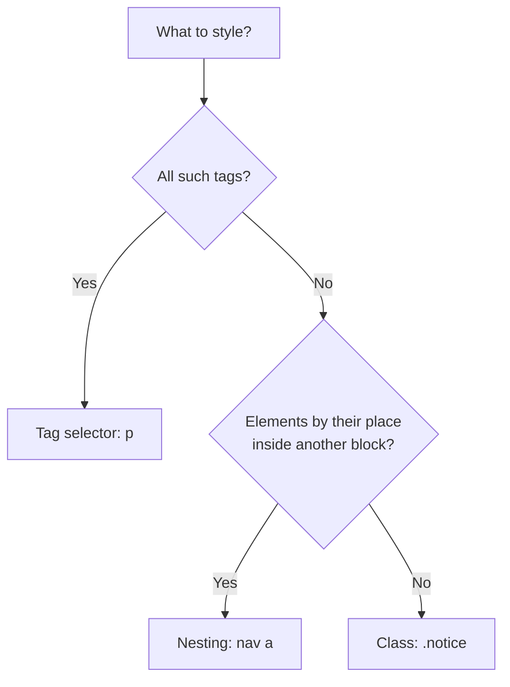
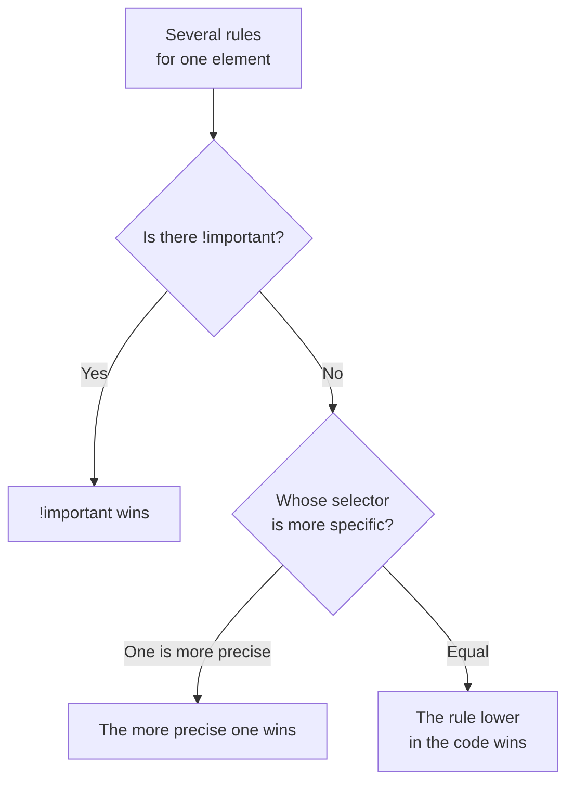

# Selectors and the cascade

[Contents](../../README.md) · [← Back](../../Lesson-1/en/Introduction%20to%20CSS.%20Syntax%20and%20linking.md) · [Next →](../../Lesson-3/en/Color%2C%20units%2C%20fonts%20and%20background.md) · [RU](../ru/%D0%A1%D0%B5%D0%BB%D0%B5%D0%BA%D1%82%D0%BE%D1%80%D1%8B%20%D0%B8%20%D0%BA%D0%B0%D1%81%D0%BA%D0%B0%D0%B4.md) · [EN](Selectors%20and%20the%20cascade.md) · [UZ](../uz/Selektorlar%20va%20kaskad.md)

> **Link to the previous lesson:** in Lesson 1 you styled whole tags: the rule `p { ... }` changed all paragraphs at once. Today we learn to pick **specific** elements and find out which rule wins when there are several.

---

## Why you need this

A page has ten paragraphs. Nine are ordinary, and one is an important notice that must be red. The rule `p { color: red; }` turns all ten red.

You need a way to say: "This paragraph is special". That is what classes and other selectors are for. And when there are many rules, they start to argue - and it matters to know who wins.

---

## What you will learn

- Select elements by tag, class, `id` and nesting.
- Give an element one or several classes.
- Explain why a rule did not apply: cascade, specificity, order.
- Understand which properties are inherited from the parent.
- Do without `!important`.

---

## Review: 3 questions from Lesson 1

1. What parts make up the rule `h1 { color: navy; }`?
2. How do you style `h1` and `h2` with one rule?
3. What does a struck-through property in DevTools mean?

Answers are at the end of the lesson.

---

## Lesson plan

| Section | What we do |
| --- | --- |
| Classes | Badges on clothes |
| Basic selectors | Tag, class, `id`, everything |
| Mini-task 1 | A card with a class |
| Nesting | An address: city, street, house |
| Cascade | Who wins the argument |
| Specificity | A three-number score |
| Inheritance | Children look like their parents |
| Mini-task 2 | Why isn't it red? |
| Independent work | IDE task and your own page |

---

## Classes

**In simple terms:** a class is a badge on clothes. Everyone with a "volunteer" badge wears a yellow vest. You can pin a badge on anyone, and one person can have several badges.

**In HTML** a class is the `class` attribute:

```html
<p class="notice">Wednesday's class is moved to Thursday.</p>
<p>An ordinary paragraph.</p>
```

**In CSS** a class is selected with a dot:

```css
.notice {
    color: #b91c1c;
    font-weight: bold;
}
```

**What you will see:** only the first paragraph turned red and bold.

### Several classes

Classes are separated by spaces:

```html
<p class="notice large">Important and large</p>
```

```css
.notice {
    color: #b91c1c;
}

.large {
    font-size: 24px;
}
```

The paragraph gets the styles of **both** classes.

### How to name classes

| Good | Bad | Why |
| --- | --- | --- |
| `.notice` | `.red-text` | Name by meaning, not by look: tomorrow the color becomes blue |
| `.card` | `.box1` | It is clear what it is |
| `.main-menu` | `.MainMenu`, `.main menu` | Lowercase, words joined by hyphens, no spaces |

---

## Basic selectors

| Selector | Example | What it selects |
| --- | --- | --- |
| By tag | `p` | All `<p>` |
| By class | `.card` | All elements with `class="card"` |
| By `id` | `#main-title` | The one element with `id="main-title"` |
| All elements | `*` | Absolutely everything |
| Group | `h1, h2` | Both `<h1>` and `<h2>` |
| Tag with a class | `p.notice` | Only `<p>` with the class `notice` |
| Two classes at once | `.btn.primary` | Elements that have **both** classes |

### Class or `id`?

An `id` is unique on the page (as in Lesson 3 of the HTML course). It is used for anchors and form labels. For styling, **use classes**:

- a class can be repeated on many elements;
- an `id` is too strong in rule arguments (more below), and later it is hard to override.

**Course rule:** we style through classes. An `id` in CSS - only when there is no other way.



**How to read the diagram.** Start with the simplest selector. Not all tags are needed - look at the element's place; if that does not help either - give it a class.

---

## Mini-task 1

Make a card: `<article class="card">` with a heading and a paragraph. Write a rule for `.card`: a light background `#eef2ff` and text color `#1e3a8a`. Solution is in the "Answers" section.

---

## Nesting: selecting by place

**In simple terms:** the address "Almalyk, Amir Temur Street, house 10". The more details, the more precisely you hit the target.

| Selector | Example | What it selects |
| --- | --- | --- |
| Descendant (space) | `nav a` | All `<a>` **anywhere** inside `<nav>` |
| Direct child | `ul > li` | Only `<li>` sitting **directly** in `<ul>` |
| Adjacent sibling | `h2 + p` | The first `<p>` right after an `<h2>` |
| By attribute | `a[target="_blank"]` | Links that open in a new tab |

```html
<nav>
    <ul>
        <li><a href="index.html">Home</a></li>
        <li><a href="about.html">About us</a></li>
    </ul>
</nav>
<p>Read the <a href="rules.html">rules</a>.</p>
```

```css
nav a {
    color: white;
    background-color: #1e3a8a;
}
```

**What you will see:** the menu links are white on blue. The "rules" link in the paragraph stays ordinary: it is not inside `<nav>`.

**A space in a selector matters:**

| Notation | Means |
| --- | --- |
| `p.notice` | A `<p>` that has the class `notice` |
| `p .notice` | An element with the class `notice` **inside** a `<p>` |

### Try to break it

Put a space into `p.notice` → `p .notice`. Reload the page. Why did the paragraph stop being red?

---

## The cascade: who wins the argument

**In simple terms:** two rules tell one paragraph different colors. The browser is the judge. It settles the argument with three questions **in order**:

1. **Importance:** is there `!important`? (Almost never needed - see below.)
2. **Specificity:** whose selector is more precise?
3. **Order:** if equal, the one written **lower** in the code wins.



**How to read the diagram.** The judge asks the questions from top to bottom and stops at the first one where there is a difference.

### Order

```css
p {
    color: blue;
}

p {
    color: green;
}
```

The selectors are the same - `green` wins: it is lower. The cascade is a "waterfall": the lower rule covers the upper one.

---

## Specificity: a three-number score

**In simple terms:** every selector has a "weight". We count how many `id`s, classes and tags it has:

| What is in the selector | Points |
| --- | --- |
| `id` | 1 - 0 - 0 |
| Class, attribute, pseudo-class | 0 - 1 - 0 |
| Tag | 0 - 0 - 1 |
| `*` | 0 - 0 - 0 |

We compare **from left to right**, like a score by sets in sport: one `id` beats any number of classes.

| Selector | Score |
| --- | --- |
| `p` | 0 - 0 - 1 |
| `nav a` | 0 - 0 - 2 |
| `.notice` | 0 - 1 - 0 |
| `p.notice` | 0 - 1 - 1 |
| `.card .title` | 0 - 2 - 0 |
| `#main-title` | 1 - 0 - 0 |

```css
.notice {
    color: red;
}

p {
    color: blue;
}
```

```html
<p class="notice">What color am I?</p>
```

**Red.** `.notice` (0-1-0) is stronger than `p` (0-0-1), even though `p` is lower in the code. Order decides only when the score is equal.

**Where to see it:** in DevTools → Styles hover over a selector - the browser shows its specificity.

### `!important` - the emergency brake

```css
p {
    color: blue !important;
}
```

It overrides almost everything. Sounds handy, but it is the emergency brake on a train: to override it later you need another `!important` - and a war begins. **We do not use `!important` in this course.** If a style does not apply, find in DevTools what overrides it and fix the selector or the order.

The `style=""` attribute is stronger than any selector. That is one more reason not to use it.

---

## Inheritance

**In simple terms:** children inherit their parents' eye color, but not their clothes. In CSS some properties pass down to nested elements, some do not.

| Inherited | Not inherited |
| --- | --- |
| `color` | `background-color` |
| `font-family`, `font-size` | `border` |
| `line-height`, `text-align` | `margin`, `padding` |

```css
body {
    font-family: Arial, sans-serif;
    color: #333333;
}
```

**All** elements on the page get this font and color. That is why the common font and text color are set once, on `body`.

**An inherited value is the weakest.** Any rule that selects the element directly, even `p` (0-0-1), overrides what came from the parent.

### Typical beginner mistakes

| Mistake | How to fix |
| --- | --- |
| `.card` in HTML: `class=".card"` | The dot is only in CSS: `class="card"` |
| `#title` for styling repeated elements | Use a class |
| `!important` to "force" it to work | Find in DevTools what overrides it |
| A space in `p .notice` instead of `p.notice` | Without a space - the same element, with a space - inside |
| Expecting the background to be inherited | `background-color` is not inherited |
| Classes by look: `.big-red` | Classes by meaning: `.notice` |

---

## Mini-task 2

What color will the text be, and why? Answer first, then check in the browser.

```html
<p class="notice" id="first">Text</p>
```

```css
#first {
    color: green;
}

.notice {
    color: red;
}

p {
    color: blue;
}
```

The answer is in the "Answers" section.

---

## Lesson summary: cheat sheet

| Task | Selector |
| --- | --- |
| All tags | `p` |
| Elements with a class | `.notice` |
| One element by `id` | `#main-title` |
| Inside another | `nav a` |
| Direct children | `ul > li` |
| With two classes | `.btn.primary` |
| By attribute | `a[target="_blank"]` |

| Who wins | Rule |
| --- | --- |
| First of all | `!important` (we do not use it) |
| Then | The higher `id - classes - tags` score |
| If equal | The rule lower in the code |
| Weakest | An inherited value |

---

## Independent work

### Part 1. IDE task (graded by the platform)

The editor contains a club page with a menu, a heading and three news cards. Do the following:

1. Give **two** `<article>` cards the class `card`, and the third one the classes `card featured`.
2. `.card` - a background and a text color.
3. `.card.featured` - a different background: this card is special.
4. `nav a` - the color of the menu links.
5. `ul > li` - any styling of the menu items, for example `font-weight`.
6. Do not use `!important`, `id` attributes or `style=""`.

What the platform checks: a `<style>` tag, the classes `card` and `featured` in the HTML, the rules `.card`, `.card.featured`, `nav a`, `ul > li`, no `!important`, no `id` and `style=""` attributes.

### Part 2. Project on your computer

1. In your `style.css`, move the common font and text color to `body`.
2. Give classes to two or three elements by meaning and style them.
3. Style the menu links with a nesting selector.
4. Find a rule in DevTools that was overridden (struck through) and explain why.

### Acceptance criteria

- [ ] The IDE task is accepted.
- [ ] Classes are named by meaning, in lowercase with hyphens.
- [ ] The common font and color are set once, on `body`.
- [ ] No `!important` and no `style=""`.
- [ ] You can calculate the specificity of any of your selectors.

---

## Self-check questions

1. How do you select elements with the class `notice` in CSS?
2. How do you give an element two classes?
3. Why is a class better than an `id` for styling?
4. How does `nav a` differ from `nav > a`?
5. How does `p.notice` differ from `p .notice`?
6. Which three questions does the browser use to settle an argument between rules?
7. Calculate the specificity of `.menu a`.
8. Why is `!important` a bad habit?
9. Is `background-color` inherited?
10. Why is the common font set on `body`?

After the questions, take the **lesson test** on the platform: 12 questions, pass threshold 70%.

---

## What's next

You can select elements precisely. In Lesson 3 we look at **what** to style them with: colors in different formats, size units, fonts and backgrounds.

---

## Answers

**Review**

1. The selector `h1`, the property `color`, the value `navy`.
2. `h1, h2 { ... }`.
3. Another rule overrode it, or the browser did not understand the notation.

**Mini-task 1**

```html
<article class="card">
    <h2>New intake</h2>
    <p>Sign up before Friday.</p>
</article>
```

```css
.card {
    background-color: #eef2ff;
    color: #1e3a8a;
}
```

**Mini-task 2.** Green. `#first` (1-0-0) is stronger than `.notice` (0-1-0) and `p` (0-0-1). The order in the code does not matter: the scores differ.

**Self-check questions**

1. `.notice { ... }`.
2. Separated by a space: `class="notice large"`.
3. A class can be repeated, and it is not too strong in rule arguments.
4. `nav a` - links at any depth inside `nav`, `nav > a` - only direct children.
5. `p.notice` - a paragraph with the class, `p .notice` - an element with the class inside a paragraph.
6. Importance (`!important`), specificity, order in the code.
7. 0 - 1 - 1.
8. It can only be overridden by another `!important`: the styles become impossible to maintain.
9. No.
10. These properties are inherited: setting them once is enough.

---

[Contents](../../README.md) · [← Back](../../Lesson-1/en/Introduction%20to%20CSS.%20Syntax%20and%20linking.md) · [Next →](../../Lesson-3/en/Color%2C%20units%2C%20fonts%20and%20background.md) · [RU](../ru/%D0%A1%D0%B5%D0%BB%D0%B5%D0%BA%D1%82%D0%BE%D1%80%D1%8B%20%D0%B8%20%D0%BA%D0%B0%D1%81%D0%BA%D0%B0%D0%B4.md) · [EN](Selectors%20and%20the%20cascade.md) · [UZ](../uz/Selektorlar%20va%20kaskad.md)
