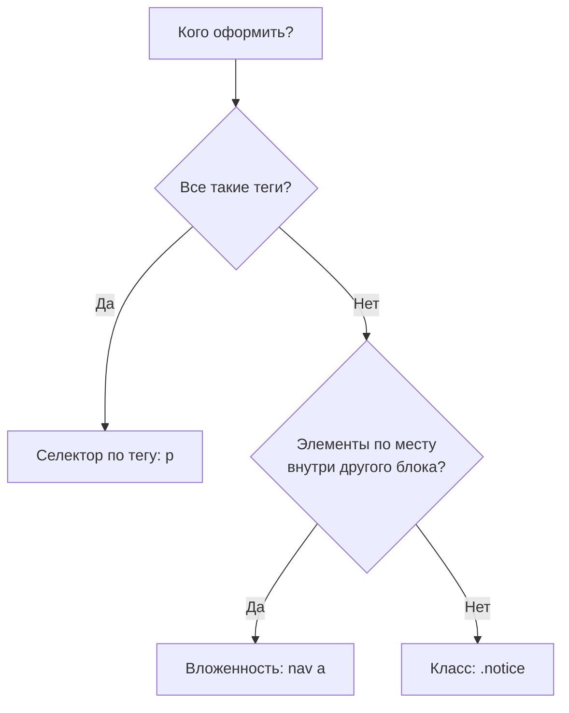
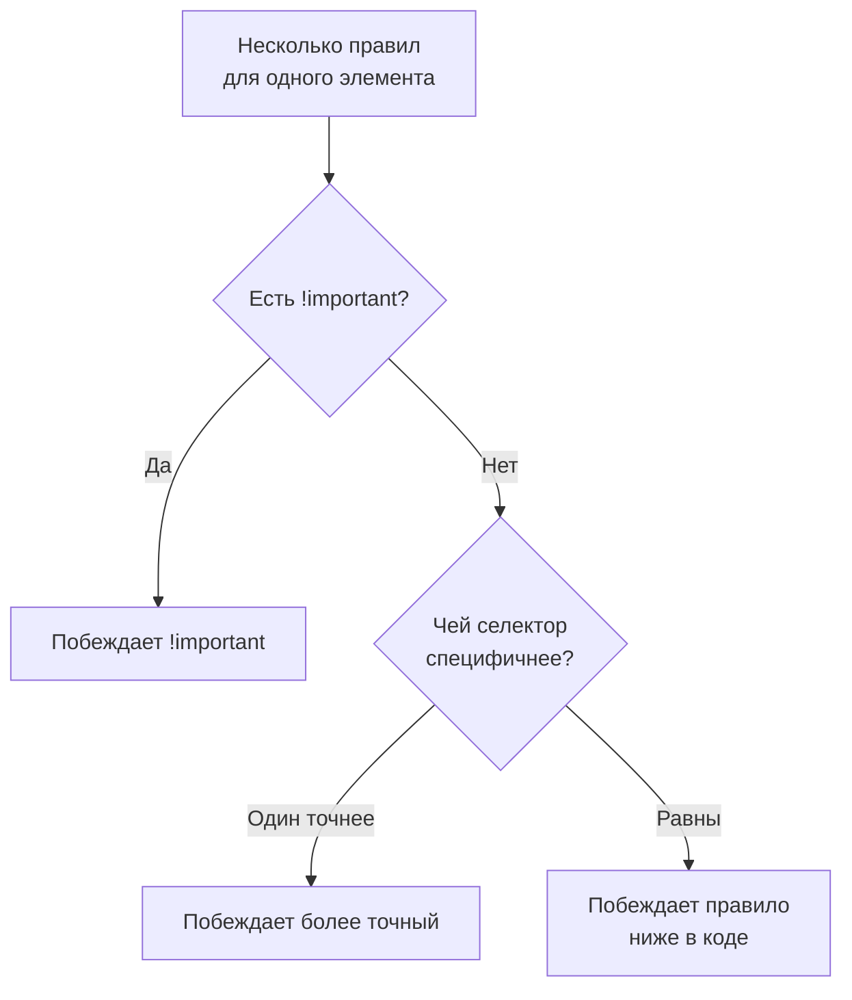

# Селекторы и каскад

[Содержание](../../README.md) · [← Назад](../../Lesson-1/ru/%D0%92%D0%B2%D0%B5%D0%B4%D0%B5%D0%BD%D0%B8%D0%B5%20%D0%B2%20CSS.%20%D0%A1%D0%B8%D0%BD%D1%82%D0%B0%D0%BA%D1%81%D0%B8%D1%81%20%D0%B8%20%D0%BF%D0%BE%D0%B4%D0%BA%D0%BB%D1%8E%D1%87%D0%B5%D0%BD%D0%B8%D0%B5.md) · [Вперёд →](../../Lesson-3/ru/%D0%A6%D0%B2%D0%B5%D1%82%2C%20%D0%B5%D0%B4%D0%B8%D0%BD%D0%B8%D1%86%D1%8B%2C%20%D1%88%D1%80%D0%B8%D1%84%D1%82%D1%8B%20%D0%B8%20%D1%84%D0%BE%D0%BD.md) · [RU](%D0%A1%D0%B5%D0%BB%D0%B5%D0%BA%D1%82%D0%BE%D1%80%D1%8B%20%D0%B8%20%D0%BA%D0%B0%D1%81%D0%BA%D0%B0%D0%B4.md) · [EN](../en/Selectors%20and%20the%20cascade.md) · [UZ](../uz/Selektorlar%20va%20kaskad.md)

> **Связь с прошлым уроком:** в уроке 1 вы стилизовали теги целиком: правило `p { ... }` меняло все абзацы сразу. Сегодня научимся выбирать **конкретные** элементы и разберёмся, какое правило побеждает, если их несколько.

---

## Зачем это вам

На странице десять абзацев. Девять обычные, а один - важное объявление, которое должно быть красным. Правило `p { color: red; }` перекрасит все десять.

Нужен способ сказать: «Вот этот абзац - особенный». Для этого есть классы и другие селекторы. А когда правил становится много, они начинают спорить - и важно знать, кто победит.

---

## Чему вы научитесь

- Выбирать элементы по тегу, классу, `id` и вложенности.
- Давать элементу один или несколько классов.
- Объяснять, почему правило не применилось: каскад, специфичность, порядок.
- Понимать, какие свойства наследуются от родителя.
- Обходиться без `!important`.

---

## Повторение: 3 вопроса из урока 1

1. Из каких частей состоит правило `h1 { color: navy; }`?
2. Как одним правилом оформить `h1` и `h2`?
3. Что означает зачёркнутое свойство в DevTools?

Ответы - в конце урока.

---

## План урока

| Раздел | Что делаем |
| --- | --- |
| Классы | Бейджи на одежде |
| Основные селекторы | Тег, класс, `id`, все |
| Мини-задание 1 | Карточка с классом |
| Вложенность | Адрес: город, улица, дом |
| Каскад | Кто победит в споре |
| Специфичность | Счёт из трёх цифр |
| Наследование | Дети похожи на родителей |
| Мини-задание 2 | Почему не красный? |
| Самостоятельная работа | Задание в IDE и своя страница |

---

## Классы

**Простыми словами:** класс - бейдж на одежде. Все, у кого бейдж «волонтёр», носят жёлтые жилеты. Бейдж можно повесить кому угодно, и у одного человека может быть несколько бейджей.

**В HTML** класс - атрибут `class`:

```html
<p class="notice">Занятие в среду переносится на четверг.</p>
<p>Обычный абзац.</p>
```

**В CSS** класс выбирают точкой:

```css
.notice {
    color: #b91c1c;
    font-weight: bold;
}
```

**Что увидите:** только первый абзац стал красным и жирным.

### Несколько классов

Классы пишутся через пробел:

```html
<p class="notice large">Важно и крупно</p>
```

```css
.notice {
    color: #b91c1c;
}

.large {
    font-size: 24px;
}
```

Абзац получит стили **обоих** классов.

### Как называть классы

| Хорошо | Плохо | Почему |
| --- | --- | --- |
| `.notice` | `.red-text` | Имя по смыслу, а не по виду: завтра цвет станет синим |
| `.card` | `.box1` | Понятно, что это |
| `.main-menu` | `.MainMenu`, `.main menu` | Строчные буквы, слова через дефис, без пробелов |

---

## Основные селекторы

| Селектор | Пример | Кого выбирает |
| --- | --- | --- |
| По тегу | `p` | Все `<p>` |
| По классу | `.card` | Все элементы с `class="card"` |
| По `id` | `#main-title` | Один элемент с `id="main-title"` |
| Все элементы | `*` | Вообще всё |
| Группа | `h1, h2` | И `<h1>`, и `<h2>` |
| Тег с классом | `p.notice` | Только `<p>` с классом `notice` |
| Два класса сразу | `.btn.primary` | Элементы, у которых **оба** класса |

### Класс или `id`?

`id` уникален на странице (как в уроке 3 курса HTML). Его используют для якорей и подписей формы. Для оформления **берите классы**:

- класс можно повторить на многих элементах;
- `id` слишком сильный в споре правил (об этом ниже), и потом его трудно перебить.

**Правило курса:** оформляем через классы. `id` в CSS - только если без него никак.



**Как читать схему.** Начинайте с самого простого селектора. Нужны не все теги - смотрите на место элемента, а если и это не помогает - дайте класс.

---

## Мини-задание 1

Сделайте карточку: `<article class="card">` с заголовком и абзацем. Напишите правило для `.card`: светлый фон `#eef2ff` и цвет текста `#1e3a8a`. Решение - в разделе «Ответы».

---

## Вложенность: выбор по месту

**Простыми словами:** адрес «Алмалык, улица Амира Темура, дом 10». Чем больше уточнений, тем точнее попадаете.

| Селектор | Пример | Кого выбирает |
| --- | --- | --- |
| Потомок (пробел) | `nav a` | Все `<a>` **где угодно** внутри `<nav>` |
| Прямой ребёнок | `ul > li` | Только `<li>`, лежащие **прямо** в `<ul>` |
| Соседний сразу после | `h2 + p` | Первый `<p>` сразу после `<h2>` |
| По атрибуту | `a[target="_blank"]` | Ссылки, открывающиеся в новой вкладке |

```html
<nav>
    <ul>
        <li><a href="index.html">Главная</a></li>
        <li><a href="about.html">О нас</a></li>
    </ul>
</nav>
<p>Читайте <a href="rules.html">правила</a>.</p>
```

```css
nav a {
    color: white;
    background-color: #1e3a8a;
}
```

**Что увидите:** ссылки меню - белые на синем. Ссылка «правила» в абзаце осталась обычной: она не внутри `<nav>`.

**Пробел в селекторе важен:**

| Запись | Значит |
| --- | --- |
| `p.notice` | `<p>`, у которого класс `notice` |
| `p .notice` | Элемент с классом `notice` **внутри** `<p>` |

### Попробуйте сломать

Поставьте пробел в `p.notice` → `p .notice`. Обновите страницу. Почему абзац перестал быть красным?

---

## Каскад: кто победит в споре

**Простыми словами:** два правила говорят одному абзацу разные цвета. Браузер - судья. Он решает спор по трём вопросам **по порядку**:

1. **Важность:** есть ли `!important`? (Почти никогда не нужно - см. ниже.)
2. **Специфичность:** чей селектор точнее?
3. **Порядок:** при равенстве побеждает то, что написано **ниже** в коде.



**Как читать схему.** Судья задаёт вопросы сверху вниз и останавливается на первом, где есть разница.

### Порядок

```css
p {
    color: blue;
}

p {
    color: green;
}
```

Селекторы одинаковые - победит `green`: он ниже. Каскад - это «водопад»: нижнее правило накрывает верхнее.

---

## Специфичность: счёт из трёх цифр

**Простыми словами:** у каждого селектора есть «вес». Считаем, сколько в нём `id`, классов и тегов:

| Что в селекторе | Очки |
| --- | --- |
| `id` | 1 - 0 - 0 |
| Класс, атрибут, псевдокласс | 0 - 1 - 0 |
| Тег | 0 - 0 - 1 |
| `*` | 0 - 0 - 0 |

Сравниваем **слева направо**, как счёт в спорте по сетам: один `id` сильнее любого количества классов.

| Селектор | Счёт |
| --- | --- |
| `p` | 0 - 0 - 1 |
| `nav a` | 0 - 0 - 2 |
| `.notice` | 0 - 1 - 0 |
| `p.notice` | 0 - 1 - 1 |
| `.card .title` | 0 - 2 - 0 |
| `#main-title` | 1 - 0 - 0 |

```css
.notice {
    color: red;
}

p {
    color: blue;
}
```

```html
<p class="notice">Какого я цвета?</p>
```

**Красный.** `.notice` (0-1-0) сильнее `p` (0-0-1), хотя `p` ниже в коде. Порядок решает только при равном счёте.

**Где посмотреть:** в DevTools → Styles наведите курсор на селектор - браузер покажет его специфичность.

### `!important` - стоп-кран

```css
p {
    color: blue !important;
}
```

Перебивает почти всё. Звучит удобно, но это стоп-кран в поезде: потом, чтобы перебить, нужен ещё один `!important` - и начинается война. **В курсе `!important` не используем.** Не применяется стиль - найдите в DevTools, кто его перебивает, и исправьте селектор или порядок.

Атрибут `style=""` сильнее любого селектора. Это ещё одна причина его не использовать.

---

## Наследование

**Простыми словами:** дети похожи на родителей цветом глаз, но не одеждой. В CSS часть свойств передаётся вложенным элементам, часть - нет.

| Наследуется | Не наследуется |
| --- | --- |
| `color` | `background-color` |
| `font-family`, `font-size` | `border` |
| `line-height`, `text-align` | `margin`, `padding` |

```css
body {
    font-family: Arial, sans-serif;
    color: #333333;
}
```

Шрифт и цвет получат **все** элементы страницы. Поэтому общий шрифт и цвет текста задают один раз на `body`.

**Наследованное значение - самое слабое.** Любое правило, которое выбирает элемент напрямую, даже `p` (0-0-1), перебьёт то, что пришло от родителя.

### Частые ошибки новичков

| Ошибка | Как исправить |
| --- | --- |
| `.card` в HTML: `class=".card"` | Точка только в CSS: `class="card"` |
| `#title` для оформления повторяющихся элементов | Используйте класс |
| `!important`, чтобы «заставить» работать | Найдите в DevTools, кто перебивает |
| Пробел в `p .notice` вместо `p.notice` | Без пробела - тот же элемент, с пробелом - внутри |
| Ждут, что фон унаследуется | `background-color` не наследуется |
| Классы по виду: `.big-red` | Классы по смыслу: `.notice` |

---

## Мини-задание 2

Какого цвета будет текст и почему? Сначала ответьте, потом проверьте в браузере.

```html
<p class="notice" id="first">Текст</p>
```

```css
#first {
    color: green;
}

.notice {
    color: red;
}

p {
    color: blue;
}
```

Ответ - в разделе «Ответы».

---

## Итоги урока: шпаргалка

| Задача | Селектор |
| --- | --- |
| Все теги | `p` |
| Элементы с классом | `.notice` |
| Один элемент по `id` | `#main-title` |
| Внутри другого | `nav a` |
| Прямые дети | `ul > li` |
| С двумя классами | `.btn.primary` |
| По атрибуту | `a[target="_blank"]` |

| Кто побеждает | Правило |
| --- | --- |
| Первым делом | `!important` (не используем) |
| Затем | Больший счёт `id - классы - теги` |
| При равенстве | Правило ниже в коде |
| Слабее всего | Унаследованное значение |

---

## Самостоятельная работа

### Часть 1. Задание в IDE (засчитывается платформой)

В редакторе страница кружка с меню, заголовком и тремя карточками-новостями. Сделайте:

1. Дайте **двум** карточкам `<article>` класс `card`, а третьей - классы `card featured`.
2. `.card` - фон и цвет текста.
3. `.card.featured` - другой фон: эта карточка особенная.
4. `nav a` - цвет ссылок меню.
5. `ul > li` - любое оформление пунктов меню, например `font-weight`.
6. Не используйте `!important`, атрибуты `id` и `style=""`.

Что проверяет платформа: тег `<style>`, классы `card` и `featured` в HTML, правила `.card`, `.card.featured`, `nav a`, `ul > li`, отсутствие `!important`, атрибутов `id` и `style=""`.

### Часть 2. Проект на компьютере

1. В своём `style.css` перенесите общий шрифт и цвет текста на `body`.
2. Дайте классы двум-трём элементам по смыслу и оформите их.
3. Оформите ссылки меню селектором вложенности.
4. Найдите в DevTools правило, которое было перебито (зачёркнуто), и объясните, почему.

### Критерии готовности

- [ ] Задание в IDE засчитано.
- [ ] Классы названы по смыслу, строчными буквами через дефис.
- [ ] Общий шрифт и цвет заданы один раз на `body`.
- [ ] Нет `!important` и `style=""`.
- [ ] Можете посчитать специфичность любого своего селектора.

---

## Вопросы для самопроверки

1. Как выбрать в CSS элементы с классом `notice`?
2. Как дать элементу два класса?
3. Почему для оформления лучше класс, чем `id`?
4. Чем `nav a` отличается от `nav > a`?
5. Чем `p.notice` отличается от `p .notice`?
6. По каким трём вопросам браузер решает спор правил?
7. Посчитайте специфичность `.menu a`.
8. Почему `!important` - плохая привычка?
9. Наследуется ли `background-color`?
10. Почему общий шрифт задают на `body`?

После вопросов пройдите **тест урока** на платформе: 12 вопросов, порог 70%.

---

## Что дальше

Вы умеете точно выбирать элементы. В уроке 3 разберёмся, **чем** их оформлять: цвета в разных форматах, единицы размеров, шрифты и фон.

---

## Ответы

**Повторение**

1. Селектор `h1`, свойство `color`, значение `navy`.
2. `h1, h2 { ... }`.
3. Его перебило другое правило или браузер не понял запись.

**Мини-задание 1**

```html
<article class="card">
    <h2>Новый набор</h2>
    <p>Записывайтесь до пятницы.</p>
</article>
```

```css
.card {
    background-color: #eef2ff;
    color: #1e3a8a;
}
```

**Мини-задание 2.** Зелёный. `#first` (1-0-0) сильнее `.notice` (0-1-0) и `p` (0-0-1). Порядок в коде не важен: счёт разный.

**Вопросы для самопроверки**

1. `.notice { ... }`.
2. Через пробел: `class="notice large"`.
3. Класс можно повторять, и он не слишком сильный в споре правил.
4. `nav a` - ссылки на любой глубине внутри `nav`, `nav > a` - только прямые дети.
5. `p.notice` - абзац с классом, `p .notice` - элемент с классом внутри абзаца.
6. Важность (`!important`), специфичность, порядок в коде.
7. 0 - 1 - 1.
8. Его можно перебить только другим `!important`: стили становится невозможно поддерживать.
9. Нет.
10. Эти свойства наследуются: достаточно задать один раз.

---

[Содержание](../../README.md) · [← Назад](../../Lesson-1/ru/%D0%92%D0%B2%D0%B5%D0%B4%D0%B5%D0%BD%D0%B8%D0%B5%20%D0%B2%20CSS.%20%D0%A1%D0%B8%D0%BD%D1%82%D0%B0%D0%BA%D1%81%D0%B8%D1%81%20%D0%B8%20%D0%BF%D0%BE%D0%B4%D0%BA%D0%BB%D1%8E%D1%87%D0%B5%D0%BD%D0%B8%D0%B5.md) · [Вперёд →](../../Lesson-3/ru/%D0%A6%D0%B2%D0%B5%D1%82%2C%20%D0%B5%D0%B4%D0%B8%D0%BD%D0%B8%D1%86%D1%8B%2C%20%D1%88%D1%80%D0%B8%D1%84%D1%82%D1%8B%20%D0%B8%20%D1%84%D0%BE%D0%BD.md) · [RU](%D0%A1%D0%B5%D0%BB%D0%B5%D0%BA%D1%82%D0%BE%D1%80%D1%8B%20%D0%B8%20%D0%BA%D0%B0%D1%81%D0%BA%D0%B0%D0%B4.md) · [EN](../en/Selectors%20and%20the%20cascade.md) · [UZ](../uz/Selektorlar%20va%20kaskad.md)
