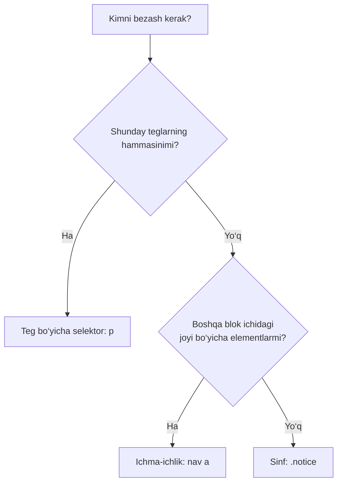
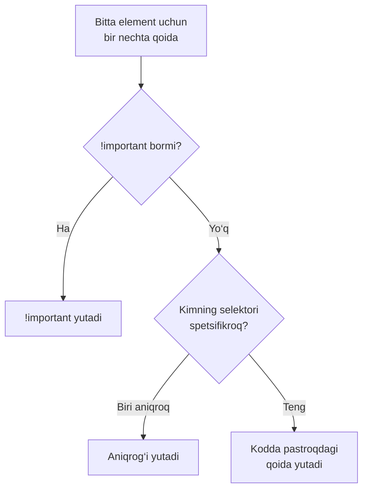

# Selektorlar va kaskad

[Mundarija](../../README.md) · [← Orqaga](../../Lesson-1/uz/CSS%20ga%20kirish.%20Sintaksis%20va%20ulash.md) · [Keyingi →](../../Lesson-3/uz/Rang%2C%20birliklar%2C%20shriftlar%20va%20fon.md) · [RU](../ru/%D0%A1%D0%B5%D0%BB%D0%B5%D0%BA%D1%82%D0%BE%D1%80%D1%8B%20%D0%B8%20%D0%BA%D0%B0%D1%81%D0%BA%D0%B0%D0%B4.md) · [EN](../en/Selectors%20and%20the%20cascade.md) · [UZ](Selektorlar%20va%20kaskad.md)

> **Oldingi dars bilan bog‘liqlik:** 1-darsda teglarni butunlay bezadingiz: `p { ... }` qoidasi barcha abzatslarni birdaniga o‘zgartirardi. Bugun **aniq** elementlarni tanlashni o‘rganamiz va bir nechta qoida bo‘lsa, qaysi biri ustun kelishini tushunib olamiz.

---

## Bu sizga nima uchun kerak

Sahifada o‘nta abzats bor. To‘qqiztasi oddiy, bittasi esa qizil bo‘lishi kerak bo‘lgan muhim e’lon. `p { color: red; }` qoidasi o‘ntasini ham qizilga bo‘yaydi.

«Aynan shu abzats - alohida» deyish usuli kerak. Buning uchun sinflar va boshqa selektorlar bor. Qoidalar ko‘payganda esa ular bahslasha boshlaydi - va kim yutishini bilish muhim.

---

## Nimani o‘rganasiz

- Elementlarni teg, sinf, `id` va ichma-ichlik bo‘yicha tanlash.
- Elementga bitta yoki bir nechta sinf berish.
- Qoida nega qo‘llanmaganini tushuntirish: kaskad, spetsifiklik, tartib.
- Qaysi xususiyatlar ota elementdan meros bo‘lib o‘tishini tushunish.
- `!important` siz ishlash.

---

## Takrorlash: 1-darsdan 3 savol

1. `h1 { color: navy; }` qoidasi qaysi qismlardan iborat?
2. `h1` va `h2` ni bitta qoida bilan qanday bezash mumkin?
3. DevTools dagi chizilgan xususiyat nimani bildiradi?

Javoblar - dars oxirida.

---

## Reja

| Bo‘lim | Nima qilamiz |
| --- | --- |
| Sinflar | Kiyimdagi beyjlar |
| Asosiy selektorlar | Teg, sinf, `id`, hammasi |
| Mini-topshiriq 1 | Sinfli kartochka |
| Ichma-ichlik | Manzil: shahar, ko‘cha, uy |
| Kaskad | Bahsda kim yutadi |
| Spetsifiklik | Uch raqamli hisob |
| Meros | Bolalar ota-onaga o‘xshaydi |
| Mini-topshiriq 2 | Nega qizil emas? |
| Mustaqil ish | IDE topshirig‘i va o‘z sahifangiz |

---

## Sinflar

**Oddiy qilib aytganda:** sinf - kiyimdagi beyj. «Ko‘ngilli» beyji bor hamma sariq jilet kiyadi. Beyjni istalgan kishiga taqish mumkin va bir kishida bir nechta beyj bo‘lishi mumkin.

**HTML da** sinf - `class` atributi:

```html
<p class="notice">Chorshanbadagi mashg‘ulot payshanbaga ko‘chiriladi.</p>
<p>Oddiy abzats.</p>
```

**CSS da** sinf nuqta bilan tanlanadi:

```css
.notice {
    color: #b91c1c;
    font-weight: bold;
}
```

**Nimani ko‘rasiz:** faqat birinchi abzats qizil va qalin bo‘ldi.

### Bir nechta sinf

Sinflar bo‘shliq bilan yoziladi:

```html
<p class="notice large">Muhim va yirik</p>
```

```css
.notice {
    color: #b91c1c;
}

.large {
    font-size: 24px;
}
```

Abzats **ikkala** sinf uslublarini oladi.

### Sinflarni qanday nomlash

| Yaxshi | Yomon | Nega |
| --- | --- | --- |
| `.notice` | `.red-text` | Nom ko‘rinishga emas, ma’noga ko‘ra: ertaga rang ko‘k bo‘ladi |
| `.card` | `.box1` | Bu nima ekani tushunarli |
| `.main-menu` | `.MainMenu`, `.main menu` | Kichik harflar, so‘zlar defis bilan, bo‘shliqsiz |

---

## Asosiy selektorlar

| Selektor | Misol | Kimni tanlaydi |
| --- | --- | --- |
| Teg bo‘yicha | `p` | Barcha `<p>` |
| Sinf bo‘yicha | `.card` | `class="card"` li barcha elementlar |
| `id` bo‘yicha | `#main-title` | `id="main-title"` li bitta element |
| Barcha elementlar | `*` | Umuman hammasi |
| Guruh | `h1, h2` | Ham `<h1>`, ham `<h2>` |
| Sinfli teg | `p.notice` | Faqat `notice` sinfli `<p>` |
| Birdaniga ikki sinf | `.btn.primary` | **Ikkala** sinfi bor elementlar |

### Sinfmi yoki `id`?

`id` sahifada yagona (HTML kursining 3-darsidagidek). U langarlar va forma imzolari uchun ishlatiladi. Bezash uchun **sinflarni oling**:

- sinfni ko‘p elementlarda takrorlash mumkin;
- `id` qoidalar bahsida haddan tashqari kuchli (bu haqda pastda) va keyin uni bosib ketish qiyin.

**Kurs qoidasi:** sinflar orqali bezaymiz. CSS da `id` - faqat usiz iloji bo‘lmasa.



**Sxemani qanday o‘qish kerak.** Eng oddiy selektordan boshlang. Barcha teglar kerak emasmi - element joyiga qarang, bu ham yordam bermasa - sinf bering.

---

## Mini-topshiriq 1

Kartochka yasang: sarlavha va abzatsli `<article class="card">`. `.card` uchun qoida yozing: `#eef2ff` och fon va `#1e3a8a` matn rangi. Yechim - «Javoblar» bo‘limida.

---

## Ichma-ichlik: joyi bo‘yicha tanlash

**Oddiy qilib aytganda:** «Olmaliq, Amir Temur ko‘chasi, 10-uy» manzili. Aniqliklar qancha ko‘p bo‘lsa, shuncha aniq tushasiz.

| Selektor | Misol | Kimni tanlaydi |
| --- | --- | --- |
| Avlod (bo‘shliq) | `nav a` | `<nav>` ichida **istalgan joydagi** barcha `<a>` |
| To‘g‘ridan-to‘g‘ri bola | `ul > li` | Faqat `<ul>` ichida **to‘g‘ridan-to‘g‘ri** turgan `<li>` |
| Darhol keyingi qo‘shni | `h2 + p` | `<h2>` dan darhol keyingi birinchi `<p>` |
| Atribut bo‘yicha | `a[target="_blank"]` | Yangi yorliqda ochiladigan havolalar |

```html
<nav>
    <ul>
        <li><a href="index.html">Bosh sahifa</a></li>
        <li><a href="about.html">Biz haqimizda</a></li>
    </ul>
</nav>
<p><a href="rules.html">Qoidalarni</a> o‘qing.</p>
```

```css
nav a {
    color: white;
    background-color: #1e3a8a;
}
```

**Nimani ko‘rasiz:** menyu havolalari - ko‘k ustida oq. Abzatsdagi «Qoidalarni» havolasi oddiyligicha qoldi: u `<nav>` ichida emas.

**Selektordagi bo‘shliq muhim:**

| Yozuv | Ma’nosi |
| --- | --- |
| `p.notice` | `notice` sinfi bor `<p>` |
| `p .notice` | `<p>` **ichidagi** `notice` sinfli element |

### Buzib ko‘ring

`p.notice` da bo‘shliq qo‘ying → `p .notice`. Sahifani yangilang. Nega abzats qizil bo‘lmay qoldi?

---

## Kaskad: bahsda kim yutadi

**Oddiy qilib aytganda:** ikki qoida bitta abzatsga turli ranglarni aytyapti. Brauzer - hakam. U bahsni uchta savol bo‘yicha **tartib bilan** hal qiladi:

1. **Muhimlik:** `!important` bormi? (Deyarli hech qachon kerak emas - pastga qarang.)
2. **Spetsifiklik:** kimning selektori aniqroq?
3. **Tartib:** tenglikda kodda **pastroqda** yozilgani yutadi.



**Sxemani qanday o‘qish kerak.** Hakam savollarni yuqoridan pastga beradi va farq bor birinchi savolda to‘xtaydi.

### Tartib

```css
p {
    color: blue;
}

p {
    color: green;
}
```

Selektorlar bir xil - `green` yutadi: u pastroqda. Kaskad - bu «sharshara»: pastki qoida yuqorisini qoplaydi.

---

## Spetsifiklik: uch raqamli hisob

**Oddiy qilib aytganda:** har bir selektorning «og‘irligi» bor. Unda nechta `id`, sinf va teg borligini sanaymiz:

| Selektorda nima bor | Ochko |
| --- | --- |
| `id` | 1 - 0 - 0 |
| Sinf, atribut, psevdosinf | 0 - 1 - 0 |
| Teg | 0 - 0 - 1 |
| `*` | 0 - 0 - 0 |

**Chapdan o‘ngga** solishtiramiz, sportdagi setlar hisobi kabi: bitta `id` istalgan miqdordagi sinfdan kuchli.

| Selektor | Hisob |
| --- | --- |
| `p` | 0 - 0 - 1 |
| `nav a` | 0 - 0 - 2 |
| `.notice` | 0 - 1 - 0 |
| `p.notice` | 0 - 1 - 1 |
| `.card .title` | 0 - 2 - 0 |
| `#main-title` | 1 - 0 - 0 |

```css
.notice {
    color: red;
}

p {
    color: blue;
}
```

```html
<p class="notice">Men qanday rangdaman?</p>
```

**Qizil.** `.notice` (0-1-0) `p` (0-0-1) dan kuchli, garchi `p` kodda pastroqda bo‘lsa ham. Tartib faqat hisob teng bo‘lganda hal qiladi.

**Qayerda ko‘rish mumkin:** DevTools → Styles da kursorni selektorga olib boring - brauzer uning spetsifikligini ko‘rsatadi.

### `!important` - favqulodda tormoz

```css
p {
    color: blue !important;
}
```

Deyarli hammasini bosib ketadi. Qulay eshitiladi, lekin bu poyezddagi favqulodda tormoz: keyin uni bosib ketish uchun yana bitta `!important` kerak bo‘ladi - va urush boshlanadi. **Kursda `!important` ishlatmaymiz.** Uslub qo‘llanmayaptimi - DevTools da uni kim bosib ketayotganini toping va selektor yoki tartibni tuzating.

`style=""` atributi istalgan selektordan kuchli. Bu uni ishlatmaslik uchun yana bir sabab.

---

## Meros

**Oddiy qilib aytganda:** bolalar ota-onaga ko‘z rangi bilan o‘xshaydi, lekin kiyimi bilan emas. CSS da xususiyatlarning bir qismi ichki elementlarga o‘tadi, bir qismi - yo‘q.

| Meros bo‘ladi | Meros bo‘lmaydi |
| --- | --- |
| `color` | `background-color` |
| `font-family`, `font-size` | `border` |
| `line-height`, `text-align` | `margin`, `padding` |

```css
body {
    font-family: Arial, sans-serif;
    color: #333333;
}
```

Shrift va rangni sahifaning **barcha** elementlari oladi. Shuning uchun umumiy shrift va matn rangi `body` da bir marta beriladi.

**Meros bo‘lgan qiymat - eng kuchsizi.** Elementni to‘g‘ridan-to‘g‘ri tanlaydigan istalgan qoida, hatto `p` (0-0-1) ham, ota elementdan kelganini bosib ketadi.

### Yangi o‘rganuvchilarning tipik xatolari

| Xato | Qanday tuzatish |
| --- | --- |
| HTML da `.card`: `class=".card"` | Nuqta faqat CSS da: `class="card"` |
| Takrorlanuvchi elementlarni bezash uchun `#title` | Sinf ishlating |
| «Ishlashga majburlash» uchun `!important` | DevTools da kim bosib ketayotganini toping |
| `p.notice` o‘rniga `p .notice` da bo‘shliq | Bo‘shliqsiz - o‘sha element, bo‘shliq bilan - ichida |
| Fon meros bo‘lishini kutishadi | `background-color` meros bo‘lmaydi |
| Ko‘rinish bo‘yicha sinflar: `.big-red` | Ma’no bo‘yicha sinflar: `.notice` |

---

## Mini-topshiriq 2

Matn qanday rangda bo‘ladi va nega? Avval javob bering, keyin brauzerda tekshiring.

```html
<p class="notice" id="first">Matn</p>
```

```css
#first {
    color: green;
}

.notice {
    color: red;
}

p {
    color: blue;
}
```

Javob - «Javoblar» bo‘limida.

---

## Dars yakuni: shpargalka

| Vazifa | Selektor |
| --- | --- |
| Barcha teglar | `p` |
| Sinfli elementlar | `.notice` |
| `id` bo‘yicha bitta element | `#main-title` |
| Boshqasining ichida | `nav a` |
| To‘g‘ridan-to‘g‘ri bolalar | `ul > li` |
| Ikki sinfli | `.btn.primary` |
| Atribut bo‘yicha | `a[target="_blank"]` |

| Kim yutadi | Qoida |
| --- | --- |
| Birinchi navbatda | `!important` (ishlatmaymiz) |
| Keyin | `id - sinflar - teglar` hisobi kattarog‘i |
| Tenglikda | Kodda pastroqdagi qoida |
| Eng kuchsizi | Meros bo‘lgan qiymat |

---

## Mustaqil ish

### 1-qism. IDE topshirig‘i (platforma hisoblaydi)

Muharrirda menyu, sarlavha va uchta yangilik-kartochkali to‘garak sahifasi turibdi. Bajaring:

1. **Ikkita** `<article>` kartochkaga `card` sinfini, uchinchisiga esa `card featured` sinflarini bering.
2. `.card` - fon va matn rangi.
3. `.card.featured` - boshqa fon: bu kartochka alohida.
4. `nav a` - menyu havolalari rangi.
5. `ul > li` - menyu bandlarining istalgan bezagi, masalan `font-weight`.
6. `!important`, `id` va `style=""` atributlarini ishlatmang.

Platforma nimani tekshiradi: `<style>` tegi, HTML da `card` va `featured` sinflari, `.card`, `.card.featured`, `nav a`, `ul > li` qoidalari, `!important`, `id` va `style=""` atributlari yo‘qligi.

### 2-qism. Kompyuterdagi loyiha

1. `style.css` da umumiy shrift va matn rangini `body` ga ko‘chiring.
2. Ikki-uchta elementga ma’noga ko‘ra sinf bering va ularni bezang.
3. Menyu havolalarini ichma-ichlik selektori bilan bezang.
4. DevTools da bosib ketilgan (chizilgan) qoidani toping va nega ekanini tushuntiring.

### Tayyorlik mezonlari

- [ ] IDE topshirig‘i qabul qilingan.
- [ ] Sinflar ma’noga ko‘ra, kichik harflar bilan defis orqali nomlangan.
- [ ] Umumiy shrift va rang `body` da bir marta berilgan.
- [ ] `!important` va `style=""` yo‘q.
- [ ] O‘zingizning istalgan selektoringiz spetsifikligini hisoblay olasiz.

---

## O‘zini tekshirish uchun savollar

1. CSS da `notice` sinfli elementlarni qanday tanlash mumkin?
2. Elementga ikkita sinfni qanday berish mumkin?
3. Nega bezash uchun `id` dan ko‘ra sinf yaxshiroq?
4. `nav a` `nav > a` dan nimasi bilan farq qiladi?
5. `p.notice` `p .notice` dan nimasi bilan farq qiladi?
6. Brauzer qoidalar bahsini qaysi uchta savol bo‘yicha hal qiladi?
7. `.menu a` ning spetsifikligini hisoblang.
8. Nega `!important` - yomon odat?
9. `background-color` meros bo‘ladimi?
10. Nega umumiy shrift `body` da beriladi?

Savollardan keyin platformada **dars testini** topshiring: 12 ta savol, o‘tish chegarasi 70%.

---

## Keyin nima

Elementlarni aniq tanlashni bilasiz. 3-darsda ularni **nima bilan** bezashni ko‘rib chiqamiz: turli formatdagi ranglar, o‘lcham birliklari, shriftlar va fon.

---

## Javoblar

**Takrorlash**

1. `h1` selektori, `color` xususiyati, `navy` qiymati.
2. `h1, h2 { ... }`.
3. Uni boshqa qoida bosib ketgan yoki brauzer yozuvni tushunmagan.

**Mini-topshiriq 1**

```html
<article class="card">
    <h2>Yangi qabul</h2>
    <p>Jumagacha yoziling.</p>
</article>
```

```css
.card {
    background-color: #eef2ff;
    color: #1e3a8a;
}
```

**Mini-topshiriq 2.** Yashil. `#first` (1-0-0) `.notice` (0-1-0) va `p` (0-0-1) dan kuchli. Koddagi tartib muhim emas: hisob turlicha.

**O‘zini tekshirish uchun savollar**

1. `.notice { ... }`.
2. Bo‘shliq bilan: `class="notice large"`.
3. Sinfni takrorlash mumkin va u qoidalar bahsida haddan tashqari kuchli emas.
4. `nav a` - `nav` ichidagi istalgan chuqurlikdagi havolalar, `nav > a` - faqat to‘g‘ridan-to‘g‘ri bolalar.
5. `p.notice` - sinfli abzats, `p .notice` - abzats ichidagi sinfli element.
6. Muhimlik (`!important`), spetsifiklik, koddagi tartib.
7. 0 - 1 - 1.
8. Uni faqat boshqa `!important` bilan bosib ketish mumkin: uslublarni qo‘llab-quvvatlab bo‘lmay qoladi.
9. Yo‘q.
10. Bu xususiyatlar meros bo‘ladi: bir marta berish kifoya.

---

[Mundarija](../../README.md) · [← Orqaga](../../Lesson-1/uz/CSS%20ga%20kirish.%20Sintaksis%20va%20ulash.md) · [Keyingi →](../../Lesson-3/uz/Rang%2C%20birliklar%2C%20shriftlar%20va%20fon.md) · [RU](../ru/%D0%A1%D0%B5%D0%BB%D0%B5%D0%BA%D1%82%D0%BE%D1%80%D1%8B%20%D0%B8%20%D0%BA%D0%B0%D1%81%D0%BA%D0%B0%D0%B4.md) · [EN](../en/Selectors%20and%20the%20cascade.md) · [UZ](Selektorlar%20va%20kaskad.md)
