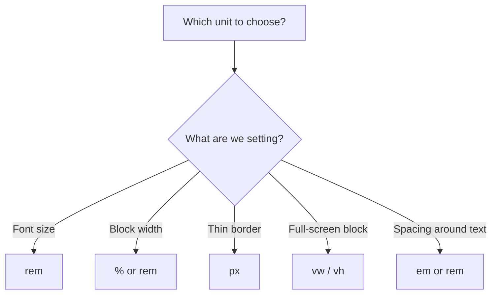
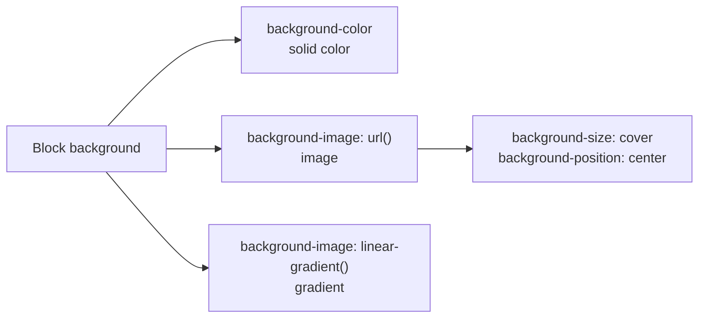

# Color, units, fonts and background

[Contents](../../README.md) · [← Back](../../Lesson-2/en/Selectors%20and%20the%20cascade.md) · [Next →](../../Lesson-4/en/Box%20model.md) · [RU](../ru/%D0%A6%D0%B2%D0%B5%D1%82%2C%20%D0%B5%D0%B4%D0%B8%D0%BD%D0%B8%D1%86%D1%8B%2C%20%D1%88%D1%80%D0%B8%D1%84%D1%82%D1%8B%20%D0%B8%20%D1%84%D0%BE%D0%BD.md) · [EN](Color%2C%20units%2C%20fonts%20and%20background.md) · [UZ](../uz/Rang%2C%20birliklar%2C%20shriftlar%20va%20fon.md)

> **Link to the previous lesson:** in Lesson 2 you learned to select elements precisely. Today we look at **what** to style them with: colors, sizes, fonts and backgrounds.

---

## Why you need this

A good website is recognized by three things: readable text, pleasant colors, a tidy background. All of this is today's lesson.

You will learn to write any color, choose sizes that adapt to the user's settings, connect nice fonts and make a background with an image or a gradient.

---

## What you will learn

- Write a color as a name, `hex`, `rgb()` and `hsl()`, and make it semi-transparent.
- Choose units: `px`, `rem`, `em`, `%`, `vw`, `vh`.
- Connect a font with fallbacks and from Google Fonts.
- Set up text: size, weight, line height, alignment.
- Make a background: color, image, gradient.
- Check the contrast of text and background.

---

## Review: 3 questions from Lesson 2

1. How do you select elements with the class `card` in CSS?
2. Which rule wins: `.notice` or `p`?
3. Is `color` inherited?

Answers are at the end of the lesson.

---

## Lesson plan

| Section | What we do |
| --- | --- |
| Color | Paint in jars and a mixer |
| Contrast | Readability in the sun |
| Size units | A ruler and a height |
| Mini-task 1 | Colors and sizes |
| Fonts | Typeface and fallback fonts |
| Text styling | Spacing, alignment, decoration |
| Background | Color, image, gradient |
| Mini-task 2 | A header with a gradient |
| Independent work | IDE task and your own page |

---

## Color

**In simple terms:** there are ready paints in jars - color names. And there is a mixer where you mix red, green and blue in the right proportions - that is `hex` and `rgb()`.

| Format | Example | When it is handy |
| --- | --- | --- |
| Name | `navy`, `teal`, `white` | Quick tries |
| `hex` | `#1e3a8a` | The most common: designers give colors this way |
| `rgb()` | `rgb(30, 58, 138)` | When a color is given as numbers |
| `rgb()` with transparency | `rgb(30 58 138 / 50%)` | A semi-transparent color |
| `hsl()` | `hsl(225, 64%, 33%)` | Easy to make lighter or darker |

### How to read `hex`

`#1e3a8a` is three pairs of characters: **red** `1e`, **green** `3a`, **blue** `8a`. Each pair goes from `00` (no color) to `ff` (maximum).

| Code | Color |
| --- | --- |
| `#000000` | Black: everything off |
| `#ffffff` | White: everything at maximum |
| `#ff0000` | Red |
| `#333333` | Dark gray: all three equal |

If the pairs repeat, you can shorten it: `#ffffff` → `#fff`, `#336699` → `#369`.

### `hsl()` - color in human terms

| Part | What it means | Example |
| --- | --- | --- |
| Hue | An angle on the color wheel, 0–360 | 0 - red, 120 - green, 225 - blue |
| Saturation | 0% - gray, 100% - vivid | `64%` |
| Lightness | 0% - black, 100% - white | `33%` |

**Handy:** need a lighter color - increase the last number. `hsl(225, 64%, 33%)` → `hsl(225, 64%, 90%)` - the same blue, but for a light background.

### Semi-transparency

```css
.overlay {
    background-color: rgb(0 0 0 / 50%);
}
```

Black, half transparent: you can see what is underneath through it.

**How to pick a color:** click the colored square in DevTools → Styles. A palette opens with an eyedropper and format switching.

---

## Contrast

Remember Lesson 8 of the HTML course: normal text must have a contrast with its background of **at least 4.5:1**.

| Text on white | Contrast | |
| --- | --- | --- |
| `#333333` | 12.6:1 | ✅ |
| `#767676` | 4.54:1 | ✅ borderline |
| `#999999` | 2.85:1 | ❌ |

Check in [WebAIM Contrast Checker](https://webaim.org/resources/contrastchecker/) or right in the DevTools palette: it shows the contrast ratio and whether it passes.

**Do not convey meaning by color alone.** A form error is not just a red border, but also the text "Error: ...".

---

## Size units

**In simple terms:** `px` is centimeters on a ruler: always the same. `rem` and `em` are "twice my height": they depend on what you compare with.

| Unit | Relative to | Example | When to use |
| --- | --- | --- | --- |
| `px` | Nothing: fixed | `border: 1px` | Thin borders, shadows |
| `rem` | The **page** font size (usually 16px) | `1.5rem` = 24px | **Font sizes** and spacing |
| `em` | The font size of **the element itself** | `0.5em` | Spacing that grows with the text |
| `%` | The size of the **parent** | `width: 50%` | Block widths |
| `vw` / `vh` | 1% of the **window** width / height | `height: 100vh` | A full-screen block |

### Why fonts go in `rem`, not `px`

A person with low vision sets a large font in the browser settings. Sizes in `rem` grow with it, sizes in `px` do not.

| Needed | `rem` |
| --- | --- |
| 16px | `1rem` |
| 20px | `1.25rem` |
| 24px | `1.5rem` |
| 32px | `2rem` |

Divide pixels by 16.

**Course rule:** font sizes in `rem`, thin borders in `px`.



**How to read the diagram.** Choose the unit by what you are setting. When in doubt - `rem`.

---

## Mini-task 1

Write a rule for the class `.notice`: dark red text `#991b1b`, a light background `#fee2e2`, a font size of 20px **in `rem`**. Solution is in the "Answers" section.

---

## Fonts

### `font-family` and fallback fonts

```css
body {
    font-family: "Segoe UI", Roboto, Arial, sans-serif;
}
```

The browser takes **the first font that exists** on the device. If none exists - the last one, a **generic family**:

| Generic family | How it looks |
| --- | --- |
| `sans-serif` | Without serifs: the main text of websites |
| `serif` | With serifs: like in books |
| `monospace` | All letters the same width: for code |

Names of several words go in quotes: `"Segoe UI"`.

### A font from Google Fonts

1. Open [fonts.google.com](https://fonts.google.com) and choose a font that supports the characters you need, for example **Inter**.
2. Click **Get font → Get embed code** and copy the `<link>` lines.
3. Paste them into `<head>` **before** your own `style.css`.
4. Use it in CSS:

```css
body {
    font-family: "Inter", Arial, sans-serif;
}
```

Do not connect more than two fonts: each weighs hundreds of kilobytes and slows the page down.

### Text properties

| Property | What it does | Example |
| --- | --- | --- |
| `font-size` | Size | `1.125rem` |
| `font-weight` | Weight: 400 - regular, 700 - bold | `600` |
| `font-style` | Italic | `italic` |
| `line-height` | Line height, **without units** | `1.6` |
| `text-align` | Alignment | `center` |
| `text-decoration` | Underline | `none` |
| `text-transform` | Letter case | `uppercase` |
| `letter-spacing` | Space between letters | `0.05em` |

```css
body {
    font-family: "Inter", Arial, sans-serif;
    font-size: 1rem;
    line-height: 1.6;
    color: #1f2937;
}

h1 {
    font-size: 2rem;
    font-weight: 700;
    line-height: 1.2;
}
```

**What you will see:** body text with comfortable spacing between lines, a large and compact heading.

**`line-height` without units** (`1.6`, not `1.6px`) means "1.6 times the font size". For body text 1.5–1.7, for headings 1.1–1.3.

### Try to break it

Set `line-height: 1;` on paragraphs several lines long. Hard to read? Put `1.6` back.

---

## Background

| Property | What it does | Example |
| --- | --- | --- |
| `background-color` | Color | `#eef2ff` |
| `background-image` | Image or gradient | `url("../images/hero.jpg")` |
| `background-size` | Image size | `cover` - fill the whole block |
| `background-position` | Where the image sits | `center` |
| `background-repeat` | Whether to repeat | `no-repeat` |

### An image as the background

```css
.hero {
    background-color: #1e3a8a;
    background-image: url("../images/hero.jpg");
    background-size: cover;
    background-position: center;
    color: white;
}
```

**The path in `url()` is relative to the CSS file**, not the HTML. The file is in `css/style.css`, the image in `images/` → you need to go up: `../images/hero.jpg`.

**A background color under the image** is for the case where the image does not load: white text will not end up on white.

### Gradient

```css
.hero {
    background-image: linear-gradient(135deg, #1e3a8a, #7c3aed);
}
```

| Part | What it means |
| --- | --- |
| `135deg` | Direction: from the top-left corner to the bottom-right |
| `#1e3a8a, #7c3aed` | From which color to which |



**How to read the diagram.** A background is a color, an image or a gradient. An image almost always needs `cover` and `center`.

### Typical beginner mistakes

| Mistake | How to fix |
| --- | --- |
| `color: 1e3a8a` without `#` | `color: #1e3a8a;` |
| Fonts in `px` | In `rem` |
| `line-height: 1.6px` | Without units: `1.6` |
| No fallback font | End with `sans-serif` or `serif` |
| `url()` relative to the HTML file | The path is from the CSS file: `../images/...` |
| White text on an image without a background color | Add `background-color` |
| Light gray text on white | Check contrast ≥ 4.5:1 |

---

## Mini-task 2

Make a header `.site-header`: a gradient from `#1e3a8a` to `#7c3aed` at `135deg`, white text, the heading inside the header centered. Solution is in the "Answers" section.

---

## Lesson summary: cheat sheet

| Task | Notation |
| --- | --- |
| Color | `#1e3a8a`, `rgb(30 58 138)`, `hsl(225, 64%, 33%)` |
| Semi-transparent | `rgb(0 0 0 / 50%)` |
| Font size | `font-size: 1.25rem;` |
| Font | `font-family: "Inter", Arial, sans-serif;` |
| Weight | `font-weight: 700;` |
| Line height | `line-height: 1.6;` |
| Centered | `text-align: center;` |
| No underline | `text-decoration: none;` |
| Image background | `background-image: url("../images/x.jpg"); background-size: cover;` |
| Gradient | `background-image: linear-gradient(135deg, #1e3a8a, #7c3aed);` |
| Contrast | ≥ 4.5:1 |

---

## Independent work

### Part 1. IDE task (graded by the platform)

Style the club page in `<style>`:

1. `body`: a font with a list of fallbacks and `sans-serif` at the end, `line-height` without units, a text color in `hex`.
2. `h1`: a size in `rem`.
3. `.site-header`: a `linear-gradient(...)` gradient and white text.
4. `.notice`: a semi-transparent background via `rgb(... / ...%)` or `hsl()`.
5. Sizes only in `rem`: do not use `px` units in this task.

What the platform checks: a `<style>` tag, `font-family` with `sans-serif`, `line-height`, `rem`, `linear-gradient(`, the classes `site-header` and `notice` in HTML and CSS, a semi-transparent color via ` / `, no `px` units.

### Part 2. Project on your computer

1. Connect a font from Google Fonts to your site.
2. Convert all font sizes to `rem`.
3. Make a header with a gradient or an image background.
4. Check the contrast of the body text and the header text.
5. Increase the font in your browser settings: did the site text grow?

### Acceptance criteria

- [ ] The IDE task is accepted.
- [ ] The font has fallbacks.
- [ ] Font sizes are in `rem`, `line-height` has no units.
- [ ] Body text contrast ≥ 4.5:1.
- [ ] A background color is set under the background image.
- [ ] The paths in `url()` work.

---

## Self-check questions

1. What do the three pairs of characters in `#1e3a8a` mean?
2. How do you shorten `#ffffff`?
3. How do you make a color semi-transparent?
4. How does `rem` differ from `px`?
5. Why are font sizes better in `rem`?
6. How does `em` differ from `rem`?
7. Why list several fonts in `font-family`?
8. Why is `line-height` written without units?
9. Which file is the path in `url()` relative to?
10. Why put a background color under a background image?

After the questions, take the **lesson test** on the platform: 12 questions, pass threshold 70%.

---

## What's next

You have colors and fonts, but the blocks are stuck to each other. In Lesson 4 we look at what any block is made of: content, inner spacing, border, outer spacing.

---

## Answers

**Review**

1. `.card { ... }`.
2. `.notice`: a class is more specific than a tag.
3. Yes.

**Mini-task 1**

```css
.notice {
    color: #991b1b;
    background-color: #fee2e2;
    font-size: 1.25rem;
}
```

**Mini-task 2**

```css
.site-header {
    background-image: linear-gradient(135deg, #1e3a8a, #7c3aed);
    color: white;
}

.site-header h1 {
    text-align: center;
}
```

**Self-check questions**

1. The share of red, green and blue, from `00` to `ff`.
2. `#fff`.
3. `rgb(0 0 0 / 50%)` or `hsl(... / 50%)`.
4. `px` is fixed, `rem` depends on the page font size.
5. They grow when the user increases the font in the settings.
6. `em` depends on the element's own font, `rem` on the page font.
7. If the first font is not on the device, the browser takes the next one.
8. Then the spacing is proportional to the font size of any element.
9. The CSS file.
10. If the image does not load, the text stays readable.

---

[Contents](../../README.md) · [← Back](../../Lesson-2/en/Selectors%20and%20the%20cascade.md) · [Next →](../../Lesson-4/en/Box%20model.md) · [RU](../ru/%D0%A6%D0%B2%D0%B5%D1%82%2C%20%D0%B5%D0%B4%D0%B8%D0%BD%D0%B8%D1%86%D1%8B%2C%20%D1%88%D1%80%D0%B8%D1%84%D1%82%D1%8B%20%D0%B8%20%D1%84%D0%BE%D0%BD.md) · [EN](Color%2C%20units%2C%20fonts%20and%20background.md) · [UZ](../uz/Rang%2C%20birliklar%2C%20shriftlar%20va%20fon.md)
