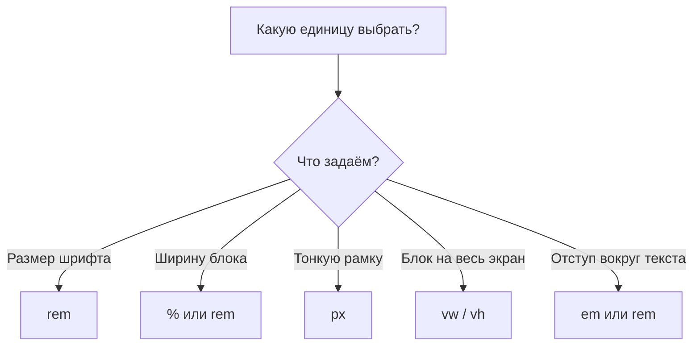
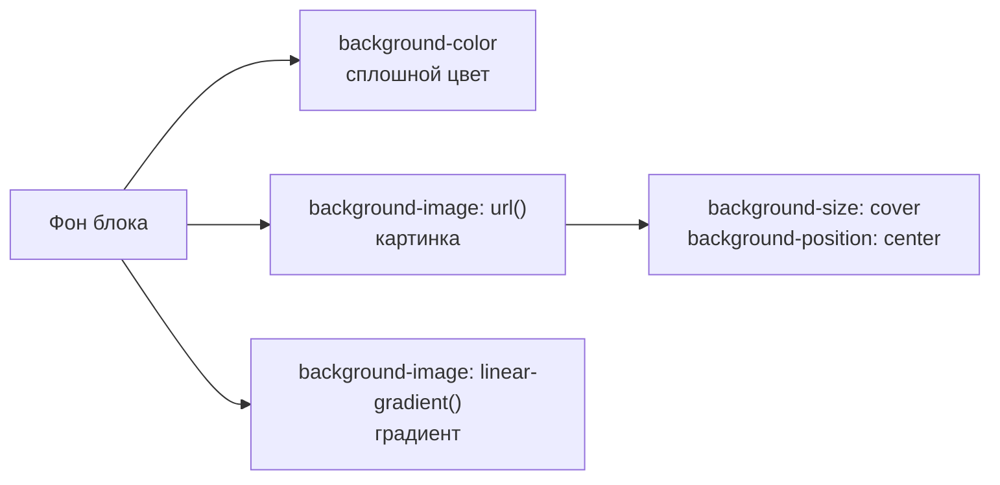

# Цвет, единицы, шрифты и фон

[Содержание](../../README.md) · [← Назад](../../Lesson-2/ru/%D0%A1%D0%B5%D0%BB%D0%B5%D0%BA%D1%82%D0%BE%D1%80%D1%8B%20%D0%B8%20%D0%BA%D0%B0%D1%81%D0%BA%D0%B0%D0%B4.md) · [Вперёд →](../../Lesson-4/ru/Box%20model%20%28%D0%BC%D0%BE%D0%B4%D0%B5%D0%BB%D1%8C%20%D0%B1%D0%BB%D0%BE%D0%BA%D0%B0%29.md) · [RU](%D0%A6%D0%B2%D0%B5%D1%82%2C%20%D0%B5%D0%B4%D0%B8%D0%BD%D0%B8%D1%86%D1%8B%2C%20%D1%88%D1%80%D0%B8%D1%84%D1%82%D1%8B%20%D0%B8%20%D1%84%D0%BE%D0%BD.md) · [EN](../en/Color%2C%20units%2C%20fonts%20and%20background.md) · [UZ](../uz/Rang%2C%20birliklar%2C%20shriftlar%20va%20fon.md)

> **Связь с прошлым уроком:** в уроке 2 вы научились точно выбирать элементы. Сегодня разберёмся, **чем** их оформлять: цвета, размеры, шрифты и фон.

---

## Зачем это вам

Хороший сайт узнают по трём вещам: читаемый текст, приятные цвета, аккуратный фон. Всё это - сегодняшний урок.

Вы научитесь записывать любой цвет, выбирать размеры, которые подстраиваются под настройки пользователя, подключать красивые шрифты и делать фон с картинкой или градиентом.

---

## Чему вы научитесь

- Записывать цвет названием, `hex`, `rgb()` и `hsl()`, делать полупрозрачность.
- Выбирать единицы: `px`, `rem`, `em`, `%`, `vw`, `vh`.
- Подключать шрифт с запасными вариантами и с Google Fonts.
- Настраивать текст: размер, насыщенность, межстрочный интервал, выравнивание.
- Делать фон: цвет, картинку, градиент.
- Проверять контраст текста и фона.

---

## Повторение: 3 вопроса из урока 2

1. Как выбрать в CSS элементы с классом `card`?
2. Какое правило победит: `.notice` или `p`?
3. Наследуется ли `color`?

Ответы - в конце урока.

---

## План урока

| Раздел | Что делаем |
| --- | --- |
| Цвет | Краски в баночках и миксер |
| Контраст | Читаемость на солнце |
| Единицы размеров | Линейка и рост |
| Мини-задание 1 | Цвета и размеры |
| Шрифты | Гарнитура и запасные шрифты |
| Оформление текста | Интервал, выравнивание, украшения |
| Фон | Цвет, картинка, градиент |
| Мини-задание 2 | Шапка с градиентом |
| Самостоятельная работа | Задание в IDE и своя страница |

---

## Цвет

**Простыми словами:** есть готовые краски в баночках - названия цветов. А есть миксер, где вы смешиваете красный, зелёный и синий в нужных долях - это `hex` и `rgb()`.

| Формат | Пример | Когда удобен |
| --- | --- | --- |
| Название | `navy`, `teal`, `white` | Быстрые пробы |
| `hex` | `#1e3a8a` | Самый частый: так цвета дают дизайнеры |
| `rgb()` | `rgb(30, 58, 138)` | Когда цвет задан числами |
| `rgb()` с прозрачностью | `rgb(30 58 138 / 50%)` | Полупрозрачный цвет |
| `hsl()` | `hsl(225, 64%, 33%)` | Удобно делать светлее или темнее |

### Как читать `hex`

`#1e3a8a` - три пары символов: **красный** `1e`, **зелёный** `3a`, **синий** `8a`. Каждая пара - от `00` (нет цвета) до `ff` (максимум).

| Код | Цвет |
| --- | --- |
| `#000000` | Чёрный: всё выключено |
| `#ffffff` | Белый: всё на максимуме |
| `#ff0000` | Красный |
| `#333333` | Тёмно-серый: все три равны |

Если пары одинаковые, можно сократить: `#ffffff` → `#fff`, `#336699` → `#369`.

### `hsl()` - цвет по-человечески

| Часть | Что значит | Пример |
| --- | --- | --- |
| Тон | Угол на цветовом круге, 0–360 | 0 - красный, 120 - зелёный, 225 - синий |
| Насыщенность | 0% - серый, 100% - яркий | `64%` |
| Светлота | 0% - чёрный, 100% - белый | `33%` |

**Удобство:** нужен цвет светлее - увеличьте последнее число. `hsl(225, 64%, 33%)` → `hsl(225, 64%, 90%)` - тот же синий, но для светлого фона.

### Полупрозрачность

```css
.overlay {
    background-color: rgb(0 0 0 / 50%);
}
```

Чёрный, наполовину прозрачный: сквозь него видно то, что под ним.

**Как подобрать цвет:** кликните по цветному квадратику в DevTools → Styles. Откроется палитра с пипеткой и переключением форматов.

---

## Контраст

Помните урок 8 курса HTML: обычный текст должен иметь контраст с фоном **не меньше 4.5:1**.

| Текст на белом | Контраст | |
| --- | --- | --- |
| `#333333` | 12.6:1 | ✅ |
| `#767676` | 4.54:1 | ✅ на грани |
| `#999999` | 2.85:1 | ❌ |

Проверяйте в [WebAIM Contrast Checker](https://webaim.org/resources/contrastchecker/) или прямо в палитре DevTools: там показан коэффициент контраста и отметка, проходит ли он.

**Не передавайте смысл только цветом.** Ошибка формы - не просто красная рамка, а ещё и текст «Ошибка: ...».

---

## Единицы размеров

**Простыми словами:** `px` - сантиметры на линейке: всегда одинаковые. `rem` и `em` - «в два моих роста»: зависят от того, с чем сравнивать.

| Единица | Относительно чего | Пример | Когда использовать |
| --- | --- | --- | --- |
| `px` | Ни от чего: фиксировано | `border: 1px` | Тонкие рамки, тени |
| `rem` | Размера шрифта **страницы** (обычно 16px) | `1.5rem` = 24px | **Размеры шрифтов** и отступы |
| `em` | Размера шрифта **самого элемента** | `0.5em` | Отступы, которые растут вместе с текстом |
| `%` | Размера **родителя** | `width: 50%` | Ширина блоков |
| `vw` / `vh` | 1% ширины / высоты **окна** | `height: 100vh` | Блок на весь экран |

### Почему шрифты в `rem`, а не в `px`

Человек со слабым зрением ставит в настройках браузера крупный шрифт. Размеры в `rem` вырастут вместе с ним, а размеры в `px` - нет.

| Нужно | `rem` |
| --- | --- |
| 16px | `1rem` |
| 20px | `1.25rem` |
| 24px | `1.5rem` |
| 32px | `2rem` |

Делите пиксели на 16.

**Правило курса:** размеры шрифтов - в `rem`, тонкие рамки - в `px`.



**Как читать схему.** По тому, что вы задаёте, выбирайте единицу. Если сомневаетесь - `rem`.

---

## Мини-задание 1

Напишите правило для класса `.notice`: тёмно-красный текст `#991b1b`, светлый фон `#fee2e2`, размер шрифта 20px **в `rem`**. Решение - в разделе «Ответы».

---

## Шрифты

### `font-family` и запасные шрифты

```css
body {
    font-family: "Segoe UI", Roboto, Arial, sans-serif;
}
```

Браузер берёт **первый шрифт, который есть** на устройстве. Если нет ни одного - последний, **общее семейство**:

| Общее семейство | Как выглядит |
| --- | --- |
| `sans-serif` | Без засечек: основной текст сайтов |
| `serif` | С засечками: как в книгах |
| `monospace` | Все буквы одной ширины: для кода |

Названия из нескольких слов - в кавычках: `"Segoe UI"`.

### Шрифт с Google Fonts

1. Откройте [fonts.google.com](https://fonts.google.com), выберите шрифт с поддержкой кириллицы, например **Inter**.
2. Нажмите **Get font → Get embed code**, скопируйте строки `<link>`.
3. Вставьте их в `<head>` **перед** своим `style.css`.
4. Используйте в CSS:

```css
body {
    font-family: "Inter", Arial, sans-serif;
}
```

Не подключайте больше двух шрифтов: каждый весит сотни килобайт и замедляет страницу.

### Свойства текста

| Свойство | Что делает | Пример |
| --- | --- | --- |
| `font-size` | Размер | `1.125rem` |
| `font-weight` | Насыщенность: 400 - обычный, 700 - жирный | `600` |
| `font-style` | Курсив | `italic` |
| `line-height` | Межстрочный интервал, **без единиц** | `1.6` |
| `text-align` | Выравнивание | `center` |
| `text-decoration` | Подчёркивание | `none` |
| `text-transform` | Регистр | `uppercase` |
| `letter-spacing` | Расстояние между буквами | `0.05em` |

```css
body {
    font-family: "Inter", Arial, sans-serif;
    font-size: 1rem;
    line-height: 1.6;
    color: #1f2937;
}

h1 {
    font-size: 2rem;
    font-weight: 700;
    line-height: 1.2;
}
```

**Что увидите:** основной текст с удобным интервалом между строками, заголовок крупный и плотный.

**`line-height` без единиц** (`1.6`, а не `1.6px`) - это «в 1.6 раза больше размера шрифта». Для основного текста 1.5–1.7, для заголовков 1.1–1.3.

### Попробуйте сломать

Поставьте `line-height: 1;` у абзацев длиной в несколько строк. Тяжело читать? Верните `1.6`.

---

## Фон

| Свойство | Что делает | Пример |
| --- | --- | --- |
| `background-color` | Цвет | `#eef2ff` |
| `background-image` | Картинка или градиент | `url("../images/hero.jpg")` |
| `background-size` | Размер картинки | `cover` - заполнить весь блок |
| `background-position` | Где картинка | `center` |
| `background-repeat` | Повторять ли | `no-repeat` |

### Картинка на фоне

```css
.hero {
    background-color: #1e3a8a;
    background-image: url("../images/hero.jpg");
    background-size: cover;
    background-position: center;
    color: white;
}
```

**Путь в `url()` - от CSS-файла**, а не от HTML. Файл в `css/style.css`, картинка в `images/` → нужно подняться: `../images/hero.jpg`.

**Цвет фона под картинкой** - на случай, если картинка не загрузилась: белый текст не окажется на белом.

### Градиент

```css
.hero {
    background-image: linear-gradient(135deg, #1e3a8a, #7c3aed);
}
```

| Часть | Что значит |
| --- | --- |
| `135deg` | Направление: из левого верхнего угла в правый нижний |
| `#1e3a8a, #7c3aed` | От какого цвета к какому |



**Как читать схему.** Фон бывает цветом, картинкой или градиентом. Картинке почти всегда нужны `cover` и `center`.

### Частые ошибки новичков

| Ошибка | Как исправить |
| --- | --- |
| `color: 1e3a8a` без `#` | `color: #1e3a8a;` |
| Шрифты в `px` | В `rem` |
| `line-height: 1.6px` | Без единиц: `1.6` |
| Нет запасного шрифта | Заканчивайте `sans-serif` или `serif` |
| `url()` от HTML-файла | Путь - от CSS-файла: `../images/...` |
| Белый текст на картинке без цвета фона | Добавьте `background-color` |
| Светло-серый текст на белом | Проверьте контраст ≥ 4.5:1 |

---

## Мини-задание 2

Сделайте шапку `.site-header`: градиент из `#1e3a8a` в `#7c3aed` под углом `135deg`, белый текст, заголовок внутри шапки по центру. Решение - в разделе «Ответы».

---

## Итоги урока: шпаргалка

| Задача | Запись |
| --- | --- |
| Цвет | `#1e3a8a`, `rgb(30 58 138)`, `hsl(225, 64%, 33%)` |
| Полупрозрачный | `rgb(0 0 0 / 50%)` |
| Размер шрифта | `font-size: 1.25rem;` |
| Шрифт | `font-family: "Inter", Arial, sans-serif;` |
| Жирность | `font-weight: 700;` |
| Интервал | `line-height: 1.6;` |
| По центру | `text-align: center;` |
| Без подчёркивания | `text-decoration: none;` |
| Картинка на фоне | `background-image: url("../images/x.jpg"); background-size: cover;` |
| Градиент | `background-image: linear-gradient(135deg, #1e3a8a, #7c3aed);` |
| Контраст | ≥ 4.5:1 |

---

## Самостоятельная работа

### Часть 1. Задание в IDE (засчитывается платформой)

Оформите страницу кружка в `<style>`:

1. `body`: шрифт со списком запасных и `sans-serif` в конце, `line-height` без единиц, цвет текста в `hex`.
2. `h1`: размер в `rem`.
3. `.site-header`: градиент `linear-gradient(...)` и белый текст.
4. `.notice`: полупрозрачный фон через `rgb(... / ...%)` или `hsl()`.
5. Размеры только в `rem`: единицы `px` в этом задании не используйте.

Что проверяет платформа: тег `<style>`, `font-family` с `sans-serif`, `line-height`, `rem`, `linear-gradient(`, классы `site-header` и `notice` в HTML и CSS, полупрозрачный цвет через ` / `, отсутствие единиц `px`.

### Часть 2. Проект на компьютере

1. Подключите шрифт с Google Fonts к своему сайту.
2. Переведите все размеры шрифтов в `rem`.
3. Сделайте шапку с градиентом или картинкой на фоне.
4. Проверьте контраст основного текста и текста в шапке.
5. Увеличьте шрифт в настройках браузера: текст сайта вырос?

### Критерии готовности

- [ ] Задание в IDE засчитано.
- [ ] У шрифта есть запасные варианты.
- [ ] Размеры шрифтов в `rem`, `line-height` без единиц.
- [ ] Контраст основного текста ≥ 4.5:1.
- [ ] Под фоновой картинкой задан цвет фона.
- [ ] Пути в `url()` работают.

---

## Вопросы для самопроверки

1. Что означают три пары символов в `#1e3a8a`?
2. Как сократить `#ffffff`?
3. Как сделать цвет полупрозрачным?
4. Чем `rem` отличается от `px`?
5. Почему размеры шрифтов лучше в `rem`?
6. Чем `em` отличается от `rem`?
7. Зачем в `font-family` несколько шрифтов?
8. Почему `line-height` пишут без единиц?
9. От какого файла считается путь в `url()`?
10. Зачем цвет фона под фоновой картинкой?

После вопросов пройдите **тест урока** на платформе: 12 вопросов, порог 70%.

---

## Что дальше

Цвета и шрифты есть, но блоки слиплись друг с другом. В уроке 4 разберём, из чего состоит любой блок: содержимое, внутренний отступ, рамка, внешний отступ.

---

## Ответы

**Повторение**

1. `.card { ... }`.
2. `.notice`: класс специфичнее тега.
3. Да.

**Мини-задание 1**

```css
.notice {
    color: #991b1b;
    background-color: #fee2e2;
    font-size: 1.25rem;
}
```

**Мини-задание 2**

```css
.site-header {
    background-image: linear-gradient(135deg, #1e3a8a, #7c3aed);
    color: white;
}

.site-header h1 {
    text-align: center;
}
```

**Вопросы для самопроверки**

1. Доля красного, зелёного и синего, от `00` до `ff`.
2. `#fff`.
3. `rgb(0 0 0 / 50%)` или `hsl(... / 50%)`.
4. `px` фиксирован, `rem` зависит от размера шрифта страницы.
5. Они растут, когда пользователь увеличивает шрифт в настройках.
6. `em` зависит от шрифта самого элемента, `rem` - от шрифта страницы.
7. Если первого шрифта нет на устройстве, браузер возьмёт следующий.
8. Тогда интервал пропорционален размеру шрифта любого элемента.
9. От CSS-файла.
10. Если картинка не загрузится, текст останется читаемым.

---

[Содержание](../../README.md) · [← Назад](../../Lesson-2/ru/%D0%A1%D0%B5%D0%BB%D0%B5%D0%BA%D1%82%D0%BE%D1%80%D1%8B%20%D0%B8%20%D0%BA%D0%B0%D1%81%D0%BA%D0%B0%D0%B4.md) · [Вперёд →](../../Lesson-4/ru/Box%20model%20%28%D0%BC%D0%BE%D0%B4%D0%B5%D0%BB%D1%8C%20%D0%B1%D0%BB%D0%BE%D0%BA%D0%B0%29.md) · [RU](%D0%A6%D0%B2%D0%B5%D1%82%2C%20%D0%B5%D0%B4%D0%B8%D0%BD%D0%B8%D1%86%D1%8B%2C%20%D1%88%D1%80%D0%B8%D1%84%D1%82%D1%8B%20%D0%B8%20%D1%84%D0%BE%D0%BD.md) · [EN](../en/Color%2C%20units%2C%20fonts%20and%20background.md) · [UZ](../uz/Rang%2C%20birliklar%2C%20shriftlar%20va%20fon.md)
