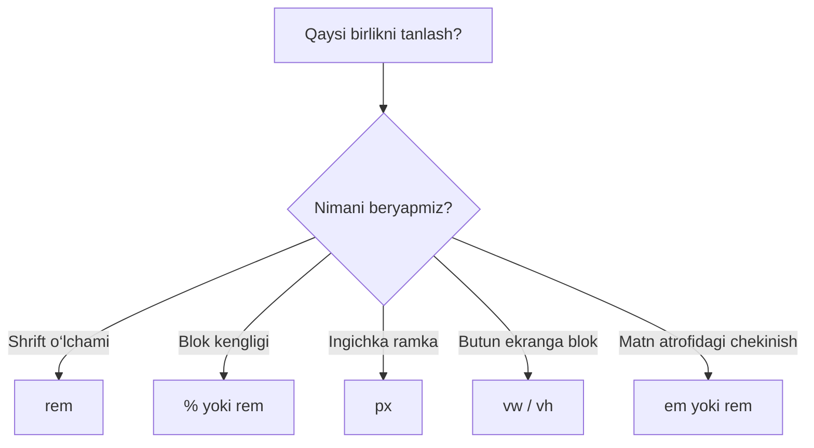
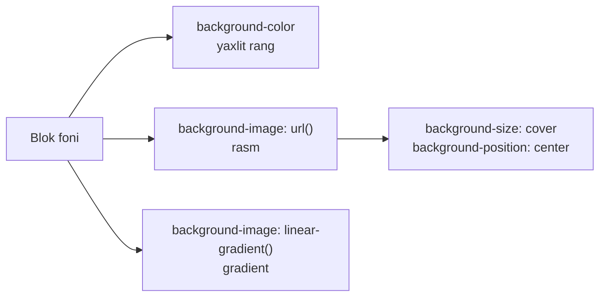

# Rang, birliklar, shriftlar va fon

[Mundarija](../../README.md) · [← Orqaga](../../Lesson-2/uz/Selektorlar%20va%20kaskad.md) · [Keyingi →](../../Lesson-4/uz/Box%20model%20%28blok%20modeli%29.md) · [RU](../ru/%D0%A6%D0%B2%D0%B5%D1%82%2C%20%D0%B5%D0%B4%D0%B8%D0%BD%D0%B8%D1%86%D1%8B%2C%20%D1%88%D1%80%D0%B8%D1%84%D1%82%D1%8B%20%D0%B8%20%D1%84%D0%BE%D0%BD.md) · [EN](../en/Color%2C%20units%2C%20fonts%20and%20background.md) · [UZ](Rang%2C%20birliklar%2C%20shriftlar%20va%20fon.md)

> **Oldingi dars bilan bog‘liqlik:** 2-darsda elementlarni aniq tanlashni o‘rgandingiz. Bugun ularni **nima bilan** bezashni ko‘rib chiqamiz: ranglar, o‘lchamlar, shriftlar va fon.

---

## Bu sizga nima uchun kerak

Yaxshi sayt uchta narsadan taniladi: o‘qiladigan matn, yoqimli ranglar, ozoda fon. Bularning hammasi - bugungi dars.

Istalgan rangni yozishni, foydalanuvchi sozlamalariga moslashadigan o‘lchamlarni tanlashni, chiroyli shriftlarni ulashni va rasm yoki gradientli fon yasashni o‘rganasiz.

---

## Nimani o‘rganasiz

- Rangni nom, `hex`, `rgb()` va `hsl()` bilan yozish, yarim shaffoflik qilish.
- Birliklarni tanlash: `px`, `rem`, `em`, `%`, `vw`, `vh`.
- Shriftni zaxira variantlari bilan va Google Fonts dan ulash.
- Matnni sozlash: o‘lcham, qalinlik, qatorlararo interval, tekislash.
- Fon yasash: rang, rasm, gradient.
- Matn va fon kontrastini tekshirish.

---

## Takrorlash: 2-darsdan 3 savol

1. CSS da `card` sinfli elementlarni qanday tanlash mumkin?
2. Qaysi qoida yutadi: `.notice` yoki `p`?
3. `color` meros bo‘ladimi?

Javoblar - dars oxirida.

---

## Reja

| Bo‘lim | Nima qilamiz |
| --- | --- |
| Rang | Bankadagi bo‘yoqlar va mikser |
| Kontrast | Quyoshda o‘qilishi |
| O‘lcham birliklari | Chizg‘ich va bo‘y |
| Mini-topshiriq 1 | Ranglar va o‘lchamlar |
| Shriftlar | Garnitura va zaxira shriftlar |
| Matnni bezash | Interval, tekislash, bezaklar |
| Fon | Rang, rasm, gradient |
| Mini-topshiriq 2 | Gradientli shapka |
| Mustaqil ish | IDE topshirig‘i va o‘z sahifangiz |

---

## Rang

**Oddiy qilib aytganda:** bankalardagi tayyor bo‘yoqlar bor - ranglar nomlari. Mikser ham bor: unda qizil, yashil va ko‘kni kerakli ulushda aralashtirasiz - bu `hex` va `rgb()`.

| Format | Misol | Qachon qulay |
| --- | --- | --- |
| Nom | `navy`, `teal`, `white` | Tez sinab ko‘rish |
| `hex` | `#1e3a8a` | Eng ko‘p uchraydi: dizaynerlar ranglarni shunday beradi |
| `rgb()` | `rgb(30, 58, 138)` | Rang sonlar bilan berilganda |
| Shaffoflikli `rgb()` | `rgb(30 58 138 / 50%)` | Yarim shaffof rang |
| `hsl()` | `hsl(225, 64%, 33%)` | Ochroq yoki to‘qroq qilish qulay |

### `hex` ni qanday o‘qish

`#1e3a8a` - uch juft belgi: **qizil** `1e`, **yashil** `3a`, **ko‘k** `8a`. Har bir juft - `00` (rang yo‘q) dan `ff` (maksimum) gacha.

| Kod | Rang |
| --- | --- |
| `#000000` | Qora: hammasi o‘chiq |
| `#ffffff` | Oq: hammasi maksimumda |
| `#ff0000` | Qizil |
| `#333333` | To‘q kulrang: uchalasi teng |

Juftlar bir xil bo‘lsa, qisqartirish mumkin: `#ffffff` → `#fff`, `#336699` → `#369`.

### `hsl()` - odamcha rang

| Qism | Ma’nosi | Misol |
| --- | --- | --- |
| Ton | Rang doirasidagi burchak, 0–360 | 0 - qizil, 120 - yashil, 225 - ko‘k |
| To‘yinganlik | 0% - kulrang, 100% - yorqin | `64%` |
| Yorqinlik | 0% - qora, 100% - oq | `33%` |

**Qulayligi:** ochroq rang kerakmi - oxirgi sonni oshiring. `hsl(225, 64%, 33%)` → `hsl(225, 64%, 90%)` - o‘sha ko‘k, lekin och fon uchun.

### Yarim shaffoflik

```css
.overlay {
    background-color: rgb(0 0 0 / 50%);
}
```

Yarmi shaffof qora: u orqali ostidagi ko‘rinadi.

**Rangni qanday tanlash:** DevTools → Styles dagi rangli kvadratchani bosing. Pipetkali va formatlarni almashtiradigan palitra ochiladi.

---

## Kontrast

HTML kursining 8-darsini eslang: oddiy matn fon bilan **kamida 4.5:1** kontrastga ega bo‘lishi kerak.

| Oqdagi matn | Kontrast | |
| --- | --- | --- |
| `#333333` | 12.6:1 | ✅ |
| `#767676` | 4.54:1 | ✅ chegarada |
| `#999999` | 2.85:1 | ❌ |

[WebAIM Contrast Checker](https://webaim.org/resources/contrastchecker/) da yoki to‘g‘ridan-to‘g‘ri DevTools palitrasida tekshiring: u yerda kontrast koeffitsienti va u o‘tadimi degan belgi ko‘rsatilgan.

**Ma’noni faqat rang bilan bermang.** Forma xatosi - shunchaki qizil ramka emas, balki «Xato: ...» matni ham.

---

## O‘lcham birliklari

**Oddiy qilib aytganda:** `px` - chizg‘ichdagi santimetrlar: doim bir xil. `rem` va `em` - «mening ikki bo‘yimcha»: nima bilan solishtirishga bog‘liq.

| Birlik | Nimaga nisbatan | Misol | Qachon ishlatish |
| --- | --- | --- | --- |
| `px` | Hech narsaga: qat’iy | `border: 1px` | Ingichka ramkalar, soyalar |
| `rem` | **Sahifa** shrifti o‘lchamiga (odatda 16px) | `1.5rem` = 24px | **Shrift o‘lchamlari** va chekinishlar |
| `em` | **Elementning o‘zi** shrifti o‘lchamiga | `0.5em` | Matn bilan birga o‘sadigan chekinishlar |
| `%` | **Ota element** o‘lchamiga | `width: 50%` | Bloklar kengligi |
| `vw` / `vh` | **Oyna** kengligi / balandligining 1% i | `height: 100vh` | Butun ekranga blok |

### Nega shriftlar `px` da emas, `rem` da

Ko‘zi zaif odam brauzer sozlamalarida yirik shriftni o‘rnatadi. `rem` dagi o‘lchamlar u bilan birga o‘sadi, `px` dagilari esa - yo‘q.

| Kerak | `rem` |
| --- | --- |
| 16px | `1rem` |
| 20px | `1.25rem` |
| 24px | `1.5rem` |
| 32px | `2rem` |

Piksellarni 16 ga bo‘ling.

**Kurs qoidasi:** shrift o‘lchamlari - `rem` da, ingichka ramkalar - `px` da.



**Sxemani qanday o‘qish kerak.** Nimani berayotganingizga qarab birlikni tanlang. Ikkilansangiz - `rem`.

---

## Mini-topshiriq 1

`.notice` sinfi uchun qoida yozing: `#991b1b` to‘q qizil matn, `#fee2e2` och fon, 20px shrift o‘lchami **`rem` da**. Yechim - «Javoblar» bo‘limida.

---

## Shriftlar

### `font-family` va zaxira shriftlar

```css
body {
    font-family: "Segoe UI", Roboto, Arial, sans-serif;
}
```

Brauzer qurilmada **bor birinchi shriftni** oladi. Birortasi ham bo‘lmasa - oxirgisini, **umumiy oilani**:

| Umumiy oila | Qanday ko‘rinadi |
| --- | --- |
| `sans-serif` | Kertiksiz: saytlarning asosiy matni |
| `serif` | Kertikli: kitoblardagidek |
| `monospace` | Barcha harflar bir xil kenglikda: kod uchun |

Bir necha so‘zli nomlar - qo‘shtirnoqda: `"Segoe UI"`.

### Google Fonts dan shrift

1. [fonts.google.com](https://fonts.google.com) ni oching, o‘zbekcha o‘, g‘ harflarini to‘g‘ri ko‘rsatadigan shriftni tanlang, masalan **Inter**.
2. **Get font → Get embed code** ni bosing, `<link>` qatorlarini nusxalang.
3. Ularni `<head>` ga o‘z `style.css` ingizdan **oldin** qo‘ying.
4. CSS da ishlating:

```css
body {
    font-family: "Inter", Arial, sans-serif;
}
```

Ikkitadan ortiq shrift ulamang: har biri yuzlab kilobayt og‘irlikda va sahifani sekinlashtiradi.

### Matn xususiyatlari

| Xususiyat | Nima qiladi | Misol |
| --- | --- | --- |
| `font-size` | O‘lcham | `1.125rem` |
| `font-weight` | Qalinlik: 400 - oddiy, 700 - qalin | `600` |
| `font-style` | Kursiv | `italic` |
| `line-height` | Qatorlararo interval, **birliksiz** | `1.6` |
| `text-align` | Tekislash | `center` |
| `text-decoration` | Tagiga chizish | `none` |
| `text-transform` | Registr | `uppercase` |
| `letter-spacing` | Harflar orasidagi masofa | `0.05em` |

```css
body {
    font-family: "Inter", Arial, sans-serif;
    font-size: 1rem;
    line-height: 1.6;
    color: #1f2937;
}

h1 {
    font-size: 2rem;
    font-weight: 700;
    line-height: 1.2;
}
```

**Nimani ko‘rasiz:** qatorlar orasida qulay intervalli asosiy matn, yirik va zich sarlavha.

**Birliksiz `line-height`** (`1.6px` emas, `1.6`) - bu «shrift o‘lchamidan 1.6 marta katta». Asosiy matn uchun 1.5–1.7, sarlavhalar uchun 1.1–1.3.

### Buzib ko‘ring

Bir necha qatorli abzatslarga `line-height: 1;` qo‘ying. O‘qish qiyinmi? `1.6` ni qaytaring.

---

## Fon

| Xususiyat | Nima qiladi | Misol |
| --- | --- | --- |
| `background-color` | Rang | `#eef2ff` |
| `background-image` | Rasm yoki gradient | `url("../images/hero.jpg")` |
| `background-size` | Rasm o‘lchami | `cover` - butun blokni to‘ldirish |
| `background-position` | Rasm qayerda | `center` |
| `background-repeat` | Takrorlansinmi | `no-repeat` |

### Fondagi rasm

```css
.hero {
    background-color: #1e3a8a;
    background-image: url("../images/hero.jpg");
    background-size: cover;
    background-position: center;
    color: white;
}
```

**`url()` dagi yo‘l HTML dan emas, CSS fayldan hisoblanadi.** Fayl `css/style.css` da, rasm `images/` da → yuqoriga ko‘tarilish kerak: `../images/hero.jpg`.

**Rasm ostidagi fon rangi** - rasm yuklanmagan holat uchun: oq matn oq ustida qolib ketmaydi.

### Gradient

```css
.hero {
    background-image: linear-gradient(135deg, #1e3a8a, #7c3aed);
}
```

| Qism | Ma’nosi |
| --- | --- |
| `135deg` | Yo‘nalish: chap yuqori burchakdan o‘ng pastki burchakka |
| `#1e3a8a, #7c3aed` | Qaysi rangdan qaysi rangga |



**Sxemani qanday o‘qish kerak.** Fon rang, rasm yoki gradient bo‘ladi. Rasmga deyarli doim `cover` va `center` kerak.

### Yangi o‘rganuvchilarning tipik xatolari

| Xato | Qanday tuzatish |
| --- | --- |
| `#` siz `color: 1e3a8a` | `color: #1e3a8a;` |
| Shriftlar `px` da | `rem` da |
| `line-height: 1.6px` | Birliksiz: `1.6` |
| Zaxira shrift yo‘q | `sans-serif` yoki `serif` bilan yakunlang |
| `url()` HTML fayldan | Yo‘l CSS fayldan: `../images/...` |
| Fon rangisiz rasm ustidagi oq matn | `background-color` qo‘shing |
| Oq ustida och kulrang matn | Kontrastni tekshiring ≥ 4.5:1 |

---

## Mini-topshiriq 2

`.site-header` shapkasini yasang: `135deg` burchak ostida `#1e3a8a` dan `#7c3aed` ga gradient, oq matn, shapka ichidagi sarlavha markazda. Yechim - «Javoblar» bo‘limida.

---

## Dars yakuni: shpargalka

| Vazifa | Yozuv |
| --- | --- |
| Rang | `#1e3a8a`, `rgb(30 58 138)`, `hsl(225, 64%, 33%)` |
| Yarim shaffof | `rgb(0 0 0 / 50%)` |
| Shrift o‘lchami | `font-size: 1.25rem;` |
| Shrift | `font-family: "Inter", Arial, sans-serif;` |
| Qalinlik | `font-weight: 700;` |
| Interval | `line-height: 1.6;` |
| Markazda | `text-align: center;` |
| Tagiga chiziqsiz | `text-decoration: none;` |
| Fondagi rasm | `background-image: url("../images/x.jpg"); background-size: cover;` |
| Gradient | `background-image: linear-gradient(135deg, #1e3a8a, #7c3aed);` |
| Kontrast | ≥ 4.5:1 |

---

## Mustaqil ish

### 1-qism. IDE topshirig‘i (platforma hisoblaydi)

To‘garak sahifasini `<style>` da bezang:

1. `body`: zaxiralar ro‘yxati va oxirida `sans-serif` li shrift, birliksiz `line-height`, `hex` dagi matn rangi.
2. `h1`: `rem` dagi o‘lcham.
3. `.site-header`: `linear-gradient(...)` gradienti va oq matn.
4. `.notice`: `rgb(... / ...%)` yoki `hsl()` orqali yarim shaffof fon.
5. O‘lchamlar faqat `rem` da: bu topshiriqda `px` birliklarini ishlatmang.

Platforma nimani tekshiradi: `<style>` tegi, `sans-serif` li `font-family`, `line-height`, `rem`, `linear-gradient(`, HTML va CSS da `site-header` va `notice` sinflari, ` / ` orqali yarim shaffof rang, `px` birliklari yo‘qligi.

### 2-qism. Kompyuterdagi loyiha

1. Saytingizga Google Fonts dan shrift ulang.
2. Barcha shrift o‘lchamlarini `rem` ga o‘tkazing.
3. Gradientli yoki fonida rasmli shapka yasang.
4. Asosiy matn va shapkadagi matn kontrastini tekshiring.
5. Brauzer sozlamalarida shriftni kattalashtiring: sayt matni o‘sdimi?

### Tayyorlik mezonlari

- [ ] IDE topshirig‘i qabul qilingan.
- [ ] Shriftning zaxira variantlari bor.
- [ ] Shrift o‘lchamlari `rem` da, `line-height` birliksiz.
- [ ] Asosiy matn kontrasti ≥ 4.5:1.
- [ ] Fon rasmi ostida fon rangi berilgan.
- [ ] `url()` dagi yo‘llar ishlaydi.

---

## O‘zini tekshirish uchun savollar

1. `#1e3a8a` dagi uch juft belgi nimani bildiradi?
2. `#ffffff` ni qanday qisqartirish mumkin?
3. Rangni qanday qilib yarim shaffof qilish mumkin?
4. `rem` `px` dan nimasi bilan farq qiladi?
5. Nega shrift o‘lchamlari `rem` da yaxshiroq?
6. `em` `rem` dan nimasi bilan farq qiladi?
7. `font-family` da bir nechta shrift nima uchun?
8. Nega `line-height` birliksiz yoziladi?
9. `url()` dagi yo‘l qaysi fayldan hisoblanadi?
10. Fon rasmi ostidagi fon rangi nima uchun?

Savollardan keyin platformada **dars testini** topshiring: 12 ta savol, o‘tish chegarasi 70%.

---

## Keyin nima

Ranglar va shriftlar bor, lekin bloklar bir-biriga yopishib qoldi. 4-darsda istalgan blok nimadan iboratligini ko‘rib chiqamiz: mazmun, ichki chekinish, ramka, tashqi chekinish.

---

## Javoblar

**Takrorlash**

1. `.card { ... }`.
2. `.notice`: sinf tegdan spetsifikroq.
3. Ha.

**Mini-topshiriq 1**

```css
.notice {
    color: #991b1b;
    background-color: #fee2e2;
    font-size: 1.25rem;
}
```

**Mini-topshiriq 2**

```css
.site-header {
    background-image: linear-gradient(135deg, #1e3a8a, #7c3aed);
    color: white;
}

.site-header h1 {
    text-align: center;
}
```

**O‘zini tekshirish uchun savollar**

1. Qizil, yashil va ko‘k ulushi, `00` dan `ff` gacha.
2. `#fff`.
3. `rgb(0 0 0 / 50%)` yoki `hsl(... / 50%)`.
4. `px` qat’iy, `rem` sahifa shrifti o‘lchamiga bog‘liq.
5. Foydalanuvchi sozlamalarda shriftni kattalashtirganda ular o‘sadi.
6. `em` elementning o‘z shriftiga, `rem` - sahifa shriftiga bog‘liq.
7. Birinchi shrift qurilmada bo‘lmasa, brauzer keyingisini oladi.
8. Shunda interval istalgan elementning shrift o‘lchamiga mutanosib bo‘ladi.
9. CSS fayldan.
10. Rasm yuklanmasa, matn o‘qiladigan bo‘lib qoladi.

---

[Mundarija](../../README.md) · [← Orqaga](../../Lesson-2/uz/Selektorlar%20va%20kaskad.md) · [Keyingi →](../../Lesson-4/uz/Box%20model%20%28blok%20modeli%29.md) · [RU](../ru/%D0%A6%D0%B2%D0%B5%D1%82%2C%20%D0%B5%D0%B4%D0%B8%D0%BD%D0%B8%D1%86%D1%8B%2C%20%D1%88%D1%80%D0%B8%D1%84%D1%82%D1%8B%20%D0%B8%20%D1%84%D0%BE%D0%BD.md) · [EN](../en/Color%2C%20units%2C%20fonts%20and%20background.md) · [UZ](Rang%2C%20birliklar%2C%20shriftlar%20va%20fon.md)
