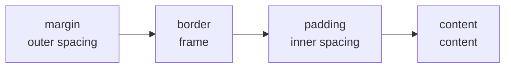
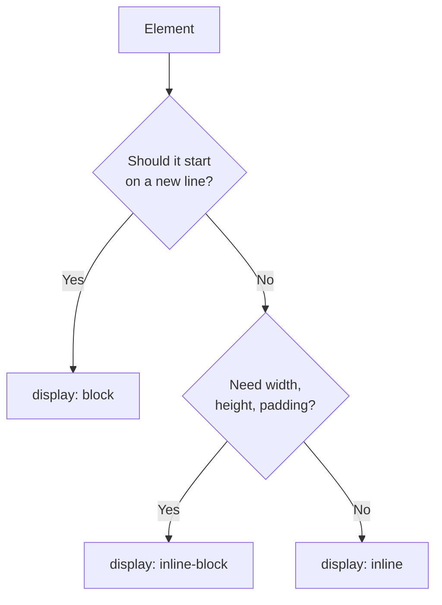

# Box model

[Contents](../../README.md) · [← Back](../../Lesson-3/en/Color%2C%20units%2C%20fonts%20and%20background.md) · [Next →](../../Lesson-5/en/Flexbox.md) · [RU](../ru/Box%20model%20%28%D0%BC%D0%BE%D0%B4%D0%B5%D0%BB%D1%8C%20%D0%B1%D0%BB%D0%BE%D0%BA%D0%B0%29.md) · [EN](Box%20model.md) · [UZ](../uz/Box%20model%20%28blok%20modeli%29.md)

> **Link to the previous lesson:** in Lesson 3 you set colors, fonts and backgrounds. But the blocks are still stuck together: the text touches the edges, the cards stand right next to each other. Today we look at what any block is made of and learn to control space.

---

## Why you need this

Look at any tidy website: there is air around the text in a card, gaps between cards, rounded corners and a shadow on a button. All of this is the box model.

Every element on a page is a rectangular box. Once you understand how it is built, you stop guessing why a block "moved to the wrong place".

---

## What you will learn

- Name the four layers of a block: content, `padding`, `border`, `margin`.
- Write spacing in short form: one, two and four values.
- Turn on `box-sizing: border-box` and understand why it is needed.
- Set width: `width`, `max-width`, center a block with `margin: 0 auto`.
- Tell `block`, `inline` and `inline-block` apart.
- Round corners and add a shadow.

---

## Review: 3 questions from Lesson 3

1. What does `2rem` equal when the page font is 16px?
2. How do you write a semi-transparent black?
3. Is `background-color` inherited?

Answers are at the end of the lesson.

---

## Lesson plan

| Section | What we do |
| --- | --- |
| Four layers | A picture in a frame |
| `padding`, `border`, `margin` | Short notation, clockwise |
| `box-sizing` | Why a block is wider than you set |
| Mini-task 1 | A card |
| Width and centering | `max-width` and `margin: 0 auto` |
| Display type | `block`, `inline`, `inline-block` |
| Corners and shadow | `border-radius`, `box-shadow` |
| Mini-task 2 | A link button |
| Independent work | IDE task and your own site |

---

## The four layers of a block

**In simple terms:** a framed picture on a wall.

| Layer | Property | In the picture |
| --- | --- | --- |
| Content | `width`, `height` | The picture itself |
| Inner spacing | `padding` | The mat - the white margin around the picture inside the frame |
| Border | `border` | The frame |
| Outer spacing | `margin` | The distance from the frame to the neighboring pictures |



**How to read the diagram.** The layers are nested from the outside in: `margin` is the outermost, the content is in the center. The block's background fills the content and the `padding`, but not the `margin`.

**Where to see it:** DevTools → Elements → select an element. At the bottom of the Styles panel (or on the **Computed** tab) there is a diagram with four colored rectangles and the size of each layer. When you hover over an element, the page highlights it: blue is content, green is `padding`, orange is `margin`.

---

## `padding`, `border`, `margin`

### `padding` - air inside

```css
.card {
    padding: 16px;
}
```

**What you will see:** the text moved 16px away from the card's edges on all sides. The card's background covers those 16px too.

### `border` - the frame

```css
.card {
    border: 1px solid #cbd5e1;
}
```

Three values: **width**, **style** (`solid`, `dashed`, `dotted`), **color**.

### `margin` - distance to neighbors

```css
.card {
    margin-bottom: 24px;
}
```

**What you will see:** a gap appeared between the cards. `margin` is transparent: the neighbor's or parent's background shows through it.

### Short notation: clockwise

```css
.card {
    padding: 8px 16px 24px 32px;
}
```

| How many values | Example | Means |
| --- | --- | --- |
| 1 | `padding: 16px;` | All sides |
| 2 | `padding: 8px 16px;` | Top-bottom 8, left-right 16 |
| 4 | `padding: 8px 16px 24px 32px;` | Top, right, bottom, left - **clockwise** from 12 o'clock |

You can also set one side: `padding-top`, `margin-left`, `border-bottom`.

### Collapsing outer margins

Two blocks one above the other have `margin-bottom: 24px` and `margin-top: 16px`. The distance between them is **24px**, not 40px: the vertical `margin`s of neighbors do not add up, the larger one wins. Horizontally, margins do add up.

---

## `box-sizing`: why a block is wider than you set

```css
.card {
    width: 300px;
    padding: 20px;
    border: 2px solid #cbd5e1;
}
```

How wide will the card be? By default - **344px**: `width` sets only the content, and `padding` and `border` are added on top. 300 + 20 + 20 + 2 + 2.

That is inconvenient. So almost every project starts with this line:

```css
* {
    box-sizing: border-box;
}
```

Now `width: 300px` is the width **including** `padding` and `border`. The card is exactly 300px, and the content shrinks inside.

| `box-sizing` | `width` includes |
| --- | --- |
| `content-box` (default) | Content only |
| `border-box` | Content + `padding` + `border` |

**Course rule:** `* { box-sizing: border-box; }` is the first rule in every style file.

### Try to break it

Give a card `width: 300px; padding: 20px;`. Look at its width in DevTools. Now add the rule `* { box-sizing: border-box; }`. How did the width change?

---

## Mini-task 1

Style `.card`: inner spacing 16px, a 1px solid `#cbd5e1` border, bottom outer spacing 24px, a white background. Solution is in the "Answers" section.

---

## Width and centering

```css
.container {
    max-width: 960px;
    margin: 0 auto;
    padding: 0 16px;
}
```

| Notation | What it does |
| --- | --- |
| `max-width: 960px` | No wider than 960px, but narrower on a narrow screen |
| `margin: 0 auto` | 0 top and bottom, equal left and right - **centered** |
| `padding: 0 16px` | So that on a phone the text does not stick to the screen edges |

**What you will see:** on a wide screen the content is a 960px column in the center. On a narrow one - full width with 16px spacing.

**`width` or `max-width`?** `width: 960px` overflows a 390px-wide phone screen. `max-width` shrinks. For text columns it is almost always `max-width`.

`margin: 0 auto` centers only a block **that has a width**. Without a width the block already takes the whole line - there is nothing to center.

---

## Display type: `display`

**In simple terms:** blocks are bricks, each on its own line. Inline elements are words in a sentence, following one another.

| `display` | How it behaves | Width and height | Default tag examples |
| --- | --- | --- | --- |
| `block` | Starts on a new line, full width | Work | `div`, `p`, `h1`, `section`, `ul` |
| `inline` | In line with the text | **Do not work**, nor do vertical `margin`s | `a`, `span`, `strong`, `em` |
| `inline-block` | In the line, but like a block | Work | `button`, `input` |
| `none` | Fully hidden, takes no space | - | - |



**How to read the diagram.** Need its own row - `block`. Needs to stay in the line, but with sizes and spacing - `inline-block`.

**A typical situation:** a link `<a>` was given `padding: 12px 24px` to make a button, and it overlaps its neighbors above and below. The reason is `inline`. The fix is `display: inline-block`.

**Hiding:** `display: none` also hides the element from screen readers. Do not hide important text this way.

---

## Corners and shadow

```css
.card {
    border-radius: 12px;
    box-shadow: 0 4px 12px rgb(0 0 0 / 10%);
}
```

| Property | Example | What it does |
| --- | --- | --- |
| `border-radius` | `12px` | Rounds the corners |
| `border-radius` | `50%` | Turns a square into a circle |
| `box-shadow` | `0 4px 12px rgb(0 0 0 / 10%)` | Shadow: X offset, Y offset, blur, color |

**Keep the shadow light:** 8–15% opacity. A solid black shadow looks dirty.

### Typical beginner mistakes

| Mistake | How to fix |
| --- | --- |
| The block is wider than `width` | `* { box-sizing: border-box; }` |
| `margin` instead of `padding` for air inside a card | Inside - `padding`, outside - `margin` |
| `width: 960px` for a column | `max-width: 960px` |
| `margin: 0 auto` does not center | Give the block a width |
| A link's `padding` overlaps neighbors | `display: inline-block` |
| Mixing up the order of four values | Clockwise: top, right, bottom, left |
| `<br>` for spacing | `margin` |

---

## Mini-task 2

Make the link `<a class="btn">Sign up</a>` look like a button: a dark blue background, white text without underline, inner spacing of 12px top and bottom and 24px left and right, 8px rounded corners. Keep the display type in mind. Solution is in the "Answers" section.

---

## Lesson summary: cheat sheet

| Task | Notation |
| --- | --- |
| The file's first rule | `* { box-sizing: border-box; }` |
| Air inside | `padding: 16px;` |
| Border | `border: 1px solid #cbd5e1;` |
| Distance to neighbors | `margin-bottom: 24px;` |
| Centered column | `max-width: 960px; margin: 0 auto;` |
| Sizes on an inline element | `display: inline-block;` |
| Hide | `display: none;` |
| Rounding / circle | `border-radius: 12px;` / `50%` |
| Shadow | `box-shadow: 0 4px 12px rgb(0 0 0 / 10%);` |
| Order of 4 values | Top, right, bottom, left |

---

## Independent work

### Part 1. IDE task (graded by the platform)

The editor has a page with two cards and a link. Style it in `<style>`:

1. `* { box-sizing: border-box; }` - as the first rule.
2. `.container`: `max-width` and centering with `margin: 0 auto;`.
3. `.card`: `padding`, `border`, `border-radius`, `margin-bottom`.
4. `.btn`: `display: inline-block;`, `padding` with two values, `border-radius`.
5. Add the needed classes to the HTML. Do not use `<br>` for spacing.

What the platform checks: `box-sizing: border-box`, the classes `container`, `card`, `btn` in HTML and CSS, `max-width`, `margin: 0 auto`, `padding`, `border`, `border-radius`, `margin-bottom`, `display: inline-block`, no `<br>` and no `style=""`.

### Part 2. Project on your computer

1. Add `box-sizing: border-box` as the first rule in your `style.css`.
2. Wrap the page content in a centered `.container` with `max-width`.
3. Style cards or sections: `padding`, a border or shadow, rounding.
4. Make a link button.
5. Narrow the browser window: does the column shrink, does nothing stick out past the edge?

### Acceptance criteria

- [ ] The IDE task is accepted.
- [ ] The first rule is `box-sizing: border-box`.
- [ ] The content is centered, no wider than the set `max-width`.
- [ ] `padding` inside blocks, `margin` between blocks.
- [ ] The link button does not overlap neighboring lines.
- [ ] You can show the four layers of any block in DevTools.

---

## Self-check questions

1. Name the four layers of a block from the outside in.
2. How does `padding` differ from `margin`?
3. What does `margin: 10px 20px;` mean?
4. In which order are four values read?
5. How wide is a block with `width: 300px; padding: 20px;` without `border-box`?
6. What does `box-sizing: border-box` do?
7. Why `max-width` and not `width` for a column?
8. Why doesn't `margin: 0 auto` center a block without a width?
9. How does `inline-block` differ from `inline`?
10. Two blocks: `margin-bottom: 30px` and `margin-top: 20px`. What is the distance between them?

After the questions, take the **lesson test** on the platform: 12 questions, pass threshold 70%.

---

## What's next

The blocks are tidy, but they stand one under another. In Lesson 5 we learn to put them in a row, align them and distribute space: Flexbox.

---

## Answers

**Review**

1. 32px.
2. `rgb(0 0 0 / 50%)`.
3. No.

**Mini-task 1**

```css
.card {
    padding: 16px;
    border: 1px solid #cbd5e1;
    margin-bottom: 24px;
    background-color: white;
}
```

**Mini-task 2**

```css
.btn {
    display: inline-block;
    padding: 12px 24px;
    background-color: #1e3a8a;
    color: white;
    text-decoration: none;
    border-radius: 8px;
}
```

**Self-check questions**

1. `margin`, `border`, `padding`, content.
2. `padding` is inside the border and has the block's background. `margin` is outside and transparent.
3. 10px top and bottom, 20px left and right.
4. Top, right, bottom, left - clockwise.
5. 340px.
6. Includes `padding` and `border` in the set width.
7. `max-width` shrinks on a narrow screen, `width` does not.
8. Without a width the block already takes the whole line.
9. Width, height and all spacing work on `inline-block`.
10. 30px: vertical `margin`s collapse, the larger one wins.

---

[Contents](../../README.md) · [← Back](../../Lesson-3/en/Color%2C%20units%2C%20fonts%20and%20background.md) · [Next →](../../Lesson-5/en/Flexbox.md) · [RU](../ru/Box%20model%20%28%D0%BC%D0%BE%D0%B4%D0%B5%D0%BB%D1%8C%20%D0%B1%D0%BB%D0%BE%D0%BA%D0%B0%29.md) · [EN](Box%20model.md) · [UZ](../uz/Box%20model%20%28blok%20modeli%29.md)
