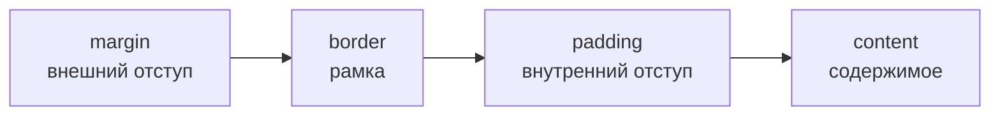
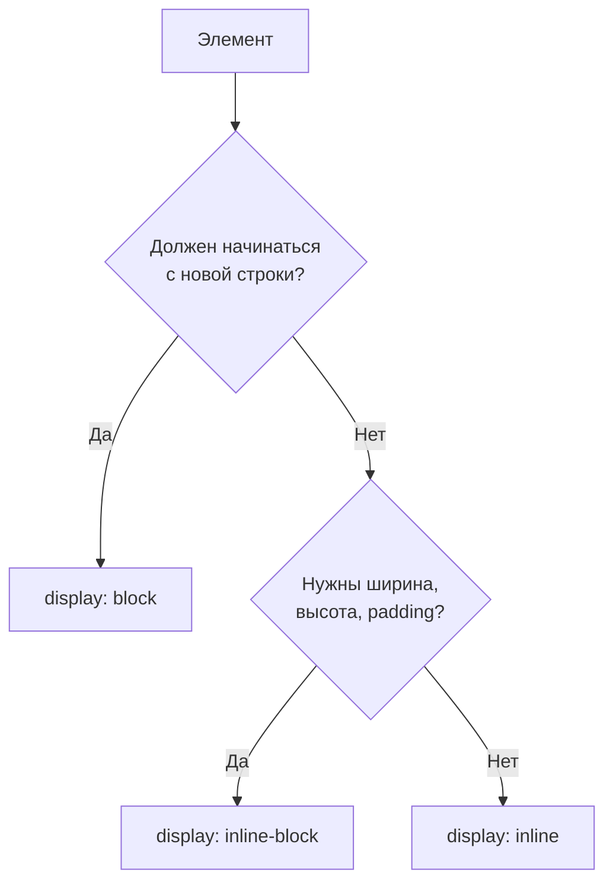

# Box model (модель блока)

[Содержание](../../README.md) · [← Назад](../../Lesson-3/ru/%D0%A6%D0%B2%D0%B5%D1%82%2C%20%D0%B5%D0%B4%D0%B8%D0%BD%D0%B8%D1%86%D1%8B%2C%20%D1%88%D1%80%D0%B8%D1%84%D1%82%D1%8B%20%D0%B8%20%D1%84%D0%BE%D0%BD.md) · [Вперёд →](../../Lesson-5/ru/Flexbox.md) · [RU](Box%20model%20%28%D0%BC%D0%BE%D0%B4%D0%B5%D0%BB%D1%8C%20%D0%B1%D0%BB%D0%BE%D0%BA%D0%B0%29.md) · [EN](../en/Box%20model.md) · [UZ](../uz/Box%20model%20%28blok%20modeli%29.md)

> **Связь с прошлым уроком:** в уроке 3 вы задали цвета, шрифты и фон. Но блоки по-прежнему слиплись: текст прижат к краям, карточки стоят вплотную. Сегодня разберём, из чего состоит любой блок, и научимся управлять пространством.

---

## Зачем это вам

Посмотрите на любой аккуратный сайт: вокруг текста в карточке есть воздух, между карточками - промежутки, у кнопки - скруглённые углы и тень. Всё это - box model.

Каждый элемент страницы - прямоугольная коробка. Поймёте, как она устроена, - и перестанете гадать, почему блок «не туда уехал».

---

## Чему вы научитесь

- Называть четыре слоя блока: содержимое, `padding`, `border`, `margin`.
- Записывать отступы коротко: одно, два и четыре значения.
- Включать `box-sizing: border-box` и понимать, зачем он нужен.
- Задавать ширину: `width`, `max-width`, центрировать блок через `margin: 0 auto`.
- Отличать `block`, `inline` и `inline-block`.
- Скруглять углы и добавлять тень.

---

## Повторение: 3 вопроса из урока 3

1. Чему равен `2rem` при шрифте страницы 16px?
2. Как записать полупрозрачный чёрный цвет?
3. Наследуется ли `background-color`?

Ответы - в конце урока.

---

## План урока

| Раздел | Что делаем |
| --- | --- |
| Четыре слоя | Картина в раме |
| `padding`, `border`, `margin` | Короткая запись по часовой стрелке |
| `box-sizing` | Почему блок шире, чем задали |
| Мини-задание 1 | Карточка |
| Ширина и центрирование | `max-width` и `margin: 0 auto` |
| Тип отображения | `block`, `inline`, `inline-block` |
| Углы и тень | `border-radius`, `box-shadow` |
| Мини-задание 2 | Кнопка-ссылка |
| Самостоятельная работа | Задание в IDE и свой сайт |

---

## Четыре слоя блока

**Простыми словами:** картина в раме на стене.

| Слой | Свойство | В картине |
| --- | --- | --- |
| Содержимое | `width`, `height` | Сам рисунок |
| Внутренний отступ | `padding` | Паспарту - белое поле вокруг рисунка внутри рамы |
| Рамка | `border` | Рама |
| Внешний отступ | `margin` | Расстояние от рамы до соседних картин |



**Как читать схему.** Слои вложены снаружи внутрь: `margin` - самый внешний, содержимое - в центре. Фон блока заливает содержимое и `padding`, но не `margin`.

**Где увидеть:** DevTools → Elements → выберите элемент. Внизу панели Styles (или во вкладке **Computed**) - схема с четырьмя цветными прямоугольниками и размерами каждого слоя. При наведении на элемент страница подсвечивает: синий - содержимое, зелёный - `padding`, оранжевый - `margin`.

---

## `padding`, `border`, `margin`

### `padding` - воздух внутри

```css
.card {
    padding: 16px;
}
```

**Что увидите:** текст отодвинулся от краёв карточки на 16px со всех сторон. Фон карточки занял и эти 16px.

### `border` - рамка

```css
.card {
    border: 1px solid #cbd5e1;
}
```

Три значения: **толщина**, **стиль** (`solid` - сплошная, `dashed` - пунктир, `dotted` - точки), **цвет**.

### `margin` - расстояние до соседей

```css
.card {
    margin-bottom: 24px;
}
```

**Что увидите:** между карточками появился промежуток. `margin` прозрачный: фон соседа или родителя видно сквозь него.

### Короткая запись: по часовой стрелке

```css
.card {
    padding: 8px 16px 24px 32px;
}
```

| Сколько значений | Пример | Значит |
| --- | --- | --- |
| 1 | `padding: 16px;` | Все стороны |
| 2 | `padding: 8px 16px;` | Сверху-снизу 8, слева-справа 16 |
| 4 | `padding: 8px 16px 24px 32px;` | Верх, право, низ, лево - **по часовой стрелке** от 12 часов |

Можно и по одной стороне: `padding-top`, `margin-left`, `border-bottom`.

### Схлопывание внешних отступов

У двух блоков друг над другом `margin-bottom: 24px` и `margin-top: 16px`. Расстояние между ними будет **24px**, а не 40px: вертикальные `margin` соседей не складываются, побеждает больший. По горизонтали отступы складываются.

---

## `box-sizing`: почему блок шире, чем задали

```css
.card {
    width: 300px;
    padding: 20px;
    border: 2px solid #cbd5e1;
}
```

Какой ширины будет карточка? По умолчанию - **344px**: `width` задаёт только содержимое, а `padding` и `border` добавляются сверху. 300 + 20 + 20 + 2 + 2.

Это неудобно. Поэтому почти в каждом проекте первой строкой пишут:

```css
* {
    box-sizing: border-box;
}
```

Теперь `width: 300px` - это ширина **вместе** с `padding` и `border`. Карточка ровно 300px, а содержимое ужимается внутри.

| `box-sizing` | `width` включает |
| --- | --- |
| `content-box` (по умолчанию) | Только содержимое |
| `border-box` | Содержимое + `padding` + `border` |

**Правило курса:** `* { box-sizing: border-box; }` - первое правило в каждом файле стилей.

### Попробуйте сломать

Задайте карточке `width: 300px; padding: 20px;`. Посмотрите ширину в DevTools. Теперь добавьте правило `* { box-sizing: border-box; }`. Как изменилась ширина?

---

## Мини-задание 1

Оформите `.card`: внутренний отступ 16px, рамка 1px сплошная `#cbd5e1`, внешний отступ снизу 24px, белый фон. Решение - в разделе «Ответы».

---

## Ширина и центрирование

```css
.container {
    max-width: 960px;
    margin: 0 auto;
    padding: 0 16px;
}
```

| Запись | Что делает |
| --- | --- |
| `max-width: 960px` | Не шире 960px, но на узком экране - уже |
| `margin: 0 auto` | Сверху-снизу 0, слева-справа поровну - **по центру** |
| `padding: 0 16px` | Чтобы на телефоне текст не прилипал к краям экрана |

**Что увидите:** на широком экране содержимое - колонкой 960px по центру. На узком - на всю ширину с отступами по 16px.

**`width` или `max-width`?** `width: 960px` на телефоне шириной 390px вылезет за экран. `max-width` - сожмётся. Для колонок текста почти всегда `max-width`.

`margin: 0 auto` центрирует только блок, **у которого задана ширина**. Без ширины блок и так на всю строку - центрировать нечего.

---

## Тип отображения: `display`

**Простыми словами:** блоки - кирпичи, каждый на своей строке. Строчные элементы - слова в предложении, идут друг за другом.

| `display` | Как ведёт себя | Ширина и высота | Примеры тегов по умолчанию |
| --- | --- | --- | --- |
| `block` | С новой строки, на всю ширину | Работают | `div`, `p`, `h1`, `section`, `ul` |
| `inline` | В строке с текстом | **Не работают**, вертикальные `margin` тоже | `a`, `span`, `strong`, `em` |
| `inline-block` | В строке, но как блок | Работают | `button`, `input` |
| `none` | Скрыт полностью, места не занимает | - | - |



**Как читать схему.** Нужен свой ряд - `block`. Нужно стоять в строке, но с размерами и отступами - `inline-block`.

**Типичная ситуация:** ссылке `<a>` задали `padding: 12px 24px`, чтобы сделать кнопку, а сверху и снизу она наползает на соседей. Причина - `inline`. Решение - `display: inline-block`.

**Скрытие:** `display: none` скрывает элемент и от скринридеров. Не прячьте так важный текст.

---

## Углы и тень

```css
.card {
    border-radius: 12px;
    box-shadow: 0 4px 12px rgb(0 0 0 / 10%);
}
```

| Свойство | Пример | Что делает |
| --- | --- | --- |
| `border-radius` | `12px` | Скругляет углы |
| `border-radius` | `50%` | Квадрат превращается в круг |
| `box-shadow` | `0 4px 12px rgb(0 0 0 / 10%)` | Тень: сдвиг по X, сдвиг по Y, размытие, цвет |

**Тень - лёгкая:** прозрачность 8–15%. Чёрная непрозрачная тень выглядит грязно.

### Частые ошибки новичков

| Ошибка | Как исправить |
| --- | --- |
| Блок шире, чем `width` | `* { box-sizing: border-box; }` |
| `margin` вместо `padding` для воздуха внутри карточки | Внутри - `padding`, снаружи - `margin` |
| `width: 960px` для колонки | `max-width: 960px` |
| `margin: 0 auto` не центрирует | Задайте блоку ширину |
| `padding` у ссылки наползает на соседей | `display: inline-block` |
| Путают порядок четырёх значений | По часовой: верх, право, низ, лево |
| `<br>` для отступов | `margin` |

---

## Мини-задание 2

Сделайте ссылку `<a class="btn">Записаться</a>` похожей на кнопку: тёмно-синий фон, белый текст без подчёркивания, внутренний отступ 12px сверху-снизу и 24px слева-справа, скруглённые углы 8px. Учтите тип отображения. Решение - в разделе «Ответы».

---

## Итоги урока: шпаргалка

| Задача | Запись |
| --- | --- |
| Первое правило файла | `* { box-sizing: border-box; }` |
| Воздух внутри | `padding: 16px;` |
| Рамка | `border: 1px solid #cbd5e1;` |
| Расстояние до соседей | `margin-bottom: 24px;` |
| Колонка по центру | `max-width: 960px; margin: 0 auto;` |
| Размеры у строчного | `display: inline-block;` |
| Скрыть | `display: none;` |
| Скругление / круг | `border-radius: 12px;` / `50%` |
| Тень | `box-shadow: 0 4px 12px rgb(0 0 0 / 10%);` |
| Порядок 4 значений | Верх, право, низ, лево |

---

## Самостоятельная работа

### Часть 1. Задание в IDE (засчитывается платформой)

В редакторе - страница с двумя карточками и ссылкой. Оформите в `<style>`:

1. `* { box-sizing: border-box; }` - первым правилом.
2. `.container`: `max-width` и центрирование `margin: 0 auto;`.
3. `.card`: `padding`, `border`, `border-radius`, `margin-bottom`.
4. `.btn`: `display: inline-block;`, `padding` из двух значений, `border-radius`.
5. Добавьте нужные классы в HTML. Отступы через `<br>` не используйте.

Что проверяет платформа: `box-sizing: border-box`, классы `container`, `card`, `btn` в HTML и CSS, `max-width`, `margin: 0 auto`, `padding`, `border`, `border-radius`, `margin-bottom`, `display: inline-block`, отсутствие `<br>` и `style=""`.

### Часть 2. Проект на компьютере

1. Добавьте `box-sizing: border-box` первым правилом в свой `style.css`.
2. Оберните содержимое страниц в `.container` с `max-width` по центру.
3. Оформите карточки или разделы: `padding`, рамка или тень, скругление.
4. Сделайте ссылку-кнопку.
5. Сузьте окно браузера: колонка сжимается, ничего не вылезает за край?

### Критерии готовности

- [ ] Задание в IDE засчитано.
- [ ] Первое правило - `box-sizing: border-box`.
- [ ] Содержимое по центру, не шире заданного `max-width`.
- [ ] Внутри блоков `padding`, между блоками `margin`.
- [ ] Кнопка-ссылка не наползает на соседние строки.
- [ ] Можете показать в DevTools четыре слоя любого блока.

---

## Вопросы для самопроверки

1. Назовите четыре слоя блока снаружи внутрь.
2. Чем `padding` отличается от `margin`?
3. Что значит `margin: 10px 20px;`?
4. В каком порядке читаются четыре значения?
5. Какой ширины блок с `width: 300px; padding: 20px;` без `border-box`?
6. Что делает `box-sizing: border-box`?
7. Почему для колонки `max-width`, а не `width`?
8. Почему `margin: 0 auto` не центрирует блок без ширины?
9. Чем `inline-block` отличается от `inline`?
10. Два блока: `margin-bottom: 30px` и `margin-top: 20px`. Какое расстояние между ними?

После вопросов пройдите **тест урока** на платформе: 12 вопросов, порог 70%.

---

## Что дальше

Блоки аккуратные, но стоят друг под другом. В уроке 5 научимся ставить их в ряд, выравнивать и распределять место: Flexbox.

---

## Ответы

**Повторение**

1. 32px.
2. `rgb(0 0 0 / 50%)`.
3. Нет.

**Мини-задание 1**

```css
.card {
    padding: 16px;
    border: 1px solid #cbd5e1;
    margin-bottom: 24px;
    background-color: white;
}
```

**Мини-задание 2**

```css
.btn {
    display: inline-block;
    padding: 12px 24px;
    background-color: #1e3a8a;
    color: white;
    text-decoration: none;
    border-radius: 8px;
}
```

**Вопросы для самопроверки**

1. `margin`, `border`, `padding`, содержимое.
2. `padding` - внутри рамки, на нём фон блока. `margin` - снаружи, прозрачный.
3. Сверху и снизу 10px, слева и справа 20px.
4. Верх, право, низ, лево - по часовой стрелке.
5. 340px.
6. Включает `padding` и `border` в заданную ширину.
7. `max-width` сжимается на узком экране, `width` - нет.
8. Без ширины блок и так занимает всю строку.
9. У `inline-block` работают ширина, высота и все отступы.
10. 30px: вертикальные `margin` схлопываются, побеждает больший.

---

[Содержание](../../README.md) · [← Назад](../../Lesson-3/ru/%D0%A6%D0%B2%D0%B5%D1%82%2C%20%D0%B5%D0%B4%D0%B8%D0%BD%D0%B8%D1%86%D1%8B%2C%20%D1%88%D1%80%D0%B8%D1%84%D1%82%D1%8B%20%D0%B8%20%D1%84%D0%BE%D0%BD.md) · [Вперёд →](../../Lesson-5/ru/Flexbox.md) · [RU](Box%20model%20%28%D0%BC%D0%BE%D0%B4%D0%B5%D0%BB%D1%8C%20%D0%B1%D0%BB%D0%BE%D0%BA%D0%B0%29.md) · [EN](../en/Box%20model.md) · [UZ](../uz/Box%20model%20%28blok%20modeli%29.md)
