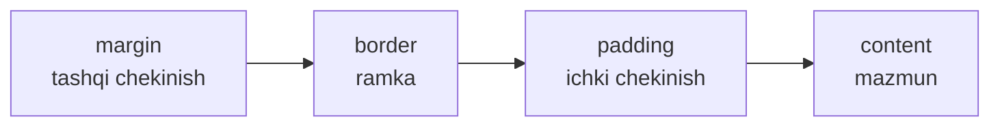
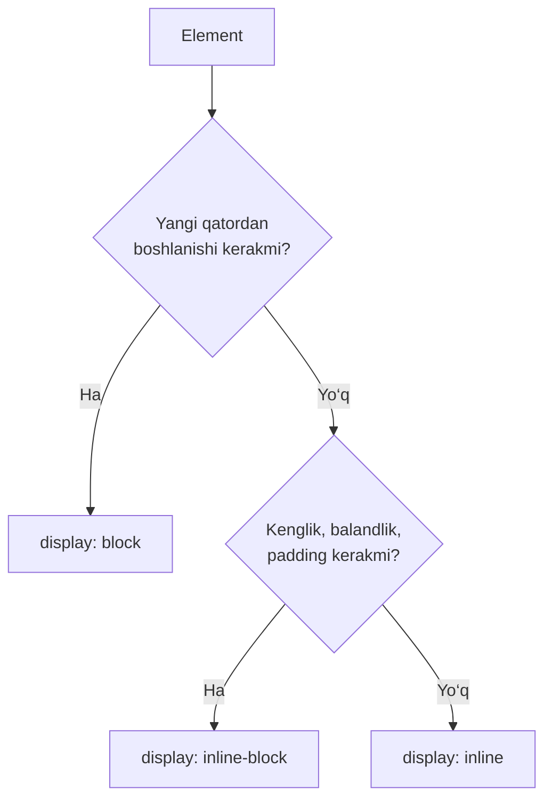

# Box model (blok modeli)

[Mundarija](../../README.md) · [← Orqaga](../../Lesson-3/uz/Rang%2C%20birliklar%2C%20shriftlar%20va%20fon.md) · [Keyingi →](../../Lesson-5/uz/Flexbox.md) · [RU](../ru/Box%20model%20%28%D0%BC%D0%BE%D0%B4%D0%B5%D0%BB%D1%8C%20%D0%B1%D0%BB%D0%BE%D0%BA%D0%B0%29.md) · [EN](../en/Box%20model.md) · [UZ](Box%20model%20%28blok%20modeli%29.md)

> **Oldingi dars bilan bog‘liqlik:** 3-darsda ranglar, shriftlar va fonni berdingiz. Lekin bloklar hamon yopishgan: matn chetlarga tegib turibdi, kartochkalar bir-biriga zich turibdi. Bugun istalgan blok nimadan iboratligini ko‘rib chiqamiz va bo‘shliqni boshqarishni o‘rganamiz.

---

## Bu sizga nima uchun kerak

Istalgan ozoda saytga qarang: kartochkadagi matn atrofida havo bor, kartochkalar orasida - oraliqlar, tugmada - yumaloq burchaklar va soya. Bularning hammasi - box model.

Sahifaning har bir elementi - to‘rtburchak quti. U qanday tuzilganini tushunsangiz, blok nega «noto‘g‘ri joyga ketib qolgani»ni taxmin qilishni bas qilasiz.

---

## Nimani o‘rganasiz

- Blokning to‘rt qatlamini aytish: mazmun, `padding`, `border`, `margin`.
- Chekinishlarni qisqa yozish: bir, ikki va to‘rt qiymat.
- `box-sizing: border-box` ni yoqish va u nima uchun kerakligini tushunish.
- Kenglikni berish: `width`, `max-width`, blokni `margin: 0 auto` orqali markazlash.
- `block`, `inline` va `inline-block` ni farqlash.
- Burchaklarni yumaloqlash va soya qo‘shish.

---

## Takrorlash: 3-darsdan 3 savol

1. Sahifa shrifti 16px bo‘lsa, `2rem` nechaga teng?
2. Yarim shaffof qora rang qanday yoziladi?
3. `background-color` meros bo‘ladimi?

Javoblar - dars oxirida.

---

## Reja

| Bo‘lim | Nima qilamiz |
| --- | --- |
| To‘rt qatlam | Ramkadagi rasm |
| `padding`, `border`, `margin` | Soat mili bo‘yicha qisqa yozuv |
| `box-sizing` | Nega blok berilganidan kengroq |
| Mini-topshiriq 1 | Kartochka |
| Kenglik va markazlash | `max-width` va `margin: 0 auto` |
| Ko‘rsatish turi | `block`, `inline`, `inline-block` |
| Burchaklar va soya | `border-radius`, `box-shadow` |
| Mini-topshiriq 2 | Tugma-havola |
| Mustaqil ish | IDE topshirig‘i va o‘z saytingiz |

---

## Blokning to‘rt qatlami

**Oddiy qilib aytganda:** devordagi ramkadagi rasm.

| Qatlam | Xususiyat | Rasmda |
| --- | --- | --- |
| Mazmun | `width`, `height` | Rasmning o‘zi |
| Ichki chekinish | `padding` | Paspartu - ramka ichida rasm atrofidagi oq maydon |
| Ramka | `border` | Ramka |
| Tashqi chekinish | `margin` | Ramkadan qo‘shni rasmlargacha masofa |



**Sxemani qanday o‘qish kerak.** Qatlamlar tashqaridan ichkariga joylashgan: `margin` - eng tashqisi, mazmun - markazda. Blok foni mazmun va `padding` ni bo‘yaydi, lekin `margin` ni emas.

**Qayerda ko‘rish mumkin:** DevTools → Elements → elementni tanlang. Styles paneli pastida (yoki **Computed** yorlig‘ida) - har bir qatlam o‘lchami ko‘rsatilgan to‘rtta rangli to‘rtburchakli sxema. Elementga kursor olib borilganda sahifa yoritadi: ko‘k - mazmun, yashil - `padding`, to‘q sariq - `margin`.

---

## `padding`, `border`, `margin`

### `padding` - ichkaridagi havo

```css
.card {
    padding: 16px;
}
```

**Nimani ko‘rasiz:** matn kartochka chetlaridan har tomondan 16px ga surildi. Kartochka foni shu 16px ni ham egalladi.

### `border` - ramka

```css
.card {
    border: 1px solid #cbd5e1;
}
```

Uchta qiymat: **qalinlik**, **uslub** (`solid` - yaxlit, `dashed` - shtrix, `dotted` - nuqtalar), **rang**.

### `margin` - qo‘shnilargacha masofa

```css
.card {
    margin-bottom: 24px;
}
```

**Nimani ko‘rasiz:** kartochkalar orasida oraliq paydo bo‘ldi. `margin` shaffof: u orqali qo‘shni yoki ota elementning foni ko‘rinadi.

### Qisqa yozuv: soat mili bo‘yicha

```css
.card {
    padding: 8px 16px 24px 32px;
}
```

| Nechta qiymat | Misol | Ma’nosi |
| --- | --- | --- |
| 1 | `padding: 16px;` | Barcha tomonlar |
| 2 | `padding: 8px 16px;` | Yuqori-pastdan 8, chap-o‘ngdan 16 |
| 4 | `padding: 8px 16px 24px 32px;` | Yuqori, o‘ng, past, chap - soat 12 dan **soat mili bo‘yicha** |

Bitta tomon uchun ham mumkin: `padding-top`, `margin-left`, `border-bottom`.

### Tashqi chekinishlarning qo‘shilib ketishi

Bir-birining ustida turgan ikki blokda `margin-bottom: 24px` va `margin-top: 16px`. Ular orasidagi masofa 40px emas, **24px** bo‘ladi: qo‘shnilarning vertikal `margin` lari qo‘shilmaydi, kattarog‘i yutadi. Gorizontal bo‘yicha chekinishlar qo‘shiladi.

---

## `box-sizing`: nega blok berilganidan kengroq

```css
.card {
    width: 300px;
    padding: 20px;
    border: 2px solid #cbd5e1;
}
```

Kartochka qanday kenglikda bo‘ladi? Sukut bo‘yicha - **344px**: `width` faqat mazmunni beradi, `padding` va `border` esa ustiga qo‘shiladi. 300 + 20 + 20 + 2 + 2.

Bu noqulay. Shuning uchun deyarli har bir loyihada birinchi qator qilib yozishadi:

```css
* {
    box-sizing: border-box;
}
```

Endi `width: 300px` - bu `padding` va `border` **bilan birga** kenglik. Kartochka roppa-rosa 300px, mazmun esa ichkarida siqiladi.

| `box-sizing` | `width` o‘z ichiga oladi |
| --- | --- |
| `content-box` (sukut bo‘yicha) | Faqat mazmun |
| `border-box` | Mazmun + `padding` + `border` |

**Kurs qoidasi:** `* { box-sizing: border-box; }` - har bir uslublar faylidagi birinchi qoida.

### Buzib ko‘ring

Kartochkaga `width: 300px; padding: 20px;` bering. DevTools da kenglikka qarang. Endi `* { box-sizing: border-box; }` qoidasini qo‘shing. Kenglik qanday o‘zgardi?

---

## Mini-topshiriq 1

`.card` ni bezang: ichki chekinish 16px, ramka 1px yaxlit `#cbd5e1`, pastdan tashqi chekinish 24px, oq fon. Yechim - «Javoblar» bo‘limida.

---

## Kenglik va markazlash

```css
.container {
    max-width: 960px;
    margin: 0 auto;
    padding: 0 16px;
}
```

| Yozuv | Nima qiladi |
| --- | --- |
| `max-width: 960px` | 960px dan keng emas, lekin tor ekranda - torroq |
| `margin: 0 auto` | Yuqori-past 0, chap-o‘ng teng - **markazda** |
| `padding: 0 16px` | Telefonda matn ekran chetlariga yopishmasligi uchun |

**Nimani ko‘rasiz:** keng ekranda mazmun - markazda 960px li ustun. Torida - 16px dan chekinishli butun kenglikda.

**`width` mi yoki `max-width` mi?** `width: 960px` 390px kenglikdagi telefonda ekrandan chiqib ketadi. `max-width` - siqiladi. Matn ustunlari uchun deyarli doim `max-width`.

`margin: 0 auto` faqat **kengligi berilgan** blokni markazlaydi. Kengliksiz blok shundoq ham butun qatorni egallaydi - markazlash uchun hech narsa yo‘q.

---

## Ko‘rsatish turi: `display`

**Oddiy qilib aytganda:** bloklar - g‘ishtlar, har biri o‘z qatorida. Qator elementlari - gapdagi so‘zlar, ketma-ket keladi.

| `display` | O‘zini qanday tutadi | Kenglik va balandlik | Sukut bo‘yicha teglar misollari |
| --- | --- | --- | --- |
| `block` | Yangi qatordan, butun kenglikda | Ishlaydi | `div`, `p`, `h1`, `section`, `ul` |
| `inline` | Matn bilan bir qatorda | **Ishlamaydi**, vertikal `margin` ham | `a`, `span`, `strong`, `em` |
| `inline-block` | Qatorda, lekin blok kabi | Ishlaydi | `button`, `input` |
| `none` | To‘liq yashirin, joy egallamaydi | - | - |



**Sxemani qanday o‘qish kerak.** O‘z qatori kerak - `block`. Qatorda turishi, lekin o‘lcham va chekinishlar bilan - `inline-block`.

**Tipik holat:** tugma yasash uchun `<a>` havolasiga `padding: 12px 24px` berishdi, u esa yuqoridan va pastdan qo‘shnilar ustiga chiqib ketadi. Sababi - `inline`. Yechimi - `display: inline-block`.

**Yashirish:** `display: none` elementni ekran o‘quvchilardan ham yashiradi. Muhim matnni bunday yashirmang.

---

## Burchaklar va soya

```css
.card {
    border-radius: 12px;
    box-shadow: 0 4px 12px rgb(0 0 0 / 10%);
}
```

| Xususiyat | Misol | Nima qiladi |
| --- | --- | --- |
| `border-radius` | `12px` | Burchaklarni yumaloqlaydi |
| `border-radius` | `50%` | Kvadrat doiraga aylanadi |
| `box-shadow` | `0 4px 12px rgb(0 0 0 / 10%)` | Soya: X bo‘yicha siljish, Y bo‘yicha siljish, xiralik, rang |

**Soya - yengil:** shaffoflik 8–15%. Qora noshaffof soya iflos ko‘rinadi.

### Yangi o‘rganuvchilarning tipik xatolari

| Xato | Qanday tuzatish |
| --- | --- |
| Blok `width` dan keng | `* { box-sizing: border-box; }` |
| Kartochka ichidagi havo uchun `padding` o‘rniga `margin` | Ichkarida - `padding`, tashqarida - `margin` |
| Ustun uchun `width: 960px` | `max-width: 960px` |
| `margin: 0 auto` markazlamaydi | Blokka kenglik bering |
| Havoladagi `padding` qo‘shnilar ustiga chiqadi | `display: inline-block` |
| To‘rt qiymat tartibini adashtirishadi | Soat mili bo‘yicha: yuqori, o‘ng, past, chap |
| Chekinishlar uchun `<br>` | `margin` |

---

## Mini-topshiriq 2

`<a class="btn">Yozilish</a>` havolasini tugmaga o‘xshatib qo‘ying: to‘q ko‘k fon, tagiga chiziqsiz oq matn, yuqori-pastdan 12px va chap-o‘ngdan 24px ichki chekinish, 8px yumaloq burchaklar. Ko‘rsatish turini hisobga oling. Yechim - «Javoblar» bo‘limida.

---

## Dars yakuni: shpargalka

| Vazifa | Yozuv |
| --- | --- |
| Faylning birinchi qoidasi | `* { box-sizing: border-box; }` |
| Ichkaridagi havo | `padding: 16px;` |
| Ramka | `border: 1px solid #cbd5e1;` |
| Qo‘shnilargacha masofa | `margin-bottom: 24px;` |
| Markazdagi ustun | `max-width: 960px; margin: 0 auto;` |
| Qator elementiga o‘lchamlar | `display: inline-block;` |
| Yashirish | `display: none;` |
| Yumaloqlash / doira | `border-radius: 12px;` / `50%` |
| Soya | `box-shadow: 0 4px 12px rgb(0 0 0 / 10%);` |
| 4 qiymat tartibi | Yuqori, o‘ng, past, chap |

---

## Mustaqil ish

### 1-qism. IDE topshirig‘i (platforma hisoblaydi)

Muharrirda - ikki kartochka va havolali sahifa. `<style>` da bezang:

1. `* { box-sizing: border-box; }` - birinchi qoida bo‘lib.
2. `.container`: `max-width` va `margin: 0 auto;` markazlash.
3. `.card`: `padding`, `border`, `border-radius`, `margin-bottom`.
4. `.btn`: `display: inline-block;`, ikki qiymatli `padding`, `border-radius`.
5. HTML ga kerakli sinflarni qo‘shing. `<br>` orqali chekinishlarni ishlatmang.

Platforma nimani tekshiradi: `box-sizing: border-box`, HTML va CSS da `container`, `card`, `btn` sinflari, `max-width`, `margin: 0 auto`, `padding`, `border`, `border-radius`, `margin-bottom`, `display: inline-block`, `<br>` va `style=""` yo‘qligi.

### 2-qism. Kompyuterdagi loyiha

1. `style.css` ingizga birinchi qoida bo‘lib `box-sizing: border-box` ni qo‘shing.
2. Sahifalar mazmunini markazdagi `max-width` li `.container` ga o‘rang.
3. Kartochka yoki bo‘limlarni bezang: `padding`, ramka yoki soya, yumaloqlash.
4. Tugma-havola yasang.
5. Brauzer oynasini toraytiring: ustun siqiladimi, hech narsa chetdan chiqmaydimi?

### Tayyorlik mezonlari

- [ ] IDE topshirig‘i qabul qilingan.
- [ ] Birinchi qoida - `box-sizing: border-box`.
- [ ] Mazmun markazda, berilgan `max-width` dan keng emas.
- [ ] Bloklar ichida `padding`, bloklar orasida `margin`.
- [ ] Tugma-havola qo‘shni qatorlar ustiga chiqmaydi.
- [ ] DevTools da istalgan blokning to‘rt qatlamini ko‘rsata olasiz.

---

## O‘zini tekshirish uchun savollar

1. Blokning to‘rt qatlamini tashqaridan ichkariga ayting.
2. `padding` `margin` dan nimasi bilan farq qiladi?
3. `margin: 10px 20px;` nimani bildiradi?
4. To‘rt qiymat qaysi tartibda o‘qiladi?
5. `border-box` siz `width: 300px; padding: 20px;` li blok qanday kenglikda?
6. `box-sizing: border-box` nima qiladi?
7. Nega ustun uchun `width` emas, `max-width`?
8. Nega `margin: 0 auto` kengliksiz blokni markazlamaydi?
9. `inline-block` `inline` dan nimasi bilan farq qiladi?
10. Ikki blok: `margin-bottom: 30px` va `margin-top: 20px`. Ular orasidagi masofa qancha?

Savollardan keyin platformada **dars testini** topshiring: 12 ta savol, o‘tish chegarasi 70%.

---

## Keyin nima

Bloklar ozoda, lekin bir-birining ostida turibdi. 5-darsda ularni qatorga qo‘yish, tekislash va joyni taqsimlashni o‘rganamiz: Flexbox.

---

## Javoblar

**Takrorlash**

1. 32px.
2. `rgb(0 0 0 / 50%)`.
3. Yo‘q.

**Mini-topshiriq 1**

```css
.card {
    padding: 16px;
    border: 1px solid #cbd5e1;
    margin-bottom: 24px;
    background-color: white;
}
```

**Mini-topshiriq 2**

```css
.btn {
    display: inline-block;
    padding: 12px 24px;
    background-color: #1e3a8a;
    color: white;
    text-decoration: none;
    border-radius: 8px;
}
```

**O‘zini tekshirish uchun savollar**

1. `margin`, `border`, `padding`, mazmun.
2. `padding` - ramka ichida, unda blok foni bor. `margin` - tashqarida, shaffof.
3. Yuqori va pastdan 10px, chap va o‘ngdan 20px.
4. Yuqori, o‘ng, past, chap - soat mili bo‘yicha.
5. 340px.
6. `padding` va `border` ni berilgan kenglikka qo‘shadi.
7. `max-width` tor ekranda siqiladi, `width` - yo‘q.
8. Kengliksiz blok shundoq ham butun qatorni egallaydi.
9. `inline-block` da kenglik, balandlik va barcha chekinishlar ishlaydi.
10. 30px: vertikal `margin` lar qo‘shilib ketadi, kattarog‘i yutadi.

---

[Mundarija](../../README.md) · [← Orqaga](../../Lesson-3/uz/Rang%2C%20birliklar%2C%20shriftlar%20va%20fon.md) · [Keyingi →](../../Lesson-5/uz/Flexbox.md) · [RU](../ru/Box%20model%20%28%D0%BC%D0%BE%D0%B4%D0%B5%D0%BB%D1%8C%20%D0%B1%D0%BB%D0%BE%D0%BA%D0%B0%29.md) · [EN](../en/Box%20model.md) · [UZ](Box%20model%20%28blok%20modeli%29.md)
