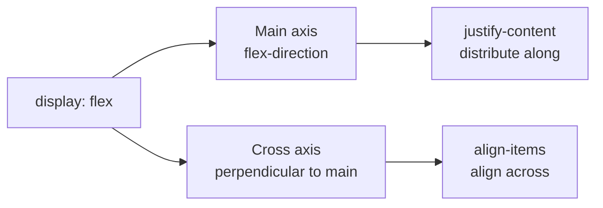
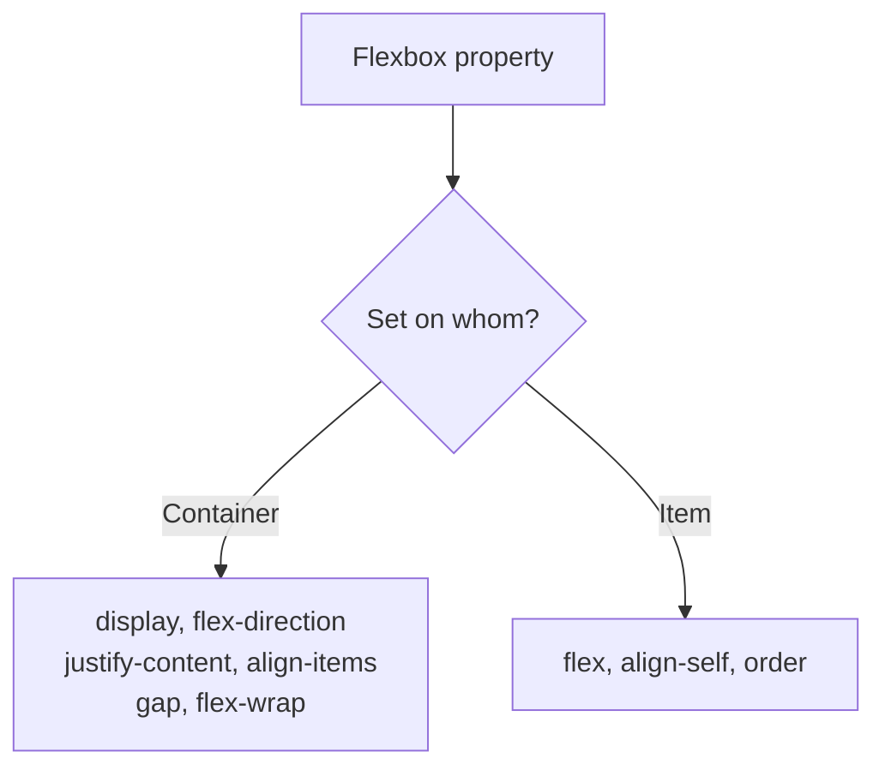

# Flexbox

[Contents](../../README.md) · [← Back](../../Lesson-4/en/Box%20model.md) · [Next →](../../Lesson-6/en/Grid.md) · [RU](../ru/Flexbox.md) · [EN](Flexbox.md) · [UZ](../uz/Flexbox.md)

> **Link to the previous lesson:** in Lesson 4 you made tidy blocks, but they stand one under another. Today we put them in a row, center them and distribute the space between them.

---

## Why you need this

Logo on the left, menu on the right. Three cards of equal height in a row. A button exactly in the center of a block. This used to take clever tricks. Now - three lines of Flexbox.

Flexbox is the main tool for laying things out along one line: in a row or in a column.

---

## What you will learn

- Turn on Flexbox: `display: flex`.
- Tell the container from the items.
- Choose a direction: `flex-direction`.
- Distribute items along the main axis: `justify-content`.
- Align along the cross axis: `align-items`.
- Make gaps with `gap` and wrapping with `flex-wrap`.
- Control item size: `flex`.

---

## Review: 3 questions from Lesson 4

1. Which rule is written first in a style file?
2. How do you center a block that has `max-width`?
3. How does `padding` differ from `margin`?

Answers are at the end of the lesson.

---

## Lesson plan

| Section | What we do |
| --- | --- |
| Container and items | A shelf and books |
| Axes | Main and cross |
| `justify-content` | Arrange books along the shelf |
| `align-items` | Align by height |
| Mini-task 1 | Header: logo and menu |
| `gap` and `flex-wrap` | Gaps and wrapping |
| `flex` | Who takes how much space |
| Mini-task 2 | A row of cards |
| Independent work | IDE task and your own site |

---

## Container and items

**In simple terms:** a shelf and the books on it. The layout rules are given to the **shelf** - the container. The books - its direct children - line up by those rules.

```html
<ul class="menu">
    <li>Home</li>
    <li>About us</li>
    <li>Contacts</li>
</ul>
```

```css
.menu {
    display: flex;
}
```

**What you will see:** the list items stand in a row instead of one under another.

**Important:** Flexbox affects only the container's **direct children**. Links inside `<li>` are grandchildren; `display: flex` on `.menu` does not affect them.

---

## Axes

A flex container has two axes:

| Axis | By default | Controlled with |
| --- | --- | --- |
| **Main** | Left to right | `justify-content` |
| **Cross** | Top to bottom | `align-items` |

`flex-direction` turns the main axis:

| Value | Items go |
| --- | --- |
| `row` (default) | In a row, left to right |
| `column` | In a column, top to bottom |
| `row-reverse` | In a row, right to left |
| `column-reverse` | In a column, bottom to top |

**Trap:** with `flex-direction: column` the main axis becomes vertical. Now `justify-content` moves items **vertically**, and `align-items` **horizontally**.



**How to read the diagram.** First determine the main axis (`row` or `column`). `justify-content` always works along it, `align-items` across it.

---

## `justify-content`: along the main axis

| Value | How it arranges three items |
| --- | --- |
| `flex-start` | `[A][B][C]_______` - to the start |
| `center` | `___[A][B][C]____` - to the center |
| `flex-end` | `_______[A][B][C]` - to the end |
| `space-between` | `[A]_____[B]_____[C]` - outer ones to the edges, the rest evenly |
| `space-around` | `_[A]__[B]__[C]_` - equal space around each |
| `space-evenly` | `__[A]__[B]__[C]__` - all gaps equal |

---

## `align-items`: across

| Value | What it does |
| --- | --- |
| `stretch` (default) | Stretches items to the full height of the container |
| `center` | To the center |
| `flex-start` | To the top |
| `flex-end` | To the bottom |

### Center on both axes

The most common task is to put something exactly in the center:

```css
.hero {
    display: flex;
    justify-content: center;
    align-items: center;
    min-height: 300px;
}
```

**What you will see:** the block's content is exactly in the center, both horizontally and vertically.

**Equal height of cards** in a row comes by itself: the default `stretch` value stretches them to the tallest one.

### Try to break it

Remove `min-height` from `.hero`. Did the vertical centering disappear? The block became as tall as its content - there is no room left to center in.

---

## Mini-task 1

A header `.site-header`: `<p class="logo">` on the left, `<nav>` on the right. The logo at the left edge, the menu at the right edge, both centered vertically. Solution is in the "Answers" section.

---

## `gap` and `flex-wrap`

### `gap` - spaces between items

```css
.menu {
    display: flex;
    gap: 16px;
}
```

**What you will see:** 16px between the items. Unlike a `margin` on each item, the outer items get no extra space at the edges.

### `flex-wrap` - wrapping to a new line

By default Flexbox stubbornly puts everything in one line and squeezes the items. To let extra items wrap:

```css
.cards {
    display: flex;
    flex-wrap: wrap;
    gap: 24px;
}
```

**What you will see:** cards in a row; those that do not fit move to the next line.

---

## `flex`: who takes how much space

This property is set on **items**, not on the container.

```css
.card {
    flex: 1 1 240px;
}
```

| Number | Name | Means |
| --- | --- | --- |
| `1` | `flex-grow` | Can **grow** if there is free space |
| `1` | `flex-shrink` | Can **shrink** if space is short |
| `240px` | `flex-basis` | The **preferred** width before growing and shrinking |

**What you will see:** together with `flex-wrap: wrap` - each card is no narrower than 240px. On a wide screen three fit in a row and stretch to the full width; on a narrow one - one per line.

| Short form | Means |
| --- | --- |
| `flex: 1` | All items share the space equally |
| `flex: 2` on one, `flex: 1` on the others | That one gets twice as much free space |
| `flex: none` | Does not grow or shrink |



**How to read the diagram.** Most properties are for the container. Items get only what concerns their own size and position.

### `align-self` and `order`

- `align-self` - align **one** item differently from the rest.
- `order` - change the display order. Careful: Tab and screen readers follow the order in the HTML, not on screen. Need a different order - better change the HTML.

### Typical beginner mistakes

| Mistake | How to fix |
| --- | --- |
| `display: flex` on items instead of the container | Set it on the parent |
| Expecting `flex` to affect grandchildren | Direct children only |
| `justify-content` "does not work" in `column` | In `column` it moves vertically |
| Vertical centering does not work | The container has no height: set `min-height` |
| A `margin` on each item for gaps | `gap` on the container |
| Cards squeeze into a thread | `flex-wrap: wrap` and `flex-basis` |
| `order` to change meaning | Change the order in the HTML |

---

## Mini-task 2

A row of cards `.cards`: wrapping to a new line, a 24px gap. Each `.card` has a preferred width of 240px and can grow and shrink. Solution is in the "Answers" section.

**Practice:** the game [Flexbox Froggy](https://flexboxfroggy.com/) - 24 levels where you arrange frogs with Flexbox properties.

---

## Lesson summary: cheat sheet

| Task | Notation |
| --- | --- |
| Turn on | `display: flex;` (on the container) |
| In a column | `flex-direction: column;` |
| To the edges | `justify-content: space-between;` |
| Centered along | `justify-content: center;` |
| Centered across | `align-items: center;` |
| Center on both axes | `justify-content: center; align-items: center;` + height |
| Gaps | `gap: 16px;` |
| Wrapping | `flex-wrap: wrap;` |
| Item size | `flex: 1 1 240px;` (on the item) |
| Equal shares | `flex: 1;` |

---

## Independent work

### Part 1. IDE task (graded by the platform)

Style the club page in `<style>`:

1. `.site-header`: Flexbox, logo and menu at the edges (`space-between`), centered vertically.
2. `.menu` (the list in the menu): Flexbox, a `gap`, no bullets (`list-style: none;`).
3. `.cards`: Flexbox with wrapping `flex-wrap: wrap;` and `gap`.
4. `.card`: `flex` with three values including a preferred width.
5. Add the needed classes to the HTML.

What the platform checks: the classes `site-header`, `menu`, `cards`, `card` in HTML and CSS, `display: flex`, `justify-content: space-between`, `align-items: center`, `gap`, `flex-wrap: wrap`, `flex:`, `list-style: none`, no `style=""` and no `float`.

### Part 2. Project on your computer

1. Make the site header: logo on the left, menu on the right, in a row.
2. Put the cards (projects, news) in a row with wrapping.
3. Center the content of the welcome block.
4. Narrow the window: do the cards rearrange, does nothing stick out?
5. Complete levels 1–10 of Flexbox Froggy.

### Acceptance criteria

- [ ] The IDE task is accepted.
- [ ] `display: flex` is set on containers, `flex` on items.
- [ ] Gaps via `gap`.
- [ ] When the window narrows, cards wrap instead of squeezing into a thread.
- [ ] The order of items on screen matches the order in the HTML.

---

## Self-check questions

1. Who gets `display: flex`: the container or the items?
2. Which descendants does Flexbox affect?
3. Which axis is the main one by default?
4. What does `justify-content: space-between` do?
5. How do you center an item on both axes?
6. Why might vertical centering not work?
7. What changes in how `justify-content` works with `flex-direction: column`?
8. Why is `gap` more convenient than `margin`?
9. What do the three numbers in `flex: 1 1 240px` mean?
10. Why should you be careful with `order`?

After the questions, take the **lesson test** on the platform: 12 questions, pass threshold 70%.

---

## What's next

Flexbox lays things out along one line. For laying out by rows **and** columns at the same time - a gallery grid, a page layout - there is Grid. We cover it in Lesson 6.

---

## Answers

**Review**

1. `* { box-sizing: border-box; }`.
2. `margin: 0 auto;`.
3. `padding` is inside the border, `margin` is outside.

**Mini-task 1**

```css
.site-header {
    display: flex;
    justify-content: space-between;
    align-items: center;
}
```

**Mini-task 2**

```css
.cards {
    display: flex;
    flex-wrap: wrap;
    gap: 24px;
}

.card {
    flex: 1 1 240px;
}
```

**Self-check questions**

1. The container.
2. Only direct children.
3. Horizontal, left to right.
4. The outer items go to the edges, the remaining space is shared evenly between them.
5. `justify-content: center; align-items: center;` and a height on the container.
6. The container has no height larger than its content.
7. It moves items vertically.
8. No extra space at the outer items, and it is set once on the container.
9. Can grow, can shrink, preferred width 240px.
10. The keyboard and screen readers follow the HTML order, not the order on screen.

---

[Contents](../../README.md) · [← Back](../../Lesson-4/en/Box%20model.md) · [Next →](../../Lesson-6/en/Grid.md) · [RU](../ru/Flexbox.md) · [EN](Flexbox.md) · [UZ](../uz/Flexbox.md)
