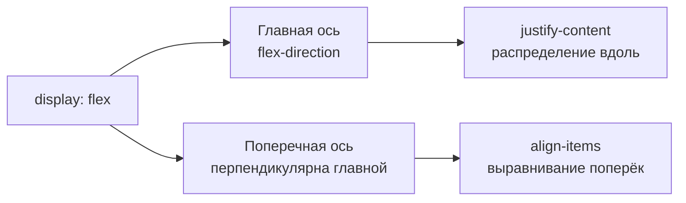
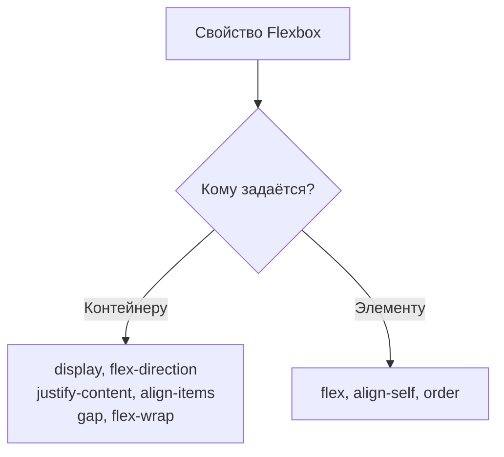

# Flexbox

[Содержание](../../README.md) · [← Назад](../../Lesson-4/ru/Box%20model%20%28%D0%BC%D0%BE%D0%B4%D0%B5%D0%BB%D1%8C%20%D0%B1%D0%BB%D0%BE%D0%BA%D0%B0%29.md) · [Вперёд →](../../Lesson-6/ru/Grid.md) · [RU](Flexbox.md) · [EN](../en/Flexbox.md) · [UZ](../uz/Flexbox.md)

> **Связь с прошлым уроком:** в уроке 4 вы сделали аккуратные блоки, но они стоят друг под другом. Сегодня поставим их в ряд, выровняем по центру и распределим место между ними.

---

## Зачем это вам

Логотип слева, меню справа. Три карточки в ряд одинаковой высоты. Кнопка ровно по центру блока. Раньше такое делали хитрыми приёмами. Сейчас - тремя строками Flexbox.

Flexbox - главный инструмент раскладки в одну линию: в ряд или в столбик.

---

## Чему вы научитесь

- Включать Flexbox: `display: flex`.
- Различать контейнер и элементы.
- Выбирать направление: `flex-direction`.
- Распределять элементы по главной оси: `justify-content`.
- Выравнивать по поперечной оси: `align-items`.
- Делать промежутки `gap` и перенос строк `flex-wrap`.
- Управлять размером элементов: `flex`.

---

## Повторение: 3 вопроса из урока 4

1. Какое правило пишут первым в файле стилей?
2. Как поставить блок с `max-width` по центру?
3. Чем `padding` отличается от `margin`?

Ответы - в конце урока.

---

## План урока

| Раздел | Что делаем |
| --- | --- |
| Контейнер и элементы | Полка и книги |
| Оси | Главная и поперечная |
| `justify-content` | Расставить книги вдоль полки |
| `align-items` | Выровнять по высоте |
| Мини-задание 1 | Шапка: логотип и меню |
| `gap` и `flex-wrap` | Промежутки и перенос |
| `flex` | Кто сколько места займёт |
| Мини-задание 2 | Ряд карточек |
| Самостоятельная работа | Задание в IDE и свой сайт |

---

## Контейнер и элементы

**Простыми словами:** полка и книги на ней. Правила раскладки задаются **полке** - контейнеру. Книги - его прямые дети - встают по этим правилам.

```html
<ul class="menu">
    <li>Главная</li>
    <li>О нас</li>
    <li>Контакты</li>
</ul>
```

```css
.menu {
    display: flex;
}
```

**Что увидите:** пункты списка встали в ряд, а не друг под другом.

**Важно:** Flexbox действует только на **прямых детей** контейнера. Ссылки внутри `<li>` - внуки, на них `display: flex` у `.menu` не влияет.

---

## Оси

У flex-контейнера две оси:

| Ось | По умолчанию | Чем управлять |
| --- | --- | --- |
| **Главная** | Слева направо | `justify-content` |
| **Поперечная** | Сверху вниз | `align-items` |

`flex-direction` поворачивает главную ось:

| Значение | Элементы идут |
| --- | --- |
| `row` (по умолчанию) | В ряд, слева направо |
| `column` | Столбиком, сверху вниз |
| `row-reverse` | В ряд, справа налево |
| `column-reverse` | Столбиком, снизу вверх |

**Ловушка:** при `flex-direction: column` главная ось становится вертикальной. Теперь `justify-content` двигает элементы **по вертикали**, а `align-items` - **по горизонтали**.



**Как читать схему.** Сначала определите главную ось (`row` или `column`). `justify-content` всегда работает вдоль неё, `align-items` - поперёк.

---

## `justify-content`: вдоль главной оси

| Значение | Как расставит три элемента |
| --- | --- |
| `flex-start` | `[A][B][C]_______` - к началу |
| `center` | `___[A][B][C]____` - по центру |
| `flex-end` | `_______[A][B][C]` - к концу |
| `space-between` | `[A]_____[B]_____[C]` - крайние к краям, остальное поровну |
| `space-around` | `_[A]__[B]__[C]_` - вокруг каждого поровну |
| `space-evenly` | `__[A]__[B]__[C]__` - все промежутки равны |

---

## `align-items`: поперёк

| Значение | Что делает |
| --- | --- |
| `stretch` (по умолчанию) | Растягивает элементы на всю высоту контейнера |
| `center` | По центру |
| `flex-start` | К верху |
| `flex-end` | К низу |

### Центр по двум осям

Самая частая задача - поставить что-то ровно в центр:

```css
.hero {
    display: flex;
    justify-content: center;
    align-items: center;
    min-height: 300px;
}
```

**Что увидите:** содержимое блока - точно в центре и по горизонтали, и по вертикали.

**Одинаковая высота карточек** в ряд получается сама: значение `stretch` по умолчанию растягивает их до самой высокой.

### Попробуйте сломать

У `.hero` удалите `min-height`. Вертикальное центрирование пропало? Блок стал высотой с содержимое - центрировать стало негде.

---

## Мини-задание 1

Шапка `.site-header`: слева `<p class="logo">`, справа `<nav>`. Логотип у левого края, меню у правого, оба по центру по высоте. Решение - в разделе «Ответы».

---

## `gap` и `flex-wrap`

### `gap` - промежутки между элементами

```css
.menu {
    display: flex;
    gap: 16px;
}
```

**Что увидите:** между пунктами 16px. У крайних элементов лишнего отступа от краёв нет - в отличие от `margin` у каждого.

### `flex-wrap` - перенос на новую строку

По умолчанию Flexbox упрямо ставит всё в одну строку и сжимает элементы. Чтобы лишнее переносилось:

```css
.cards {
    display: flex;
    flex-wrap: wrap;
    gap: 24px;
}
```

**Что увидите:** карточки в ряд; не помещаются - переходят на следующую строку.

---

## `flex`: кто сколько места займёт

Это свойство задают **элементам**, а не контейнеру.

```css
.card {
    flex: 1 1 240px;
}
```

| Число | Название | Значит |
| --- | --- | --- |
| `1` | `flex-grow` | Может **расти**, если есть свободное место |
| `1` | `flex-shrink` | Может **сжиматься**, если места мало |
| `240px` | `flex-basis` | **Желаемая** ширина до роста и сжатия |

**Что увидите:** вместе с `flex-wrap: wrap` - каждая карточка не уже 240px. На широком экране три в ряд и растягиваются на всю ширину, на узком - по одной.

| Короткая запись | Значит |
| --- | --- |
| `flex: 1` | Все элементы делят место поровну |
| `flex: 2` у одного, `flex: 1` у других | Этот получает вдвое больше свободного места |
| `flex: none` | Не растёт и не сжимается |



**Как читать схему.** Большинство свойств - для контейнера. Элементам задают только то, что касается их собственного размера и положения.

### `align-self` и `order`

- `align-self` - выровнять **один** элемент иначе, чем остальные.
- `order` - поменять порядок показа. Осторожно: Tab и скринридер идут по порядку в HTML, а не на экране. Нужен другой порядок - лучше поменяйте HTML.

### Частые ошибки новичков

| Ошибка | Как исправить |
| --- | --- |
| `display: flex` у элементов, а не у контейнера | Задайте родителю |
| Ждут, что `flex` подействует на внуков | Только прямые дети |
| `justify-content` «не работает» в `column` | В `column` он двигает по вертикали |
| Вертикальный центр не работает | У контейнера нет высоты: задайте `min-height` |
| `margin` у каждого элемента для промежутков | `gap` у контейнера |
| Карточки сжимаются в нитку | `flex-wrap: wrap` и `flex-basis` |
| `order` для смены смысла | Меняйте порядок в HTML |

---

## Мини-задание 2

Ряд карточек `.cards`: перенос на новую строку, промежуток 24px. Каждая `.card` - желаемая ширина 240px, может расти и сжиматься. Решение - в разделе «Ответы».

**Потренируйтесь:** игра [Flexbox Froggy](https://flexboxfroggy.com/#ru) - 24 уровня на русском, где лягушек расставляют свойствами Flexbox.

---

## Итоги урока: шпаргалка

| Задача | Запись |
| --- | --- |
| Включить | `display: flex;` (контейнеру) |
| В столбик | `flex-direction: column;` |
| По краям | `justify-content: space-between;` |
| По центру вдоль | `justify-content: center;` |
| По центру поперёк | `align-items: center;` |
| Центр по двум осям | `justify-content: center; align-items: center;` + высота |
| Промежутки | `gap: 16px;` |
| Перенос | `flex-wrap: wrap;` |
| Размер элемента | `flex: 1 1 240px;` (элементу) |
| Поровну | `flex: 1;` |

---

## Самостоятельная работа

### Часть 1. Задание в IDE (засчитывается платформой)

Оформите страницу кружка в `<style>`:

1. `.site-header`: Flexbox, логотип и меню по краям (`space-between`), по центру по высоте.
2. `.menu` (список в меню): Flexbox, промежуток `gap`, без маркеров (`list-style: none;`).
3. `.cards`: Flexbox с переносом `flex-wrap: wrap;` и `gap`.
4. `.card`: `flex` из трёх значений с желаемой шириной.
5. Добавьте нужные классы в HTML.

Что проверяет платформа: классы `site-header`, `menu`, `cards`, `card` в HTML и CSS, `display: flex`, `justify-content: space-between`, `align-items: center`, `gap`, `flex-wrap: wrap`, `flex:`, `list-style: none`, отсутствие `style=""` и `float`.

### Часть 2. Проект на компьютере

1. Сделайте шапку сайта: логотип слева, меню справа, в ряд.
2. Поставьте карточки (проекты, новости) в ряд с переносом.
3. Отцентрируйте содержимое приветственного блока.
4. Сузьте окно: карточки перестраиваются, ничего не вылезает?
5. Пройдите уровни 1–10 Flexbox Froggy.

### Критерии готовности

- [ ] Задание в IDE засчитано.
- [ ] `display: flex` задан контейнерам, `flex` - элементам.
- [ ] Промежутки через `gap`.
- [ ] При сужении окна карточки переносятся, а не сжимаются в нитку.
- [ ] Порядок элементов на экране совпадает с порядком в HTML.

---

## Вопросы для самопроверки

1. Кому задаётся `display: flex`: контейнеру или элементам?
2. На каких потомков действует Flexbox?
3. Какая ось главная по умолчанию?
4. Что делает `justify-content: space-between`?
5. Как поставить элемент в центр по двум осям?
6. Почему вертикальное центрирование может не работать?
7. Что меняется в работе `justify-content` при `flex-direction: column`?
8. Чем `gap` удобнее `margin`?
9. Что означают три числа в `flex: 1 1 240px`?
10. Почему с `order` нужно быть осторожным?

После вопросов пройдите **тест урока** на платформе: 12 вопросов, порог 70%.

---

## Что дальше

Flexbox раскладывает в одну линию. Для раскладки по строкам **и** столбцам одновременно - сетка галереи, макет страницы - есть Grid. Его разберём в уроке 6.

---

## Ответы

**Повторение**

1. `* { box-sizing: border-box; }`.
2. `margin: 0 auto;`.
3. `padding` - внутри рамки, `margin` - снаружи.

**Мини-задание 1**

```css
.site-header {
    display: flex;
    justify-content: space-between;
    align-items: center;
}
```

**Мини-задание 2**

```css
.cards {
    display: flex;
    flex-wrap: wrap;
    gap: 24px;
}

.card {
    flex: 1 1 240px;
}
```

**Вопросы для самопроверки**

1. Контейнеру.
2. Только на прямых детей.
3. Горизонтальная, слева направо.
4. Крайние элементы - к краям, остальное место поровну между ними.
5. `justify-content: center; align-items: center;` и высота у контейнера.
6. У контейнера нет высоты больше содержимого.
7. Он двигает элементы по вертикали.
8. Нет лишних отступов у крайних элементов, задаётся один раз на контейнере.
9. Может расти, может сжиматься, желаемая ширина 240px.
10. Клавиатура и скринридер идут по порядку HTML, а не по порядку на экране.

---

[Содержание](../../README.md) · [← Назад](../../Lesson-4/ru/Box%20model%20%28%D0%BC%D0%BE%D0%B4%D0%B5%D0%BB%D1%8C%20%D0%B1%D0%BB%D0%BE%D0%BA%D0%B0%29.md) · [Вперёд →](../../Lesson-6/ru/Grid.md) · [RU](Flexbox.md) · [EN](../en/Flexbox.md) · [UZ](../uz/Flexbox.md)
