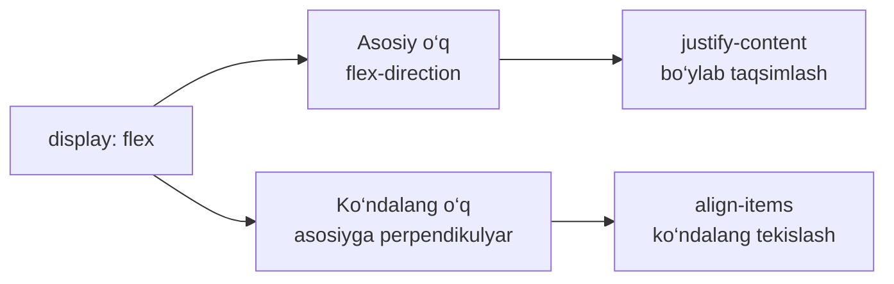
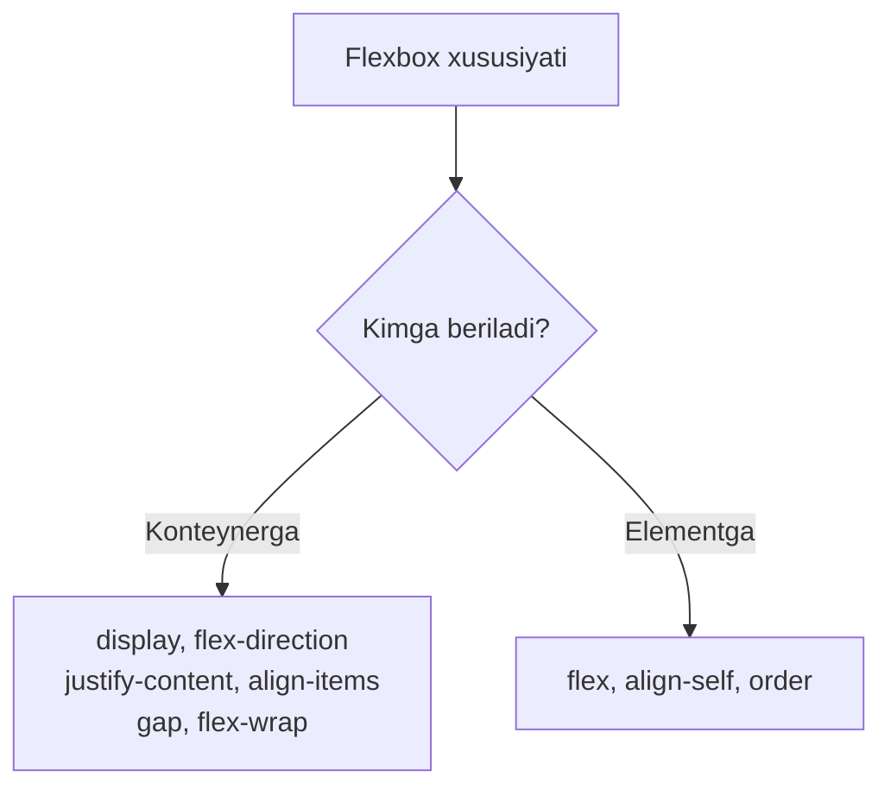

# Flexbox

[Mundarija](../../README.md) · [← Orqaga](../../Lesson-4/uz/Box%20model%20%28blok%20modeli%29.md) · [Keyingi →](../../Lesson-6/uz/Grid.md) · [RU](../ru/Flexbox.md) · [EN](../en/Flexbox.md) · [UZ](Flexbox.md)

> **Oldingi dars bilan bog‘liqlik:** 4-darsda ozoda bloklar yasadingiz, lekin ular bir-birining ostida turibdi. Bugun ularni qatorga qo‘yamiz, markazga tekislaymiz va ular orasida joyni taqsimlaymiz.

---

## Bu sizga nima uchun kerak

Logotip chapda, menyu o‘ngda. Bir xil balandlikdagi uchta kartochka qatorda. Tugma blokning roppa-rosa markazida. Ilgari buni ayyorona usullar bilan qilishardi. Hozir - Flexbox ning uch qatori bilan.

Flexbox - bitta chiziqqa joylashtirishning asosiy vositasi: qatorga yoki ustunga.

---

## Nimani o‘rganasiz

- Flexbox ni yoqish: `display: flex`.
- Konteyner va elementlarni farqlash.
- Yo‘nalishni tanlash: `flex-direction`.
- Elementlarni asosiy o‘q bo‘ylab taqsimlash: `justify-content`.
- Ko‘ndalang o‘q bo‘ylab tekislash: `align-items`.
- `gap` oraliqlari va `flex-wrap` qatorga o‘tkazishni qilish.
- Elementlar o‘lchamini boshqarish: `flex`.

---

## Takrorlash: 4-darsdan 3 savol

1. Uslublar faylida birinchi qaysi qoida yoziladi?
2. `max-width` li blokni qanday markazga qo‘yish mumkin?
3. `padding` `margin` dan nimasi bilan farq qiladi?

Javoblar - dars oxirida.

---

## Reja

| Bo‘lim | Nima qilamiz |
| --- | --- |
| Konteyner va elementlar | Javon va kitoblar |
| O‘qlar | Asosiy va ko‘ndalang |
| `justify-content` | Kitoblarni javon bo‘ylab terish |
| `align-items` | Balandlik bo‘yicha tekislash |
| Mini-topshiriq 1 | Shapka: logotip va menyu |
| `gap` va `flex-wrap` | Oraliqlar va qatorga o‘tkazish |
| `flex` | Kim qancha joy egallaydi |
| Mini-topshiriq 2 | Kartochkalar qatori |
| Mustaqil ish | IDE topshirig‘i va o‘z saytingiz |

---

## Konteyner va elementlar

**Oddiy qilib aytganda:** javon va undagi kitoblar. Joylashtirish qoidalari **javonga** - konteynerga beriladi. Kitoblar - uning to‘g‘ridan-to‘g‘ri bolalari - shu qoidalar bo‘yicha turadi.

```html
<ul class="menu">
    <li>Bosh sahifa</li>
    <li>Biz haqimizda</li>
    <li>Kontaktlar</li>
</ul>
```

```css
.menu {
    display: flex;
}
```

**Nimani ko‘rasiz:** ro‘yxat bandlari bir-birining ostida emas, qatorda turdi.

**Muhim:** Flexbox faqat konteynerning **to‘g‘ridan-to‘g‘ri bolalariga** ta’sir qiladi. `<li>` ichidagi havolalar - nevaralar, ularga `.menu` dagi `display: flex` ta’sir qilmaydi.

---

## O‘qlar

Flex-konteynerning ikki o‘qi bor:

| O‘q | Sukut bo‘yicha | Nima bilan boshqarish |
| --- | --- | --- |
| **Asosiy** | Chapdan o‘ngga | `justify-content` |
| **Ko‘ndalang** | Yuqoridan pastga | `align-items` |

`flex-direction` asosiy o‘qni buradi:

| Qiymat | Elementlar boradi |
| --- | --- |
| `row` (sukut bo‘yicha) | Qatorda, chapdan o‘ngga |
| `column` | Ustunda, yuqoridan pastga |
| `row-reverse` | Qatorda, o‘ngdan chapga |
| `column-reverse` | Ustunda, pastdan yuqoriga |

**Tuzoq:** `flex-direction: column` da asosiy o‘q vertikal bo‘ladi. Endi `justify-content` elementlarni **vertikal**, `align-items` esa **gorizontal** bo‘yicha suradi.



**Sxemani qanday o‘qish kerak.** Avval asosiy o‘qni aniqlang (`row` yoki `column`). `justify-content` doim uning bo‘ylab, `align-items` - ko‘ndalang ishlaydi.

---

## `justify-content`: asosiy o‘q bo‘ylab

| Qiymat | Uchta elementni qanday teradi |
| --- | --- |
| `flex-start` | `[A][B][C]_______` - boshiga |
| `center` | `___[A][B][C]____` - markazga |
| `flex-end` | `_______[A][B][C]` - oxiriga |
| `space-between` | `[A]_____[B]_____[C]` - chetdagilari chetlarga, qolgani teng |
| `space-around` | `_[A]__[B]__[C]_` - har birining atrofida teng |
| `space-evenly` | `__[A]__[B]__[C]__` - barcha oraliqlar teng |

---

## `align-items`: ko‘ndalang

| Qiymat | Nima qiladi |
| --- | --- |
| `stretch` (sukut bo‘yicha) | Elementlarni konteynerning butun balandligiga cho‘zadi |
| `center` | Markazga |
| `flex-start` | Yuqoriga |
| `flex-end` | Pastga |

### Ikki o‘q bo‘yicha markaz

Eng ko‘p uchraydigan vazifa - nimanidir roppa-rosa markazga qo‘yish:

```css
.hero {
    display: flex;
    justify-content: center;
    align-items: center;
    min-height: 300px;
}
```

**Nimani ko‘rasiz:** blok mazmuni - ham gorizontal, ham vertikal bo‘yicha aniq markazda.

**Qatordagi kartochkalarning bir xil balandligi** o‘zi chiqadi: sukut bo‘yicha `stretch` qiymati ularni eng balandigacha cho‘zadi.

### Buzib ko‘ring

`.hero` dan `min-height` ni o‘chiring. Vertikal markazlash yo‘qoldimi? Blok mazmun balandligida bo‘lib qoldi - markazlash uchun joy qolmadi.

---

## Mini-topshiriq 1

`.site-header` shapkasi: chapda `<p class="logo">`, o‘ngda `<nav>`. Logotip chap chetda, menyu o‘ng chetda, ikkalasi balandlik bo‘yicha markazda. Yechim - «Javoblar» bo‘limida.

---

## `gap` va `flex-wrap`

### `gap` - elementlar orasidagi oraliqlar

```css
.menu {
    display: flex;
    gap: 16px;
}
```

**Nimani ko‘rasiz:** bandlar orasida 16px. Har biridagi `margin` dan farqli o‘laroq, chetdagi elementlarda chetlardan ortiqcha chekinish yo‘q.

### `flex-wrap` - yangi qatorga o‘tkazish

Sukut bo‘yicha Flexbox o‘jarlik bilan hammasini bitta qatorga qo‘yadi va elementlarni siqadi. Ortiqchasi o‘tishi uchun:

```css
.cards {
    display: flex;
    flex-wrap: wrap;
    gap: 24px;
}
```

**Nimani ko‘rasiz:** kartochkalar qatorda; sig‘masa - keyingi qatorga o‘tadi.

---

## `flex`: kim qancha joy egallaydi

Bu xususiyat konteynerga emas, **elementlarga** beriladi.

```css
.card {
    flex: 1 1 240px;
}
```

| Son | Nomi | Ma’nosi |
| --- | --- | --- |
| `1` | `flex-grow` | Bo‘sh joy bo‘lsa, **o‘sishi** mumkin |
| `1` | `flex-shrink` | Joy kam bo‘lsa, **siqilishi** mumkin |
| `240px` | `flex-basis` | O‘sish va siqilishdan oldingi **istalgan** kenglik |

**Nimani ko‘rasiz:** `flex-wrap: wrap` bilan birga - har bir kartochka 240px dan tor emas. Keng ekranda uchtasi qatorda va butun kenglikka cho‘ziladi, torida - bittadan.

| Qisqa yozuv | Ma’nosi |
| --- | --- |
| `flex: 1` | Barcha elementlar joyni teng bo‘ladi |
| Bittasida `flex: 2`, boshqalarida `flex: 1` | Bu bo‘sh joyning ikki baravarini oladi |
| `flex: none` | O‘smaydi va siqilmaydi |



**Sxemani qanday o‘qish kerak.** Ko‘pchilik xususiyatlar - konteyner uchun. Elementlarga faqat o‘z o‘lchami va joyiga tegishli narsa beriladi.

### `align-self` va `order`

- `align-self` - **bitta** elementni qolganlaridan boshqacha tekislash.
- `order` - ko‘rsatish tartibini o‘zgartirish. Ehtiyot bo‘ling: Tab va ekran o‘quvchi ekrandagi emas, HTML dagi tartib bo‘yicha boradi. Boshqa tartib kerakmi - yaxshisi HTML ni o‘zgartiring.

### Yangi o‘rganuvchilarning tipik xatolari

| Xato | Qanday tuzatish |
| --- | --- |
| `display: flex` konteynerga emas, elementlarga | Ota elementga bering |
| `flex` nevaralarga ta’sir qilishini kutishadi | Faqat to‘g‘ridan-to‘g‘ri bolalar |
| `column` da `justify-content` «ishlamaydi» | `column` da u vertikal bo‘yicha suradi |
| Vertikal markaz ishlamaydi | Konteynerda balandlik yo‘q: `min-height` bering |
| Oraliqlar uchun har bir elementda `margin` | Konteynerda `gap` |
| Kartochkalar ipdek siqiladi | `flex-wrap: wrap` va `flex-basis` |
| Ma’noni o‘zgartirish uchun `order` | HTML dagi tartibni o‘zgartiring |

---

## Mini-topshiriq 2

`.cards` kartochkalar qatori: yangi qatorga o‘tkazish, 24px oraliq. Har bir `.card` - istalgan kenglik 240px, o‘sishi va siqilishi mumkin. Yechim - «Javoblar» bo‘limida.

**Mashq qiling:** [Flexbox Froggy](https://flexboxfroggy.com/) o‘yini - qurbaqalarni Flexbox xususiyatlari bilan joylashtiradigan 24 daraja. O‘yin ko‘p tillarda mavjud, rus yoki ingliz tilini tanlang.

---

## Dars yakuni: shpargalka

| Vazifa | Yozuv |
| --- | --- |
| Yoqish | `display: flex;` (konteynerga) |
| Ustunga | `flex-direction: column;` |
| Chetlarga | `justify-content: space-between;` |
| Bo‘ylab markazga | `justify-content: center;` |
| Ko‘ndalang markazga | `align-items: center;` |
| Ikki o‘q bo‘yicha markaz | `justify-content: center; align-items: center;` + balandlik |
| Oraliqlar | `gap: 16px;` |
| O‘tkazish | `flex-wrap: wrap;` |
| Element o‘lchami | `flex: 1 1 240px;` (elementga) |
| Teng | `flex: 1;` |

---

## Mustaqil ish

### 1-qism. IDE topshirig‘i (platforma hisoblaydi)

To‘garak sahifasini `<style>` da bezang:

1. `.site-header`: Flexbox, logotip va menyu chetlarda (`space-between`), balandlik bo‘yicha markazda.
2. `.menu` (menyudagi ro‘yxat): Flexbox, `gap` oralig‘i, markerlarsiz (`list-style: none;`).
3. `.cards`: `flex-wrap: wrap;` o‘tkazish va `gap` li Flexbox.
4. `.card`: istalgan kenglikli uch qiymatli `flex`.
5. HTML ga kerakli sinflarni qo‘shing.

Platforma nimani tekshiradi: HTML va CSS da `site-header`, `menu`, `cards`, `card` sinflari, `display: flex`, `justify-content: space-between`, `align-items: center`, `gap`, `flex-wrap: wrap`, `flex:`, `list-style: none`, `style=""` va `float` yo‘qligi.

### 2-qism. Kompyuterdagi loyiha

1. Sayt shapkasini yasang: logotip chapda, menyu o‘ngda, qatorda.
2. Kartochkalarni (loyihalar, yangiliklar) o‘tkazish bilan qatorga qo‘ying.
3. Salomlashuv bloki mazmunini markazlang.
4. Oynani toraytiring: kartochkalar qayta joylashadimi, hech narsa chiqib ketmaydimi?
5. Flexbox Froggy ning 1–10-darajalarini o‘ting.

### Tayyorlik mezonlari

- [ ] IDE topshirig‘i qabul qilingan.
- [ ] `display: flex` konteynerlarga, `flex` - elementlarga berilgan.
- [ ] Oraliqlar `gap` orqali.
- [ ] Oyna toraytirilganda kartochkalar ipdek siqilmay, o‘tkaziladi.
- [ ] Ekrandagi elementlar tartibi HTML dagi tartib bilan mos.

---

## O‘zini tekshirish uchun savollar

1. `display: flex` kimga beriladi: konteynergami yoki elementlargami?
2. Flexbox qaysi avlodlarga ta’sir qiladi?
3. Sukut bo‘yicha qaysi o‘q asosiy?
4. `justify-content: space-between` nima qiladi?
5. Elementni ikki o‘q bo‘yicha markazga qanday qo‘yish mumkin?
6. Nega vertikal markazlash ishlamasligi mumkin?
7. `flex-direction: column` da `justify-content` ishi nimasi bilan o‘zgaradi?
8. `gap` `margin` dan nimasi bilan qulayroq?
9. `flex: 1 1 240px` dagi uchta son nimani bildiradi?
10. Nega `order` bilan ehtiyot bo‘lish kerak?

Savollardan keyin platformada **dars testini** topshiring: 12 ta savol, o‘tish chegarasi 70%.

---

## Keyin nima

Flexbox bitta chiziqqa joylashtiradi. Bir vaqtning o‘zida qatorlar **va** ustunlar bo‘yicha joylashtirish uchun - galereya to‘ri, sahifa maketi - Grid bor. Uni 6-darsda ko‘rib chiqamiz.

---

## Javoblar

**Takrorlash**

1. `* { box-sizing: border-box; }`.
2. `margin: 0 auto;`.
3. `padding` - ramka ichida, `margin` - tashqarida.

**Mini-topshiriq 1**

```css
.site-header {
    display: flex;
    justify-content: space-between;
    align-items: center;
}
```

**Mini-topshiriq 2**

```css
.cards {
    display: flex;
    flex-wrap: wrap;
    gap: 24px;
}

.card {
    flex: 1 1 240px;
}
```

**O‘zini tekshirish uchun savollar**

1. Konteynerga.
2. Faqat to‘g‘ridan-to‘g‘ri bolalarga.
3. Gorizontal, chapdan o‘ngga.
4. Chetdagi elementlar - chetlarga, qolgan joy ular orasida teng.
5. `justify-content: center; align-items: center;` va konteynerda balandlik.
6. Konteynerda mazmundan katta balandlik yo‘q.
7. U elementlarni vertikal bo‘yicha suradi.
8. Chetdagi elementlarda ortiqcha chekinish yo‘q, konteynerda bir marta beriladi.
9. O‘sishi mumkin, siqilishi mumkin, istalgan kenglik 240px.
10. Klaviatura va ekran o‘quvchi ekrandagi emas, HTML dagi tartib bo‘yicha boradi.

---

[Mundarija](../../README.md) · [← Orqaga](../../Lesson-4/uz/Box%20model%20%28blok%20modeli%29.md) · [Keyingi →](../../Lesson-6/uz/Grid.md) · [RU](../ru/Flexbox.md) · [EN](../en/Flexbox.md) · [UZ](Flexbox.md)
