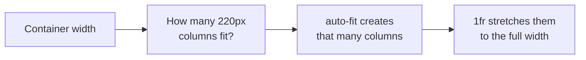
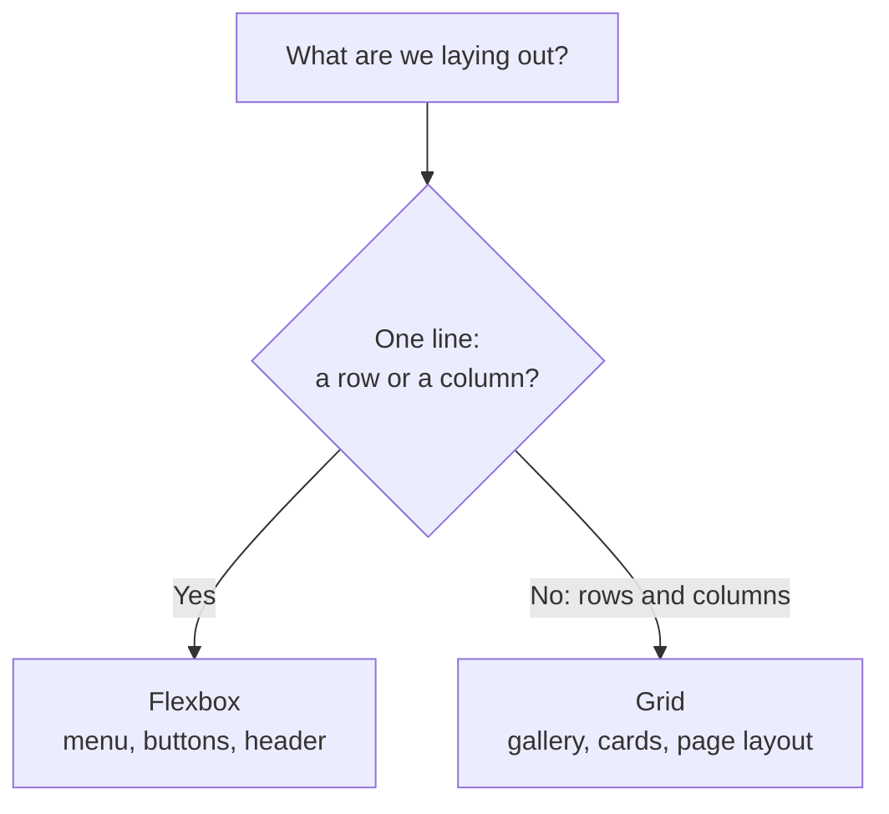

# Grid

[Contents](../../README.md) · [← Back](../../Lesson-5/en/Flexbox.md) · [Next →](../../Lesson-7/en/Positioning%20elements.md) · [RU](../ru/Grid.md) · [EN](Grid.md) · [UZ](../uz/Grid.md)

> **Link to the previous lesson:** in Lesson 5 Flexbox laid items out along one line. Today - laying out by rows **and** columns at once: galleries, card grids, a whole page layout.

---

## Why you need this

A gallery of 12 photos in neat rows of 4. A page layout: header on top, menu on the left, text in the middle, footer at the bottom. In Flexbox this takes wrappers and calculations. In Grid - a few lines.

Grid is a table for layout: you draw a grid, and the items take its cells.

---

## What you will learn

- Turn on a grid: `display: grid`.
- Set columns: `grid-template-columns`, the `fr` unit, the `repeat()` function.
- Make a grid that adjusts the number of columns by itself: `auto-fit` and `minmax()`.
- Stretch an item across several cells: `grid-column`, `span`.
- Draw a page layout with named areas: `grid-template-areas`.
- Choose between Flexbox and Grid.

---

## Review: 3 questions from Lesson 5

1. Who gets `display: flex`?
2. How do you put items at the edges of a row?
3. What does `flex-wrap: wrap` do?

Answers are at the end of the lesson.

---

## Lesson plan

| Section | What we do |
| --- | --- |
| Grid | Squared paper |
| Columns and `fr` | Sharing a pie |
| `repeat()` | No repeating the same thing |
| Mini-task 1 | Three equal columns |
| Responsive grid | `auto-fit` and `minmax()` |
| Stretch an item | `span` |
| Layout by areas | A map of rooms |
| Flexbox or Grid | When to use which |
| Mini-task 2 | A page layout |
| Independent work | IDE task and your own site |

---

## The grid

**In simple terms:** squared paper. You decide how many columns there are and how wide. The items arrange themselves in the cells from left to right, top to bottom.

```html
<div class="gallery">
    
    
    
    
</div>
```

```css
.gallery {
    display: grid;
    grid-template-columns: 200px 200px;
    gap: 16px;
}
```

**What you will see:** two columns of 200px, images two per row, 16px between them. Rows are created by themselves, as many as needed.

As with Flexbox, a grid affects only the container's **direct children**.

---

## Columns and `fr`

**In simple terms:** `fr` is a share of a pie. `1fr 1fr 1fr` - three equal pieces. `2fr 1fr` - one piece twice as big as the other.

| Notation | Result |
| --- | --- |
| `1fr 1fr 1fr` | Three equal columns |
| `2fr 1fr` | The left one twice as wide as the right |
| `250px 1fr` | Left 250px, right - everything else |

```css
.layout {
    display: grid;
    grid-template-columns: 250px 1fr;
    gap: 24px;
}
```

**What you will see:** a 250px side column, and the main one stretches across all the remaining width.

`fr` divides the **free** space - what is left after fixed columns and `gap`. That is why a grid in `fr` never sticks out past the edge because of gaps, unlike percentages.

### `repeat()`

```css
.gallery {
    grid-template-columns: repeat(4, 1fr);
}
```

The same as `1fr 1fr 1fr 1fr`, but shorter.

---

## Mini-task 1

Make `.features` - a grid of three equal columns with a 24px gap. Use `repeat()`. Solution is in the "Answers" section.

---

## A responsive grid: `auto-fit` and `minmax()`

**The main recipe of the lesson:**

```css
.gallery {
    display: grid;
    grid-template-columns: repeat(auto-fit, minmax(220px, 1fr));
    gap: 16px;
}
```

| Part | Means |
| --- | --- |
| `minmax(220px, 1fr)` | A column no narrower than 220px and no wider than a share of free space |
| `auto-fit` | As many columns as fit |

**What you will see:** 4–5 columns on a wide screen, 3 on a tablet, 1 on a phone. Without a single media query.



**How to read the diagram.** The browser works out how many minimum-width columns fit and stretches them so no empty space is left.

### Try to break it

Replace `auto-fit` with `4`: `repeat(4, minmax(220px, 1fr))`. Narrow the window. What happened? Four 220px columns do not fit - a horizontal scrollbar appeared.

---

## Stretching an item: `span`

```css
.featured {
    grid-column: span 2;
}
```

**What you will see:** this item takes two cells in width, and the others flow around it.

| Notation | Means |
| --- | --- |
| `grid-column: span 2;` | Across 2 columns |
| `grid-row: span 2;` | Across 2 rows |
| `grid-column: 1 / -1;` | From the first line to the last - the full width |

Grid lines are numbered from 1, and `-1` is the last line. The notation `1 / -1` is handy for a heading above the grid.

**Careful with `span` in a responsive grid:** on a phone where only one column fits, `span 2` forces the browser to add a second one - and a scrollbar appears. In Lesson 8 we will switch `span` off on narrow screens with a media query.

---

## Layout by areas

**In simple terms:** you draw a floor plan in words - where the kitchen is, where the bedroom is. Then you tell each item: "You are the kitchen".

```css
.page {
    display: grid;
    grid-template-columns: 220px 1fr;
    grid-template-areas:
        "header header"
        "aside  main"
        "footer footer";
    gap: 16px;
}

.page-header {
    grid-area: header;
}

.page-aside {
    grid-area: aside;
}

.page-main {
    grid-area: main;
}

.page-footer {
    grid-area: footer;
}
```

**What you will see:** a full-width header, below it a column on the left and the main content, at the bottom a full-width footer.

| Rule | What it means |
| --- | --- |
| Each string in quotes | A grid row |
| Words in a string | The row's cells, one per column |
| A repeated word | The area spans several cells |
| `.` instead of a word | An empty cell |
| Areas are rectangles | An "L" shape is not allowed |

You invent the area names. `grid-area` is written **without quotes**.



**How to read the diagram.** One line - Flexbox. Two axes at once - Grid. They are often combined: the page layout in Grid, the menu inside the header in Flexbox.

## Flexbox or Grid

| | Flexbox | Grid |
| --- | --- | --- |
| Axes | One | Two |
| Who decides the size | The items' content | The container's grid |
| Typical tasks | Menu, header, buttons in a row, centering | Gallery, cards in neat rows, page layout |

### Typical beginner mistakes

| Mistake | How to fix |
| --- | --- |
| Columns in `%` plus `gap` stick out past the edge | Use `fr` |
| `repeat(4, 220px)` on a phone | `repeat(auto-fit, minmax(220px, 1fr))` |
| Strings of different length in `grid-template-areas` | Each string has as many words as there are columns |
| An "L"-shaped area | Rectangles only |
| `grid-area: "main"` in quotes | No quotes: `grid-area: main;` |
| Expecting the grid to affect grandchildren | Direct children only |
| Grid for one row of buttons | Flexbox is simpler here |

---

## Mini-task 2

Make a `.page` layout: a full-width header on top, below it the main content on the left and an `aside` column 260px wide on the right, a full-width footer at the bottom. Use `grid-template-areas`. Solution is in the "Answers" section.

**Practice:** the game [Grid Garden](https://cssgridgarden.com/) - 28 levels where you water carrots with Grid properties.

---

## Lesson summary: cheat sheet

| Task | Notation |
| --- | --- |
| Turn on | `display: grid;` |
| Three equal columns | `grid-template-columns: repeat(3, 1fr);` |
| A column + the rest | `grid-template-columns: 250px 1fr;` |
| Responsive grid | `repeat(auto-fit, minmax(220px, 1fr))` |
| Gaps | `gap: 16px;` |
| Across 2 columns | `grid-column: span 2;` |
| Full width | `grid-column: 1 / -1;` |
| Layout | `grid-template-areas: "header header" ...;` |
| Item's place | `grid-area: main;` |

---

## Independent work

### Part 1. IDE task (graded by the platform)

A page with a header, main content, a side column, a gallery and a footer. In `<style>`:

1. `.page`: a Grid layout via `grid-template-areas` with the areas `header`, `main`, `aside`, `footer`.
2. Each layout block gets its own `grid-area`.
3. `.gallery`: a responsive grid `repeat(auto-fit, minmax(..., 1fr))` with `gap`.
4. `.featured`: a gallery image across two columns - `span 2`.
5. Add the needed classes to the HTML.

What the platform checks: the classes `page`, `gallery`, `featured` in HTML and CSS, `display: grid`, `grid-template-areas`, `grid-area:` for the four areas, `repeat(auto-fit`, `minmax(`, `1fr`, `gap`, `span 2`, no `float` and no `style=""`.

### Part 2. Project on your computer

1. Make a projects page: cards in a responsive grid.
2. Stretch one card across two columns.
3. Make the layout of at least one page with `grid-template-areas`.
4. Narrow the window to phone width: did the grid rearrange into one column?
5. Complete levels 1–12 of Grid Garden.

### Acceptance criteria

- [ ] The IDE task is accepted.
- [ ] The card grid changes the number of columns without media queries.
- [ ] No horizontal scrolling on a narrow screen.
- [ ] Layout by areas: strings of equal length, areas are rectangles.
- [ ] Menus and small rows use Flexbox, grids use Grid.

---

## Self-check questions

1. How does Grid differ from Flexbox?
2. What is `fr`?
3. Why is `fr` better than percentages together with `gap`?
4. How do you write four equal columns briefly?
5. What does `repeat(auto-fit, minmax(220px, 1fr))` do?
6. How do you stretch an item across two columns?
7. What does `grid-column: 1 / -1` mean?
8. What are the rules of `grid-template-areas`?
9. How do you tell an item which area it occupies?
10. What do you choose for a header menu, and what for a gallery?

After the questions, take the **lesson test** on the platform: 12 questions, pass threshold 70%.

---

## What's next

Flexbox and Grid lay out items in the flow. But sometimes an item has to leave the flow: a badge over an image, a header that sticks while scrolling, a pop-up window. That is positioning - Lesson 7.

---

## Answers

**Review**

1. The container.
2. `justify-content: space-between;`.
3. It moves items that do not fit onto a new line.

**Mini-task 1**

```css
.features {
    display: grid;
    grid-template-columns: repeat(3, 1fr);
    gap: 24px;
}
```

**Mini-task 2**

```css
.page {
    display: grid;
    grid-template-columns: 1fr 260px;
    grid-template-areas:
        "header header"
        "main   aside"
        "footer footer";
    gap: 16px;
}

.page-header { grid-area: header; }
.page-main { grid-area: main; }
.page-aside { grid-area: aside; }
.page-footer { grid-area: footer; }
```

**Self-check questions**

1. Flexbox is one axis, Grid is rows and columns at once.
2. A share of the free space.
3. `fr` divides the space left after `gap`, so the grid does not stick out past the edge.
4. `repeat(4, 1fr)`.
5. It places as many columns no narrower than 220px as fit and stretches them to the full width.
6. `grid-column: span 2;`.
7. From the first grid line to the last - the full width.
8. Strings of equal length, areas are rectangles, `.` is an empty cell.
9. `grid-area: name;`.
10. Menu - Flexbox, gallery - Grid.

---

[Contents](../../README.md) · [← Back](../../Lesson-5/en/Flexbox.md) · [Next →](../../Lesson-7/en/Positioning%20elements.md) · [RU](../ru/Grid.md) · [EN](Grid.md) · [UZ](../uz/Grid.md)
