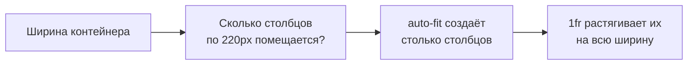
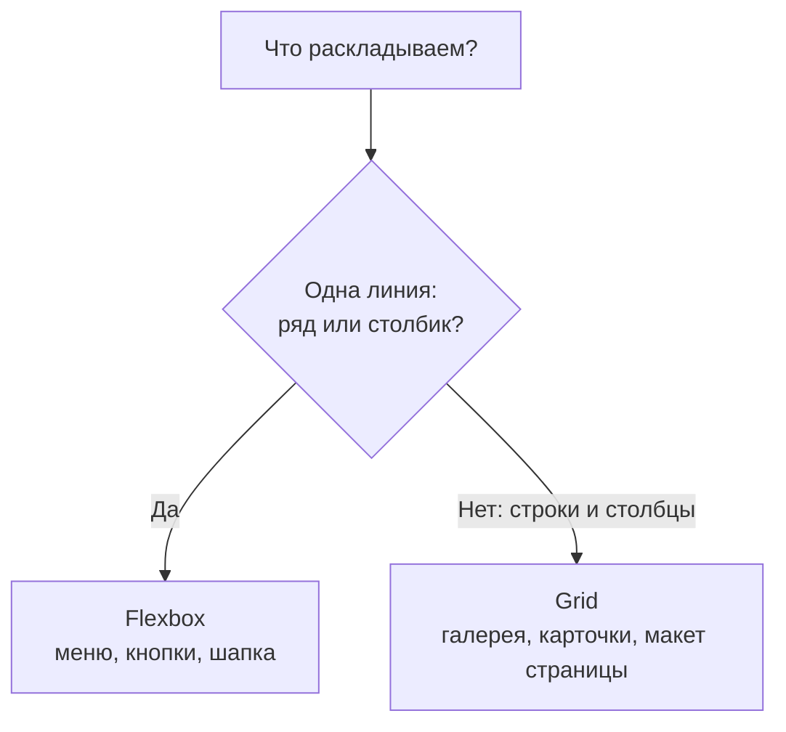

# Grid

[Содержание](../../README.md) · [← Назад](../../Lesson-5/ru/Flexbox.md) · [Вперёд →](../../Lesson-7/ru/%D0%9F%D0%BE%D0%B7%D0%B8%D1%86%D0%B8%D0%BE%D0%BD%D0%B8%D1%80%D0%BE%D0%B2%D0%B0%D0%BD%D0%B8%D0%B5%20%D1%8D%D0%BB%D0%B5%D0%BC%D0%B5%D0%BD%D1%82%D0%BE%D0%B2.md) · [RU](Grid.md) · [EN](../en/Grid.md) · [UZ](../uz/Grid.md)

> **Связь с прошлым уроком:** в уроке 5 Flexbox раскладывал элементы в одну линию. Сегодня - раскладка сразу по строкам **и** столбцам: галереи, сетки карточек, макет всей страницы.

---

## Зачем это вам

Галерея из 12 фотографий ровными рядами по 4. Макет страницы: шапка сверху, меню слева, текст в центре, подвал внизу. Во Flexbox это требует обёрток и подсчётов. В Grid - нескольких строк.

Grid - таблица для раскладки: вы рисуете сетку, а элементы занимают её клетки.

---

## Чему вы научитесь

- Включать сетку: `display: grid`.
- Задавать столбцы: `grid-template-columns`, единица `fr`, функция `repeat()`.
- Делать сетку, которая сама подстраивает число столбцов: `auto-fit` и `minmax()`.
- Растягивать элемент на несколько клеток: `grid-column`, `span`.
- Рисовать макет страницы по именам областей: `grid-template-areas`.
- Выбирать между Flexbox и Grid.

---

## Повторение: 3 вопроса из урока 5

1. Кому задают `display: flex`?
2. Как поставить элементы по краям строки?
3. Что делает `flex-wrap: wrap`?

Ответы - в конце урока.

---

## План урока

| Раздел | Что делаем |
| --- | --- |
| Сетка | Лист в клетку |
| Столбцы и `fr` | Делим пирог |
| `repeat()` | Не повторяем одно и то же |
| Мини-задание 1 | Три равных столбца |
| Адаптивная сетка | `auto-fit` и `minmax()` |
| Растянуть элемент | `span` |
| Макет по областям | Карта комнат |
| Flexbox или Grid | Когда что |
| Мини-задание 2 | Макет страницы |
| Самостоятельная работа | Задание в IDE и свой сайт |

---

## Сетка

**Простыми словами:** лист в клетку. Вы решаете, сколько столбцов и какой ширины. Элементы сами раскладываются по клеткам слева направо, сверху вниз.

```html
<div class="gallery">
    
    
    
    
</div>
```

```css
.gallery {
    display: grid;
    grid-template-columns: 200px 200px;
    gap: 16px;
}
```

**Что увидите:** два столбца по 200px, картинки по две в ряд, между ними 16px. Строки создаются сами, сколько нужно.

Как и во Flexbox, сетка действует только на **прямых детей** контейнера.

---

## Столбцы и `fr`

**Простыми словами:** `fr` - доля пирога. `1fr 1fr 1fr` - три равных куска. `2fr 1fr` - один кусок вдвое больше другого.

| Запись | Результат |
| --- | --- |
| `1fr 1fr 1fr` | Три равных столбца |
| `2fr 1fr` | Левый вдвое шире правого |
| `250px 1fr` | Левый 250px, правый - всё остальное |

```css
.layout {
    display: grid;
    grid-template-columns: 250px 1fr;
    gap: 24px;
}
```

**Что увидите:** боковая колонка 250px, основная растягивается на всю оставшуюся ширину.

`fr` делит **свободное** место - то, что осталось после фиксированных столбцов и `gap`. Поэтому сетка в `fr` никогда не вылезает за край из-за промежутков, в отличие от процентов.

### `repeat()`

```css
.gallery {
    grid-template-columns: repeat(4, 1fr);
}
```

То же самое, что `1fr 1fr 1fr 1fr`, но короче.

---

## Мини-задание 1

Сделайте `.features` - сетку из трёх равных столбцов с промежутком 24px. Используйте `repeat()`. Решение - в разделе «Ответы».

---

## Адаптивная сетка: `auto-fit` и `minmax()`

**Главный рецепт урока:**

```css
.gallery {
    display: grid;
    grid-template-columns: repeat(auto-fit, minmax(220px, 1fr));
    gap: 16px;
}
```

| Часть | Значит |
| --- | --- |
| `minmax(220px, 1fr)` | Столбец не уже 220px и не шире доли свободного места |
| `auto-fit` | Столько столбцов, сколько помещается |

**Что увидите:** на широком экране - 4–5 столбцов, на планшете - 3, на телефоне - 1. Без единого медиазапроса.



**Как читать схему.** Браузер сам считает, сколько столбцов минимальной ширины влезает, и растягивает их, чтобы не осталось пустого места.

### Попробуйте сломать

Замените `auto-fit` на `4`: `repeat(4, minmax(220px, 1fr))`. Сузьте окно. Что случилось? Четыре столбца по 220px не помещаются - появилась горизонтальная прокрутка.

---

## Растянуть элемент: `span`

```css
.featured {
    grid-column: span 2;
}
```

**Что увидите:** этот элемент занимает две клетки по ширине, остальные обтекают его.

| Запись | Значит |
| --- | --- |
| `grid-column: span 2;` | На 2 столбца |
| `grid-row: span 2;` | На 2 строки |
| `grid-column: 1 / -1;` | От первой линии до последней - на всю ширину |

Линии сетки нумеруются с 1, а `-1` - последняя линия. Запись `1 / -1` удобна для заголовка над сеткой.

**Осторожно с `span` в адаптивной сетке:** на телефоне, где помещается один столбец, `span 2` заставит браузер добавить второй - и появится прокрутка. В уроке 8 отключим `span` на узких экранах медиазапросом.

---

## Макет по областям

**Простыми словами:** вы рисуете план квартиры словами - где кухня, где спальня. Потом говорите каждому элементу: «Ты - кухня».

```css
.page {
    display: grid;
    grid-template-columns: 220px 1fr;
    grid-template-areas:
        "header header"
        "aside  main"
        "footer footer";
    gap: 16px;
}

.page-header {
    grid-area: header;
}

.page-aside {
    grid-area: aside;
}

.page-main {
    grid-area: main;
}

.page-footer {
    grid-area: footer;
}
```

**Что увидите:** шапка на всю ширину, ниже - колонка слева и основное содержимое, внизу подвал на всю ширину.

| Правило | Что значит |
| --- | --- |
| Каждая строка в кавычках | Ряд сетки |
| Слова в строке | Клетки ряда, по числу столбцов |
| Повтор слова | Область растянута на несколько клеток |
| `.` вместо слова | Пустая клетка |
| Области - прямоугольники | Форма «Г» не допускается |

Имена областей придумываете вы. `grid-area` пишется **без кавычек**.



**Как читать схему.** Одна линия - Flexbox. Две оси сразу - Grid. Их часто сочетают: макет страницы на Grid, меню внутри шапки на Flexbox.

## Flexbox или Grid

| | Flexbox | Grid |
| --- | --- | --- |
| Оси | Одна | Две |
| Кто решает размер | Содержимое элементов | Сетка контейнера |
| Типичные задачи | Меню, шапка, кнопки в ряд, центрирование | Галерея, карточки ровными рядами, макет страницы |

### Частые ошибки новичков

| Ошибка | Как исправить |
| --- | --- |
| Столбцы в `%` плюс `gap` вылезают за край | Используйте `fr` |
| `repeat(4, 220px)` на телефоне | `repeat(auto-fit, minmax(220px, 1fr))` |
| В `grid-template-areas` строки разной длины | В каждой строке столько слов, сколько столбцов |
| Область формы «Г» | Только прямоугольники |
| `grid-area: "main"` в кавычках | Без кавычек: `grid-area: main;` |
| Ждут, что сетка подействует на внуков | Только прямые дети |
| Grid ради одного ряда кнопок | Тут проще Flexbox |

---

## Мини-задание 2

Сделайте макет `.page`: шапка сверху на всю ширину, ниже основное содержимое слева и колонка `aside` справа шириной 260px, подвал внизу на всю ширину. Используйте `grid-template-areas`. Решение - в разделе «Ответы».

**Потренируйтесь:** игра [Grid Garden](https://cssgridgarden.com/#ru) - 28 уровней на русском, где морковку поливают свойствами Grid.

---

## Итоги урока: шпаргалка

| Задача | Запись |
| --- | --- |
| Включить | `display: grid;` |
| Три равных столбца | `grid-template-columns: repeat(3, 1fr);` |
| Колонка + остальное | `grid-template-columns: 250px 1fr;` |
| Адаптивная сетка | `repeat(auto-fit, minmax(220px, 1fr))` |
| Промежутки | `gap: 16px;` |
| На 2 столбца | `grid-column: span 2;` |
| На всю ширину | `grid-column: 1 / -1;` |
| Макет | `grid-template-areas: "header header" ...;` |
| Место элемента | `grid-area: main;` |

---

## Самостоятельная работа

### Часть 1. Задание в IDE (засчитывается платформой)

Страница с шапкой, основным содержимым, боковой колонкой, галереей и подвалом. В `<style>`:

1. `.page`: Grid-макет через `grid-template-areas` с областями `header`, `main`, `aside`, `footer`.
2. Каждому блоку макета - свой `grid-area`.
3. `.gallery`: адаптивная сетка `repeat(auto-fit, minmax(..., 1fr))` с `gap`.
4. `.featured`: картинка галереи на два столбца - `span 2`.
5. Добавьте нужные классы в HTML.

Что проверяет платформа: классы `page`, `gallery`, `featured` в HTML и CSS, `display: grid`, `grid-template-areas`, `grid-area:` для четырёх областей, `repeat(auto-fit`, `minmax(`, `1fr`, `gap`, `span 2`, отсутствие `float` и `style=""`.

### Часть 2. Проект на компьютере

1. Сделайте страницу проектов: карточки в адаптивной сетке.
2. Одну карточку растяните на два столбца.
3. Сделайте макет хотя бы одной страницы через `grid-template-areas`.
4. Сузьте окно до ширины телефона: сетка перестроилась в один столбец?
5. Пройдите уровни 1–12 Grid Garden.

### Критерии готовности

- [ ] Задание в IDE засчитано.
- [ ] Сетка карточек меняет число столбцов без медиазапросов.
- [ ] Нет горизонтальной прокрутки на узком экране.
- [ ] Макет по областям: строки одной длины, области - прямоугольники.
- [ ] Меню и мелкие ряды - на Flexbox, сетки - на Grid.

---

## Вопросы для самопроверки

1. Чем Grid отличается от Flexbox?
2. Что такое `fr`?
3. Почему `fr` лучше процентов вместе с `gap`?
4. Как записать четыре равных столбца коротко?
5. Что делает `repeat(auto-fit, minmax(220px, 1fr))`?
6. Как растянуть элемент на два столбца?
7. Что значит `grid-column: 1 / -1`?
8. Какие правила у `grid-template-areas`?
9. Как сказать элементу, какую область он занимает?
10. Что выбрать для меню в шапке, а что - для галереи?

После вопросов пройдите **тест урока** на платформе: 12 вопросов, порог 70%.

---

## Что дальше

Flexbox и Grid раскладывают элементы в потоке. Но иногда элемент должен выпасть из потока: значок поверх картинки, шапка, прилипающая при прокрутке, всплывающее окно. Это позиционирование - урок 7.

---

## Ответы

**Повторение**

1. Контейнеру.
2. `justify-content: space-between;`.
3. Переносит элементы, которые не помещаются, на новую строку.

**Мини-задание 1**

```css
.features {
    display: grid;
    grid-template-columns: repeat(3, 1fr);
    gap: 24px;
}
```

**Мини-задание 2**

```css
.page {
    display: grid;
    grid-template-columns: 1fr 260px;
    grid-template-areas:
        "header header"
        "main   aside"
        "footer footer";
    gap: 16px;
}

.page-header { grid-area: header; }
.page-main { grid-area: main; }
.page-aside { grid-area: aside; }
.page-footer { grid-area: footer; }
```

**Вопросы для самопроверки**

1. Flexbox - одна ось, Grid - строки и столбцы сразу.
2. Доля свободного места.
3. `fr` делит место, оставшееся после `gap`, поэтому сетка не вылезает за край.
4. `repeat(4, 1fr)`.
5. Ставит столько столбцов не уже 220px, сколько помещается, и растягивает их на всю ширину.
6. `grid-column: span 2;`.
7. От первой линии сетки до последней - на всю ширину.
8. Строки одной длины, области - прямоугольники, `.` - пустая клетка.
9. `grid-area: имя;`.
10. Меню - Flexbox, галерея - Grid.

---

[Содержание](../../README.md) · [← Назад](../../Lesson-5/ru/Flexbox.md) · [Вперёд →](../../Lesson-7/ru/%D0%9F%D0%BE%D0%B7%D0%B8%D1%86%D0%B8%D0%BE%D0%BD%D0%B8%D1%80%D0%BE%D0%B2%D0%B0%D0%BD%D0%B8%D0%B5%20%D1%8D%D0%BB%D0%B5%D0%BC%D0%B5%D0%BD%D1%82%D0%BE%D0%B2.md) · [RU](Grid.md) · [EN](../en/Grid.md) · [UZ](../uz/Grid.md)
