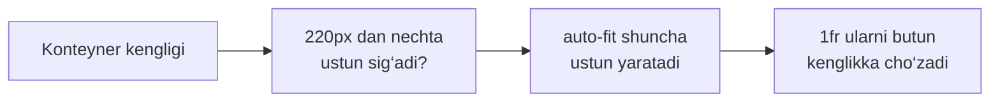
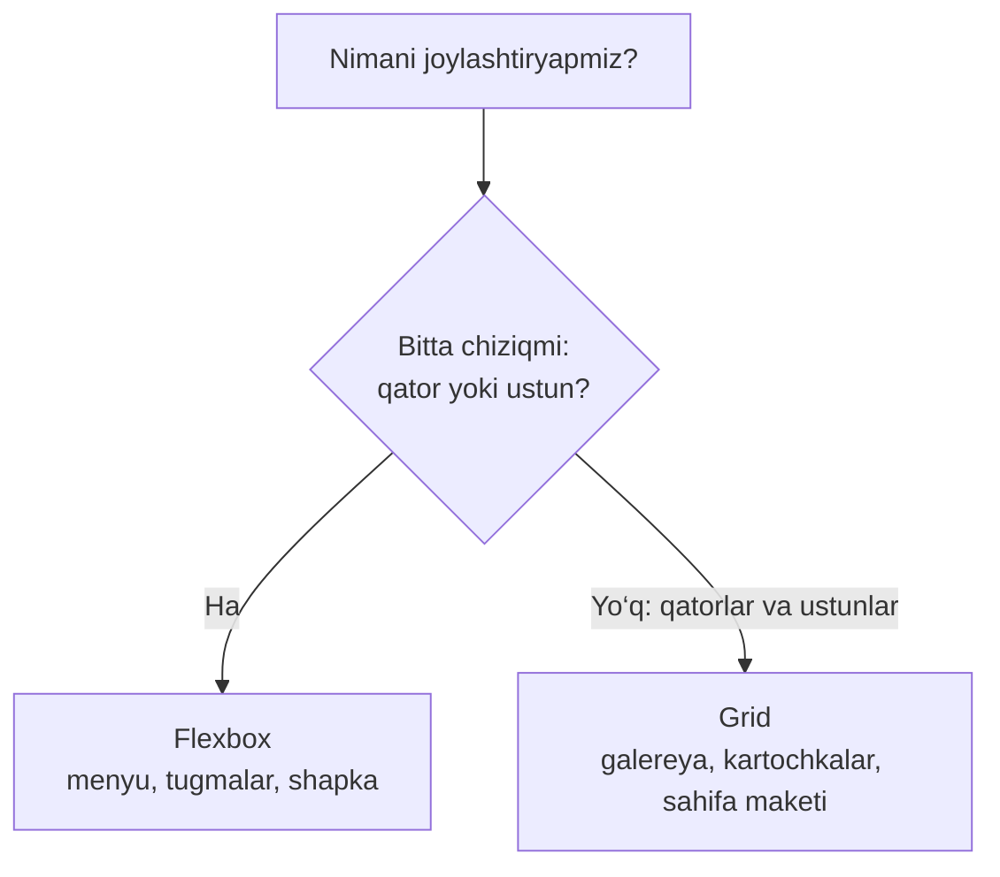

# Grid

[Mundarija](../../README.md) · [← Orqaga](../../Lesson-5/uz/Flexbox.md) · [Keyingi →](../../Lesson-7/uz/Elementlarni%20pozitsiyalash.md) · [RU](../ru/Grid.md) · [EN](../en/Grid.md) · [UZ](Grid.md)

> **Oldingi dars bilan bog‘liqlik:** 5-darsda Flexbox elementlarni bitta chiziqqa joylashtirdi. Bugun - birdaniga qatorlar **va** ustunlar bo‘yicha joylashtirish: galereyalar, kartochkalar to‘ri, butun sahifa maketi.

---

## Bu sizga nima uchun kerak

12 ta fotosuratdan iborat, 4 tadan tekis qatorli galereya. Sahifa maketi: shapka yuqorida, menyu chapda, matn markazda, futer pastda. Flexbox da bu o‘ramlar va hisob-kitoblarni talab qiladi. Grid da - bir necha qatorni.

Grid - joylashtirish uchun jadval: siz to‘r chizasiz, elementlar esa uning kataklarini egallaydi.

---

## Nimani o‘rganasiz

- To‘rni yoqish: `display: grid`.
- Ustunlarni berish: `grid-template-columns`, `fr` birligi, `repeat()` funksiyasi.
- Ustunlar sonini o‘zi moslaydigan to‘r yasash: `auto-fit` va `minmax()`.
- Elementni bir nechta katakka cho‘zish: `grid-column`, `span`.
- Sahifa maketini sohalar nomlari bo‘yicha chizish: `grid-template-areas`.
- Flexbox va Grid orasidan tanlash.

---

## Takrorlash: 5-darsdan 3 savol

1. `display: flex` kimga beriladi?
2. Elementlarni qator chetlariga qanday qo‘yish mumkin?
3. `flex-wrap: wrap` nima qiladi?

Javoblar - dars oxirida.

---

## Reja

| Bo‘lim | Nima qilamiz |
| --- | --- |
| To‘r | Katakli varaq |
| Ustunlar va `fr` | Pirogni bo‘lamiz |
| `repeat()` | Bir xil narsani takrorlamaymiz |
| Mini-topshiriq 1 | Uchta teng ustun |
| Moslashuvchan to‘r | `auto-fit` va `minmax()` |
| Elementni cho‘zish | `span` |
| Sohalar bo‘yicha maket | Xonalar xaritasi |
| Flexbox mi yoki Grid mi | Qachon nima |
| Mini-topshiriq 2 | Sahifa maketi |
| Mustaqil ish | IDE topshirig‘i va o‘z saytingiz |

---

## To‘r

**Oddiy qilib aytganda:** katakli varaq. Nechta ustun va qanday kenglikda bo‘lishini siz hal qilasiz. Elementlar kataklarga o‘zi chapdan o‘ngga, yuqoridan pastga joylashadi.

```html
<div class="gallery">
    
    
    
    
</div>
```

```css
.gallery {
    display: grid;
    grid-template-columns: 200px 200px;
    gap: 16px;
}
```

**Nimani ko‘rasiz:** 200px dan ikkita ustun, rasmlar qatorda ikkitadan, ular orasida 16px. Qatorlar kerakli miqdorda o‘zi yaratiladi.

Flexbox dagidek, to‘r faqat konteynerning **to‘g‘ridan-to‘g‘ri bolalariga** ta’sir qiladi.

---

## Ustunlar va `fr`

**Oddiy qilib aytganda:** `fr` - pirog ulushi. `1fr 1fr 1fr` - uchta teng bo‘lak. `2fr 1fr` - bir bo‘lak ikkinchisidan ikki baravar katta.

| Yozuv | Natija |
| --- | --- |
| `1fr 1fr 1fr` | Uchta teng ustun |
| `2fr 1fr` | Chapdagisi o‘ngdagisidan ikki baravar keng |
| `250px 1fr` | Chapdagisi 250px, o‘ngdagisi - qolgan hammasi |

```css
.layout {
    display: grid;
    grid-template-columns: 250px 1fr;
    gap: 24px;
}
```

**Nimani ko‘rasiz:** yon ustun 250px, asosiysi qolgan butun kenglikka cho‘ziladi.

`fr` **bo‘sh** joyni - qat’iy ustunlar va `gap` dan keyin qolganini bo‘ladi. Shuning uchun `fr` dagi to‘r, foizlardan farqli o‘laroq, oraliqlar tufayli hech qachon chetdan chiqib ketmaydi.

### `repeat()`

```css
.gallery {
    grid-template-columns: repeat(4, 1fr);
}
```

`1fr 1fr 1fr 1fr` bilan bir xil, lekin qisqaroq.

---

## Mini-topshiriq 1

`.features` ni yasang - 24px oraliqli uchta teng ustunli to‘r. `repeat()` dan foydalaning. Yechim - «Javoblar» bo‘limida.

---

## Moslashuvchan to‘r: `auto-fit` va `minmax()`

**Darsning asosiy retsepti:**

```css
.gallery {
    display: grid;
    grid-template-columns: repeat(auto-fit, minmax(220px, 1fr));
    gap: 16px;
}
```

| Qism | Ma’nosi |
| --- | --- |
| `minmax(220px, 1fr)` | Ustun 220px dan tor emas va bo‘sh joy ulushidan keng emas |
| `auto-fit` | Qancha sig‘sa, shuncha ustun |

**Nimani ko‘rasiz:** keng ekranda - 4–5 ustun, planshetda - 3, telefonda - 1. Bitta ham media so‘rovsiz.



**Sxemani qanday o‘qish kerak.** Brauzer minimal kenglikdagi nechta ustun sig‘ishini o‘zi hisoblaydi va bo‘sh joy qolmasligi uchun ularni cho‘zadi.

### Buzib ko‘ring

`auto-fit` ni `4` ga almashtiring: `repeat(4, minmax(220px, 1fr))`. Oynani toraytiring. Nima bo‘ldi? 220px dan to‘rtta ustun sig‘maydi - gorizontal aylantirish paydo bo‘ldi.

---

## Elementni cho‘zish: `span`

```css
.featured {
    grid-column: span 2;
}
```

**Nimani ko‘rasiz:** bu element kenglik bo‘yicha ikkita katakni egallaydi, qolganlari uni aylanib o‘tadi.

| Yozuv | Ma’nosi |
| --- | --- |
| `grid-column: span 2;` | 2 ustunga |
| `grid-row: span 2;` | 2 qatorga |
| `grid-column: 1 / -1;` | Birinchi chiziqdan oxirgisigacha - butun kenglikka |

To‘r chiziqlari 1 dan raqamlanadi, `-1` esa - oxirgi chiziq. `1 / -1` yozuvi to‘r ustidagi sarlavha uchun qulay.

**Moslashuvchan to‘rda `span` bilan ehtiyot bo‘ling:** bitta ustun sig‘adigan telefonda `span 2` brauzerni ikkinchisini qo‘shishga majbur qiladi - va aylantirish paydo bo‘ladi. 8-darsda tor ekranlarda `span` ni media so‘rov bilan o‘chiramiz.

---

## Sohalar bo‘yicha maket

**Oddiy qilib aytganda:** kvartira rejasini so‘zlar bilan chizasiz - oshxona qayerda, yotoqxona qayerda. Keyin har bir elementga aytasiz: «Sen - oshxonasan».

```css
.page {
    display: grid;
    grid-template-columns: 220px 1fr;
    grid-template-areas:
        "header header"
        "aside  main"
        "footer footer";
    gap: 16px;
}

.page-header {
    grid-area: header;
}

.page-aside {
    grid-area: aside;
}

.page-main {
    grid-area: main;
}

.page-footer {
    grid-area: footer;
}
```

**Nimani ko‘rasiz:** shapka butun kenglikda, pastda - chapdagi ustun va asosiy mazmun, eng pastda butun kenglikdagi futer.

| Qoida | Ma’nosi |
| --- | --- |
| Har bir qator qo‘shtirnoqda | To‘r qatori |
| Qatordagi so‘zlar | Qator kataklari, ustunlar soniga ko‘ra |
| So‘zning takrorlanishi | Soha bir necha katakka cho‘zilgan |
| So‘z o‘rniga `.` | Bo‘sh katak |
| Sohalar - to‘rtburchaklar | «Г» shakliga yo‘l qo‘yilmaydi |

Sohalar nomlarini o‘zingiz o‘ylab topasiz. `grid-area` **qo‘shtirnoqsiz** yoziladi.



**Sxemani qanday o‘qish kerak.** Bitta chiziq - Flexbox. Birdaniga ikki o‘q - Grid. Ular ko‘pincha birga ishlatiladi: sahifa maketi Grid da, shapka ichidagi menyu Flexbox da.

## Flexbox mi yoki Grid mi

| | Flexbox | Grid |
| --- | --- | --- |
| O‘qlar | Bitta | Ikkita |
| O‘lchamni kim hal qiladi | Elementlar mazmuni | Konteyner to‘ri |
| Tipik vazifalar | Menyu, shapka, qatordagi tugmalar, markazlash | Galereya, tekis qatorli kartochkalar, sahifa maketi |

### Yangi o‘rganuvchilarning tipik xatolari

| Xato | Qanday tuzatish |
| --- | --- |
| `%` dagi ustunlar va `gap` chetdan chiqadi | `fr` ishlating |
| Telefonda `repeat(4, 220px)` | `repeat(auto-fit, minmax(220px, 1fr))` |
| `grid-template-areas` da turli uzunlikdagi qatorlar | Har bir qatorda ustunlar sonicha so‘z |
| «Г» shaklidagi soha | Faqat to‘rtburchaklar |
| Qo‘shtirnoqdagi `grid-area: "main"` | Qo‘shtirnoqsiz: `grid-area: main;` |
| To‘r nevaralarga ta’sir qilishini kutishadi | Faqat to‘g‘ridan-to‘g‘ri bolalar |
| Bitta qator tugma uchun Grid | Bu yerda Flexbox osonroq |

---

## Mini-topshiriq 2

`.page` maketini yasang: yuqorida butun kenglikdagi shapka, pastda chapda asosiy mazmun va o‘ngda 260px kenglikdagi `aside` ustuni, eng pastda butun kenglikdagi futer. `grid-template-areas` dan foydalaning. Yechim - «Javoblar» bo‘limida.

**Mashq qiling:** [Grid Garden](https://cssgridgarden.com/) o‘yini - sabzini Grid xususiyatlari bilan sug‘oradigan 28 daraja. O‘yin ko‘p tillarda mavjud.

---

## Dars yakuni: shpargalka

| Vazifa | Yozuv |
| --- | --- |
| Yoqish | `display: grid;` |
| Uchta teng ustun | `grid-template-columns: repeat(3, 1fr);` |
| Ustun + qolgani | `grid-template-columns: 250px 1fr;` |
| Moslashuvchan to‘r | `repeat(auto-fit, minmax(220px, 1fr))` |
| Oraliqlar | `gap: 16px;` |
| 2 ustunga | `grid-column: span 2;` |
| Butun kenglikka | `grid-column: 1 / -1;` |
| Maket | `grid-template-areas: "header header" ...;` |
| Element joyi | `grid-area: main;` |

---

## Mustaqil ish

### 1-qism. IDE topshirig‘i (platforma hisoblaydi)

Shapka, asosiy mazmun, yon ustun, galereya va futerli sahifa. `<style>` da:

1. `.page`: `header`, `main`, `aside`, `footer` sohalari bilan `grid-template-areas` orqali Grid-maket.
2. Maketning har bir blokiga - o‘z `grid-area` si.
3. `.gallery`: `gap` li `repeat(auto-fit, minmax(..., 1fr))` moslashuvchan to‘ri.
4. `.featured`: ikki ustunga cho‘zilgan galereya rasmi - `span 2`.
5. HTML ga kerakli sinflarni qo‘shing.

Platforma nimani tekshiradi: HTML va CSS da `page`, `gallery`, `featured` sinflari, `display: grid`, `grid-template-areas`, to‘rt soha uchun `grid-area:`, `repeat(auto-fit`, `minmax(`, `1fr`, `gap`, `span 2`, `float` va `style=""` yo‘qligi.

### 2-qism. Kompyuterdagi loyiha

1. Loyihalar sahifasini yasang: kartochkalar moslashuvchan to‘rda.
2. Bitta kartochkani ikki ustunga cho‘zing.
3. Kamida bitta sahifa maketini `grid-template-areas` orqali yasang.
4. Oynani telefon kengligigacha toraytiring: to‘r bitta ustunga qayta joylashdimi?
5. Grid Garden ning 1–12-darajalarini o‘ting.

### Tayyorlik mezonlari

- [ ] IDE topshirig‘i qabul qilingan.
- [ ] Kartochkalar to‘ri ustunlar sonini media so‘rovlarsiz o‘zgartiradi.
- [ ] Tor ekranda gorizontal aylantirish yo‘q.
- [ ] Sohalar bo‘yicha maket: qatorlar bir uzunlikda, sohalar - to‘rtburchaklar.
- [ ] Menyu va kichik qatorlar - Flexbox da, to‘rlar - Grid da.

---

## O‘zini tekshirish uchun savollar

1. Grid Flexbox dan nimasi bilan farq qiladi?
2. `fr` nima?
3. Nega `gap` bilan birga `fr` foizlardan yaxshiroq?
4. To‘rtta teng ustunni qisqa qanday yozish mumkin?
5. `repeat(auto-fit, minmax(220px, 1fr))` nima qiladi?
6. Elementni ikki ustunga qanday cho‘zish mumkin?
7. `grid-column: 1 / -1` nimani bildiradi?
8. `grid-template-areas` ning qanday qoidalari bor?
9. Elementga qaysi sohani egallashini qanday aytish mumkin?
10. Shapkadagi menyu uchun nimani, galereya uchun nimani tanlash kerak?

Savollardan keyin platformada **dars testini** topshiring: 12 ta savol, o‘tish chegarasi 70%.

---

## Keyin nima

Flexbox va Grid elementlarni oqimda joylashtiradi. Lekin ba’zan element oqimdan chiqishi kerak: rasm ustidagi belgi, aylantirishda yopishib qoladigan shapka, qalqib chiquvchi oyna. Bu pozitsiyalash - 7-dars.

---

## Javoblar

**Takrorlash**

1. Konteynerga.
2. `justify-content: space-between;`.
3. Sig‘magan elementlarni yangi qatorga o‘tkazadi.

**Mini-topshiriq 1**

```css
.features {
    display: grid;
    grid-template-columns: repeat(3, 1fr);
    gap: 24px;
}
```

**Mini-topshiriq 2**

```css
.page {
    display: grid;
    grid-template-columns: 1fr 260px;
    grid-template-areas:
        "header header"
        "main   aside"
        "footer footer";
    gap: 16px;
}

.page-header { grid-area: header; }
.page-main { grid-area: main; }
.page-aside { grid-area: aside; }
.page-footer { grid-area: footer; }
```

**O‘zini tekshirish uchun savollar**

1. Flexbox - bitta o‘q, Grid - birdaniga qatorlar va ustunlar.
2. Bo‘sh joy ulushi.
3. `fr` `gap` dan keyin qolgan joyni bo‘ladi, shuning uchun to‘r chetdan chiqmaydi.
4. `repeat(4, 1fr)`.
5. 220px dan tor bo‘lmagan qancha ustun sig‘sa, shunchasini qo‘yadi va ularni butun kenglikka cho‘zadi.
6. `grid-column: span 2;`.
7. To‘rning birinchi chizig‘idan oxirgisigacha - butun kenglikka.
8. Qatorlar bir uzunlikda, sohalar - to‘rtburchaklar, `.` - bo‘sh katak.
9. `grid-area: nom;`.
10. Menyu - Flexbox, galereya - Grid.

---

[Mundarija](../../README.md) · [← Orqaga](../../Lesson-5/uz/Flexbox.md) · [Keyingi →](../../Lesson-7/uz/Elementlarni%20pozitsiyalash.md) · [RU](../ru/Grid.md) · [EN](../en/Grid.md) · [UZ](Grid.md)
