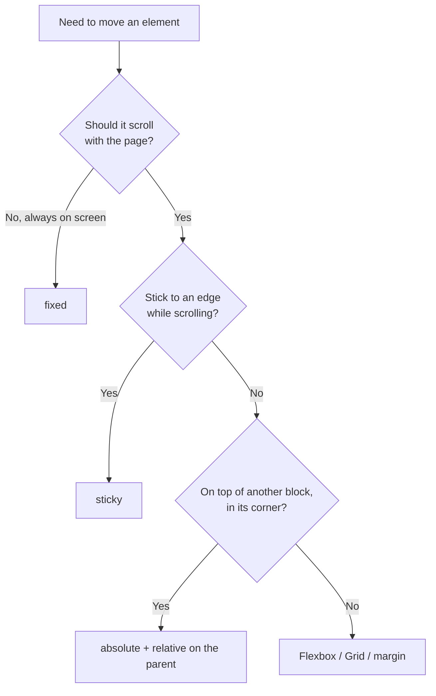
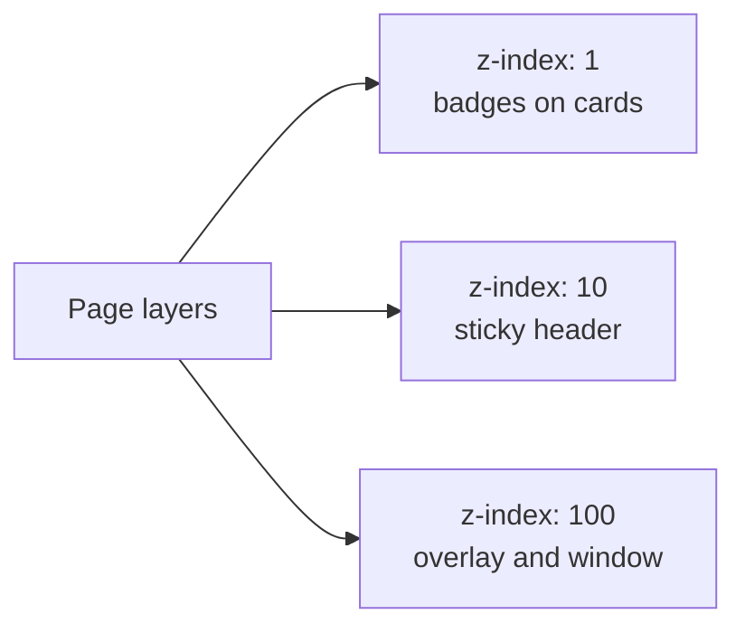

# Positioning elements

[Contents](../../README.md) · [← Back](../../Lesson-6/en/Grid.md) · [Next →](../../Lesson-8/en/Responsive%20layout.md) · [RU](../ru/%D0%9F%D0%BE%D0%B7%D0%B8%D1%86%D0%B8%D0%BE%D0%BD%D0%B8%D1%80%D0%BE%D0%B2%D0%B0%D0%BD%D0%B8%D0%B5%20%D1%8D%D0%BB%D0%B5%D0%BC%D0%B5%D0%BD%D1%82%D0%BE%D0%B2.md) · [EN](Positioning%20elements.md) · [UZ](../uz/Elementlarni%20pozitsiyalash.md)

> **Link to the previous lesson:** Flexbox and Grid lay out items **in the flow**: each takes its own place and pushes its neighbors. Today we learn to take an element out of the flow and put it exactly where it needs to be.

---

## Why you need this

A "New" badge in the corner of a card. A header that sticks to the top of the screen while scrolling. A "Back to top" button that is always in the bottom-right corner. A dark overlay on top of the page under a pop-up window.

Neither Flexbox nor Grid can do this. It is the job of the `position` property.

---

## What you will learn

- Tell apart the five values of `position`: `static`, `relative`, `absolute`, `fixed`, `sticky`.
- Move elements with the `top`, `right`, `bottom`, `left` properties.
- Understand what `absolute` is measured from.
- Control layer stacking with `z-index`.
- Make a badge on a card, a sticky header, a "Back to top" button and an overlay.

---

## Review: 3 questions from Lesson 6

1. What is `fr`?
2. How do you stretch a grid item across two columns?
3. When do you choose Flexbox, and when Grid?

Answers are at the end of the lesson.

---

## Lesson plan

| Section | What we do |
| --- | --- |
| Document flow | A queue of people |
| `relative` | A step aside from the queue |
| `absolute` | A sticker on a box |
| Mini-task 1 | A badge on a card |
| `fixed` | A sticker on the screen |
| `sticky` | A magnet at the edge |
| `z-index` | Who is on top |
| Mini-task 2 | A sticky header |
| Independent work | IDE task and your own site |

---

## Document flow

**In simple terms:** elements stand in a queue. Each takes its own place, and the next one stands behind it. That is the **flow**. By default all have `position: static` - "I stand in the queue like everyone else".

| `position` | In the flow? | `top/left` measured from | Example |
| --- | --- | --- | --- |
| `static` | Yes | Does not work | Everything by default |
| `relative` | Yes, its place is kept | Its own normal place | Anchor for `absolute` |
| `absolute` | **No** | The nearest positioned ancestor | A badge on a card |
| `fixed` | **No** | The browser window | A "Back to top" button |
| `sticky` | Yes, until it sticks | The window edge while scrolling | A sticky header |



**How to read the diagram.** Positioning is needed in three cases: always on screen, sticking, overlaying. For ordinary layout - Flexbox and Grid.

---

## `relative`: a step aside

```css
.shifted {
    position: relative;
    top: 10px;
    left: 20px;
}
```

**What you will see:** the element moved 10px down and 20px right. Its **old place stayed empty**: the neighbors did not move, as if it were still there.

**How to remember `top`:** `top: 10px` means "push away from the top by 10px", that is, **down**.

Shifting with `relative` by itself is rarely needed. The main role of `relative` is to be an **anchor** for `absolute`.

---

## `absolute`: a sticker on a box

**In simple terms:** a sticker on a box. Wherever the box stands, the sticker is in its top-right corner. The box is the parent with `position: relative`.

```html
<article class="card">
    <span class="badge">New</span>
    <h2>CSS course</h2>
    <p>10 lessons.</p>
</article>
```

```css
.card {
    position: relative;
}

.badge {
    position: absolute;
    top: 12px;
    right: 12px;
}
```

**What you will see:** the "New" badge in the top-right corner of the card, over its content.

### What `absolute` is measured from

From the **nearest ancestor** whose `position` is not `static`. If there is none - from the whole page.

### Try to break it

Remove `position: relative` from `.card`. Where did the badge fly off to? To the top-right corner of the **page**: the anchor is gone.

**An element with `absolute` drops out of the flow:** its neighbors do not see it and move into its place. So do not lay out whole blocks this way - only small overlays.

---

## Mini-task 1

Add a `.badge` "Hit" to the `.card` in the **top-left** corner, 8px from the edges. Solution is in the "Answers" section.

---

## `fixed`: a sticker on the screen

```css
.to-top {
    position: fixed;
    right: 24px;
    bottom: 24px;
}
```

**What you will see:** the button is in the bottom-right corner of the window. You scroll the page - the button stays in place.

**Careful:** `fixed` elements cover the content beneath them. On a phone this is more noticeable: do not make them big.

---

## `sticky`: a magnet at the edge

```css
.site-header {
    position: sticky;
    top: 0;
    background-color: white;
}
```

**What you will see:** the header scrolls with the page, but once it reaches the top of the window it **sticks** and stays.

| `sticky` does not work without | Why |
| --- | --- |
| `top: 0` (or another edge) | Otherwise it is unclear where to stick |
| A background on the header | Without it the page text shows through |
| A parent taller than the header | The header sticks only within its parent |

### A sticky header and anchors

A link to `#contacts` scrolls the page so that the section heading hides **under** the sticky header. The fix:

```css
html {
    scroll-padding-top: 80px;
}
```

The browser will stop scrolling 80px lower - right below the header.

---

## `z-index`: who is on top

**In simple terms:** sheets of paper on a desk. `z-index` is the floor number: the larger it is, the higher the sheet lies.

```css
.site-header {
    position: sticky;
    top: 0;
    z-index: 10;
}

.overlay {
    position: fixed;
    inset: 0;
    background-color: rgb(0 0 0 / 50%);
    z-index: 100;
}
```

| Rule | |
| --- | --- |
| Works only on positioned elements (and flex/grid children) | On `static`, `z-index` is ignored |
| Larger number - higher | `100` above `10` |
| Do not use `9999` without need | Keep a short scale: 1, 10, 100 |

**`inset: 0`** is the same as `top: 0; right: 0; bottom: 0; left: 0;`: stretch over the whole parent or, for `fixed`, over the whole window.



**How to read the diagram.** A simple layer scale. A new element goes on the right floor instead of getting a random large number.

### Typical beginner mistakes

| Mistake | How to fix |
| --- | --- |
| The badge flew to the page corner | Add `position: relative` to the parent |
| `absolute` for laying out blocks | Flexbox or Grid |
| `top` moves it up | `top: 10px` pushes away **from** the top, i.e. down |
| `sticky` does not stick | No `top: 0` |
| Text shows through the sticky header | Give it a background |
| `z-index` does not work | The element is not positioned |
| `z-index: 99999` | A short scale: 1, 10, 100 |
| Headings hide under the header after an anchor jump | `scroll-padding-top` |

---

## Mini-task 2

Make the `.site-header` sticky: it sticks to the top, has a white background, sits above other content (`z-index: 10`). And make anchor links not hide headings under a header about 72px tall. Solution is in the "Answers" section.

---

## Lesson summary: cheat sheet

| Task | Notation |
| --- | --- |
| Anchor for a sticker | `position: relative;` on the parent |
| Sticker in a corner | `position: absolute; top: 12px; right: 12px;` |
| Always on screen | `position: fixed; right: 24px; bottom: 24px;` |
| Sticks while scrolling | `position: sticky; top: 0;` + background |
| Full screen | `position: fixed; inset: 0;` |
| Who is on top | `z-index: 10;` |
| Anchors under a sticky header | `html { scroll-padding-top: 80px; }` |

---

## Independent work

### Part 1. IDE task (graded by the platform)

A page with a header, a card and a "Back to top" button. In `<style>`:

1. `.site-header`: `position: sticky;`, `top: 0;`, a background, `z-index`.
2. `.card`: the anchor - `position: relative;`.
3. `.badge`: `position: absolute;` in a corner of the card.
4. `.to-top`: `position: fixed;` in the bottom-right corner (`right` and `bottom`).
5. `html`: `scroll-padding-top`.
6. Add the classes to the HTML.

What the platform checks: the classes `site-header`, `card`, `badge`, `to-top` in HTML and CSS, `position: sticky`, `top: 0`, `z-index`, `position: relative`, `position: absolute`, `position: fixed`, `right:`, `bottom:`, `scroll-padding-top`, no `style=""` and no `z-index` with five nines.

### Part 2. Project on your computer

1. Make your site's header sticky.
2. Add a badge to one of the project cards.
3. Make a "Back to top" link (`href="#top"`) with `position: fixed`.
4. Check the anchors: do headings not hide under the header?
5. Check on a narrow screen: do fixed elements not cover anything important?

### Acceptance criteria

- [ ] The IDE task is accepted.
- [ ] Every `absolute` has a parent with `relative`.
- [ ] A sticky header with a background and `z-index`.
- [ ] Anchor links do not hide headings.
- [ ] The `z-index` scale is short and clear.
- [ ] Blocks are laid out with Flexbox and Grid, not `absolute`.

---

## Self-check questions

1. What `position` value do all elements have by default?
2. What happens to an element's place with `position: relative` and a shift?
3. What is `position: absolute` measured from?
4. Why did the badge fly to the page corner?
5. How does `fixed` differ from `absolute`?
6. What does `sticky` need to work?
7. Why must a sticky header have a background?
8. When does `z-index` not work?
9. What does `inset: 0` do?
10. How do you fix headings that hide under a sticky header?

After the questions, take the **lesson test** on the platform: 12 questions, pass threshold 70%.

---

## What's next

The site already looks good - on a computer. In Lesson 8 we make it look great on a phone too: media queries and the "mobile first" approach.

---

## Answers

**Review**

1. A share of the free space in the grid.
2. `grid-column: span 2;`.
3. One line - Flexbox, rows and columns - Grid.

**Mini-task 1**

```css
.card {
    position: relative;
}

.badge {
    position: absolute;
    top: 8px;
    left: 8px;
}
```

**Mini-task 2**

```css
.site-header {
    position: sticky;
    top: 0;
    background-color: white;
    z-index: 10;
}

html {
    scroll-padding-top: 80px;
}
```

**Self-check questions**

1. `static`.
2. The place stays empty, the neighbors do not move.
3. From the nearest ancestor whose `position` is not `static`, otherwise from the page.
4. The parent has no `position: relative`.
5. `fixed` is measured from the window and does not scroll, `absolute` from a positioned ancestor and scrolls with it.
6. An edge to stick to, such as `top: 0`, and a parent taller than the element itself.
7. Otherwise the scrolling text shows through it.
8. When the element is not positioned and is not a flex or grid child.
9. Stretches the element over the whole parent (or the window for `fixed`).
10. `html { scroll-padding-top: ...; }` set to the header height.

---

[Contents](../../README.md) · [← Back](../../Lesson-6/en/Grid.md) · [Next →](../../Lesson-8/en/Responsive%20layout.md) · [RU](../ru/%D0%9F%D0%BE%D0%B7%D0%B8%D1%86%D0%B8%D0%BE%D0%BD%D0%B8%D1%80%D0%BE%D0%B2%D0%B0%D0%BD%D0%B8%D0%B5%20%D1%8D%D0%BB%D0%B5%D0%BC%D0%B5%D0%BD%D1%82%D0%BE%D0%B2.md) · [EN](Positioning%20elements.md) · [UZ](../uz/Elementlarni%20pozitsiyalash.md)
