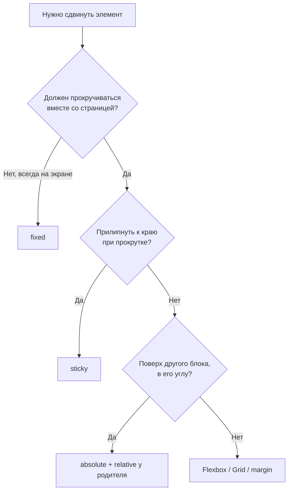
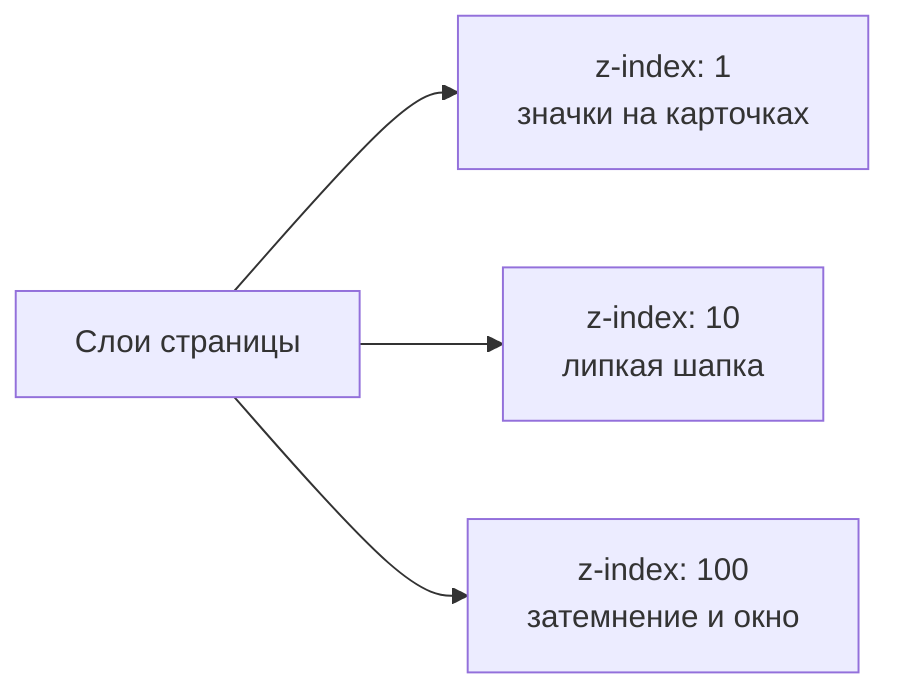

# Позиционирование элементов

[Содержание](../../README.md) · [← Назад](../../Lesson-6/ru/Grid.md) · [Вперёд →](../../Lesson-8/ru/%D0%90%D0%B4%D0%B0%D0%BF%D1%82%D0%B8%D0%B2%D0%BD%D0%B0%D1%8F%20%D0%B2%D1%91%D1%80%D1%81%D1%82%D0%BA%D0%B0.md) · [RU](%D0%9F%D0%BE%D0%B7%D0%B8%D1%86%D0%B8%D0%BE%D0%BD%D0%B8%D1%80%D0%BE%D0%B2%D0%B0%D0%BD%D0%B8%D0%B5%20%D1%8D%D0%BB%D0%B5%D0%BC%D0%B5%D0%BD%D1%82%D0%BE%D0%B2.md) · [EN](../en/Positioning%20elements.md) · [UZ](../uz/Elementlarni%20pozitsiyalash.md)

> **Связь с прошлым уроком:** Flexbox и Grid раскладывают элементы **в потоке**: каждый занимает своё место и толкает соседей. Сегодня научимся вынимать элемент из потока и ставить его точно туда, куда нужно.

---

## Зачем это вам

Значок «Новое» в углу карточки. Шапка, которая прилипает к верху экрана при прокрутке. Кнопка «Наверх», которая всегда в правом нижнем углу. Затемнение поверх страницы под всплывающим окном.

Ни Flexbox, ни Grid этого не умеют. Это работа свойства `position`.

---

## Чему вы научитесь

- Различать пять значений `position`: `static`, `relative`, `absolute`, `fixed`, `sticky`.
- Сдвигать элементы свойствами `top`, `right`, `bottom`, `left`.
- Понимать, от чего отсчитывается `absolute`.
- Управлять наложением слоёв через `z-index`.
- Делать значок на карточке, липкую шапку, кнопку «Наверх» и затемнение.

---

## Повторение: 3 вопроса из урока 6

1. Что такое `fr`?
2. Как растянуть элемент сетки на два столбца?
3. Когда выбирать Flexbox, а когда Grid?

Ответы - в конце урока.

---

## План урока

| Раздел | Что делаем |
| --- | --- |
| Поток документа | Очередь людей |
| `relative` | Шаг в сторону из очереди |
| `absolute` | Наклейка на коробке |
| Мини-задание 1 | Значок на карточке |
| `fixed` | Наклейка на экране |
| `sticky` | Магнит у края |
| `z-index` | Кто сверху |
| Мини-задание 2 | Липкая шапка |
| Самостоятельная работа | Задание в IDE и свой сайт |

---

## Поток документа

**Простыми словами:** элементы стоят в очереди. Каждый занимает своё место, и следующий встаёт за ним. Это **поток**. По умолчанию у всех `position: static` - «стою в очереди, как все».

| `position` | В потоке? | Отсчёт `top/left` от | Пример |
| --- | --- | --- | --- |
| `static` | Да | Не работает | Всё по умолчанию |
| `relative` | Да, место сохраняется | Своего обычного места | Опора для `absolute` |
| `absolute` | **Нет** | Ближайшего позиционированного предка | Значок на карточке |
| `fixed` | **Нет** | Окна браузера | Кнопка «Наверх» |
| `sticky` | Да, пока не прилипнет | Края окна при прокрутке | Липкая шапка |



**Как читать схему.** Позиционирование нужно в трёх случаях: всегда на экране, прилипание, наложение поверх. Для обычной раскладки - Flexbox и Grid.

---

## `relative`: шаг в сторону

```css
.shifted {
    position: relative;
    top: 10px;
    left: 20px;
}
```

**Что увидите:** элемент сдвинулся на 10px вниз и 20px вправо. Его **прежнее место осталось пустым**: соседи не сдвинулись, как будто он всё ещё там.

**Как запомнить `top`:** `top: 10px` - «отодвинь от верха на 10px», то есть **вниз**.

Сам по себе сдвиг через `relative` нужен редко. Главная роль `relative` - быть **опорой** для `absolute`.

---

## `absolute`: наклейка на коробке

**Простыми словами:** наклейка на коробке. Где бы коробка ни стояла, наклейка в её правом верхнем углу. Коробка - родитель с `position: relative`.

```html
<article class="card">
    <span class="badge">Новое</span>
    <h2>Курс CSS</h2>
    <p>10 уроков.</p>
</article>
```

```css
.card {
    position: relative;
}

.badge {
    position: absolute;
    top: 12px;
    right: 12px;
}
```

**Что увидите:** значок «Новое» в правом верхнем углу карточки, поверх её содержимого.

### От чего отсчитывается `absolute`

От **ближайшего предка**, у которого `position` не `static`. Если такого нет - от всей страницы.

### Попробуйте сломать

Удалите `position: relative` у `.card`. Куда улетел значок? В правый верхний угол **страницы**: опоры не стало.

**Элемент с `absolute` выпадает из потока:** соседи его не видят и встают на его место. Поэтому не делайте так раскладку целых блоков - только мелкие наложения.

---

## Мини-задание 1

Добавьте карточке `.card` значок `.badge` «Хит» в **левом верхнем** углу, с отступами 8px. Решение - в разделе «Ответы».

---

## `fixed`: наклейка на экране

```css
.to-top {
    position: fixed;
    right: 24px;
    bottom: 24px;
}
```

**Что увидите:** кнопка в правом нижнем углу окна. Прокручиваете страницу - кнопка остаётся на месте.

**Осторожно:** `fixed`-элементы закрывают содержимое под собой. На телефоне это заметнее: не делайте их большими.

---

## `sticky`: магнит у края

```css
.site-header {
    position: sticky;
    top: 0;
    background-color: white;
}
```

**Что увидите:** шапка прокручивается вместе со страницей, но, дойдя до верха окна, **прилипает** и остаётся.

| Без чего `sticky` не работает | Почему |
| --- | --- |
| `top: 0` (или другой край) | Иначе непонятно, где прилипать |
| Фон у шапки | Без фона текст страницы просвечивает сквозь неё |
| Родитель выше самой шапки | Шапка прилипает только в пределах своего родителя |

### Липкая шапка и якоря

Ссылка на `#contacts` прокручивает страницу так, что заголовок раздела прячется **под** липкой шапкой. Решение:

```css
html {
    scroll-padding-top: 80px;
}
```

Браузер будет останавливать прокрутку на 80px ниже - ровно под шапкой.

---

## `z-index`: кто сверху

**Простыми словами:** листы бумаги на столе. `z-index` - номер этажа: чем больше, тем выше лежит лист.

```css
.site-header {
    position: sticky;
    top: 0;
    z-index: 10;
}

.overlay {
    position: fixed;
    inset: 0;
    background-color: rgb(0 0 0 / 50%);
    z-index: 100;
}
```

| Правило | |
| --- | --- |
| Работает только у позиционированных элементов (и у детей flex/grid) | У `static` `z-index` игнорируется |
| Больше число - выше | `100` над `10` |
| Без нужды не ставьте `9999` | Держите короткую шкалу: 1, 10, 100 |

**`inset: 0`** - то же самое, что `top: 0; right: 0; bottom: 0; left: 0;`: растянуть на весь родитель или, для `fixed`, на всё окно.



**Как читать схему.** Простая шкала слоёв. Новый элемент встаёт на нужный этаж, а не получает случайное большое число.

### Частые ошибки новичков

| Ошибка | Как исправить |
| --- | --- |
| Значок улетел в угол страницы | Добавьте `position: relative` родителю |
| `absolute` для раскладки блоков | Flexbox или Grid |
| `top` двигает вверх | `top: 10px` - отодвинуть **от** верха, то есть вниз |
| `sticky` не прилипает | Нет `top: 0` |
| Сквозь липкую шапку виден текст | Задайте ей фон |
| `z-index` не работает | Элемент не позиционирован |
| `z-index: 99999` | Короткая шкала: 1, 10, 100 |
| Заголовки прячутся под шапкой при переходе по якорю | `scroll-padding-top` |

---

## Мини-задание 2

Сделайте шапку `.site-header` липкой: прилипает к верху, белый фон, над остальным содержимым (`z-index: 10`). И чтобы ссылки-якоря не прятали заголовки под шапкой высотой около 72px. Решение - в разделе «Ответы».

---

## Итоги урока: шпаргалка

| Задача | Запись |
| --- | --- |
| Опора для наклейки | `position: relative;` у родителя |
| Наклейка в углу | `position: absolute; top: 12px; right: 12px;` |
| Всегда на экране | `position: fixed; right: 24px; bottom: 24px;` |
| Прилипает при прокрутке | `position: sticky; top: 0;` + фон |
| На весь экран | `position: fixed; inset: 0;` |
| Кто сверху | `z-index: 10;` |
| Якоря под липкой шапкой | `html { scroll-padding-top: 80px; }` |

---

## Самостоятельная работа

### Часть 1. Задание в IDE (засчитывается платформой)

Страница с шапкой, карточкой и кнопкой «Наверх». В `<style>`:

1. `.site-header`: `position: sticky;`, `top: 0;`, фон, `z-index`.
2. `.card`: опора - `position: relative;`.
3. `.badge`: `position: absolute;` в углу карточки.
4. `.to-top`: `position: fixed;` в правом нижнем углу (`right` и `bottom`).
5. `html`: `scroll-padding-top`.
6. Добавьте классы в HTML.

Что проверяет платформа: классы `site-header`, `card`, `badge`, `to-top` в HTML и CSS, `position: sticky`, `top: 0`, `z-index`, `position: relative`, `position: absolute`, `position: fixed`, `right:`, `bottom:`, `scroll-padding-top`, отсутствие `style=""` и `z-index` с числом из пяти девяток.

### Часть 2. Проект на компьютере

1. Сделайте шапку своего сайта липкой.
2. Добавьте значок на одну из карточек проектов.
3. Сделайте ссылку «Наверх» (`href="#top"`) с `position: fixed`.
4. Проверьте якоря: заголовки не прячутся под шапкой?
5. Проверьте на узком экране: фиксированные элементы не закрывают важное?

### Критерии готовности

- [ ] Задание в IDE засчитано.
- [ ] У каждого `absolute` есть родитель с `relative`.
- [ ] Липкая шапка с фоном и `z-index`.
- [ ] Ссылки-якоря не прячут заголовки.
- [ ] Шкала `z-index` короткая и понятная.
- [ ] Раскладка блоков - на Flexbox и Grid, а не на `absolute`.

---

## Вопросы для самопроверки

1. Какое значение `position` у всех элементов по умолчанию?
2. Что происходит с местом элемента при `position: relative` и сдвиге?
3. От чего отсчитывается `position: absolute`?
4. Почему значок улетел в угол страницы?
5. Чем `fixed` отличается от `absolute`?
6. Что нужно для работы `sticky`?
7. Почему у липкой шапки должен быть фон?
8. Когда `z-index` не работает?
9. Что делает `inset: 0`?
10. Как исправить заголовки, которые прячутся под липкой шапкой?

После вопросов пройдите **тест урока** на платформе: 12 вопросов, порог 70%.

---

## Что дальше

Сайт уже выглядит хорошо - на компьютере. В уроке 8 сделаем так, чтобы он отлично выглядел и на телефоне: медиазапросы и подход «сначала мобильный».

---

## Ответы

**Повторение**

1. Доля свободного места в сетке.
2. `grid-column: span 2;`.
3. Одна линия - Flexbox, строки и столбцы - Grid.

**Мини-задание 1**

```css
.card {
    position: relative;
}

.badge {
    position: absolute;
    top: 8px;
    left: 8px;
}
```

**Мини-задание 2**

```css
.site-header {
    position: sticky;
    top: 0;
    background-color: white;
    z-index: 10;
}

html {
    scroll-padding-top: 80px;
}
```

**Вопросы для самопроверки**

1. `static`.
2. Место остаётся пустым, соседи не сдвигаются.
3. От ближайшего предка с `position`, отличным от `static`, иначе от страницы.
4. У родителя нет `position: relative`.
5. `fixed` отсчитывается от окна и не прокручивается, `absolute` - от позиционированного предка и прокручивается с ним.
6. Край прилипания, например `top: 0`, и родитель выше самого элемента.
7. Иначе сквозь неё просвечивает прокручиваемый текст.
8. Когда элемент не позиционирован и не является ребёнком flex или grid.
9. Растягивает элемент на всего родителя (или на окно у `fixed`).
10. `html { scroll-padding-top: ...; }` на высоту шапки.

---

[Содержание](../../README.md) · [← Назад](../../Lesson-6/ru/Grid.md) · [Вперёд →](../../Lesson-8/ru/%D0%90%D0%B4%D0%B0%D0%BF%D1%82%D0%B8%D0%B2%D0%BD%D0%B0%D1%8F%20%D0%B2%D1%91%D1%80%D1%81%D1%82%D0%BA%D0%B0.md) · [RU](%D0%9F%D0%BE%D0%B7%D0%B8%D1%86%D0%B8%D0%BE%D0%BD%D0%B8%D1%80%D0%BE%D0%B2%D0%B0%D0%BD%D0%B8%D0%B5%20%D1%8D%D0%BB%D0%B5%D0%BC%D0%B5%D0%BD%D1%82%D0%BE%D0%B2.md) · [EN](../en/Positioning%20elements.md) · [UZ](../uz/Elementlarni%20pozitsiyalash.md)
