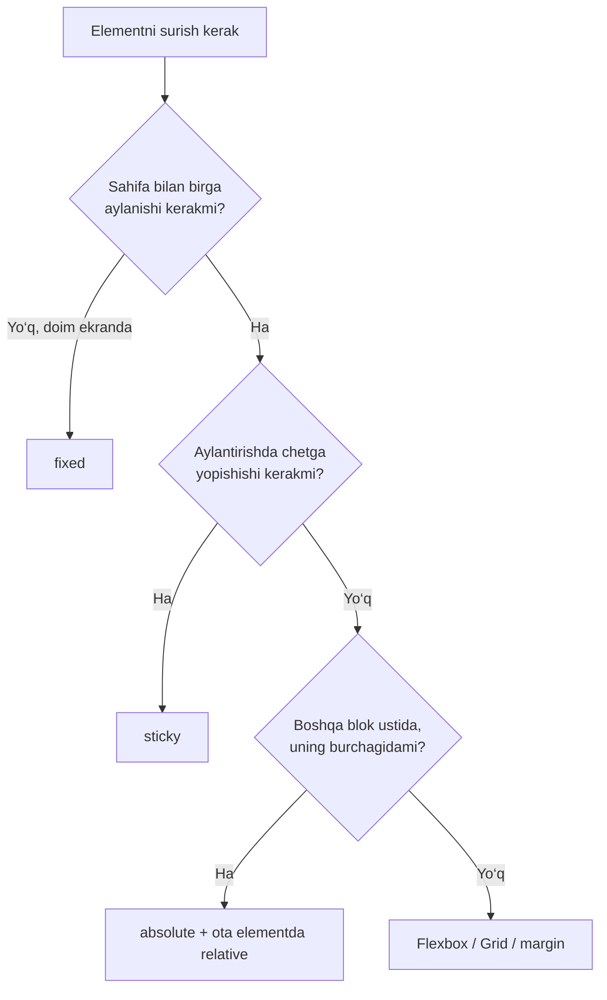
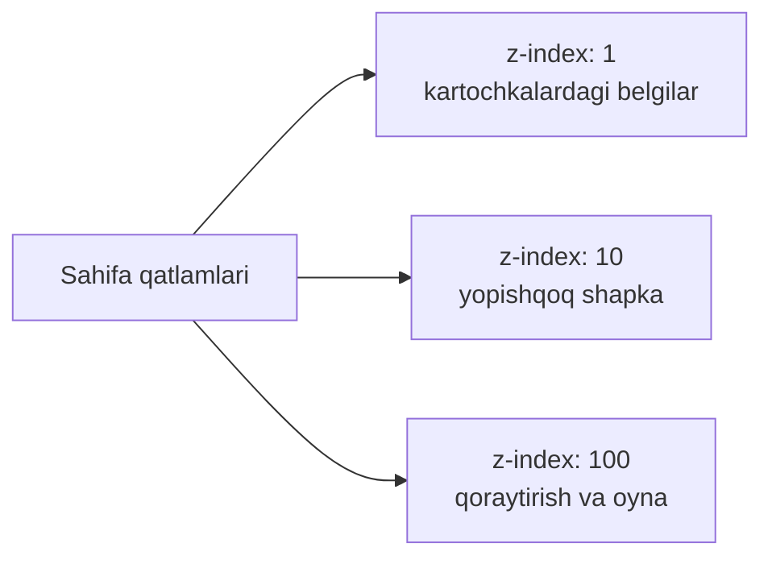

# Elementlarni pozitsiyalash

[Mundarija](../../README.md) · [← Orqaga](../../Lesson-6/uz/Grid.md) · [Keyingi →](../../Lesson-8/uz/Moslashuvchan%20sahifa.md) · [RU](../ru/%D0%9F%D0%BE%D0%B7%D0%B8%D1%86%D0%B8%D0%BE%D0%BD%D0%B8%D1%80%D0%BE%D0%B2%D0%B0%D0%BD%D0%B8%D0%B5%20%D1%8D%D0%BB%D0%B5%D0%BC%D0%B5%D0%BD%D1%82%D0%BE%D0%B2.md) · [EN](../en/Positioning%20elements.md) · [UZ](Elementlarni%20pozitsiyalash.md)

> **Oldingi dars bilan bog‘liqlik:** Flexbox va Grid elementlarni **oqimda** joylashtiradi: har biri o‘z joyini egallaydi va qo‘shnilarini itaradi. Bugun elementni oqimdan chiqarib, roppa-rosa kerakli joyga qo‘yishni o‘rganamiz.

---

## Bu sizga nima uchun kerak

Kartochka burchagidagi «Yangi» belgisi. Aylantirishda ekran tepasiga yopishib qoladigan shapka. Doim o‘ng pastki burchakda turadigan «Tepaga» tugmasi. Qalqib chiquvchi oyna ostida sahifa ustidagi qoraytirish.

Buni Flexbox ham, Grid ham qila olmaydi. Bu `position` xususiyatining ishi.

---

## Nimani o‘rganasiz

- `position` ning beshta qiymatini farqlash: `static`, `relative`, `absolute`, `fixed`, `sticky`.
- Elementlarni `top`, `right`, `bottom`, `left` xususiyatlari bilan surish.
- `absolute` nimadan hisoblanishini tushunish.
- Qatlamlar ustma-ustligini `z-index` orqali boshqarish.
- Kartochkadagi belgi, yopishqoq shapka, «Tepaga» tugmasi va qoraytirishni yasash.

---

## Takrorlash: 6-darsdan 3 savol

1. `fr` nima?
2. To‘r elementini ikki ustunga qanday cho‘zish mumkin?
3. Qachon Flexbox, qachon Grid tanlanadi?

Javoblar - dars oxirida.

---

## Reja

| Bo‘lim | Nima qilamiz |
| --- | --- |
| Hujjat oqimi | Odamlar navbati |
| `relative` | Navbatdan bir qadam chetga |
| `absolute` | Qutidagi yopishtirma |
| Mini-topshiriq 1 | Kartochkadagi belgi |
| `fixed` | Ekrandagi yopishtirma |
| `sticky` | Chetdagi magnit |
| `z-index` | Kim ustida |
| Mini-topshiriq 2 | Yopishqoq shapka |
| Mustaqil ish | IDE topshirig‘i va o‘z saytingiz |

---

## Hujjat oqimi

**Oddiy qilib aytganda:** elementlar navbatda turibdi. Har biri o‘z joyini egallaydi, keyingisi uning ortidan turadi. Bu - **oqim**. Sukut bo‘yicha hammada `position: static` - «hamma qatori navbatda turibman».

| `position` | Oqimdami? | `top/left` hisobi nimadan | Misol |
| --- | --- | --- | --- |
| `static` | Ha | Ishlamaydi | Sukut bo‘yicha hammasi |
| `relative` | Ha, joyi saqlanadi | O‘zining odatiy joyidan | `absolute` uchun tayanch |
| `absolute` | **Yo‘q** | Eng yaqin pozitsiyalangan ajdoddan | Kartochkadagi belgi |
| `fixed` | **Yo‘q** | Brauzer oynasidan | «Tepaga» tugmasi |
| `sticky` | Ha, yopishguncha | Aylantirishda oyna chetidan | Yopishqoq shapka |



**Sxemani qanday o‘qish kerak.** Pozitsiyalash uch holatda kerak: doim ekranda, yopishish, ustiga qo‘yish. Oddiy joylashtirish uchun - Flexbox va Grid.

---

## `relative`: chetga bir qadam

```css
.shifted {
    position: relative;
    top: 10px;
    left: 20px;
}
```

**Nimani ko‘rasiz:** element 10px pastga va 20px o‘ngga surildi. Uning **avvalgi joyi bo‘sh qoldi**: qo‘shnilar surilmadi, go‘yo u hamon o‘sha yerda.

**`top` ni qanday eslab qolish:** `top: 10px` - «yuqoridan 10px ga uzoqlashtir», ya’ni **pastga**.

`relative` orqali surishning o‘zi kamdan-kam kerak. `relative` ning asosiy roli - `absolute` uchun **tayanch** bo‘lish.

---

## `absolute`: qutidagi yopishtirma

**Oddiy qilib aytganda:** qutidagi yopishtirma. Quti qayerda tursa ham, yopishtirma uning o‘ng yuqori burchagida. Quti - `position: relative` li ota element.

```html
<article class="card">
    <span class="badge">Yangi</span>
    <h2>CSS kursi</h2>
    <p>10 ta dars.</p>
</article>
```

```css
.card {
    position: relative;
}

.badge {
    position: absolute;
    top: 12px;
    right: 12px;
}
```

**Nimani ko‘rasiz:** «Yangi» belgisi kartochkaning o‘ng yuqori burchagida, uning mazmuni ustida.

### `absolute` nimadan hisoblanadi

`position` i `static` bo‘lmagan **eng yaqin ajdoddan**. Bunday bo‘lmasa - butun sahifadan.

### Buzib ko‘ring

`.card` dan `position: relative` ni o‘chiring. Belgi qayerga uchib ketdi? **Sahifaning** o‘ng yuqori burchagiga: tayanch qolmadi.

**`absolute` li element oqimdan tushib qoladi:** qo‘shnilar uni ko‘rmaydi va uning joyiga turadi. Shuning uchun butun bloklarni shunday joylashtirmang - faqat kichik ustma-ust qo‘yishlar uchun.

---

## Mini-topshiriq 1

`.card` kartochkasiga **chap yuqori** burchakda, 8px chekinishli «Xit» `.badge` belgisini qo‘shing. Yechim - «Javoblar» bo‘limida.

---

## `fixed`: ekrandagi yopishtirma

```css
.to-top {
    position: fixed;
    right: 24px;
    bottom: 24px;
}
```

**Nimani ko‘rasiz:** tugma oynaning o‘ng pastki burchagida. Sahifani aylantirasiz - tugma joyida qoladi.

**Ehtiyot bo‘ling:** `fixed` elementlar ostidagi mazmunni yopib qo‘yadi. Telefonda bu ko‘proq seziladi: ularni katta qilmang.

---

## `sticky`: chetdagi magnit

```css
.site-header {
    position: sticky;
    top: 0;
    background-color: white;
}
```

**Nimani ko‘rasiz:** shapka sahifa bilan birga aylanadi, lekin oyna tepasiga yetganda **yopishib qoladi** va o‘sha yerda turadi.

| Nimasiz `sticky` ishlamaydi | Nega |
| --- | --- |
| `top: 0` (yoki boshqa chet) | Aks holda qayerga yopishishi noma’lum |
| Shapkada fon | Fonsiz sahifa matni u orqali ko‘rinib turadi |
| Shapkadan baland ota element | Shapka faqat o‘z ota elementi chegarasida yopishadi |

### Yopishqoq shapka va langarlar

`#contacts` ga havola sahifani shunday aylantiradiki, bo‘lim sarlavhasi yopishqoq shapka **ostiga** yashirinib qoladi. Yechim:

```css
html {
    scroll-padding-top: 80px;
}
```

Brauzer aylantirishni 80px pastroqda - roppa-rosa shapka ostida to‘xtatadi.

---

## `z-index`: kim ustida

**Oddiy qilib aytganda:** stol ustidagi qog‘oz varaqlari. `z-index` - qavat raqami: qancha katta bo‘lsa, varaq shuncha yuqorida yotadi.

```css
.site-header {
    position: sticky;
    top: 0;
    z-index: 10;
}

.overlay {
    position: fixed;
    inset: 0;
    background-color: rgb(0 0 0 / 50%);
    z-index: 100;
}
```

| Qoida | |
| --- | --- |
| Faqat pozitsiyalangan elementlarda ishlaydi (va flex/grid bolalarida) | `static` da `z-index` e’tiborsiz qoldiriladi |
| Son katta - yuqoriroq | `100` `10` ustida |
| Keraksiz `9999` qo‘ymang | Qisqa shkalani saqlang: 1, 10, 100 |

**`inset: 0`** - `top: 0; right: 0; bottom: 0; left: 0;` bilan bir xil: butun ota elementga yoki `fixed` uchun butun oynaga cho‘zish.



**Sxemani qanday o‘qish kerak.** Qatlamlarning oddiy shkalasi. Yangi element tasodifiy katta son olmasdan, kerakli qavatga turadi.

### Yangi o‘rganuvchilarning tipik xatolari

| Xato | Qanday tuzatish |
| --- | --- |
| Belgi sahifa burchagiga uchib ketdi | Ota elementga `position: relative` qo‘shing |
| Bloklarni joylashtirish uchun `absolute` | Flexbox yoki Grid |
| `top` yuqoriga suradi | `top: 10px` - yuqoridan **uzoqlashtirish**, ya’ni pastga |
| `sticky` yopishmaydi | `top: 0` yo‘q |
| Yopishqoq shapka orqali matn ko‘rinadi | Unga fon bering |
| `z-index` ishlamaydi | Element pozitsiyalanmagan |
| `z-index: 99999` | Qisqa shkala: 1, 10, 100 |
| Langar orqali o‘tishda sarlavhalar shapka ostiga yashirinadi | `scroll-padding-top` |

---

## Mini-topshiriq 2

`.site-header` shapkasini yopishqoq qiling: tepaga yopishadi, oq fon, qolgan mazmun ustida (`z-index: 10`). Va langar-havolalar sarlavhalarni taxminan 72px balandlikdagi shapka ostiga yashirmasin. Yechim - «Javoblar» bo‘limida.

---

## Dars yakuni: shpargalka

| Vazifa | Yozuv |
| --- | --- |
| Yopishtirma uchun tayanch | Ota elementda `position: relative;` |
| Burchakdagi yopishtirma | `position: absolute; top: 12px; right: 12px;` |
| Doim ekranda | `position: fixed; right: 24px; bottom: 24px;` |
| Aylantirishda yopishadi | `position: sticky; top: 0;` + fon |
| Butun ekranga | `position: fixed; inset: 0;` |
| Kim ustida | `z-index: 10;` |
| Yopishqoq shapka ostidagi langarlar | `html { scroll-padding-top: 80px; }` |

---

## Mustaqil ish

### 1-qism. IDE topshirig‘i (platforma hisoblaydi)

Shapka, kartochka va «Tepaga» tugmali sahifa. `<style>` da:

1. `.site-header`: `position: sticky;`, `top: 0;`, fon, `z-index`.
2. `.card`: tayanch - `position: relative;`.
3. `.badge`: kartochka burchagida `position: absolute;`.
4. `.to-top`: o‘ng pastki burchakda `position: fixed;` (`right` va `bottom`).
5. `html`: `scroll-padding-top`.
6. HTML ga sinflarni qo‘shing.

Platforma nimani tekshiradi: HTML va CSS da `site-header`, `card`, `badge`, `to-top` sinflari, `position: sticky`, `top: 0`, `z-index`, `position: relative`, `position: absolute`, `position: fixed`, `right:`, `bottom:`, `scroll-padding-top`, `style=""` va beshta to‘qqizli `z-index` yo‘qligi.

### 2-qism. Kompyuterdagi loyiha

1. Saytingiz shapkasini yopishqoq qiling.
2. Loyihalar kartochkalaridan biriga belgi qo‘shing.
3. `position: fixed` li «Tepaga» havolasini (`href="#top"`) yasang.
4. Langarlarni tekshiring: sarlavhalar shapka ostiga yashirinmaydimi?
5. Tor ekranda tekshiring: qat’iy elementlar muhim narsani yopmaydimi?

### Tayyorlik mezonlari

- [ ] IDE topshirig‘i qabul qilingan.
- [ ] Har bir `absolute` ning `relative` li ota elementi bor.
- [ ] Fon va `z-index` li yopishqoq shapka.
- [ ] Langar-havolalar sarlavhalarni yashirmaydi.
- [ ] `z-index` shkalasi qisqa va tushunarli.
- [ ] Bloklar `absolute` da emas, Flexbox va Grid da joylashtirilgan.

---

## O‘zini tekshirish uchun savollar

1. Sukut bo‘yicha barcha elementlarda `position` ning qiymati qanday?
2. `position: relative` va surishda element joyi bilan nima bo‘ladi?
3. `position: absolute` nimadan hisoblanadi?
4. Nega belgi sahifa burchagiga uchib ketdi?
5. `fixed` `absolute` dan nimasi bilan farq qiladi?
6. `sticky` ishlashi uchun nima kerak?
7. Nega yopishqoq shapkada fon bo‘lishi kerak?
8. `z-index` qachon ishlamaydi?
9. `inset: 0` nima qiladi?
10. Yopishqoq shapka ostiga yashirinadigan sarlavhalarni qanday tuzatish mumkin?

Savollardan keyin platformada **dars testini** topshiring: 12 ta savol, o‘tish chegarasi 70%.

---

## Keyin nima

Sayt allaqachon yaxshi ko‘rinadi - kompyuterda. 8-darsda u telefonda ham ajoyib ko‘rinishini ta’minlaymiz: media so‘rovlar va «avval mobil» yondashuvi.

---

## Javoblar

**Takrorlash**

1. To‘rdagi bo‘sh joy ulushi.
2. `grid-column: span 2;`.
3. Bitta chiziq - Flexbox, qatorlar va ustunlar - Grid.

**Mini-topshiriq 1**

```css
.card {
    position: relative;
}

.badge {
    position: absolute;
    top: 8px;
    left: 8px;
}
```

**Mini-topshiriq 2**

```css
.site-header {
    position: sticky;
    top: 0;
    background-color: white;
    z-index: 10;
}

html {
    scroll-padding-top: 80px;
}
```

**O‘zini tekshirish uchun savollar**

1. `static`.
2. Joy bo‘sh qoladi, qo‘shnilar surilmaydi.
3. `position` i `static` dan farqli eng yaqin ajdoddan, aks holda sahifadan.
4. Ota elementda `position: relative` yo‘q.
5. `fixed` oynadan hisoblanadi va aylanmaydi, `absolute` - pozitsiyalangan ajdoddan va u bilan birga aylanadi.
6. Yopishish cheti, masalan `top: 0`, va elementning o‘zidan baland ota element.
7. Aks holda u orqali aylanayotgan matn ko‘rinib turadi.
8. Element pozitsiyalanmagan va flex yoki grid bolasi bo‘lmaganda.
9. Elementni butun ota elementga (yoki `fixed` da oynaga) cho‘zadi.
10. Shapka balandligiga `html { scroll-padding-top: ...; }`.

---

[Mundarija](../../README.md) · [← Orqaga](../../Lesson-6/uz/Grid.md) · [Keyingi →](../../Lesson-8/uz/Moslashuvchan%20sahifa.md) · [RU](../ru/%D0%9F%D0%BE%D0%B7%D0%B8%D1%86%D0%B8%D0%BE%D0%BD%D0%B8%D1%80%D0%BE%D0%B2%D0%B0%D0%BD%D0%B8%D0%B5%20%D1%8D%D0%BB%D0%B5%D0%BC%D0%B5%D0%BD%D1%82%D0%BE%D0%B2.md) · [EN](../en/Positioning%20elements.md) · [UZ](Elementlarni%20pozitsiyalash.md)
