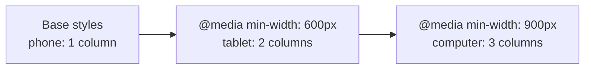
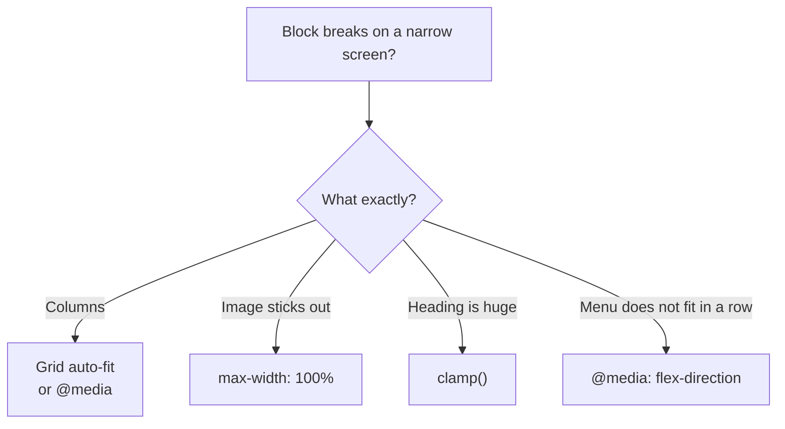

# Responsive layout

[Contents](../../README.md) · [← Back](../../Lesson-7/en/Positioning%20elements.md) · [Next →](../../Lesson-9/en/States%2C%20transitions%2C%20animations%20and%20variables.md) · [RU](../ru/%D0%90%D0%B4%D0%B0%D0%BF%D1%82%D0%B8%D0%B2%D0%BD%D0%B0%D1%8F%20%D0%B2%D1%91%D1%80%D1%81%D1%82%D0%BA%D0%B0.md) · [EN](Responsive%20layout.md) · [UZ](../uz/Moslashuvchan%20sahifa.md)

> **Link to previous lessons:** you can lay out blocks with Flexbox and Grid. Today we teach the layout to change with the screen width: one column on a phone, three on a computer.

---

## Why you need this

More than half of website visitors come from a phone. If a site is made only for a wide screen, on a phone the text is tiny, the menu does not fit, a horizontal scrollbar appears - and the person leaves.

**Responsive layout** is one site that adapts to any screen by itself.

---

## What you will learn

- Explain the role of `meta viewport`.
- Write styles following the "mobile first" principle.
- Change styles at the right screen width: `@media` queries.
- Make fluid images that do not stick out of the screen.
- Scale headings smoothly: `clamp()`.
- Check the site in DevTools device mode.
- Support the system dark theme.

---

## Review: 3 questions from Lessons 5–6

1. How do you put menu items in a row?
2. What does `repeat(auto-fit, minmax(220px, 1fr))` do?
3. How do you put the items of a flex container in a column?

Answers are at the end of the lesson.

---

## Lesson plan

| Section | What we do |
| --- | --- |
| `viewport` | Nothing works without it |
| Device mode | A phone inside a computer |
| Mobile first | Narrow screen first |
| Media queries | "If the screen is wider..." |
| Mini-task 1 | Grid 1 → 2 → 3 |
| Fluid images | No wider than the parent |
| `clamp()` | A heading that grows |
| Mini-task 2 | A flipping header |
| Dark theme | `prefers-color-scheme` |
| Independent work | IDE task and your own site |

---

## `viewport`

From Lesson 9 of the HTML course:

```html
<meta name="viewport" content="width=device-width, initial-scale=1.0">
```

Without this line a phone shows the page as if on a 980px-wide screen, shrunk several times. No media queries will work. **Check that it is on every page.**

---

## Device mode in DevTools

1. F12 → the phone and tablet icon at the top left (Toggle device toolbar), or Ctrl+Shift+M (on macOS: Cmd+Shift+M).
2. At the top choose a device, for example an iPhone, or **Responsive** mode and drag the edge.
3. The width in pixels is shown at the top.

**What to look for:** no horizontal scrollbar, text readable without zooming, buttons tappable with a finger.

Device mode is a good check, but it does not replace a real phone. Before publishing, open the site on your own.

---

## Mobile first: narrow screen first

**In simple terms:** when packing a suitcase, you first put in the essentials - what fits into a small bag. Then, if the bag is bigger, you add the rest.

| Approach | Base styles for | Media queries |
| --- | --- | --- |
| **Mobile first** | The phone | `min-width`: "if the screen is **wider** - add" |
| Desktop first | The computer | `max-width`: "if the screen is **narrower** - remove" |

**Why mobile first:**
- on a phone the layout is simpler: one column, much works by itself;
- the phone does not have to load and undo desktop styles;
- you think about the essentials right away.

**Course rule:** mobile first, media queries with `min-width`.

---

## Media queries

```css
/* Base styles - phone */
.cards {
    display: grid;
    grid-template-columns: 1fr;
    gap: 16px;
}

/* Screen from 600px - tablet */
@media (min-width: 600px) {
    .cards {
        grid-template-columns: repeat(2, 1fr);
    }
}

/* Screen from 900px - computer */
@media (min-width: 900px) {
    .cards {
        grid-template-columns: repeat(3, 1fr);
    }
}
```

**What you will see:** drag the window edge in device mode. Below 600px - one column, from 600px - two, from 900px - three.

| Part | Means |
| --- | --- |
| `@media` | "Apply only if..." |
| `(min-width: 600px)` | ...the window width is **600px or more** |
| `{ ... }` inside | Ordinary CSS rules |

Media queries go **at the end** of the file or right after the base rule. Order matters: with equal specificity, the lower one wins (Lesson 2).

### Breakpoints

Where do you put `min-width`? **Where your layout breaks**, not for a specific phone model. Drag the window until it looks bad - that is a breakpoint. Two are enough to start:

| Width | Usually |
| --- | --- |
| Base styles | Phone |
| `min-width: 600px` | Tablet, a large phone sideways |
| `min-width: 900px` | Laptop and computer |



**How to read the diagram.** Each next media query **adds** changes to the previous ones. On a wide screen all three layers work at once.

### Try to break it

Swap the media queries: 900px first, then 600px. Stretch the window wider than 900px. How many columns? Two: the 600px rule is lower and overrides the 900px rule.

---

## Mini-task 1

A `.gallery` grid: one column on a phone, two from 600px, four from 900px. Mobile first. Solution is in the "Answers" section.

---

## Fluid images

```css
img {
    max-width: 100%;
    height: auto;
}
```

| Property | Why |
| --- | --- |
| `max-width: 100%` | The image is no wider than its parent |
| `height: auto` | The height changes proportionally, the image is not squashed |

**What you will see:** large images on a phone shrink to the screen width. The horizontal scrollbar they caused disappears. This rule sits at the top of almost every style file.

### Turning off `span` on a phone

Remember the warning from Lesson 6? We stretch only on wide screens:

```css
@media (min-width: 600px) {
    .featured {
        grid-column: span 2;
    }
}
```

---

## `clamp()`: a heading that grows

```css
h1 {
    font-size: clamp(1.75rem, 4vw + 1rem, 3rem);
}
```

| Value | Role |
| --- | --- |
| `1.75rem` | No smaller: on a phone |
| `4vw + 1rem` | Preferred size: grows with the window width |
| `3rem` | No larger: on a big monitor |

**What you will see:** drag the window - the heading grows and shrinks smoothly, without jumps at breakpoints.

The `+ 1rem` term matters: without it the heading will not grow if the user increases the font in browser settings.



**How to read the diagram.** Each typical breakage on a phone has its own tool.

---

## Mini-task 2

A `.site-header`: on a phone the logo and menu are one under the other; from 600px - in a row, at the edges, centered vertically. Mobile first. Solution is in the "Answers" section.

---

## Dark theme

Many people turn on a dark theme in their system. A site can adapt:

```css
@media (prefers-color-scheme: dark) {
    body {
        background-color: #0f172a;
        color: #e2e8f0;
    }
}
```

`prefers-color-scheme` is a media query not about width but about **user settings**. To check: DevTools → `⋮` → **More tools → Rendering** → **Emulate CSS media feature prefers-color-scheme: dark**.

Check the contrast in the dark theme too: ≥ 4.5:1.

### Typical beginner mistakes

| Mistake | How to fix |
| --- | --- |
| Media queries do not work on a phone | No `meta viewport` |
| Horizontal scrolling | `img { max-width: 100%; }`, `max-width` instead of `width` |
| Media queries in the wrong order | With `min-width` - from smaller to larger |
| Breakpoints for phone models | Put them where the layout breaks |
| `@media min-width: 600px` without parentheses | The condition is always in parentheses |
| Tiny text on a phone | Body text no smaller than `1rem` |
| Buttons too small for a finger | A tap area about 44px tall |

---

## Lesson summary: cheat sheet

| Task | Notation |
| --- | --- |
| Turn on responsiveness | `<meta name="viewport" content="width=device-width, initial-scale=1.0">` |
| From 600px width | `@media (min-width: 600px) { ... }` |
| Order | Base → 600px → 900px |
| Images do not stick out | `img { max-width: 100%; height: auto; }` |
| Smooth size | `font-size: clamp(1.75rem, 4vw + 1rem, 3rem);` |
| Dark theme | `@media (prefers-color-scheme: dark) { ... }` |
| Checking | DevTools → device mode + a real phone |

---

## Independent work

### Part 1. IDE task (graded by the platform)

A page with a header, a heading and cards. Mobile first:

1. In `<head>` - `meta viewport`.
2. `img`: `max-width: 100%;` and `height: auto;`.
3. `.site-header`: `flex-direction: column;` on a phone, `flex-direction: row;` in `@media (min-width: 600px)`.
4. `.cards`: one column (`1fr`) on a phone, two from 600px, three from 900px.
5. `h1`: `font-size` via `clamp()`.
6. Do not use media queries with `max-width`.

What the platform checks: `viewport` with `width=device-width`, `max-width: 100%`, `height: auto`, `@media (min-width: 600px)`, `@media (min-width: 900px)`, `flex-direction: column` and `row`, `grid-template-columns: 1fr`, `repeat(2, 1fr)`, `repeat(3, 1fr)`, `clamp(`, no `@media (max-width`.

### Part 2. Project on your computer

1. Check `viewport` on all pages.
2. Rework the site's styles to mobile first.
3. Make the header and the project grid responsive.
4. Go through the whole site in device mode at 360px, 768px and 1280px.
5. Open the site on a real phone.

### Acceptance criteria

- [ ] The IDE task is accepted.
- [ ] No horizontal scrolling at 360px.
- [ ] Text is readable without zooming.
- [ ] `min-width` media queries go from smaller to larger.
- [ ] Images do not stick out of the screen.
- [ ] The site has been checked on a real phone.

---

## Self-check questions

1. What happens on a phone without `meta viewport`?
2. What does mobile first mean?
3. How does `min-width` differ from `max-width` in a media query?
4. Why do `min-width` media queries go from smaller to larger?
5. How do you choose breakpoints?
6. Why `img { max-width: 100%; }`?
7. Why `height: auto` next to it?
8. What do the three values in `clamp()` mean?
9. Why `+ 1rem` in the middle of `clamp()`?
10. How do you check the dark theme without changing system settings?

After the questions, take the **lesson test** on the platform: 12 questions, pass threshold 70%.

---

## What's next

The site is pretty and responsive, but static. In Lesson 9 we bring it to life: reacting to hover and focus, smooth transitions, animations and variables for colors.

---

## Answers

**Review**

1. `display: flex;` on the list.
2. It places as many columns no narrower than 220px as fit.
3. `flex-direction: column;`.

**Mini-task 1**

```css
.gallery {
    display: grid;
    grid-template-columns: 1fr;
    gap: 16px;
}

@media (min-width: 600px) {
    .gallery {
        grid-template-columns: repeat(2, 1fr);
    }
}

@media (min-width: 900px) {
    .gallery {
        grid-template-columns: repeat(4, 1fr);
    }
}
```

**Mini-task 2**

```css
.site-header {
    display: flex;
    flex-direction: column;
}

@media (min-width: 600px) {
    .site-header {
        flex-direction: row;
        justify-content: space-between;
        align-items: center;
    }
}
```

**Self-check questions**

1. The page appears as a shrunken copy, and media queries do not work.
2. Base styles are written for the phone, and changes are added for wider screens.
3. `min-width` means "the screen is wider", `max-width` means "the screen is narrower".
4. Otherwise the lower rule for a smaller width overrides the rule for a larger one.
5. Where your layout breaks, not for device models.
6. So the image is not wider than its parent.
7. So the height changes proportionally.
8. Minimum, preferred value, maximum.
9. So the size grows when the user increases the font.
10. DevTools → Rendering → Emulate prefers-color-scheme.

---

[Contents](../../README.md) · [← Back](../../Lesson-7/en/Positioning%20elements.md) · [Next →](../../Lesson-9/en/States%2C%20transitions%2C%20animations%20and%20variables.md) · [RU](../ru/%D0%90%D0%B4%D0%B0%D0%BF%D1%82%D0%B8%D0%B2%D0%BD%D0%B0%D1%8F%20%D0%B2%D1%91%D1%80%D1%81%D1%82%D0%BA%D0%B0.md) · [EN](Responsive%20layout.md) · [UZ](../uz/Moslashuvchan%20sahifa.md)
