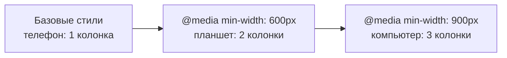
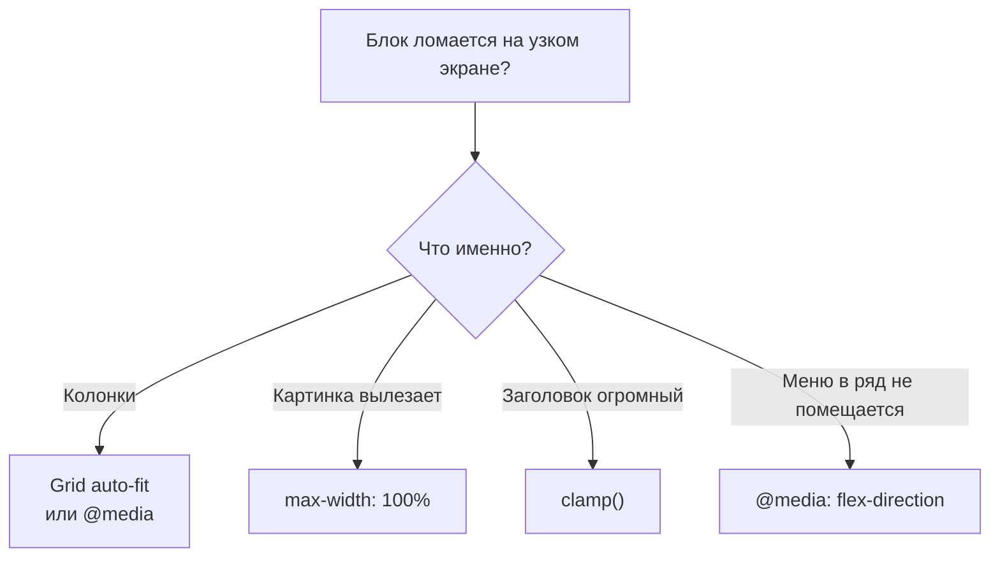

# Адаптивная вёрстка

[Содержание](../../README.md) · [← Назад](../../Lesson-7/ru/%D0%9F%D0%BE%D0%B7%D0%B8%D1%86%D0%B8%D0%BE%D0%BD%D0%B8%D1%80%D0%BE%D0%B2%D0%B0%D0%BD%D0%B8%D0%B5%20%D1%8D%D0%BB%D0%B5%D0%BC%D0%B5%D0%BD%D1%82%D0%BE%D0%B2.md) · [Вперёд →](../../Lesson-9/ru/%D0%A1%D0%BE%D1%81%D1%82%D0%BE%D1%8F%D0%BD%D0%B8%D1%8F%2C%20%D0%BF%D0%B5%D1%80%D0%B5%D1%85%D0%BE%D0%B4%D1%8B%2C%20%D0%B0%D0%BD%D0%B8%D0%BC%D0%B0%D1%86%D0%B8%D0%B8%20%D0%B8%20%D0%BF%D0%B5%D1%80%D0%B5%D0%BC%D0%B5%D0%BD%D0%BD%D1%8B%D0%B5.md) · [RU](%D0%90%D0%B4%D0%B0%D0%BF%D1%82%D0%B8%D0%B2%D0%BD%D0%B0%D1%8F%20%D0%B2%D1%91%D1%80%D1%81%D1%82%D0%BA%D0%B0.md) · [EN](../en/Responsive%20layout.md) · [UZ](../uz/Moslashuvchan%20sahifa.md)

> **Связь с прошлыми уроками:** вы умеете раскладывать блоки Flexbox и Grid. Сегодня научим раскладку меняться в зависимости от ширины экрана: одна колонка на телефоне, три - на компьютере.

---

## Зачем это вам

Больше половины посетителей сайтов приходят с телефона. Если сайт сделан только для широкого экрана, на телефоне текст мелкий, меню не помещается, появляется горизонтальная прокрутка - и человек уходит.

**Адаптивная вёрстка** - один сайт, который сам подстраивается под любой экран.

---

## Чему вы научитесь

- Объяснять роль `meta viewport`.
- Писать стили по принципу «сначала мобильный» (mobile-first).
- Менять стили на нужной ширине экрана: медиазапросы `@media`.
- Делать резиновые картинки, которые не вылезают за экран.
- Плавно масштабировать заголовки: `clamp()`.
- Проверять сайт в режиме устройства в DevTools.
- Поддерживать тёмную тему системы.

---

## Повторение: 3 вопроса из уроков 5–6

1. Как поставить пункты меню в ряд?
2. Что делает `repeat(auto-fit, minmax(220px, 1fr))`?
3. Как сделать элементы flex-контейнера столбиком?

Ответы - в конце урока.

---

## План урока

| Раздел | Что делаем |
| --- | --- |
| `viewport` | Без него ничего не заработает |
| Режим устройства | Телефон внутри компьютера |
| Mobile-first | Сначала узкий экран |
| Медиазапросы | «Если экран шире...» |
| Мини-задание 1 | Сетка 1 → 2 → 3 |
| Резиновые картинки | Не шире родителя |
| `clamp()` | Заголовок, который растёт |
| Мини-задание 2 | Шапка-перевёртыш |
| Тёмная тема | `prefers-color-scheme` |
| Самостоятельная работа | Задание в IDE и свой сайт |

---

## `viewport`

Из урока 9 курса HTML:

```html
<meta name="viewport" content="width=device-width, initial-scale=1.0">
```

Без этой строки телефон показывает страницу как на экране шириной 980px, уменьшенную в несколько раз. Никакие медиазапросы не сработают. **Проверьте, что она есть на каждой странице.**

---

## Режим устройства в DevTools

1. F12 → значок телефона и планшета вверху слева (Toggle device toolbar), или Ctrl+Shift+M (на macOS: Cmd+Shift+M).
2. Сверху выберите устройство, например iPhone, или режим **Responsive** и тяните край.
3. Ширина в пикселях показана сверху.

**Что смотреть:** нет ли горизонтальной прокрутки, читается ли текст без увеличения, нажимаются ли кнопки пальцем.

Режим устройства - хорошая проверка, но не замена настоящему телефону. Перед публикацией откройте сайт на своём.

---

## Mobile-first: сначала узкий экран

**Простыми словами:** собирая чемодан, сначала кладут самое нужное - то, что влезет в маленькую сумку. Потом, если сумка больше, добавляют остальное.

| Подход | Базовые стили для | Медиазапросы |
| --- | --- | --- |
| **Mobile-first** | Телефона | `min-width`: «если экран **шире** - добавь» |
| Desktop-first | Компьютера | `max-width`: «если экран **уже** - убери» |

**Почему mobile-first:**
- на телефоне раскладка проще: одна колонка, многое работает само;
- телефону не приходится загружать и отменять стили для компьютера;
- вы сразу думаете о главном.

**Правило курса:** mobile-first, медиазапросы через `min-width`.

---

## Медиазапросы

```css
/* Базовые стили - телефон */
.cards {
    display: grid;
    grid-template-columns: 1fr;
    gap: 16px;
}

/* Экран от 600px - планшет */
@media (min-width: 600px) {
    .cards {
        grid-template-columns: repeat(2, 1fr);
    }
}

/* Экран от 900px - компьютер */
@media (min-width: 900px) {
    .cards {
        grid-template-columns: repeat(3, 1fr);
    }
}
```

**Что увидите:** тяните край окна в режиме устройства. До 600px - одна колонка, с 600px - две, с 900px - три.

| Часть | Значит |
| --- | --- |
| `@media` | «Применить, только если...» |
| `(min-width: 600px)` | ...ширина окна **600px или больше** |
| `{ ... }` внутри | Обычные правила CSS |

Медиазапросы пишут **в конце** файла или сразу после базового правила. Порядок важен: при равной специфичности побеждает то, что ниже (урок 2).

### Точки перелома

Где ставить `min-width`? **Там, где ломается ваша вёрстка**, а не под конкретную модель телефона. Тяните окно, пока не станет некрасиво, - это и есть точка перелома. Для начала хватает двух:

| Ширина | Обычно |
| --- | --- |
| Базовые стили | Телефон |
| `min-width: 600px` | Планшет, большой телефон боком |
| `min-width: 900px` | Ноутбук и компьютер |



**Как читать схему.** Каждый следующий медиазапрос **добавляет** изменения к предыдущим. На широком экране работают все три слоя сразу.

### Попробуйте сломать

Поменяйте местами медиазапросы: сначала 900px, потом 600px. Растяните окно шире 900px. Сколько колонок? Две: правило для 600px ниже и перебивает правило для 900px.

---

## Мини-задание 1

Сетка `.gallery`: на телефоне одна колонка, от 600px - две, от 900px - четыре. Mobile-first. Решение - в разделе «Ответы».

---

## Резиновые картинки

```css
img {
    max-width: 100%;
    height: auto;
}
```

| Свойство | Зачем |
| --- | --- |
| `max-width: 100%` | Картинка не шире своего родителя |
| `height: auto` | Высота меняется пропорционально, картинка не сплющивается |

**Что увидите:** большие картинки на телефоне сжимаются по ширине экрана. Горизонтальная прокрутка из-за них исчезает. Это правило стоит в начале почти любого файла стилей.

### Отключить `span` на телефоне

Помните предупреждение из урока 6? Делаем растяжку только на широких экранах:

```css
@media (min-width: 600px) {
    .featured {
        grid-column: span 2;
    }
}
```

---

## `clamp()`: заголовок, который растёт

```css
h1 {
    font-size: clamp(1.75rem, 4vw + 1rem, 3rem);
}
```

| Значение | Роль |
| --- | --- |
| `1.75rem` | Не меньше: на телефоне |
| `4vw + 1rem` | Желаемый размер: растёт с шириной окна |
| `3rem` | Не больше: на большом мониторе |

**Что увидите:** тяните окно - заголовок плавно растёт и уменьшается, без скачков на точках перелома.

Слагаемое `+ 1rem` важно: без него заголовок не вырастет, если пользователь увеличит шрифт в настройках браузера.



**Как читать схему.** Для каждой типичной поломки на телефоне - свой инструмент.

---

## Мини-задание 2

Шапка `.site-header`: на телефоне логотип и меню друг под другом, от 600px - в ряд, по краям, по центру по высоте. Mobile-first. Решение - в разделе «Ответы».

---

## Тёмная тема

Многие включают тёмную тему в системе. Сайт может подстроиться:

```css
@media (prefers-color-scheme: dark) {
    body {
        background-color: #0f172a;
        color: #e2e8f0;
    }
}
```

`prefers-color-scheme` - медиазапрос не о ширине, а о **настройках пользователя**. Проверить: DevTools → `⋮` → **More tools → Rendering** → **Emulate CSS media feature prefers-color-scheme: dark**.

Проверьте контраст и в тёмной теме: ≥ 4.5:1.

### Частые ошибки новичков

| Ошибка | Как исправить |
| --- | --- |
| Медиазапросы не работают на телефоне | Нет `meta viewport` |
| Горизонтальная прокрутка | `img { max-width: 100%; }`, `max-width` вместо `width` |
| Медиазапросы перепутаны по порядку | При `min-width` - от меньшего к большему |
| Точки перелома под модели телефонов | Ставьте там, где ломается вёрстка |
| `@media (min-width: 600px)` без скобок | Условие всегда в скобках |
| Мелкий текст на телефоне | Основной текст не меньше `1rem` |
| Кнопки слишком маленькие для пальца | Высота нажимаемой области около 44px |

---

## Итоги урока: шпаргалка

| Задача | Запись |
| --- | --- |
| Включить адаптивность | `<meta name="viewport" content="width=device-width, initial-scale=1.0">` |
| От ширины 600px | `@media (min-width: 600px) { ... }` |
| Порядок | Базовые → 600px → 900px |
| Картинки не вылезают | `img { max-width: 100%; height: auto; }` |
| Плавный размер | `font-size: clamp(1.75rem, 4vw + 1rem, 3rem);` |
| Тёмная тема | `@media (prefers-color-scheme: dark) { ... }` |
| Проверка | DevTools → режим устройства + настоящий телефон |

---

## Самостоятельная работа

### Часть 1. Задание в IDE (засчитывается платформой)

Страница с шапкой, заголовком и карточками. Mobile-first:

1. В `<head>` - `meta viewport`.
2. `img`: `max-width: 100%;` и `height: auto;`.
3. `.site-header`: на телефоне `flex-direction: column;`, в `@media (min-width: 600px)` - `flex-direction: row;`.
4. `.cards`: на телефоне одна колонка (`1fr`), от 600px - две, от 900px - три.
5. `h1`: `font-size` через `clamp()`.
6. Медиазапросы через `max-width` не используйте.

Что проверяет платформа: `viewport` с `width=device-width`, `max-width: 100%`, `height: auto`, `@media (min-width: 600px)`, `@media (min-width: 900px)`, `flex-direction: column` и `row`, `grid-template-columns: 1fr`, `repeat(2, 1fr)`, `repeat(3, 1fr)`, `clamp(`, отсутствие `@media (max-width`.

### Часть 2. Проект на компьютере

1. Проверьте `viewport` на всех страницах.
2. Переделайте стили сайта в mobile-first.
3. Сделайте шапку и сетку проектов адаптивными.
4. Пройдите весь сайт в режиме устройства на ширине 360px, 768px и 1280px.
5. Откройте сайт на настоящем телефоне.

### Критерии готовности

- [ ] Задание в IDE засчитано.
- [ ] Нет горизонтальной прокрутки на ширине 360px.
- [ ] Текст читается без увеличения.
- [ ] Медиазапросы `min-width` идут от меньшего к большему.
- [ ] Картинки не вылезают за экран.
- [ ] Сайт проверен на настоящем телефоне.

---

## Вопросы для самопроверки

1. Что будет на телефоне без `meta viewport`?
2. Что значит mobile-first?
3. Чем `min-width` отличается от `max-width` в медиазапросе?
4. Почему медиазапросы с `min-width` идут от меньшего к большему?
5. Как выбирать точки перелома?
6. Зачем `img { max-width: 100%; }`?
7. Зачем `height: auto` рядом с ним?
8. Что означают три значения в `clamp()`?
9. Зачем `+ 1rem` в середине `clamp()`?
10. Как проверить тёмную тему без смены настроек системы?

После вопросов пройдите **тест урока** на платформе: 12 вопросов, порог 70%.

---

## Что дальше

Сайт красивый и адаптивный, но статичный. В уроке 9 оживим его: реакция на наведение и фокус, плавные переходы, анимации и переменные для цветов.

---

## Ответы

**Повторение**

1. `display: flex;` у списка.
2. Ставит столько столбцов не уже 220px, сколько помещается.
3. `flex-direction: column;`.

**Мини-задание 1**

```css
.gallery {
    display: grid;
    grid-template-columns: 1fr;
    gap: 16px;
}

@media (min-width: 600px) {
    .gallery {
        grid-template-columns: repeat(2, 1fr);
    }
}

@media (min-width: 900px) {
    .gallery {
        grid-template-columns: repeat(4, 1fr);
    }
}
```

**Мини-задание 2**

```css
.site-header {
    display: flex;
    flex-direction: column;
}

@media (min-width: 600px) {
    .site-header {
        flex-direction: row;
        justify-content: space-between;
        align-items: center;
    }
}
```

**Вопросы для самопроверки**

1. Страница покажется уменьшенной копией, медиазапросы не сработают.
2. Базовые стили пишут для телефона, а для широких экранов добавляют изменения.
3. `min-width` - «экран шире», `max-width` - «экран уже».
4. Иначе нижнее правило для меньшей ширины перебьёт правило для большей.
5. Там, где ломается ваша вёрстка, а не под модели устройств.
6. Чтобы картинка не была шире родителя.
7. Чтобы высота менялась пропорционально.
8. Минимум, желаемое значение, максимум.
9. Чтобы размер рос, когда пользователь увеличивает шрифт.
10. DevTools → Rendering → Emulate prefers-color-scheme.

---

[Содержание](../../README.md) · [← Назад](../../Lesson-7/ru/%D0%9F%D0%BE%D0%B7%D0%B8%D1%86%D0%B8%D0%BE%D0%BD%D0%B8%D1%80%D0%BE%D0%B2%D0%B0%D0%BD%D0%B8%D0%B5%20%D1%8D%D0%BB%D0%B5%D0%BC%D0%B5%D0%BD%D1%82%D0%BE%D0%B2.md) · [Вперёд →](../../Lesson-9/ru/%D0%A1%D0%BE%D1%81%D1%82%D0%BE%D1%8F%D0%BD%D0%B8%D1%8F%2C%20%D0%BF%D0%B5%D1%80%D0%B5%D1%85%D0%BE%D0%B4%D1%8B%2C%20%D0%B0%D0%BD%D0%B8%D0%BC%D0%B0%D1%86%D0%B8%D0%B8%20%D0%B8%20%D0%BF%D0%B5%D1%80%D0%B5%D0%BC%D0%B5%D0%BD%D0%BD%D1%8B%D0%B5.md) · [RU](%D0%90%D0%B4%D0%B0%D0%BF%D1%82%D0%B8%D0%B2%D0%BD%D0%B0%D1%8F%20%D0%B2%D1%91%D1%80%D1%81%D1%82%D0%BA%D0%B0.md) · [EN](../en/Responsive%20layout.md) · [UZ](../uz/Moslashuvchan%20sahifa.md)
