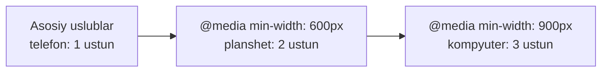
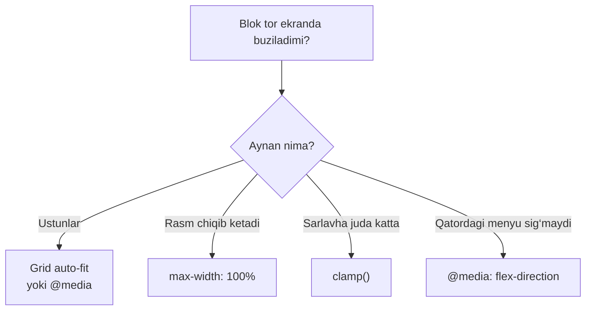

# Moslashuvchan sahifa

[Mundarija](../../README.md) · [← Orqaga](../../Lesson-7/uz/Elementlarni%20pozitsiyalash.md) · [Keyingi →](../../Lesson-9/uz/Holatlar%2C%20o%27tishlar%2C%20animatsiyalar%20va%20o%27zgaruvchilar.md) · [RU](../ru/%D0%90%D0%B4%D0%B0%D0%BF%D1%82%D0%B8%D0%B2%D0%BD%D0%B0%D1%8F%20%D0%B2%D1%91%D1%80%D1%81%D1%82%D0%BA%D0%B0.md) · [EN](../en/Responsive%20layout.md) · [UZ](Moslashuvchan%20sahifa.md)

> **Oldingi darslar bilan bog‘liqlik:** bloklarni Flexbox va Grid bilan joylashtirishni bilasiz. Bugun joylashuvni ekran kengligiga qarab o‘zgartirishni o‘rganamiz: telefonda bitta ustun, kompyuterda - uchta.

---

## Bu sizga nima uchun kerak

Saytlarga tashrif buyuruvchilarning yarmidan ko‘pi telefondan kiradi. Sayt faqat keng ekran uchun qilingan bo‘lsa, telefonda matn mayda, menyu sig‘maydi, gorizontal aylantirish paydo bo‘ladi - va odam chiqib ketadi.

**Moslashuvchan sahifa** - istalgan ekranga o‘zi moslashadigan bitta sayt.

---

## Nimani o‘rganasiz

- `meta viewport` ning rolini tushuntirish.
- Uslublarni «avval mobil» (mobile-first) tamoyili bo‘yicha yozish.
- Kerakli ekran kengligida uslublarni o‘zgartirish: `@media` so‘rovlari.
- Ekrandan chiqmaydigan elastik rasmlar yasash.
- Sarlavhalarni silliq masshtablash: `clamp()`.
- Saytni DevTools dagi qurilma rejimida tekshirish.
- Tizimning tungi mavzusini qo‘llab-quvvatlash.

---

## Takrorlash: 5–6-darslardan 3 savol

1. Menyu bandlarini qatorga qanday qo‘yish mumkin?
2. `repeat(auto-fit, minmax(220px, 1fr))` nima qiladi?
3. Flex-konteyner elementlarini ustunga qanday qilish mumkin?

Javoblar - dars oxirida.

---

## Reja

| Bo‘lim | Nima qilamiz |
| --- | --- |
| `viewport` | Usiz hech narsa ishlamaydi |
| Qurilma rejimi | Kompyuter ichidagi telefon |
| Mobile-first | Avval tor ekran |
| Media so‘rovlar | «Agar ekran kengroq bo‘lsa...» |
| Mini-topshiriq 1 | To‘r 1 → 2 → 3 |
| Elastik rasmlar | Ota elementdan keng emas |
| `clamp()` | O‘sadigan sarlavha |
| Mini-topshiriq 2 | Aylanuvchi shapka |
| Tungi mavzu | `prefers-color-scheme` |
| Mustaqil ish | IDE topshirig‘i va o‘z saytingiz |

---

## `viewport`

HTML kursining 9-darsidan:

```html
<meta name="viewport" content="width=device-width, initial-scale=1.0">
```

Bu qatorsiz telefon sahifani 980px kenglikdagi ekrandagidek, bir necha baravar kichraytirib ko‘rsatadi. Hech qanday media so‘rov ishlamaydi. **U har bir sahifada borligini tekshiring.**

---

## DevTools dagi qurilma rejimi

1. F12 → yuqori chapdagi telefon va planshet belgisi (Toggle device toolbar) yoki Ctrl+Shift+M (macOS da: Cmd+Shift+M).
2. Yuqorida qurilmani, masalan iPhone ni, yoki **Responsive** rejimini tanlang va chetini torting.
3. Piksellardagi kenglik yuqorida ko‘rsatilgan.

**Nimaga qarash kerak:** gorizontal aylantirish yo‘qmi, matn kattalashtirmasdan o‘qiladimi, tugmalar barmoq bilan bosiladimi.

Qurilma rejimi - yaxshi tekshiruv, lekin haqiqiy telefon o‘rnini bosmaydi. Nashrdan oldin saytni o‘z telefoningizda oching.

---

## Mobile-first: avval tor ekran

**Oddiy qilib aytganda:** chamadon yig‘ishda avval eng keraklisini - kichik sumkaga sig‘adiganini solishadi. Keyin, sumka kattaroq bo‘lsa, qolganini qo‘shishadi.

| Yondashuv | Asosiy uslublar nima uchun | Media so‘rovlar |
| --- | --- | --- |
| **Mobile-first** | Telefon | `min-width`: «ekran **kengroq** bo‘lsa - qo‘sh» |
| Desktop-first | Kompyuter | `max-width`: «ekran **torroq** bo‘lsa - olib tashla» |

**Nega mobile-first:**
- telefonda joylashuv oddiyroq: bitta ustun, ko‘p narsa o‘zi ishlaydi;
- telefon kompyuter uslublarini yuklab, bekor qilishga majbur emas;
- siz darhol asosiy narsa haqida o‘ylaysiz.

**Kurs qoidasi:** mobile-first, media so‘rovlar `min-width` orqali.

---

## Media so‘rovlar

```css
/* Asosiy uslublar - telefon */
.cards {
    display: grid;
    grid-template-columns: 1fr;
    gap: 16px;
}

/* 600px dan ekran - planshet */
@media (min-width: 600px) {
    .cards {
        grid-template-columns: repeat(2, 1fr);
    }
}

/* 900px dan ekran - kompyuter */
@media (min-width: 900px) {
    .cards {
        grid-template-columns: repeat(3, 1fr);
    }
}
```

**Nimani ko‘rasiz:** qurilma rejimida oyna chetini torting. 600px gacha - bitta ustun, 600px dan - ikkita, 900px dan - uchta.

| Qism | Ma’nosi |
| --- | --- |
| `@media` | «Faqat agar... bo‘lsa qo‘lla» |
| `(min-width: 600px)` | ...oyna kengligi **600px yoki undan katta** |
| Ichidagi `{ ... }` | Oddiy CSS qoidalari |

Media so‘rovlar fayl **oxirida** yoki asosiy qoidadan darhol keyin yoziladi. Tartib muhim: spetsifiklik teng bo‘lsa, pastroqdagi yutadi (2-dars).

### Sinish nuqtalari

`min-width` ni qayerga qo‘yish kerak? Aniq telefon modeli uchun emas, **sahifangiz buziladigan joyga**. Oynani xunuk bo‘lguncha torting - bu sinish nuqtasi. Boshlash uchun ikkitasi yetarli:

| Kenglik | Odatda |
| --- | --- |
| Asosiy uslublar | Telefon |
| `min-width: 600px` | Planshet, yonboshlatilgan katta telefon |
| `min-width: 900px` | Noutbuk va kompyuter |



**Sxemani qanday o‘qish kerak.** Har bir keyingi media so‘rov oldingilariga o‘zgarishlarni **qo‘shadi**. Keng ekranda uchala qatlam birdaniga ishlaydi.

### Buzib ko‘ring

Media so‘rovlar o‘rnini almashtiring: avval 900px, keyin 600px. Oynani 900px dan kengroq cho‘zing. Nechta ustun? Ikkita: 600px uchun qoida pastroqda va 900px uchun qoidani bosib ketadi.

---

## Mini-topshiriq 1

`.gallery` to‘ri: telefonda bitta ustun, 600px dan - ikkita, 900px dan - to‘rtta. Mobile-first. Yechim - «Javoblar» bo‘limida.

---

## Elastik rasmlar

```css
img {
    max-width: 100%;
    height: auto;
}
```

| Xususiyat | Nima uchun |
| --- | --- |
| `max-width: 100%` | Rasm o‘z ota elementidan keng emas |
| `height: auto` | Balandlik mutanosib o‘zgaradi, rasm yassilanmaydi |

**Nimani ko‘rasiz:** katta rasmlar telefonda ekran kengligi bo‘yicha siqiladi. Ular tufayli gorizontal aylantirish yo‘qoladi. Bu qoida deyarli har qanday uslublar faylining boshida turadi.

### Telefonda `span` ni o‘chirish

6-darsdagi ogohlantirishni eslaysizmi? Cho‘zishni faqat keng ekranlarda qilamiz:

```css
@media (min-width: 600px) {
    .featured {
        grid-column: span 2;
    }
}
```

---

## `clamp()`: o‘sadigan sarlavha

```css
h1 {
    font-size: clamp(1.75rem, 4vw + 1rem, 3rem);
}
```

| Qiymat | Roli |
| --- | --- |
| `1.75rem` | Kamida: telefonda |
| `4vw + 1rem` | Istalgan o‘lcham: oyna kengligi bilan o‘sadi |
| `3rem` | Ko‘pi bilan: katta monitorda |

**Nimani ko‘rasiz:** oynani torting - sarlavha sinish nuqtalarida sakramasdan silliq o‘sadi va kichrayadi.

`+ 1rem` qo‘shiluvchisi muhim: usiz foydalanuvchi brauzer sozlamalarida shriftni kattalashtirsa, sarlavha o‘smaydi.



**Sxemani qanday o‘qish kerak.** Telefondagi har bir tipik buzilish uchun - o‘z vositasi.

---

## Mini-topshiriq 2

`.site-header` shapkasi: telefonda logotip va menyu bir-birining ostida, 600px dan - qatorda, chetlarda, balandlik bo‘yicha markazda. Mobile-first. Yechim - «Javoblar» bo‘limida.

---

## Tungi mavzu

Ko‘pchilik tizimda tungi mavzuni yoqadi. Sayt moslasha oladi:

```css
@media (prefers-color-scheme: dark) {
    body {
        background-color: #0f172a;
        color: #e2e8f0;
    }
}
```

`prefers-color-scheme` - kenglik haqida emas, **foydalanuvchi sozlamalari** haqidagi media so‘rov. Tekshirish: DevTools → `⋮` → **More tools → Rendering** → **Emulate CSS media feature prefers-color-scheme: dark**.

Tungi mavzuda ham kontrastni tekshiring: ≥ 4.5:1.

### Yangi o‘rganuvchilarning tipik xatolari

| Xato | Qanday tuzatish |
| --- | --- |
| Media so‘rovlar telefonda ishlamaydi | `meta viewport` yo‘q |
| Gorizontal aylantirish | `img { max-width: 100%; }`, `width` o‘rniga `max-width` |
| Media so‘rovlar tartibi chalkash | `min-width` da - kichikdan kattaga |
| Telefon modellari uchun sinish nuqtalari | Sahifa buziladigan joyga qo‘ying |
| Qavssiz `@media (min-width: 600px)` | Shart doim qavsda |
| Telefonda mayda matn | Asosiy matn `1rem` dan kichik emas |
| Tugmalar barmoq uchun juda kichik | Bosiladigan soha balandligi 44px atrofida |

---

## Dars yakuni: shpargalka

| Vazifa | Yozuv |
| --- | --- |
| Moslashuvchanlikni yoqish | `<meta name="viewport" content="width=device-width, initial-scale=1.0">` |
| 600px kenglikdan | `@media (min-width: 600px) { ... }` |
| Tartib | Asosiy → 600px → 900px |
| Rasmlar chiqmaydi | `img { max-width: 100%; height: auto; }` |
| Silliq o‘lcham | `font-size: clamp(1.75rem, 4vw + 1rem, 3rem);` |
| Tungi mavzu | `@media (prefers-color-scheme: dark) { ... }` |
| Tekshiruv | DevTools → qurilma rejimi + haqiqiy telefon |

---

## Mustaqil ish

### 1-qism. IDE topshirig‘i (platforma hisoblaydi)

Shapka, sarlavha va kartochkalarli sahifa. Mobile-first:

1. `<head>` da - `meta viewport`.
2. `img`: `max-width: 100%;` va `height: auto;`.
3. `.site-header`: telefonda `flex-direction: column;`, `@media (min-width: 600px)` da - `flex-direction: row;`.
4. `.cards`: telefonda bitta ustun (`1fr`), 600px dan - ikkita, 900px dan - uchta.
5. `h1`: `clamp()` orqali `font-size`.
6. `max-width` orqali media so‘rovlarni ishlatmang.

Platforma nimani tekshiradi: `width=device-width` li `viewport`, `max-width: 100%`, `height: auto`, `@media (min-width: 600px)`, `@media (min-width: 900px)`, `flex-direction: column` va `row`, `grid-template-columns: 1fr`, `repeat(2, 1fr)`, `repeat(3, 1fr)`, `clamp(`, `@media (max-width` yo‘qligi.

### 2-qism. Kompyuterdagi loyiha

1. Barcha sahifalarda `viewport` ni tekshiring.
2. Sayt uslublarini mobile-first ga qayta yozing.
3. Shapka va loyihalar to‘rini moslashuvchan qiling.
4. Butun saytni qurilma rejimida 360px, 768px va 1280px kenglikda o‘ting.
5. Saytni haqiqiy telefonda oching.

### Tayyorlik mezonlari

- [ ] IDE topshirig‘i qabul qilingan.
- [ ] 360px kenglikda gorizontal aylantirish yo‘q.
- [ ] Matn kattalashtirmasdan o‘qiladi.
- [ ] `min-width` media so‘rovlari kichikdan kattaga boradi.
- [ ] Rasmlar ekrandan chiqmaydi.
- [ ] Sayt haqiqiy telefonda tekshirilgan.

---

## O‘zini tekshirish uchun savollar

1. `meta viewport` siz telefonda nima bo‘ladi?
2. Mobile-first nimani bildiradi?
3. Media so‘rovda `min-width` `max-width` dan nimasi bilan farq qiladi?
4. Nega `min-width` li media so‘rovlar kichikdan kattaga boradi?
5. Sinish nuqtalarini qanday tanlash kerak?
6. `img { max-width: 100%; }` nima uchun?
7. Uning yonida `height: auto` nima uchun?
8. `clamp()` dagi uchta qiymat nimani bildiradi?
9. `clamp()` o‘rtasidagi `+ 1rem` nima uchun?
10. Tizim sozlamalarini o‘zgartirmasdan tungi mavzuni qanday tekshirish mumkin?

Savollardan keyin platformada **dars testini** topshiring: 12 ta savol, o‘tish chegarasi 70%.

---

## Keyin nima

Sayt chiroyli va moslashuvchan, lekin harakatsiz. 9-darsda uni jonlantiramiz: kursor olib borish va fokusga javob, silliq o‘tishlar, animatsiyalar va ranglar uchun o‘zgaruvchilar.

---

## Javoblar

**Takrorlash**

1. Ro‘yxatda `display: flex;`.
2. 220px dan tor bo‘lmagan qancha ustun sig‘sa, shunchasini qo‘yadi.
3. `flex-direction: column;`.

**Mini-topshiriq 1**

```css
.gallery {
    display: grid;
    grid-template-columns: 1fr;
    gap: 16px;
}

@media (min-width: 600px) {
    .gallery {
        grid-template-columns: repeat(2, 1fr);
    }
}

@media (min-width: 900px) {
    .gallery {
        grid-template-columns: repeat(4, 1fr);
    }
}
```

**Mini-topshiriq 2**

```css
.site-header {
    display: flex;
    flex-direction: column;
}

@media (min-width: 600px) {
    .site-header {
        flex-direction: row;
        justify-content: space-between;
        align-items: center;
    }
}
```

**O‘zini tekshirish uchun savollar**

1. Sahifa kichraytirilgan nusxa bo‘lib ko‘rinadi, media so‘rovlar ishlamaydi.
2. Asosiy uslublar telefon uchun yoziladi, keng ekranlar uchun esa o‘zgarishlar qo‘shiladi.
3. `min-width` - «ekran kengroq», `max-width` - «ekran torroq».
4. Aks holda kichikroq kenglik uchun pastki qoida kattaroq kenglik qoidasini bosib ketadi.
5. Qurilma modellari uchun emas, sahifangiz buziladigan joyda.
6. Rasm ota elementdan keng bo‘lmasligi uchun.
7. Balandlik mutanosib o‘zgarishi uchun.
8. Minimum, istalgan qiymat, maksimum.
9. Foydalanuvchi shriftni kattalashtirganda o‘lcham o‘sishi uchun.
10. DevTools → Rendering → Emulate prefers-color-scheme.

---

[Mundarija](../../README.md) · [← Orqaga](../../Lesson-7/uz/Elementlarni%20pozitsiyalash.md) · [Keyingi →](../../Lesson-9/uz/Holatlar%2C%20o%27tishlar%2C%20animatsiyalar%20va%20o%27zgaruvchilar.md) · [RU](../ru/%D0%90%D0%B4%D0%B0%D0%BF%D1%82%D0%B8%D0%B2%D0%BD%D0%B0%D1%8F%20%D0%B2%D1%91%D1%80%D1%81%D1%82%D0%BA%D0%B0.md) · [EN](../en/Responsive%20layout.md) · [UZ](Moslashuvchan%20sahifa.md)
