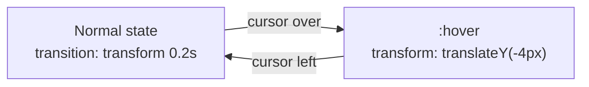
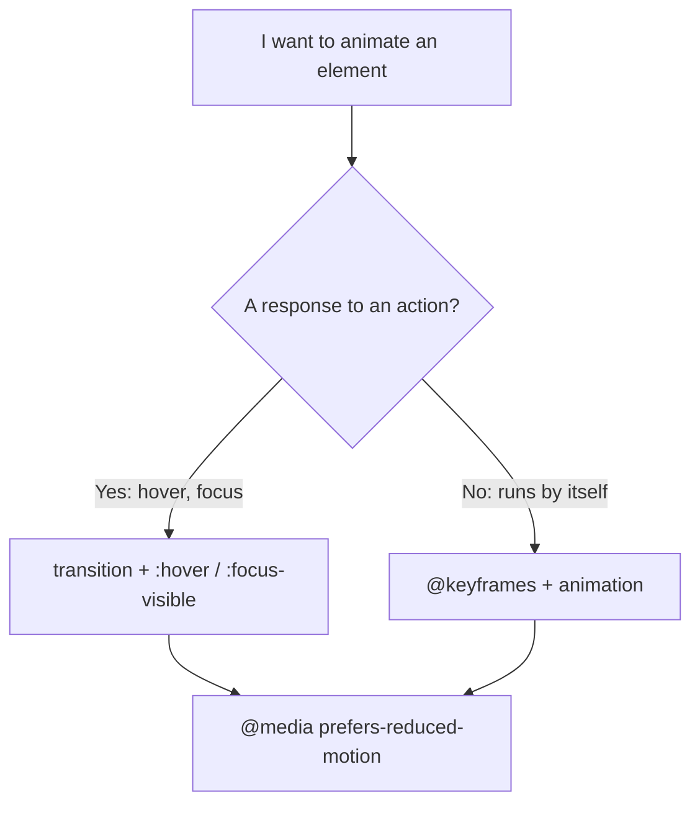

# States, transitions, animations and variables

[Contents](../../README.md) · [← Back](../../Lesson-8/en/Responsive%20layout.md) · [Next →](../../Lesson-10/en/Final%20project%20-%20full%20styling%20and%20publication.md) · [RU](../ru/%D0%A1%D0%BE%D1%81%D1%82%D0%BE%D1%8F%D0%BD%D0%B8%D1%8F%2C%20%D0%BF%D0%B5%D1%80%D0%B5%D1%85%D0%BE%D0%B4%D1%8B%2C%20%D0%B0%D0%BD%D0%B8%D0%BC%D0%B0%D1%86%D0%B8%D0%B8%20%D0%B8%20%D0%BF%D0%B5%D1%80%D0%B5%D0%BC%D0%B5%D0%BD%D0%BD%D1%8B%D0%B5.md) · [EN](States%2C%20transitions%2C%20animations%20and%20variables.md) · [UZ](../uz/Holatlar%2C%20o%27tishlar%2C%20animatsiyalar%20va%20o%27zgaruvchilar.md)

> **Link to previous lessons:** the site is pretty and responsive, but motionless. Today it starts to respond to the user's actions: hover, focus, press. And the colors stop being repeated all over the file.

---

## Why you need this

Hover over a button on a good website: it softly changes color. A card lifts slightly. A new block appears smoothly. Such little things tell the user that the element is alive and can be clicked.

Without JavaScript, with CSS alone.

---

## What you will learn

- Style states: `:hover`, `:focus-visible`, `:active`.
- Select elements by position: `:first-child`, `:nth-child()`.
- Add decorative content: `::before`, `::after`.
- Make changes smooth: `transition`.
- Move, scale, rotate: `transform`.
- Create animations: `@keyframes` and `animation`.
- Respect the "reduce motion" setting.
- Keep colors in variables: `--primary` and `var()`.

---

## Review: 3 questions from Lesson 8

1. What does mobile first mean?
2. How does a media query for screens from 600px start?
3. Which media query handles the system dark theme?

Answers are at the end of the lesson.

---

## Lesson plan

| Section | What we do |
| --- | --- |
| Variables | An artist's palette |
| Pseudo-classes | Element states |
| Focus | Do not hide the outline |
| Mini-task 1 | A button with three states |
| Pseudo-elements | Decorations without extra tags |
| `transition` | Smoothness instead of a jump |
| `transform` | Move, scale, rotate |
| `@keyframes` | Frame-by-frame animation |
| Reduce motion | Caring for the user |
| Mini-task 2 | A card that lifts |
| Independent work | IDE task and your own site |

---

## Variables

**In simple terms:** an artist's palette. The paints are mixed once and sit on the palette with labels. Need the brand blue - you take it from the palette instead of mixing it again.

```css
:root {
    --primary: #1e3a8a;
    --primary-light: #eef2ff;
    --text: #1f2937;
    --radius: 12px;
}

.btn {
    background-color: var(--primary);
    border-radius: var(--radius);
}

.card {
    background-color: var(--primary-light);
    border-radius: var(--radius);
}
```

| Part | Means |
| --- | --- |
| `:root` | The document root - variables are available everywhere |
| `--primary` | The variable name: always with two hyphens |
| `var(--primary)` | Take the value |

**Why:** you decide to change the brand color - you edit one line, not twenty.

### A dark theme with variables

```css
@media (prefers-color-scheme: dark) {
    :root {
        --primary-light: #1e293b;
        --text: #e2e8f0;
    }
}
```

All rules that take their colors via `var()` repaint by themselves.

---

## Pseudo-classes: element states

A **pseudo-class** is a selector with a colon. It selects an element in a certain **state** or **position**.

| Pseudo-class | When it applies |
| --- | --- |
| `:hover` | The cursor is over the element |
| `:focus-visible` | The element got focus from the keyboard (Tab) |
| `:active` | At the moment of pressing |
| `:first-child` | The parent's first child |
| `:last-child` | The last one |
| `:nth-child(2n)` | Every second: 2, 4, 6... |
| `:nth-child(odd)` | Odd ones: 1, 3, 5... |
| `:not(.featured)` | All except elements with the class `featured` |

```css
.btn:hover {
    background-color: #1e40af;
}

tbody tr:nth-child(even) {
    background-color: #f8fafc;
}

.menu li:last-child {
    margin-right: 0;
}
```

**What you will see:** the button darkens under the cursor; the table rows alternate in a "zebra" pattern.

A pseudo-class has the specificity of a class: 0-1-0 (Lesson 2).

---

## Focus: do not hide the outline

When you go through a page with the keyboard (Lesson 8 of the HTML course), the browser outlines the element in focus. Some people remove it because it is "ugly":

```css
/* DO NOT */
button:focus {
    outline: none;
}
```

The keyboard user loses track of where they are. **Do not remove focus - style it:**

```css
.btn:focus-visible {
    outline: 3px solid #f59e0b;
    outline-offset: 2px;
}
```

`:focus-visible` applies during keyboard navigation and does not get in the way of mouse clicks.

**Course rule:** every button and link you gave a `:hover` also gets a `:focus-visible`. Keyboard users must see a response too.

---

## Mini-task 1

A `.btn` button with three states: darker under the cursor, a 3px orange outline with a 2px offset when focused from the keyboard, even darker when pressed. Solution is in the "Answers" section.

---

## Pseudo-elements: decorations without extra tags

A **pseudo-element** is a selector with **two** colons. It creates an "invisible tag" at the start or end of the element's content.

```css
.required-label::after {
    content: " *";
    color: #b91c1c;
}
```

```html
<label class="required-label" for="email">Email</label>
```

**What you will see:** "Email *" - the asterisk is red, although it is not in the HTML.

| Pseudo-element | Where it appears |
| --- | --- |
| `::before` | Before the content |
| `::after` | After the content |

**`content` is required**, even if empty: `content: "";`. Without it the pseudo-element does not appear.

**For decoration only.** Screen readers read `content` inconsistently, and it cannot be selected and copied. Write important text in the HTML.

---

## `transition`: smoothness instead of a jump

**In simple terms:** a switch versus a dimmer. Without `transition` the color changes with a click. With it - smoothly, like light on a dimmer.

```css
.btn {
    background-color: var(--primary);
    transition: background-color 0.2s ease;
}

.btn:hover {
    background-color: #1e40af;
}
```

| Part | Means |
| --- | --- |
| `background-color` | What to change smoothly |
| `0.2s` | How long: 0.2 seconds |
| `ease` | How: slow-fast-slow |

**`transition` goes on the normal state**, not on `:hover`. Then it is smooth both ways.

Fast means 0.15–0.3s. A transition longer than half a second is annoying.

---

## `transform`: move, scale, rotate

| Function | Example | What it does |
| --- | --- | --- |
| `translateY()` | `translateY(-4px)` | Move up by 4px |
| `scale()` | `scale(1.05)` | Enlarge by 5% |
| `rotate()` | `rotate(10deg)` | Rotate |

```css
.card {
    transition: transform 0.2s ease, box-shadow 0.2s ease;
}

.card:hover {
    transform: translateY(-4px);
    box-shadow: 0 8px 24px rgb(0 0 0 / 12%);
}
```

**What you will see:** the card under the cursor lifts and its shadow grows.

**Why `transform` and not `top` or `margin`:** `transform` does not push neighbors and runs more smoothly - the browser does not recalculate the page layout.



**How to read the diagram.** A `transition` on the normal state makes the change smooth both ways.

---

## `@keyframes`: frame-by-frame animation

`transition` goes from state A to B on an action. An animation runs by itself, following a script of frames.

```css
@keyframes fade-in {
    from {
        opacity: 0;
        transform: translateY(16px);
    }

    to {
        opacity: 1;
        transform: translateY(0);
    }
}

.hero {
    animation: fade-in 0.6s ease-out;
}
```

| Part | Means |
| --- | --- |
| `@keyframes fade-in` | A script named `fade-in` |
| `from` / `to` | The first and last frame (`0%`, `50%`, `100%` also work) |
| `animation: fade-in 0.6s ease-out` | Apply the script, duration, character |

**What you will see:** when the page loads, the `.hero` block appears smoothly and rises slightly.

Extras: `infinite` - forever, `alternate` - back and forth. Endless animations distract: use them only for loading indicators.

---

## Reduce motion

For some people, motion on screen causes dizziness. The system has a "reduce motion" setting, and a site can respect it.

The first idea is to switch off all motion with one rule:

```css
/* This will NOT work */
@media (prefers-reduced-motion: reduce) {
    * {
        animation: none;
    }
}
```

It fails because of specificity (Lesson 2): `*` scores 0-0-0, while `.hero { animation: ... }` scores 0-1-0. The `.hero` rule is stronger, and the animation keeps running.

**The right approach:** do not switch motion off afterwards, but **switch it on only for those who do not mind**:

```css
@media (prefers-reduced-motion: no-preference) {
    .hero {
        animation: fade-in 0.6s ease-out;
    }

    .card {
        transition: transform 0.2s ease;
    }
}
```

`no-preference` means "the user has not asked to reduce motion". For everyone else there is simply no animation, and nothing has to fight other rules.

Leave the hover change itself (`.card:hover { transform: ... }`) outside: without `transition` it applies instantly, without smoothness. That is fine.

**Course rule:** all `animation` and `transition` go inside `@media (prefers-reduced-motion: no-preference)`.



**How to read the diagram.** A response to an action is `transition`, independent motion is `@keyframes`. In both cases - respect the "reduce motion" setting.

### Typical beginner mistakes

| Mistake | How to fix |
| --- | --- |
| `outline: none` on focus | Style `:focus-visible` |
| `:hover` without `:focus-visible` | Add both |
| `transition` on `:hover` | On the normal state |
| `transition: all 2s` | A specific property, 0.15–0.3s |
| No `content` on `::before` | `content: "";` |
| Important text in `content` | Decorations only |
| Moving with `margin-top` on hover | `transform: translateY()` |
| `var(primary)` without hyphens | `var(--primary)` |
| No `prefers-reduced-motion` block | Animations and transitions go inside `no-preference` |
| `* { animation: none; }` in `reduce` | Loses on specificity - use `no-preference` |

---

## Mini-task 2

A `.card`: under the cursor it lifts by 6px and its shadow grows, smoothly over 0.2s. Do not forget users who switched motion off. Solution is in the "Answers" section.

---

## Lesson summary: cheat sheet

| Task | Notation |
| --- | --- |
| Variable | `:root { --primary: #1e3a8a; }` |
| Use a variable | `color: var(--primary);` |
| Under the cursor | `.btn:hover { ... }` |
| Keyboard focus | `.btn:focus-visible { outline: 3px solid ...; }` |
| Every second | `:nth-child(even)` |
| Decoration after | `::after { content: "*"; }` |
| Smoothly | `transition: background-color 0.2s ease;` |
| Lift | `transform: translateY(-4px);` |
| Animation | `@keyframes name { from {...} to {...} }` + `animation: name 0.6s;` |
| Motion only for those who do not mind | `@media (prefers-reduced-motion: no-preference) { ... }` |

---

## Independent work

### Part 1. IDE task (graded by the platform)

A page with a button, cards and a welcome block. In `<style>`:

1. `:root` with the variables `--primary` and at least one more; use them via `var()`.
2. `.btn`: `transition`, `:hover` and `:focus-visible` with `outline`.
3. `.card:hover`: `transform: translateY(...)`.
4. `@keyframes fade-in` and `animation: fade-in ...` on `.hero` (the animation name must be exactly `fade-in`).
5. `.required-label::after` with an asterisk in `content`.
6. All `transition` and `animation` inside `@media (prefers-reduced-motion: no-preference)`.
7. Do not use `outline: none`.

What the platform checks: `:root`, `--primary`, `var(--primary)`, `transition:`, `.btn:hover`, `.btn:focus-visible`, `outline:`, `translateY(`, `@keyframes fade-in`, `animation: fade-in`, `::after`, `content:`, `prefers-reduced-motion: no-preference`, the classes `btn`, `card`, `hero`, `required-label` in the HTML, no `outline: none` and no `outline: 0`.

### Part 2. Project on your computer

1. Move your site's colors into variables.
2. Add `:hover` and `:focus-visible` to all menu links and buttons.
3. Make the project cards "lift".
4. Add one appearance animation.
5. Go through the site with the keyboard: is focus visible everywhere?
6. Turn on the `prefers-reduced-motion: reduce` emulation in DevTools → Rendering: did the animations switch off?

### Acceptance criteria

- [ ] The IDE task is accepted.
- [ ] Colors are in variables and used via `var()`.
- [ ] Every `:hover` has a `:focus-visible`.
- [ ] Focus is visible on every link and button.
- [ ] Transitions are 0.15–0.3s, `transition` sits on the normal state.
- [ ] Animations and transitions are inside `prefers-reduced-motion: no-preference`.

---

## Self-check questions

1. How do you declare and use a CSS variable?
2. Why are variables declared in `:root`?
3. How does a pseudo-class differ from a pseudo-element?
4. Why must you not write `outline: none` on focus?
5. Why is `:focus-visible` more convenient than `:focus`?
6. What does `:nth-child(even)` select?
7. Without which property does `::after` not appear?
8. Why is `transition` written on the normal state?
9. Why use `transform`, not `margin`, to move on hover?
10. Why might `* { animation: none; }` in a `reduce` block not work?

After the questions, take the **lesson test** on the platform: 12 questions, pass threshold 70%.

---

## What's next

You know everything you need. In Lesson 10 you take the site from the HTML course's final project and style it fully - from variables to animations - and then publish it.

---

## Answers

**Review**

1. Base styles for the phone; changes are added for wide screens.
2. `@media (min-width: 600px) { ... }`.
3. `@media (prefers-color-scheme: dark)`.

**Mini-task 1**

```css
.btn {
    background-color: #1e3a8a;
    color: white;
    transition: background-color 0.2s ease;
}

.btn:hover {
    background-color: #1e40af;
}

.btn:focus-visible {
    outline: 3px solid #f59e0b;
    outline-offset: 2px;
}

.btn:active {
    background-color: #172554;
}
```

**Mini-task 2**

```css
.card:hover {
    transform: translateY(-6px);
    box-shadow: 0 12px 24px rgb(0 0 0 / 12%);
}

@media (prefers-reduced-motion: no-preference) {
    .card {
        transition: transform 0.2s ease, box-shadow 0.2s ease;
    }
}
```

**Self-check questions**

1. `:root { --primary: #1e3a8a; }`, then `var(--primary)`.
2. Then they are available in the whole document.
3. A pseudo-class (`:`) is an element's state or position, a pseudo-element (`::`) is an "invisible" part inside the element.
4. The keyboard user loses track of where they are.
5. It applies during keyboard navigation and does not get in the way of mouse clicks.
6. Even elements: 2, 4, 6...
7. Without `content`.
8. Then the transition is smooth both ways.
9. `transform` does not push neighbors and runs more smoothly.
10. `*` has specificity 0-0-0: any rule with a class or tag overrides it. That is why motion is switched on inside `no-preference`.

---

[Contents](../../README.md) · [← Back](../../Lesson-8/en/Responsive%20layout.md) · [Next →](../../Lesson-10/en/Final%20project%20-%20full%20styling%20and%20publication.md) · [RU](../ru/%D0%A1%D0%BE%D1%81%D1%82%D0%BE%D1%8F%D0%BD%D0%B8%D1%8F%2C%20%D0%BF%D0%B5%D1%80%D0%B5%D1%85%D0%BE%D0%B4%D1%8B%2C%20%D0%B0%D0%BD%D0%B8%D0%BC%D0%B0%D1%86%D0%B8%D0%B8%20%D0%B8%20%D0%BF%D0%B5%D1%80%D0%B5%D0%BC%D0%B5%D0%BD%D0%BD%D1%8B%D0%B5.md) · [EN](States%2C%20transitions%2C%20animations%20and%20variables.md) · [UZ](../uz/Holatlar%2C%20o%27tishlar%2C%20animatsiyalar%20va%20o%27zgaruvchilar.md)
