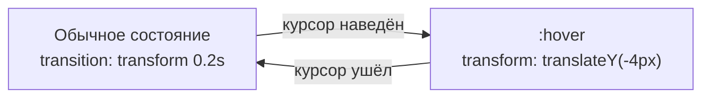
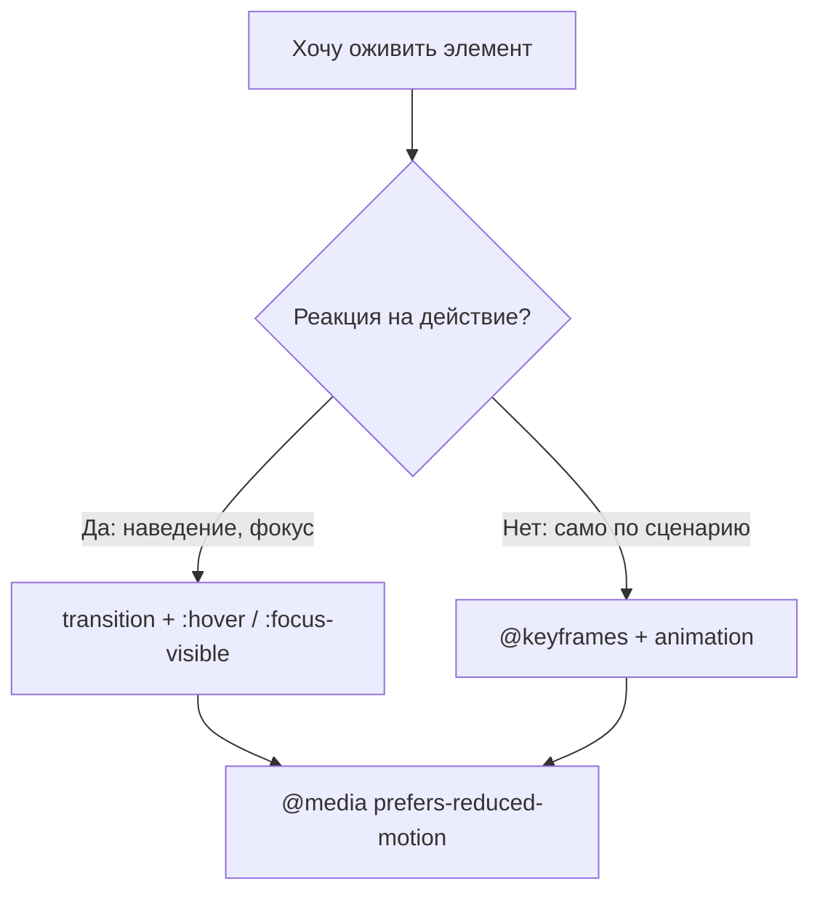

# Состояния, переходы, анимации и переменные

[Содержание](../../README.md) · [← Назад](../../Lesson-8/ru/%D0%90%D0%B4%D0%B0%D0%BF%D1%82%D0%B8%D0%B2%D0%BD%D0%B0%D1%8F%20%D0%B2%D1%91%D1%80%D1%81%D1%82%D0%BA%D0%B0.md) · [Вперёд →](../../Lesson-10/ru/%D0%98%D1%82%D0%BE%D0%B3%D0%BE%D0%B2%D1%8B%D0%B9%20%D0%BF%D1%80%D0%BE%D0%B5%D0%BA%D1%82%20%E2%80%94%20%D0%BF%D0%BE%D0%BB%D0%BD%D0%B0%D1%8F%20%D1%81%D1%82%D0%B8%D0%BB%D0%B8%D0%B7%D0%B0%D1%86%D0%B8%D1%8F%20%D0%B8%20%D0%BF%D1%83%D0%B1%D0%BB%D0%B8%D0%BA%D0%B0%D1%86%D0%B8%D1%8F.md) · [RU](%D0%A1%D0%BE%D1%81%D1%82%D0%BE%D1%8F%D0%BD%D0%B8%D1%8F%2C%20%D0%BF%D0%B5%D1%80%D0%B5%D1%85%D0%BE%D0%B4%D1%8B%2C%20%D0%B0%D0%BD%D0%B8%D0%BC%D0%B0%D1%86%D0%B8%D0%B8%20%D0%B8%20%D0%BF%D0%B5%D1%80%D0%B5%D0%BC%D0%B5%D0%BD%D0%BD%D1%8B%D0%B5.md) · [EN](../en/States%2C%20transitions%2C%20animations%20and%20variables.md) · [UZ](../uz/Holatlar%2C%20o%27tishlar%2C%20animatsiyalar%20va%20o%27zgaruvchilar.md)

> **Связь с прошлыми уроками:** сайт красивый и адаптивный, но неподвижный. Сегодня он начнёт откликаться на действия пользователя: наведение, фокус, нажатие. А цвета перестанут повторяться по всему файлу.

---

## Зачем это вам

Наведите курсор на кнопку хорошего сайта: она мягко меняет цвет. Карточка чуть приподнимается. Новый блок плавно появляется. Такие мелочи подсказывают пользователю, что элемент живой и на него можно нажать.

Без JavaScript, одним CSS.

---

## Чему вы научитесь

- Оформлять состояния: `:hover`, `:focus-visible`, `:active`.
- Выбирать элементы по порядку: `:first-child`, `:nth-child()`.
- Добавлять декоративное содержимое: `::before`, `::after`.
- Делать плавные изменения: `transition`.
- Сдвигать, увеличивать, поворачивать: `transform`.
- Создавать анимации: `@keyframes` и `animation`.
- Уважать настройку «уменьшить движение».
- Хранить цвета в переменных: `--primary` и `var()`.

---

## Повторение: 3 вопроса из урока 8

1. Что значит mobile-first?
2. Как начинается медиазапрос для экранов от 600px?
3. Какой медиазапрос отвечает за тёмную тему системы?

Ответы - в конце урока.

---

## План урока

| Раздел | Что делаем |
| --- | --- |
| Переменные | Палитра художника |
| Псевдоклассы | Состояния элемента |
| Фокус | Не прятать рамку |
| Мини-задание 1 | Кнопка с тремя состояниями |
| Псевдоэлементы | Украшения без лишних тегов |
| `transition` | Плавность вместо скачка |
| `transform` | Сдвиг, масштаб, поворот |
| `@keyframes` | Анимация по кадрам |
| Уменьшить движение | Забота о пользователе |
| Мини-задание 2 | Карточка, которая приподнимается |
| Самостоятельная работа | Задание в IDE и свой сайт |

---

## Переменные

**Простыми словами:** палитра художника. Краски смешаны один раз и стоят на палитре с подписями. Нужен фирменный синий - берёте с палитры, а не смешиваете заново.

```css
:root {
    --primary: #1e3a8a;
    --primary-light: #eef2ff;
    --text: #1f2937;
    --radius: 12px;
}

.btn {
    background-color: var(--primary);
    border-radius: var(--radius);
}

.card {
    background-color: var(--primary-light);
    border-radius: var(--radius);
}
```

| Часть | Значит |
| --- | --- |
| `:root` | Корень документа - переменные доступны везде |
| `--primary` | Имя переменной: всегда с двумя дефисами |
| `var(--primary)` | Взять значение |

**Зачем:** решили поменять фирменный цвет - правите одну строку, а не двадцать.

### Тёмная тема на переменных

```css
@media (prefers-color-scheme: dark) {
    :root {
        --primary-light: #1e293b;
        --text: #e2e8f0;
    }
}
```

Все правила, которые берут цвета через `var()`, перекрасятся сами.

---

## Псевдоклассы: состояния элемента

**Псевдокласс** - селектор с двоеточием. Он выбирает элемент в определённом **состоянии** или **положении**.

| Псевдокласс | Когда срабатывает |
| --- | --- |
| `:hover` | Курсор над элементом |
| `:focus-visible` | Элемент получил фокус с клавиатуры (Tab) |
| `:active` | В момент нажатия |
| `:first-child` | Первый ребёнок у родителя |
| `:last-child` | Последний |
| `:nth-child(2n)` | Каждый второй: 2, 4, 6... |
| `:nth-child(odd)` | Нечётные: 1, 3, 5... |
| `:not(.featured)` | Все, кроме элементов с классом `featured` |

```css
.btn:hover {
    background-color: #1e40af;
}

tbody tr:nth-child(even) {
    background-color: #f8fafc;
}

.menu li:last-child {
    margin-right: 0;
}
```

**Что увидите:** кнопка темнеет под курсором; строки таблицы чередуются «зеброй».

Специфичность псевдокласса - как у класса: 0-1-0 (урок 2).

---

## Фокус: не прятать рамку

Когда вы проходите страницу клавиатурой (урок 8 курса HTML), браузер обводит элемент в фокусе. Некоторые убирают её, потому что «некрасиво»:

```css
/* НЕЛЬЗЯ */
button:focus {
    outline: none;
}
```

Пользователь клавиатуры теряет, где он находится. **Не убирайте фокус - оформите его:**

```css
.btn:focus-visible {
    outline: 3px solid #f59e0b;
    outline-offset: 2px;
}
```

`:focus-visible` срабатывает при навигации клавиатурой и не мешает при клике мышью.

**Правило курса:** у каждой кнопки и ссылки, которой вы задали `:hover`, есть и `:focus-visible`. Пользователь клавиатуры тоже должен видеть отклик.

---

## Мини-задание 1

Кнопка `.btn` с тремя состояниями: под курсором - темнее, в фокусе с клавиатуры - оранжевая рамка 3px с отступом 2px, при нажатии - ещё темнее. Решение - в разделе «Ответы».

---

## Псевдоэлементы: украшения без лишних тегов

**Псевдоэлемент** - селектор с **двумя** двоеточиями. Он создаёт «невидимый тег» в начале или в конце содержимого элемента.

```css
.required-label::after {
    content: " *";
    color: #b91c1c;
}
```

```html
<label class="required-label" for="email">Почта</label>
```

**Что увидите:** «Почта *» - звёздочка красная, хотя в HTML её нет.

| Псевдоэлемент | Где появляется |
| --- | --- |
| `::before` | Перед содержимым |
| `::after` | После содержимого |

**`content` обязателен**, даже пустой: `content: "";`. Без него псевдоэлемент не появится.

**Только для украшений.** Скринридеры читают `content` непоследовательно, а выделить и скопировать его нельзя. Важный текст пишите в HTML.

---

## `transition`: плавность вместо скачка

**Простыми словами:** выключатель против диммера. Без `transition` цвет меняется щелчком. С ним - плавно, как свет на диммере.

```css
.btn {
    background-color: var(--primary);
    transition: background-color 0.2s ease;
}

.btn:hover {
    background-color: #1e40af;
}
```

| Часть | Значит |
| --- | --- |
| `background-color` | Что плавно менять |
| `0.2s` | За сколько: 0.2 секунды |
| `ease` | Как: медленно-быстро-медленно |

**`transition` пишут на обычном состоянии**, а не на `:hover`. Тогда плавно и туда, и обратно.

Быстро - это 0.15–0.3s. Переход дольше полсекунды раздражает.

---

## `transform`: сдвиг, масштаб, поворот

| Функция | Пример | Что делает |
| --- | --- | --- |
| `translateY()` | `translateY(-4px)` | Сдвиг вверх на 4px |
| `scale()` | `scale(1.05)` | Увеличить на 5% |
| `rotate()` | `rotate(10deg)` | Повернуть |

```css
.card {
    transition: transform 0.2s ease, box-shadow 0.2s ease;
}

.card:hover {
    transform: translateY(-4px);
    box-shadow: 0 8px 24px rgb(0 0 0 / 12%);
}
```

**Что увидите:** карточка под курсором приподнимается, тень становится больше.

**Почему `transform`, а не `top` или `margin`:** `transform` не сдвигает соседей и работает плавнее - браузер не пересчитывает раскладку страницы.



**Как читать схему.** `transition` на обычном состоянии делает плавным переход в обе стороны.

---

## `@keyframes`: анимация по кадрам

`transition` - из состояния А в Б по действию. Анимация - сама, по сценарию из кадров.

```css
@keyframes fade-in {
    from {
        opacity: 0;
        transform: translateY(16px);
    }

    to {
        opacity: 1;
        transform: translateY(0);
    }
}

.hero {
    animation: fade-in 0.6s ease-out;
}
```

| Часть | Значит |
| --- | --- |
| `@keyframes fade-in` | Сценарий с именем `fade-in` |
| `from` / `to` | Начальный и конечный кадр (можно `0%`, `50%`, `100%`) |
| `animation: fade-in 0.6s ease-out` | Применить сценарий, длительность, характер |

**Что увидите:** при загрузке страницы блок `.hero` плавно появляется и чуть поднимается.

Дополнительно: `infinite` - бесконечно, `alternate` - туда-обратно. Бесконечные анимации отвлекают: используйте их только для индикаторов загрузки.

---

## Уменьшить движение

Некоторым людям движение на экране вызывает головокружение. В системе есть настройка «уменьшить движение», и сайт может её уважать.

Первая мысль - выключить всё движение одним правилом:

```css
/* Так НЕ сработает */
@media (prefers-reduced-motion: reduce) {
    * {
        animation: none;
    }
}
```

Не сработает из-за специфичности (урок 2): у `*` счёт 0-0-0, а у `.hero { animation: ... }` - 0-1-0. Правило `.hero` сильнее, и анимация продолжится.

**Правильный приём:** не выключать движение потом, а **включать только тем, кто не против**:

```css
@media (prefers-reduced-motion: no-preference) {
    .hero {
        animation: fade-in 0.6s ease-out;
    }

    .card {
        transition: transform 0.2s ease;
    }
}
```

`no-preference` - «пользователь не просил уменьшить движение». У остальных анимации просто не будет, и спорить с другими правилами не придётся.

Само изменение при наведении (`.card:hover { transform: ... }`) оставьте снаружи: без `transition` оно сработает мгновенно, без плавности. Это нормально.

**Правило курса:** все `animation` и `transition` - внутри `@media (prefers-reduced-motion: no-preference)`.



**Как читать схему.** Реакция на действие - `transition`, самостоятельное движение - `@keyframes`. В обоих случаях - уважение к настройке «уменьшить движение».

### Попробуйте сломать

1. Напишите у `.btn` `var(primary)` вместо `var(--primary)`. Кнопка потеряла фон. В DevTools → **Elements** → **Styles** строка зачёркнута, рядом значок предупреждения: значение недопустимо.
2. Перенесите `transition` из `.btn` в `.btn:hover`. Наведите курсор и уберите его. Туда цвет меняется плавно, обратно - скачком.
3. Удалите `content: " *";` у `.required-label::after`. Звёздочка исчезла: без `content` псевдоэлемента нет.
4. Удалите правило `.btn:focus-visible` и добавьте `.btn:focus { outline: none; }`. Пройдите страницу клавиатурой (Tab). Видно ли, где сейчас фокус?
5. В DevTools → **Rendering** включите `prefers-reduced-motion: reduce` и обновите страницу. Блок `.hero` появляется сразу, без анимации. Вынесите `animation` из блока `no-preference` - анимация вернётся даже при `reduce`.
6. В `:root` замените значение `--primary` на `#b91c1c`. Все элементы с `var(--primary)` покраснели сразу - вы правили одну строку.

После каждого опыта верните код как было.

### Частые ошибки новичков

| Ошибка | Как исправить |
| --- | --- |
| `outline: none` у фокуса | Оформите `:focus-visible` |
| `:hover` без `:focus-visible` | Добавьте оба |
| `transition` на `:hover` | На обычном состоянии |
| `transition: all 2s` | Конкретное свойство, 0.15–0.3s |
| Нет `content` у `::before` | `content: "";` |
| Важный текст в `content` | Только украшения |
| Сдвиг через `margin-top` на hover | `transform: translateY()` |
| `var(primary)` без дефисов | `var(--primary)` |
| Нет блока `prefers-reduced-motion` | Анимации и переходы - внутри `no-preference` |
| `* { animation: none; }` в `reduce` | Проигрывает по специфичности - используйте `no-preference` |

---

## Мини-задание 2

Карточка `.card`: под курсором приподнимается на 6px и тень становится больше, плавно за 0.2s. Не забудьте пользователей, которые выключили движение. Решение - в разделе «Ответы».

---

## Итоги урока: шпаргалка

| Задача | Запись |
| --- | --- |
| Переменная | `:root { --primary: #1e3a8a; }` |
| Взять переменную | `color: var(--primary);` |
| Под курсором | `.btn:hover { ... }` |
| Фокус клавиатуры | `.btn:focus-visible { outline: 3px solid ...; }` |
| Каждый второй | `:nth-child(even)` |
| Украшение после | `::after { content: "*"; }` |
| Плавно | `transition: background-color 0.2s ease;` |
| Приподнять | `transform: translateY(-4px);` |
| Анимация | `@keyframes имя { from {...} to {...} }` + `animation: имя 0.6s;` |
| Движение только тем, кто не против | `@media (prefers-reduced-motion: no-preference) { ... }` |

---

## Самостоятельная работа

### Часть 1. Задание в IDE (засчитывается платформой)

Страница с кнопкой, карточками и приветственным блоком. В `<style>`:

1. `:root` с переменными `--primary` и ещё хотя бы одной; используйте их через `var()`.
2. `.btn`: `transition`, `:hover` и `:focus-visible` с `outline`.
3. `.card:hover`: `transform: translateY(...)`.
4. `@keyframes fade-in` и `animation: fade-in ...` у `.hero` (имя анимации - именно `fade-in`).
5. `.required-label::after` со звёздочкой в `content`.
6. Все `transition` и `animation` - внутри `@media (prefers-reduced-motion: no-preference)`.
7. `outline: none` не используйте.

Что проверяет платформа: `:root`, `--primary`, `var(--primary)`, `transition:`, `.btn:hover`, `.btn:focus-visible`, `outline:`, `translateY(`, `@keyframes fade-in`, `animation: fade-in`, `::after`, `content:`, `prefers-reduced-motion: no-preference`, классы `btn`, `card`, `hero`, `required-label` в HTML, отсутствие `outline: none` и `outline: 0`.

### Часть 2. Проект на компьютере

1. Вынесите цвета своего сайта в переменные.
2. Добавьте всем ссылкам меню и кнопкам `:hover` и `:focus-visible`.
3. Сделайте карточки проектов «приподнимающимися».
4. Добавьте одну анимацию появления.
5. Пройдите сайт клавиатурой: фокус виден везде?
6. Включите эмуляцию `prefers-reduced-motion: reduce` в DevTools → Rendering: анимации выключились?

### Критерии готовности

- [ ] Задание в IDE засчитано.
- [ ] Цвета в переменных, используются через `var()`.
- [ ] У каждого `:hover` есть `:focus-visible`.
- [ ] Фокус виден на каждой ссылке и кнопке.
- [ ] Переходы 0.15–0.3s, `transition` на обычном состоянии.
- [ ] Анимации и переходы - внутри `prefers-reduced-motion: no-preference`.

---

## Вопросы для самопроверки

1. Как объявить и использовать переменную CSS?
2. Почему переменные объявляют в `:root`?
3. Чем псевдокласс отличается от псевдоэлемента?
4. Почему нельзя писать `outline: none` у фокуса?
5. Чем `:focus-visible` удобнее `:focus`?
6. Что выберет `:nth-child(even)`?
7. Без какого свойства не появится `::after`?
8. Почему `transition` пишут на обычном состоянии?
9. Почему для сдвига при наведении берут `transform`, а не `margin`?
10. Почему `* { animation: none; }` в блоке `reduce` может не сработать?

После вопросов пройдите **тест урока** на платформе: 12 вопросов, порог 70%.

---

## Что дальше

Вы знаете всё, что нужно. В уроке 10 возьмёте сайт из итогового проекта курса HTML и полностью его оформите: от переменных до анимаций, - а потом опубликуете.

---

## Ответы

**Повторение**

1. Базовые стили для телефона, для широких экранов добавляем изменения.
2. `@media (min-width: 600px) { ... }`.
3. `@media (prefers-color-scheme: dark)`.

**Мини-задание 1**

```css
.btn {
    background-color: #1e3a8a;
    color: white;
    transition: background-color 0.2s ease;
}

.btn:hover {
    background-color: #1e40af;
}

.btn:focus-visible {
    outline: 3px solid #f59e0b;
    outline-offset: 2px;
}

.btn:active {
    background-color: #172554;
}
```

**Мини-задание 2**

```css
.card:hover {
    transform: translateY(-6px);
    box-shadow: 0 12px 24px rgb(0 0 0 / 12%);
}

@media (prefers-reduced-motion: no-preference) {
    .card {
        transition: transform 0.2s ease, box-shadow 0.2s ease;
    }
}
```

**Вопросы для самопроверки**

1. `:root { --primary: #1e3a8a; }`, затем `var(--primary)`.
2. Тогда они доступны во всём документе.
3. Псевдокласс (`:`) - состояние или положение элемента, псевдоэлемент (`::`) - «невидимая» часть внутри элемента.
4. Пользователь клавиатуры потеряет, где находится.
5. Срабатывает при навигации клавиатурой и не мешает при клике мышью.
6. Чётные элементы: 2, 4, 6...
7. Без `content`.
8. Тогда переход плавный в обе стороны.
9. `transform` не сдвигает соседей и работает плавнее.
10. У `*` специфичность 0-0-0: любое правило с классом или тегом перебьёт его. Поэтому движение включают внутри `no-preference`.

---

[Содержание](../../README.md) · [← Назад](../../Lesson-8/ru/%D0%90%D0%B4%D0%B0%D0%BF%D1%82%D0%B8%D0%B2%D0%BD%D0%B0%D1%8F%20%D0%B2%D1%91%D1%80%D1%81%D1%82%D0%BA%D0%B0.md) · [Вперёд →](../../Lesson-10/ru/%D0%98%D1%82%D0%BE%D0%B3%D0%BE%D0%B2%D1%8B%D0%B9%20%D0%BF%D1%80%D0%BE%D0%B5%D0%BA%D1%82%20%E2%80%94%20%D0%BF%D0%BE%D0%BB%D0%BD%D0%B0%D1%8F%20%D1%81%D1%82%D0%B8%D0%BB%D0%B8%D0%B7%D0%B0%D1%86%D0%B8%D1%8F%20%D0%B8%20%D0%BF%D1%83%D0%B1%D0%BB%D0%B8%D0%BA%D0%B0%D1%86%D0%B8%D1%8F.md) · [RU](%D0%A1%D0%BE%D1%81%D1%82%D0%BE%D1%8F%D0%BD%D0%B8%D1%8F%2C%20%D0%BF%D0%B5%D1%80%D0%B5%D1%85%D0%BE%D0%B4%D1%8B%2C%20%D0%B0%D0%BD%D0%B8%D0%BC%D0%B0%D1%86%D0%B8%D0%B8%20%D0%B8%20%D0%BF%D0%B5%D1%80%D0%B5%D0%BC%D0%B5%D0%BD%D0%BD%D1%8B%D0%B5.md) · [EN](../en/States%2C%20transitions%2C%20animations%20and%20variables.md) · [UZ](../uz/Holatlar%2C%20o%27tishlar%2C%20animatsiyalar%20va%20o%27zgaruvchilar.md)
