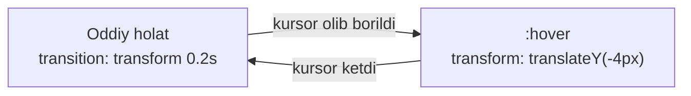
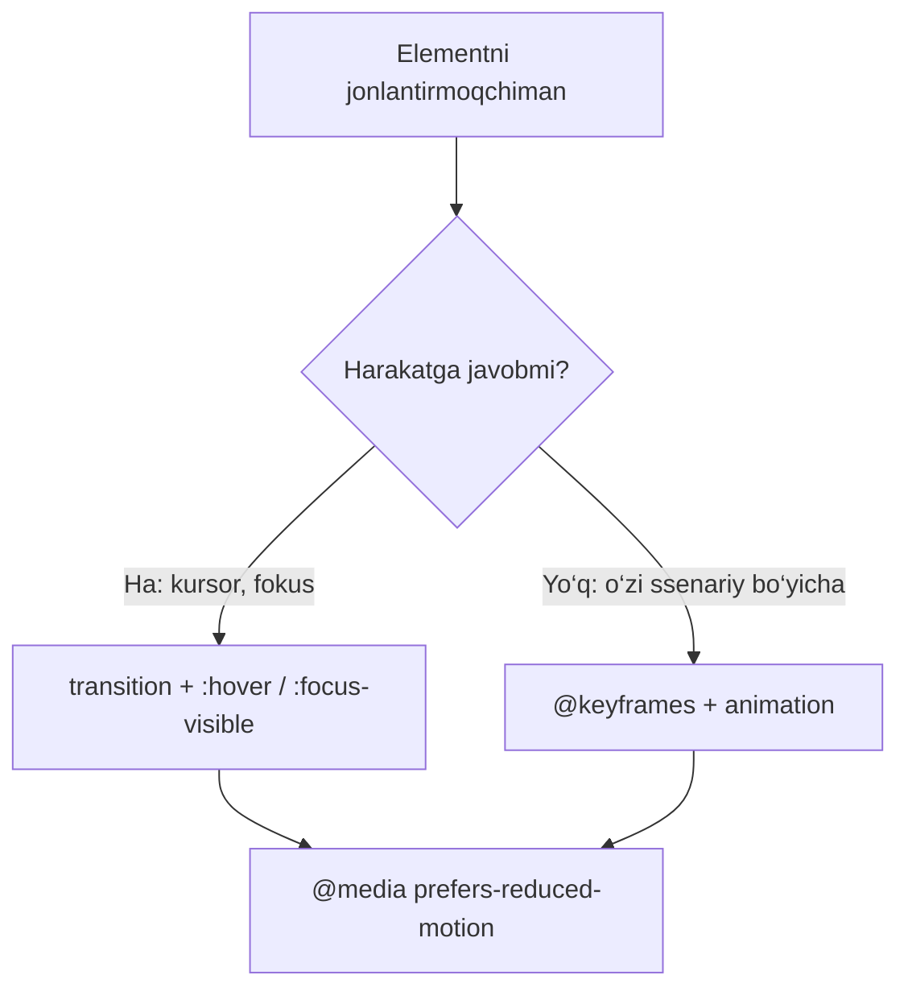

# Holatlar, o‘tishlar, animatsiyalar va o‘zgaruvchilar

[Mundarija](../../README.md) · [← Orqaga](../../Lesson-8/uz/Moslashuvchan%20sahifa.md) · [Keyingi →](../../Lesson-10/uz/Yakuniy%20loyiha%20-%20to%27liq%20bezash%20va%20nashr.md) · [RU](../ru/%D0%A1%D0%BE%D1%81%D1%82%D0%BE%D1%8F%D0%BD%D0%B8%D1%8F%2C%20%D0%BF%D0%B5%D1%80%D0%B5%D1%85%D0%BE%D0%B4%D1%8B%2C%20%D0%B0%D0%BD%D0%B8%D0%BC%D0%B0%D1%86%D0%B8%D0%B8%20%D0%B8%20%D0%BF%D0%B5%D1%80%D0%B5%D0%BC%D0%B5%D0%BD%D0%BD%D1%8B%D0%B5.md) · [EN](../en/States%2C%20transitions%2C%20animations%20and%20variables.md) · [UZ](Holatlar%2C%20o%27tishlar%2C%20animatsiyalar%20va%20o%27zgaruvchilar.md)

> **Oldingi darslar bilan bog‘liqlik:** sayt chiroyli va moslashuvchan, lekin harakatsiz. Bugun u foydalanuvchi harakatlariga javob bera boshlaydi: kursor olib borish, fokus, bosish. Ranglar esa butun fayl bo‘ylab takrorlanishni bas qiladi.

---

## Bu sizga nima uchun kerak

Yaxshi saytdagi tugmaga kursorni olib boring: u yumshoq rangini o‘zgartiradi. Kartochka biroz ko‘tariladi. Yangi blok silliq paydo bo‘ladi. Bunday mayda narsalar foydalanuvchiga element jonli va uni bosish mumkinligini ko‘rsatadi.

JavaScript siz, faqat CSS bilan.

---

## Nimani o‘rganasiz

- Holatlarni bezash: `:hover`, `:focus-visible`, `:active`.
- Elementlarni tartib bo‘yicha tanlash: `:first-child`, `:nth-child()`.
- Bezak mazmunini qo‘shish: `::before`, `::after`.
- Silliq o‘zgarishlar qilish: `transition`.
- Surish, kattalashtirish, burish: `transform`.
- Animatsiyalar yaratish: `@keyframes` va `animation`.
- «Harakatni kamaytirish» sozlamasini hurmat qilish.
- Ranglarni o‘zgaruvchilarda saqlash: `--primary` va `var()`.

---

## Takrorlash: 8-darsdan 3 savol

1. Mobile-first nimani bildiradi?
2. 600px dan boshlanadigan ekranlar uchun media so‘rov qanday boshlanadi?
3. Tizimning tungi mavzusi uchun qaysi media so‘rov javob beradi?

Javoblar - dars oxirida.

---

## Reja

| Bo‘lim | Nima qilamiz |
| --- | --- |
| O‘zgaruvchilar | Rassom palitrasi |
| Psevdosinflar | Element holatlari |
| Fokus | Ramkani yashirmaslik |
| Mini-topshiriq 1 | Uch holatli tugma |
| Psevdoelementlar | Ortiqcha teglarsiz bezaklar |
| `transition` | Sakrash o‘rniga silliqlik |
| `transform` | Surish, masshtab, burish |
| `@keyframes` | Kadrlar bo‘yicha animatsiya |
| Harakatni kamaytirish | Foydalanuvchiga g‘amxo‘rlik |
| Mini-topshiriq 2 | Ko‘tariladigan kartochka |
| Mustaqil ish | IDE topshirig‘i va o‘z saytingiz |

---

## O‘zgaruvchilar

**Oddiy qilib aytganda:** rassom palitrasi. Bo‘yoqlar bir marta aralashtirilgan va palitrada imzolari bilan turibdi. Brend ko‘k rangi kerakmi - palitradan olasiz, qaytadan aralashtirmaysiz.

```css
:root {
    --primary: #1e3a8a;
    --primary-light: #eef2ff;
    --text: #1f2937;
    --radius: 12px;
}

.btn {
    background-color: var(--primary);
    border-radius: var(--radius);
}

.card {
    background-color: var(--primary-light);
    border-radius: var(--radius);
}
```

| Qism | Ma’nosi |
| --- | --- |
| `:root` | Hujjat ildizi - o‘zgaruvchilar hamma joyda mavjud |
| `--primary` | O‘zgaruvchi nomi: doim ikki defis bilan |
| `var(--primary)` | Qiymatni olish |

**Nima uchun:** brend rangini o‘zgartirishga qaror qildingiz - yigirmata emas, bitta qatorni tuzatasiz.

### O‘zgaruvchilardagi tungi mavzu

```css
@media (prefers-color-scheme: dark) {
    :root {
        --primary-light: #1e293b;
        --text: #e2e8f0;
    }
}
```

Ranglarni `var()` orqali oladigan barcha qoidalar o‘zi qayta bo‘yaladi.

---

## Psevdosinflar: element holatlari

**Psevdosinf** - ikki nuqtali selektor. U elementni ma’lum **holatda** yoki **joyda** tanlaydi.

| Psevdosinf | Qachon ishlaydi |
| --- | --- |
| `:hover` | Kursor element ustida |
| `:focus-visible` | Element klaviaturadan (Tab) fokus oldi |
| `:active` | Bosilish paytida |
| `:first-child` | Ota elementdagi birinchi bola |
| `:last-child` | Oxirgisi |
| `:nth-child(2n)` | Har ikkinchisi: 2, 4, 6... |
| `:nth-child(odd)` | Toqlari: 1, 3, 5... |
| `:not(.featured)` | `featured` sinfli elementlardan tashqari hammasi |

```css
.btn:hover {
    background-color: #1e40af;
}

tbody tr:nth-child(even) {
    background-color: #f8fafc;
}

.menu li:last-child {
    margin-right: 0;
}
```

**Nimani ko‘rasiz:** tugma kursor ostida to‘qlashadi; jadval qatorlari «zebra» bo‘lib almashinadi.

Psevdosinf spetsifikligi - sinfnikidek: 0-1-0 (2-dars).

---

## Fokus: ramkani yashirmaslik

Sahifani klaviatura bilan o‘tganingizda (HTML kursining 8-darsi), brauzer fokusdagi elementni chiziq bilan o‘raydi. Ba’zilar «xunuk» deb uni olib tashlaydi:

```css
/* MUMKIN EMAS */
button:focus {
    outline: none;
}
```

Klaviatura foydalanuvchisi qayerda ekanini yo‘qotadi. **Fokusni olib tashlamang - uni bezang:**

```css
.btn:focus-visible {
    outline: 3px solid #f59e0b;
    outline-offset: 2px;
}
```

`:focus-visible` klaviatura bilan harakatlanishda ishlaydi va sichqoncha bilan bosishda xalaqit bermaydi.

**Kurs qoidasi:** `:hover` bergan har bir tugma va havolada `:focus-visible` ham bor. Klaviatura foydalanuvchisi ham javobni ko‘rishi kerak.

---

## Mini-topshiriq 1

Uch holatli `.btn` tugmasi: kursor ostida - to‘qroq, klaviaturadan fokusda - 2px chekinishli 3px to‘q sariq ramka, bosilganda - yanada to‘qroq. Yechim - «Javoblar» bo‘limida.

---

## Psevdoelementlar: ortiqcha teglarsiz bezaklar

**Psevdoelement** - **ikkita** ikki nuqtali selektor. U element mazmunining boshida yoki oxirida «ko‘rinmas teg» yaratadi.

```css
.required-label::after {
    content: " *";
    color: #b91c1c;
}
```

```html
<label class="required-label" for="email">Pochta</label>
```

**Nimani ko‘rasiz:** «Pochta *» - yulduzcha qizil, garchi HTML da u yo‘q bo‘lsa ham.

| Psevdoelement | Qayerda paydo bo‘ladi |
| --- | --- |
| `::before` | Mazmundan oldin |
| `::after` | Mazmundan keyin |

**`content` majburiy**, hatto bo‘sh bo‘lsa ham: `content: "";`. Usiz psevdoelement paydo bo‘lmaydi.

**Faqat bezaklar uchun.** Ekran o‘quvchilar `content` ni nomuntazam o‘qiydi, uni belgilab nusxalab ham bo‘lmaydi. Muhim matnni HTML da yozing.

---

## `transition`: sakrash o‘rniga silliqlik

**Oddiy qilib aytganda:** oddiy kalitga qarshi dimmer. `transition` siz rang chertishdek o‘zgaradi. U bilan - dimmerdagi yorug‘likdek silliq.

```css
.btn {
    background-color: var(--primary);
    transition: background-color 0.2s ease;
}

.btn:hover {
    background-color: #1e40af;
}
```

| Qism | Ma’nosi |
| --- | --- |
| `background-color` | Nimani silliq o‘zgartirish |
| `0.2s` | Qancha vaqtda: 0.2 soniya |
| `ease` | Qanday: sekin-tez-sekin |

**`transition` `:hover` ga emas, oddiy holatga yoziladi.** Shunda u yoqqa ham, orqaga ham silliq bo‘ladi.

Tez - bu 0.15–0.3s. Yarim soniyadan uzun o‘tish asabni buzadi.

---

## `transform`: surish, masshtab, burish

| Funksiya | Misol | Nima qiladi |
| --- | --- | --- |
| `translateY()` | `translateY(-4px)` | 4px yuqoriga surish |
| `scale()` | `scale(1.05)` | 5% ga kattalashtirish |
| `rotate()` | `rotate(10deg)` | Burish |

```css
.card {
    transition: transform 0.2s ease, box-shadow 0.2s ease;
}

.card:hover {
    transform: translateY(-4px);
    box-shadow: 0 8px 24px rgb(0 0 0 / 12%);
}
```

**Nimani ko‘rasiz:** kartochka kursor ostida ko‘tariladi, soya kattalashadi.

**Nega `top` yoki `margin` emas, `transform`:** `transform` qo‘shnilarni surmaydi va silliqroq ishlaydi - brauzer sahifa joylashuvini qayta hisoblamaydi.



**Sxemani qanday o‘qish kerak.** Oddiy holatdagi `transition` ikkala tomonga o‘tishni silliq qiladi.

---

## `@keyframes`: kadrlar bo‘yicha animatsiya

`transition` - harakat bo‘yicha A holatdan B ga. Animatsiya - o‘zi, kadrlardan iborat ssenariy bo‘yicha.

```css
@keyframes fade-in {
    from {
        opacity: 0;
        transform: translateY(16px);
    }

    to {
        opacity: 1;
        transform: translateY(0);
    }
}

.hero {
    animation: fade-in 0.6s ease-out;
}
```

| Qism | Ma’nosi |
| --- | --- |
| `@keyframes fade-in` | `fade-in` nomli ssenariy |
| `from` / `to` | Boshlang‘ich va oxirgi kadr (`0%`, `50%`, `100%` ham mumkin) |
| `animation: fade-in 0.6s ease-out` | Ssenariyni qo‘llash, davomiyligi, xarakteri |

**Nimani ko‘rasiz:** sahifa yuklanganda `.hero` bloki silliq paydo bo‘ladi va biroz ko‘tariladi.

Qo‘shimcha: `infinite` - cheksiz, `alternate` - u yoqqa-bu yoqqa. Cheksiz animatsiyalar chalg‘itadi: ularni faqat yuklanish indikatorlari uchun ishlating.

---

## Harakatni kamaytirish

Ba’zi odamlarda ekrandagi harakat bosh aylanishini keltirib chiqaradi. Tizimda «harakatni kamaytirish» sozlamasi bor va sayt uni hurmat qilishi mumkin.

Birinchi fikr - barcha harakatni bitta qoida bilan o‘chirish:

```css
/* Bunday ISHLAMAYDI */
@media (prefers-reduced-motion: reduce) {
    * {
        animation: none;
    }
}
```

Spetsifiklik tufayli ishlamaydi (2-dars): `*` ning hisobi 0-0-0, `.hero { animation: ... }` niki esa - 0-1-0. `.hero` qoidasi kuchliroq va animatsiya davom etadi.

**To‘g‘ri usul:** harakatni keyin o‘chirmaslik, balki **uni faqat qarshi bo‘lmaganlarga yoqish**:

```css
@media (prefers-reduced-motion: no-preference) {
    .hero {
        animation: fade-in 0.6s ease-out;
    }

    .card {
        transition: transform 0.2s ease;
    }
}
```

`no-preference` - «foydalanuvchi harakatni kamaytirishni so‘ramagan». Qolganlarda animatsiya shunchaki bo‘lmaydi va boshqa qoidalar bilan bahslashishga to‘g‘ri kelmaydi.

Kursor olib borishdagi o‘zgarishning o‘zini (`.card:hover { transform: ... }`) tashqarida qoldiring: `transition` siz u silliqliksiz, bir zumda ishlaydi. Bu normal.

**Kurs qoidasi:** barcha `animation` va `transition` - `@media (prefers-reduced-motion: no-preference)` ichida.



**Sxemani qanday o‘qish kerak.** Harakatga javob - `transition`, mustaqil harakat - `@keyframes`. Ikkala holatda ham - «harakatni kamaytirish» sozlamasiga hurmat.

### Yangi o‘rganuvchilarning tipik xatolari

| Xato | Qanday tuzatish |
| --- | --- |
| Fokusda `outline: none` | `:focus-visible` ni bezang |
| `:focus-visible` siz `:hover` | Ikkalasini qo‘shing |
| `:hover` dagi `transition` | Oddiy holatda |
| `transition: all 2s` | Aniq xususiyat, 0.15–0.3s |
| `::before` da `content` yo‘q | `content: "";` |
| `content` da muhim matn | Faqat bezaklar |
| Kursor olib borishda `margin-top` orqali surish | `transform: translateY()` |
| Defissiz `var(primary)` | `var(--primary)` |
| `prefers-reduced-motion` bloki yo‘q | Animatsiya va o‘tishlar - `no-preference` ichida |
| `reduce` da `* { animation: none; }` | Spetsifiklikda yutqazadi - `no-preference` ishlating |

---

## Mini-topshiriq 2

`.card` kartochkasi: kursor ostida 6px ga ko‘tariladi va soya kattalashadi, 0.2s da silliq. Harakatni o‘chirib qo‘ygan foydalanuvchilarni unutmang. Yechim - «Javoblar» bo‘limida.

---

## Dars yakuni: shpargalka

| Vazifa | Yozuv |
| --- | --- |
| O‘zgaruvchi | `:root { --primary: #1e3a8a; }` |
| O‘zgaruvchini olish | `color: var(--primary);` |
| Kursor ostida | `.btn:hover { ... }` |
| Klaviatura fokusi | `.btn:focus-visible { outline: 3px solid ...; }` |
| Har ikkinchisi | `:nth-child(even)` |
| Keyingi bezak | `::after { content: "*"; }` |
| Silliq | `transition: background-color 0.2s ease;` |
| Ko‘tarish | `transform: translateY(-4px);` |
| Animatsiya | `@keyframes nom { from {...} to {...} }` + `animation: nom 0.6s;` |
| Harakat faqat qarshi bo‘lmaganlarga | `@media (prefers-reduced-motion: no-preference) { ... }` |

---

## Mustaqil ish

### 1-qism. IDE topshirig‘i (platforma hisoblaydi)

Tugma, kartochkalar va salomlashuv blokli sahifa. `<style>` da:

1. `--primary` va yana kamida bitta o‘zgaruvchili `:root`; ularni `var()` orqali ishlating.
2. `.btn`: `transition`, `:hover` va `outline` li `:focus-visible`.
3. `.card:hover`: `transform: translateY(...)`.
4. `@keyframes fade-in` va `.hero` da `animation: fade-in ...` (animatsiya nomi - aynan `fade-in`).
5. `content` da yulduzchali `.required-label::after`.
6. Barcha `transition` va `animation` - `@media (prefers-reduced-motion: no-preference)` ichida.
7. `outline: none` ni ishlatmang.

Platforma nimani tekshiradi: `:root`, `--primary`, `var(--primary)`, `transition:`, `.btn:hover`, `.btn:focus-visible`, `outline:`, `translateY(`, `@keyframes fade-in`, `animation: fade-in`, `::after`, `content:`, `prefers-reduced-motion: no-preference`, HTML da `btn`, `card`, `hero`, `required-label` sinflari, `outline: none` va `outline: 0` yo‘qligi.

### 2-qism. Kompyuterdagi loyiha

1. Saytingiz ranglarini o‘zgaruvchilarga chiqaring.
2. Barcha menyu havolalari va tugmalarga `:hover` va `:focus-visible` qo‘shing.
3. Loyiha kartochkalarini «ko‘tariladigan» qiling.
4. Bitta paydo bo‘lish animatsiyasini qo‘shing.
5. Saytni klaviatura bilan o‘ting: fokus hamma joyda ko‘rinadimi?
6. DevTools → Rendering da `prefers-reduced-motion: reduce` emulyatsiyasini yoqing: animatsiyalar o‘chdimi?

### Tayyorlik mezonlari

- [ ] IDE topshirig‘i qabul qilingan.
- [ ] Ranglar o‘zgaruvchilarda, `var()` orqali ishlatiladi.
- [ ] Har bir `:hover` ning `:focus-visible` i bor.
- [ ] Fokus har bir havola va tugmada ko‘rinadi.
- [ ] O‘tishlar 0.15–0.3s, `transition` oddiy holatda.
- [ ] Animatsiya va o‘tishlar - `prefers-reduced-motion: no-preference` ichida.

---

## O‘zini tekshirish uchun savollar

1. CSS o‘zgaruvchisini qanday e’lon qilish va ishlatish mumkin?
2. Nega o‘zgaruvchilar `:root` da e’lon qilinadi?
3. Psevdosinf psevdoelementdan nimasi bilan farq qiladi?
4. Nega fokusda `outline: none` yozib bo‘lmaydi?
5. `:focus-visible` `:focus` dan nimasi bilan qulayroq?
6. `:nth-child(even)` nimani tanlaydi?
7. Qaysi xususiyatsiz `::after` paydo bo‘lmaydi?
8. Nega `transition` oddiy holatga yoziladi?
9. Nega kursor olib borishda surish uchun `margin` emas, `transform` olinadi?
10. Nega `reduce` blokidagi `* { animation: none; }` ishlamasligi mumkin?

Savollardan keyin platformada **dars testini** topshiring: 12 ta savol, o‘tish chegarasi 70%.

---

## Keyin nima

Kerakli hamma narsani bilasiz. 10-darsda HTML kursi yakuniy loyihasidagi saytni olib, uni o‘zgaruvchilardan animatsiyalargacha to‘liq bezaysiz, keyin esa nashr qilasiz.

---

## Javoblar

**Takrorlash**

1. Asosiy uslublar telefon uchun, keng ekranlar uchun o‘zgarishlar qo‘shamiz.
2. `@media (min-width: 600px) { ... }`.
3. `@media (prefers-color-scheme: dark)`.

**Mini-topshiriq 1**

```css
.btn {
    background-color: #1e3a8a;
    color: white;
    transition: background-color 0.2s ease;
}

.btn:hover {
    background-color: #1e40af;
}

.btn:focus-visible {
    outline: 3px solid #f59e0b;
    outline-offset: 2px;
}

.btn:active {
    background-color: #172554;
}
```

**Mini-topshiriq 2**

```css
.card:hover {
    transform: translateY(-6px);
    box-shadow: 0 12px 24px rgb(0 0 0 / 12%);
}

@media (prefers-reduced-motion: no-preference) {
    .card {
        transition: transform 0.2s ease, box-shadow 0.2s ease;
    }
}
```

**O‘zini tekshirish uchun savollar**

1. `:root { --primary: #1e3a8a; }`, keyin `var(--primary)`.
2. Shunda ular butun hujjatda mavjud.
3. Psevdosinf (`:`) - element holati yoki joyi, psevdoelement (`::`) - element ichidagi «ko‘rinmas» qism.
4. Klaviatura foydalanuvchisi qayerda ekanini yo‘qotadi.
5. Klaviatura bilan harakatlanishda ishlaydi va sichqoncha bilan bosishda xalaqit bermaydi.
6. Juft elementlar: 2, 4, 6...
7. `content` siz.
8. Shunda o‘tish ikkala tomonga silliq.
9. `transform` qo‘shnilarni surmaydi va silliqroq ishlaydi.
10. `*` ning spetsifikligi 0-0-0: sinf yoki tegli istalgan qoida uni bosib ketadi. Shuning uchun harakat `no-preference` ichida yoqiladi.

---

[Mundarija](../../README.md) · [← Orqaga](../../Lesson-8/uz/Moslashuvchan%20sahifa.md) · [Keyingi →](../../Lesson-10/uz/Yakuniy%20loyiha%20-%20to%27liq%20bezash%20va%20nashr.md) · [RU](../ru/%D0%A1%D0%BE%D1%81%D1%82%D0%BE%D1%8F%D0%BD%D0%B8%D1%8F%2C%20%D0%BF%D0%B5%D1%80%D0%B5%D1%85%D0%BE%D0%B4%D1%8B%2C%20%D0%B0%D0%BD%D0%B8%D0%BC%D0%B0%D1%86%D0%B8%D0%B8%20%D0%B8%20%D0%BF%D0%B5%D1%80%D0%B5%D0%BC%D0%B5%D0%BD%D0%BD%D1%8B%D0%B5.md) · [EN](../en/States%2C%20transitions%2C%20animations%20and%20variables.md) · [UZ](Holatlar%2C%20o%27tishlar%2C%20animatsiyalar%20va%20o%27zgaruvchilar.md)
