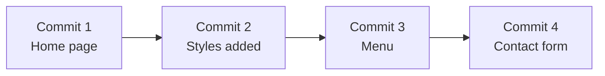
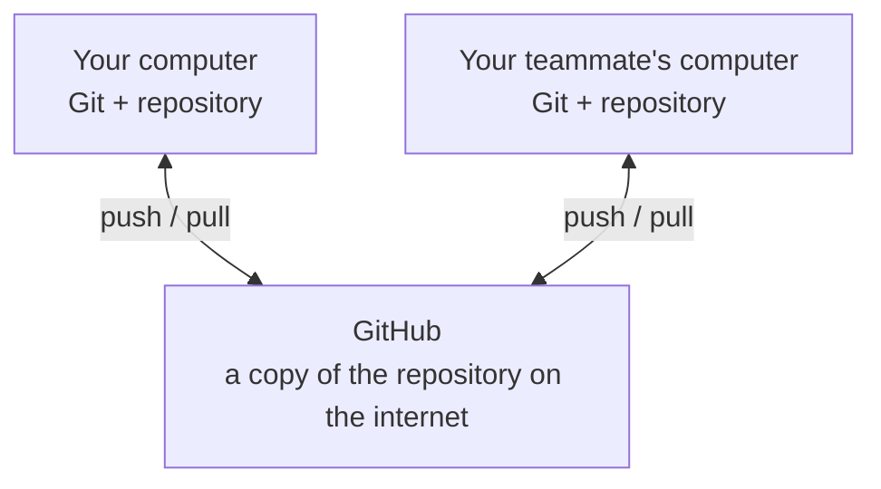
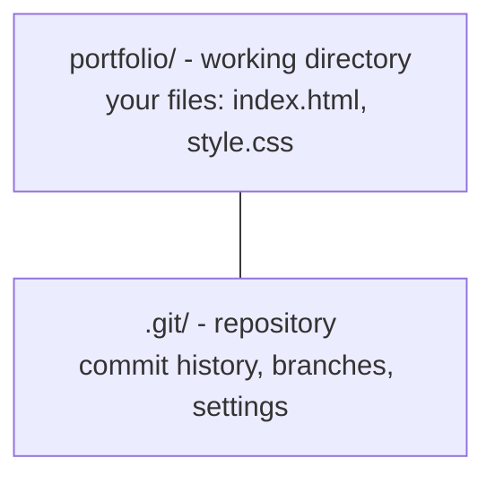
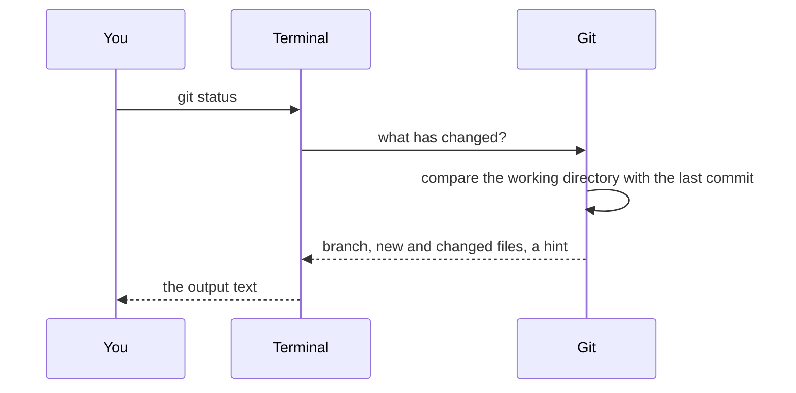

# Getting to know Git and the terminal

[Contents](../../README.md) · [← jQuery course](https://github.com/JLearn-space/JLearn-docs/tree/main/jQuery) · [Next →](../../Lesson-2/en/The%20first%20commit.md) · [RU](../ru/%D0%97%D0%BD%D0%B0%D0%BA%D0%BE%D0%BC%D1%81%D1%82%D0%B2%D0%BE%20%D1%81%20Git%20%D0%B8%20%D1%82%D0%B5%D1%80%D0%BC%D0%B8%D0%BD%D0%B0%D0%BB%D0%BE%D0%BC.md) · [EN](Getting%20to%20know%20Git%20and%20the%20terminal.md) · [UZ](../uz/Git%20va%20terminal%20bilan%20tanishuv.md)

> **Link to the HTML, CSS and JavaScript courses:** you already have your own website made of several files. You have changed it dozens of times - and you have probably wished at least once that you could get yesterday's version back. Today you will install Git, learn to work in the terminal and create the first repository for your project.

---

## Why you need this

Imagine a project folder that many people know well:

```text
site/
├── index.html
├── index_old.html
├── index_new_FINAL.html
├── index_new_FINAL_2.html
└── style (copy).css
```

Which version is the working one? What changed between `FINAL` and `FINAL_2`? How can two people work on the site without overwriting each other's changes? Git solves all of these problems. Almost every IT company uses it, GitHub is built on it, and employers often ask for a link to your GitHub before they ask for your CV.

---

## What you will learn

- Explain what a version control system is and how Git is different from GitHub.
- Install Git and check its version: `git --version`.
- Work in the terminal: `pwd`, `ls`, `cd`, `mkdir`, `echo`, `cat`.
- Tell an absolute path from a relative one and understand `~`, `.` and `..`.
- Configure Git: your name, email and the name of the main branch.
- Create a repository with `git init` and understand what the `.git` folder is.
- Read the output of `git status`.

---

## Review: 3 questions from the HTML course

1. How is the path `css/style.css` different from `/css/style.css` in the `href` attribute?
2. What does `..` mean in the path `../images/logo.png`?
3. Which files and folders did your project from the HTML course have?

Answers are at the end of the lesson.

---

## Lesson plan

| Section | What we do |
| --- | --- |
| Version control | What it is and why you need it |
| Git and GitHub | A program and a website - what the difference is |
| Installation | Windows, macOS, Linux |
| Terminal | First commands and paths |
| Mini-task 1 | Folders and files from the terminal |
| Configuring Git | Name, email, `main` branch |
| `git init` | The first repository and the `.git` folder |
| `git status` | How to read Git's output |
| Mini-task 2 | A repository for a practice project |
| Independent work | A task in the learning terminal and on your computer |

---

## Version control

**In simple words:** a version control system works like save points in a video game. Before a hard level, you save the game. If something goes wrong, you load the save and try again. All your earlier saves stay, and you can go back to any of them.

In Git, such a "save" is called a **commit** (to commit means to record something for good). A commit is a snapshot of all project files at a certain moment, with a signature: who made the change, when and why.



**How to read the diagram.** Each box is a commit, and an arrow shows the order. Together they make up the project's **history**. You can look at any commit, compare two commits or return the project to any of them.

| Without Git | With Git |
| --- | --- |
| Copies like `index_old.html`, `index_FINAL.html` | One `index.html` and the history of all its versions |
| "What did I change yesterday?" - impossible to remember | `git diff` shows every changed line |
| You broke the site - you restore it by hand | Go back to a working commit with one command |
| Two people work together - they send files and merge them by hand | Each person works in their own branch, and Git combines the changes |
| Your laptop broke - the project is lost | A copy is stored on GitHub |

---

## Git and GitHub

People often mix up these two words, but they are different things.

| | Git | GitHub |
| --- | --- | --- |
| What it is | A program on your computer | The website github.com |
| Works without the internet | Yes | No |
| What it does | Stores the version history of a project | Stores copies of repositories and helps teams work together |
| Who created it | Linus Torvalds, 2005 | The GitHub company, 2008 (owned by Microsoft since 2018) |
| Alternatives | Almost none: Git is the standard | GitLab, Bitbucket, Gitea |

**In simple words:** Git is a camera that takes snapshots of your project. GitHub is a cloud photo album where you can upload the snapshots so they don't get lost and other people can see them.



**How to read the diagram.** Every participant has a full copy of the repository with its whole history. GitHub is a shared exchange point. That is why Git is called a **distributed** system: even if GitHub is down, everyone still has the whole history. We will start working with GitHub in lesson 8; lessons 1–7 are about Git on your computer.

A **repository** is a project folder that Git tracks, together with the whole history of its commits.

---

## Installing Git

The current version of Git is **2.56** (fall 2026). Any version from 2.40 on will do: the course commands work the same way in all of them.

| System | How to install | Where to type commands |
| --- | --- | --- |
| Windows | Download the installer from [git-scm.com](https://git-scm.com/install/windows) and keep clicking "Next" with the default settings | The **Git Bash** program (it appears after installation) or the VS Code terminal |
| macOS | Type `git --version` in Terminal: the system will offer to install the developer tools itself. Or use `brew install git` | The **Terminal** app |
| Linux (Ubuntu) | `sudo apt install git` | Terminal |

Check the installation:

```bash
git --version
```

```text
git version 2.56.1
```

If you see `command not found` (or `'git' is not recognized` on Windows), Git is not installed, or the terminal was opened before the installation - close it and open it again.

> **Important:** on Windows, this course uses **Git Bash**, not Command Prompt and not PowerShell. Git Bash runs the same commands as macOS and Linux: `ls`, `pwd`, `cat`.

### The learning terminal on the platform

IDE tasks run in the **learning terminal** - a Git simulator in your browser. Its commands and output are the same as in real Git, but everything happens in the page's memory: nothing gets installed or broken on your computer. The learning terminal has no text editors, so you create files with the `echo` command (more on it below). Part 2 of every lesson is done in real Git on your own computer.

---

## Terminal

**In simple words:** the terminal is a text conversation with your computer. Instead of "double-click the folder", you type `cd site`; instead of "New folder", you type `mkdir site`. It feels strange at first, but Git was made for the terminal, and all instructions on the internet are written as commands.

The line where the cursor blinks is called the **prompt**:

```text
student@laptop:~$
```

| Part | Meaning |
| --- | --- |
| `student` | The user name |
| `laptop` | The computer name |
| `~` | The current folder: `~` is your home folder |
| `$` | The computer is waiting for a command |

In the lessons, the `$` sign before a command shows that you type it into the terminal. You don't type the `$` itself.

### First commands

| Command | What it does | Example |
| --- | --- | --- |
| `pwd` | Shows which folder you are in (print working directory) | `pwd` → `/home/student` |
| `ls` | Shows what is in the folder (list) | `ls` → `site  notes.txt` |
| `ls -a` | The same, including hidden files (their names start with a dot) | `.  ..  .git  index.html` |
| `cd folder` | Goes into a folder (change directory) | `cd site` |
| `cd ..` | Goes one level up | from `~/site` to `~` |
| `cd ~` or `cd` | Goes back to your home folder | |
| `mkdir name` | Creates a folder (make directory) | `mkdir site` |
| `echo "text" > file` | Writes text to a file (the file is created or overwritten) | `echo "Hello" > hello.txt` |
| `cat file` | Shows what is in a file | `cat hello.txt` → `Hello` |
| `clear` | Clears the screen | |

The `echo` command simply prints text. The `>` sign **redirects** this output to a file: the text goes into the file instead of the screen.

```bash
echo "<h1>My website</h1>" > index.html
cat index.html
```

```text
<h1>My website</h1>
```

> **Important:** `>` completely **replaces** what is in the file. If `index.html` had 100 lines, only one will be left after `echo "..." > index.html`. You will learn how to add a line to the end of a file in lesson 2.

### Paths: where am I and where am I going

Paths in the terminal work the same way as paths in the `href` attribute from the HTML course.

| Notation | Meaning |
| --- | --- |
| `/home/student/site` | An **absolute** path: from the very root of the disk |
| `site/css` | A **relative** path: from the current folder |
| `~` | The home folder: `/home/student` |
| `.` | The current folder |
| `..` | The folder one level up |

Step by step: how the current folder changes.

| Step | Command | Current folder after the command |
| --- | --- | --- |
| 1 | (the terminal is open) | `/home/student` |
| 2 | `mkdir site` | `/home/student` - the folder is created, but you haven't moved into it |
| 3 | `cd site` | `/home/student/site` |
| 4 | `mkdir css` | `/home/student/site` |
| 5 | `cd css` | `/home/student/site/css` |
| 6 | `cd ..` | `/home/student/site` |
| 7 | `cd ~` | `/home/student` |

**Tip:** in a real terminal, type the first letters of a folder name and press `Tab` - the terminal will complete the name for you. The `↑` arrow repeats the previous command.

---

## Mini-task 1

In the learning terminal (or in a real one):

1. Find out which folder you are in.
2. Create a folder `practice` and go into it.
3. Create a file `hello.txt` with the text `Hello, terminal!` and print its contents.
4. Go back to your home folder and look at what is in it.

---

## Configuring Git

Before your first commit, you need to introduce yourself to Git: every commit is signed with the author's name and email. You do this **once** on your computer.

```bash
git config --global user.name "Anna Karimova"
git config --global user.email "anna@example.com"
git config --global init.defaultBranch main
```

| Command | What it sets |
| --- | --- |
| `user.name` | The name in the commit signature. Write your first and last name in Latin letters |
| `user.email` | The email in the signature. It is best to use the same one as on GitHub: then GitHub will link your commits to your profile |
| `init.defaultBranch main` | What to call the main branch in new repositories. Without this setting, Git 2.x calls it `master` |

The `--global` option means "for all repositories of this user". Without it, the setting only applies to the current repository - this way you can, for example, use your work email for a work project.

Check the settings:

```bash
git config --global user.name
git config --global --list
```

```text
Anna Karimova
user.name=Anna Karimova
user.email=anna@example.com
init.defaultBranch=main
```

**Why `main`.** The main branch used to be called `master`. Today GitHub, GitLab and most projects use `main`, and in Git 3.0 (planned for spring 2027) `main` will become the default name. If you skip this setting, `git init` shows a long hint `hint: Using 'master' as the name for the initial branch...` - this is a warning, not an error.

> **Important:** anyone who opens your public repository will see the email in your commits. If you don't want to show your personal email, GitHub gives you an address like `12345+login@users.noreply.github.com` - you can put it in `user.email`.

---

## `git init`: the first repository

Any folder becomes a repository with one command:

```bash
mkdir portfolio
cd portfolio
git init
```

```text
Initialized empty Git repository in /home/student/portfolio/.git/
```

So Git has created an empty repository in /home/student/portfolio/.git/: a hidden `.git` folder inside your folder. This folder stores the whole history, the branches and the settings of the repository.

```bash
ls -a
```

```text
.  ..  .git
```



**How to read the diagram.** The working directory is the files you see and change. The `.git` folder is Git's "archive". Until you make a commit, the archive is empty.

| Action | What happens |
| --- | --- |
| Delete the `.git` folder | The whole history is lost, and the folder becomes an ordinary folder |
| Copy the project together with `.git` | The copy is a complete repository with the whole history |
| Run `git init` again in the same folder | Nothing bad: `Reinitialized existing Git repository` |
| Run `git init` in your home folder `~` | Git will start tracking **all** your files - don't do this |

> **Important:** one project - one repository. Create the repository in the project folder, not in your home folder and not on the desktop.

---

## `git status`: what Git sees

`git status` is the command you will use most often in Git. It answers the question "what is going on right now?". You can run it as many times as you like - it doesn't change anything.

Right after `git init`:

```text
On branch main

No commits yet

nothing to commit (create/copy files and use "git add" to track)
```

| Line | Meaning |
| --- | --- |
| `On branch main` | You are on the `main` branch (branches are covered in lesson 6) |
| `No commits yet` | There are no commits yet |
| `nothing to commit` | There is nothing to save: create files and add them with `git add` |

Let's create a file:

```bash
echo "# Portfolio" > README.md
git status
```

```text
On branch main

No commits yet

Untracked files:
  (use "git add <file>..." to include in what will be committed)
	README.md

nothing added to commit but untracked files present (use "git add" to track)
```

`Untracked files` are files that Git sees as new but does not track changes in yet. In the line in brackets, Git itself suggests the next command - `git add`. We will cover it and the first commit in lesson 2.

**In simple words:** `git status` is like the dashboard of a car. Looking at it costs nothing, and it shows you right away whether everything is fine.



**How to read the diagram.** `git status` doesn't save or change anything. Git compares the files in the folder with the last commit and reports the difference and the next step.

---

### Try to break it

1. Run `git status` in your home folder, where there is no repository. What does Git answer?
2. Go to a folder that doesn't exist: `cd sitee`. What message does the terminal show?
3. Make a typo in a command: `git stauts`. What does Git suggest?
4. Run `git init` a second time in the same folder. How is the output different?
5. Write text to a file without quotes: `echo Hello world > a.txt`, then `cat a.txt`. And what happens with `echo <h1> > a.txt`?
6. Delete the repository: `rm -rf .git` and run `git status`. (It is safe in the learning terminal, but not in your own project!)

### Typical beginner mistakes

| Mistake | What you get | How to fix |
| --- | --- | --- |
| A Git command outside the project folder | `fatal: not a git repository` | `cd` into the project folder, check with `pwd` |
| `git init` in your home folder | Git sees all your files as part of the project | Delete `~/.git` and create the repository in the project folder |
| A space in a folder name: `cd My Site` | `cd: too many arguments` or you end up in the wrong place | Quotes: `cd "My Site"`, or better, names without spaces |
| You typed `$` together with the command | `$: command not found` | `$` is part of the prompt; you don't type it |
| `echo "..." > index.html` into an existing file | All the contents of the file are replaced with one line | To add to the end - `>>` (lesson 2) |
| Name and email are not set | Git refuses to make a commit: `Author identity unknown` | `git config --global user.name` and `user.email` |
| A typo in a setting: `user.mail` | The setting is saved, but Git doesn't use it | Check with `git config --global --list` |

---

## Mini-task 2

1. Configure Git: your name in Latin letters, your email and the main branch `main`.
2. Check the settings with `git config --global --list`.
3. Create a folder `recipes`, go into it and create a repository.
4. Create a file `README.md` with the text `# My recipes`.
5. Look at `git status` and find the name of your file in the output.

---

## Lesson summary: cheat sheet

| Task | Command |
| --- | --- |
| Check the Git version | `git --version` |
| Where am I | `pwd` |
| What is in the folder | `ls`, `ls -a` |
| Go into a folder / up / home | `cd site`, `cd ..`, `cd ~` |
| Create a folder | `mkdir site` |
| Create a file with text | `echo "text" > file` |
| Show a file | `cat file` |
| Introduce yourself to Git | `git config --global user.name "Name"` and `user.email "email"` |
| Main branch `main` | `git config --global init.defaultBranch main` |
| View the settings | `git config --global --list` |
| Create a repository | `git init` in the project folder |
| What is going on | `git status` |

---

## Independent work

### Part 1. IDE task (graded by the platform)

In the learning terminal, Git is not configured yet, and you are in your home folder. Write the commands one per line:

1. Check the Git version.
2. Set your name (`user.name`), email (`user.email`, with the `@` symbol) and the main branch `main` - globally.
3. Create a folder `portfolio`, go into it and create a repository.
4. Create a file `README.md` with the text `# Portfolio`.
5. Look at the state of the repository with `git status`.

What the platform checks: that `git --version` was run; that the name is not empty and the email contains `@`; that the main branch is `main`; that the repository was created exactly in `~/portfolio` and not in the home folder; that `README.md` contains the right text; that `git status` was run inside the repository; that the script runs without errors.

### Part 2. Project on your computer

1. Install Git and check `git --version`.
2. Do the configuration from this lesson with your own details. If you don't have a GitHub account yet, sign up at [github.com](https://github.com) and use the same email.
3. Open the terminal (Git Bash on Windows) and use `cd` to go to the folder of your website from the HTML, CSS and JavaScript courses.
4. Create a repository in it and look at `git status`: all the files of your site will be in the `Untracked files` list.
5. Take a screenshot of the terminal - you will need it to compare with the result of lesson 2.

### Acceptance criteria

- [ ] The IDE task is accepted.
- [ ] `git --version` on your computer shows version 2.40 or newer.
- [ ] `git config --global --list` shows your name, email and `init.defaultBranch=main`.
- [ ] The folder of your website has `.git`, and `git status` answers `On branch main`.
- [ ] You can explain the difference between Git and GitHub.

---

## Self-check questions

1. What is a version control system? Give two problems it solves.
2. How is Git different from GitHub?
3. What is a commit, and what is a repository?
4. What do the commands `pwd`, `ls -a`, `cd ..` do?
5. How is an absolute path different from a relative one? What does `~` mean?
6. What does the `>` sign do in the command `echo "text" > file`, and why is it dangerous?
7. Why does Git need to know your name and email? What does `--global` mean?
8. Why do you need the setting `init.defaultBranch main`?
9. What is in the `.git` folder, and what happens if you delete it?
10. What does `Untracked files` mean in the output of `git status`?

After the questions, take the **lesson test** on the platform: 12 questions, pass mark 70%.

---

## What's next

The repository is ready, but it doesn't have a single commit yet. In lesson 2 you will learn how Git tracks files: what the working directory, the index and the repository are, and you will make your first commits with `git add` and `git commit`.

---

## Answers

**Review**

1. `css/style.css` is a path relative to the current page; `/css/style.css` starts from the root of the site.
2. Go up one folder.
3. For example: `index.html`, `about.html`, `css/style.css`, `js/main.js`, `images/`.

**Mini-task 1**

```bash
pwd
mkdir practice
cd practice
echo "Hello, terminal!" > hello.txt
cat hello.txt
cd ~
ls
```

**Mini-task 2**

```bash
git config --global user.name "Anna Karimova"
git config --global user.email "anna@example.com"
git config --global init.defaultBranch main
git config --global --list
mkdir recipes
cd recipes
git init
echo "# My recipes" > README.md
git status
```

**Self-check questions**

1. A program that stores the history of changes to files. It helps you: go back to an earlier version, see what was changed and by whom, work on a project together.
2. Git is a program on your computer that stores history. GitHub is a website where people store copies of repositories and work in teams.
3. A commit is a snapshot of all project files with a signature (who, when, why). A repository is a project folder together with its commit history.
4. `pwd` shows the current folder, `ls -a` shows the contents including hidden files, `cd ..` goes one level up.
5. An absolute path starts from the root (`/home/student/site`), a relative one starts from the current folder (`site/css`). `~` is the home folder.
6. It redirects the output of `echo` to a file. It is dangerous because it completely replaces the contents of the file.
7. Every commit is signed by its author. `--global` means the setting applies to all repositories of the user.
8. So that the main branch of new repositories is called `main`, as on GitHub and in Git 3.0, without the `hint` message.
9. The whole history, the branches and the settings of the repository. If you delete it, the history is lost and the folder becomes an ordinary folder.
10. Files that Git sees in the folder but doesn't track yet: they have never been added with `git add`.

---

[Contents](../../README.md) · [← jQuery course](https://github.com/JLearn-space/JLearn-docs/tree/main/jQuery) · [Next →](../../Lesson-2/en/The%20first%20commit.md) · [RU](../ru/%D0%97%D0%BD%D0%B0%D0%BA%D0%BE%D0%BC%D1%81%D1%82%D0%B2%D0%BE%20%D1%81%20Git%20%D0%B8%20%D1%82%D0%B5%D1%80%D0%BC%D0%B8%D0%BD%D0%B0%D0%BB%D0%BE%D0%BC.md) · [EN](Getting%20to%20know%20Git%20and%20the%20terminal.md) · [UZ](../uz/Git%20va%20terminal%20bilan%20tanishuv.md)
