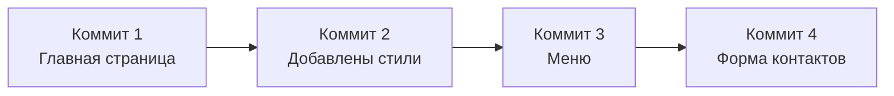
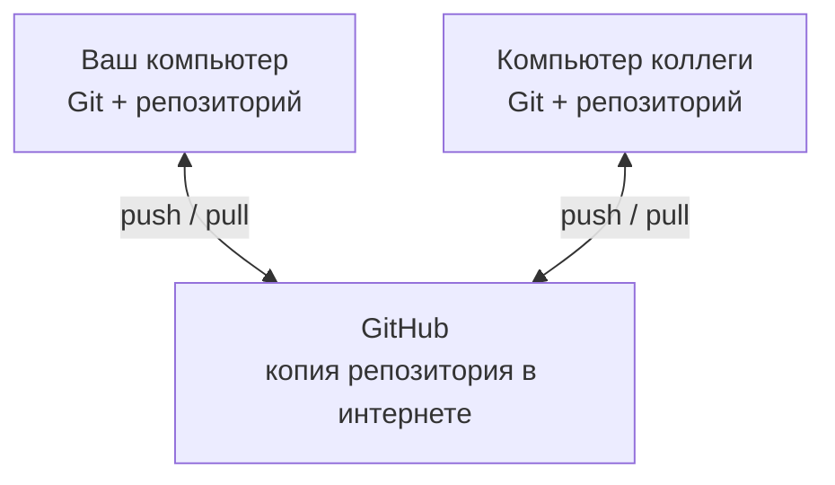
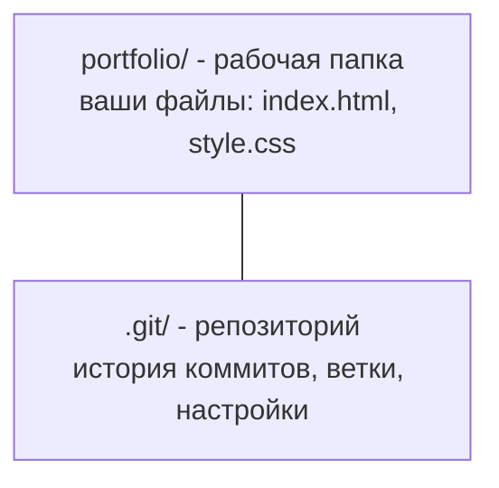
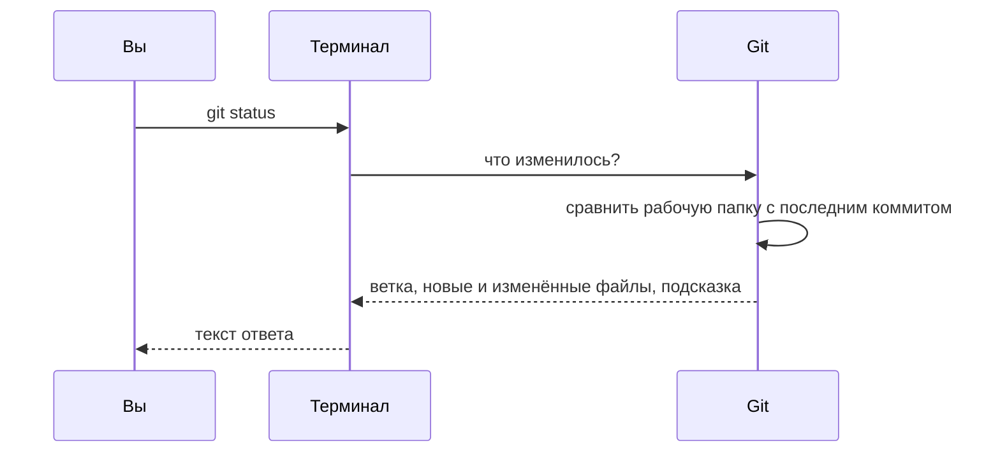

# Знакомство с Git и терминалом

[Содержание](../../README.md) · [← Курс jQuery](https://github.com/JLearn-space/JLearn-docs/tree/main/jQuery) · [Вперёд →](../../Lesson-2/ru/%D0%9F%D0%B5%D1%80%D0%B2%D1%8B%D0%B9%20%D0%BA%D0%BE%D0%BC%D0%BC%D0%B8%D1%82.md) · [RU](%D0%97%D0%BD%D0%B0%D0%BA%D0%BE%D0%BC%D1%81%D1%82%D0%B2%D0%BE%20%D1%81%20Git%20%D0%B8%20%D1%82%D0%B5%D1%80%D0%BC%D0%B8%D0%BD%D0%B0%D0%BB%D0%BE%D0%BC.md) · [EN](../en/Getting%20to%20know%20Git%20and%20the%20terminal.md) · [UZ](../uz/Git%20va%20terminal%20bilan%20tanishuv.md)

> **Связь с курсами HTML, CSS и JavaScript:** у вас уже есть свой сайт из нескольких файлов. Вы меняли его десятки раз - и наверняка хоть раз жалели, что не можете вернуть вчерашнюю версию. Сегодня вы установите Git, научитесь работать в терминале и создадите первый репозиторий для своего проекта.

---

## Зачем это вам

Представьте папку проекта, знакомую многим:

```text
site/
├── index.html
├── index_old.html
├── index_new_FINAL.html
├── index_new_FINAL_2.html
└── style (копия).css
```

Какая версия рабочая? Что изменилось между `FINAL` и `FINAL_2`? Как работать над сайтом вдвоём, чтобы не затереть правки друг друга? Git решает все эти задачи. Он используется почти в каждой IT-компании, на нём построен GitHub, а ссылку на свой GitHub работодатель часто просит раньше, чем резюме.

---

## Чему вы научитесь

- Объяснять, что такое система контроля версий и чем Git отличается от GitHub.
- Устанавливать Git и проверять версию: `git --version`.
- Работать в терминале: `pwd`, `ls`, `cd`, `mkdir`, `echo`, `cat`.
- Различать абсолютный и относительный путь, понимать `~`, `.` и `..`.
- Настраивать Git: имя, email и название основной ветки.
- Создавать репозиторий командой `git init` и понимать, что такое папка `.git`.
- Читать ответ `git status`.

---

## Повторение: 3 вопроса из курса HTML

1. Чем путь `css/style.css` отличается от `/css/style.css` в атрибуте `href`?
2. Что означает `..` в пути `../images/logo.png`?
3. Какие файлы и папки были в вашем проекте из курса HTML?

Ответы - в конце урока.

---

## План урока

| Раздел | Что делаем |
| --- | --- |
| Контроль версий | Что это и зачем |
| Git и GitHub | Программа и сайт - в чём разница |
| Установка | Windows, macOS, Linux |
| Терминал | Первые команды и пути |
| Мини-задание 1 | Папки и файлы из терминала |
| Настройка Git | Имя, email, ветка `main` |
| `git init` | Первый репозиторий и папка `.git` |
| `git status` | Как читать ответ Git |
| Мини-задание 2 | Репозиторий для учебного проекта |
| Самостоятельная работа | Задание в учебном терминале и на компьютере |

---

## Контроль версий

**Простыми словами:** система контроля версий - это «сохранения» в компьютерной игре. Перед трудным уровнем вы сохраняетесь. Если что-то пошло не так, загружаете сохранение и пробуете снова. При этом все прошлые сохранения остаются, и к любому можно вернуться.

В Git такое «сохранение» называется **коммит** (от англ. commit - «зафиксировать»). Коммит - это снимок всех файлов проекта в определённый момент, с подписью: кто, когда и зачем сделал изменение.



**Как читать схему.** Каждый прямоугольник - коммит, стрелка - порядок. Вместе они образуют **историю** проекта. Можно посмотреть любой коммит, сравнить два коммита или вернуть проект к любому из них.

| Без Git | С Git |
| --- | --- |
| Копии `index_old.html`, `index_FINAL.html` | Один `index.html` и история всех его версий |
| «Что я вчера поменял?» - не вспомнить | `git diff` показывает каждую изменённую строку |
| Сломал сайт - восстанавливать вручную | Вернуться к рабочему коммиту одной командой |
| Работа вдвоём - пересылать файлы и сливать руками | Каждый работает в своей ветке, Git объединяет правки |
| Ноутбук сломался - проект потерян | Копия лежит на GitHub |

---

## Git и GitHub

Эти слова часто путают, но это разные вещи.

| | Git | GitHub |
| --- | --- | --- |
| Что это | Программа на вашем компьютере | Сайт github.com |
| Работает без интернета | Да | Нет |
| Чем занимается | Хранит историю версий проекта | Хранит копии репозиториев, помогает работать в команде |
| Кто создал | Линус Торвальдс, 2005 год | Компания GitHub, 2008 год (с 2018 - Microsoft) |
| Аналоги | Почти нет: Git - стандарт | GitLab, Bitbucket, Gitea |

**Простыми словами:** Git - это фотоаппарат, который делает снимки проекта. GitHub - это облачный фотоальбом, куда снимки можно выложить, чтобы они не потерялись и их увидели другие.



**Как читать схему.** У каждого участника - полная копия репозитория со всей историей. GitHub - общая точка обмена. Поэтому Git называют **распределённой** системой: даже если GitHub недоступен, у каждого есть вся история. С GitHub мы начнём работать в уроке 8, а уроки 1–7 - про Git на вашем компьютере.

**Репозиторий** - это папка проекта, за которой следит Git, вместе со всей историей коммитов.

---

## Установка Git

Текущая версия Git - **2.56** (осень 2026). Подойдёт любая версия от 2.40: команды курса в них работают одинаково.

| Система | Как установить | Где вводить команды |
| --- | --- | --- |
| Windows | Скачать установщик с [git-scm.com](https://git-scm.com/install/windows) и нажимать «Next» с настройками по умолчанию | Программа **Git Bash** (появится после установки) или терминал VS Code |
| macOS | Ввести в Терминале `git --version`: система сама предложит установить инструменты разработчика. Или `brew install git` | Программа **Терминал** |
| Linux (Ubuntu) | `sudo apt install git` | Терминал |

Проверьте установку:

```bash
git --version
```

```text
git version 2.56.1
```

Если видите `command not found` (или `'git' is not recognized` в Windows), Git не установлен или терминал открыт до установки - закройте его и откройте заново.

> **Важно:** на Windows в курсе используется **Git Bash**, а не «Командная строка» и не PowerShell. В Git Bash работают те же команды, что на macOS и Linux: `ls`, `pwd`, `cat`.

### Учебный терминал на платформе

Задания в IDE выполняются в **учебном терминале** - симуляторе Git в браузере. Команды и ответы в нём такие же, как в настоящем Git, но всё происходит в памяти страницы: ничего не установится и не сломается на вашем компьютере. В учебном терминале нет текстовых редакторов, поэтому файлы создаются командой `echo` (о ней - ниже). Часть 2 каждого урока выполняется уже в настоящем Git на вашем компьютере.

---

## Терминал

**Простыми словами:** терминал - это разговор с компьютером текстом. Вместо «двойной щелчок по папке» вы пишете `cd site`, вместо «Новая папка» - `mkdir site`. Сначала непривычно, но Git создавался для терминала, и все инструкции в интернете написаны командами.

Строка, где мигает курсор, называется **приглашением**:

```text
student@laptop:~$
```

| Часть | Значение |
| --- | --- |
| `student` | Имя пользователя |
| `laptop` | Имя компьютера |
| `~` | Текущая папка: `~` - ваша домашняя папка |
| `$` | Компьютер ждёт команду |

В уроках знак `$` перед командой показывает, что её вводят в терминал. Сам `$` набирать не нужно.

### Первые команды

| Команда | Что делает | Пример |
| --- | --- | --- |
| `pwd` | Показать, в какой папке вы находитесь (print working directory) | `pwd` → `/home/student` |
| `ls` | Показать содержимое папки (list) | `ls` → `site  notes.txt` |
| `ls -a` | То же, включая скрытые файлы (их имена начинаются с точки) | `.  ..  .git  index.html` |
| `cd папка` | Перейти в папку (change directory) | `cd site` |
| `cd ..` | Подняться на уровень выше | из `~/site` в `~` |
| `cd ~` или `cd` | Вернуться в домашнюю папку | |
| `mkdir имя` | Создать папку (make directory) | `mkdir site` |
| `echo "текст" > файл` | Записать текст в файл (файл создаётся или перезаписывается) | `echo "Привет" > hello.txt` |
| `cat файл` | Показать содержимое файла | `cat hello.txt` → `Привет` |
| `clear` | Очистить экран | |

Команда `echo` просто выводит текст. Знак `>` **перенаправляет** этот вывод в файл: вместо экрана текст попадает в файл.

```bash
echo "<h1>Мой сайт</h1>" > index.html
cat index.html
```

```text
<h1>Мой сайт</h1>
```

> **Важно:** `>` полностью **заменяет** содержимое файла. Если в `index.html` было 100 строк, после `echo "..." > index.html` останется одна. Как дописать строку в конец файла, вы узнаете в уроке 2.

### Пути: где я и куда иду

Пути в терминале устроены так же, как пути в атрибуте `href` из курса HTML.

| Запись | Значение |
| --- | --- |
| `/home/student/site` | **Абсолютный** путь: от самого корня диска |
| `site/css` | **Относительный** путь: от текущей папки |
| `~` | Домашняя папка: `/home/student` |
| `.` | Текущая папка |
| `..` | Папка на уровень выше |

Пошагово: как меняется текущая папка.

| Шаг | Команда | Текущая папка после команды |
| --- | --- | --- |
| 1 | (терминал открыт) | `/home/student` |
| 2 | `mkdir site` | `/home/student` - папка создана, но вы в неё не перешли |
| 3 | `cd site` | `/home/student/site` |
| 4 | `mkdir css` | `/home/student/site` |
| 5 | `cd css` | `/home/student/site/css` |
| 6 | `cd ..` | `/home/student/site` |
| 7 | `cd ~` | `/home/student` |

**Совет:** в настоящем терминале нажмите `Tab` после первых букв имени папки - терминал допишет его сам. Стрелка `↑` повторяет прошлую команду.

---

## Мини-задание 1

В учебном терминале (или в настоящем):

1. Узнайте, в какой папке вы находитесь.
2. Создайте папку `practice` и перейдите в неё.
3. Создайте файл `hello.txt` с текстом `Hello, terminal!` и выведите его содержимое.
4. Вернитесь в домашнюю папку и посмотрите её содержимое.

---

## Настройка Git

Перед первым коммитом Git нужно представиться: каждый коммит подписывается именем и email автора. Это делается **один раз** на компьютере.

```bash
git config --global user.name "Anna Karimova"
git config --global user.email "anna@example.com"
git config --global init.defaultBranch main
```

| Команда | Что настраивает |
| --- | --- |
| `user.name` | Имя в подписи коммитов. Пишут имя и фамилию латиницей |
| `user.email` | Email в подписи. Лучше тот же, что на GitHub: так GitHub свяжет коммиты с вашим профилем |
| `init.defaultBranch main` | Как называть основную ветку в новых репозиториях. Без этой настройки Git 2.x называет её `master` |

Параметр `--global` значит «для всех репозиториев этого пользователя». Без него настройка действует только в текущем репозитории - так можно, например, указать рабочий email для рабочего проекта.

Проверить настройки:

```bash
git config --global user.name
git config --global --list
```

```text
Anna Karimova
user.name=Anna Karimova
user.email=anna@example.com
init.defaultBranch=main
```

**Почему `main`.** Раньше основная ветка называлась `master`. Сейчас GitHub, GitLab и большинство проектов используют `main`, а в Git 3.0 (запланирован на весну 2027) `main` станет названием по умолчанию. Если не сделать эту настройку, `git init` покажет длинную подсказку `hint: Using 'master' as the name for the initial branch...` - это предупреждение, а не ошибка.

> **Важно:** email в коммитах увидит любой, кто откроет ваш публичный репозиторий. Если не хотите показывать личную почту, на GitHub есть адрес вида `12345+login@users.noreply.github.com` - его можно указать в `user.email`.

---

## `git init`: первый репозиторий

Любая папка становится репозиторием одной командой:

```bash
mkdir portfolio
cd portfolio
git init
```

```text
Initialized empty Git repository in /home/student/portfolio/.git/
```

Перевод: «Создан пустой репозиторий Git в /home/student/portfolio/.git/». Git создал в папке скрытую папку `.git` - в ней хранится вся история, ветки и настройки репозитория.

```bash
ls -a
```

```text
.  ..  .git
```



**Как читать схему.** Рабочая папка - это файлы, которые вы видите и меняете. Папка `.git` - «архив» Git. Пока вы не сделали коммит, архив пустой.

| Действие | Что произойдёт |
| --- | --- |
| Удалить папку `.git` | Вся история пропадёт, папка станет обычной |
| Скопировать проект вместе с `.git` | Копия будет полноценным репозиторием со всей историей |
| Вызвать `git init` повторно в той же папке | Ничего страшного: `Reinitialized existing Git repository` |
| Вызвать `git init` в домашней папке `~` | Git начнёт следить за **всеми** вашими файлами - так делать не надо |

> **Важно:** один проект - один репозиторий. Создавайте репозиторий в папке проекта, а не в домашней папке и не на рабочем столе.

---

## `git status`: что видит Git

`git status` - самая частая команда в работе с Git. Она отвечает на вопрос «что сейчас происходит?». Её можно вызывать сколько угодно раз - она ничего не меняет.

Сразу после `git init`:

```text
On branch main

No commits yet

nothing to commit (create/copy files and use "git add" to track)
```

| Строка | Перевод и смысл |
| --- | --- |
| `On branch main` | Вы на ветке `main` (о ветках - урок 6) |
| `No commits yet` | Коммитов пока нет |
| `nothing to commit` | Сохранять нечего: создайте файлы и добавьте их через `git add` |

Создадим файл:

```bash
echo "# Portfolio" > README.md
git status
```

```text
On branch main

No commits yet

Untracked files:
  (use "git add <file>..." to include in what will be committed)
	README.md

nothing added to commit but untracked files present (use "git add" to track)
```

`Untracked files` - **неотслеживаемые** файлы: Git видит новый файл, но пока не следит за его изменениями. В строке в скобках Git сам подсказывает следующую команду - `git add`. Её и первый коммит разберём в уроке 2.

**Простыми словами:** `git status` - как приборная панель автомобиля. Посмотреть на неё ничего не стоит, а она сразу показывает, всё ли в порядке.



**Как читать схему.** `git status` ничего не сохраняет и не меняет. Git сравнивает файлы в папке с последним коммитом и сообщает разницу и следующий шаг.

---

### Попробуйте сломать

1. Вызовите `git status` в домашней папке, где нет репозитория. Что ответит Git?
2. Перейдите в несуществующую папку: `cd sitee`. Какое сообщение покажет терминал?
3. Ошибитесь в команде: `git stauts`. Что предложит Git?
4. Выполните `git init` второй раз в той же папке. Чем отличается ответ?
5. Запишите в файл текст без кавычек: `echo Привет мир > a.txt`, затем `cat a.txt`. А что будет с `echo <h1> > a.txt`?
6. Удалите репозиторий: `rm -rf .git` и вызовите `git status`. (В учебном терминале это безопасно, на своём проекте - нет!)

### Частые ошибки новичков

| Ошибка | Что получится | Как исправить |
| --- | --- | --- |
| Команда Git вне папки проекта | `fatal: not a git repository` | `cd` в папку проекта, проверить `pwd` |
| `git init` в домашней папке | Git видит все ваши файлы как часть проекта | Удалить `~/.git` и создать репозиторий в папке проекта |
| Пробел в имени папки: `cd My Site` | `cd: too many arguments` или переход не туда | Кавычки: `cd "My Site"`, а лучше имена без пробелов |
| Набрали `$` вместе с командой | `$: command not found` | `$` - часть приглашения, его не вводят |
| `echo "..." > index.html` в готовый файл | Всё содержимое файла заменено одной строкой | Для дописывания - `>>` (урок 2) |
| Не настроены имя и email | Git откажется делать коммит: `Author identity unknown` | `git config --global user.name` и `user.email` |
| Опечатка в настройке: `user.mail` | Настройка сохранится, но Git её не использует | Проверить `git config --global --list` |

---

## Мини-задание 2

1. Настройте Git: своё имя латиницей, email и основную ветку `main`.
2. Проверьте настройки командой `git config --global --list`.
3. Создайте папку `recipes`, перейдите в неё и создайте репозиторий.
4. Создайте файл `README.md` с текстом `# My recipes`.
5. Посмотрите `git status` и найдите в ответе имя вашего файла.

---

## Итоги урока: шпаргалка

| Задача | Команда |
| --- | --- |
| Проверить версию Git | `git --version` |
| Где я | `pwd` |
| Что в папке | `ls`, `ls -a` |
| Перейти в папку / выше / домой | `cd site`, `cd ..`, `cd ~` |
| Создать папку | `mkdir site` |
| Создать файл с текстом | `echo "текст" > файл` |
| Показать файл | `cat файл` |
| Представиться Git | `git config --global user.name "Имя"` и `user.email "почта"` |
| Основная ветка `main` | `git config --global init.defaultBranch main` |
| Посмотреть настройки | `git config --global --list` |
| Создать репозиторий | `git init` в папке проекта |
| Что происходит | `git status` |

---

## Самостоятельная работа

### Часть 1. Задание в IDE (засчитывается платформой)

В учебном терминале Git ещё не настроен, вы находитесь в домашней папке. Напишите команды по одной на строке:

1. Проверьте версию Git.
2. Настройте имя (`user.name`), email (`user.email`, с символом `@`) и основную ветку `main` - глобально.
3. Создайте папку `portfolio`, перейдите в неё и создайте репозиторий.
4. Создайте файл `README.md` с текстом `# Portfolio`.
5. Посмотрите состояние репозитория командой `git status`.

Что проверяет платформа: выполнена ли `git --version`; что имя не пустое, а email содержит `@`; что основная ветка - `main`; что репозиторий создан именно в `~/portfolio`, а не в домашней папке; что в `README.md` записан нужный текст; что `git status` вызвана внутри репозитория; что сценарий выполняется без ошибок.

### Часть 2. Проект на компьютере

1. Установите Git и проверьте `git --version`.
2. Выполните настройку из этого урока со своими данными. Если у вас ещё нет аккаунта GitHub - зарегистрируйтесь на [github.com](https://github.com) и укажите тот же email.
3. Откройте терминал (Git Bash на Windows), перейдите командой `cd` в папку своего сайта из курсов HTML, CSS и JavaScript.
4. Создайте в ней репозиторий и посмотрите `git status`: все файлы сайта будут в списке `Untracked files`.
5. Сделайте снимок экрана терминала - он понадобится, чтобы сравнить с результатом урока 2.

### Критерии готовности

- [ ] Задание в IDE засчитано.
- [ ] `git --version` на вашем компьютере показывает версию 2.40 или новее.
- [ ] `git config --global --list` показывает ваше имя, email и `init.defaultBranch=main`.
- [ ] В папке вашего сайта есть `.git`, а `git status` отвечает `On branch main`.
- [ ] Вы можете объяснить разницу между Git и GitHub.

---

## Вопросы для самопроверки

1. Что такое система контроля версий? Приведите две задачи, которые она решает.
2. Чем Git отличается от GitHub?
3. Что такое коммит и что такое репозиторий?
4. Что делают команды `pwd`, `ls -a`, `cd ..`?
5. Чем абсолютный путь отличается от относительного? Что означает `~`?
6. Что делает знак `>` в команде `echo "текст" > файл` и чем он опасен?
7. Зачем Git знать ваше имя и email? Что означает `--global`?
8. Зачем настройка `init.defaultBranch main`?
9. Что находится в папке `.git` и что будет, если её удалить?
10. Что означает `Untracked files` в ответе `git status`?

После вопросов пройдите **тест урока** на платформе: 12 вопросов, порог 70%.

---

## Что дальше

Репозиторий готов, но в нём пока нет ни одного коммита. В уроке 2 вы узнаете, как Git отслеживает файлы: что такое рабочая папка, индекс и репозиторий, и сделаете первые коммиты командами `git add` и `git commit`.

---

## Ответы

**Повторение**

1. `css/style.css` - относительный путь от текущей страницы, `/css/style.css` - от корня сайта.
2. Подняться на одну папку выше.
3. Например: `index.html`, `about.html`, `css/style.css`, `js/main.js`, `images/`.

**Мини-задание 1**

```bash
pwd
mkdir practice
cd practice
echo "Hello, terminal!" > hello.txt
cat hello.txt
cd ~
ls
```

**Мини-задание 2**

```bash
git config --global user.name "Anna Karimova"
git config --global user.email "anna@example.com"
git config --global init.defaultBranch main
git config --global --list
mkdir recipes
cd recipes
git init
echo "# My recipes" > README.md
git status
```

**Вопросы для самопроверки**

1. Программа, которая хранит историю изменений файлов. Задачи: вернуть прошлую версию, увидеть, что и кто изменил, работать над проектом вместе.
2. Git - программа на компьютере, хранит историю. GitHub - сайт, где хранят копии репозиториев и работают в команде.
3. Коммит - снимок всех файлов проекта с подписью (кто, когда, зачем). Репозиторий - папка проекта вместе с историей коммитов.
4. `pwd` - показать текущую папку, `ls -a` - содержимое с учётом скрытых файлов, `cd ..` - подняться на уровень выше.
5. Абсолютный путь начинается от корня (`/home/student/site`), относительный - от текущей папки (`site/css`). `~` - домашняя папка.
6. Перенаправляет вывод `echo` в файл. Опасен тем, что полностью заменяет содержимое файла.
7. Каждый коммит подписывается автором. `--global` - настройка для всех репозиториев пользователя.
8. Чтобы основная ветка новых репозиториев называлась `main`, как на GitHub и в Git 3.0, без подсказки `hint`.
9. Вся история, ветки и настройки репозитория. Если удалить - история пропадёт, папка станет обычной.
10. Файлы, которые Git видит в папке, но пока не отслеживает: их ещё ни разу не добавили через `git add`.

---

[Содержание](../../README.md) · [← Курс jQuery](https://github.com/JLearn-space/JLearn-docs/tree/main/jQuery) · [Вперёд →](../../Lesson-2/ru/%D0%9F%D0%B5%D1%80%D0%B2%D1%8B%D0%B9%20%D0%BA%D0%BE%D0%BC%D0%BC%D0%B8%D1%82.md) · [RU](%D0%97%D0%BD%D0%B0%D0%BA%D0%BE%D0%BC%D1%81%D1%82%D0%B2%D0%BE%20%D1%81%20Git%20%D0%B8%20%D1%82%D0%B5%D1%80%D0%BC%D0%B8%D0%BD%D0%B0%D0%BB%D0%BE%D0%BC.md) · [EN](../en/Getting%20to%20know%20Git%20and%20the%20terminal.md) · [UZ](../uz/Git%20va%20terminal%20bilan%20tanishuv.md)
