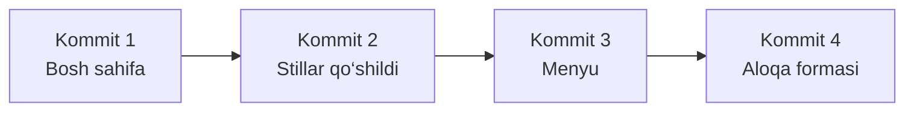
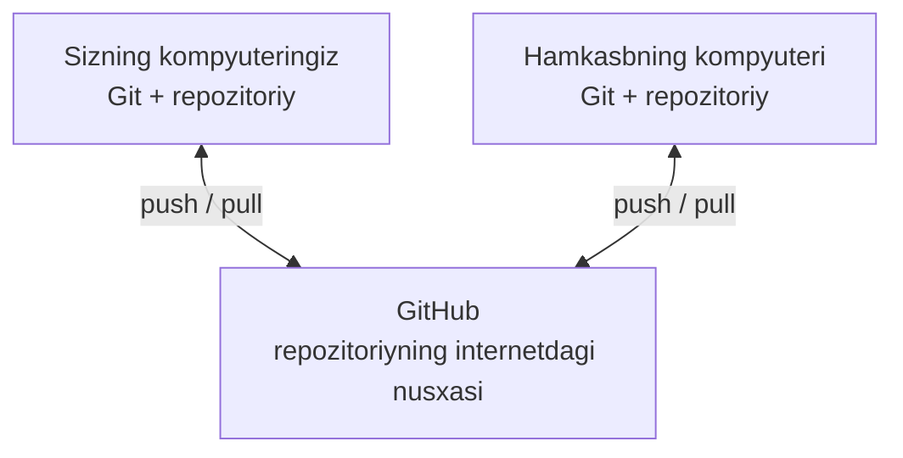
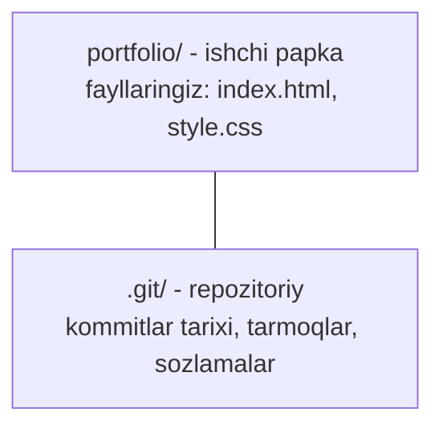
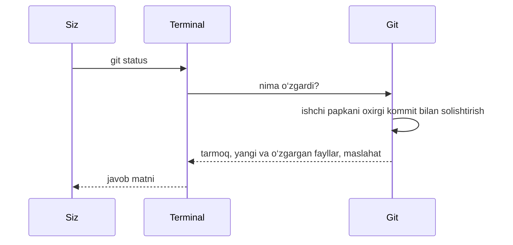

# Git va terminal bilan tanishuv

[Mundarija](../../README.md) · [← jQuery kursi](https://github.com/JLearn-space/JLearn-docs/tree/main/jQuery) · [Keyingi →](../../Lesson-2/uz/Birinchi%20kommit.md) · [RU](../ru/%D0%97%D0%BD%D0%B0%D0%BA%D0%BE%D0%BC%D1%81%D1%82%D0%B2%D0%BE%20%D1%81%20Git%20%D0%B8%20%D1%82%D0%B5%D1%80%D0%BC%D0%B8%D0%BD%D0%B0%D0%BB%D0%BE%D0%BC.md) · [EN](../en/Getting%20to%20know%20Git%20and%20the%20terminal.md) · [UZ](Git%20va%20terminal%20bilan%20tanishuv.md)

> **HTML, CSS va JavaScript kurslari bilan bog‘liqlik:** sizda bir nechta fayldan iborat o‘z saytingiz bor. Siz uni o‘nlab marta o‘zgartirgansiz - va, ehtimol, kechagi versiyani qaytara olmaganingizdan hech bo‘lmasa bir marta afsuslangansiz. Bugun Git’ni o‘rnatasiz, terminalda ishlashni o‘rganasiz va loyihangiz uchun birinchi repozitoriyni yaratasiz.

---

## Bu sizga nima uchun kerak

Ko‘pchilikka tanish bo‘lgan loyiha papkasini tasavvur qiling:

```text
site/
├── index.html
├── index_old.html
├── index_new_FINAL.html
├── index_new_FINAL_2.html
└── style (nusxa).css
```

Qaysi versiya ishlaydigan? `FINAL` va `FINAL_2` orasida nima o‘zgargan? Sayt ustida ikki kishi bir-birining tuzatishlarini o‘chirib yubormasdan qanday ishlashi mumkin? Git bu vazifalarning barchasini hal qiladi. U deyarli har bir IT kompaniyada ishlatiladi, GitHub aynan Git asosida qurilgan, ish beruvchi esa ko‘pincha rezyumedan ham oldin GitHub profilingizga havolani so‘raydi.

---

## Nimani o‘rganasiz

- Versiyalarni boshqarish tizimi nima ekanini va Git GitHub’dan nimasi bilan farq qilishini tushuntirish.
- Git’ni o‘rnatish va versiyasini tekshirish: `git --version`.
- Terminalda ishlash: `pwd`, `ls`, `cd`, `mkdir`, `echo`, `cat`.
- Absolyut va nisbiy yo‘lni farqlash, `~`, `.` va `..` belgilarini tushunish.
- Git’ni sozlash: ism, email va asosiy tarmoq (branch) nomi.
- `git init` buyrug‘i bilan repozitoriy yaratish va `.git` papkasi nima ekanini tushunish.
- `git status` javobini o‘qish.

---

## Takrorlash: HTML kursidan 3 savol

1. `href` atributida `css/style.css` yo‘li `/css/style.css` dan nimasi bilan farq qiladi?
2. `../images/logo.png` yo‘lidagi `..` nimani bildiradi?
3. HTML kursidagi loyihangizda qaysi fayl va papkalar bor edi?

Javoblar - dars oxirida.

---

## Reja

| Bo‘lim | Nima qilamiz |
| --- | --- |
| Versiyalarni boshqarish | Bu nima va nima uchun kerak |
| Git va GitHub | Dastur va sayt - farqi nimada |
| O‘rnatish | Windows, macOS, Linux |
| Terminal | Birinchi buyruqlar va yo‘llar |
| Mini-topshiriq 1 | Terminal orqali papka va fayllar |
| Git’ni sozlash | Ism, email, `main` tarmog‘i |
| `git init` | Birinchi repozitoriy va `.git` papkasi |
| `git status` | Git javobini qanday o‘qish |
| Mini-topshiriq 2 | O‘quv loyihasi uchun repozitoriy |
| Mustaqil ish | O‘quv terminalida va kompyuterda topshiriq |

---

## Versiyalarni boshqarish

**Oddiy so‘z bilan:** versiyalarni boshqarish tizimi - bu kompyuter o‘yinidagi «saqlash»lar. Qiyin bosqich oldidan siz o‘yinni saqlaysiz. Agar nimadir noto‘g‘ri ketsa, saqlangan joyni yuklaysiz va qaytadan urinib ko‘rasiz. Bunda oldingi barcha saqlashlar joyida qoladi va istalganiga qaytish mumkin.

Git’da bunday «saqlash» **kommit** deb ataladi (inglizcha commit - «qayd etmoq»). Kommit - loyihadagi barcha fayllarning ma’lum bir paytdagi surati, unga imzo qo‘shiladi: o‘zgarishni kim, qachon va nima uchun qilgani.



**Sxemani qanday o‘qish kerak.** Har bir to‘rtburchak - kommit, strelka - ularning tartibi. Birgalikda ular loyihaning **tarixini** tashkil qiladi. Istalgan kommitni ko‘rish, ikki kommitni solishtirish yoki loyihani ulardan istalganiga qaytarish mumkin.

| Git’siz | Git bilan |
| --- | --- |
| `index_old.html`, `index_FINAL.html` nusxalari | Bitta `index.html` va uning barcha versiyalari tarixi |
| «Kecha nimani o‘zgartirdim?» - eslab bo‘lmaydi | `git diff` har bir o‘zgargan qatorni ko‘rsatadi |
| Sayt buzildi - qo‘lda tiklash kerak | Bitta buyruq bilan ishlaydigan kommitga qaytish |
| Ikki kishi ishlaydi - fayllarni bir-biriga jo‘natib, qo‘lda birlashtiradi | Har kim o‘z tarmog‘ida ishlaydi, Git tuzatishlarni birlashtiradi |
| Noutbuk buzildi - loyiha yo‘qoldi | Nusxasi GitHub’da saqlanadi |

---

## Git va GitHub

Bu so‘zlarni ko‘pincha adashtirishadi, lekin ular turli narsalar.

| | Git | GitHub |
| --- | --- | --- |
| Bu nima | Kompyuteringizdagi dastur | github.com sayti |
| Internetsiz ishlaydi | Ha | Yo‘q |
| Nima bilan shug‘ullanadi | Loyiha versiyalari tarixini saqlaydi | Repozitoriylar nusxalarini saqlaydi, jamoada ishlashga yordam beradi |
| Kim yaratgan | Linus Torvalds, 2005-yil | GitHub kompaniyasi, 2008-yil (2018-yildan - Microsoft) |
| Muqobillari | Deyarli yo‘q: Git - standart | GitLab, Bitbucket, Gitea |

**Oddiy so‘z bilan:** Git - loyihani suratga oladigan fotoapparat. GitHub - bulutdagi fotoalbom: suratlarni u yerga joylasangiz, ular yo‘qolmaydi va boshqalar ham ularni ko‘ra oladi.



**Sxemani qanday o‘qish kerak.** Har bir ishtirokchida repozitoriyning butun tarixi bilan to‘liq nusxasi bor. GitHub - umumiy almashish nuqtasi. Shuning uchun Git **taqsimlangan** tizim deb ataladi: GitHub ishlamay qolsa ham, har kimda butun tarix saqlanib qoladi. GitHub bilan 8-darsda ishlay boshlaymiz, 1–7-darslar esa kompyuteringizdagi Git haqida.

**Repozitoriy** - Git kuzatib boradigan loyiha papkasi va uning kommitlari tarixi.

---

## Git’ni o‘rnatish

Git’ning joriy versiyasi - **2.56** (2026-yil kuzi). 2.40 va undan yangi istalgan versiya mos keladi: kursdagi buyruqlar ularda bir xil ishlaydi.

| Tizim | Qanday o‘rnatish | Buyruqlarni qayerda kiritish |
| --- | --- | --- |
| Windows | [git-scm.com](https://git-scm.com/install/windows) saytidan o‘rnatuvchini yuklab oling va standart sozlamalar bilan «Next» tugmasini bosib boring | **Git Bash** dasturi (o‘rnatishdan keyin paydo bo‘ladi) yoki VS Code terminali |
| macOS | Terminal’da `git --version` ni kiriting: tizim dasturchi vositalarini o‘rnatishni o‘zi taklif qiladi. Yoki `brew install git` | **Terminal** dasturi |
| Linux (Ubuntu) | `sudo apt install git` | Terminal |

O‘rnatilganini tekshiring:

```bash
git --version
```

```text
git version 2.56.1
```

Agar `command not found` (Windows’da esa `'git' is not recognized`) xabarini ko‘rsangiz, Git o‘rnatilmagan yoki terminal o‘rnatishdan oldin ochilgan - uni yopib, qaytadan oching.

> **Muhim:** kursda Windows’da «Buyruqlar satri» (Command Prompt) ham, PowerShell ham emas, **Git Bash** ishlatiladi. Git Bash’da macOS va Linux’dagi buyruqlarning o‘zi ishlaydi: `ls`, `pwd`, `cat`.

### Platformadagi o‘quv terminali

IDE topshiriqlari **o‘quv terminalida** - brauzerdagi Git simulyatorida bajariladi. Undagi buyruqlar va javoblar haqiqiy Git’dagi bilan bir xil, lekin hammasi sahifa xotirasida sodir bo‘ladi: kompyuteringizga hech narsa o‘rnatilmaydi va hech narsa buzilmaydi. O‘quv terminalida matn muharrirlari yo‘q, shuning uchun fayllar `echo` buyrug‘i bilan yaratiladi (u haqida quyida). Har bir darsning 2-qismi esa kompyuteringizdagi haqiqiy Git’da bajariladi.

---

## Terminal

**Oddiy so‘z bilan:** terminal - kompyuter bilan matn orqali suhbat. «Papkani ikki marta bosish» o‘rniga `cd site` deb yozasiz, «Yangi papka» o‘rniga - `mkdir site`. Avvaliga g‘ayrioddiy tuyuladi, lekin Git terminal uchun yaratilgan va internetdagi barcha yo‘riqnomalar buyruqlar bilan yozilgan.

Kursor miltillab turgan qator **taklif satri** (prompt) deb ataladi:

```text
student@laptop:~$
```

| Qism | Ma’nosi |
| --- | --- |
| `student` | Foydalanuvchi nomi |
| `laptop` | Kompyuter nomi |
| `~` | Joriy papka: `~` - sizning uy papkangiz |
| `$` | Kompyuter buyruq kutmoqda |

Darslarda buyruq oldidagi `$` belgisi uni terminalga kiritish kerakligini bildiradi. `$` ning o‘zini yozish shart emas.

### Birinchi buyruqlar

| Buyruq | Nima qiladi | Misol |
| --- | --- | --- |
| `pwd` | Qaysi papkada turganingizni ko‘rsatadi (print working directory) | `pwd` → `/home/student` |
| `ls` | Papka ichidagilarni ko‘rsatadi (list) | `ls` → `site  notes.txt` |
| `ls -a` | Xuddi shunday, lekin yashirin fayllar bilan (ularning nomi nuqta bilan boshlanadi) | `.  ..  .git  index.html` |
| `cd papka` | Papkaga o‘tadi (change directory) | `cd site` |
| `cd ..` | Bir daraja yuqoriga chiqadi | `~/site` dan `~` ga |
| `cd ~` yoki `cd` | Uy papkasiga qaytaradi | |
| `mkdir nom` | Papka yaratadi (make directory) | `mkdir site` |
| `echo "matn" > fayl` | Faylga matn yozadi (fayl yaratiladi yoki ustidan yoziladi) | `echo "Salom" > hello.txt` |
| `cat fayl` | Fayl ichidagini ko‘rsatadi | `cat hello.txt` → `Salom` |
| `clear` | Ekranni tozalaydi | |

`echo` buyrug‘i shunchaki matnni chiqaradi. `>` belgisi bu chiqishni faylga **yo‘naltiradi**: matn ekranga emas, faylga tushadi.

```bash
echo "<h1>Mening saytim</h1>" > index.html
cat index.html
```

```text
<h1>Mening saytim</h1>
```

> **Muhim:** `>` fayl ichidagini butunlay **almashtiradi**. Agar `index.html` da 100 qator bo‘lgan bo‘lsa, `echo "..." > index.html` dan keyin bitta qator qoladi. Fayl oxiriga qator qanday qo‘shishni 2-darsda bilib olasiz.

### Yo‘llar: qayerdaman va qayerga boraman

Terminaldagi yo‘llar HTML kursidagi `href` atributining yo‘llari kabi tuzilgan.

| Yozuv | Ma’nosi |
| --- | --- |
| `/home/student/site` | **Absolyut** yo‘l: diskning eng ildizidan boshlanadi |
| `site/css` | **Nisbiy** yo‘l: joriy papkadan boshlanadi |
| `~` | Uy papkasi: `/home/student` |
| `.` | Joriy papka |
| `..` | Bir daraja yuqoridagi papka |

Qadamma-qadam: joriy papka qanday o‘zgaradi.

| Qadam | Buyruq | Buyruqdan keyingi joriy papka |
| --- | --- | --- |
| 1 | (terminal ochildi) | `/home/student` |
| 2 | `mkdir site` | `/home/student` - papka yaratildi, lekin siz unga o‘tmadingiz |
| 3 | `cd site` | `/home/student/site` |
| 4 | `mkdir css` | `/home/student/site` |
| 5 | `cd css` | `/home/student/site/css` |
| 6 | `cd ..` | `/home/student/site` |
| 7 | `cd ~` | `/home/student` |

**Maslahat:** haqiqiy terminalda papka nomining birinchi harflarini yozib, `Tab` ni bosing - terminal nomni o‘zi to‘ldiradi. `↑` strelkasi oldingi buyruqni takrorlaydi.

---

## Mini-topshiriq 1

O‘quv terminalida (yoki haqiqiy terminalda):

1. Qaysi papkada turganingizni aniqlang.
2. `practice` papkasini yarating va unga o‘ting.
3. `Hello, terminal!` matnli `hello.txt` faylini yarating va uning ichidagini chiqaring.
4. Uy papkasiga qayting va uning ichidagilarni ko‘ring.

---

## Git’ni sozlash

Birinchi kommitdan oldin Git’ga o‘zingizni tanishtirishingiz kerak: har bir kommitga muallifning ismi va emaili yoziladi. Bu kompyuterda **bir marta** qilinadi.

```bash
git config --global user.name "Anna Karimova"
git config --global user.email "anna@example.com"
git config --global init.defaultBranch main
```

| Buyruq | Nimani sozlaydi |
| --- | --- |
| `user.name` | Kommitlar imzosidagi ism. Ism va familiya lotin harflarida yoziladi |
| `user.email` | Imzodagi email. GitHub’dagi bilan bir xil bo‘lgani ma’qul: shunda GitHub kommitlarni profilingizga bog‘laydi |
| `init.defaultBranch main` | Yangi repozitoriylarda asosiy tarmoq qanday nomlanadi. Bu sozlamasiz Git 2.x uni `master` deb ataydi |

`--global` parametri «shu foydalanuvchining barcha repozitoriylari uchun» degani. Usiz sozlama faqat joriy repozitoriyda amal qiladi - shu yo‘l bilan, masalan, ish loyihasi uchun ishdagi emailni ko‘rsatish mumkin.

Sozlamalarni tekshirish:

```bash
git config --global user.name
git config --global --list
```

```text
Anna Karimova
user.name=Anna Karimova
user.email=anna@example.com
init.defaultBranch=main
```

**Nima uchun `main`.** Ilgari asosiy tarmoq `master` deb atalardi. Hozir GitHub, GitLab va ko‘pchilik loyihalar `main` nomidan foydalanadi, Git 3.0 da esa (2027-yil bahoriga rejalashtirilgan) `main` standart nom bo‘ladi. Agar bu sozlamani qilmasangiz, `git init` uzun `hint: Using 'master' as the name for the initial branch...` maslahatini ko‘rsatadi - bu xato emas, ogohlantirish.

> **Muhim:** kommitlardagi emailni ochiq repozitoriyingizni ochgan har bir kishi ko‘radi. Shaxsiy pochtangizni ko‘rsatishni istamasangiz, GitHub’da `12345+login@users.noreply.github.com` ko‘rinishidagi manzil bor - uni `user.email` ga yozish mumkin.

---

## `git init`: birinchi repozitoriy

Istalgan papka bitta buyruq bilan repozitoriyga aylanadi:

```bash
mkdir portfolio
cd portfolio
git init
```

```text
Initialized empty Git repository in /home/student/portfolio/.git/
```

Tarjimasi: «/home/student/portfolio/.git/ da bo‘sh Git repozitoriysi yaratildi». Git papka ichida yashirin `.git` papkasini yaratdi - unda repozitoriyning butun tarixi, tarmoqlari va sozlamalari saqlanadi.

```bash
ls -a
```

```text
.  ..  .git
```



**Sxemani qanday o‘qish kerak.** Ishchi papka - siz ko‘radigan va o‘zgartiradigan fayllar. `.git` papkasi - Git’ning «arxivi». Birinchi kommitni qilmaguningizcha arxiv bo‘sh.

| Amal | Nima bo‘ladi |
| --- | --- |
| `.git` papkasini o‘chirish | Butun tarix yo‘qoladi, papka oddiy papkaga aylanadi |
| Loyihani `.git` bilan birga nusxalash | Nusxa butun tarixi bilan to‘laqonli repozitoriy bo‘ladi |
| Shu papkada `git init` ni qayta chaqirish | Hech qisi yo‘q: `Reinitialized existing Git repository` |
| `~` uy papkasida `git init` ni chaqirish | Git **barcha** fayllaringizni kuzata boshlaydi - bunday qilmang |

> **Muhim:** bitta loyiha - bitta repozitoriy. Repozitoriyni uy papkasida yoki ish stolida emas, loyiha papkasida yarating.

---

## `git status`: Git nimani ko‘radi

`git status` - Git bilan ishlashda eng ko‘p ishlatiladigan buyruq. U «hozir nima bo‘lyapti?» degan savolga javob beradi. Uni xohlagancha chaqirish mumkin - u hech narsani o‘zgartirmaydi.

`git init` dan so‘ng darhol:

```text
On branch main

No commits yet

nothing to commit (create/copy files and use "git add" to track)
```

| Qator | Tarjimasi va ma’nosi |
| --- | --- |
| `On branch main` | Siz `main` tarmog‘idasiz (tarmoqlar haqida - 6-dars) |
| `No commits yet` | Hozircha kommitlar yo‘q |
| `nothing to commit` | Saqlaydigan narsa yo‘q: fayllar yarating va ularni `git add` orqali qo‘shing |

Fayl yaratamiz:

```bash
echo "# Portfolio" > README.md
git status
```

```text
On branch main

No commits yet

Untracked files:
  (use "git add <file>..." to include in what will be committed)
	README.md

nothing added to commit but untracked files present (use "git add" to track)
```

`Untracked files` - **kuzatilmaydigan** fayllar: Git yangi faylni ko‘radi, lekin hozircha uning o‘zgarishlarini kuzatmaydi. Qavs ichidagi qatorda Git keyingi buyruqni o‘zi maslahat beradi - `git add`. Uni va birinchi kommitni 2-darsda ko‘rib chiqamiz.

**Oddiy so‘z bilan:** `git status` - avtomobilning asboblar paneli kabi. Unga qarash hech narsaga tushmaydi, u esa hammasi joyidami yoki yo‘qmi, darhol ko‘rsatadi.



**Sxemani qanday o‘qish kerak.** `git status` hech narsani saqlamaydi va o‘zgartirmaydi. Git papkadagi fayllarni oxirgi kommit bilan solishtiradi va farqni hamda keyingi qadamni aytadi.

---

### Buzib ko‘ring

1. Repozitoriy bo‘lmagan uy papkasida `git status` ni chaqiring. Git nima deb javob beradi?
2. Mavjud bo‘lmagan papkaga o‘ting: `cd sitee`. Terminal qanday xabar ko‘rsatadi?
3. Buyruqda xato qiling: `git stauts`. Git nimani taklif qiladi?
4. Shu papkada `git init` ni ikkinchi marta bajaring. Javob nimasi bilan farq qiladi?
5. Faylga matnni qo‘shtirnoqsiz yozing: `echo Salom dunyo > a.txt`, keyin `cat a.txt`. `echo <h1> > a.txt` bilan nima bo‘ladi?
6. Repozitoriyni o‘chiring: `rm -rf .git` va `git status` ni chaqiring. (O‘quv terminalida bu xavfsiz, o‘z loyihangizda esa - yo‘q!)

### Yangi o‘rganuvchilarning tipik xatolari

| Xato | Nima bo‘ladi | Qanday tuzatish |
| --- | --- | --- |
| Git buyrug‘i loyiha papkasidan tashqarida berilgan | `fatal: not a git repository` | `cd` bilan loyiha papkasiga o‘ting, `pwd` bilan tekshiring |
| Uy papkasida `git init` | Git barcha fayllaringizni loyihaning qismi deb hisoblaydi | `~/.git` ni o‘chiring va repozitoriyni loyiha papkasida yarating |
| Papka nomida bo‘sh joy: `cd My Site` | `cd: too many arguments` yoki boshqa papkaga o‘tib qolasiz | Qo‘shtirnoq: `cd "My Site"`, undan ham yaxshisi - bo‘sh joysiz nomlar |
| Buyruq bilan birga `$` ham terilgan | `$: command not found` | `$` - taklif satrining qismi, uni kiritish kerak emas |
| Tayyor faylga `echo "..." > index.html` | Faylning butun ichidagisi bitta qator bilan almashtirildi | Qo‘shib yozish uchun - `>>` (2-dars) |
| Ism va email sozlanmagan | Git kommit qilishni rad etadi: `Author identity unknown` | `git config --global user.name` va `user.email` |
| Sozlamada xato: `user.mail` | Sozlama saqlanadi, lekin Git undan foydalanmaydi | `git config --global --list` bilan tekshiring |

---

## Mini-topshiriq 2

1. Git’ni sozlang: lotin harflarida o‘z ismingiz, email va `main` asosiy tarmog‘i.
2. Sozlamalarni `git config --global --list` buyrug‘i bilan tekshiring.
3. `recipes` papkasini yarating, unga o‘ting va repozitoriy yarating.
4. `# My recipes` matnli `README.md` faylini yarating.
5. `git status` ni ko‘ring va javobdan faylingiz nomini toping.

---

## Dars yakuni: shpargalka

| Vazifa | Buyruq |
| --- | --- |
| Git versiyasini tekshirish | `git --version` |
| Qayerdaman | `pwd` |
| Papkada nima bor | `ls`, `ls -a` |
| Papkaga / yuqoriga / uyga o‘tish | `cd site`, `cd ..`, `cd ~` |
| Papka yaratish | `mkdir site` |
| Matnli fayl yaratish | `echo "matn" > fayl` |
| Faylni ko‘rsatish | `cat fayl` |
| Git’ga o‘zingizni tanishtirish | `git config --global user.name "Ism"` va `user.email "pochta"` |
| `main` asosiy tarmog‘i | `git config --global init.defaultBranch main` |
| Sozlamalarni ko‘rish | `git config --global --list` |
| Repozitoriy yaratish | Loyiha papkasida `git init` |
| Nima bo‘lyapti | `git status` |

---

## Mustaqil ish

### 1-qism. IDE topshirig‘i (platforma hisoblaydi)

O‘quv terminalida Git hali sozlanmagan, siz uy papkasidasiz. Buyruqlarni har bir qatorga bittadan yozing:

1. Git versiyasini tekshiring.
2. Ism (`user.name`), email (`user.email`, `@` belgisi bilan) va `main` asosiy tarmog‘ini global sozlang.
3. `portfolio` papkasini yarating, unga o‘ting va repozitoriy yarating.
4. `# Portfolio` matnli `README.md` faylini yarating.
5. Repozitoriy holatini `git status` buyrug‘i bilan ko‘ring.

Platforma nimani tekshiradi: `git --version` bajarilganini; ism bo‘sh emasligini, email esa `@` belgisini o‘z ichiga olishini; asosiy tarmoq `main` ekanini; repozitoriy uy papkasida emas, aynan `~/portfolio` da yaratilganini; `README.md` ga kerakli matn yozilganini; `git status` repozitoriy ichida chaqirilganini; ssenariy xatosiz bajarilishini.

### 2-qism. Kompyuterdagi loyiha

1. Git’ni o‘rnating va `git --version` bilan tekshiring.
2. Shu darsdagi sozlashni o‘z ma’lumotlaringiz bilan bajaring. Agar hali GitHub akkauntingiz bo‘lmasa, [github.com](https://github.com) da ro‘yxatdan o‘ting va o‘sha emailni ko‘rsating.
3. Terminalni oching (Windows’da Git Bash) va `cd` buyrug‘i bilan HTML, CSS va JavaScript kurslaridagi saytingiz papkasiga o‘ting.
4. Unda repozitoriy yarating va `git status` ni ko‘ring: saytning barcha fayllari `Untracked files` ro‘yxatida bo‘ladi.
5. Terminal ekranining skrinshotini oling - u 2-dars natijasi bilan solishtirish uchun kerak bo‘ladi.

### Tayyorlik mezonlari

- [ ] IDE topshirig‘i qabul qilindi.
- [ ] Kompyuteringizda `git --version` 2.40 yoki undan yangi versiyani ko‘rsatadi.
- [ ] `git config --global --list` ismingiz, emailingiz va `init.defaultBranch=main` ni ko‘rsatadi.
- [ ] Saytingiz papkasida `.git` bor, `git status` esa `On branch main` deb javob beradi.
- [ ] Git va GitHub o‘rtasidagi farqni tushuntira olasiz.

---

## O‘zini tekshirish uchun savollar

1. Versiyalarni boshqarish tizimi nima? U hal qiladigan ikkita vazifani keltiring.
2. Git GitHub’dan nimasi bilan farq qiladi?
3. Kommit nima va repozitoriy nima?
4. `pwd`, `ls -a`, `cd ..` buyruqlari nima qiladi?
5. Absolyut yo‘l nisbiy yo‘ldan nimasi bilan farq qiladi? `~` nimani bildiradi?
6. `echo "matn" > fayl` buyrug‘idagi `>` belgisi nima qiladi va uning xavfi nimada?
7. Git’ga ismingiz va emailingiz nima uchun kerak? `--global` nimani bildiradi?
8. `init.defaultBranch main` sozlamasi nima uchun kerak?
9. `.git` papkasida nima saqlanadi va uni o‘chirsangiz nima bo‘ladi?
10. `git status` javobidagi `Untracked files` nimani bildiradi?

Savollardan keyin platformada **dars testini** topshiring: 12 ta savol, o‘tish chegarasi 70%.

---

## Keyin nima

Repozitoriy tayyor, lekin unda hali bitta ham kommit yo‘q. 2-darsda Git fayllarni qanday kuzatishini bilib olasiz: ishchi papka, indeks va repozitoriy nima ekanini o‘rganasiz hamda `git add` va `git commit` buyruqlari bilan birinchi kommitlarni qilasiz.

---

## Javoblar

**Takrorlash**

1. `css/style.css` - joriy sahifaga nisbatan yo‘l, `/css/style.css` - sayt ildizidan boshlanadigan yo‘l.
2. Bir papka yuqoriga chiqish.
3. Masalan: `index.html`, `about.html`, `css/style.css`, `js/main.js`, `images/`.

**Mini-topshiriq 1**

```bash
pwd
mkdir practice
cd practice
echo "Hello, terminal!" > hello.txt
cat hello.txt
cd ~
ls
```

**Mini-topshiriq 2**

```bash
git config --global user.name "Anna Karimova"
git config --global user.email "anna@example.com"
git config --global init.defaultBranch main
git config --global --list
mkdir recipes
cd recipes
git init
echo "# My recipes" > README.md
git status
```

**O‘zini tekshirish uchun savollar**

1. Fayllar o‘zgarishlari tarixini saqlaydigan dastur. Vazifalari: oldingi versiyani qaytarish, nimani va kim o‘zgartirganini ko‘rish, loyiha ustida birgalikda ishlash.
2. Git - kompyuterdagi dastur, tarixni saqlaydi. GitHub - repozitoriylar nusxalari saqlanadigan va jamoada ishlanadigan sayt.
3. Kommit - loyihadagi barcha fayllarning imzoli surati (kim, qachon, nima uchun). Repozitoriy - loyiha papkasi va uning kommitlari tarixi.
4. `pwd` - joriy papkani ko‘rsatadi, `ls -a` - yashirin fayllar bilan birga ichidagilarni ko‘rsatadi, `cd ..` - bir daraja yuqoriga chiqadi.
5. Absolyut yo‘l ildizdan boshlanadi (`/home/student/site`), nisbiy yo‘l - joriy papkadan (`site/css`). `~` - uy papkasi.
6. `echo` chiqishini faylga yo‘naltiradi. Xavfi shundaki, fayl ichidagini butunlay almashtiradi.
7. Har bir kommitga muallif imzosi qo‘yiladi. `--global` - foydalanuvchining barcha repozitoriylari uchun sozlama.
8. Yangi repozitoriylarning asosiy tarmog‘i GitHub va Git 3.0 dagi kabi `main` deb nomlanishi va `hint` maslahati chiqmasligi uchun.
9. Repozitoriyning butun tarixi, tarmoqlari va sozlamalari. Agar uni o‘chirsangiz, tarix yo‘qoladi va papka oddiy papkaga aylanadi.
10. Git papkada ko‘radigan, lekin hali kuzatmaydigan fayllar: ular hali bir marta ham `git add` orqali qo‘shilmagan.

---

[Mundarija](../../README.md) · [← jQuery kursi](https://github.com/JLearn-space/JLearn-docs/tree/main/jQuery) · [Keyingi →](../../Lesson-2/uz/Birinchi%20kommit.md) · [RU](../ru/%D0%97%D0%BD%D0%B0%D0%BA%D0%BE%D0%BC%D1%81%D1%82%D0%B2%D0%BE%20%D1%81%20Git%20%D0%B8%20%D1%82%D0%B5%D1%80%D0%BC%D0%B8%D0%BD%D0%B0%D0%BB%D0%BE%D0%BC.md) · [EN](../en/Getting%20to%20know%20Git%20and%20the%20terminal.md) · [UZ](Git%20va%20terminal%20bilan%20tanishuv.md)
