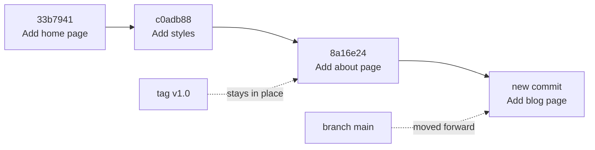
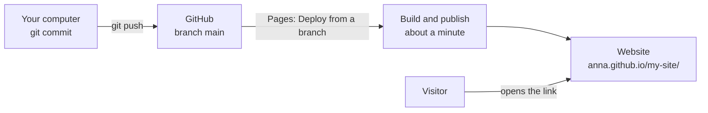
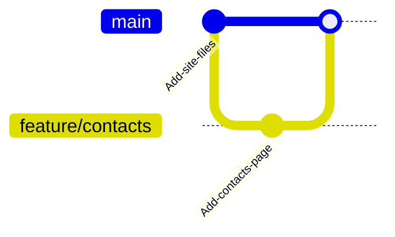

# Tags, releases and final project

[Contents](../../README.md) · [← Back](../../Lesson-9/en/Teamwork.md) · [RU](../ru/%D0%A2%D0%B5%D0%B3%D0%B8%2C%20%D1%80%D0%B5%D0%BB%D0%B8%D0%B7%D1%8B%20%D0%B8%20%D0%B8%D1%82%D0%BE%D0%B3%D0%BE%D0%B2%D1%8B%D0%B9%20%D0%BF%D1%80%D0%BE%D0%B5%D0%BA%D1%82.md) · [EN](Tags%2C%20releases%20and%20final%20project.md) · [UZ](../uz/Teglar%2C%20relizlar%20va%20yakuniy%20loyiha.md)

> **Link to lesson 9:** you learned to work in a team: GitHub Flow, pull requests and code review, a rejected `push`, `git pull` with a chosen way of combining changes (`pull.rebase`), `git stash`. Your project lives on GitHub, and it already has history, branches and merges. Today is the last lesson of the course: you will mark the finished version with a **tag**, prepare a **release**, speed up your work with **aliases**, publish your website with **GitHub Pages** and bring everything you have learned together in the **final project**.

---

## Why you need this

You sent a link to your website to a teacher or an employer. A week later you redid the menu, broke something, and they ask you: "Can you show us the version you sent?" Which commit was it? `8a16e24` or `c0adb88`? Nobody remembers hashes.

Real projects always do it like this: every release has a clear name - `v1.0`, `v1.1`, `v2.0`. These are **tags**. With a tag you can go back to a released version at any time, compare it with the current one and show the list of changes. And on GitHub a tag is the base for a **release** - a version page with a description that everyone can see.

And most importantly: by the end of the lesson you will have something to put in your CV - a live website at `https://your-login.github.io/my-site/` and a tidy repository with history, branches, `README.md` and version `v1.0`.

---

## What you will learn

- Explain why tags are needed and how a tag differs from a branch.
- Create lightweight and annotated tags: `git tag`, `git tag -a -m`, put a tag on an old commit.
- View a tag with `git show v1.0` and find tags in `git log --oneline`.
- Push tags to GitHub (`git push origin v1.0`, `git push --tags`) and delete them.
- Name versions by the rules of semantic versioning: `MAJOR.MINOR.PATCH`.
- Create a release on GitHub based on a tag.
- Shorten long commands with aliases: `git config --global alias.lg "..."`.
- Publish a website with GitHub Pages.
- Put together the full project cycle: from `git init` to the `v1.0` tag and a published website.

---

## Review: 3 questions from lesson 9

1. `git push` answered `! [rejected] main -> main (fetch first)`. What happened and what should you do?
2. How does `git stash pop` differ from `git stash apply`?
3. What steps does GitHub Flow consist of?

Answers are at the end of the lesson.

---

## Lesson plan

| Section | What we do |
| --- | --- |
| What a tag is | A bookmark on a project version |
| Lightweight and annotated tags | `git tag`, `git tag -a`, `git show` |
| Tags on GitHub | Pushing and deleting tags |
| Mini-task 1 | Tags in a practice project |
| Semantic versioning | How to choose a version number |
| Releases on GitHub | A version page on the website |
| Aliases | Your own short commands |
| GitHub Pages | A website by link in five minutes |
| Final project | The full cycle and the acceptance checklist |
| Mini-task 2 | Versions and aliases in a practice project |
| Independent work | A task in the learning terminal and the final project on your computer |

---

## What a tag is

**In simple words:** a tag is a **bookmark in a book** or a **label on a jar of jam**: "Harvest 2026". The book (the project history) keeps being written, but the bookmark stays on the page where you put it. A year later you open the book at the bookmark without flipping through it.

In Git a **tag** is a permanent name for one commit. It is usually used to mark releases: `v1.0`, `v1.1`, `v2.0`.

You already know a similar label - a branch. The difference is that a branch **moves**, and a tag **does not**.

| | Branch `main` | Tag `v1.0` |
| --- | --- | --- |
| What it is | A label on the last commit of a line of work | A label on one specific commit |
| On a new commit | Moves to the new commit | Stays in place forever |
| Why | To keep working | To remember a version |
| Analogy | A "where I am reading now" bookmark | A note in the margin "chapter 1 ended here" |



**How to read the diagram.** The tag `v1.0` was created when the last commit was `8a16e24`. Then a new commit appeared: the `main` branch moved to it, but the tag stayed on `8a16e24`. That is why a tag always lets you find exactly the version you released.

---

## Lightweight and annotated tags

Let's take the `portfolio` project from lesson 8: three commits (`Add home page`, `Add styles`, `Add about page`), the `main` branch is already pushed to GitHub. The `git tag` command without parameters shows the list of tags. There are none yet, so it prints nothing - this is not an error.

### `git tag -a`: an annotated tag

A version you release is marked with an **annotated** tag (annotated - "with a note"): it stores the author, the date and a message - like a commit.

```bash
git tag -a v1.0 -m "First public version"
git tag
```

```text
v1.0
```

| Part of the command | Meaning |
| --- | --- |
| `git tag` | Working with tags |
| `-a` | An annotated tag (with author, date and message) |
| `v1.0` | The tag name. The letter `v` (version) before the number is a common habit |
| `-m "First public version"` | The tag message, like a commit message |

The tag is put on `HEAD` - the commit you are on now.

**In real Git** the command `git tag -a v1.0` without `-m` opens a text editor for the message - like `git commit` without `-m`. The learning terminal has no editor, so always write `-m`.

### `git show v1.0`: what a tag stores

The `--stat` option (lesson 3) shortens the output: instead of all changed lines, only the list of files.

```bash
git show v1.0 --stat
```

```text
tag v1.0
Tagger: Anna Karimova <anna@example.com>
Date:   Tue Sep 1 10:03:01 2026 +0500

First public version

commit 8a16e24b93cf37968707ddc0cab0887a0dc24eed (HEAD -> main, tag: v1.0, origin/main)
Author: Anna Karimova <anna@example.com>
Date:   Tue Sep 1 10:03:00 2026 +0500

    Add about page

 about.html | 1 +
 1 file changed, 1 insertion(+)
```

| Line | Meaning |
| --- | --- |
| `tag v1.0` | This is a tag named `v1.0` |
| `Tagger: Anna Karimova <...>` | "Who created the tag". A commit has `Author`, a tag has `Tagger` |
| `Date: ...` (the first one) | When the tag was created |
| `First public version` | The tag message |
| `commit 8a16e24...` | Below is the commit the tag points to, as in `git show` from lesson 3 |
| `about.html \| 1 +` | The files of the commit (because of `--stat`; without it - the full `diff`) |

### A lightweight tag and a tag on an old commit

If you do not write `-a` and `-m`, you get a **lightweight** tag - just a name for a commit, without an author or a message. You can also put a tag on an old commit: give it after the tag name - a hash or `HEAD~2` (lesson 3).

```bash
git tag v0.1 HEAD~2
git log --oneline
```

```text
8a16e24 (HEAD -> main, tag: v1.0, origin/main) Add about page
c0adb88 Add styles
33b7941 (tag: v0.1) Add home page
```

`tag:` labels have appeared in the brackets: the commit `8a16e24` now has three of them - `HEAD -> main` (you are here), `tag: v1.0` (the version) and `origin/main` (the branch on GitHub). And for a lightweight tag `git show v0.1` starts right away with the line `commit 33b7941...`: there is no `tag` / `Tagger` / message block.

| | Lightweight tag | Annotated tag |
| --- | --- | --- |
| Command | `git tag v0.1` | `git tag -a v1.0 -m "..."` |
| Stores | Only a reference to the commit | The reference, the author (`Tagger`), the date, the message |
| `git show` starts with | `commit ...` | `tag v1.0`, `Tagger: ...` |
| When to use | A temporary note "for yourself" | Version releases, releases on GitHub |

**In simple words:** a lightweight tag is a sticker that says "v0.1". An annotated tag is a label that also says who stuck it on, when and why.

---

## Tags on GitHub: pushing and deleting

### Tags are not pushed automatically

Let's check: the tag exists, so what will a normal `git push` say?

```bash
git push
```

```text
Everything up-to-date
```

"Everything is up to date" - but the `v1.0` tag is **not** on GitHub. A normal `git push` sends only branches.

> **Important:** tags do not go to the server together with commits. They are pushed with a separate command - otherwise there will be nothing to create a release on GitHub from.

Let's push one tag (`git push origin v1.0`), and then all tags that are not on the server yet (`git push --tags`):

```bash
git push origin v1.0
git push --tags
```

```text
To https://github.com/anna/portfolio.git
 * [new tag]         v1.0 -> v1.0
To https://github.com/anna/portfolio.git
 * [new tag]         v0.1 -> v0.1
```

| Line | Meaning |
| --- | --- |
| `To https://github.com/...` | Where we are pushing |
| `* [new tag]` | "A new tag": the server did not have it yet (for branches it was `[new branch]`) |
| `v1.0 -> v1.0` | The local tag `v1.0` became the tag `v1.0` on GitHub |

Only `v0.1` was sent: `v1.0` was already on the server. **In real Git** there will also be lines `Enumerating objects ...`, `Writing objects ...` before the `To ...` line - Git sends the annotated tag object.

### Deleting a tag

Made a mistake with a tag? You can delete it on your computer:

```bash
git tag -d v0.1
git tag
```

```text
Deleted tag 'v0.1' (was 33b7941)
v1.0
```

`git tag -d` deletes the tag **only on your computer**. If the tag is already on GitHub, it is deleted there with a separate command in real Git:

```bash
git push origin --delete v0.1
```

The output will contain the line ` - [deleted]         v0.1`. The learning terminal does not support deleting a tag on the server yet - run this command in part 2 on your own computer.

> **Important:** do not move or delete a tag that is already pushed and that others might have used: they will keep the old `v1.0`, and you will have a new one with the same name. This is the same rule as in lesson 4: published history is not rewritten. Found a bug in a released version? Fix it and release `v1.0.1`.

---

## Mini-task 1

In the learning terminal:

1. Create the `blog` folder, a repository in it and three commits: `index.html` (`<h1>My blog</h1>`) - `Add home page`, `style.css` (`body { font-family: sans-serif; }`) - `Add styles`, `post.html` (`<h1>Frist post</h1>`, with a typo - you will need it in the second mini-task) - `Add first post`.
2. Put a lightweight tag `v0.1` on the first commit.
3. Put an annotated tag `v1.0` with the message `First version of the blog` on the last commit.
4. Look at the list of tags and at `git log --oneline`: which commits have `tag:` labels?
5. Look at `git show v1.0` and find the `Tagger` line.
6. Delete the tag `v0.1` and try to create the tag `v1.0` once more. What will Git answer?

---

## Semantic versioning

How do you choose a number: `v1.1` or `v2.0`? Most projects follow the rules of **semantic versioning** (Semantic Versioning, SemVer, website [semver.org](https://semver.org/)). A version number consists of three numbers: `MAJOR.MINOR.PATCH`.

**In simple words:** it is like an address "building.entrance.flat". The building changed - everything is new. The flat changed - a small thing, the neighbors are the same.

| Part | Name | When to increase | Example for a website | Was → became |
| --- | --- | --- | --- | --- |
| `MAJOR` | Major | Incompatible changes: old things stop working | The website is completely redone, old page addresses do not work | `1.4.2` → `2.0.0` |
| `MINOR` | Minor | A new feature, old things still work | A blog page is added | `1.4.2` → `1.5.0` |
| `PATCH` | Patch | A bug is fixed, nothing new | A typo is fixed, a link is repaired | `1.4.2` → `1.4.3` |

- When a number is increased, all numbers to the **right** of it are reset to zero: `1.4.2` → `1.5.0`, not `1.5.2`.
- Versions `0.x.y` are "drafts": the project is not ready yet, anything can change. The first ready version is `1.0.0`.
- Short names like `v1.0` and `v1.1` are also common - they are `1.0.0` and `1.1.0` without the last zero. The final project of the course uses the tag `v1.0`.

---

## Releases on GitHub

A **release** is a version page on GitHub: a title, a description of the changes and an archive of the project files to download. A release is always created **based on a tag**. Git itself knows nothing about releases: it is a feature of the GitHub website (GitLab and Bitbucket have similar ones).

**In simple words:** a tag is a label on a jar, a release is a shop window where the jar stands with a price tag and a description.

How to create a release (GitHub interface, autumn 2026):

1. Open the repository on GitHub, click **Releases** to the right of the file list, then **Draft a new release**.
2. In the **Choose a tag** list, select the pushed tag `v1.0`. You can also type a new name and click **Create new tag** - then GitHub will create the tag itself on the selected branch (**Target**), but it is better to create tags in Git: this way you have them both locally and on the server.
3. In the **Release title** field, write a title, for example `v1.0 - the first version of the website`. In the **Describe this release** field, describe what is in the version. The **Generate release notes** button makes the list of changes automatically from pull requests.
4. Click **Publish release**. **Save draft** saves a draft that only you can see for now.

After publishing, the release page will have the archives **Source code (zip)** and **Source code (tar.gz)** - the project files exactly in the version the tag points to.

> **Important:** if the tag was created on the GitHub website, your computer does not have it yet. `git fetch` or `git pull` (lesson 8) will bring it, and the output will contain the line `* [new tag]`.

---

## Aliases: your own short commands

During the course you typed `git log --oneline --graph --all` many times. Git lets you give a long command a short name - an **alias**.

**In simple words:** it is like speed dial on a phone: instead of a 12-digit number you press one button.

```bash
git config --global alias.st status
git config --global alias.lg "log --oneline --graph --all"
```

The commands print nothing. You can check with `git config --global --list` - it will show the lines `alias.st=status` and `alias.lg=log --oneline --graph --all`.

| Part | Meaning |
| --- | --- |
| `--global` | For all your repositories (like `user.name` in lesson 1) |
| `alias.lg` | The new command will be called `git lg` |
| `"log --oneline --graph --all"` | What to use instead of `lg`. The value has spaces - **quotes are required** |

Now `git lg` works like the long command:

```bash
git lg
```

```text
* 8a16e24 (HEAD -> main, tag: v1.0, origin/main) Add about page
* c0adb88 Add styles
* 33b7941 Add home page
```

Other popular aliases: `sw` for `switch`, `last` for `"log -1 --stat"`. To delete an alias: `git config --global --unset alias.st`.

> **Important:** aliases live only on your computer. In instructions for others, at a job interview and in answers to colleagues, write the full commands - `git lg` will not work for another person.

---

## GitHub Pages: a website by link

**GitHub Pages** is free hosting for static websites (HTML, CSS, JavaScript, jQuery) right from a repository. You run `git push` - and a minute later the website is updated.

**In simple words:** a repository on GitHub is a warehouse where the website files are stored. GitHub Pages is the shop window through which visitors see the website in a browser.

How to turn it on (GitHub interface, autumn 2026):

1. Make sure that `index.html` is in the **root** of the `main` branch on GitHub - this is the start page.
2. Open the repository → the **Settings** tab → the **Pages** section in the menu on the left. In the **Build and deployment** block, in the **Source** field, select **Deploy from a branch**.
3. In the **Branch** field, select `main` (the default is `None`), leave the folder as `/ (root)` and click **Save**.
4. Wait a minute or two and refresh the **Pages** page: the website address and the **Visit site** button will appear at the top.

Website address: `https://<login>.github.io/<repository>/`. For the user `anna` and the repository `my-site` it is `https://anna.github.io/my-site/`.



**How to read the diagram.** Pages publishes what is **on GitHub** in the selected branch, not what is on your computer. Until you run `git push`, visitors see the old version. Every new `push` to `main` updates the website.

| Problem | Cause | Solution |
| --- | --- | --- |
| Error 404 at the website address | No `index.html` in the root, or too little time has passed | Check the files on GitHub, wait a couple of minutes |
| No styles and images | A path from the disk root: `/css/style.css` or `C:\...` | Relative paths: `css/style.css` (HTML course) |
| Styles work for you but not on the website | Letter case: `Style.css` and `style.css` are different files on the server | The same case in the file name and in `href` |

---

## Final project

It is time to bring the whole course together in one project. Below is the full cycle on the practice website `my-site`: the folder has the website files, plus `node_modules/` (this happens if you installed packages with npm) and `.env` with a secret key. There is no repository, and an empty `https://github.com/anna/my-site.git` has been created on GitHub.

The order matters: `.gitignore` - before the first commit, the tag - after everything is merged and pushed. Every step is a topic of one of the course lessons.

### Steps 1–3: repository, `.gitignore`, first commit

```bash
cd my-site
git init
echo "node_modules/" > .gitignore
echo ".env" >> .gitignore
git status -s
git add .
git commit -m "Add site files"
```

```text
Initialized empty Git repository in /home/student/my-site/.git/
?? .gitignore
?? css/
?? index.html
?? js/
[main (root-commit) 22281c8] Add site files
 4 files changed, 5 insertions(+)
 create mode 100644 .gitignore
 create mode 100644 css/style.css
 create mode 100644 index.html
 create mode 100644 js/main.js
```

The output of `git status -s` has no `node_modules/` and `.env` - Git no longer sees them (lesson 5). Without `.gitignore` there would also be the lines `?? .env` and `?? node_modules/`, and the commit would contain `create mode 100644 .env`.

| Step | Command | Working directory | Index | Repository |
| --- | --- | --- | --- | --- |
| 1 | `git init` | Website, `node_modules/`, `.env` | Empty | Empty, no commits |
| 2 | `echo ... > .gitignore` | + `.gitignore` | Empty | Empty |
| 3 | `git add .` | No changes | `.gitignore`, `index.html`, `css/style.css`, `js/main.js` (without `node_modules/` and `.env`) | Empty |
| 4 | `git commit -m "Add site files"` | No changes | Same as the commit | Commit `22281c8` with four files |

### Steps 4–5: branch, merge, alias

```bash
git switch -c feature/contacts
echo "<h1>Contacts</h1>" > contacts.html
git add contacts.html
git commit -m "Add contacts page"
git switch main
git merge --no-ff feature/contacts
git branch -d feature/contacts
git config --global alias.lg "log --oneline --graph --all"
git lg
```

You know the output of the first commands from lessons 6–7: `Switched to a new branch`, `Merge made by the 'ort' strategy.`, `Deleted branch feature/contacts`. `--no-ff` keeps a merge commit in the history - you can see that the contacts were made in a separate branch (a normal fast-forward `git merge` is also fine). The output of `git lg`:

```text
*   75d1cf9 (HEAD -> main) Merge branch 'feature/contacts'
|\
| * b16f788 Add contacts page
|/
* 22281c8 Add site files
```



**How to read the diagram.** The `feature/contacts` branch with one commit split off from the first commit and came back into `main` with a merge commit. The branch was deleted after the merge - its commit stayed in the history of `main`.

### Steps 6–7: GitHub and the `v1.0` tag

```bash
git remote add origin https://github.com/anna/my-site.git
git push -u origin main
git tag -a v1.0 -m "First release"
git push --tags
git lg
```

After `git push -u` Git will answer `* [new branch]      main -> main` and `branch 'main' set up to track 'origin/main'.` (lesson 8), and then:

```text
To https://github.com/anna/my-site.git
 * [new tag]         v1.0 -> v1.0
*   75d1cf9 (HEAD -> main, tag: v1.0, origin/main) Merge branch 'feature/contacts'
|\
| * b16f788 Add contacts page
|/
* 22281c8 Add site files
```

| Step | Command | What changed / where HEAD points |
| --- | --- | --- |
| 1 | `git push -u origin main` | `main` → `75d1cf9` appeared on GitHub. `HEAD -> main` → `75d1cf9`, `origin/main` is in the same place |
| 2 | `git tag -a v1.0 -m "First release"` | The local tag `v1.0` → `75d1cf9`. GitHub does not have the tag yet |
| 3 | `git push --tags` | The tag `v1.0` appeared on GitHub |
| 4 | `git lg` | `75d1cf9` has three labels: `HEAD -> main`, `tag: v1.0`, `origin/main` - everything is pushed |

What is left on the GitHub website: create a release from the `v1.0` tag and turn on GitHub Pages.

### README and your GitHub profile as a portfolio

A good `README.md` (lesson 5) is the first thing a person sees when opening the repository. The minimum for the final project: the heading `# My site`, one or two lines about what the website is and what it is made with (HTML, CSS, JavaScript, jQuery), and the link `Live demo: https://anna.github.io/my-site/`. You can create it with `cat > README.md << 'EOF'` (lesson 2).

**Your GitHub profile is your portfolio.** If you create a repository whose name **matches your login** (for the user `anna` it is `anna/anna`) and put a `README.md` in it, GitHub will show this file on the main page of your profile. Write 3–5 lines: who you are, what you are learning, links to your best projects. And pin the final project to your profile: **Customize your pins** on the profile page.

### Final project acceptance checklist

| No. | Requirement | How to check |
| --- | --- | --- |
| 1 | The website from the HTML/CSS/JS courses (and jQuery, if you took it) - at least 3 pages | `*.html` files in the root, `css/` and `js/` folders |
| 2 | A public repository on GitHub, `main` is pushed with upstream | `git status` → `up to date with 'origin/main'` |
| 3 | At least 8 commits in the history, messages in English in the imperative mood | `git log --oneline` |
| 4 | At least 2 `feature/...` branches are merged into `main` and deleted after the merge | `git lg` shows the forks, `git branch` shows only `main` |
| 5 | `.gitignore` is created before the first commit, no secrets and no `node_modules/` in the history | `git log --stat` does not contain `.env` or `node_modules/` |
| 6 | `README.md`: description, technologies, link to the website | Open the repository on GitHub |
| 7 | An annotated tag `v1.0` on the last commit is pushed to GitHub | `git show v1.0` starts with `tag v1.0`; the Tags tab on GitHub |
| 8 | Release `v1.0` with a description | The Releases page |
| 9 | The website opens through GitHub Pages, styles and scripts work | `https://login.github.io/repository/` |
| 10 | The working directory is clean | `git status` → `nothing to commit, working tree clean` |

### Try to break it

1. Create the tag `v1.0` a second time. What will Git answer?
2. Create a tag and run a normal `git push`. What will Git print? Is the tag on the server?
3. Push a tag that does not exist: `git push origin v9.9`.
4. Look at a tag that does not exist: `git show v9.9`.
5. Make a commit in a website without `.gitignore` and look at `create mode` in the output: which extra files got into the commit?
6. Delete the alias (`git config --global --unset alias.lg`) and call `git lg`.

### Typical beginner mistakes

| Mistake | What you get | How to fix |
| --- | --- | --- |
| The tag is created but not pushed | `git push` answers `Everything up-to-date`, but there is no tag on GitHub | `git push origin v1.0` or `git push --tags` |
| The same tag once more | `fatal: tag 'v1.0' already exists` | A different name (`v1.0.1`) or, if the tag is not pushed, `git tag -d v1.0` and create it again |
| A lightweight tag for a release | `git show v1.0` without `Tagger` and a message | `git tag -d v1.0`, then `git tag -a v1.0 -m "..."` |
| The tag is created before the merge | The tag points to an old commit, the version lacks the latest changes | While the tag is not pushed: delete it and put it on the right commit |
| An alias without quotes: `alias.lg log --oneline --graph --all` | Git shows the help `usage: git config [<options>]` | A value with spaces goes in quotes |
| `.gitignore` is created after `git add .` | `create mode 100644 .env` in the first commit - the secret is in the history | Lesson 5: `git rm --cached`, change the secret key |
| The website on Pages has no styles | The path `/css/style.css` leads to the root of `github.io`, not to the project folder | The relative path `css/style.css` |

---

## Mini-task 2

Continue in the `blog` repository from mini-task 1:

1. Set up the global aliases `st` (for `status`) and `lg` (for `log --oneline --graph --all`). Check `git st`.
2. Fix the typo in the `fix/typo` branch: overwrite `post.html` with the text `<h1>First post</h1>`, commit with `-am`. Merge the branch into `main` and delete it.
3. What version number does SemVer require after fixing a typo? Create an annotated tag with the message `Fix typo`.
4. In the `feature/about` branch, add the page `about.html` (`<h1>About the author</h1>`) and commit it. Merge into `main` with `--no-ff`, delete the branch.
5. What is the version number now? Create an annotated tag with the message `Add about page`.
6. Look at the list of tags and at `git lg`: which commits are the tags on?

---

## Lesson summary: cheat sheet

| Task | Command |
| --- | --- |
| List of tags | `git tag` |
| An annotated tag on `HEAD` | `git tag -a v1.0 -m "First release"` |
| A lightweight tag on an old commit | `git tag v0.1 HEAD~2` or `git tag v0.1 33b7941` |
| View a tag and its commit | `git show v1.0` |
| Push one tag / all tags | `git push origin v1.0` / `git push --tags` |
| Delete a tag locally / on the server | `git tag -d v0.1` / `git push origin --delete v0.1` |
| Create an alias | `git config --global alias.lg "log --oneline --graph --all"` |
| Delete an alias | `git config --global --unset alias.lg` |
| Release | GitHub: Releases → Draft a new release → tag → Publish release |
| Website on GitHub Pages | Settings → Pages → Deploy from a branch → `main`, `/ (root)` → Save |

### Course summary cheat sheet

| Task | Command |
| --- | --- |
| Set up Git (lesson 1) | `git config --global user.name "Name"`, `user.email`, `init.defaultBranch main` |
| Repository and status (1–2) | `git init`, `git status`, `git status -s` |
| Commit (2) | `git add .`, `git commit -m "Add page"`, `git commit -am "Update page"` |
| History and changes (3) | `git log --oneline`, `git show HEAD~1`, `git show HEAD~2:file`, `git diff`, `git diff --staged` |
| Undo an edit / remove from the index (4) | `git restore file`, `git restore --staged file` |
| Fix or undo a commit (4) | `git commit --amend`, `git revert hash`, `git reset --soft/--mixed/--hard HEAD~1`, `git reflog` |
| Keeping the project tidy (5) | `.gitignore`, `git rm --cached file`, `git rm`, `git mv` |
| Branches (6) | `git branch`, `git switch -c name`, `git switch name`, `git branch -m`, `git branch -d` |
| Merge and conflict (7) | `git merge name`, `--no-ff`; after fixing: `git add`, `git commit --no-edit`; to cancel: `git merge --abort` |
| GitHub (8) | `git remote add origin URL`, `git push -u origin main`, `git clone URL`, `git fetch`, `git pull` |
| Team (9) | `git pull --rebase` / `--no-rebase`, `git stash`, `git stash pop` |
| Versions (10) | `git tag -a v1.0 -m "..."`, `git push --tags`, `git lg` |

---

## Independent work

### Part 1. IDE task (graded by the platform)

Git is already set up, you are in your home folder. The `~/my-site` folder contains your website (`index.html`, `css/style.css`, `js/main.js`), as well as the `node_modules/` folder and the `.env` file with a secret key - but there is no repository. An empty repository `https://github.com/anna/my-site.git` has been created on "GitHub". Write the commands one per line:

1. Go to `my-site` and create a repository.
2. Create `.gitignore` with the lines `node_modules/` and `.env` and check `git status -s`.
3. Make the first commit with all the website files: `Add site files`.
4. Create the `feature/contacts` branch, and in it - the file `contacts.html` with the text `<h1>Contacts</h1>` and the commit `Add contacts page`.
5. Go back to `main`, merge the branch (with `--no-ff` or fast-forward) and delete it.
6. Set up the global alias `lg` for `log --oneline --graph --all` and look at the history with `git lg`.
7. Connect the remote repository as `origin` and push `main` with upstream.
8. Create an annotated tag `v1.0` with a message, push it to the server and check `git status`.

As a result, the server has the `main` branch with your history and the tag `v1.0` on the last commit, while `node_modules` and `.env` are not in any commit.

What the platform checks: that the repository is created exactly in `~/my-site` and has a committed `.gitignore` that hides `node_modules/` and `.env`; that no commit (yours or on the server) contains `node_modules` or `.env`; that the first commit contains the website files; that the work on the contacts was done in the `feature/contacts` branch, `contacts.html` is in `main` and on the server, and the branch is deleted; that the global alias `lg` is set up and used; that `main` on the server matches yours and the upstream is `origin/main`; that the tag `v1.0` is annotated, is on the server and points to the last commit; that you are on `main` and the working directory is clean; that the solution also works with a different set of website files; that the script runs without errors.

### Part 2. Project on your computer

This is the **final project of the course** - in real Git, in the repository of your website from lesson 1.

1. Bring the website up to the acceptance checklist (the "Final project" section): at least 3 pages, `.gitignore`, `README.md` with a link to the future Pages address. Make every new page in its own `feature/...` branch, merge it into `main` and delete the branch.
2. Push `main` to GitHub, set up the `lg` alias and check `git lg`: the history must be clear without explanations.
3. Create an annotated tag `v1.0`, push it (`git push origin v1.0`) and create a release `v1.0` with a description on GitHub (Releases → Draft a new release).
4. Turn on GitHub Pages (Settings → Pages → Deploy from a branch → `main`, `/ (root)`) and check the website at `https://login.github.io/repository/` - all styles and scripts must work.
5. Create a profile README (a repository named like your login) and pin the final project to your profile. Try deleting a test tag on the server: `git tag test`, `git push origin test`, `git push origin --delete test`, `git tag -d test`.

### Acceptance criteria

- [ ] The IDE task is accepted.
- [ ] All 10 items of the final project acceptance checklist are done.
- [ ] `git show v1.0` starts with the line `tag v1.0`, and GitHub has the release `v1.0`.
- [ ] The website opens at the GitHub Pages address with styles and scripts.
- [ ] You can explain the difference between a tag and a branch and choose the next version number by SemVer.

---

## Self-check questions

1. What is a tag and how does it differ from a branch?
2. How does a lightweight tag differ from an annotated one? Which one should you use for a release?
3. How do you put a tag on the commit that was two commits ago?
4. How can you tell from the output of `git show v1.0` that the tag is annotated?
5. Why is the tag not on GitHub after `git push`? Which commands push it?
6. How do you delete a tag locally and on the server? Why is it dangerous to move a tag that is already pushed?
7. The version is `2.3.1`. What will the next version be after a bug fix, after a new page, after a complete redesign?
8. What is a release on GitHub and how is it related to a tag?
9. How do you create the `git lg` alias and why are quotes needed?
10. What do you need to do for the website to open through GitHub Pages, and at what address will it be available?

After the questions, take the **lesson test** on the platform: 12 questions, pass mark 70%.

---

## What's next

Congratulations: you have finished the Git course! You can keep the history of a project, undo mistakes, work in branches, resolve conflicts, publish projects on GitHub, work in a team and release versions. This is enough to take part in study projects and your first real team projects. The main advice: use Git every day, even in small projects. What to learn next:

| Topic | What it is | Where to start |
| --- | --- | --- |
| GitHub Actions | Automatic actions on every `push`: code checks, tests, publishing the website | The **Actions** tab in the repository, ready-made templates (workflow) |
| `git bisect` | Finding the commit that broke the project by "splitting in half": Git itself suggests commits to check | `git bisect start`, `git bisect bad`, `git bisect good v1.0` - in real Git |
| `git blame` | Who changed each line of a file and in which commit | `git blame index.html` or the **Blame** button on GitHub |
| Open source | Taking part in other people's projects: fork → branch → pull request | Issues labeled `good first issue` on GitHub |
| Git 3.0 | Spring 2027: SHA-256 by default (a 64-character hash), `main` by default | Follow the news at [git-scm.com](https://git-scm.com) |

---

## Answers

**Review**

1. The server has commits that you do not have (someone has already pushed theirs). You need to get them - `git pull` (with the chosen way: `--no-rebase` or `--rebase`), and then `git push` again.
2. `git stash pop` brings back the stashed edits and removes the entry from the list, `git stash apply` brings them back and keeps the entry.
3. A branch from `main` → commits → `git push` of the branch → pull request → review → merge into `main` → deleting the branch.

**Mini-task 1**

```bash
mkdir blog && cd blog && git init
echo "<h1>My blog</h1>" > index.html
git add . && git commit -m "Add home page"
echo "body { font-family: sans-serif; }" > style.css
git add . && git commit -m "Add styles"
echo "<h1>Frist post</h1>" > post.html
git add . && git commit -m "Add first post"
git tag v0.1 HEAD~2
git tag -a v1.0 -m "First version of the blog"
git tag && git log --oneline
git show v1.0
git tag -d v0.1
git tag -a v1.0 -m "Again"
```

`tag: v0.1` is on the commit `Add home page`, `tag: v1.0` is on `Add first post`. Creating it again: `fatal: tag 'v1.0' already exists`.

**Mini-task 2**

```bash
git config --global alias.st status
git config --global alias.lg "log --oneline --graph --all"
git st
git switch -c fix/typo
echo "<h1>First post</h1>" > post.html
git commit -am "Fix typo in first post"
git switch main && git merge fix/typo && git branch -d fix/typo
git tag -a v1.0.1 -m "Fix typo"
git switch -c feature/about
echo "<h1>About the author</h1>" > about.html
git add about.html && git commit -m "Add about page"
git switch main && git merge --no-ff feature/about && git branch -d feature/about
git tag -a v1.1.0 -m "Add about page"
git tag
git lg
```

After the typo - `v1.0.1` (PATCH), after the new page - `v1.1.0` (MINOR). In `git lg`: `tag: v1.1.0` is on the merge commit, `tag: v1.0.1` is on `Fix typo in first post`, `tag: v1.0` is on `Add first post`.

**Self-check questions**

1. A permanent name for one commit. A branch moves to every new commit, a tag stays in place.
2. A lightweight tag is only a reference to a commit. An annotated tag stores the author (`Tagger`), the date and a message. For a release - an annotated one: `git tag -a v1.0 -m "..."`.
3. `git tag v0.1 HEAD~2` (or give the commit hash).
4. The output starts with the lines `tag v1.0`, `Tagger: ...` and the message, and only then comes `commit ...`.
5. A normal `git push` sends only branches. A tag is pushed with `git push origin v1.0`, or all at once with `git push --tags`.
6. Locally - `git tag -d v1.0`, on the server - `git push origin --delete v1.0`. Others may have already downloaded the old tag: for different people the same name will point to different commits.
7. `2.3.2`, `2.4.0`, `3.0.0`.
8. A version page on GitHub with a title, a description and an archive of the files. A release is always created based on a tag.
9. `git config --global alias.lg "log --oneline --graph --all"`. Without quotes the terminal splits the value into separate words, and Git does not understand the command.
10. Push the website to GitHub (`index.html` in the root of `main`), in Settings → Pages select Deploy from a branch, the branch `main` and `/ (root)`, click Save. The address is `https://login.github.io/repository/`.

---

[Contents](../../README.md) · [← Back](../../Lesson-9/en/Teamwork.md) · [RU](../ru/%D0%A2%D0%B5%D0%B3%D0%B8%2C%20%D1%80%D0%B5%D0%BB%D0%B8%D0%B7%D1%8B%20%D0%B8%20%D0%B8%D1%82%D0%BE%D0%B3%D0%BE%D0%B2%D1%8B%D0%B9%20%D0%BF%D1%80%D0%BE%D0%B5%D0%BA%D1%82.md) · [EN](Tags%2C%20releases%20and%20final%20project.md) · [UZ](../uz/Teglar%2C%20relizlar%20va%20yakuniy%20loyiha.md)
