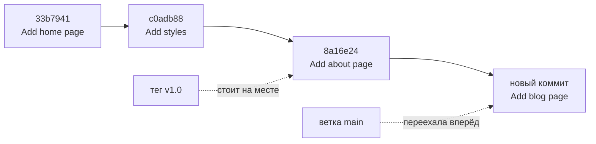
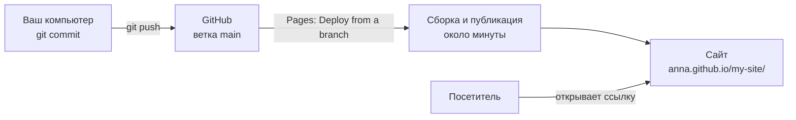
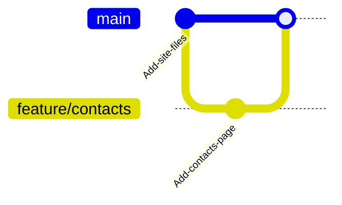

# Теги, релизы и итоговый проект

[Содержание](../../README.md) · [← Назад](../../Lesson-9/ru/%D0%9A%D0%BE%D0%BC%D0%B0%D0%BD%D0%B4%D0%BD%D0%B0%D1%8F%20%D1%80%D0%B0%D0%B1%D0%BE%D1%82%D0%B0.md) · [RU](%D0%A2%D0%B5%D0%B3%D0%B8%2C%20%D1%80%D0%B5%D0%BB%D0%B8%D0%B7%D1%8B%20%D0%B8%20%D0%B8%D1%82%D0%BE%D0%B3%D0%BE%D0%B2%D1%8B%D0%B9%20%D0%BF%D1%80%D0%BE%D0%B5%D0%BA%D1%82.md) · [EN](../en/Tags%2C%20releases%20and%20final%20project.md) · [UZ](../uz/Teglar%2C%20relizlar%20va%20yakuniy%20loyiha.md)

> **Связь с уроком 9:** вы научились работать в команде: GitHub Flow, pull request и ревью, отклонённый `push`, `git pull` с выбором способа объединения (`pull.rebase`), `git stash`. Ваш проект живёт на GitHub, и в нём уже есть история, ветки и слияния. Сегодня последний урок курса: вы отметите готовую версию **тегом**, оформите **релиз**, ускорите работу **алиасами**, опубликуете сайт через **GitHub Pages** и соберёте всё, чему научились, в **итоговом проекте**.

---

## Зачем это вам

Вы отправили ссылку на свой сайт преподавателю или работодателю. Через неделю вы переделали меню, что-то сломали, а вас спрашивают: «А покажите ту версию, которую присылали». Какой это был коммит? `8a16e24` или `c0adb88`? Хеш никто не запоминает.

В настоящих проектах так делают всегда: у каждого выпуска есть понятное имя - `v1.0`, `v1.1`, `v2.0`. Это **теги**. По тегу можно в любой момент вернуться к выпущенной версии, сравнить её с текущей и показать список изменений. А на GitHub по тегу создаётся **релиз** - страница версии с описанием, которую видят все.

И главное: к концу урока у вас будет то, что можно вставить в резюме, - живой сайт по адресу `https://ваш-логин.github.io/my-site/` и аккуратный репозиторий с историей, ветками, `README.md` и версией `v1.0`.

---

## Чему вы научитесь

- Объяснять, зачем нужны теги и чем тег отличается от ветки.
- Создавать лёгкие и аннотированные теги: `git tag`, `git tag -a -m`, ставить тег на старый коммит.
- Смотреть тег командой `git show v1.0` и находить теги в `git log --oneline`.
- Отправлять теги на GitHub (`git push origin v1.0`, `git push --tags`) и удалять их.
- Называть версии по правилам семантического версионирования `MAJOR.MINOR.PATCH`.
- Создавать релиз на GitHub на основе тега.
- Сокращать длинные команды алиасами: `git config --global alias.lg "..."`.
- Публиковать сайт через GitHub Pages.
- Собирать полный цикл проекта: от `git init` до тега `v1.0` и опубликованного сайта.

---

## Повторение: 3 вопроса из урока 9

1. `git push` ответил `! [rejected] main -> main (fetch first)`. Что произошло и что делать?
2. Чем `git stash pop` отличается от `git stash apply`?
3. Из каких шагов состоит GitHub Flow?

Ответы - в конце урока.

---

## План урока

| Раздел | Что делаем |
| --- | --- |
| Что такое тег | Закладка на версии проекта |
| Лёгкие и аннотированные теги | `git tag`, `git tag -a`, `git show` |
| Теги на GitHub | Отправка и удаление тегов |
| Мини-задание 1 | Теги в учебном проекте |
| Семантическое версионирование | Как выбрать номер версии |
| Релизы на GitHub | Страница версии на сайте |
| Алиасы | Свои короткие команды |
| GitHub Pages | Сайт по ссылке за пять минут |
| Итоговый проект | Полный цикл и чек-лист приёмки |
| Мини-задание 2 | Версии и алиасы в учебном проекте |
| Самостоятельная работа | Задание в учебном терминале и итоговый проект на компьютере |

---

## Что такое тег

**Простыми словами:** тег - это **закладка в книге** или **этикетка на банке с вареньем**: «Урожай 2026». Книга (история проекта) продолжает писаться, а закладка остаётся на той странице, куда вы её положили. Через год вы откроете книгу по закладке, не листая.

В Git **тег** (англ. tag - «ярлык, этикетка») - постоянное имя для одного коммита. Обычно им отмечают выпуски: `v1.0`, `v1.1`, `v2.0`.

Вы уже знаете похожий ярлык - ветку. Разница в том, что ветка **двигается**, а тег - **нет**.

| | Ветка `main` | Тег `v1.0` |
| --- | --- | --- |
| Что это | Ярлык на последнем коммите линии работы | Ярлык на одном конкретном коммите |
| При новом коммите | Переезжает на новый коммит | Остаётся на месте навсегда |
| Зачем | Продолжать работу | Запомнить версию |
| Аналогия | Закладка «где я читаю сейчас» | Пометка на полях «здесь глава 1 закончилась» |



**Как читать схему.** Тег `v1.0` поставили, когда последним был коммит `8a16e24`. Потом появился новый коммит: ветка `main` передвинулась на него, а тег остался на `8a16e24`. Поэтому по тегу всегда можно найти именно ту версию, которую вы выпустили.

---

## Лёгкие и аннотированные теги

Возьмём проект `portfolio` из урока 8: три коммита (`Add home page`, `Add styles`, `Add about page`), ветка `main` уже отправлена на GitHub. Команда `git tag` без параметров показывает список тегов. Пока их нет, она ничего не выводит - это не ошибка.

### `git tag -a`: аннотированный тег

Версию, которую вы выпускаете, отмечают **аннотированным** тегом (англ. annotated - «с примечанием»): он хранит автора, дату и сообщение - как коммит.

```bash
git tag -a v1.0 -m "First public version"
git tag
```

```text
v1.0
```

| Часть команды | Смысл |
| --- | --- |
| `git tag` | Работа с тегами |
| `-a` | Аннотированный тег (с автором, датой и сообщением) |
| `v1.0` | Имя тега. Буква `v` (version) перед номером - общий обычай |
| `-m "First public version"` | Сообщение тега, как у коммита |

Тег ставится на `HEAD` - коммит, на котором вы сейчас стоите.

**В настоящем Git** команда `git tag -a v1.0` без `-m` откроет текстовый редактор для сообщения - как `git commit` без `-m`. В учебном терминале редактора нет, поэтому всегда пишите `-m`.

### `git show v1.0`: что хранит тег

Ключ `--stat` (урок 3) сокращает вывод: вместо всех изменённых строк - только список файлов.

```bash
git show v1.0 --stat
```

```text
tag v1.0
Tagger: Anna Karimova <anna@example.com>
Date:   Tue Sep 1 10:03:01 2026 +0500

First public version

commit 8a16e24b93cf37968707ddc0cab0887a0dc24eed (HEAD -> main, tag: v1.0, origin/main)
Author: Anna Karimova <anna@example.com>
Date:   Tue Sep 1 10:03:00 2026 +0500

    Add about page

 about.html | 1 +
 1 file changed, 1 insertion(+)
```

| Строка | Перевод и смысл |
| --- | --- |
| `tag v1.0` | Это тег с именем `v1.0` |
| `Tagger: Anna Karimova <...>` | «Кто поставил тег». У коммита это `Author`, у тега - `Tagger` |
| `Date: ...` (первая) | Когда поставлен тег |
| `First public version` | Сообщение тега |
| `commit 8a16e24...` | Ниже - коммит, на который указывает тег, как в `git show` из урока 3 |
| `about.html \| 1 +` | Файлы коммита (из-за `--stat`; без него - полный `diff`) |

### Лёгкий тег и тег на старом коммите

Если не писать `-a` и `-m`, получится **лёгкий** тег (англ. lightweight) - просто имя для коммита, без автора и сообщения. Тег можно поставить и на старый коммит: укажите его после имени тега - хеш или `HEAD~2` (урок 3).

```bash
git tag v0.1 HEAD~2
git log --oneline
```

```text
8a16e24 (HEAD -> main, tag: v1.0, origin/main) Add about page
c0adb88 Add styles
33b7941 (tag: v0.1) Add home page
```

В скобках появились ярлыки `tag:`: у коммита `8a16e24` их теперь три - `HEAD -> main` (вы здесь), `tag: v1.0` (версия) и `origin/main` (ветка на GitHub). А `git show v0.1` у лёгкого тега сразу начнётся со строки `commit 33b7941...`: блока `tag` / `Tagger` / сообщения нет.

| | Лёгкий тег | Аннотированный тег |
| --- | --- | --- |
| Команда | `git tag v0.1` | `git tag -a v1.0 -m "..."` |
| Хранит | Только ссылку на коммит | Ссылку, автора (`Tagger`), дату, сообщение |
| `git show` начинается с | `commit ...` | `tag v1.0`, `Tagger: ...` |
| Когда использовать | Временная пометка «для себя» | Выпуски версий, релизы на GitHub |

**Простыми словами:** лёгкий тег - стикер с надписью «v0.1». Аннотированный - этикетка, на которой написано ещё, кто её наклеил, когда и зачем.

---

## Теги на GitHub: отправка и удаление

### Теги не отправляются сами

Проверим: тег есть, а что скажет обычный `git push`?

```bash
git push
```

```text
Everything up-to-date
```

«Всё актуально» - но тега `v1.0` на GitHub **нет**. Обычный `git push` отправляет только ветки.

> **Важно:** теги не уходят на сервер вместе с коммитами. Их отправляют отдельной командой - иначе релиз на GitHub создать будет не из чего.

Отправим один тег (`git push origin v1.0`), а затем все теги, которых ещё нет на сервере (`git push --tags`):

```bash
git push origin v1.0
git push --tags
```

```text
To https://github.com/anna/portfolio.git
 * [new tag]         v1.0 -> v1.0
To https://github.com/anna/portfolio.git
 * [new tag]         v0.1 -> v0.1
```

| Строка | Перевод и смысл |
| --- | --- |
| `To https://github.com/...` | Куда отправляем |
| `* [new tag]` | «Новый тег»: на сервере его ещё не было (для веток было `[new branch]`) |
| `v1.0 -> v1.0` | Локальный тег `v1.0` стал тегом `v1.0` на GitHub |

Ушёл только `v0.1`: `v1.0` на сервере уже был. **В настоящем Git** перед строкой `To ...` появятся ещё строки `Enumerating objects ...`, `Writing objects ...` - Git отправляет объект аннотированного тега.

### Удаление тега

Ошиблись с тегом - его можно удалить на своём компьютере:

```bash
git tag -d v0.1
git tag
```

```text
Deleted tag 'v0.1' (was 33b7941)
v1.0
```

`git tag -d` удаляет тег **только у вас**. Если тег уже на GitHub, его удаляют там отдельной командой в настоящем Git:

```bash
git push origin --delete v0.1
```

В ответе будет строка ` - [deleted]         v0.1`. В учебном терминале удаление тега на сервере пока не поддерживается - выполните эту команду в части 2 на своём компьютере.

> **Важно:** не переставляйте и не удаляйте тег, который уже отправлен и которым могли воспользоваться другие: у них останется старый `v1.0`, а у вас - новый с тем же именем. Это то же правило, что в уроке 4: опубликованную историю не переписывают. Нашли ошибку в выпущенной версии - исправьте её и выпустите `v1.0.1`.

---

## Мини-задание 1

В учебном терминале:

1. Создайте папку `blog`, репозиторий в ней и три коммита: `index.html` (`<h1>My blog</h1>`) - `Add home page`, `style.css` (`body { font-family: sans-serif; }`) - `Add styles`, `post.html` (`<h1>Frist post</h1>`, с опечаткой - пригодится во втором мини-задании) - `Add first post`.
2. Поставьте лёгкий тег `v0.1` на первый коммит.
3. Поставьте аннотированный тег `v1.0` с сообщением `First version of the blog` на последний коммит.
4. Посмотрите список тегов и `git log --oneline`: на каких коммитах ярлыки `tag:`?
5. Посмотрите `git show v1.0` и найдите строку `Tagger`.
6. Удалите тег `v0.1` и попробуйте ещё раз создать тег `v1.0`. Что ответит Git?

---

## Семантическое версионирование

Как выбрать номер: `v1.1` или `v2.0`? Большинство проектов следует правилам **семантического версионирования** (англ. Semantic Versioning, SemVer, сайт [semver.org](https://semver.org/lang/ru/)). Номер версии состоит из трёх чисел: `MAJOR.MINOR.PATCH`.

**Простыми словами:** как адрес «дом.подъезд.квартира». Сменился дом - всё по-новому. Сменилась квартира - мелочь, а соседи те же.

| Часть | Название | Когда увеличивать | Пример для сайта | Было → стало |
| --- | --- | --- | --- | --- |
| `MAJOR` | Главная | Несовместимые изменения: старое перестаёт работать | Сайт полностью переделан, старые адреса страниц не работают | `1.4.2` → `2.0.0` |
| `MINOR` | Второстепенная | Новая возможность, старое работает | Добавлена страница блога | `1.4.2` → `1.5.0` |
| `PATCH` | Исправление | Исправлена ошибка, ничего нового | Исправлена опечатка, починена ссылка | `1.4.2` → `1.4.3` |

- При увеличении числа все числа **правее** обнуляются: `1.4.2` → `1.5.0`, а не `1.5.2`.
- Версии `0.x.y` - «черновики»: проект ещё не готов, всё может поменяться. Первая готовая версия - `1.0.0`.
- Короткие имена `v1.0` и `v1.1` тоже встречаются часто - это `1.0.0` и `1.1.0` без последнего нуля. В итоговом проекте курса используется тег `v1.0`.

---

## Релизы на GitHub

**Релиз** (англ. release - «выпуск») - страница версии на GitHub: название, описание изменений и архив с файлами проекта для скачивания. Релиз всегда создаётся **на основе тега**. Сам Git про релизы ничего не знает: это функция сайта GitHub (у GitLab и Bitbucket есть похожие).

**Простыми словами:** тег - этикетка на банке, релиз - витрина в магазине, где банка стоит с ценником и описанием.

Как создать релиз (интерфейс GitHub, осень 2026):

1. Откройте репозиторий на GitHub, справа от списка файлов нажмите **Releases**, затем **Draft a new release** («Подготовить новый релиз»).
2. В списке **Choose a tag** выберите отправленный тег `v1.0`. Можно ввести новое имя и нажать **Create new tag** - тогда GitHub создаст тег сам на выбранной ветке (**Target**), но лучше создавать теги в Git: так они есть и у вас, и на сервере.
3. В поле **Release title** напишите название, например `v1.0 - первая версия сайта`. В поле **Describe this release** опишите, что вошло в версию. Кнопка **Generate release notes** составит список изменений автоматически по pull request'ам.
4. Нажмите **Publish release** («Опубликовать»). **Save draft** сохраняет черновик, который пока видите только вы.

После публикации на странице релиза появятся архивы **Source code (zip)** и **Source code (tar.gz)** - файлы проекта ровно в той версии, на которую указывает тег.

> **Важно:** если тег создали на сайте GitHub, у вас на компьютере его пока нет. Его заберёт `git fetch` или `git pull` (урок 8), и в выводе появится строка `* [new tag]`.

---

## Алиасы: свои короткие команды

За курс вы много раз набирали `git log --oneline --graph --all`. Git позволяет дать длинной команде короткое имя - **алиас** (англ. alias - «псевдоним»).

**Простыми словами:** как быстрый набор в телефоне: вместо номера из 12 цифр нажимаете одну кнопку.

```bash
git config --global alias.st status
git config --global alias.lg "log --oneline --graph --all"
```

Команды ничего не выводят. Проверить можно через `git config --global --list` - там появятся строки `alias.st=status` и `alias.lg=log --oneline --graph --all`.

| Часть | Смысл |
| --- | --- |
| `--global` | Для всех ваших репозиториев (как `user.name` в уроке 1) |
| `alias.lg` | Новая команда будет называться `git lg` |
| `"log --oneline --graph --all"` | Что подставить вместо `lg`. В значении есть пробелы - **кавычки обязательны** |

Теперь `git lg` работает как длинная команда:

```bash
git lg
```

```text
* 8a16e24 (HEAD -> main, tag: v1.0, origin/main) Add about page
* c0adb88 Add styles
* 33b7941 Add home page
```

Другие популярные алиасы: `sw` для `switch`, `last` для `"log -1 --stat"`. Удалить алиас: `git config --global --unset alias.st`.

> **Важно:** алиасы живут только на вашем компьютере. В чужих инструкциях, на собеседовании и в ответах коллегам пишите полные команды - `git lg` у другого человека не сработает.

---

## GitHub Pages: сайт по ссылке

**GitHub Pages** - бесплатный хостинг статических сайтов (HTML, CSS, JavaScript, jQuery) прямо из репозитория. Вы делаете `git push` - и через минуту сайт обновлён.

**Простыми словами:** репозиторий на GitHub - это склад, где лежат файлы сайта. GitHub Pages - витрина, через которую сайт видят посетители в браузере.

Как включить (интерфейс GitHub, осень 2026):

1. Убедитесь, что в **корне** ветки `main` на GitHub лежит `index.html` - это стартовая страница.
2. Откройте репозиторий → вкладка **Settings** → в меню слева раздел **Pages**. В блоке **Build and deployment** в поле **Source** выберите **Deploy from a branch**.
3. В поле **Branch** выберите `main` (по умолчанию там `None`), папку оставьте `/ (root)` и нажмите **Save**.
4. Подождите одну-две минуты и обновите страницу **Pages**: вверху появится адрес сайта и кнопка **Visit site**.

Адрес сайта: `https://<логин>.github.io/<репозиторий>/`. Для пользователя `anna` и репозитория `my-site` - `https://anna.github.io/my-site/`.



**Как читать схему.** Pages публикует то, что лежит **на GitHub** в выбранной ветке, а не на вашем компьютере. Пока вы не сделали `git push`, посетители видят старую версию. Каждый новый `push` в `main` обновляет сайт.

| Проблема | Причина | Решение |
| --- | --- | --- |
| Ошибка 404 по адресу сайта | Нет `index.html` в корне или прошло мало времени | Проверить файлы на GitHub, подождать пару минут |
| Нет стилей и картинок | Путь от корня диска: `/css/style.css` или `C:\...` | Относительные пути: `css/style.css` (курс HTML) |
| Стили есть у вас, но не на сайте | Регистр букв: `Style.css` и `style.css` - разные файлы на сервере | Одинаковый регистр в имени файла и в `href` |

---

## Итоговый проект

Пора собрать весь курс в одном проекте. Ниже - полный цикл на учебном сайте `my-site`: в папке лежат файлы сайта, а ещё `node_modules/` (так бывает, если вы ставили пакеты через npm) и `.env` с секретным ключом. Репозитория нет, на GitHub создан пустой `https://github.com/anna/my-site.git`.

Порядок важен: `.gitignore` - до первого коммита, тег - после того, как всё влито и отправлено. Каждый шаг - тема одного из уроков курса.

### Шаги 1–3: репозиторий, `.gitignore`, первый коммит

```bash
cd my-site
git init
echo "node_modules/" > .gitignore
echo ".env" >> .gitignore
git status -s
git add .
git commit -m "Add site files"
```

```text
Initialized empty Git repository in /home/student/my-site/.git/
?? .gitignore
?? css/
?? index.html
?? js/
[main (root-commit) 22281c8] Add site files
 4 files changed, 5 insertions(+)
 create mode 100644 .gitignore
 create mode 100644 css/style.css
 create mode 100644 index.html
 create mode 100644 js/main.js
```

В ответе `git status -s` нет `node_modules/` и `.env` - Git их больше не видит (урок 5). Без `.gitignore` там были бы ещё строки `?? .env` и `?? node_modules/`, а в коммите - `create mode 100644 .env`.

| Шаг | Команда | Рабочая папка | Индекс | Репозиторий |
| --- | --- | --- | --- | --- |
| 1 | `git init` | Сайт, `node_modules/`, `.env` | Пусто | Пусто, коммитов нет |
| 2 | `echo ... > .gitignore` | + `.gitignore` | Пусто | Пусто |
| 3 | `git add .` | Без изменений | `.gitignore`, `index.html`, `css/style.css`, `js/main.js` (без `node_modules/` и `.env`) | Пусто |
| 4 | `git commit -m "Add site files"` | Без изменений | Совпадает с коммитом | Коммит `22281c8` с четырьмя файлами |

### Шаги 4–5: ветка, слияние, алиас

```bash
git switch -c feature/contacts
echo "<h1>Contacts</h1>" > contacts.html
git add contacts.html
git commit -m "Add contacts page"
git switch main
git merge --no-ff feature/contacts
git branch -d feature/contacts
git config --global alias.lg "log --oneline --graph --all"
git lg
```

Ответы первых команд вы знаете по урокам 6–7: `Switched to a new branch`, `Merge made by the 'ort' strategy.`, `Deleted branch feature/contacts`. `--no-ff` оставляет в истории коммит слияния - видно, что контакты делались в отдельной ветке (обычный `git merge` с перемоткой тоже подходит). Ответ `git lg`:

```text
*   75d1cf9 (HEAD -> main) Merge branch 'feature/contacts'
|\
| * b16f788 Add contacts page
|/
* 22281c8 Add site files
```



**Как читать схему.** От первого коммита отошла ветка `feature/contacts` с одним коммитом и вернулась в `main` коммитом слияния. Ветку после слияния удалили - её коммит остался в истории `main`.

### Шаги 6–7: GitHub и тег `v1.0`

```bash
git remote add origin https://github.com/anna/my-site.git
git push -u origin main
git tag -a v1.0 -m "First release"
git push --tags
git lg
```

После `git push -u` Git ответит `* [new branch]      main -> main` и `branch 'main' set up to track 'origin/main'.` (урок 8), а дальше:

```text
To https://github.com/anna/my-site.git
 * [new tag]         v1.0 -> v1.0
*   75d1cf9 (HEAD -> main, tag: v1.0, origin/main) Merge branch 'feature/contacts'
|\
| * b16f788 Add contacts page
|/
* 22281c8 Add site files
```

| Шаг | Команда | Что изменилось / куда указывает HEAD |
| --- | --- | --- |
| 1 | `git push -u origin main` | На GitHub появилась `main` → `75d1cf9`. `HEAD -> main` → `75d1cf9`, `origin/main` - там же |
| 2 | `git tag -a v1.0 -m "First release"` | Локальный тег `v1.0` → `75d1cf9`. На GitHub тега ещё нет |
| 3 | `git push --tags` | Тег `v1.0` появился на GitHub |
| 4 | `git lg` | У `75d1cf9` три ярлыка: `HEAD -> main`, `tag: v1.0`, `origin/main` - всё отправлено |

Осталось на сайте GitHub: создать релиз по тегу `v1.0` и включить GitHub Pages.

### README и профиль GitHub как портфолио

Хороший `README.md` (урок 5) - первое, что видит человек, открывший репозиторий. Минимум для итогового проекта: заголовок `# My site`, одна-две строки о том, что это за сайт и на чём он сделан (HTML, CSS, JavaScript, jQuery), и ссылка `Live demo: https://anna.github.io/my-site/`. Создать его можно через `cat > README.md << 'EOF'` (урок 2).

**Профиль GitHub - ваше портфолио.** Если создать репозиторий с именем, **совпадающим с вашим логином** (у пользователя `anna` - `anna/anna`), и положить в него `README.md`, GitHub покажет этот файл на главной странице профиля. Напишите 3–5 строк: кто вы, что изучаете, ссылки на лучшие проекты. А итоговый проект закрепите на профиле: **Customize your pins** на странице профиля.

### Чек-лист приёмки итогового проекта

| № | Требование | Как проверить |
| --- | --- | --- |
| 1 | Сайт из курсов HTML/CSS/JS (и jQuery, если проходили) - не менее 3 страниц | Файлы `*.html` в корне, папки `css/`, `js/` |
| 2 | Публичный репозиторий на GitHub, `main` отправлена с upstream | `git status` → `up to date with 'origin/main'` |
| 3 | История не меньше 8 коммитов, сообщения на английском в повелительном наклонении | `git log --oneline` |
| 4 | Минимум 2 ветки `feature/...` влиты в `main`, после слияния удалены | `git lg` показывает развилки, `git branch` - только `main` |
| 5 | `.gitignore` создан до первого коммита, секретов и `node_modules/` нет в истории | `git log --stat` не содержит `.env` и `node_modules/` |
| 6 | `README.md`: описание, технологии, ссылка на сайт | Открыть репозиторий на GitHub |
| 7 | Аннотированный тег `v1.0` на последнем коммите отправлен на GitHub | `git show v1.0` начинается с `tag v1.0`; вкладка Tags на GitHub |
| 8 | Релиз `v1.0` с описанием | Страница Releases |
| 9 | Сайт открывается через GitHub Pages, стили и скрипты работают | `https://логин.github.io/репозиторий/` |
| 10 | Рабочая папка чистая | `git status` → `nothing to commit, working tree clean` |

### Попробуйте сломать

1. Создайте тег `v1.0` второй раз. Что ответит Git?
2. Поставьте тег и выполните обычный `git push`. Что напишет Git? Есть ли тег на сервере?
3. Отправьте несуществующий тег: `git push origin v9.9`.
4. Посмотрите несуществующий тег: `git show v9.9`.
5. Сделайте коммит в сайте без `.gitignore` и посмотрите `create mode` в ответе: какие лишние файлы попали в коммит?
6. Удалите алиас (`git config --global --unset alias.lg`) и вызовите `git lg`.

### Частые ошибки новичков

| Ошибка | Что получится | Как исправить |
| --- | --- | --- |
| Тег создан, но не отправлен | `git push` отвечает `Everything up-to-date`, а на GitHub тега нет | `git push origin v1.0` или `git push --tags` |
| Тот же тег ещё раз | `fatal: tag 'v1.0' already exists` | Другое имя (`v1.0.1`) или, если тег не отправлен, `git tag -d v1.0` и создать заново |
| Лёгкий тег для выпуска | `git show v1.0` без `Tagger` и сообщения | `git tag -d v1.0`, затем `git tag -a v1.0 -m "..."` |
| Тег поставлен до слияния | Тег указывает на старый коммит, в версии нет последних изменений | Пока тег не отправлен: удалить и поставить на нужном коммите |
| Алиас без кавычек: `alias.lg log --oneline --graph --all` | Git показывает справку `usage: git config [<options>]` | Значение с пробелами - в кавычках |
| `.gitignore` создан после `git add .` | `create mode 100644 .env` в первом коммите - секрет в истории | Урок 5: `git rm --cached`, сменить секретный ключ |
| В Pages сайт без стилей | Путь `/css/style.css` ведёт в корень `github.io`, а не в папку проекта | Относительный путь `css/style.css` |

---

## Мини-задание 2

Продолжите в репозитории `blog` из мини-задания 1:

1. Настройте глобальные алиасы `st` (для `status`) и `lg` (для `log --oneline --graph --all`). Проверьте `git st`.
2. Исправьте опечатку в ветке `fix/typo`: перезапишите `post.html` текстом `<h1>First post</h1>`, закоммитьте через `-am`. Влейте ветку в `main` и удалите её.
3. Какой номер версии по SemVer нужен после исправления опечатки? Поставьте аннотированный тег с сообщением `Fix typo`.
4. В ветке `feature/about` добавьте страницу `about.html` (`<h1>About the author</h1>`) и закоммитьте. Влейте в `main` с `--no-ff`, удалите ветку.
5. Какой номер версии теперь? Поставьте аннотированный тег с сообщением `Add about page`.
6. Посмотрите список тегов и `git lg`: на каких коммитах стоят теги?

---

## Итоги урока: шпаргалка

| Задача | Команда |
| --- | --- |
| Список тегов | `git tag` |
| Аннотированный тег на `HEAD` | `git tag -a v1.0 -m "First release"` |
| Лёгкий тег на старом коммите | `git tag v0.1 HEAD~2` или `git tag v0.1 33b7941` |
| Посмотреть тег и его коммит | `git show v1.0` |
| Отправить один тег / все теги | `git push origin v1.0` / `git push --tags` |
| Удалить тег у себя / на сервере | `git tag -d v0.1` / `git push origin --delete v0.1` |
| Создать алиас | `git config --global alias.lg "log --oneline --graph --all"` |
| Удалить алиас | `git config --global --unset alias.lg` |
| Релиз | GitHub: Releases → Draft a new release → тег → Publish release |
| Сайт на GitHub Pages | Settings → Pages → Deploy from a branch → `main`, `/ (root)` → Save |

### Сводная шпаргалка курса

| Задача | Команда |
| --- | --- |
| Настроить Git (урок 1) | `git config --global user.name "Имя"`, `user.email`, `init.defaultBranch main` |
| Репозиторий и состояние (1–2) | `git init`, `git status`, `git status -s` |
| Коммит (2) | `git add .`, `git commit -m "Add page"`, `git commit -am "Update page"` |
| История и изменения (3) | `git log --oneline`, `git show HEAD~1`, `git show HEAD~2:файл`, `git diff`, `git diff --staged` |
| Отменить правку / убрать из индекса (4) | `git restore файл`, `git restore --staged файл` |
| Исправить или отменить коммит (4) | `git commit --amend`, `git revert хеш`, `git reset --soft/--mixed/--hard HEAD~1`, `git reflog` |
| Порядок в проекте (5) | `.gitignore`, `git rm --cached файл`, `git rm`, `git mv` |
| Ветки (6) | `git branch`, `git switch -c имя`, `git switch имя`, `git branch -m`, `git branch -d` |
| Слияние и конфликт (7) | `git merge имя`, `--no-ff`; после правки: `git add`, `git commit --no-edit`; отмена: `git merge --abort` |
| GitHub (8) | `git remote add origin URL`, `git push -u origin main`, `git clone URL`, `git fetch`, `git pull` |
| Команда (9) | `git pull --rebase` / `--no-rebase`, `git stash`, `git stash pop` |
| Версии (10) | `git tag -a v1.0 -m "..."`, `git push --tags`, `git lg` |

---

## Самостоятельная работа

### Часть 1. Задание в IDE (засчитывается платформой)

Git уже настроен, вы в домашней папке. В папке `~/my-site` лежит ваш сайт (`index.html`, `css/style.css`, `js/main.js`), а также папка `node_modules/` и файл `.env` с секретным ключом - но репозитория нет. На «GitHub» создан пустой репозиторий `https://github.com/anna/my-site.git`. Напишите команды по одной на строке:

1. Перейдите в `my-site` и создайте репозиторий.
2. Создайте `.gitignore` со строками `node_modules/` и `.env` и проверьте `git status -s`.
3. Сделайте первый коммит со всеми файлами сайта: `Add site files`.
4. Создайте ветку `feature/contacts`, в ней - файл `contacts.html` с текстом `<h1>Contacts</h1>` и коммит `Add contacts page`.
5. Вернитесь на `main`, влейте ветку (с `--no-ff` или перемоткой) и удалите её.
6. Настройте глобальный алиас `lg` для `log --oneline --graph --all` и посмотрите историю командой `git lg`.
7. Подключите удалённый репозиторий как `origin` и отправьте `main` с upstream.
8. Создайте аннотированный тег `v1.0` с сообщением, отправьте его на сервер и проверьте `git status`.

В итоге на сервере - ветка `main` с вашей историей и тег `v1.0` на последнем коммите, а `node_modules` и `.env` не попали ни в один коммит.

Что проверяет платформа: что репозиторий создан именно в `~/my-site` и в нём закоммичен `.gitignore`, который скрывает `node_modules/` и `.env`; что ни в одном коммите (у вас и на сервере) нет `node_modules` и `.env`; что первый коммит содержит файлы сайта; что работа над контактами шла в ветке `feature/contacts`, `contacts.html` есть в `main` и на сервере, а ветка удалена; что глобальный алиас `lg` настроен и вызван; что `main` на сервере совпадает с вашей и upstream - `origin/main`; что тег `v1.0` аннотированный, есть на сервере и указывает на последний коммит; что вы на `main` и рабочая папка чистая; что решение работает и с другим набором файлов сайта; что сценарий выполняется без ошибок.

### Часть 2. Проект на компьютере

Это **итоговый проект курса** - в настоящем Git, на репозитории вашего сайта из урока 1.

1. Доведите сайт до требований чек-листа приёмки (раздел «Итоговый проект»): не меньше 3 страниц, `.gitignore`, `README.md` со ссылкой на будущий адрес Pages. Каждую новую страницу делайте в своей ветке `feature/...`, вливайте в `main` и удаляйте ветку.
2. Отправьте `main` на GitHub, настройте алиас `lg` и проверьте `git lg`: история должна быть понятна без пояснений.
3. Поставьте аннотированный тег `v1.0`, отправьте его (`git push origin v1.0`) и создайте на GitHub релиз `v1.0` с описанием (Releases → Draft a new release).
4. Включите GitHub Pages (Settings → Pages → Deploy from a branch → `main`, `/ (root)`) и проверьте сайт по адресу `https://логин.github.io/репозиторий/` - все стили и скрипты должны работать.
5. Создайте README профиля (репозиторий с именем, как ваш логин) и закрепите итоговый проект на профиле. Попробуйте удалить на сервере пробный тег: `git tag test`, `git push origin test`, `git push origin --delete test`, `git tag -d test`.

### Критерии готовности

- [ ] Задание в IDE засчитано.
- [ ] Все 10 пунктов чек-листа приёмки итогового проекта выполнены.
- [ ] `git show v1.0` начинается со строки `tag v1.0`, а на GitHub есть релиз `v1.0`.
- [ ] Сайт открывается по адресу GitHub Pages со стилями и скриптами.
- [ ] Вы можете объяснить разницу между тегом и веткой и выбрать номер следующей версии по SemVer.

---

## Вопросы для самопроверки

1. Что такое тег и чем он отличается от ветки?
2. Чем лёгкий тег отличается от аннотированного? Какой использовать для выпуска версии?
3. Как поставить тег на коммит, который был два коммита назад?
4. Как по выводу `git show v1.0` понять, что тег аннотированный?
5. Почему после `git push` тега нет на GitHub? Какими командами его отправить?
6. Как удалить тег у себя и на сервере? Почему опасно переставлять уже отправленный тег?
7. Версия `2.3.1`. Какой будет следующая версия после исправления ошибки, после новой страницы, после полной переделки?
8. Что такое релиз на GitHub и как он связан с тегом?
9. Как создать алиас `git lg` и почему нужны кавычки?
10. Что нужно сделать, чтобы сайт открылся через GitHub Pages, и по какому адресу он будет доступен?

После вопросов пройдите **тест урока** на платформе: 12 вопросов, порог 70%.

---

## Что дальше

Поздравляем: курс Git пройден! Вы умеете вести историю проекта, отменять ошибки, работать в ветках, решать конфликты, публиковать проекты на GitHub, работать в команде и выпускать версии. Этого хватает для участия в учебных и первых рабочих командных проектах. Главный совет: пользуйтесь Git каждый день, даже в маленьких проектах. Что изучать дальше:

| Тема | Что это | С чего начать |
| --- | --- | --- |
| GitHub Actions | Автоматические действия при каждом `push`: проверка кода, тесты, публикация сайта | Вкладка **Actions** в репозитории, готовые шаблоны (workflow) |
| `git bisect` | Поиск коммита, который сломал проект, «делением пополам»: Git сам предлагает коммиты для проверки | `git bisect start`, `git bisect bad`, `git bisect good v1.0` - в настоящем Git |
| `git blame` | Кто и в каком коммите изменил каждую строку файла | `git blame index.html` или кнопка **Blame** на GitHub |
| Open source | Участие в чужих проектах: fork → ветка → pull request | Задачи с меткой `good first issue` на GitHub |
| Git 3.0 | Весна 2027: SHA-256 по умолчанию (хеш из 64 символов), `main` по умолчанию | Следить за новостями на [git-scm.com](https://git-scm.com) |

---

## Ответы

**Повторение**

1. На сервере есть коммиты, которых нет у вас (кто-то уже отправил свои). Нужно забрать их - `git pull` (с выбранным способом: `--no-rebase` или `--rebase`), а затем снова `git push`.
2. `git stash pop` возвращает отложенные правки и удаляет запись из списка, `git stash apply` возвращает и оставляет запись.
3. Ветка от `main` → коммиты → `git push` ветки → pull request → ревью → слияние в `main` → удаление ветки.

**Мини-задание 1**

```bash
mkdir blog && cd blog && git init
echo "<h1>My blog</h1>" > index.html
git add . && git commit -m "Add home page"
echo "body { font-family: sans-serif; }" > style.css
git add . && git commit -m "Add styles"
echo "<h1>Frist post</h1>" > post.html
git add . && git commit -m "Add first post"
git tag v0.1 HEAD~2
git tag -a v1.0 -m "First version of the blog"
git tag && git log --oneline
git show v1.0
git tag -d v0.1
git tag -a v1.0 -m "Again"
```

`tag: v0.1` - на коммите `Add home page`, `tag: v1.0` - на `Add first post`. Повторное создание: `fatal: tag 'v1.0' already exists`.

**Мини-задание 2**

```bash
git config --global alias.st status
git config --global alias.lg "log --oneline --graph --all"
git st
git switch -c fix/typo
echo "<h1>First post</h1>" > post.html
git commit -am "Fix typo in first post"
git switch main && git merge fix/typo && git branch -d fix/typo
git tag -a v1.0.1 -m "Fix typo"
git switch -c feature/about
echo "<h1>About the author</h1>" > about.html
git add about.html && git commit -m "Add about page"
git switch main && git merge --no-ff feature/about && git branch -d feature/about
git tag -a v1.1.0 -m "Add about page"
git tag
git lg
```

После опечатки - `v1.0.1` (PATCH), после новой страницы - `v1.1.0` (MINOR). В `git lg`: `tag: v1.1.0` - на коммите слияния, `tag: v1.0.1` - на `Fix typo in first post`, `tag: v1.0` - на `Add first post`.

**Вопросы для самопроверки**

1. Постоянное имя для одного коммита. Ветка переезжает на каждый новый коммит, тег остаётся на месте.
2. Лёгкий - только ссылка на коммит. Аннотированный хранит автора (`Tagger`), дату и сообщение. Для выпуска - аннотированный: `git tag -a v1.0 -m "..."`.
3. `git tag v0.1 HEAD~2` (или указать хеш коммита).
4. Вывод начинается со строк `tag v1.0`, `Tagger: ...` и сообщения, а уже потом `commit ...`.
5. Обычный `git push` отправляет только ветки. Тег отправляют `git push origin v1.0` или все сразу - `git push --tags`.
6. У себя - `git tag -d v1.0`, на сервере - `git push origin --delete v1.0`. Другие уже могли скачать старый тег: у разных людей одно имя будет указывать на разные коммиты.
7. `2.3.2`, `2.4.0`, `3.0.0`.
8. Страница версии на GitHub с названием, описанием и архивом файлов. Релиз всегда создаётся на основе тега.
9. `git config --global alias.lg "log --oneline --graph --all"`. Без кавычек терминал разделит значение на отдельные слова, и Git не поймёт команду.
10. Отправить сайт на GitHub (`index.html` в корне `main`), в Settings → Pages выбрать Deploy from a branch, ветку `main` и `/ (root)`, нажать Save. Адрес - `https://логин.github.io/репозиторий/`.

---

[Содержание](../../README.md) · [← Назад](../../Lesson-9/ru/%D0%9A%D0%BE%D0%BC%D0%B0%D0%BD%D0%B4%D0%BD%D0%B0%D1%8F%20%D1%80%D0%B0%D0%B1%D0%BE%D1%82%D0%B0.md) · [RU](%D0%A2%D0%B5%D0%B3%D0%B8%2C%20%D1%80%D0%B5%D0%BB%D0%B8%D0%B7%D1%8B%20%D0%B8%20%D0%B8%D1%82%D0%BE%D0%B3%D0%BE%D0%B2%D1%8B%D0%B9%20%D0%BF%D1%80%D0%BE%D0%B5%D0%BA%D1%82.md) · [EN](../en/Tags%2C%20releases%20and%20final%20project.md) · [UZ](../uz/Teglar%2C%20relizlar%20va%20yakuniy%20loyiha.md)
