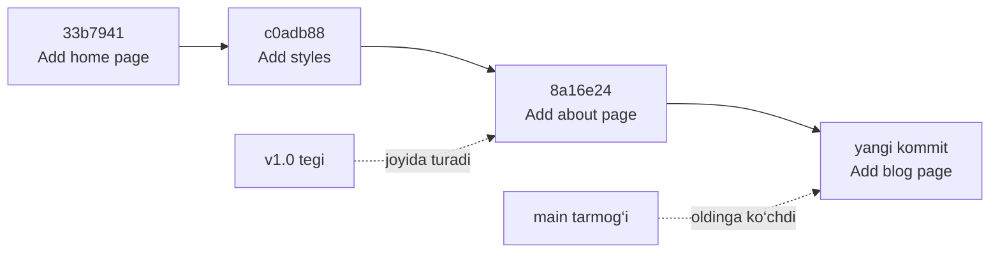
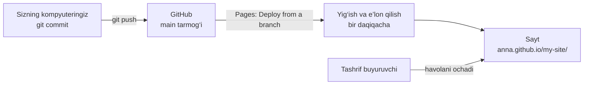
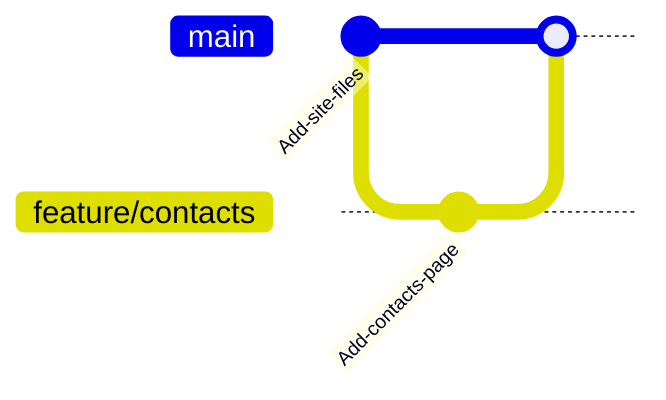

# Teglar, relizlar va yakuniy loyiha

[Mundarija](../../README.md) · [← Orqaga](../../Lesson-9/uz/Jamoada%20ishlash.md) · [RU](../ru/%D0%A2%D0%B5%D0%B3%D0%B8%2C%20%D1%80%D0%B5%D0%BB%D0%B8%D0%B7%D1%8B%20%D0%B8%20%D0%B8%D1%82%D0%BE%D0%B3%D0%BE%D0%B2%D1%8B%D0%B9%20%D0%BF%D1%80%D0%BE%D0%B5%D0%BA%D1%82.md) · [EN](../en/Tags%2C%20releases%20and%20final%20project.md) · [UZ](Teglar%2C%20relizlar%20va%20yakuniy%20loyiha.md)

> **9-dars bilan bog‘liqlik:** siz jamoada ishlashni o‘rgandingiz: GitHub Flow, pull request va kodni ko‘rib chiqish (review), rad etilgan `push`, birlashtirish usulini tanlab `git pull` (`pull.rebase`), `git stash`. Loyihangiz GitHub’da yashaydi, unda allaqachon tarix, tarmoqlar va birlashtirishlar bor. Bugun kursning oxirgi darsi: tayyor versiyani **teg** bilan belgilaysiz, **reliz** tayyorlaysiz, **aliaslar** yordamida ishni tezlashtirasiz, saytni **GitHub Pages** orqali e’lon qilasiz va o‘rganganlaringizning hammasini **yakuniy loyiha**da jamlaysiz.

---

## Bu sizga nima uchun kerak

Siz saytingizga havolani o‘qituvchiga yoki ish beruvchiga yubordingiz. Bir haftadan keyin menyuni qayta yasadingiz, nimanidir buzib qo‘ydingiz, sizdan esa so‘rashadi: «Yuborgan versiyangizni ko‘rsating-chi». Bu qaysi kommit edi? `8a16e24` mi yoki `c0adb88` mi? Xeshni hech kim eslab qolmaydi.

Haqiqiy loyihalarda doim shunday qilinadi: har bir chiqarilgan versiyaning tushunarli nomi bor - `v1.0`, `v1.1`, `v2.0`. Bular **teglar**. Teg bo‘yicha istalgan paytda chiqarilgan versiyaga qaytish, uni joriy versiya bilan solishtirish va o‘zgarishlar ro‘yxatini ko‘rsatish mumkin. GitHub’da esa teg asosida **reliz** yaratiladi - hamma ko‘radigan, tavsifli versiya sahifasi.

Eng muhimi: dars oxirida sizda rezyumega qo‘shsa bo‘ladigan narsa paydo bo‘ladi - `https://sizning-login.github.io/my-site/` manzilidagi jonli sayt va tarix, tarmoqlar, `README.md` hamda `v1.0` versiyasiga ega tartibli repozitoriy.

---

## Nimani o‘rganasiz

- Teglar nima uchun kerakligini va teg tarmoqdan nimasi bilan farq qilishini tushuntirish.
- Yengil va annotatsiyali teglar yaratish: `git tag`, `git tag -a -m`, tegni eski kommitga qo‘yish.
- Tegni `git show v1.0` buyrug‘i bilan ko‘rish va teglarni `git log --oneline` da topish.
- Teglarni GitHub’ga yuborish (`git push origin v1.0`, `git push --tags`) va ularni o‘chirish.
- Versiyalarni semantik versiyalash qoidalari bo‘yicha nomlash: `MAJOR.MINOR.PATCH`.
- GitHub’da teg asosida reliz yaratish.
- Uzun buyruqlarni aliaslar bilan qisqartirish: `git config --global alias.lg "..."`.
- Saytni GitHub Pages orqali e’lon qilish.
- Loyihaning to‘liq siklini yig‘ish: `git init` dan `v1.0` tegi va e’lon qilingan saytgacha.

---

## Takrorlash: 9-darsdan 3 savol

1. `git push` `! [rejected] main -> main (fetch first)` deb javob berdi. Nima bo‘ldi va nima qilish kerak?
2. `git stash pop` buyrug‘i `git stash apply` dan nimasi bilan farq qiladi?
3. GitHub Flow qanday qadamlardan iborat?

Javoblar - dars oxirida.

---

## Reja

| Bo‘lim | Nima qilamiz |
| --- | --- |
| Teg nima | Loyiha versiyasidagi xatcho‘p |
| Yengil va annotatsiyali teglar | `git tag`, `git tag -a`, `git show` |
| GitHub’dagi teglar | Teglarni yuborish va o‘chirish |
| Mini-topshiriq 1 | O‘quv loyihasidagi teglar |
| Semantik versiyalash | Versiya raqamini qanday tanlash kerak |
| GitHub’dagi relizlar | Saytdagi versiya sahifasi |
| Aliaslar | O‘zingizning qisqa buyruqlaringiz |
| GitHub Pages | Besh daqiqada havola orqali ochiladigan sayt |
| Yakuniy loyiha | To‘liq sikl va qabul qilish ro‘yxati |
| Mini-topshiriq 2 | O‘quv loyihasidagi versiyalar va aliaslar |
| Mustaqil ish | O‘quv terminalidagi topshiriq va kompyuterdagi yakuniy loyiha |

---

## Teg nima

**Oddiy so‘z bilan:** teg - bu **kitobdagi xatcho‘p** yoki **murabbo bankasidagi yorliq**: «2026-yil hosili». Kitob (loyiha tarixi) yozilishda davom etadi, xatcho‘p esa siz qo‘ygan sahifada qoladi. Bir yildan keyin kitobni varaqlamasdan, to‘g‘ridan-to‘g‘ri xatcho‘pdan ochasiz.

Git’da **teg** (ingl. tag - «yorliq, belgi») - bitta kommit uchun doimiy nom. Odatda u bilan chiqarilgan versiyalar belgilanadi: `v1.0`, `v1.1`, `v2.0`.

Siz shunga o‘xshash yorliqni allaqachon bilasiz - tarmoq. Farqi shundaki, tarmoq **siljiydi**, teg esa **yo‘q**.

| | `main` tarmog‘i | `v1.0` tegi |
| --- | --- | --- |
| Bu nima | Ish yo‘nalishining oxirgi kommitidagi yorliq | Bitta aniq kommitdagi yorliq |
| Yangi kommitda | Yangi kommitga ko‘chadi | Abadiy joyida qoladi |
| Nima uchun | Ishni davom ettirish | Versiyani eslab qolish |
| O‘xshatish | «Hozir qayerda o‘qiyapman» xatcho‘pi | Hoshiyadagi «1-bob shu yerda tugadi» belgisi |



**Sxemani qanday o‘qish kerak.** `v1.0` tegi oxirgi kommit `8a16e24` bo‘lganida qo‘yilgan. Keyin yangi kommit paydo bo‘ldi: `main` tarmog‘i unga ko‘chdi, teg esa `8a16e24` da qoldi. Shuning uchun teg bo‘yicha doim aynan siz chiqargan versiyani topish mumkin.

---

## Yengil va annotatsiyali teglar

8-darsdagi `portfolio` loyihasini olamiz: uchta kommit (`Add home page`, `Add styles`, `Add about page`), `main` tarmog‘i allaqachon GitHub’ga yuborilgan. Parametrsiz `git tag` buyrug‘i teglar ro‘yxatini ko‘rsatadi. Hozircha teglar yo‘q, shuning uchun u hech narsa chiqarmaydi - bu xato emas.

### `git tag -a`: annotatsiyali teg

Chiqarayotgan versiyangiz **annotatsiyali** teg bilan belgilanadi (ingl. annotated - «izohli»): u kommit kabi muallif, sana va xabarni saqlaydi.

```bash
git tag -a v1.0 -m "First public version"
git tag
```

```text
v1.0
```

| Buyruq qismi | Ma’nosi |
| --- | --- |
| `git tag` | Teglar bilan ishlash |
| `-a` | Annotatsiyali teg (muallif, sana va xabar bilan) |
| `v1.0` | Teg nomi. Raqam oldidagi `v` (version) harfi - umumiy odat |
| `-m "First public version"` | Kommitdagi kabi teg xabari |

Teg `HEAD` ga - siz hozir turgan kommitga qo‘yiladi.

**Haqiqiy Git’da** `-m` siz `git tag -a v1.0` buyrug‘i xabar uchun matn muharririni ochadi - `-m` siz `git commit` kabi. O‘quv terminalida muharrir yo‘q, shuning uchun doim `-m` ni yozing.

### `git show v1.0`: teg nimani saqlaydi

`--stat` kaliti (3-dars) chiqishni qisqartiradi: barcha o‘zgargan qatorlar o‘rniga faqat fayllar ro‘yxati.

```bash
git show v1.0 --stat
```

```text
tag v1.0
Tagger: Anna Karimova <anna@example.com>
Date:   Tue Sep 1 10:03:01 2026 +0500

First public version

commit 8a16e24b93cf37968707ddc0cab0887a0dc24eed (HEAD -> main, tag: v1.0, origin/main)
Author: Anna Karimova <anna@example.com>
Date:   Tue Sep 1 10:03:00 2026 +0500

    Add about page

 about.html | 1 +
 1 file changed, 1 insertion(+)
```

| Qator | Tarjimasi va ma’nosi |
| --- | --- |
| `tag v1.0` | Bu `v1.0` nomli teg |
| `Tagger: Anna Karimova <...>` | «Tegni kim qo‘ygan». Kommitda bu `Author`, tegda esa `Tagger` |
| `Date: ...` (birinchisi) | Teg qachon qo‘yilgani |
| `First public version` | Teg xabari |
| `commit 8a16e24...` | Pastda - teg ishora qilayotgan kommit, 3-darsdagi `git show` dagi kabi |
| `about.html \| 1 +` | Kommit fayllari (`--stat` tufayli; usiz - to‘liq `diff`) |

### Yengil teg va eski kommitdagi teg

Agar `-a` va `-m` ni yozmasangiz, **yengil** teg (ingl. lightweight) hosil bo‘ladi - muallif va xabarsiz, kommit uchun shunchaki nom. Tegni eski kommitga ham qo‘yish mumkin: uni teg nomidan keyin ko‘rsating - xesh yoki `HEAD~2` (3-dars).

```bash
git tag v0.1 HEAD~2
git log --oneline
```

```text
8a16e24 (HEAD -> main, tag: v1.0, origin/main) Add about page
c0adb88 Add styles
33b7941 (tag: v0.1) Add home page
```

Qavslarda `tag:` yorliqlari paydo bo‘ldi: `8a16e24` kommitida endi ular uchta - `HEAD -> main` (siz shu yerdasiz), `tag: v1.0` (versiya) va `origin/main` (GitHub’dagi tarmoq). Yengil tegda esa `git show v0.1` darhol `commit 33b7941...` qatoridan boshlanadi: `tag` / `Tagger` / xabar bloki yo‘q.

| | Yengil teg | Annotatsiyali teg |
| --- | --- | --- |
| Buyruq | `git tag v0.1` | `git tag -a v1.0 -m "..."` |
| Nimani saqlaydi | Faqat kommitga havolani | Havola, muallif (`Tagger`), sana, xabar |
| `git show` nimadan boshlanadi | `commit ...` | `tag v1.0`, `Tagger: ...` |
| Qachon ishlatish kerak | «O‘zim uchun» vaqtinchalik belgi | Versiyalarni chiqarish, GitHub’dagi relizlar |

**Oddiy so‘z bilan:** yengil teg - «v0.1» deb yozilgan stiker. Annotatsiyali teg - uni kim, qachon va nima uchun yopishtirgani ham yozilgan yorliq.

---

## GitHub’dagi teglar: yuborish va o‘chirish

### Teglar o‘z-o‘zidan yuborilmaydi

Tekshirib ko‘ramiz: teg bor, oddiy `git push` nima der ekan?

```bash
git push
```

```text
Everything up-to-date
```

«Hammasi dolzarb» - lekin GitHub’da `v1.0` tegi **yo‘q**. Oddiy `git push` faqat tarmoqlarni yuboradi.

> **Muhim:** teglar serverga kommitlar bilan birga ketmaydi. Ular alohida buyruq bilan yuboriladi - aks holda GitHub’da relizni yaratish uchun asos bo‘lmaydi.

Bitta tegni (`git push origin v1.0`), keyin esa serverda hali yo‘q barcha teglarni (`git push --tags`) yuboramiz:

```bash
git push origin v1.0
git push --tags
```

```text
To https://github.com/anna/portfolio.git
 * [new tag]         v1.0 -> v1.0
To https://github.com/anna/portfolio.git
 * [new tag]         v0.1 -> v0.1
```

| Qator | Tarjimasi va ma’nosi |
| --- | --- |
| `To https://github.com/...` | Qayerga yuboryapmiz |
| `* [new tag]` | «Yangi teg»: serverda u hali yo‘q edi (tarmoqlar uchun `[new branch]` edi) |
| `v1.0 -> v1.0` | Lokal `v1.0` tegi GitHub’dagi `v1.0` tegiga aylandi |

Faqat `v0.1` ketdi: `v1.0` serverda allaqachon bor edi. **Haqiqiy Git’da** `To ...` qatoridan oldin yana `Enumerating objects ...`, `Writing objects ...` qatorlari paydo bo‘ladi - Git annotatsiyali teg obyektini yuboradi.

### Tegni o‘chirish

Teg bilan xato qildingizmi - uni o‘z kompyuteringizda o‘chirish mumkin:

```bash
git tag -d v0.1
git tag
```

```text
Deleted tag 'v0.1' (was 33b7941)
v1.0
```

`git tag -d` tegni **faqat sizda** o‘chiradi. Agar teg allaqachon GitHub’da bo‘lsa, u yerda haqiqiy Git’da alohida buyruq bilan o‘chiriladi:

```bash
git push origin --delete v0.1
```

Javobda ` - [deleted]         v0.1` qatori bo‘ladi. O‘quv terminalida serverdagi tegni o‘chirish hozircha qo‘llab-quvvatlanmaydi - bu buyruqni 2-qismda o‘z kompyuteringizda bajaring.

> **Muhim:** allaqachon yuborilgan va boshqalar foydalanishi mumkin bo‘lgan tegni ko‘chirmang va o‘chirmang: ularda eski `v1.0` qoladi, sizda esa xuddi shu nomli yangisi. Bu 4-darsdagi qoidaning o‘zi: e’lon qilingan tarix qayta yozilmaydi. Chiqarilgan versiyada xato topdingizmi - uni tuzating va `v1.0.1` ni chiqaring.

---

## Mini-topshiriq 1

O‘quv terminalida:

1. `blog` papkasini, unda repozitoriy va uchta kommit yarating: `index.html` (`<h1>My blog</h1>`) - `Add home page`, `style.css` (`body { font-family: sans-serif; }`) - `Add styles`, `post.html` (`<h1>Frist post</h1>`, xato bilan - ikkinchi mini-topshiriqda kerak bo‘ladi) - `Add first post`.
2. Birinchi kommitga `v0.1` yengil tegini qo‘ying.
3. Oxirgi kommitga `First version of the blog` xabarli `v1.0` annotatsiyali tegini qo‘ying.
4. Teglar ro‘yxatini va `git log --oneline` ni ko‘ring: `tag:` yorliqlari qaysi kommitlarda?
5. `git show v1.0` ni ko‘ring va `Tagger` qatorini toping.
6. `v0.1` tegini o‘chiring va `v1.0` tegini yana bir marta yaratib ko‘ring. Git nima deb javob beradi?

---

## Semantik versiyalash

Raqamni qanday tanlash kerak: `v1.1` mi yoki `v2.0` mi? Ko‘pchilik loyihalar **semantik versiyalash** qoidalariga amal qiladi (ingl. Semantic Versioning, SemVer, sayt [semver.org](https://semver.org/)). Versiya raqami uchta sondan iborat: `MAJOR.MINOR.PATCH`.

**Oddiy so‘z bilan:** «uy.yo‘lak.xonadon» manziliga o‘xshaydi. Uy o‘zgardi - hammasi yangicha. Xonadon o‘zgardi - mayda gap, qo‘shnilar o‘sha-o‘sha.

| Qism | Nomi | Qachon oshirish kerak | Sayt uchun misol | Edi → bo‘ldi |
| --- | --- | --- | --- | --- |
| `MAJOR` | Asosiy | Mos kelmaydigan o‘zgarishlar: eskisi ishlamay qoladi | Sayt butunlay qayta yasalgan, sahifalarning eski manzillari ishlamaydi | `1.4.2` → `2.0.0` |
| `MINOR` | Ikkinchi darajali | Yangi imkoniyat, eskisi ishlaydi | Blog sahifasi qo‘shildi | `1.4.2` → `1.5.0` |
| `PATCH` | Tuzatish | Xato tuzatildi, yangi narsa yo‘q | Imlo xatosi tuzatildi, havola to‘g‘rilandi | `1.4.2` → `1.4.3` |

- Son oshirilganda undan **o‘ngdagi** barcha sonlar nolga tushadi: `1.4.2` → `1.5.0`, `1.5.2` emas.
- `0.x.y` versiyalari - «qoralamalar»: loyiha hali tayyor emas, hammasi o‘zgarishi mumkin. Birinchi tayyor versiya - `1.0.0`.
- `v1.0` va `v1.1` kabi qisqa nomlar ham tez-tez uchraydi - bu oxirgi nolsiz `1.0.0` va `1.1.0`. Kursning yakuniy loyihasida `v1.0` tegi ishlatiladi.

---

## GitHub’dagi relizlar

**Reliz** (ingl. release - «chiqarilgan versiya») - GitHub’dagi versiya sahifasi: nomi, o‘zgarishlar tavsifi va yuklab olish uchun loyiha fayllari arxivi. Reliz doim **teg asosida** yaratiladi. Git’ning o‘zi relizlar haqida hech narsa bilmaydi: bu GitHub saytining funksiyasi (GitLab va Bitbucket’da ham shunga o‘xshashi bor).

**Oddiy so‘z bilan:** teg - bankadagi yorliq, reliz - do‘kon vitrinasi, u yerda banka narx va tavsif bilan turadi.

Relizni qanday yaratish kerak (GitHub interfeysi, 2026-yil kuzi):

1. GitHub’da repozitoriyni oching, fayllar ro‘yxatining o‘ng tomonida **Releases** (Relizlar) ni, keyin **Draft a new release** («Yangi reliz tayyorlash») ni bosing.
2. **Choose a tag** («Tegni tanlang») ro‘yxatidan yuborilgan `v1.0` tegini tanlang. Yangi nom kiritib, **Create new tag** («Yangi teg yaratish») ni bosish ham mumkin - unda GitHub tegni tanlangan tarmoqda (**Target**) o‘zi yaratadi, lekin teglarni Git’da yaratgan ma’qul: shunda ular sizda ham, serverda ham bo‘ladi.
3. **Release title** («Reliz nomi») maydoniga nom yozing, masalan `v1.0 - saytning birinchi versiyasi`. **Describe this release** («Relizni tavsiflang») maydonida versiyaga nimalar kirganini yozing. **Generate release notes** («Reliz izohlarini yaratish») tugmasi o‘zgarishlar ro‘yxatini pull request’lar bo‘yicha avtomatik tuzadi.
4. **Publish release** («E’lon qilish») ni bosing. **Save draft** («Qoralamani saqlash») hozircha faqat siz ko‘radigan qoralamani saqlaydi.

E’lon qilingandan keyin reliz sahifasida **Source code (zip)** va **Source code (tar.gz)** arxivlari paydo bo‘ladi - teg ishora qilayotgan versiyadagi loyiha fayllari.

> **Muhim:** agar teg GitHub saytida yaratilgan bo‘lsa, kompyuteringizda u hali yo‘q. Uni `git fetch` yoki `git pull` (8-dars) olib keladi va chiqishda `* [new tag]` qatori paydo bo‘ladi.

---

## Aliaslar: o‘zingizning qisqa buyruqlaringiz

Kurs davomida siz `git log --oneline --graph --all` ni ko‘p marta yozdingiz. Git uzun buyruqqa qisqa nom berishga imkon beradi - **alias** (ingl. alias - «taxallus»).

**Oddiy so‘z bilan:** telefondagi tezkor terish kabi: 12 raqamli nomer o‘rniga bitta tugmani bosasiz.

```bash
git config --global alias.st status
git config --global alias.lg "log --oneline --graph --all"
```

Buyruqlar hech narsa chiqarmaydi. `git config --global --list` orqali tekshirish mumkin - u yerda `alias.st=status` va `alias.lg=log --oneline --graph --all` qatorlari paydo bo‘ladi.

| Qism | Ma’nosi |
| --- | --- |
| `--global` | Barcha repozitoriylaringiz uchun (1-darsdagi `user.name` kabi) |
| `alias.lg` | Yangi buyruq `git lg` deb ataladi |
| `"log --oneline --graph --all"` | `lg` o‘rniga nima qo‘yiladi. Qiymatda probellar bor - **qo‘shtirnoq majburiy** |

Endi `git lg` uzun buyruq kabi ishlaydi:

```bash
git lg
```

```text
* 8a16e24 (HEAD -> main, tag: v1.0, origin/main) Add about page
* c0adb88 Add styles
* 33b7941 Add home page
```

Boshqa mashhur aliaslar: `switch` uchun `sw`, `"log -1 --stat"` uchun `last`. Aliasni o‘chirish: `git config --global --unset alias.st`.

> **Muhim:** aliaslar faqat sizning kompyuteringizda yashaydi. Boshqalar uchun yo‘riqnomalarda, suhbatda (intervyuda) va hamkasblarga javoblarda to‘liq buyruqlarni yozing - boshqa odamda `git lg` ishlamaydi.

---

## GitHub Pages: havola orqali ochiladigan sayt

**GitHub Pages** - statik saytlar (HTML, CSS, JavaScript, jQuery) uchun to‘g‘ridan-to‘g‘ri repozitoriydan ishlaydigan bepul xosting. Siz `git push` qilasiz - va bir daqiqadan keyin sayt yangilanadi.

**Oddiy so‘z bilan:** GitHub’dagi repozitoriy - sayt fayllari saqlanadigan ombor. GitHub Pages - tashrif buyuruvchilar saytni brauzerda ko‘radigan vitrina.

Qanday yoqish kerak (GitHub interfeysi, 2026-yil kuzi):

1. GitHub’dagi `main` tarmog‘ining **ildizida** `index.html` borligiga ishonch hosil qiling - bu bosh sahifa.
2. Repozitoriyni oching → **Settings** (Sozlamalar) yorlig‘i → chapdagi menyuda **Pages** bo‘limi. **Build and deployment** («Yig‘ish va joylash») blokidagi **Source** («Manba») maydonida **Deploy from a branch** («Tarmoqdan joylash») ni tanlang.
3. **Branch** («Tarmoq») maydonida `main` ni tanlang (sukut bo‘yicha u yerda `None`), papkani `/ (root)` qoldiring va **Save** («Saqlash») ni bosing.
4. Bir-ikki daqiqa kuting va **Pages** sahifasini yangilang: tepada sayt manzili va **Visit site** («Saytga o‘tish») tugmasi paydo bo‘ladi.

Sayt manzili: `https://<login>.github.io/<repozitoriy>/`. `anna` foydalanuvchisi va `my-site` repozitoriysi uchun - `https://anna.github.io/my-site/`.



**Sxemani qanday o‘qish kerak.** Pages sizning kompyuteringizdagini emas, tanlangan tarmoqda **GitHub’da** turgan narsani e’lon qiladi. `git push` qilmaguningizcha tashrif buyuruvchilar eski versiyani ko‘radi. `main` ga har bir yangi `push` saytni yangilaydi.

| Muammo | Sababi | Yechim |
| --- | --- | --- |
| Sayt manzilida 404 xatosi | Ildizda `index.html` yo‘q yoki hali kam vaqt o‘tgan | GitHub’dagi fayllarni tekshirish, bir-ikki daqiqa kutish |
| Stillar va rasmlar yo‘q | Diskning ildizidan yo‘l: `/css/style.css` yoki `C:\...` | Nisbiy yo‘llar: `css/style.css` (HTML kursi) |
| Stillar sizda bor, saytda esa yo‘q | Harflar registri: serverda `Style.css` va `style.css` - turli fayllar | Fayl nomida va `href` da bir xil registr |

---

## Yakuniy loyiha

Butun kursni bitta loyihada jamlash vaqti keldi. Quyida `my-site` o‘quv saytidagi to‘liq sikl: papkada sayt fayllari, yana `node_modules/` (npm orqali paketlar o‘rnatgan bo‘lsangiz, shunday bo‘ladi) va maxfiy kalitli `.env` bor. Repozitoriy yo‘q, GitHub’da bo‘sh `https://github.com/anna/my-site.git` yaratilgan.

Tartib muhim: `.gitignore` - birinchi kommitdan oldin, teg - hammasi birlashtirilib, yuborilgandan keyin. Har bir qadam - kursdagi darslardan birining mavzusi.

### 1–3-qadamlar: repozitoriy, `.gitignore`, birinchi kommit

```bash
cd my-site
git init
echo "node_modules/" > .gitignore
echo ".env" >> .gitignore
git status -s
git add .
git commit -m "Add site files"
```

```text
Initialized empty Git repository in /home/student/my-site/.git/
?? .gitignore
?? css/
?? index.html
?? js/
[main (root-commit) 22281c8] Add site files
 4 files changed, 5 insertions(+)
 create mode 100644 .gitignore
 create mode 100644 css/style.css
 create mode 100644 index.html
 create mode 100644 js/main.js
```

`git status -s` javobida `node_modules/` va `.env` yo‘q - Git ularni endi ko‘rmaydi (5-dars). `.gitignore` bo‘lmaganida u yerda yana `?? .env` va `?? node_modules/` qatorlari, kommitda esa `create mode 100644 .env` bo‘lardi.

| Qadam | Buyruq | Ishchi papka | Indeks | Repozitoriy |
| --- | --- | --- | --- | --- |
| 1 | `git init` | Sayt, `node_modules/`, `.env` | Bo‘sh | Bo‘sh, kommitlar yo‘q |
| 2 | `echo ... > .gitignore` | + `.gitignore` | Bo‘sh | Bo‘sh |
| 3 | `git add .` | O‘zgarishsiz | `.gitignore`, `index.html`, `css/style.css`, `js/main.js` (`node_modules/` va `.env` siz) | Bo‘sh |
| 4 | `git commit -m "Add site files"` | O‘zgarishsiz | Kommit bilan bir xil | To‘rtta faylli `22281c8` kommiti |

### 4–5-qadamlar: tarmoq, birlashtirish, alias

```bash
git switch -c feature/contacts
echo "<h1>Contacts</h1>" > contacts.html
git add contacts.html
git commit -m "Add contacts page"
git switch main
git merge --no-ff feature/contacts
git branch -d feature/contacts
git config --global alias.lg "log --oneline --graph --all"
git lg
```

Birinchi buyruqlarning javoblarini 6–7-darslardan bilasiz: `Switched to a new branch`, `Merge made by the 'ort' strategy.`, `Deleted branch feature/contacts`. `--no-ff` tarixda birlashtirish kommitini qoldiradi - kontaktlar alohida tarmoqda qilingani ko‘rinib turadi (oldinga o‘tkazishli oddiy `git merge` ham mos keladi). `git lg` javobi:

```text
*   75d1cf9 (HEAD -> main) Merge branch 'feature/contacts'
|\
| * b16f788 Add contacts page
|/
* 22281c8 Add site files
```



**Sxemani qanday o‘qish kerak.** Birinchi kommitdan bitta kommitli `feature/contacts` tarmog‘i ajralib chiqdi va birlashtirish kommiti bilan `main` ga qaytdi. Tarmoq birlashtirilgandan keyin o‘chirildi - uning kommiti `main` tarixida qoldi.

### 6–7-qadamlar: GitHub va `v1.0` tegi

```bash
git remote add origin https://github.com/anna/my-site.git
git push -u origin main
git tag -a v1.0 -m "First release"
git push --tags
git lg
```

`git push -u` dan keyin Git `* [new branch]      main -> main` va `branch 'main' set up to track 'origin/main'.` deb javob beradi (8-dars), keyin esa:

```text
To https://github.com/anna/my-site.git
 * [new tag]         v1.0 -> v1.0
*   75d1cf9 (HEAD -> main, tag: v1.0, origin/main) Merge branch 'feature/contacts'
|\
| * b16f788 Add contacts page
|/
* 22281c8 Add site files
```

| Qadam | Buyruq | Nima o‘zgardi / HEAD qayerga ishora qiladi |
| --- | --- | --- |
| 1 | `git push -u origin main` | GitHub’da `main` → `75d1cf9` paydo bo‘ldi. `HEAD -> main` → `75d1cf9`, `origin/main` - o‘sha yerda |
| 2 | `git tag -a v1.0 -m "First release"` | Lokal `v1.0` tegi → `75d1cf9`. GitHub’da teg hali yo‘q |
| 3 | `git push --tags` | `v1.0` tegi GitHub’da paydo bo‘ldi |
| 4 | `git lg` | `75d1cf9` da uchta yorliq: `HEAD -> main`, `tag: v1.0`, `origin/main` - hammasi yuborilgan |

GitHub saytida qolgan ishlar: `v1.0` tegi bo‘yicha reliz yaratish va GitHub Pages’ni yoqish.

### README va portfolio sifatidagi GitHub profili

Yaxshi `README.md` (5-dars) - repozitoriyni ochgan odam ko‘radigan birinchi narsa. Yakuniy loyiha uchun minimum: `# My site` sarlavhasi, bu qanday sayt va nimada yasalgani (HTML, CSS, JavaScript, jQuery) haqida bir-ikki qator hamda `Live demo: https://anna.github.io/my-site/` havolasi. Uni `cat > README.md << 'EOF'` orqali yaratish mumkin (2-dars).

**GitHub profili - sizning portfoliongiz.** Agar nomi **loginingiz bilan bir xil** repozitoriy yaratsangiz (`anna` foydalanuvchisida - `anna/anna`) va unga `README.md` qo‘ysangiz, GitHub bu faylni profilning bosh sahifasida ko‘rsatadi. 3–5 qator yozing: kimsiz, nimani o‘rganyapsiz, eng yaxshi loyihalaringizga havolalar. Yakuniy loyihani esa profilga mahkamlang: profil sahifasidagi **Customize your pins** («Mahkamlanganlarni sozlash»).

### Yakuniy loyihani qabul qilish ro‘yxati

| № | Talab | Qanday tekshirish |
| --- | --- | --- |
| 1 | HTML/CSS/JS (va o‘tgan bo‘lsangiz, jQuery) kurslaridagi sayt - kamida 3 sahifa | Ildizda `*.html` fayllari, `css/`, `js/` papkalari |
| 2 | GitHub’da ochiq repozitoriy, `main` upstream bilan yuborilgan | `git status` → `up to date with 'origin/main'` |
| 3 | Tarix kamida 8 kommit, xabarlar ingliz tilida, buyruq maylida | `git log --oneline` |
| 4 | Kamida 2 ta `feature/...` tarmog‘i `main` ga birlashtirilgan va keyin o‘chirilgan | `git lg` ayrilishlarni, `git branch` esa faqat `main` ni ko‘rsatadi |
| 5 | `.gitignore` birinchi kommitdan oldin yaratilgan, tarixda sirlar va `node_modules/` yo‘q | `git log --stat` da `.env` va `node_modules/` yo‘q |
| 6 | `README.md`: tavsif, texnologiyalar, saytga havola | Repozitoriyni GitHub’da ochish |
| 7 | Oxirgi kommitdagi annotatsiyali `v1.0` tegi GitHub’ga yuborilgan | `git show v1.0` `tag v1.0` dan boshlanadi; GitHub’dagi Tags yorlig‘i |
| 8 | Tavsifli `v1.0` relizi | Releases sahifasi |
| 9 | Sayt GitHub Pages orqali ochiladi, stillar va skriptlar ishlaydi | `https://login.github.io/repozitoriy/` |
| 10 | Ishchi papka toza | `git status` → `nothing to commit, working tree clean` |

### Buzib ko‘ring

1. `v1.0` tegini ikkinchi marta yarating. Git nima deb javob beradi?
2. Teg qo‘ying va oddiy `git push` ni bajaring. Git nima deb yozadi? Serverda teg bormi?
3. Mavjud bo‘lmagan tegni yuboring: `git push origin v9.9`.
4. Mavjud bo‘lmagan tegni ko‘ring: `git show v9.9`.
5. Saytda `.gitignore` siz kommit qiling va javobdagi `create mode` ni ko‘ring: kommitga qanday ortiqcha fayllar tushdi?
6. Aliasni o‘chiring (`git config --global --unset alias.lg`) va `git lg` ni chaqiring.

### Yangi o‘rganuvchilarning tipik xatolari

| Xato | Nima bo‘ladi | Qanday tuzatish |
| --- | --- | --- |
| Teg yaratilgan, lekin yuborilmagan | `git push` `Everything up-to-date` deb javob beradi, GitHub’da esa teg yo‘q | `git push origin v1.0` yoki `git push --tags` |
| Xuddi shu tegni yana bir marta yaratish | `fatal: tag 'v1.0' already exists` | Boshqa nom (`v1.0.1`) yoki, teg yuborilmagan bo‘lsa, `git tag -d v1.0` va qaytadan yaratish |
| Versiya chiqarish uchun yengil teg | `git show v1.0` da `Tagger` va xabar yo‘q | `git tag -d v1.0`, keyin `git tag -a v1.0 -m "..."` |
| Teg birlashtirishdan oldin qo‘yilgan | Teg eski kommitga ishora qiladi, versiyada oxirgi o‘zgarishlar yo‘q | Teg yuborilmaguncha: o‘chirib, kerakli kommitga qo‘yish |
| Qo‘shtirnoqsiz alias: `alias.lg log --oneline --graph --all` | Git `usage: git config [<options>]` yordamini ko‘rsatadi | Probelli qiymat - qo‘shtirnoq ichida |
| `.gitignore` `git add .` dan keyin yaratilgan | Birinchi kommitda `create mode 100644 .env` - sir tarixda | 5-dars: `git rm --cached`, maxfiy kalitni almashtirish |
| Pages’da sayt stilsiz | `/css/style.css` yo‘li loyiha papkasiga emas, `github.io` ildiziga olib boradi | `css/style.css` nisbiy yo‘li |

---

## Mini-topshiriq 2

1-mini-topshiriqdagi `blog` repozitoriysida davom eting:

1. `st` (`status` uchun) va `lg` (`log --oneline --graph --all` uchun) global aliaslarini sozlang. `git st` ni tekshiring.
2. Xatoni `fix/typo` tarmog‘ida tuzating: `post.html` ni `<h1>First post</h1>` matni bilan qayta yozing, `-am` orqali kommit qiling. Tarmoqni `main` ga birlashtiring va uni o‘chiring.
3. Imlo xatosi tuzatilgandan keyin SemVer bo‘yicha qanday versiya raqami kerak? `Fix typo` xabarli annotatsiyali teg qo‘ying.
4. `feature/about` tarmog‘ida `about.html` sahifasini (`<h1>About the author</h1>`) qo‘shing va kommit qiling. `--no-ff` bilan `main` ga birlashtiring, tarmoqni o‘chiring.
5. Endi versiya raqami qanday? `Add about page` xabarli annotatsiyali teg qo‘ying.
6. Teglar ro‘yxatini va `git lg` ni ko‘ring: teglar qaysi kommitlarda turibdi?

---

## Dars yakuni: shpargalka

| Vazifa | Buyruq |
| --- | --- |
| Teglar ro‘yxati | `git tag` |
| `HEAD` dagi annotatsiyali teg | `git tag -a v1.0 -m "First release"` |
| Eski kommitdagi yengil teg | `git tag v0.1 HEAD~2` yoki `git tag v0.1 33b7941` |
| Teg va uning kommitini ko‘rish | `git show v1.0` |
| Bitta tegni / barcha teglarni yuborish | `git push origin v1.0` / `git push --tags` |
| Tegni o‘zingizda / serverda o‘chirish | `git tag -d v0.1` / `git push origin --delete v0.1` |
| Alias yaratish | `git config --global alias.lg "log --oneline --graph --all"` |
| Aliasni o‘chirish | `git config --global --unset alias.lg` |
| Reliz | GitHub: Releases → Draft a new release → teg → Publish release |
| GitHub Pages’dagi sayt | Settings → Pages → Deploy from a branch → `main`, `/ (root)` → Save |

### Kursning umumiy shpargalkasi

| Vazifa | Buyruq |
| --- | --- |
| Git’ni sozlash (1-dars) | `git config --global user.name "Ism"`, `user.email`, `init.defaultBranch main` |
| Repozitoriy va holat (1–2) | `git init`, `git status`, `git status -s` |
| Kommit (2) | `git add .`, `git commit -m "Add page"`, `git commit -am "Update page"` |
| Tarix va o‘zgarishlar (3) | `git log --oneline`, `git show HEAD~1`, `git show HEAD~2:fayl`, `git diff`, `git diff --staged` |
| Tahrirni bekor qilish / indeksdan olib tashlash (4) | `git restore fayl`, `git restore --staged fayl` |
| Kommitni tuzatish yoki bekor qilish (4) | `git commit --amend`, `git revert xesh`, `git reset --soft/--mixed/--hard HEAD~1`, `git reflog` |
| Loyihada tartib (5) | `.gitignore`, `git rm --cached fayl`, `git rm`, `git mv` |
| Tarmoqlar (6) | `git branch`, `git switch -c nom`, `git switch nom`, `git branch -m`, `git branch -d` |
| Birlashtirish va konflikt (7) | `git merge nom`, `--no-ff`; tuzatgandan keyin: `git add`, `git commit --no-edit`; bekor qilish: `git merge --abort` |
| GitHub (8) | `git remote add origin URL`, `git push -u origin main`, `git clone URL`, `git fetch`, `git pull` |
| Jamoa (9) | `git pull --rebase` / `--no-rebase`, `git stash`, `git stash pop` |
| Versiyalar (10) | `git tag -a v1.0 -m "..."`, `git push --tags`, `git lg` |

---

## Mustaqil ish

### 1-qism. IDE topshirig‘i (platforma hisoblaydi)

Git allaqachon sozlangan, siz uy papkasidasiz. `~/my-site` papkasida saytingiz (`index.html`, `css/style.css`, `js/main.js`), shuningdek `node_modules/` papkasi va maxfiy kalitli `.env` fayli bor - lekin repozitoriy yo‘q. «GitHub»da bo‘sh `https://github.com/anna/my-site.git` repozitoriysi yaratilgan. Buyruqlarni har qatorga bittadan yozing:

1. `my-site` ga o‘ting va repozitoriy yarating.
2. `node_modules/` va `.env` qatorli `.gitignore` yarating va `git status -s` ni tekshiring.
3. Saytning barcha fayllari bilan birinchi kommitni qiling: `Add site files`.
4. `feature/contacts` tarmog‘ini yarating, unda - `<h1>Contacts</h1>` matnli `contacts.html` fayli va `Add contacts page` kommiti.
5. `main` ga qayting, tarmoqni birlashtiring (`--no-ff` bilan yoki oldinga o‘tkazish bilan) va uni o‘chiring.
6. `log --oneline --graph --all` uchun global `lg` aliasini sozlang va tarixni `git lg` buyrug‘i bilan ko‘ring.
7. Masofaviy repozitoriyni `origin` sifatida ulang va `main` ni upstream bilan yuboring.
8. Xabarli annotatsiyali `v1.0` tegini yarating, uni serverga yuboring va `git status` ni tekshiring.

Natijada serverda - tarixingizga ega `main` tarmog‘i va oxirgi kommitdagi `v1.0` tegi, `node_modules` va `.env` esa hech bir kommitga tushmagan.

Platforma nimani tekshiradi: repozitoriy aynan `~/my-site` da yaratilganini va unda `node_modules/` hamda `.env` ni yashiradigan `.gitignore` kommit qilinganini; hech bir kommitda (sizda ham, serverda ham) `node_modules` va `.env` yo‘qligini; birinchi kommitda sayt fayllari borligini; kontaktlar ustidagi ish `feature/contacts` tarmog‘ida bo‘lganini, `contacts.html` `main` da va serverda borligini, tarmoq esa o‘chirilganini; global `lg` aliasi sozlangani va chaqirilganini; serverdagi `main` sizniki bilan bir xilligini va upstream - `origin/main` ekanini; `v1.0` tegi annotatsiyali ekanini, serverda borligini va oxirgi kommitga ishora qilishini; siz `main` da ekaningizni va ishchi papka tozaligini; yechim sayt fayllarining boshqa to‘plami bilan ham ishlashini; ssenariy xatosiz bajarilishini.

### 2-qism. Kompyuterdagi loyiha

Bu **kursning yakuniy loyihasi** - haqiqiy Git’da, 1-darsdagi saytingiz repozitoriysida.

1. Saytni qabul qilish ro‘yxati talablariga yetkazing («Yakuniy loyiha» bo‘limi): kamida 3 sahifa, `.gitignore`, Pages’ning bo‘lajak manziliga havolali `README.md`. Har bir yangi sahifani o‘zining `feature/...` tarmog‘ida qiling, `main` ga birlashtiring va tarmoqni o‘chiring.
2. `main` ni GitHub’ga yuboring, `lg` aliasini sozlang va `git lg` ni tekshiring: tarix izohsiz tushunarli bo‘lishi kerak.
3. Annotatsiyali `v1.0` tegini qo‘ying, uni yuboring (`git push origin v1.0`) va GitHub’da tavsifli `v1.0` relizini yarating (Releases → Draft a new release).
4. GitHub Pages’ni yoqing (Settings → Pages → Deploy from a branch → `main`, `/ (root)`) va saytni `https://login.github.io/repozitoriy/` manzilida tekshiring - barcha stillar va skriptlar ishlashi kerak.
5. Profil README’sini yarating (nomi loginingiz bilan bir xil repozitoriy) va yakuniy loyihani profilga mahkamlang. Serverda sinov tegini o‘chirib ko‘ring: `git tag test`, `git push origin test`, `git push origin --delete test`, `git tag -d test`.

### Tayyorlik mezonlari

- [ ] IDE topshirig‘i qabul qilindi.
- [ ] Yakuniy loyihani qabul qilish ro‘yxatining barcha 10 bandi bajarildi.
- [ ] `git show v1.0` `tag v1.0` qatoridan boshlanadi, GitHub’da esa `v1.0` relizi bor.
- [ ] Sayt GitHub Pages manzilida stillar va skriptlar bilan ochiladi.
- [ ] Siz teg va tarmoq o‘rtasidagi farqni tushuntira olasiz va SemVer bo‘yicha keyingi versiya raqamini tanlay olasiz.

---

## O‘zini tekshirish uchun savollar

1. Teg nima va u tarmoqdan nimasi bilan farq qiladi?
2. Yengil teg annotatsiyalidan nimasi bilan farq qiladi? Versiya chiqarish uchun qaysi birini ishlatish kerak?
3. Ikki kommit oldin bo‘lgan kommitga tegni qanday qo‘yish mumkin?
4. `git show v1.0` chiqishidan teg annotatsiyali ekanini qanday bilish mumkin?
5. Nima uchun `git push` dan keyin GitHub’da teg yo‘q? Uni qaysi buyruqlar bilan yuborish mumkin?
6. Tegni o‘zingizda va serverda qanday o‘chirish mumkin? Nima uchun allaqachon yuborilgan tegni ko‘chirish xavfli?
7. Versiya `2.3.1`. Xato tuzatilgandan keyin, yangi sahifadan keyin, butunlay qayta yasalgandan keyin keyingi versiya qanday bo‘ladi?
8. GitHub’dagi reliz nima va u teg bilan qanday bog‘liq?
9. `git lg` aliasini qanday yaratish mumkin va nima uchun qo‘shtirnoq kerak?
10. Sayt GitHub Pages orqali ochilishi uchun nima qilish kerak va u qaysi manzilda ochiladi?

Savollardan keyin platformada **dars testini** topshiring: 12 ta savol, o‘tish chegarasi 70%.

---

## Keyin nima

Tabriklaymiz: Git kursi tugadi! Siz loyiha tarixini yuritish, xatolarni bekor qilish, tarmoqlarda ishlash, konfliktlarni hal qilish, loyihalarni GitHub’da e’lon qilish, jamoada ishlash va versiyalarni chiqarishni bilasiz. Bu o‘quv va birinchi ishchi jamoaviy loyihalarda qatnashish uchun yetarli. Asosiy maslahat: Git’dan har kuni, hatto kichik loyihalarda ham foydalaning. Keyin nimani o‘rganish kerak:

| Mavzu | Bu nima | Nimadan boshlash kerak |
| --- | --- | --- |
| GitHub Actions | Har bir `push` da avtomatik amallar: kodni tekshirish, testlar, saytni e’lon qilish | Repozitoriydagi **Actions** yorlig‘i, tayyor shablonlar (workflow) |
| `git bisect` | Loyihani buzgan kommitni «teng ikkiga bo‘lish» usulida qidirish: Git tekshirish uchun kommitlarni o‘zi taklif qiladi | `git bisect start`, `git bisect bad`, `git bisect good v1.0` - haqiqiy Git’da |
| `git blame` | Faylning har bir qatorini kim va qaysi kommitda o‘zgartirgan | `git blame index.html` yoki GitHub’dagi **Blame** tugmasi |
| Open source | Boshqalarning loyihalarida qatnashish: fork → tarmoq → pull request | GitHub’da `good first issue` belgili vazifalar |
| Git 3.0 | 2027-yil bahori: sukut bo‘yicha SHA-256 (64 belgili xesh), sukut bo‘yicha `main` | [git-scm.com](https://git-scm.com) dagi yangiliklarni kuzatib borish |

---

## Javoblar

**Takrorlash**

1. Serverda sizda yo‘q kommitlar bor (kimdir o‘z kommitlarini allaqachon yuborgan). Ularni olish kerak - `git pull` (tanlangan usul bilan: `--no-rebase` yoki `--rebase`), keyin esa yana `git push`.
2. `git stash pop` chetga qo‘yilgan tahrirlarni qaytaradi va yozuvni ro‘yxatdan o‘chiradi, `git stash apply` esa qaytaradi va yozuvni qoldiradi.
3. `main` dan tarmoq → kommitlar → tarmoqni `git push` qilish → pull request → ko‘rib chiqish (review) → `main` ga birlashtirish → tarmoqni o‘chirish.

**Mini-topshiriq 1**

```bash
mkdir blog && cd blog && git init
echo "<h1>My blog</h1>" > index.html
git add . && git commit -m "Add home page"
echo "body { font-family: sans-serif; }" > style.css
git add . && git commit -m "Add styles"
echo "<h1>Frist post</h1>" > post.html
git add . && git commit -m "Add first post"
git tag v0.1 HEAD~2
git tag -a v1.0 -m "First version of the blog"
git tag && git log --oneline
git show v1.0
git tag -d v0.1
git tag -a v1.0 -m "Again"
```

`tag: v0.1` - `Add home page` kommitida, `tag: v1.0` - `Add first post` da. Qayta yaratish: `fatal: tag 'v1.0' already exists`.

**Mini-topshiriq 2**

```bash
git config --global alias.st status
git config --global alias.lg "log --oneline --graph --all"
git st
git switch -c fix/typo
echo "<h1>First post</h1>" > post.html
git commit -am "Fix typo in first post"
git switch main && git merge fix/typo && git branch -d fix/typo
git tag -a v1.0.1 -m "Fix typo"
git switch -c feature/about
echo "<h1>About the author</h1>" > about.html
git add about.html && git commit -m "Add about page"
git switch main && git merge --no-ff feature/about && git branch -d feature/about
git tag -a v1.1.0 -m "Add about page"
git tag
git lg
```

Imlo xatosidan keyin - `v1.0.1` (PATCH), yangi sahifadan keyin - `v1.1.0` (MINOR). `git lg` da: `tag: v1.1.0` - birlashtirish kommitida, `tag: v1.0.1` - `Fix typo in first post` da, `tag: v1.0` - `Add first post` da.

**O‘zini tekshirish uchun savollar**

1. Bitta kommit uchun doimiy nom. Tarmoq har bir yangi kommitga ko‘chadi, teg esa joyida qoladi.
2. Yengil teg - faqat kommitga havola. Annotatsiyali teg muallif (`Tagger`), sana va xabarni saqlaydi. Versiya chiqarish uchun - annotatsiyali: `git tag -a v1.0 -m "..."`.
3. `git tag v0.1 HEAD~2` (yoki kommit xeshini ko‘rsatish).
4. Chiqish `tag v1.0`, `Tagger: ...` qatorlari va xabar bilan boshlanadi, shundan keyingina `commit ...` keladi.
5. Oddiy `git push` faqat tarmoqlarni yuboradi. Teg `git push origin v1.0` bilan yoki hammasi birdaniga - `git push --tags` bilan yuboriladi.
6. O‘zingizda - `git tag -d v1.0`, serverda - `git push origin --delete v1.0`. Boshqalar eski tegni allaqachon yuklab olgan bo‘lishi mumkin: turli odamlarda bitta nom turli kommitlarga ishora qiladi.
7. `2.3.2`, `2.4.0`, `3.0.0`.
8. GitHub’dagi nomi, tavsifi va fayllar arxivi bor versiya sahifasi. Reliz doim teg asosida yaratiladi.
9. `git config --global alias.lg "log --oneline --graph --all"`. Qo‘shtirnoqsiz terminal qiymatni alohida so‘zlarga bo‘lib yuboradi va Git buyruqni tushunmaydi.
10. Saytni GitHub’ga yuborish (`index.html` - `main` ildizida), Settings → Pages da Deploy from a branch, `main` tarmog‘i va `/ (root)` ni tanlash, Save ni bosish. Manzil - `https://login.github.io/repozitoriy/`.

---

[Mundarija](../../README.md) · [← Orqaga](../../Lesson-9/uz/Jamoada%20ishlash.md) · [RU](../ru/%D0%A2%D0%B5%D0%B3%D0%B8%2C%20%D1%80%D0%B5%D0%BB%D0%B8%D0%B7%D1%8B%20%D0%B8%20%D0%B8%D1%82%D0%BE%D0%B3%D0%BE%D0%B2%D1%8B%D0%B9%20%D0%BF%D1%80%D0%BE%D0%B5%D0%BA%D1%82.md) · [EN](../en/Tags%2C%20releases%20and%20final%20project.md) · [UZ](Teglar%2C%20relizlar%20va%20yakuniy%20loyiha.md)
