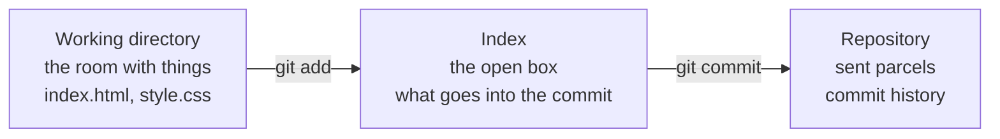
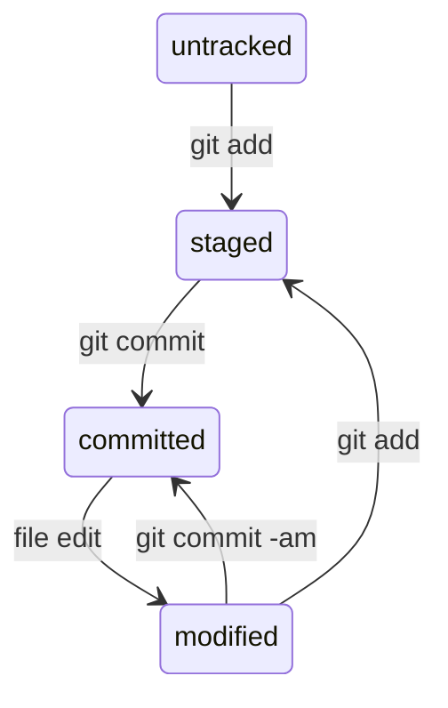
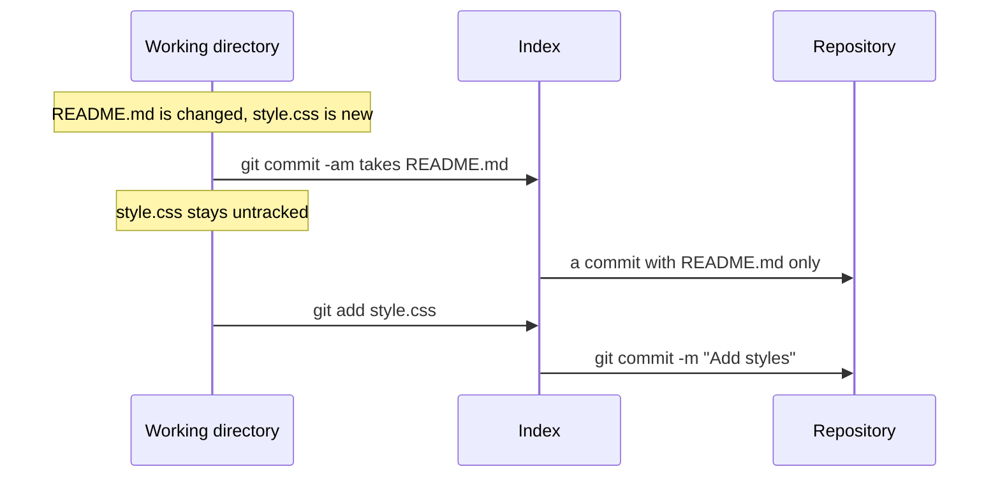
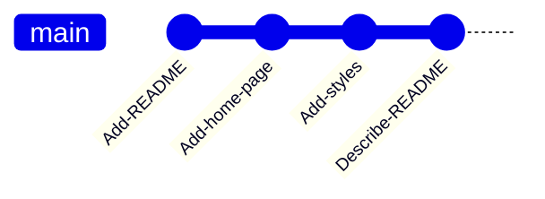

# The first commit

[Contents](../../README.md) · [← Back](../../Lesson-1/en/Getting%20to%20know%20Git%20and%20the%20terminal.md) · [Next →](../../Lesson-3/en/History%20and%20changes.md) · [RU](../ru/%D0%9F%D0%B5%D1%80%D0%B2%D1%8B%D0%B9%20%D0%BA%D0%BE%D0%BC%D0%BC%D0%B8%D1%82.md) · [EN](The%20first%20commit.md) · [UZ](../uz/Birinchi%20kommit.md)

> **Link to lesson 1:** you configured Git, created the `portfolio` repository and the `README.md` file, and `git status` listed it under `Untracked files` and suggested the `git add` command. Today you will follow the whole path of a file - from the working directory to the history - and make your first commits.

---

## Why you need this

You spent a whole evening building the home page and fixed the styles at the same time. In the morning the client says: "The home page is great, but please bring back the old colors." If everything is saved as one big snapshot called "made the site", you will have to separate one change from the other by hand.

Git lets you save your work **in portions**: the home page in one commit, the styles in another, the README edit in a third. Each commit has a clear message, and a month later the history shows what changed, when and why. This is what the history of any real project looks like, and this is what an employer looks at when they open your GitHub.

---

## What you will learn

- Explain the three areas of Git: the working directory, the index and the repository.
- Name the states of a file: untracked, staged, committed, modified.
- Add files to the index: `git add file` and `git add .`.
- Read the short status `git status -s`: what `??`, `A`, `M` and the columns mean.
- Make a commit with `git commit -m` and read Git's output.
- Write good commit messages in English.
- Commit modified files with one command, `git commit -am` - and know why it does not take new files.
- Append a line to a file with `>>` and create a multi-line file with `cat > file << 'EOF'`.

---

## Review: 3 questions from lesson 1

1. What does the `Untracked files` section in the output of `git status` mean?
2. What does the `>` sign do in the command `echo "text" > file`, and why is it dangerous?
3. Where does Git store the history of a repository?

Answers are at the end of the lesson.

---

## Lesson plan

| Section | What we do |
| --- | --- |
| The three areas of Git | Working directory, index, repository - explained with a parcel |
| The life cycle of a file | untracked, staged, committed, modified |
| `git add` | Put files into the index one by one and all at once |
| `git status -s` | The short status and its two columns |
| `git commit -m` | The first commit and Git's output |
| Mini-task 1 | First commits in a recipes repository |
| Commit messages | Rules and examples |
| `>>` and `cat > file << 'EOF'` | Append a line and create a file of several lines |
| `git commit -am` | A quick commit of modified files |
| The whole cycle | Four commits in the portfolio step by step |
| Mini-task 2 | A multi-line recipe and `git commit -am` |
| Independent work | A task in the learning terminal and on your computer |

---

## The three areas of Git

**In simple words:** a commit is a parcel. First you walk around the room and **choose things** (change files). Then you **put into a box** only what belongs to this parcel (`git add`). When everything is packed, you **seal the box, write what is inside on it and send it** (`git commit`). A parcel that has been sent cannot be changed, but before sending you can repack the box as much as you like: add one more thing or take out something extra.

Git has three such "areas":

| Area | English name | In the parcel | Where it is |
| --- | --- | --- | --- |
| Working directory | working directory, working tree | The room with things | The files you see and change |
| Index | index, staging area | The open box | The `.git/index` file - a list of what goes into the next commit |
| Repository | repository | Sent parcels | Commits in the `.git` folder |



**How to read the diagram.** Changes move from left to right. `git add` copies a snapshot of a file from the working directory into the index, and `git commit` packs everything in the index into a new commit. You cannot skip the index: a commit takes **only** what is in the index.

Why do we need a box if we could just save everything at once? So that **one logical change is one commit**. You fixed both the home page and the styles - but you commit them separately, with different messages. Then either of them is easy to find later and, if needed, to undo (lesson 4).

> **Important:** the index is not a "just in case" copy. If you change a file again after `git add`, the box holds the **old** version - the one from the moment of `git add`. New edits must be added again.

---

## The life cycle of a file

Every file in the working directory is in one of four states.

| State | Meaning of the word | What it means | In `git status` |
| --- | --- | --- | --- |
| untracked | not tracked | A new file that Git is not watching yet | `Untracked files` |
| staged | in the index | The changes are in the box and will go into the commit | `Changes to be committed` |
| committed | saved | The version is saved in a commit, there are no new edits | the file is not in the list |
| modified | changed | A tracked file has changed, the edits are not in the index yet | `Changes not staged for commit` |



**How to read the diagram.** A new file starts its path in the `untracked` state. After the first `git add` and commit, Git always watches it: any edit makes the file `modified`, and `git add` and `git commit` bring it back to `committed`. The `git commit -am` arrow is a shortcut for modified files, we will look at it below. Note: there is no arrow from `untracked` straight to `committed`.

**In simple words:** untracked is a thing you have just bought and have not yet added to the list of things in your flat. Until it is on the list, Git "does not notice" it: it does not save it and does not track its changes.

---

## `git add`: put it in the box

### `git add file`

Let's go back to the `portfolio` repository from lesson 1. It has one file, `README.md`, with the text `# Portfolio`, and it is `untracked`. Let's add it to the index:

```bash
git add README.md
```

Git says nothing - in the terminal this means "everything went well". Let's see what has changed:

```bash
git status
```

```text
On branch main

No commits yet

Changes to be committed:
  (use "git rm --cached <file>..." to unstage)
	new file:   README.md
```

| Line | Meaning |
| --- | --- |
| `Changes to be committed` | Changes that will go into the commit: the contents of the box |
| `(use "git rm --cached <file>..." to unstage)` | A hint on how to take a file out of the index. This is for the first commit; later Git will suggest `git restore --staged` (lesson 4) |
| `new file:   README.md` | A new file: it has not been in any commit yet |

You must type the file name exactly, with the right upper and lower case letters. If there is no file with that name, Git refuses:

```bash
git add readme.md
```

```text
fatal: pathspec 'readme.md' did not match any files
```

Meaning: "the path `readme.md` did not match any file". You can list several files separated by spaces: `git add index.html style.css`.

### `git add .`

The dot, as you remember from lesson 1, means "the current folder". The command `git add .` puts **all** new and modified files of the current folder and its subfolders into the index.

| Command | What goes into the index | When to use it |
| --- | --- | --- |
| `git add index.html` | Only `index.html` | You want to build a commit from specific files |
| `git add index.html style.css` | The two listed files | The same for several files |
| `git add .` | Everything new and modified in the current folder | All changes belong to one task |

> **Important:** always check `git status` before `git add .`. The dot will also pick up random files: drafts, copies, files with passwords. How to exclude such files for good is lesson 5.

---

## `git status -s`: the essentials in short

The long `git status` is detailed, but when there are many files, the short version is handier: `-s` (short).

Suppose `README.md` is already in the index (we have just run `git add`). Let's create two more files and look at the short status:

```bash
echo "<h1>Anna Karimova</h1>" > index.html
echo "body { font-family: sans-serif; }" > style.css
git status -s
```

```text
A  README.md
?? index.html
?? style.css
```

Each line starts with **two columns**:

```text
XY file-name
│└─ right column: working directory (changed after git add?)
└── left column: index (what is in the box)
```

| Code | Left column (index) | Right column (working directory) | Meaning |
| --- | --- | --- | --- |
| `??` | - | - | A new file, not tracked (untracked) |
| `A ` | A - added | empty | A new file is added to the index |
| ` M` | empty | M - modified | The file is changed, the edits are not in the index |
| `M ` | M | empty | The edits are added to the index |
| `MM` | M | M | Some edits are in the index, the file was changed again after `git add` |
| `AM` | A | M | A new file is in the index, but it was changed again after `git add` |

**In simple words:** the left column is "what is in the box", the right one is "what is still in the room and did not get into the box". A space means "no changes here". If you want the right column to be empty, run `git add`.

---

## `git commit -m`: seal and send

### The first commit

`git commit` packs the contents of the index into a commit. The `-m` (message) option sets the message - the label on the box. The message goes in quotes.

```bash
git commit -m "Add README"
```

```text
[main (root-commit) eb46eed] Add README
 1 file changed, 1 insertion(+)
 create mode 100644 README.md
```

| Line | Meaning |
| --- | --- |
| `main` | The commit was made on the `main` branch |
| `(root-commit)` | The root commit - the very first one in the repository, it has no "parent". This mark will not appear again |
| `eb46eed` | The short **hash** - a unique ID of the commit. Yours will be different. More about hashes in lesson 3 |
| `Add README` | Your message |
| `1 file changed, 1 insertion(+)` | 1 file changed, 1 line added |
| `create mode 100644 README.md` | A new file was created. `100644` means a normal (not executable) file |

Now let's check the state:

```bash
git status
```

```text
On branch main
nothing to commit, working tree clean
```

Meaning: "Nothing to commit, the working directory is clean". This means all three areas match and everything is saved. The `No commits yet` line is gone - there is a commit now.

**In simple words:** `working tree clean` means "the room is tidy": everything you changed has already been sent in parcels.

### What happened in the three areas

| Step | Command | Working directory | Index | Repository |
| --- | --- | --- | --- | --- |
| 1 | `echo "# Portfolio" > README.md` (lesson 1) | `README.md` | empty | no commits |
| 2 | `git add README.md` | `README.md` | `README.md` | no commits |
| 3 | `git commit -m "Add README"` | `README.md` | matches the commit | `eb46eed Add README` |

After a commit the index is not "emptied": it always holds a full snapshot of the next commit, and right now it matches the last commit. That is why `git status` says there is nothing to commit.

If the index does not differ from the last commit, you cannot make a commit. For example, if you forget `git add`:

```text
On branch main
Untracked files:
  (use "git add <file>..." to include in what will be committed)
	style.css

nothing added to commit but untracked files present (use "git add" to track)
```

The last line means: "nothing was added to the commit, but there are untracked files (use git add)". This is not a breakdown - Git is reminding you that the box is empty.

You can quickly see your commits with `git log --oneline` - one line per commit, newest on top. We will look at the history in detail in lesson 3.

---

## Mini-task 1

In the learning terminal (or in a real one):

1. Create a `recipes` repository with a `README.md` file containing the text `# My recipes` (as in mini-task 2 of lesson 1; if the folder already exists, just go into it).
2. Look at `git status -s`. What code is shown before `README.md`?
3. Add `README.md` to the index and look at `git status -s` again. What changed in the columns?
4. Make a commit with the message `Add README`.
5. Create a `plov.txt` file with the text `Plov: rice, carrots, meat, onion`, add it to the index and commit it with the message `Add plov recipe`.
6. Make sure that `git status` answers `working tree clean`.

---

## Good commit messages

Commit messages are read by people: you in six months, a colleague during a review, an employer on GitHub. In this course we follow the rules used in most projects.

| Rule | Why |
| --- | --- |
| In English | This is the norm in IT all over the world, GitHub and tools expect it |
| Imperative mood: `Add`, `Fix`, `Remove`, `Update` | It reads like an instruction: "this commit - **add** a form". Git itself writes this way: `Merge branch...` |
| Starts with a capital letter, no period at the end | It is a title, not a sentence |
| Up to 50 characters | Fully visible in `git log --oneline` and on GitHub |
| Says **what** was done, not "I did something" | The message should explain the contents of the commit without looking at the files |
| One commit - one logical change | If the message wants an "and", it may be two commits |

**In simple words:** test your message with the phrase "If applied, this commit will ...". "If applied, this commit will **add contact form**" - sounds right. "If applied, this commit will **added stuff**" - does not.

| Bad | Good | What is wrong |
| --- | --- | --- |
| `update` | `Update phone number in footer` | It is not clear what was updated |
| `commit` | `Add home page` | The word says nothing: every commit is a commit |
| `fix` | `Fix menu overlap on small screens` | What was fixed? |
| `Added styles.` | `Add styles` | Past tense and a period |
| `xatoni tuzatdim` | `Fix broken link to CV` | Not in English and no details |
| `Add header, footer, contact form, fix colors and update README` | Three separate commits | Too long, several tasks at once |

> **Important:** the message goes in quotes. Without them, `git commit -m Add home page` takes only the word `Add` as the message and `home` and `page` as file names, and prints `error: pathspec 'home' did not match any file(s) known to git`.

If you run `git commit` without `-m` at all, real Git opens a text editor for the message. Beginners are often scared by this (especially by the Vim editor). Use `-m` - it is easier. The learning terminal has no editor, and the simulator will tell you to use `-m`.

---

## Files from the terminal: `>>` and `cat > file << 'EOF'`

### `>>`: append to the end

In lesson 1 you learned that `>` **overwrites** a file. Two signs, `>>`, **append** a line to the end and keep the old contents.

```bash
echo "Built with HTML and CSS." >> README.md
cat README.md
```

```text
# Portfolio
Built with HTML and CSS.
```

| Sign | What it does | If the file does not exist |
| --- | --- | --- |
| `>` | Replaces all contents of the file | Creates the file |
| `>>` | Appends to the end of the file | Creates the file |

**In simple words:** `>` means wiping the board and writing again, `>>` means adding at the bottom of the board.

### `cat > file << 'EOF'`: a file of several lines

You cannot write an HTML page with a single `echo` command. For several lines there is a construction called a **here-document** ("a document right here"):

```bash
cat > index.html << 'EOF'
<!DOCTYPE html>
<html>
<head>
  <title>Anna Karimova</title>
</head>
<body>
  <h1>Anna Karimova</h1>
</body>
</html>
EOF
```

In the terminal it looks like this: after the first line the prompt changes to `>` - the terminal is waiting for more:

```text
$ cat > index.html << 'EOF'
> <!DOCTYPE html>
> <html>
> ...
> EOF
```

| Part | Meaning |
| --- | --- |
| `cat` | Prints what it receives as input |
| `> index.html` | The output goes not to the screen but to the `index.html` file (overwriting it) |
| `<< 'EOF'` | The input is the following lines, up to the `EOF` line (end of file) |
| `'EOF'` in quotes | The text goes into the file as it is: the terminal will not substitute values like `$USER` |
| `EOF` on the last line | The end of input. The line must be exactly `EOF` - no spaces or other characters |

**In simple words:** a here-document is a dictation. You tell the terminal "write into the file everything I dictate until I say the word EOF", dictate the lines and say "EOF".

The similar command `cat >> file << 'EOF'` appends several lines to the end of a file.

> **Important:** `>` in the first line overwrites the file, just like with `echo`. If `index.html` already had your markup, it will be lost. Before such a command, check that the file does not exist or that you do not mind losing it - or make a commit first: then you can bring the old version back (lesson 4).

On your computer you will, of course, write code in VS Code. But `>>` and here-documents are useful to know: people use them to create files in instructions, on servers and in the learning terminal.

---

## `git commit -am`: a quick commit of modified files

After we appended a line to `README.md`, it became `modified`:

```bash
git status -s
```

```text
 M README.md
```

A space in the left column, `M` in the right one: the file is changed, the edit is not in the index. The usual way is `git add README.md` and `git commit -m "..."`. For files that are already tracked there is a shortcut:

```bash
git commit -am "Describe project in README"
```

```text
[main 55b1780] Describe project in README
 1 file changed, 1 insertion(+)
```

`-am` is two options together: `-a` (all - "all modified tracked files go into the index") and `-m` (message). You can write the same thing as `git commit -a -m "..."`.

| Line | Meaning |
| --- | --- |
| `[main 55b1780]` | A new commit on the `main` branch, `(root-commit)` is gone |
| `1 file changed, 1 insertion(+)` | 1 file changed, 1 line added. There is no `create mode` line: the file is not new |

### Why `-a` does not take new files

`-a` adds only the files that Git **already tracks** - the ones that were in earlier commits. Git will not put a new file into the history by itself: what if it is a draft or a file with a password? You make the decision about a new file - with the `git add` command.



**How to read the diagram.** Time goes from top to bottom. `git commit -am` moves only the tracked `README.md` into the index and makes a commit right away. The new `style.css` stays in the working directory - it needs a separate `git add`.

If the folder has **only** new files, `git commit -am` answers with the familiar message `nothing added to commit but untracked files present`, and no commit is made.

| Situation | Command |
| --- | --- |
| You changed files that are already tracked, all edits are one task | `git commit -am "..."` |
| You created a new file | `git add file`, then `git commit -m "..."` |
| You changed several files, but these are different tasks | `git add` one file at a time and several commits |

---

## The whole cycle: four commits in the portfolio

Let's put it all together. The `portfolio` repository has only `README.md` and no commits. The goal is four commits: README, home page, styles, description in README.

| Step | Command | Working directory | Index | Repository |
| --- | --- | --- | --- | --- |
| 1 | `git add README.md` | `README.md` | `README.md` (A) | no commits |
| 2 | `git commit -m "Add README"` | `README.md` | = commit | `Add README` |
| 3 | `cat > index.html << 'EOF'` ... and `echo "..." > style.css` | + `index.html`, `style.css` (??) | no changes | 1 commit |
| 4 | `git add index.html` | `style.css` still ?? | + `index.html` (A) | 1 commit |
| 5 | `git commit -m "Add home page"` | `style.css` ?? | = commit | 2 commits |
| 6 | `git add style.css` and `git commit -m "Add styles"` | everything saved | = commit | 3 commits |
| 7 | `echo "Built with HTML and CSS." >> README.md` | `README.md` ( M) | no changes | 3 commits |
| 8 | `git commit -am "Describe project in README"` | clean | = commit | 4 commits |

The key moment is step 4. There are two new files in the folder, but we put only `index.html` into the index:

```bash
git add index.html
git status
```

```text
On branch main
Changes to be committed:
  (use "git restore --staged <file>..." to unstage)
	new file:   index.html

Untracked files:
  (use "git add <file>..." to include in what will be committed)
	style.css
```

The box is packed: it has only the home page, and `style.css` will wait for its own parcel.

```bash
git commit -m "Add home page"
```

```text
[main 2d2814c] Add home page
 1 file changed, 9 insertions(+)
 create mode 100644 index.html
```

`9 insertions(+)` means the nine HTML lines from the here-document. After steps 6–8 the history looks like this:

```bash
git log --oneline
```

```text
55b1780 (HEAD -> main) Describe project in README
7154fc6 Add styles
2d2814c Add home page
eb46eed Add README
```

New commits are on top. `HEAD -> main` shows where you are now: on the last commit of the `main` branch (details in lessons 3 and 6).



**How to read the diagram.** Each circle is a commit, the line is the `main` branch, and time goes from left to right. Each commit stores a snapshot of **all** tracked files: `Add-styles` has `README.md`, `index.html` and `style.css`. Four clear steps of history instead of one "made the site".

### Try to break it

1. In a new repository folder, create a file and immediately run `git commit -m "Add file"`, without `git add`. What will Git answer?
2. Write a message without quotes: `git commit -m Add home page`. What error will you see, and why does Git talk about a file called `home`?
3. Create a new file and try to commit it with `git commit -am "Add notes"`. Did the file get into the commit? Check `git status -s`.
4. Run `git add index.html`, then append a line to it with `>>` and look at `git status -s`. What do the two letters `AM` or `MM` mean?
5. Write a line into `README.md` with `>` instead of `>>` and run `cat README.md`. Where did the heading go?
6. Start a here-document and "forget" the `EOF` line: the next commands will go into the file as text. Look at the file with `cat`.

### Typical beginner mistakes

| Mistake | What you get | How to fix |
| --- | --- | --- |
| A commit without `git add` | `nothing added to commit but untracked files present (use "git add" to track)` | `git add file`, then `git commit -m` |
| A message without quotes | `error: pathspec 'home' did not match any file(s) known to git` | `git commit -m "Add home page"` |
| A typo or wrong letter case in the file name | `fatal: pathspec 'readme.md' did not match any files` | Check the name with `ls`, type it exactly: `README.md` |
| `git commit -am` for a new file | A commit without the new file or `nothing added to commit...` | A new file - through `git add` |
| `git add .` when you need a commit of one file | Extra files got into the commit | Check `git status -s` before `git add .`, add files by name |
| The file was changed after `git add` | `git status -s` shows `MM` or `AM`, the old version will go into the commit | Run `git add file` again before the commit |
| `>` instead of `>>` | The old contents of the file are gone | Append with `>>`; bringing back a version from a commit is lesson 4 |
| `git commit` without `-m` in real Git | The Vim editor opened, and it is not clear how to exit | Type `:q!` and press Enter, then repeat with `-m "..."` |
| A typo in the command: `git comit` | `git: 'comit' is not a git command` and a hint `commit` | Fix the command |

---

## Mini-task 2

Continue in the `recipes` repository from mini-task 1:

1. Create a `soup.md` file of four lines with `cat > soup.md << 'EOF'`: the heading `# Lentil soup` and three ingredients, each on a new line after `- `.
2. Append the line `Recipes: plov, lentil soup` to `README.md` with `>>`.
3. Look at `git status -s` and explain both lines.
4. Commit the README edit with `git commit -am "List recipes in README"`. What is left in `git status -s` and why?
5. Save `soup.md` in a separate commit with the message `Add lentil soup recipe`.
6. Look at the history with `git log --oneline`: there should be 4 commits.

---

## Lesson summary: cheat sheet

| Task | Command |
| --- | --- |
| Put a file into the index | `git add file` |
| Put several files | `git add index.html style.css` |
| Put everything new and modified | `git add .` |
| Short status | `git status -s` |
| Make a commit | `git commit -m "Add home page"` |
| Commit all modified tracked files | `git commit -am "Update README"` |
| See commits one per line | `git log --oneline` (details in lesson 3) |
| Append a line to a file | `echo "text" >> file` |
| Create a file of several lines | `cat > file << 'EOF'` ... `EOF` |
| Append several lines | `cat >> file << 'EOF'` ... `EOF` |

---

## Independent work

### Part 1. IDE task (graded by the platform)

Git is configured, and you are in the `~/portfolio` folder: it has a repository and a `README.md` file, there are no commits yet. Write the commands one per line:

1. Check the state of the repository, add `README.md` to the index and make the first commit.
2. Create `index.html` from several lines of HTML with `cat > index.html << 'EOF'` (the last line is `EOF`).
3. Create `style.css` with one CSS rule using `echo`.
4. Make a commit that contains only `index.html`.
5. Save `style.css` in a separate commit.
6. Append a line with a project description to `README.md` (with `>>`) and commit it with `git commit -am`.
7. Make sure the working directory is clean.

Commit messages are in English, in the imperative mood, and each commit has its own (not `update` and not `commit`).

What the platform checks: that there are exactly four commits and they come in the right order; that the first commit contains only `README.md`, the second adds only `index.html` (of several lines), the third adds only a non-empty `style.css`, and the fourth changes only `README.md`; that the line in `README.md` is appended and the old text is kept (this is also checked with a different starting README text); that the messages are meaningful and different; that `git commit -am` is used; that the working directory is clean at the end; that the script runs without errors.

### Part 2. Project on your computer

Work in real Git, in the repository of your website from lesson 1 (all its files are still `Untracked`).

1. Look at `git status -s` and decide which files belong to one task: for example, HTML pages, styles, scripts.
2. Make 2–3 commits by group: `git add index.html about.html` → `git commit -m "Add pages"`, then `git add css/` → `git commit -m "Add styles"` and so on, until `git status` answers `working tree clean`.
3. If the project has no `README.md`, create it with `cat > README.md << 'EOF'` (the site name and a couple of lines of description) and commit it separately.
4. Change something in a file that is already committed (for example, the heading text in VS Code) and save the edit with `git commit -am`.
5. Run `git log --oneline` and compare it with the screenshot from lesson 1: your files have become history.

### Acceptance criteria

- [ ] The IDE task is accepted.
- [ ] Your website repository has at least three commits, and `git status` answers `working tree clean`.
- [ ] All commit messages are in English, in the imperative mood, up to 50 characters.
- [ ] You can explain the three areas of Git and the life cycle of a file using the diagram.
- [ ] You know why `git commit -am` does not add new files.

---

## Self-check questions

1. Name the three areas of Git and explain them with the parcel example.
2. Why do we need the index if we could commit all changes at once?
3. What is the difference between `git add index.html` and `git add .`? When do you use each?
4. Name the four states of a file and the commands that move a file from one state to another.
5. What do the lines `?? style.css`, `A  index.html` and ` M README.md` mean in `git status -s`?
6. What do `(root-commit)` and `eb46eed` mean in the output of `git commit`?
7. What does `nothing to commit, working tree clean` mean?
8. What rules of a good commit message do you know? Fix the message `fixed some stuff.`.
9. What does `git commit -am` do, and why does it not take new files?
10. What is the difference between `>` and `>>`? How do you create a file of several lines?

After the questions, take the **lesson test** on the platform: 12 questions, pass mark 70%.

---

## What's next

You now have a history of several commits. In lesson 3 you will learn to read it: the detailed `git log`, viewing any commit with `git show`, comparing versions with `git diff` - and you will find out what the hash `eb46eed` really means.

---

## Answers

**Review**

1. The folder has files that Git is not tracking yet: they have never been added with `git add`.
2. It redirects the output of `echo` into a file. It is dangerous because it fully replaces the contents of the file.
3. In the hidden `.git` folder inside the project folder.

**Mini-task 1**

```bash
mkdir recipes
cd recipes
git init
echo "# My recipes" > README.md
git status -s
git add README.md
git status -s
git commit -m "Add README"
echo "Plov: rice, carrots, meat, onion" > plov.txt
git add plov.txt
git commit -m "Add plov recipe"
git status
```

Before `git add`, `README.md` has the code `??` (untracked), after it - `A ` in the left column: the file is in the index. If the `recipes` folder already exists, replace the first four commands with `cd recipes`.

**Mini-task 2**

```bash
cat > soup.md << 'EOF'
# Lentil soup
- red lentils
- onion
- carrot
EOF
echo "Recipes: plov, lentil soup" >> README.md
git status -s
git commit -am "List recipes in README"
git status -s
git add soup.md
git commit -m "Add lentil soup recipe"
git log --oneline
```

`git status -s` shows ` M README.md` (changed, not in the index) and `?? soup.md` (new). After `git commit -am`, `?? soup.md` remains: `-a` does not take untracked files.

**Self-check questions**

1. The working directory is the room with things (the files you change), the index is the open box (what goes into the commit), the repository is the sent parcels (the commit history).
2. To build a commit only from what belongs to one task: one logical change - one commit.
3. `git add index.html` adds one file, `git add .` adds all new and modified files of the current folder. The first is for when the folder has changes for different commits, the second is for when everything belongs to one task.
4. untracked → (`git add`) staged → (`git commit`) committed → (edit) modified → (`git add`) staged.
5. `??` is a new untracked file, `A ` is a new file in the index, ` M` is a changed file whose edit is not in the index.
6. `(root-commit)` is the first commit of the repository, with no parent. `eb46eed` is the short hash, the ID of the commit.
7. There is nothing to commit: the working directory, the index and the last commit match.
8. English, imperative mood, a capital letter and no period, up to 50 characters, says what was done. For example: `Fix menu links on about page`.
9. It adds all modified tracked files to the index and makes a commit. Git does not take new files by itself, so that drafts and secrets do not get into the history by accident: the decision about a new file is yours (`git add`).
10. `>` overwrites the file, `>>` appends to the end. A multi-line file: `cat > file << 'EOF'`, then the lines of text, then the line `EOF`.

---

[Contents](../../README.md) · [← Back](../../Lesson-1/en/Getting%20to%20know%20Git%20and%20the%20terminal.md) · [Next →](../../Lesson-3/en/History%20and%20changes.md) · [RU](../ru/%D0%9F%D0%B5%D1%80%D0%B2%D1%8B%D0%B9%20%D0%BA%D0%BE%D0%BC%D0%BC%D0%B8%D1%82.md) · [EN](The%20first%20commit.md) · [UZ](../uz/Birinchi%20kommit.md)
