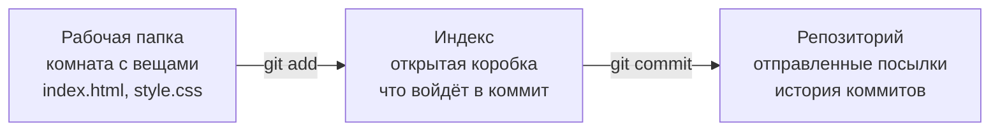
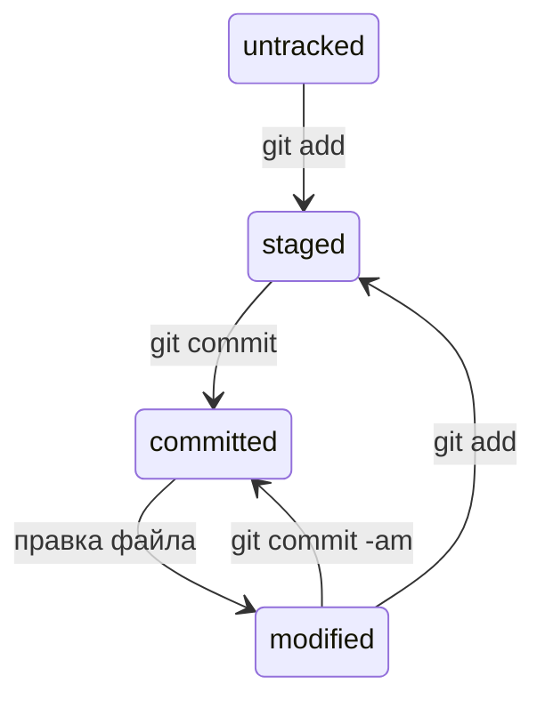
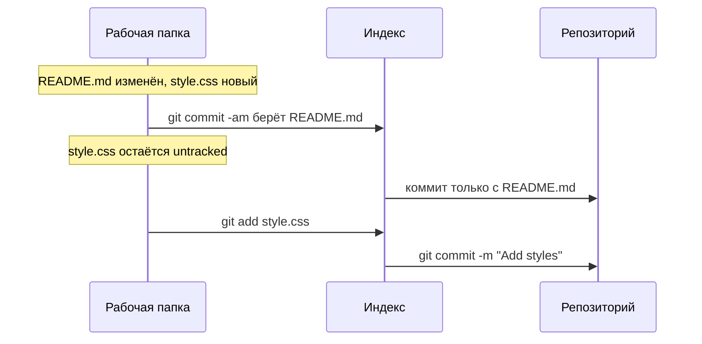
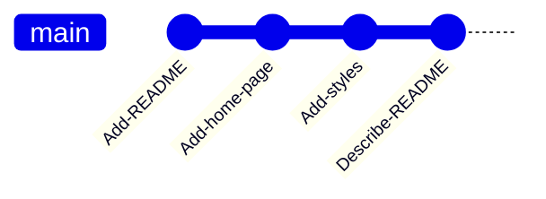

# Первый коммит

[Содержание](../../README.md) · [← Назад](../../Lesson-1/ru/%D0%97%D0%BD%D0%B0%D0%BA%D0%BE%D0%BC%D1%81%D1%82%D0%B2%D0%BE%20%D1%81%20Git%20%D0%B8%20%D1%82%D0%B5%D1%80%D0%BC%D0%B8%D0%BD%D0%B0%D0%BB%D0%BE%D0%BC.md) · [Вперёд →](../../Lesson-3/ru/%D0%98%D1%81%D1%82%D0%BE%D1%80%D0%B8%D1%8F%20%D0%B8%20%D0%B8%D0%B7%D0%BC%D0%B5%D0%BD%D0%B5%D0%BD%D0%B8%D1%8F.md) · [RU](%D0%9F%D0%B5%D1%80%D0%B2%D1%8B%D0%B9%20%D0%BA%D0%BE%D0%BC%D0%BC%D0%B8%D1%82.md) · [EN](../en/The%20first%20commit.md) · [UZ](../uz/Birinchi%20kommit.md)

> **Связь с уроком 1:** вы настроили Git, создали репозиторий `portfolio` и файл `README.md`, а `git status` назвал его `Untracked files` и подсказал команду `git add`. Сегодня вы пройдёте весь путь файла - от рабочей папки до истории - и сделаете первые коммиты.

---

## Зачем это вам

Вы целый вечер верстали главную страницу и одновременно поправили стили. Утром заказчик говорит: «Главная - отлично, а новые цвета верните как было». Если всё сохранено одним большим снимком «сделал сайт», отделить одно от другого придётся вручную.

Git позволяет сохранять работу **порциями**: главная страница - в одном коммите, стили - в другом, правка README - в третьем. Каждый коммит подписан понятным сообщением, и через месяц по истории видно, что, когда и зачем менялось. Именно так выглядит история любого рабочего проекта, и именно её смотрит работодатель, открывая ваш GitHub.

---

## Чему вы научитесь

- Объяснять три зоны Git: рабочая папка, индекс и репозиторий.
- Называть состояния файла: untracked, staged, committed, modified.
- Добавлять файлы в индекс: `git add файл` и `git add .`.
- Читать короткий статус `git status -s`: что значат `??`, `A`, `M` и колонки.
- Делать коммит командой `git commit -m` и читать ответ Git.
- Писать хорошие сообщения коммитов на английском.
- Коммитить изменённые файлы одной командой `git commit -am` - и знать, почему она не берёт новые файлы.
- Дописывать строку в файл знаком `>>` и создавать многострочный файл командой `cat > файл << 'EOF'`.

---

## Повторение: 3 вопроса из урока 1

1. Что означает раздел `Untracked files` в ответе `git status`?
2. Что делает знак `>` в команде `echo "текст" > файл` и чем он опасен?
3. Где Git хранит историю репозитория?

Ответы - в конце урока.

---

## План урока

| Раздел | Что делаем |
| --- | --- |
| Три зоны Git | Рабочая папка, индекс, репозиторий - на примере посылки |
| Жизненный цикл файла | untracked, staged, committed, modified |
| `git add` | Кладём файлы в индекс по одному и все сразу |
| `git status -s` | Короткий статус и его две колонки |
| `git commit -m` | Первый коммит и ответ Git |
| Мини-задание 1 | Первые коммиты в репозитории рецептов |
| Сообщения коммитов | Правила и примеры |
| `>>` и `cat > файл << 'EOF'` | Дописываем строку и создаём файл из нескольких строк |
| `git commit -am` | Быстрый коммит изменённых файлов |
| Весь цикл | Четыре коммита в портфолио шаг за шагом |
| Мини-задание 2 | Многострочный рецепт и `git commit -am` |
| Самостоятельная работа | Задание в учебном терминале и на компьютере |

---

## Три зоны Git

**Простыми словами:** коммит - это посылка. Сначала вы ходите по комнате и **выбираете вещи** (меняете файлы). Потом **кладёте в коробку** только то, что относится к этой посылке (`git add`). Когда всё собрано, вы **заклеиваете коробку, пишете на ней, что внутри, и отправляете** (`git commit`). Отправленную посылку уже не изменить, а коробку до отправки можно собирать сколько угодно: доложить вещь или вынуть лишнюю.

У Git три такие «зоны»:

| Зона | Английское название | В посылке | Где находится |
| --- | --- | --- | --- |
| Рабочая папка | working directory, working tree | Комната с вещами | Файлы, которые вы видите и меняете |
| Индекс | index, staging area | Открытая коробка | Файл `.git/index` - список того, что войдёт в следующий коммит |
| Репозиторий | repository | Отправленные посылки | Коммиты в папке `.git` |



**Как читать схему.** Изменения движутся слева направо. `git add` переносит снимок файла из рабочей папки в индекс, `git commit` упаковывает всё содержимое индекса в новый коммит. Перепрыгнуть через индекс нельзя: коммит берёт **только** то, что лежит в индексе.

Зачем нужна коробка, если можно было бы сразу сохранять всё? Чтобы **одно логическое изменение было одним коммитом**. Вы поправили и главную страницу, и стили - а коммитите их отдельно, с разными сообщениями. Тогда любое из них потом легко найти и при необходимости отменить (урок 4).

> **Важно:** индекс - это не копия «на всякий случай». Если после `git add` вы снова изменили файл, в коробке лежит **старая** версия - та, что была в момент `git add`. Новые правки нужно снова добавить.

---

## Жизненный цикл файла

Каждый файл в рабочей папке находится в одном из четырёх состояний.

| Состояние | Перевод | Что значит | В `git status` |
| --- | --- | --- | --- |
| untracked | не отслеживается | Новый файл, Git за ним ещё не следит | `Untracked files` |
| staged | в индексе | Изменения лежат в коробке и войдут в коммит | `Changes to be committed` |
| committed | зафиксирован | Версия сохранена в коммите, новых правок нет | файла в списке нет |
| modified | изменён | Отслеживаемый файл изменён, правки ещё не в индексе | `Changes not staged for commit` |



**Как читать схему.** Новый файл начинает путь в состоянии `untracked`. После первого `git add` и коммита Git следит за ним всегда: любая правка делает файл `modified`, а `git add` и `git commit` снова приводят его в `committed`. Стрелка `git commit -am` - короткий путь для изменённых файлов, его разберём ниже. Обратите внимание: из `untracked` сразу в `committed` стрелки нет.

**Простыми словами:** untracked - вещь, которую вы только что купили и ещё не внесли в опись квартиры. Пока она не в описи, Git её «не замечает»: не сохраняет и не следит за её изменениями.

---

## `git add`: положить в коробку

### `git add файл`

Вернёмся в репозиторий `portfolio` из урока 1. В нём один файл `README.md` с текстом `# Portfolio`, и он `untracked`. Добавим его в индекс:

```bash
git add README.md
```

Git ничего не отвечает - в терминале это значит «всё прошло успешно». Посмотрим, что изменилось:

```bash
git status
```

```text
On branch main

No commits yet

Changes to be committed:
  (use "git rm --cached <file>..." to unstage)
	new file:   README.md
```

| Строка | Перевод и смысл |
| --- | --- |
| `Changes to be committed` | Изменения, которые войдут в коммит: содержимое коробки |
| `(use "git rm --cached <file>..." to unstage)` | Подсказка, как вынуть файл из индекса. В первом коммите - так, позже Git предложит `git restore --staged` (урок 4) |
| `new file:   README.md` | Новый файл: в коммитах его ещё не было |

Имя файла нужно писать точно, с учётом регистра букв. Если файла с таким именем нет, Git откажет:

```bash
git add readme.md
```

```text
fatal: pathspec 'readme.md' did not match any files
```

Перевод: «путь `readme.md` не совпал ни с одним файлом». Можно перечислить несколько файлов через пробел: `git add index.html style.css`.

### `git add .`

Точка, как вы помните из урока 1, означает «текущая папка». Команда `git add .` кладёт в индекс **все** новые и изменённые файлы текущей папки и вложенных папок.

| Команда | Что попадёт в индекс | Когда использовать |
| --- | --- | --- |
| `git add index.html` | Только `index.html` | Хотите собрать коммит из конкретных файлов |
| `git add index.html style.css` | Два перечисленных файла | То же для нескольких файлов |
| `git add .` | Всё новое и изменённое в текущей папке | Все изменения относятся к одной задаче |

> **Важно:** перед `git add .` всегда смотрите `git status`. Точка заберёт и случайные файлы: черновики, копии, файлы с паролями. Как навсегда исключить такие файлы - урок 5.

---

## `git status -s`: коротко о главном

Длинный `git status` подробен, но когда файлов много, удобнее короткий вариант: `-s` (short).

Пусть `README.md` уже в индексе (мы только что сделали `git add`). Создадим ещё два файла и посмотрим короткий статус:

```bash
echo "<h1>Anna Karimova</h1>" > index.html
echo "body { font-family: sans-serif; }" > style.css
git status -s
```

```text
A  README.md
?? index.html
?? style.css
```

Каждая строка начинается с **двух колонок**:

```text
XY имя-файла
│└─ правая колонка: рабочая папка (изменён ли файл после git add)
└── левая колонка: индекс (что лежит в коробке)
```

| Код | Левая колонка (индекс) | Правая колонка (рабочая папка) | Смысл |
| --- | --- | --- | --- |
| `??` | - | - | Новый файл, не отслеживается (untracked) |
| `A ` | A - added | пусто | Новый файл добавлен в индекс |
| ` M` | пусто | M - modified | Файл изменён, правки не в индексе |
| `M ` | M | пусто | Правки добавлены в индекс |
| `MM` | M | M | Часть правок в индексе, после `git add` файл снова изменили |
| `AM` | A | M | Новый файл в индексе, но после `git add` его снова изменили |

**Простыми словами:** левая колонка - «что в коробке», правая - «что ещё лежит в комнате, а в коробку не попало». Пробел значит «здесь без изменений». Хотите, чтобы правая колонка опустела, - сделайте `git add`.

---

## `git commit -m`: заклеить и отправить

### Первый коммит

`git commit` упаковывает содержимое индекса в коммит. Параметр `-m` (message) задаёт сообщение - надпись на коробке. Сообщение пишется в кавычках.

```bash
git commit -m "Add README"
```

```text
[main (root-commit) eb46eed] Add README
 1 file changed, 1 insertion(+)
 create mode 100644 README.md
```

| Строка | Перевод и смысл |
| --- | --- |
| `main` | Коммит сделан на ветке `main` |
| `(root-commit)` | Корневой коммит - самый первый в репозитории, у него нет «родителя». Дальше эта пометка не появится |
| `eb46eed` | Короткий **хеш** - уникальный идентификатор коммита. У вас он будет другим. Подробно о хешах - в уроке 3 |
| `Add README` | Ваше сообщение |
| `1 file changed, 1 insertion(+)` | Изменён 1 файл, добавлена 1 строка |
| `create mode 100644 README.md` | Создан новый файл. `100644` - обычный (не исполняемый) файл |

Теперь проверим состояние:

```bash
git status
```

```text
On branch main
nothing to commit, working tree clean
```

Перевод: «Коммитить нечего, рабочая папка чистая». Это значит: все три зоны совпадают, всё сохранено. Строка `No commits yet` исчезла - коммит уже есть.

**Простыми словами:** `working tree clean` - «в комнате порядок»: всё, что вы меняли, уже отправлено в посылках.

### Что произошло в трёх зонах

| Шаг | Команда | Рабочая папка | Индекс | Репозиторий |
| --- | --- | --- | --- | --- |
| 1 | `echo "# Portfolio" > README.md` (урок 1) | `README.md` | пусто | коммитов нет |
| 2 | `git add README.md` | `README.md` | `README.md` | коммитов нет |
| 3 | `git commit -m "Add README"` | `README.md` | совпадает с коммитом | `eb46eed Add README` |

После коммита индекс не «опустошается»: он всегда хранит полный снимок следующего коммита и сейчас совпадает с последним коммитом. Поэтому `git status` пишет, что коммитить нечего.

Если индекс не отличается от последнего коммита, коммит не получится. Например, если забыть `git add`:

```text
On branch main
Untracked files:
  (use "git add <file>..." to include in what will be committed)
	style.css

nothing added to commit but untracked files present (use "git add" to track)
```

Перевод последней строки: «в коммит ничего не добавлено, но есть неотслеживаемые файлы (используйте git add)». Это не поломка - Git напоминает, что коробка пуста.

Быстро увидеть сделанные коммиты можно командой `git log --oneline` - по строке на коммит, новые сверху. Подробно историю разберём в уроке 3.

---

## Мини-задание 1

В учебном терминале (или в настоящем):

1. Создайте репозиторий `recipes` с файлом `README.md` и текстом `# My recipes` (как в мини-задании 2 урока 1; если папка уже есть - просто перейдите в неё).
2. Посмотрите `git status -s`. Какой код стоит перед `README.md`?
3. Добавьте `README.md` в индекс и снова посмотрите `git status -s`. Что изменилось в колонках?
4. Сделайте коммит с сообщением `Add README`.
5. Создайте файл `plov.txt` с текстом `Plov: rice, carrots, meat, onion`, добавьте его в индекс и закоммитьте с сообщением `Add plov recipe`.
6. Убедитесь, что `git status` отвечает `working tree clean`.

---

## Хорошие сообщения коммитов

Сообщение коммита читают люди: вы через полгода, коллега на ревью, работодатель на GitHub. В курсе мы следуем правилам, принятым в большинстве проектов.

| Правило | Почему |
| --- | --- |
| На английском | Так принято в IT во всём мире, GitHub и инструменты рассчитаны на это |
| Повелительное наклонение: `Add`, `Fix`, `Remove`, `Update` | Читается как команда: «этот коммит - **добавь** форму». Так пишет и сам Git: `Merge branch...` |
| С заглавной буквы, без точки в конце | Это заголовок, а не предложение |
| До 50 символов | Полностью видно в `git log --oneline` и на GitHub |
| Говорит, **что** сделано, а не «я что-то сделал» | По сообщению должно быть понятно содержание коммита без просмотра файлов |
| Один коммит - одно логическое изменение | Если в сообщение просится «и», возможно, это два коммита |

**Простыми словами:** проверьте сообщение фразой «If applied, this commit will ...» («если применить, этот коммит ...»). «If applied, this commit will **add contact form**» - звучит. «If applied, this commit will **added stuff**» - нет.

| Плохо | Хорошо | Что не так |
| --- | --- | --- |
| `update` | `Update phone number in footer` | Непонятно, что обновлено |
| `commit` | `Add home page` | Слово ничего не сообщает: любой коммит - commit |
| `fix` | `Fix menu overlap on small screens` | Что исправлено? |
| `Added styles.` | `Add styles` | Прошедшее время и точка |
| `исправил баг` | `Fix broken link to CV` | Не на английском и без подробностей |
| `Add header, footer, contact form, fix colors and update README` | Три отдельных коммита | Слишком длинно, несколько задач сразу |

> **Важно:** сообщение пишется в кавычках. Без них `git commit -m Add home page` поймёт как сообщение только слово `Add`, а `home` и `page` - как имена файлов, и выдаст `error: pathspec 'home' did not match any file(s) known to git`.

Если вызвать `git commit` вообще без `-m`, настоящий Git откроет текстовый редактор для сообщения. Новичков это часто пугает (особенно редактор Vim). Пишите `-m` - так проще. В учебном терминале редактора нет, и симулятор подскажет использовать `-m`.

---

## Файлы из терминала: `>>` и `cat > файл << 'EOF'`

### `>>`: дописать в конец

В уроке 1 вы узнали, что `>` **перезаписывает** файл. Два знака `>>` **дописывают** строку в конец, сохраняя старое содержимое.

```bash
echo "Built with HTML and CSS." >> README.md
cat README.md
```

```text
# Portfolio
Built with HTML and CSS.
```

| Знак | Что делает | Если файла нет |
| --- | --- | --- |
| `>` | Заменяет всё содержимое файла | Создаёт файл |
| `>>` | Дописывает в конец файла | Создаёт файл |

**Простыми словами:** `>` - стереть доску и написать заново, `>>` - дописать внизу доски.

### `cat > файл << 'EOF'`: файл из нескольких строк

Страницу HTML одной командой `echo` не напишешь. Для нескольких строк есть конструкция **here-document** («документ прямо здесь»):

```bash
cat > index.html << 'EOF'
<!DOCTYPE html>
<html>
<head>
  <title>Anna Karimova</title>
</head>
<body>
  <h1>Anna Karimova</h1>
</body>
</html>
EOF
```

В терминале это выглядит так: после первой строки приглашение меняется на `>` - терминал ждёт продолжения:

```text
$ cat > index.html << 'EOF'
> <!DOCTYPE html>
> <html>
> ...
> EOF
```

| Часть | Значение |
| --- | --- |
| `cat` | Выводит то, что получает на вход |
| `> index.html` | Вывод - не на экран, а в файл `index.html` (с перезаписью) |
| `<< 'EOF'` | Вход - следующие строки, до строки `EOF` (end of file - «конец файла») |
| `'EOF'` в кавычках | Текст попадёт в файл как есть: терминал не будет подставлять значения вроде `$USER` |
| `EOF` в последней строке | Конец ввода. Строка должна быть ровно `EOF` - без пробелов и других символов |

**Простыми словами:** here-document - диктант. Вы говорите терминалу «пиши в файл всё, что я продиктую, пока не скажу слово EOF», диктуете строки и произносите «EOF».

Похожая команда `cat >> файл << 'EOF'` дописывает несколько строк в конец файла.

> **Важно:** `>` в первой строке перезаписывает файл, как и у `echo`. Если в `index.html` уже была ваша вёрстка, она пропадёт. Перед такой командой проверьте, что файла нет или его не жалко, - или сначала сделайте коммит: тогда старую версию можно будет вернуть (урок 4).

На своём компьютере вы, конечно, будете писать код в VS Code. Но команды `>>` и here-document полезно знать: ими создают файлы в инструкциях, на серверах и в учебном терминале.

---

## `git commit -am`: быстрый коммит изменённых файлов

После того как мы дописали строку в `README.md`, он стал `modified`:

```bash
git status -s
```

```text
 M README.md
```

Пробел в левой колонке, `M` в правой: файл изменён, в индекс правка не попала. Обычный путь - `git add README.md` и `git commit -m "..."`. Для уже отслеживаемых файлов есть сокращение:

```bash
git commit -am "Describe project in README"
```

```text
[main 55b1780] Describe project in README
 1 file changed, 1 insertion(+)
```

`-am` - это два параметра вместе: `-a` (all - «все изменённые отслеживаемые файлы - в индекс») и `-m` (сообщение). То же самое можно записать как `git commit -a -m "..."`.

| Строка | Перевод и смысл |
| --- | --- |
| `[main 55b1780]` | Новый коммит на ветке `main`, `(root-commit)` больше нет |
| `1 file changed, 1 insertion(+)` | Изменён 1 файл, добавлена 1 строка. Строки `create mode` нет: файл не новый |

### Почему `-a` не берёт новые файлы

`-a` добавляет только файлы, которые Git **уже отслеживает** - те, что были в прошлых коммитах. Новый файл Git сам в историю не возьмёт: вдруг это черновик или файл с паролем? Решение о новом файле принимаете вы - командой `git add`.



**Как читать схему.** Время идёт сверху вниз. `git commit -am` переносит в индекс только отслеживаемый `README.md` и сразу делает коммит. Новый `style.css` остаётся в рабочей папке - для него нужен отдельный `git add`.

Если в папке **только** новые файлы, `git commit -am` ответит знакомым сообщением `nothing added to commit but untracked files present` и коммита не будет.

| Ситуация | Команда |
| --- | --- |
| Изменили уже отслеживаемые файлы, все правки - одна задача | `git commit -am "..."` |
| Создали новый файл | `git add файл`, затем `git commit -m "..."` |
| Изменили несколько файлов, но это разные задачи | `git add` по одному файлу и несколько коммитов |

---

## Весь цикл: четыре коммита в портфолио

Соберём всё вместе. Репозиторий `portfolio`, в нём только `README.md`, коммитов нет. Цель - четыре коммита: README, главная страница, стили, описание в README.

| Шаг | Команда | Рабочая папка | Индекс | Репозиторий |
| --- | --- | --- | --- | --- |
| 1 | `git add README.md` | `README.md` | `README.md` (A) | коммитов нет |
| 2 | `git commit -m "Add README"` | `README.md` | = коммит | `Add README` |
| 3 | `cat > index.html << 'EOF'` ... и `echo "..." > style.css` | + `index.html`, `style.css` (??) | без изменений | 1 коммит |
| 4 | `git add index.html` | `style.css` ещё ?? | + `index.html` (A) | 1 коммит |
| 5 | `git commit -m "Add home page"` | `style.css` ?? | = коммит | 2 коммита |
| 6 | `git add style.css` и `git commit -m "Add styles"` | всё сохранено | = коммит | 3 коммита |
| 7 | `echo "Built with HTML and CSS." >> README.md` | `README.md` ( M) | без изменений | 3 коммита |
| 8 | `git commit -am "Describe project in README"` | чисто | = коммит | 4 коммита |

Ключевой момент - шаг 4. В папке два новых файла, но в индекс кладём только `index.html`:

```bash
git add index.html
git status
```

```text
On branch main
Changes to be committed:
  (use "git restore --staged <file>..." to unstage)
	new file:   index.html

Untracked files:
  (use "git add <file>..." to include in what will be committed)
	style.css
```

Коробка собрана: в ней только главная страница, `style.css` подождёт своей посылки.

```bash
git commit -m "Add home page"
```

```text
[main 2d2814c] Add home page
 1 file changed, 9 insertions(+)
 create mode 100644 index.html
```

`9 insertions(+)` - девять строк HTML из here-document. После шагов 6–8 история выглядит так:

```bash
git log --oneline
```

```text
55b1780 (HEAD -> main) Describe project in README
7154fc6 Add styles
2d2814c Add home page
eb46eed Add README
```

Новые коммиты - сверху. `HEAD -> main` показывает, где вы сейчас: на последнем коммите ветки `main` (подробно - уроки 3 и 6).



**Как читать схему.** Каждый кружок - коммит, линия - ветка `main`, время идёт слева направо. Каждый коммит хранит снимок **всех** отслеживаемых файлов: в `Add-styles` есть и `README.md`, и `index.html`, и `style.css`. Четыре понятных шага истории вместо одного «сделал сайт».

### Попробуйте сломать

1. В новой папке-репозитории создайте файл и сразу выполните `git commit -m "Add file"`, без `git add`. Что ответит Git?
2. Напишите сообщение без кавычек: `git commit -m Add home page`. Какую ошибку вы увидите и почему Git говорит о файле `home`?
3. Создайте новый файл и попробуйте закоммитить его через `git commit -am "Add notes"`. Попал ли файл в коммит? Проверьте `git status -s`.
4. Выполните `git add index.html`, затем допишите в него строку через `>>` и посмотрите `git status -s`. Что значат две буквы `AM` или `MM`?
5. Запишите в `README.md` строку через `>` вместо `>>` и выполните `cat README.md`. Куда делся заголовок?
6. Начните here-document и «забудьте» строку `EOF`: следующие команды попадут в файл как текст. Посмотрите файл командой `cat`.

### Частые ошибки новичков

| Ошибка | Что получится | Как исправить |
| --- | --- | --- |
| Коммит без `git add` | `nothing added to commit but untracked files present (use "git add" to track)` | `git add файл`, затем `git commit -m` |
| Сообщение без кавычек | `error: pathspec 'home' did not match any file(s) known to git` | `git commit -m "Add home page"` |
| Опечатка или неверный регистр в имени файла | `fatal: pathspec 'readme.md' did not match any files` | Проверить имя через `ls`, писать точно: `README.md` |
| `git commit -am` для нового файла | Коммит без нового файла или `nothing added to commit...` | Новый файл - через `git add` |
| `git add .`, когда нужен коммит одного файла | В коммит попали лишние файлы | Перед `git add .` смотреть `git status -s`, добавлять по имени |
| Файл изменили после `git add` | `git status -s` показывает `MM` или `AM`, в коммит уйдёт старая версия | Снова `git add файл` перед коммитом |
| `>` вместо `>>` | Старое содержимое файла пропало | Дописывать через `>>`; вернуть версию из коммита - урок 4 |
| `git commit` без `-m` в настоящем Git | Открылся редактор Vim, непонятно, как выйти | Набрать `:q!` и Enter, затем повторить с `-m "..."` |
| Опечатка в команде: `git comit` | `git: 'comit' is not a git command` и подсказка `commit` | Исправить команду |

---

## Мини-задание 2

Продолжайте в репозитории `recipes` из мини-задания 1:

1. Создайте файл `soup.md` из четырёх строк командой `cat > soup.md << 'EOF'`: заголовок `# Lentil soup` и три ингредиента, каждый с новой строки через `- `.
2. Допишите в `README.md` строку `Recipes: plov, lentil soup` знаком `>>`.
3. Посмотрите `git status -s` и объясните обе строки.
4. Закоммитьте правку README командой `git commit -am "List recipes in README"`. Что осталось в `git status -s` и почему?
5. Отдельным коммитом сохраните `soup.md` с сообщением `Add lentil soup recipe`.
6. Посмотрите историю командой `git log --oneline`: должно быть 4 коммита.

---

## Итоги урока: шпаргалка

| Задача | Команда |
| --- | --- |
| Положить файл в индекс | `git add файл` |
| Положить несколько файлов | `git add index.html style.css` |
| Положить всё новое и изменённое | `git add .` |
| Короткий статус | `git status -s` |
| Сделать коммит | `git commit -m "Add home page"` |
| Коммит всех изменённых отслеживаемых файлов | `git commit -am "Update README"` |
| Посмотреть коммиты одной строкой | `git log --oneline` (подробно - урок 3) |
| Дописать строку в файл | `echo "текст" >> файл` |
| Создать файл из нескольких строк | `cat > файл << 'EOF'` ... `EOF` |
| Дописать несколько строк | `cat >> файл << 'EOF'` ... `EOF` |

---

## Самостоятельная работа

### Часть 1. Задание в IDE (засчитывается платформой)

Git настроен, вы в папке `~/portfolio`: там есть репозиторий и файл `README.md`, коммитов пока нет. Напишите команды по одной на строке:

1. Посмотрите состояние репозитория, добавьте `README.md` в индекс и сделайте первый коммит.
2. Создайте `index.html` из нескольких строк HTML командой `cat > index.html << 'EOF'` (последняя строка - `EOF`).
3. Создайте `style.css` с одним CSS-правилом командой `echo`.
4. Сделайте коммит, в котором есть только `index.html`.
5. Отдельным коммитом сохраните `style.css`.
6. Допишите в `README.md` строку с описанием проекта (знаком `>>`) и закоммитьте её командой `git commit -am`.
7. Убедитесь, что рабочая папка чистая.

Сообщения коммитов - на английском, в повелительном наклонении, у каждого коммита своё (не `update` и не `commit`).

Что проверяет платформа: что коммитов ровно четыре и они идут в нужном порядке; что первый коммит содержит только `README.md`, второй добавляет только `index.html` (из нескольких строк), третий - только непустой `style.css`, а четвёртый меняет только `README.md`; что строка в `README.md` дописана, а старый текст сохранился (это проверяется и на другом исходном тексте README); что сообщения осмысленные и разные; что использована `git commit -am`; что в конце рабочая папка чистая; что сценарий выполняется без ошибок.

### Часть 2. Проект на компьютере

Работайте в настоящем Git, в репозитории своего сайта из урока 1 (там все файлы пока `Untracked`).

1. Посмотрите `git status -s` и решите, какие файлы относятся к одной задаче: например, страницы HTML, стили, скрипты.
2. Сделайте 2–3 коммита по группам: `git add index.html about.html` → `git commit -m "Add pages"`, затем `git add css/` → `git commit -m "Add styles"` и так далее, пока `git status` не ответит `working tree clean`.
3. Если в проекте нет `README.md`, создайте его командой `cat > README.md << 'EOF'` (название сайта и пара строк описания) и закоммитьте отдельно.
4. Поменяйте что-нибудь в уже закоммиченном файле (например, текст заголовка в VS Code) и сохраните правку через `git commit -am`.
5. Выполните `git log --oneline` и сравните с снимком экрана из урока 1: файлы стали историей.

### Критерии готовности

- [ ] Задание в IDE засчитано.
- [ ] В репозитории вашего сайта не меньше трёх коммитов, `git status` отвечает `working tree clean`.
- [ ] Все сообщения коммитов - на английском, в повелительном наклонении, до 50 символов.
- [ ] Вы можете объяснить по схеме три зоны Git и жизненный цикл файла.
- [ ] Вы знаете, почему `git commit -am` не добавляет новые файлы.

---

## Вопросы для самопроверки

1. Назовите три зоны Git и объясните их на примере посылки.
2. Зачем нужен индекс, если можно было бы сразу коммитить все изменения?
3. Чем отличаются `git add index.html` и `git add .`? Когда что использовать?
4. Назовите четыре состояния файла и команды, которые переводят файл из одного в другое.
5. Что значат строки `?? style.css`, `A  index.html` и ` M README.md` в `git status -s`?
6. Что означают `(root-commit)` и `eb46eed` в ответе `git commit`?
7. Что значит `nothing to commit, working tree clean`?
8. Какие правила хорошего сообщения коммита вы знаете? Исправьте сообщение `fixed some stuff.`.
9. Что делает `git commit -am` и почему он не берёт новые файлы?
10. Чем отличаются `>` и `>>`? Как создать файл из нескольких строк?

После вопросов пройдите **тест урока** на платформе: 12 вопросов, порог 70%.

---

## Что дальше

У вас есть история из нескольких коммитов. В уроке 3 вы научитесь её читать: подробный `git log`, просмотр любого коммита командой `git show`, сравнение версий через `git diff` - и узнаете, что на самом деле означает хеш `eb46eed`.

---

## Ответы

**Повторение**

1. В папке есть файлы, за которыми Git ещё не следит: их ни разу не добавляли через `git add`.
2. Перенаправляет вывод `echo` в файл. Опасен тем, что полностью заменяет содержимое файла.
3. В скрытой папке `.git` в папке проекта.

**Мини-задание 1**

```bash
mkdir recipes
cd recipes
git init
echo "# My recipes" > README.md
git status -s
git add README.md
git status -s
git commit -m "Add README"
echo "Plov: rice, carrots, meat, onion" > plov.txt
git add plov.txt
git commit -m "Add plov recipe"
git status
```

Перед `git add` у `README.md` код `??` (untracked), после - `A ` в левой колонке: файл в индексе. Если папка `recipes` уже есть, первые четыре команды замените на `cd recipes`.

**Мини-задание 2**

```bash
cat > soup.md << 'EOF'
# Lentil soup
- red lentils
- onion
- carrot
EOF
echo "Recipes: plov, lentil soup" >> README.md
git status -s
git commit -am "List recipes in README"
git status -s
git add soup.md
git commit -m "Add lentil soup recipe"
git log --oneline
```

`git status -s` покажет ` M README.md` (изменён, не в индексе) и `?? soup.md` (новый). После `git commit -am` останется `?? soup.md`: `-a` не берёт неотслеживаемые файлы.

**Вопросы для самопроверки**

1. Рабочая папка - комната с вещами (файлы, которые вы меняете), индекс - открытая коробка (что войдёт в коммит), репозиторий - отправленные посылки (история коммитов).
2. Чтобы собирать коммит только из того, что относится к одной задаче: одно логическое изменение - один коммит.
3. `git add index.html` добавляет один файл, `git add .` - все новые и изменённые файлы текущей папки. Первое - когда в папке изменения для разных коммитов, второе - когда всё относится к одной задаче.
4. untracked → (`git add`) staged → (`git commit`) committed → (правка) modified → (`git add`) staged.
5. `??` - новый неотслеживаемый файл, `A ` - новый файл в индексе, ` M` - файл изменён, но правка не в индексе.
6. `(root-commit)` - первый коммит репозитория, без родителя. `eb46eed` - короткий хеш, идентификатор коммита.
7. Коммитить нечего: рабочая папка, индекс и последний коммит совпадают.
8. Английский, повелительное наклонение, с заглавной буквы без точки, до 50 символов, говорит, что сделано. Например: `Fix menu links on about page`.
9. Добавляет в индекс все изменённые отслеживаемые файлы и делает коммит. Новые файлы Git не берёт сам, чтобы в историю случайно не попали черновики и секреты: решение о новом файле - за вами (`git add`).
10. `>` перезаписывает файл, `>>` дописывает в конец. Многострочный файл: `cat > файл << 'EOF'`, затем строки текста, затем строка `EOF`.

---

[Содержание](../../README.md) · [← Назад](../../Lesson-1/ru/%D0%97%D0%BD%D0%B0%D0%BA%D0%BE%D0%BC%D1%81%D1%82%D0%B2%D0%BE%20%D1%81%20Git%20%D0%B8%20%D1%82%D0%B5%D1%80%D0%BC%D0%B8%D0%BD%D0%B0%D0%BB%D0%BE%D0%BC.md) · [Вперёд →](../../Lesson-3/ru/%D0%98%D1%81%D1%82%D0%BE%D1%80%D0%B8%D1%8F%20%D0%B8%20%D0%B8%D0%B7%D0%BC%D0%B5%D0%BD%D0%B5%D0%BD%D0%B8%D1%8F.md) · [RU](%D0%9F%D0%B5%D1%80%D0%B2%D1%8B%D0%B9%20%D0%BA%D0%BE%D0%BC%D0%BC%D0%B8%D1%82.md) · [EN](../en/The%20first%20commit.md) · [UZ](../uz/Birinchi%20kommit.md)
