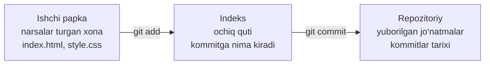
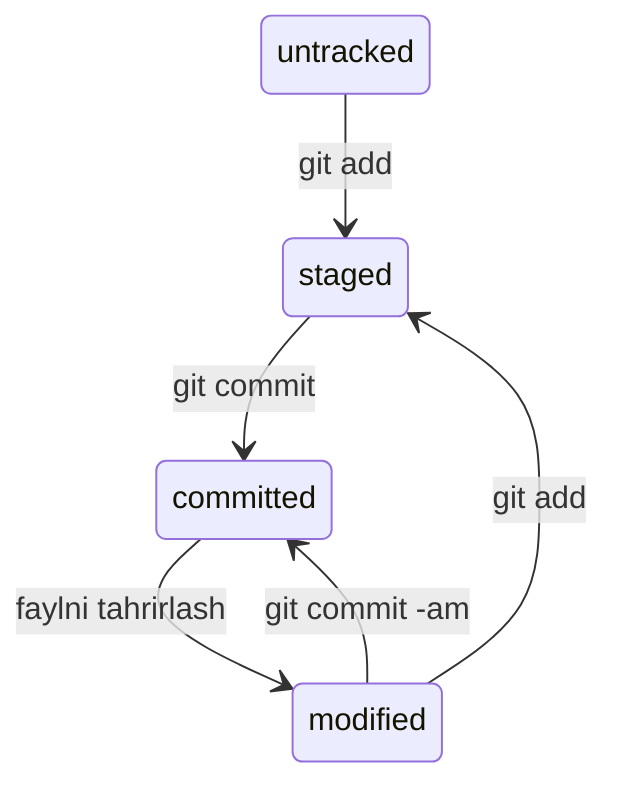
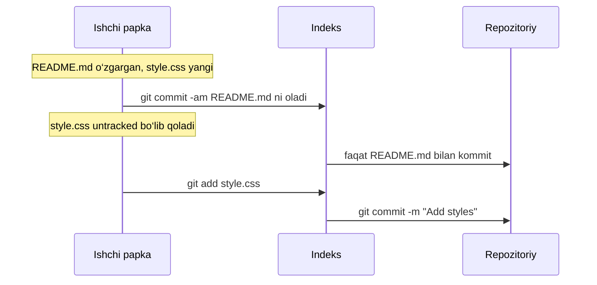
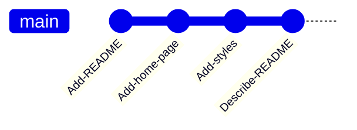

# Birinchi kommit

[Mundarija](../../README.md) · [← Orqaga](../../Lesson-1/uz/Git%20va%20terminal%20bilan%20tanishuv.md) · [Keyingi →](../../Lesson-3/uz/Tarix%20va%20o'zgarishlar.md) · [RU](../ru/%D0%9F%D0%B5%D1%80%D0%B2%D1%8B%D0%B9%20%D0%BA%D0%BE%D0%BC%D0%BC%D0%B8%D1%82.md) · [EN](../en/The%20first%20commit.md) · [UZ](Birinchi%20kommit.md)

> **1-dars bilan bog‘liqlik:** siz Git’ni sozladingiz, `portfolio` repozitoriysini va `README.md` faylini yaratdingiz, `git status` esa uni `Untracked files` deb atadi va `git add` buyrug‘ini maslahat berdi. Bugun faylning butun yo‘lini - ishchi papkadan tarixgacha - bosib o‘tasiz va birinchi kommitlaringizni qilasiz.

---

## Bu sizga nima uchun kerak

Siz butun oqshom bosh sahifani yasadingiz va shu bilan birga stillarni ham o‘zgartirdingiz. Ertalab buyurtmachi aytadi: «Bosh sahifa a’lo, yangi ranglarni esa avvalgidek qaytaring». Agar hammasi «sayt qildim» degan bitta katta suratda saqlangan bo‘lsa, birini ikkinchisidan qo‘lda ajratishga to‘g‘ri keladi.

Git ishni **bo‘laklab** saqlash imkonini beradi: bosh sahifa - bitta kommitda, stillar - boshqasida, README tahriri - uchinchisida. Har bir kommit tushunarli xabar bilan imzolangan va bir oydan keyin tarixdan nima, qachon va nima uchun o‘zgarganini ko‘rish mumkin. Har qanday ishchi loyihaning tarixi aynan shunday ko‘rinadi va ish beruvchi GitHub sahifangizni ochganda aynan shuni ko‘radi.

---

## Nimani o‘rganasiz

- Git’ning uchta zonasini tushuntirish: ishchi papka, indeks va repozitoriy.
- Fayl holatlarini aytish: untracked, staged, committed, modified.
- Fayllarni indeksga qo‘shish: `git add fayl` va `git add .`.
- Qisqa `git status -s` holatini o‘qish: `??`, `A`, `M` va ustunlar nimani bildiradi.
- `git commit -m` buyrug‘i bilan kommit qilish va Git javobini o‘qish.
- Ingliz tilida yaxshi kommit xabarlarini yozish.
- O‘zgargan fayllarni bitta `git commit -am` buyrug‘i bilan kommit qilish - va u nima uchun yangi fayllarni olmasligini bilish.
- Faylga `>>` belgisi bilan qator qo‘shish va ko‘p qatorli faylni `cat > fayl << 'EOF'` buyrug‘i bilan yaratish.

---

## Takrorlash: 1-darsdan 3 savol

1. `git status` javobidagi `Untracked files` bo‘limi nimani bildiradi?
2. `echo "matn" > fayl` buyrug‘idagi `>` belgisi nima qiladi va uning xavfi nimada?
3. Git repozitoriy tarixini qayerda saqlaydi?

Javoblar - dars oxirida.

---

## Reja

| Bo‘lim | Nima qilamiz |
| --- | --- |
| Git’ning uchta zonasi | Ishchi papka, indeks, repozitoriy - jo‘natma misolida |
| Faylning hayot sikli | untracked, staged, committed, modified |
| `git add` | Fayllarni indeksga bittadan va hammasini birdaniga qo‘yamiz |
| `git status -s` | Qisqa holat va uning ikki ustuni |
| `git commit -m` | Birinchi kommit va Git javobi |
| Mini-topshiriq 1 | Retseptlar repozitoriysidagi birinchi kommitlar |
| Kommit xabarlari | Qoidalar va misollar |
| `>>` va `cat > fayl << 'EOF'` | Qator qo‘shamiz va bir necha qatorli fayl yaratamiz |
| `git commit -am` | O‘zgargan fayllarni tez kommit qilish |
| Butun sikl | Portfolioda to‘rtta kommit qadamma-qadam |
| Mini-topshiriq 2 | Ko‘p qatorli retsept va `git commit -am` |
| Mustaqil ish | O‘quv terminalidagi va kompyuterdagi topshiriq |

---

## Git’ning uchta zonasi

**Oddiy so‘z bilan:** kommit - bu jo‘natma. Avval siz xona bo‘ylab yurib, **narsalarni tanlaysiz** (fayllarni o‘zgartirasiz). Keyin qutiga faqat shu jo‘natmaga tegishli narsalarni **solasiz** (`git add`). Hammasi yig‘ilgach, siz **qutini yopishtirasiz, ustiga ichida nima borligini yozasiz va jo‘natasiz** (`git commit`). Yuborilgan jo‘natmani endi o‘zgartirib bo‘lmaydi, jo‘natishdan oldin esa qutini xohlagancha yig‘ish mumkin: biror narsa qo‘shish yoki ortiqchasini olib qo‘yish.

Git’da shunday uchta «zona» bor:

| Zona | Inglizcha nomi | Jo‘natmada | Qayerda joylashgan |
| --- | --- | --- | --- |
| Ishchi papka | working directory, working tree | Narsalar turgan xona | Siz ko‘radigan va o‘zgartiradigan fayllar |
| Indeks | index, staging area | Ochiq quti | `.git/index` fayli - keyingi kommitga nima kirishi ro‘yxati |
| Repozitoriy | repository | Yuborilgan jo‘natmalar | `.git` papkasidagi kommitlar |



**Sxemani qanday o‘qish kerak.** O‘zgarishlar chapdan o‘ngga harakatlanadi. `git add` faylning suratini ishchi papkadan indeksga o‘tkazadi, `git commit` esa indeksdagi hamma narsani yangi kommitga joylaydi. Indeksdan sakrab o‘tib bo‘lmaydi: kommit **faqat** indeksdagi narsani oladi.

Agar hammasini birdaniga saqlash mumkin bo‘lsa, quti nimaga kerak? **Bitta mantiqiy o‘zgarish bitta kommit bo‘lishi** uchun. Siz ham bosh sahifani, ham stillarni tuzatdingiz - lekin ularni alohida, turli xabarlar bilan kommit qilasiz. Shunda keyinroq ulardan istalganini oson topish va kerak bo‘lsa bekor qilish mumkin (4-dars).

> **Muhim:** indeks «har ehtimolga qarshi» olingan nusxa emas. Agar `git add` dan keyin faylni yana o‘zgartirsangiz, qutida **eski** versiya - `git add` paytidagisi yotadi. Yangi tahrirlarni yana qo‘shish kerak.

---

## Faylning hayot sikli

Ishchi papkadagi har bir fayl to‘rt holatdan birida bo‘ladi.

| Holat | Tarjimasi | Ma’nosi | `git status` da |
| --- | --- | --- | --- |
| untracked | kuzatilmaydi | Yangi fayl, Git hali uni kuzatmaydi | `Untracked files` |
| staged | indeksda | O‘zgarishlar qutida va kommitga kiradi | `Changes to be committed` |
| committed | saqlangan | Versiya kommitda saqlangan, yangi tahrirlar yo‘q | fayl ro‘yxatda yo‘q |
| modified | o‘zgargan | Kuzatiladigan fayl o‘zgargan, tahrirlar hali indeksda emas | `Changes not staged for commit` |



**Sxemani qanday o‘qish kerak.** Yangi fayl yo‘lini `untracked` holatidan boshlaydi. Birinchi `git add` va kommitdan keyin Git uni doim kuzatadi: har qanday tahrir faylni `modified` qiladi, `git add` va `git commit` esa uni yana `committed` holatiga qaytaradi. `git commit -am` strelkasi - o‘zgargan fayllar uchun qisqa yo‘l, uni quyida ko‘rib chiqamiz. E’tibor bering: `untracked` dan to‘g‘ridan-to‘g‘ri `committed` ga strelka yo‘q.

**Oddiy so‘z bilan:** untracked - siz endigina sotib olgan va hali uydagi narsalar ro‘yxatiga kiritmagan buyum. U ro‘yxatda bo‘lmaguncha Git uni «sezmaydi»: saqlamaydi va o‘zgarishlarini kuzatmaydi.

---

## `git add`: qutiga solish

### `git add fayl`

1-darsdagi `portfolio` repozitoriysiga qaytamiz. Unda `# Portfolio` matnli bitta `README.md` fayli bor va u `untracked`. Uni indeksga qo‘shamiz:

```bash
git add README.md
```

Git hech narsa demaydi - terminalda bu «hammasi muvaffaqiyatli o‘tdi» degani. Nima o‘zgarganini ko‘ramiz:

```bash
git status
```

```text
On branch main

No commits yet

Changes to be committed:
  (use "git rm --cached <file>..." to unstage)
	new file:   README.md
```

| Qator | Tarjimasi va ma’nosi |
| --- | --- |
| `Changes to be committed` | Kommitga kiradigan o‘zgarishlar: qutidagi narsalar |
| `(use "git rm --cached <file>..." to unstage)` | Faylni indeksdan qanday olish haqida maslahat. Birinchi kommitda shunday, keyinroq Git `git restore --staged` ni taklif qiladi (4-dars) |
| `new file:   README.md` | Yangi fayl: u hali kommitlarda bo‘lmagan |

Fayl nomini aniq, harflarning katta-kichikligini hisobga olib yozish kerak. Agar bunday nomli fayl bo‘lmasa, Git rad etadi:

```bash
git add readme.md
```

```text
fatal: pathspec 'readme.md' did not match any files
```

Tarjimasi: «`readme.md` yo‘li birorta ham faylga mos kelmadi». Bir nechta faylni probel bilan sanab o‘tish mumkin: `git add index.html style.css`.

### `git add .`

Nuqta, 1-darsdan eslaganingizdek, «joriy papka» degani. `git add .` buyrug‘i joriy papka va ichki papkalardagi **barcha** yangi va o‘zgargan fayllarni indeksga qo‘yadi.

| Buyruq | Indeksga nima tushadi | Qachon ishlatiladi |
| --- | --- | --- |
| `git add index.html` | Faqat `index.html` | Kommitni aniq fayllardan yig‘moqchisiz |
| `git add index.html style.css` | Sanab o‘tilgan ikki fayl | Bir nechta fayl uchun ham xuddi shunday |
| `git add .` | Joriy papkadagi barcha yangi va o‘zgargan narsalar | Barcha o‘zgarishlar bitta vazifaga tegishli |

> **Muhim:** `git add .` dan oldin har doim `git status` ni ko‘ring. Nuqta tasodifiy fayllarni ham oladi: qoralamalar, nusxalar, parolli fayllar. Bunday fayllarni butunlay chiqarib tashlash - 5-darsda.

---

## `git status -s`: eng muhimi qisqacha

Uzun `git status` batafsil, lekin fayllar ko‘p bo‘lganda qisqa variant qulayroq: `-s` (short).

Aytaylik, `README.md` allaqachon indeksda (biz hozirgina `git add` qildik). Yana ikkita fayl yaratamiz va qisqa holatni ko‘ramiz:

```bash
echo "<h1>Anna Karimova</h1>" > index.html
echo "body { font-family: sans-serif; }" > style.css
git status -s
```

```text
A  README.md
?? index.html
?? style.css
```

Har bir qator **ikki ustun** bilan boshlanadi:

```text
XY fayl-nomi
│└─ o‘ng ustun: ishchi papka (fayl git add dan keyin o‘zgarganmi)
└── chap ustun: indeks (qutida nima bor)
```

| Kod | Chap ustun (indeks) | O‘ng ustun (ishchi papka) | Ma’nosi |
| --- | --- | --- | --- |
| `??` | - | - | Yangi fayl, kuzatilmaydi (untracked) |
| `A ` | A - added | bo‘sh | Yangi fayl indeksga qo‘shilgan |
| ` M` | bo‘sh | M - modified | Fayl o‘zgargan, tahrirlar indeksda emas |
| `M ` | M | bo‘sh | Tahrirlar indeksga qo‘shilgan |
| `MM` | M | M | Tahrirlarning bir qismi indeksda, `git add` dan keyin fayl yana o‘zgartirilgan |
| `AM` | A | M | Yangi fayl indeksda, lekin `git add` dan keyin u yana o‘zgartirilgan |

**Oddiy so‘z bilan:** chap ustun - «qutida nima bor», o‘ng ustun - «nima hali xonada yotibdi, qutiga tushmagan». Probel «bu yerda o‘zgarish yo‘q» degani. O‘ng ustun bo‘shashini xohlasangiz - `git add` qiling.

---

## `git commit -m`: yopishtirish va jo‘natish

### Birinchi kommit

`git commit` indeksdagi narsalarni kommitga joylaydi. `-m` (message) parametri xabarni - qutidagi yozuvni belgilaydi. Xabar qo‘shtirnoq ichida yoziladi.

```bash
git commit -m "Add README"
```

```text
[main (root-commit) eb46eed] Add README
 1 file changed, 1 insertion(+)
 create mode 100644 README.md
```

| Qator | Tarjimasi va ma’nosi |
| --- | --- |
| `main` | Kommit `main` tarmog‘ida qilingan |
| `(root-commit)` | Ildiz kommit - repozitoriydagi eng birinchisi, uning «ota-onasi» yo‘q. Bundan keyin bu belgi chiqmaydi |
| `eb46eed` | Qisqa **xesh** - kommitning noyob identifikatori. Sizda u boshqacha bo‘ladi. Xeshlar haqida batafsil - 3-darsda |
| `Add README` | Sizning xabaringiz |
| `1 file changed, 1 insertion(+)` | 1 ta fayl o‘zgardi, 1 ta qator qo‘shildi |
| `create mode 100644 README.md` | Yangi fayl yaratildi. `100644` - oddiy (bajariladigan emas) fayl |

Endi holatni tekshiramiz:

```bash
git status
```

```text
On branch main
nothing to commit, working tree clean
```

Tarjimasi: «Kommit qiladigan narsa yo‘q, ishchi papka toza». Bu degani: uchala zona bir xil, hammasi saqlangan. `No commits yet` qatori yo‘qoldi - endi kommit bor.

**Oddiy so‘z bilan:** `working tree clean` - «xonada tartib»: siz o‘zgartirgan hamma narsa allaqachon jo‘natmalarda yuborilgan.

### Uchta zonada nima bo‘ldi

| Qadam | Buyruq | Ishchi papka | Indeks | Repozitoriy |
| --- | --- | --- | --- | --- |
| 1 | `echo "# Portfolio" > README.md` (1-dars) | `README.md` | bo‘sh | kommitlar yo‘q |
| 2 | `git add README.md` | `README.md` | `README.md` | kommitlar yo‘q |
| 3 | `git commit -m "Add README"` | `README.md` | kommit bilan bir xil | `eb46eed Add README` |

Kommitdan keyin indeks «bo‘shab qolmaydi»: u doim keyingi kommitning to‘liq suratini saqlaydi va hozir oxirgi kommit bilan bir xil. Shuning uchun `git status` kommit qiladigan narsa yo‘qligini yozadi.

Agar indeks oxirgi kommitdan farq qilmasa, kommit qilib bo‘lmaydi. Masalan, `git add` ni unutsangiz:

```text
On branch main
Untracked files:
  (use "git add <file>..." to include in what will be committed)
	style.css

nothing added to commit but untracked files present (use "git add" to track)
```

Oxirgi qatorning tarjimasi: «kommitga hech narsa qo‘shilmagan, lekin kuzatilmaydigan fayllar bor (git add dan foydalaning)». Bu buzilish emas - Git quti bo‘shligini eslatyapti.

Qilingan kommitlarni `git log --oneline` buyrug‘i bilan tez ko‘rish mumkin - har bir kommitga bitta qator, yangilari tepada. Tarixni 3-darsda batafsil ko‘rib chiqamiz.

---

## Mini-topshiriq 1

O‘quv terminalida (yoki haqiqiysida):

1. `# My recipes` matnli `README.md` fayli bilan `recipes` repozitoriysini yarating (1-darsning 2-mini-topshirig‘idagidek; agar papka allaqachon bo‘lsa - shunchaki unga o‘ting).
2. `git status -s` ni ko‘ring. `README.md` oldida qanday kod turibdi?
3. `README.md` ni indeksga qo‘shing va yana `git status -s` ni ko‘ring. Ustunlarda nima o‘zgardi?
4. `Add README` xabari bilan kommit qiling.
5. `Plov: rice, carrots, meat, onion` matnli `plov.txt` faylini yarating, uni indeksga qo‘shing va `Add plov recipe` xabari bilan kommit qiling.
6. `git status` `working tree clean` deb javob berishiga ishonch hosil qiling.

---

## Yaxshi kommit xabarlari

Kommit xabarini odamlar o‘qiydi: yarim yildan keyin siz, ko‘rib chiqishda (review) hamkasbingiz, GitHub’da ish beruvchi. Kursda biz ko‘pchilik loyihalarda qabul qilingan qoidalarga amal qilamiz.

| Qoida | Nima uchun |
| --- | --- |
| Ingliz tilida | Butun dunyoda IT’da shunday qabul qilingan, GitHub va vositalar shunga mo‘ljallangan |
| Buyruq mayli: `Add`, `Fix`, `Remove`, `Update` | Buyruq kabi o‘qiladi: «bu kommit - formani **qo‘sh**». Git’ning o‘zi ham shunday yozadi: `Merge branch...` |
| Bosh harf bilan, oxirida nuqtasiz | Bu sarlavha, gap emas |
| 50 belgigacha | `git log --oneline` da va GitHub’da to‘liq ko‘rinadi |
| **Nima** qilinganini aytadi, «men nimadir qildim» emas | Xabardan fayllarni ko‘rmasdan kommit mazmuni tushunarli bo‘lishi kerak |
| Bitta kommit - bitta mantiqiy o‘zgarish | Agar xabarga «va» so‘zi so‘ralib tursa, ehtimol bu ikkita kommit |

**Oddiy so‘z bilan:** xabarni «If applied, this commit will ...» («agar qo‘llansa, bu kommit ...») iborasi bilan tekshiring. «If applied, this commit will **add contact form**» - to‘g‘ri eshitiladi. «If applied, this commit will **added stuff**» - yo‘q.

| Yomon | Yaxshi | Nima noto‘g‘ri |
| --- | --- | --- |
| `update` | `Update phone number in footer` | Nima yangilangani tushunarsiz |
| `commit` | `Add home page` | So‘z hech narsa bildirmaydi: har qanday kommit - commit |
| `fix` | `Fix menu overlap on small screens` | Nima tuzatildi? |
| `Added styles.` | `Add styles` | O‘tgan zamon va nuqta |
| `xatoni tuzatdim` | `Fix broken link to CV` | Ingliz tilida emas va tafsilotlarsiz |
| `Add header, footer, contact form, fix colors and update README` | Uchta alohida kommit | Juda uzun, bir vaqtda bir nechta vazifa |

> **Muhim:** xabar qo‘shtirnoq ichida yoziladi. Ularsiz `git commit -m Add home page` faqat `Add` so‘zini xabar deb, `home` va `page` ni esa fayl nomlari deb tushunadi va `error: pathspec 'home' did not match any file(s) known to git` xatosini beradi.

Agar `git commit` ni umuman `-m` siz chaqirsangiz, haqiqiy Git xabar uchun matn muharririni ochadi. Bu yangi o‘rganuvchilarni ko‘pincha qo‘rqitadi (ayniqsa Vim muharriri). `-m` ni yozing - shunisi osonroq. O‘quv terminalida muharrir yo‘q, simulyator esa `-m` dan foydalanishni maslahat beradi.

---

## Terminaldan fayllar: `>>` va `cat > fayl << 'EOF'`

### `>>`: oxiriga qo‘shish

1-darsda siz `>` faylni **qayta yozishini** bildingiz. Ikkita `>>` belgisi esa eski mazmunni saqlab, qatorni oxiriga **qo‘shadi**.

```bash
echo "Built with HTML and CSS." >> README.md
cat README.md
```

```text
# Portfolio
Built with HTML and CSS.
```

| Belgi | Nima qiladi | Agar fayl bo‘lmasa |
| --- | --- | --- |
| `>` | Faylning butun mazmunini almashtiradi | Faylni yaratadi |
| `>>` | Fayl oxiriga qo‘shadi | Faylni yaratadi |

**Oddiy so‘z bilan:** `>` - doskani o‘chirib, qaytadan yozish, `>>` - doskaning pastiga qo‘shib yozish.

### `cat > fayl << 'EOF'`: bir necha qatorli fayl

HTML sahifani bitta `echo` buyrug‘i bilan yozib bo‘lmaydi. Bir necha qator uchun **here-document** («shu yerning o‘zidagi hujjat») konstruksiyasi bor:

```bash
cat > index.html << 'EOF'
<!DOCTYPE html>
<html>
<head>
  <title>Anna Karimova</title>
</head>
<body>
  <h1>Anna Karimova</h1>
</body>
</html>
EOF
```

Terminalda bu shunday ko‘rinadi: birinchi qatordan keyin taklif belgisi `>` ga o‘zgaradi - terminal davomini kutyapti:

```text
$ cat > index.html << 'EOF'
> <!DOCTYPE html>
> <html>
> ...
> EOF
```

| Qism | Ma’nosi |
| --- | --- |
| `cat` | Kirishga nima olsa, shuni chiqaradi |
| `> index.html` | Chiqish - ekranga emas, `index.html` fayliga (qayta yozish bilan) |
| `<< 'EOF'` | Kirish - keyingi qatorlar, `EOF` qatorigacha (end of file - «fayl oxiri») |
| Qo‘shtirnoqdagi `'EOF'` | Matn faylga qanday bo‘lsa, shunday tushadi: terminal `$USER` kabi qiymatlarni qo‘ymaydi |
| Oxirgi qatordagi `EOF` | Kiritish tugadi. Qator aynan `EOF` bo‘lishi kerak - probellar va boshqa belgilarsiz |

**Oddiy so‘z bilan:** here-document - bu diktant. Siz terminalga «men EOF so‘zini aytmagunimcha, aytganlarimning hammasini faylga yoz» deysiz, qatorlarni aytib turasiz va «EOF» deysiz.

Shunga o‘xshash `cat >> fayl << 'EOF'` buyrug‘i fayl oxiriga bir necha qator qo‘shadi.

> **Muhim:** birinchi qatordagi `>` faylni `echo` dagidek qayta yozadi. Agar `index.html` da sizning maketingiz bo‘lgan bo‘lsa, u yo‘qoladi. Bunday buyruqdan oldin fayl yo‘qligini yoki uni yo‘qotish achinarli emasligini tekshiring - yoki avval kommit qiling: shunda eski versiyani qaytarish mumkin bo‘ladi (4-dars).

O‘z kompyuteringizda, albatta, kodni VS Code’da yozasiz. Lekin `>>` va here-document buyruqlarini bilish foydali: ular bilan yo‘riqnomalarda, serverlarda va o‘quv terminalida fayllar yaratiladi.

---

## `git commit -am`: o‘zgargan fayllarni tez kommit qilish

`README.md` ga qator qo‘shganimizdan keyin u `modified` bo‘ldi:

```bash
git status -s
```

```text
 M README.md
```

Chap ustunda probel, o‘ngda `M`: fayl o‘zgargan, tahrir indeksga tushmagan. Odatiy yo‘l - `git add README.md` va `git commit -m "..."`. Allaqachon kuzatiladigan fayllar uchun qisqartma bor:

```bash
git commit -am "Describe project in README"
```

```text
[main 55b1780] Describe project in README
 1 file changed, 1 insertion(+)
```

`-am` - bu birgalikdagi ikki parametr: `-a` (all - «barcha o‘zgargan kuzatiladigan fayllar - indeksga») va `-m` (xabar). Xuddi shuni `git commit -a -m "..."` deb ham yozish mumkin.

| Qator | Tarjimasi va ma’nosi |
| --- | --- |
| `[main 55b1780]` | `main` tarmog‘ida yangi kommit, `(root-commit)` endi yo‘q |
| `1 file changed, 1 insertion(+)` | 1 ta fayl o‘zgardi, 1 ta qator qo‘shildi. `create mode` qatori yo‘q: fayl yangi emas |

### Nima uchun `-a` yangi fayllarni olmaydi

`-a` faqat Git **allaqachon kuzatayotgan** fayllarni - oldingi kommitlarda bo‘lganlarini qo‘shadi. Yangi faylni Git o‘zi tarixga olmaydi: birdan u qoralama yoki parolli fayl bo‘lsa-chi? Yangi fayl haqidagi qarorni siz qabul qilasiz - `git add` buyrug‘i bilan.



**Sxemani qanday o‘qish kerak.** Vaqt yuqoridan pastga qarab o‘tadi. `git commit -am` indeksga faqat kuzatiladigan `README.md` ni o‘tkazadi va darhol kommit qiladi. Yangi `style.css` ishchi papkada qoladi - unga alohida `git add` kerak.

Agar papkada **faqat** yangi fayllar bo‘lsa, `git commit -am` tanish `nothing added to commit but untracked files present` xabari bilan javob beradi va kommit bo‘lmaydi.

| Vaziyat | Buyruq |
| --- | --- |
| Allaqachon kuzatiladigan fayllarni o‘zgartirdingiz, barcha tahrirlar - bitta vazifa | `git commit -am "..."` |
| Yangi fayl yaratdingiz | `git add fayl`, keyin `git commit -m "..."` |
| Bir nechta faylni o‘zgartirdingiz, lekin bular turli vazifalar | `git add` bilan bittadan fayl va bir nechta kommit |

---

## Butun sikl: portfolioda to‘rtta kommit

Hammasini birlashtiramiz. `portfolio` repozitoriysida faqat `README.md` bor, kommitlar yo‘q. Maqsad - to‘rtta kommit: README, bosh sahifa, stillar, README’dagi tavsif.

| Qadam | Buyruq | Ishchi papka | Indeks | Repozitoriy |
| --- | --- | --- | --- | --- |
| 1 | `git add README.md` | `README.md` | `README.md` (A) | kommitlar yo‘q |
| 2 | `git commit -m "Add README"` | `README.md` | = kommit | `Add README` |
| 3 | `cat > index.html << 'EOF'` ... va `echo "..." > style.css` | + `index.html`, `style.css` (??) | o‘zgarishsiz | 1 ta kommit |
| 4 | `git add index.html` | `style.css` hali ?? | + `index.html` (A) | 1 ta kommit |
| 5 | `git commit -m "Add home page"` | `style.css` ?? | = kommit | 2 ta kommit |
| 6 | `git add style.css` va `git commit -m "Add styles"` | hammasi saqlangan | = kommit | 3 ta kommit |
| 7 | `echo "Built with HTML and CSS." >> README.md` | `README.md` ( M) | o‘zgarishsiz | 3 ta kommit |
| 8 | `git commit -am "Describe project in README"` | toza | = kommit | 4 ta kommit |

Asosiy lahza - 4-qadam. Papkada ikkita yangi fayl bor, lekin indeksga faqat `index.html` ni qo‘yamiz:

```bash
git add index.html
git status
```

```text
On branch main
Changes to be committed:
  (use "git restore --staged <file>..." to unstage)
	new file:   index.html

Untracked files:
  (use "git add <file>..." to include in what will be committed)
	style.css
```

Quti yig‘ildi: unda faqat bosh sahifa bor, `style.css` esa o‘z jo‘natmasini kutadi.

```bash
git commit -m "Add home page"
```

```text
[main 2d2814c] Add home page
 1 file changed, 9 insertions(+)
 create mode 100644 index.html
```

`9 insertions(+)` - here-document’dagi to‘qqiz qator HTML. 6–8-qadamlardan keyin tarix shunday ko‘rinadi:

```bash
git log --oneline
```

```text
55b1780 (HEAD -> main) Describe project in README
7154fc6 Add styles
2d2814c Add home page
eb46eed Add README
```

Yangi kommitlar - tepada. `HEAD -> main` hozir qayerda ekaningizni ko‘rsatadi: `main` tarmog‘ining oxirgi kommitida (batafsil - 3- va 6-darslar).



**Sxemani qanday o‘qish kerak.** Har bir doiracha - kommit, chiziq - `main` tarmog‘i, vaqt chapdan o‘ngga o‘tadi. Har bir kommit **barcha** kuzatiladigan fayllarning suratini saqlaydi: `Add-styles` da `README.md`, `index.html` va `style.css` ham bor. Bitta «sayt qildim» o‘rniga tarixning to‘rtta tushunarli qadami.

### Buzib ko‘ring

1. Yangi repozitoriy-papkada fayl yarating va `git add` siz darhol `git commit -m "Add file"` ni bajaring. Git nima deb javob beradi?
2. Xabarni qo‘shtirnoqsiz yozing: `git commit -m Add home page`. Qanday xatoni ko‘rasiz va nima uchun Git `home` fayli haqida gapiradi?
3. Yangi fayl yarating va uni `git commit -am "Add notes"` orqali kommit qilib ko‘ring. Fayl kommitga tushdimi? `git status -s` ni tekshiring.
4. `git add index.html` ni bajaring, keyin unga `>>` orqali qator qo‘shing va `git status -s` ni ko‘ring. `AM` yoki `MM` degan ikki harf nimani bildiradi?
5. `README.md` ga qatorni `>>` o‘rniga `>` orqali yozing va `cat README.md` ni bajaring. Sarlavha qayerga ketdi?
6. Here-document’ni boshlang va `EOF` qatorini «unuting»: keyingi buyruqlar faylga matn bo‘lib tushadi. Faylni `cat` buyrug‘i bilan ko‘ring.

### Yangi o‘rganuvchilarning tipik xatolari

| Xato | Nima bo‘ladi | Qanday tuzatish |
| --- | --- | --- |
| `git add` siz kommit | `nothing added to commit but untracked files present (use "git add" to track)` | `git add fayl`, keyin `git commit -m` |
| Qo‘shtirnoqsiz xabar | `error: pathspec 'home' did not match any file(s) known to git` | `git commit -m "Add home page"` |
| Fayl nomida xato yoki harflar katta-kichikligi noto‘g‘ri | `fatal: pathspec 'readme.md' did not match any files` | Nomni `ls` orqali tekshirish, aniq yozish: `README.md` |
| Yangi fayl uchun `git commit -am` | Yangi faylsiz kommit yoki `nothing added to commit...` | Yangi fayl - `git add` orqali |
| Bitta fayl kommiti kerak bo‘lganda `git add .` | Kommitga ortiqcha fayllar tushdi | `git add .` dan oldin `git status -s` ni ko‘rish, nomi bilan qo‘shish |
| Fayl `git add` dan keyin o‘zgartirildi | `git status -s` `MM` yoki `AM` ni ko‘rsatadi, kommitga eski versiya ketadi | Kommitdan oldin yana `git add fayl` |
| `>>` o‘rniga `>` | Faylning eski mazmuni yo‘qoldi | `>>` bilan qo‘shish; versiyani kommitdan qaytarish - 4-dars |
| Haqiqiy Git’da `-m` siz `git commit` | Vim muharriri ochildi, qanday chiqish tushunarsiz | `:q!` ni terib Enter bosing, keyin `-m "..."` bilan takrorlang |
| Buyruqda xato: `git comit` | `git: 'comit' is not a git command` va `commit` maslahati | Buyruqni tuzatish |

---

## Mini-topshiriq 2

1-mini-topshiriqdagi `recipes` repozitoriysida davom eting:

1. `cat > soup.md << 'EOF'` buyrug‘i bilan to‘rt qatorli `soup.md` faylini yarating: `# Lentil soup` sarlavhasi va uchta masalliq, har biri yangi qatordan `- ` orqali.
2. `README.md` ga `>>` belgisi bilan `Recipes: plov, lentil soup` qatorini qo‘shing.
3. `git status -s` ni ko‘ring va ikkala qatorni tushuntiring.
4. README tahririni `git commit -am "List recipes in README"` buyrug‘i bilan kommit qiling. `git status -s` da nima qoldi va nima uchun?
5. Alohida kommit bilan `soup.md` ni `Add lentil soup recipe` xabari bilan saqlang.
6. `git log --oneline` buyrug‘i bilan tarixni ko‘ring: 4 ta kommit bo‘lishi kerak.

---

## Dars yakuni: shpargalka

| Vazifa | Buyruq |
| --- | --- |
| Faylni indeksga qo‘yish | `git add fayl` |
| Bir nechta faylni qo‘yish | `git add index.html style.css` |
| Barcha yangi va o‘zgargan narsalarni qo‘yish | `git add .` |
| Qisqa holat | `git status -s` |
| Kommit qilish | `git commit -m "Add home page"` |
| Barcha o‘zgargan kuzatiladigan fayllarni kommit qilish | `git commit -am "Update README"` |
| Kommitlarni bitta qatorda ko‘rish | `git log --oneline` (batafsil - 3-dars) |
| Faylga qator qo‘shish | `echo "matn" >> fayl` |
| Bir necha qatorli fayl yaratish | `cat > fayl << 'EOF'` ... `EOF` |
| Bir necha qator qo‘shish | `cat >> fayl << 'EOF'` ... `EOF` |

---

## Mustaqil ish

### 1-qism. IDE topshirig‘i (platforma hisoblaydi)

Git sozlangan, siz `~/portfolio` papkasidasiz: u yerda repozitoriy va `README.md` fayli bor, kommitlar hali yo‘q. Buyruqlarni har qatorga bittadan yozing:

1. Repozitoriy holatini ko‘ring, `README.md` ni indeksga qo‘shing va birinchi kommitni qiling.
2. `cat > index.html << 'EOF'` buyrug‘i bilan bir necha qator HTML’dan iborat `index.html` ni yarating (oxirgi qator - `EOF`).
3. `echo` buyrug‘i bilan bitta CSS qoidali `style.css` ni yarating.
4. Faqat `index.html` bo‘lgan kommit qiling.
5. Alohida kommit bilan `style.css` ni saqlang.
6. `README.md` ga loyiha tavsifi yozilgan qatorni (`>>` belgisi bilan) qo‘shing va uni `git commit -am` buyrug‘i bilan kommit qiling.
7. Ishchi papka toza ekaniga ishonch hosil qiling.

Kommit xabarlari - ingliz tilida, buyruq maylida, har bir kommitning o‘z xabari (`update` ham emas, `commit` ham emas).

Platforma nimani tekshiradi: kommitlar roppa-rosa to‘rtta va ular kerakli tartibda kelishini; birinchi kommitda faqat `README.md` borligini, ikkinchisi faqat `index.html` ni (bir necha qatorli) qo‘shishini, uchinchisi - faqat bo‘sh bo‘lmagan `style.css` ni, to‘rtinchisi esa faqat `README.md` ni o‘zgartirishini; `README.md` ga qator qo‘shilgani va eski matn saqlanganini (bu README’ning boshqa boshlang‘ich matnida ham tekshiriladi); xabarlar mazmunli va turlicha ekanini; `git commit -am` ishlatilganini; oxirida ishchi papka tozaligini; ssenariy xatosiz bajarilishini.

### 2-qism. Kompyuterdagi loyiha

Haqiqiy Git’da, 1-darsdagi saytingiz repozitoriysida ishlang (u yerda barcha fayllar hozircha `Untracked`).

1. `git status -s` ni ko‘ring va qaysi fayllar bitta vazifaga tegishli ekanini hal qiling: masalan, HTML sahifalar, stillar, skriptlar.
2. Guruhlar bo‘yicha 2–3 ta kommit qiling: `git add index.html about.html` → `git commit -m "Add pages"`, keyin `git add css/` → `git commit -m "Add styles"` va hokazo, toki `git status` `working tree clean` deb javob bermaguncha.
3. Agar loyihada `README.md` bo‘lmasa, uni `cat > README.md << 'EOF'` buyrug‘i bilan yarating (sayt nomi va bir-ikki qator tavsif) va alohida kommit qiling.
4. Allaqachon kommit qilingan faylda biror narsani o‘zgartiring (masalan, VS Code’da sarlavha matnini) va tahrirni `git commit -am` orqali saqlang.
5. `git log --oneline` ni bajaring va 1-darsdagi ekran surati bilan solishtiring: fayllar tarixga aylandi.

### Tayyorlik mezonlari

- [ ] IDE topshirig‘i qabul qilindi.
- [ ] Saytingiz repozitoriysida kamida uchta kommit bor, `git status` `working tree clean` deb javob beradi.
- [ ] Barcha kommit xabarlari - ingliz tilida, buyruq maylida, 50 belgigacha.
- [ ] Siz sxema bo‘yicha Git’ning uchta zonasini va faylning hayot siklini tushuntira olasiz.
- [ ] Siz `git commit -am` nima uchun yangi fayllarni qo‘shmasligini bilasiz.

---

## O‘zini tekshirish uchun savollar

1. Git’ning uchta zonasini ayting va ularni jo‘natma misolida tushuntiring.
2. Agar barcha o‘zgarishlarni darhol kommit qilish mumkin bo‘lsa, indeks nimaga kerak?
3. `git add index.html` va `git add .` nimasi bilan farq qiladi? Qachon qaysi biri ishlatiladi?
4. Faylning to‘rtta holatini va faylni biridan boshqasiga o‘tkazadigan buyruqlarni ayting.
5. `git status -s` dagi `?? style.css`, `A  index.html` va ` M README.md` qatorlari nimani bildiradi?
6. `git commit` javobidagi `(root-commit)` va `eb46eed` nimani anglatadi?
7. `nothing to commit, working tree clean` nimani bildiradi?
8. Yaxshi kommit xabarining qanday qoidalarini bilasiz? `fixed some stuff.` xabarini tuzating.
9. `git commit -am` nima qiladi va nima uchun u yangi fayllarni olmaydi?
10. `>` va `>>` nimasi bilan farq qiladi? Bir necha qatorli faylni qanday yaratish mumkin?

Savollardan keyin platformada **dars testini** topshiring: 12 ta savol, o‘tish chegarasi 70%.

---

## Keyin nima

Sizda bir nechta kommitdan iborat tarix bor. 3-darsda uni o‘qishni o‘rganasiz: batafsil `git log`, istalgan kommitni `git show` buyrug‘i bilan ko‘rish, versiyalarni `git diff` orqali solishtirish - va `eb46eed` xeshi aslida nimani anglatishini bilib olasiz.

---

## Javoblar

**Takrorlash**

1. Papkada Git hali kuzatmayotgan fayllar bor: ular hech qachon `git add` orqali qo‘shilmagan.
2. `echo` chiqishini faylga yo‘naltiradi. Xavfi shundaki, u fayl mazmunini to‘liq almashtiradi.
3. Loyiha papkasidagi yashirin `.git` papkasida.

**Mini-topshiriq 1**

```bash
mkdir recipes
cd recipes
git init
echo "# My recipes" > README.md
git status -s
git add README.md
git status -s
git commit -m "Add README"
echo "Plov: rice, carrots, meat, onion" > plov.txt
git add plov.txt
git commit -m "Add plov recipe"
git status
```

`git add` dan oldin `README.md` da `??` kodi (untracked), keyin esa chap ustunda `A `: fayl indeksda. Agar `recipes` papkasi allaqachon bo‘lsa, birinchi to‘rtta buyruqni `cd recipes` bilan almashtiring.

**Mini-topshiriq 2**

```bash
cat > soup.md << 'EOF'
# Lentil soup
- red lentils
- onion
- carrot
EOF
echo "Recipes: plov, lentil soup" >> README.md
git status -s
git commit -am "List recipes in README"
git status -s
git add soup.md
git commit -m "Add lentil soup recipe"
git log --oneline
```

`git status -s` ` M README.md` (o‘zgargan, indeksda emas) va `?? soup.md` (yangi) ni ko‘rsatadi. `git commit -am` dan keyin `?? soup.md` qoladi: `-a` kuzatilmaydigan fayllarni olmaydi.

**O‘zini tekshirish uchun savollar**

1. Ishchi papka - narsalar turgan xona (siz o‘zgartiradigan fayllar), indeks - ochiq quti (kommitga nima kiradi), repozitoriy - yuborilgan jo‘natmalar (kommitlar tarixi).
2. Kommitni faqat bitta vazifaga tegishli narsalardan yig‘ish uchun: bitta mantiqiy o‘zgarish - bitta kommit.
3. `git add index.html` bitta faylni qo‘shadi, `git add .` - joriy papkadagi barcha yangi va o‘zgargan fayllarni. Birinchisi - papkada turli kommitlar uchun o‘zgarishlar bo‘lganda, ikkinchisi - hammasi bitta vazifaga tegishli bo‘lganda.
4. untracked → (`git add`) staged → (`git commit`) committed → (tahrir) modified → (`git add`) staged.
5. `??` - yangi kuzatilmaydigan fayl, `A ` - indeksdagi yangi fayl, ` M` - fayl o‘zgargan, lekin tahrir indeksda emas.
6. `(root-commit)` - repozitoriyning ota-onasiz birinchi kommiti. `eb46eed` - qisqa xesh, kommit identifikatori.
7. Kommit qiladigan narsa yo‘q: ishchi papka, indeks va oxirgi kommit bir xil.
8. Ingliz tili, buyruq mayli, bosh harf bilan va nuqtasiz, 50 belgigacha, nima qilinganini aytadi. Masalan: `Fix menu links on about page`.
9. Barcha o‘zgargan kuzatiladigan fayllarni indeksga qo‘shadi va kommit qiladi. Git yangi fayllarni o‘zi olmaydi, toki tarixga tasodifan qoralamalar va maxfiy ma’lumotlar tushib qolmasin: yangi fayl haqidagi qaror - sizda (`git add`).
10. `>` faylni qayta yozadi, `>>` oxiriga qo‘shadi. Ko‘p qatorli fayl: `cat > fayl << 'EOF'`, keyin matn qatorlari, keyin `EOF` qatori.

---

[Mundarija](../../README.md) · [← Orqaga](../../Lesson-1/uz/Git%20va%20terminal%20bilan%20tanishuv.md) · [Keyingi →](../../Lesson-3/uz/Tarix%20va%20o'zgarishlar.md) · [RU](../ru/%D0%9F%D0%B5%D1%80%D0%B2%D1%8B%D0%B9%20%D0%BA%D0%BE%D0%BC%D0%BC%D0%B8%D1%82.md) · [EN](../en/The%20first%20commit.md) · [UZ](Birinchi%20kommit.md)
