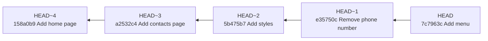
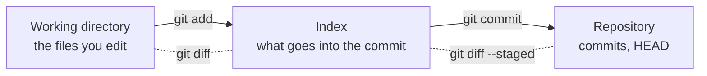
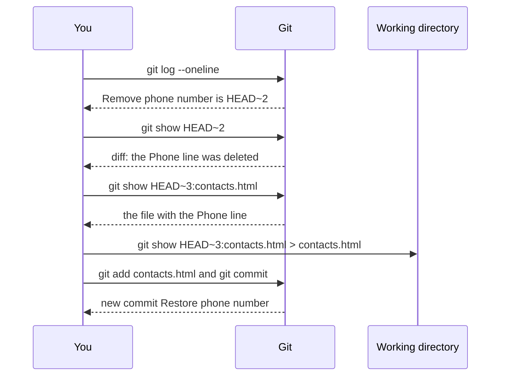
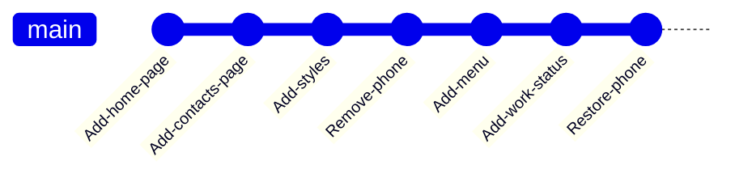

# History and changes

[Contents](../../README.md) · [← Back](../../Lesson-2/en/The%20first%20commit.md) · [Next →](../../Lesson-4/en/Undoing%20changes.md) · [RU](../ru/%D0%98%D1%81%D1%82%D0%BE%D1%80%D0%B8%D1%8F%20%D0%B8%20%D0%B8%D0%B7%D0%BC%D0%B5%D0%BD%D0%B5%D0%BD%D0%B8%D1%8F.md) · [EN](History%20and%20changes.md) · [UZ](../uz/Tarix%20va%20o'zgarishlar.md)

> **Link to lesson 2:** you learned to save snapshots of a project: `git add` puts changes into the index, and `git commit` saves them to the repository. Commits are piling up, but you have not opened them yet. Today you will learn to read the history, see every changed line and get an old version of a file back from the past.

---

## Why you need this

Monday. You open your website and see that the phone number has disappeared from the contacts page. Who deleted it? When? What was the number? You are sure it was there.

Without Git, all you can do is guess and look for an old copy on a USB stick. With Git, it takes three commands: `git log --oneline`, `git show e35750c` and `git show HEAD~3:contacts.html`. The first shows a list of all commits, the second shows what exactly the suspicious commit changed, and the third shows the file as it was before the deletion. At work you will do this all the time: "what has changed since yesterday?", "who broke the menu?", "what am I about to commit?". Answering such questions is half of working with Git.

---

## What you will learn

- View the history with `git log` and its options: `--oneline`, `-n`, `--stat`, `-p`, `--graph`.
- Read the output of `git log`: hash, author, date, message.
- Leave the pager with the `q` key.
- Understand what a commit hash and a short hash are, and how SHA-1 differs from SHA-256 in Git 3.0.
- Point to commits with `HEAD`, `HEAD~1`, `HEAD~2`.
- Open a commit with `git show` and an old version of a file with `git show HEAD~2:file`.
- Tell `git diff` from `git diff --staged` and compare two commits.
- Read a unified diff: `---`, `+++`, `@@`, `-`, `+`.
- Bring deleted text back from the history in a new commit.

---

## Review: 3 questions from lesson 2

1. Name the three areas of Git and the commands that move changes between them.
2. How is `git add .` different from `git commit -am "..."`? When will `-am` not work?
3. What do the lines `M  index.html` and ` M index.html` mean in the output of `git status -s`?

Answers are at the end of the lesson.

---

## Lesson plan

| Section | What we do |
| --- | --- |
| `git log` | Read the commit log and leave the pager |
| Commit hash | The name of a commit: SHA-1 now, SHA-256 in Git 3.0 |
| `HEAD`, `HEAD~1` | Point to commits without a hash |
| Mini-task 1 | Your own history and how to view it |
| `git show` | One whole commit and an old version of a file |
| Unified diff | Learn to read `-` and `+` |
| `git diff` | Working directory, index, two commits |
| Bringing text back | Find what was deleted and restore it with a new commit |
| Mini-task 2 | Compare, find, restore |
| Independent work | A task in the learning terminal and on your computer |

---

## `git log`: the project's logbook

**In simple words:** `git log` is a ship's logbook. Each entry says who did what and when. Nobody erases entries, and the newest one is always on top.

For the examples in this lesson we take the `site` project: Anna made the home page and the contacts page, Aziz added styles and deleted the phone number, then Anna added a menu. Let's look at the history:

```bash
git log
```

```text
commit 7c7963cc35a65bbb9832fd5d6439f853ca36431d (HEAD -> main)
Author: Anna Karimova <anna@example.com>
Date:   Tue Sep 1 10:05:00 2026 +0500

    Add menu

commit e35750c1c66ed0c2c556e7c18f9a05f89a93720c
Author: Aziz Rakhimov <aziz@example.com>
Date:   Tue Sep 1 10:04:00 2026 +0500

    Remove phone number

commit 5b475b7de4c5aae03a92685a35470ea5117a2108
Author: Aziz Rakhimov <aziz@example.com>
Date:   Tue Sep 1 10:03:00 2026 +0500

    Add styles

commit a2532c488b61adacfa6bb9229fe21950608670af
Author: Anna Karimova <anna@example.com>
Date:   Tue Sep 1 10:02:00 2026 +0500

    Add contacts page

commit 158a0b98afc0c6c0c51d5ae6992ab0fe79688ad7
Author: Anna Karimova <anna@example.com>
Date:   Tue Sep 1 10:01:00 2026 +0500

    Add home page
```

### How to read the output of `git log`

The order is from newest to oldest: `Add menu` was made last, `Add home page` first. Let's look at one entry:

| Line | Meaning |
| --- | --- |
| `commit 7c7963cc35a6...` | The commit hash - its unique 40-character name (more in the next section) |
| `(HEAD -> main)` | This is the latest commit of the `main` branch, and you are on it now |
| `Author: Anna Karimova <anna@example.com>` | The author: name and email from `git config` (lesson 1) |
| `Date:   Tue Sep 1 10:05:00 2026 +0500` | The date: Tuesday, September 1, 2026, 10:05; `+0500` is the time zone (UTC+5, Tashkent) |
| `    Add menu` | The commit message - indented by 4 spaces |

### Leaving the pager: the `q` key

In the learning terminal the output is simply printed. In a **real** terminal, Git opens a long history in a pager program (it is called `less`). It looks like this: the history fills the whole screen, at the very bottom there is a colon `:` or the text `(END)`, and the terminal "does not accept commands".

The terminal has not frozen - it is waiting for pager keys:

| Key | What it does |
| --- | --- |
| `Space` | Next page |
| `↓` / `↑`, `b` | One line down / up, one page back |
| `/text` and `Enter` | Search for text, for example `/Remove` |
| `q` | **Quit** and return to the command line |

> **Important:** if the terminal stops responding after `git log`, `git show` or `git diff`, and you see `:` or `(END)` at the bottom, press `q` (quit). Do not close the terminal window. The same rule works in Git Bash on Windows, on macOS and on Linux.

### `git log` options

The full output is detailed but long. Most of the time you need the short one:

```bash
git log --oneline
```

```text
7c7963c (HEAD -> main) Add menu
e35750c Remove phone number
5b475b7 Add styles
a2532c4 Add contacts page
158a0b9 Add home page
```

Each commit is one line: a **short hash** (the first 7 characters) and the message. Here you can see why the good messages from lesson 2 matter: `Remove phone number` tells you right away where to look for the missing phone.

To limit the number of commits, use `-n` and a number: `git log --oneline -n 3` shows only the top three lines. You can also write the number like this: `git log -3`. Options can be combined: `git log --stat -n 2`.

To see which files each commit changed, use `--stat` (statistics). Let's look at one commit - `Remove phone number` (`HEAD~1` means "the commit before the last one", more on this a bit below):

```bash
git log --stat -n 1 HEAD~1
```

```text
commit e35750c1c66ed0c2c556e7c18f9a05f89a93720c
Author: Aziz Rakhimov <aziz@example.com>
Date:   Tue Sep 1 10:04:00 2026 +0500

    Remove phone number

 contacts.html | 1 -
 1 file changed, 1 deletion(-)
```

| Line | Meaning |
| --- | --- |
| `contacts.html \| 1 -` | 1 line changed in `contacts.html`, the minus means it was deleted (a plus would mean "added") |
| `1 file changed, 1 deletion(-)` | In total: 1 file changed, 1 line deleted |

To see all changed lines of each commit, use `-p` (patch):

```bash
git log -p -n 1
```

Under the commit header you will see a **diff** - a list of changed lines marked with `-` and `+`. `git show` gives the same output, and we will look at it in detail below. The last option is `--graph`, a picture of the history:

```bash
git log --oneline --graph
```

```text
* 7c7963c (HEAD -> main) Add menu
* e35750c Remove phone number
* 5b475b7 Add styles
* a2532c4 Add contacts page
* 158a0b9 Add home page
```

Right now the history is a straight line, and the `*` stars simply stand in a column. The graph will get interesting in lesson 6, when branches appear.

---

## Commit hash: SHA-1 and SHA-256

**In simple words:** a hash is a commit's fingerprint. Git calculates it from the whole content of the commit: the files, the author, the date, the message and the link to the previous commit. Change even one letter and you get a completely different fingerprint. In practice, two different commits never have the same hash.

A hash is written in hexadecimal digits: `0-9` and `a-f`.

| Form | Example | Where you see it |
| --- | --- | --- |
| Full SHA-1 hash (Git 2.x) | `e35750c1c66ed0c2c556e7c18f9a05f89a93720c` - 40 characters | `git log`, `git show` |
| Short hash | `e35750c` - the first 7 characters | `git log --oneline`, the output of `git commit` |
| Full SHA-256 hash (Git 3.0) | 64 characters | New repositories in Git 3.0 |

In commands you can use the short hash: Git finds the commit itself if that beginning of the hash is unique in the repository. In very large projects Git shows 8–12 characters so that the beginning stays unique.

**SHA-1 and SHA-256.** SHA-1 is the algorithm Git has used to calculate hashes since 2005. It is outdated: researchers have learned to create different data with the same SHA-1. That is why in **Git 3.0** (planned for spring 2027) new repositories will use **SHA-256** by default - a hash 64 characters long. Almost nothing changes for you: the commands are the same, the hashes are just longer, and the short hash is still 7 characters. You can already try it: `git init --object-format=sha256` - but not all services and programs support such repositories yet, so in this course we use the usual ones.

> **Important:** your hashes will differ from the ones in the lesson examples: they include your name, email and the time of the commit. So in instructions and tasks, do not copy someone else's hash - look up your own in `git log --oneline`.

---

## `HEAD`, `HEAD~1`, `HEAD~2`: addresses in the history

Copying hashes is inconvenient. Recent commits have short names.

**In simple words:** `HEAD` is the "You are here" sign on a shopping mall map. Usually it stands on the latest commit of the current branch. `HEAD~1` is "one step back from you", `HEAD~2` is "two steps back".



**How to read the diagram.** Each commit remembers its **parent** - the previous commit, and the arrow goes from the child to the parent. `HEAD~N` means "go N steps from `HEAD` towards the parents". Compare this with the lines of `git log --oneline`: the top line is `HEAD`, the second is `HEAD~1`, the third is `HEAD~2`, and so on.

| Form | What it means | In our project |
| --- | --- | --- |
| `HEAD` | The current commit | `7c7963c Add menu` |
| `HEAD~1` or `HEAD^` | The parent of the current commit | `e35750c Remove phone number` |
| `HEAD~2` | Two steps back | `5b475b7 Add styles` |
| `e35750c` | A commit by its short hash | `Remove phone number` |
| `e35750c~1` | The parent of commit `e35750c` | `5b475b7 Add styles` |

`HEAD` moves: after each new commit it moves to that commit, and the `~N` numbers shift.

`HEAD~2` is an address "relative to now": after the next commit, `Add work status`, the "You are here" sign moves to it, and `Remove phone number` becomes `HEAD~2`. A commit's hash never changes, but its `~N` number grows with every new commit. So before a command with `HEAD~N`, always check `git log --oneline`.

---

## Mini-task 1

In the learning terminal (Git is already configured as in lesson 1; if the terminal is new, first run `git config --global` for your name, email and `init.defaultBranch main`):

1. Create a `notes` folder, go into it and create a repository.
2. Make three commits: a `todo.txt` file with the line `Learn Git` (`Add todo list`), then add `Learn terminal` (`Add terminal task`), then add `Make website` (`Add website task`). Add lines with the `>>` sign from lesson 2.
3. View the history in three ways: `git log`, `git log --oneline`, `git log --oneline -n 2`.
4. Look at `git log --stat`: how many lines did each commit add?
5. Find the short hash of the very first commit. Which `HEAD~N` number can you use for it?

---

## `git show`: one whole commit

`git log` shows a list, and `git show` shows one commit in detail: the header and all the changes. Without an argument, it shows the latest commit. Let's look at Aziz's suspicious commit by its number:

```bash
git show HEAD~1
```

```text
commit e35750c1c66ed0c2c556e7c18f9a05f89a93720c
Author: Aziz Rakhimov <aziz@example.com>
Date:   Tue Sep 1 10:04:00 2026 +0500

    Remove phone number

diff --git a/contacts.html b/contacts.html
index 5228743..c197d12 100644
--- a/contacts.html
+++ b/contacts.html
@@ -1,3 +1,2 @@
 <h1>Contacts</h1>
 <p>Email: anna@example.com</p>
-<p>Phone: +998 90 123-45-67</p>
```

You can open the same commit by its hash - the result is the same: `git show e35750c`. The line with the minus is the missing phone.

**In simple words:** `git log` is the table of contents of a book, `git show` opens one chapter.

### `git show HEAD~2:file`: a file from the past

If you put a colon and a file name after the commit, Git shows **not the changes but the file itself** - as it was in that commit:

```bash
git show HEAD~2:contacts.html
```

```text
<h1>Contacts</h1>
<p>Email: anna@example.com</p>
<p>Phone: +998 90 123-45-67</p>
```

Without a colon, `git show HEAD~1` prints the commit (header and diff); with a colon, `git show HEAD~1:contacts.html` prints only the file. You can also give the commit as a hash: `git show e35750c:contacts.html`.

> **Important:** `git show` only **shows**. The files in the working directory and the history do not change. How to write an old version into a file is covered in the section "Bringing deleted text back".

---

## How to read a unified diff

The format Git uses to show changes is called a **unified diff**. It is the same in `git show`, `git log -p` and `git diff`, and also on GitHub.

**In simple words:** a diff is a notebook checked by a teacher. What is crossed out in red was deleted, what is written in green was added, and the rest is the surrounding text, so you can see where the edit is. In a real terminal Git colors it exactly like that: `-` in red, `+` in green.

Let's go through the diff of the `Remove phone number` commit line by line:

| Line | Meaning |
| --- | --- |
| `diff --git a/contacts.html b/contacts.html` | The file `contacts.html` is being compared: `a/` is the old version, `b/` is the new one |
| `index 5228743..c197d12 100644` | A service line: short hashes of the two versions of the file and the file type. People usually skip it |
| `--- a/contacts.html` | The old version ("before") |
| `+++ b/contacts.html` | The new version ("after") |
| `@@ -1,3 +1,2 @@` | The header of a hunk: in the old version, 3 lines starting from line 1; in the new one, 2 lines starting from line 1 |
| ` <h1>Contacts</h1>` (a space at the start) | An unchanged line - context |
| `-<p>Phone: +998 90 123-45-67</p>` | The line was **deleted** |
| `+...` (there are none in this diff) | The line was **added** |

A changed line in a diff looks like a pair: the old version with `-` and the new one with `+`. For example, if you change the name in `<h1>Anna</h1>`, you get:

```text
-<h1>Anna</h1>
+<h1>Anna Karimova</h1>
```

The `@@` header is useful in large files: `@@ -40,6 +40,7 @@` means "look around line 40". A file can have several changes - then there are several `@@` hunks too.

---

## `git diff`: what changed and where

`git show` shows the changes of a commit that is **already saved**. What about the changes you made just now and have not committed yet? For that there is `git diff`.

Let's recall the three areas from lesson 2 and see which of them each command compares:



**How to read the diagram.** Solid arrows are the path of changes from lesson 2. Dotted lines show what a command compares: `git diff` compares the working directory with the index ("what I changed but have not added yet"), and `git diff --staged` compares the index with the latest commit ("what goes into the next commit").

### `git diff`: changes that are not in the index yet

Let's add a line to the home page and ask Git:

```bash
echo "<p>Open to work</p>" >> index.html
git diff
```

```text
diff --git a/index.html b/index.html
index a679213..6f5b66d 100644
--- a/index.html
+++ b/index.html
@@ -1,2 +1,3 @@
 <h1>Anna Karimova</h1>
 <nav><a href="contacts.html">Contacts</a></nav>
+<p>Open to work</p>
```

The new line has a `+`, the two old ones are context. Now let's add the file to the index and repeat:

```bash
git add index.html
git diff
```

`git diff` printed **nothing**. This is not an error: there is no longer any difference between the working directory and the index - everything is already in the index.

### `git diff --staged`: what goes into the commit

```bash
git diff --staged
```

```text
diff --git a/index.html b/index.html
index a679213..6f5b66d 100644
--- a/index.html
+++ b/index.html
@@ -1,2 +1,3 @@
 <h1>Anna Karimova</h1>
 <nav><a href="contacts.html">Contacts</a></nav>
+<p>Open to work</p>
```

This is what will get into the commit. A good habit: **check `git diff --staged` before every `git commit`** - then no random line gets into the commit. `--staged` has an old name, `--cached`, which works the same way.

Step by step - where the `Open to work` line is and what the commands show:

| Step | Command | Working directory | Index | Repository |
| --- | --- | --- | --- | --- |
| 1 | `echo "<p>Open to work</p>" >> index.html` | Line is there | No line | No line. `git diff` shows the line, `git diff --staged` is empty |
| 2 | `git add index.html` | Line is there | Line is there | No line. `git diff` is empty, `git diff --staged` shows the line |
| 3 | `git commit -m "Add work status"` | Line is there | Line is there | The line is in the new `HEAD` commit. Both commands are empty |

### Comparing two commits

`git diff A B` shows how to get snapshot `B` from snapshot `A`: lines with `-` were in `A`, lines with `+` appeared in `B`. After the `Add work status` commit, the history shifted: `Remove phone number` became `HEAD~2`. Let's compare the commit before it with the commit itself:

```bash
git diff HEAD~3 HEAD~2
```

```text
diff --git a/contacts.html b/contacts.html
index 5228743..c197d12 100644
--- a/contacts.html
+++ b/contacts.html
@@ -1,3 +1,2 @@
 <h1>Contacts</h1>
 <p>Email: anna@example.com</p>
-<p>Phone: +998 90 123-45-67</p>
```

These are exactly the changes of commit `HEAD~2` - the same as `git show HEAD~2` would show. You can also compare commits that are far apart: `git diff HEAD~4 HEAD` shows everything that changed over the last four commits in one list. Instead of `HEAD~N` you can write hashes: `git diff a2532c4 e35750c`.

The order matters: `git diff HEAD~2 HEAD~3` shows the same thing "backwards", and the phone gets a `+` sign. Write the older commit first, then the newer one.

---

## Bringing deleted text back

Let's put it all together and bring the phone back to the contacts page. After the `Add work status` commit, the history shifted: `Add work status` is on top, then `Add menu`, then `Remove phone number`.

The plan: find the commit that deleted the text, take the file from the commit **before it**, write it into the working directory and make a **new** commit.



**How to read the diagram.** At first you only look: `git log` and `git show` change nothing. The only change to the file is writing with the `>` sign, which you know from lesson 1: the output of the command goes into a file instead of the screen. Then comes an ordinary commit from lesson 2.

Step 1. Find the commit. In `git log --oneline`, `Remove phone number` is third from the top - that is `HEAD~2`. Check its changes: `git show HEAD~2` - the `Phone` line was deleted.

Step 2. The version you need is in the commit **before** the deletion, that is `HEAD~3` (or `e35750c~1`). First look at it without writing anything: `git show HEAD~3:contacts.html` prints the same file with the `Phone` line that we saw in the section about `git show`.

Step 3. The phone is there - write this version into the file and check:

```bash
git show HEAD~3:contacts.html > contacts.html
git status -s
git diff
```

```text
 M contacts.html
diff --git a/contacts.html b/contacts.html
index c197d12..5228743 100644
--- a/contacts.html
+++ b/contacts.html
@@ -1,2 +1,3 @@
 <h1>Contacts</h1>
 <p>Email: anna@example.com</p>
+<p>Phone: +998 90 123-45-67</p>
```

`git diff` confirms it: exactly one line changed - the phone is back. Nothing extra.

Step 4. A commit with a clear message:

```bash
git add contacts.html
git commit -m "Restore phone number"
git log --oneline -n 3
```

```text
[main 4769e07] Restore phone number
 1 file changed, 1 insertion(+)
4769e07 (HEAD -> main) Restore phone number
4a87916 Add work status
7c7963c Add menu
```

| Step | Command | What changed / where HEAD points |
| --- | --- | --- |
| 1 | `git log --oneline` | Nothing. `HEAD` = `Add work status`, the deletion is `HEAD~2` |
| 2 | `git show HEAD~3:contacts.html` | Nothing, the file is only shown on the screen |
| 3 | `git show HEAD~3:contacts.html > contacts.html` | Working directory: the phone is back in `contacts.html`. The history is the same |
| 4 | `git add contacts.html` | Index: it holds the new version of the file |
| 5 | `git commit -m "Restore phone number"` | A new commit, `HEAD` = `Restore phone number`, the deletion became `HEAD~3` |



**How to read the diagram.** This is the project history: commits go from left to right, from oldest to newest. Note that the `Remove-phone` commit has not gone anywhere. We did not erase the past, we added a new commit that brings the line back. The history honestly shows it: the phone was deleted, then restored. This is safe even in a project that other people can see. Other ways of undoing - `git restore`, `git revert` and `git reset` - are covered in lesson 4.

> **Important:** if the deletion happened long ago and the file changed again **after** it, `git show HEAD~N:file > file` brings back the whole file and wipes out those later edits. In that case, copy only the lines you need from `git show HEAD~N:file`, append them with `>>`, and then be sure to check `git diff`.

### Try to break it

1. Ask for a commit that does not exist: `git show HEAD~20`. What does Git answer?
2. Create a new empty repository and run `git log` in it. Why is there an error?
3. Make a typo in the file name: `git show HEAD~1:contact.html` (without the `s`). What hint does Git give?
4. Change a file, run `git add` and then `git diff` right away. Why is it empty? What does `git diff --staged` show?
5. Forget the colon: `git show HEAD~1 > old.txt`, then `cat old.txt`. What ended up in the file?
6. Swap the commits: `git diff HEAD HEAD~1`. How is the output different from `git diff HEAD~1 HEAD`?

### Typical beginner mistakes

| Mistake | What you get | How to fix |
| --- | --- | --- |
| After `git log` in a real terminal there is `:` or `(END)` at the bottom | The terminal seems to have frozen | Press `q` |
| The number is larger than the number of commits: `git show HEAD~9` | `fatal: ambiguous argument 'HEAD~9': unknown revision or path not in the working tree.` | Look at `git log --oneline` and count the lines |
| A typo in the file name: `git show HEAD~1:contact.html` | `fatal: path 'contact.html' does not exist in 'HEAD~1'` | Check the name: `ls` or `git log --stat -n 3` |
| `git log` in a repository without commits | `fatal: your current branch 'main' does not have any commits yet` | Make a commit first (lesson 2) |
| Expecting changes from `git diff` after `git add` | Empty output | The changes are already in the index: `git diff --staged` |
| Taking the version **after** the deletion (`HEAD~2` instead of `HEAD~3`) | The file did not change, `git commit` answers `nothing to commit, working tree clean` | Take the commit **before** the deletion: one number higher |
| Forgetting `:file`: `git show HEAD~3 > contacts.html` | The file now contains the lines `commit ...`, `Author:` and a diff | Repeat with `HEAD~3:contacts.html` |
| Thinking that `git show HEAD~3:file` restored the file | The text appeared on the screen, the file is the same | Write it with the `>` sign, then `git add` and `git commit` |
| Copying a hash from someone else's example | `fatal: ambiguous argument 'e35750c': unknown revision...` | Take the hash from your own `git log --oneline` |

---

## Mini-task 2

Continue in the `notes` repository from Mini-task 1:

1. Add the line `Read lesson 3` to `todo.txt`. Look at `git diff`.
2. Add the file to the index. Run `git diff` and `git diff --staged` again - explain the difference.
3. Make the commit `Add lesson task`.
4. Compare the first and the last commit: `git diff HEAD~3 HEAD`. How many lines were added?
5. Show `todo.txt` from the very first commit, write this version into the file and make the commit `Restore first todo list`. Check `git log --oneline`.

---

## Lesson summary: cheat sheet

| Task | Command |
| --- | --- |
| Detailed history | `git log` |
| Short history | `git log --oneline` |
| The last N commits | `git log -n 3` or `git log -3` |
| Which files each commit changed | `git log --stat` |
| All changed lines | `git log -p` |
| A picture of the history | `git log --oneline --graph` |
| Leave the pager | The `q` key |
| One whole commit | `git show HEAD~1` or `git show e35750c` |
| A file from a past commit | `git show HEAD~2:file` |
| Changes not yet added to the index | `git diff` |
| What goes into the commit | `git diff --staged` |
| The difference between commits | `git diff HEAD~3 HEAD` |
| Bring back an old version of a file with a new commit | `git show HEAD~3:file > file`, `git add file`, `git commit -m "Restore ..."` |

---

## Independent work

### Part 1. IDE task (graded by the platform)

You are in the `~/portfolio` folder, and Git is configured. The history has several commits by different authors, and one of them deleted part of the text from `about.html` - its message starts with the word `Remove`. The number and hash of this commit are not known in advance: find it in the history. Write the commands one per line:

1. View the history with `git log` and `git log --oneline`.
2. Find the commit whose message starts with `Remove` and look at its changes (`git show`).
3. Print `about.html` from the commit **before** it (`git show HEAD~N:about.html`).
4. Write this version into `about.html` (the `>` sign) and check `git status` and `git diff`.
5. Add `about.html` to the index and check `git diff --staged`.
6. Make a commit with a message that starts with `Restore` (for example, `Restore team section`).
7. Check the history: `git log --oneline -n 3`.

What the platform checks: that exactly one new commit was added and the old ones were not changed; that `about.html` in the new commit and in the working directory fully matches the version before the deletion; that the new commit changes only `about.html`; that the message starts with `Restore` and is no longer than 50 characters; that the working directory is clean; that you looked at the history (`git log`) and the changes (`git show` or `git diff`); that the script runs without errors. The solution is also checked on a **different** history - with different deleted text, different hashes and a different number of commits. So do not type the text by hand and do not use hashes: refer to commits with `HEAD~N`.

### Part 2. Project on your computer

1. In your website's repository (lessons 1–2), run `git log`, then `git log --oneline` and `git log --stat`. If the output opens in a pager, leave it with the `q` key.
2. Change any page of the website, look at `git diff`, add it to the index and look at `git diff --staged`. Make a commit.
3. Delete a paragraph from a page and make the commit `Remove ...`. Then find this commit in the history and bring the paragraph back with a new commit `Restore ...` using the recipe from this lesson.
4. Compare the first and the last commit of the project: `git diff <hash of the first> HEAD --stat`.
5. Count the characters in the full hash of any commit: 40 means your repository uses SHA-1.

### Acceptance criteria

- [ ] The IDE task is accepted.
- [ ] You can leave the `git log` pager with the `q` key.
- [ ] The history of your website has a pair of commits `Remove ...` and `Restore ...`, and `git status` is clean after them.
- [ ] You can explain the difference between `git diff` and `git diff --staged` with your own example.
- [ ] You can read the lines `---`, `+++`, `@@`, `-`, `+` in any diff without help.

---

## Self-check questions

1. What four pieces of information about a commit does `git log` show? In what order do the commits appear?
2. How do `git log --oneline`, `git log --stat` and `git log -p` differ?
3. What should you do if `:` or `(END)` appears at the bottom of the terminal after `git log`?
4. What is a commit hash, and why can you write only the first 7 characters?
5. For the user, how is SHA-256 in Git 3.0 different from SHA-1?
6. Which commits do `HEAD`, `HEAD~1` and `HEAD~2` point to? Why can `HEAD~2` mean a different commit tomorrow?
7. How is `git show HEAD~2` different from `git show HEAD~2:index.html`?
8. What do the lines `---`, `+++`, `@@ -1,3 +1,2 @@` and the signs `-` and `+` mean in a diff?
9. What do `git diff` and `git diff --staged` compare? Why can `git diff` be empty even though a file has changed?
10. How do you bring back text deleted three commits ago without erasing the history?

After the questions, take the **lesson test** on the platform: 12 questions, pass mark 70%.

---

## What's next

Today you brought back old text "by hand": you found the version in the history and made a new commit. In lesson 4 you will learn special undo commands: `git restore` to undo edits in a file, `git commit --amend` to fix the last commit, `git revert` to undo a commit with a new commit, `git reset` to move a branch back, and `git reflog` to find "lost" commits. And the main rule: what you may rewrite and what you may not.

---

## Answers

**Review**

1. The working directory, the index and the repository. `git add` moves changes from the working directory to the index, and `git commit` moves them from the index to the repository.
2. `git add .` only adds all changes to the index. `git commit -am "..."` adds the changes of **tracked** files and makes a commit right away. `-am` will not add new (untracked) files - they need `git add`.
3. `M  index.html` (a letter in the first column) means the changes are added to the index. ` M index.html` (a letter in the second column) means the file is changed but not added.

**Mini-task 1**

```bash
mkdir notes
cd notes
git init
echo "Learn Git" > todo.txt
git add todo.txt
git commit -m "Add todo list"
echo "Learn terminal" >> todo.txt
git commit -am "Add terminal task"
echo "Make website" >> todo.txt
git commit -am "Add website task"
git log
git log --oneline
git log --oneline -n 2
git log --stat
```

Each commit added 1 line (`1 insertion(+)`). The first commit is the bottom line of `git log --oneline`, that is `HEAD~2`.

**Mini-task 2**

```bash
echo "Read lesson 3" >> todo.txt
git diff
git add todo.txt
git diff
git diff --staged
git commit -m "Add lesson task"
git diff HEAD~3 HEAD
git show HEAD~3:todo.txt
git show HEAD~3:todo.txt > todo.txt
git diff
git add todo.txt
git commit -m "Restore first todo list"
git log --oneline
```

After `git add`, plain `git diff` is empty, and `git diff --staged` shows the line `Read lesson 3`. Between the first and the last commit, 3 lines were added.

**Self-check questions**

1. The hash, the author, the date and the message. From newest to oldest: the latest commit is on top.
2. `--oneline` gives one line per commit (short hash and message), `--stat` shows which files changed and how many lines, `-p` shows all changed lines.
3. This is the pager. Press `q`.
4. A unique name of a commit that Git calculates from its content. The first 7 characters are enough if that beginning of the hash is unique in the repository.
5. The hash is longer - 64 characters instead of 40 - and more secure. The commands are the same.
6. `HEAD` is the current commit, `HEAD~1` is its parent, `HEAD~2` is two steps back. After a new commit, `HEAD` moves, and so do all the numbers.
7. The first shows the commit: the header and the diff. The second shows only the content of `index.html` in that commit.
8. `---` is the old version of the file, `+++` is the new one, `@@ -1,3 +1,2 @@` is a hunk: there were 3 lines from line 1, now there are 2 from line 1. `-` means a line was deleted, `+` means it was added.
9. `git diff` compares the working directory with the index, `git diff --staged` compares the index with the latest commit. `git diff` is empty if all changes are already added to the index.
10. Find the deletion commit in `git log --oneline`, print the file from the commit before it (`git show HEAD~N:file > file`), check `git diff`, then `git add` and `git commit -m "Restore ..."`.

---

[Contents](../../README.md) · [← Back](../../Lesson-2/en/The%20first%20commit.md) · [Next →](../../Lesson-4/en/Undoing%20changes.md) · [RU](../ru/%D0%98%D1%81%D1%82%D0%BE%D1%80%D0%B8%D1%8F%20%D0%B8%20%D0%B8%D0%B7%D0%BC%D0%B5%D0%BD%D0%B5%D0%BD%D0%B8%D1%8F.md) · [EN](History%20and%20changes.md) · [UZ](../uz/Tarix%20va%20o'zgarishlar.md)
