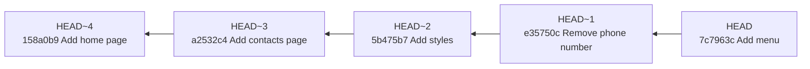
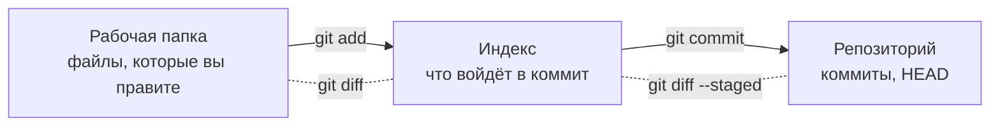
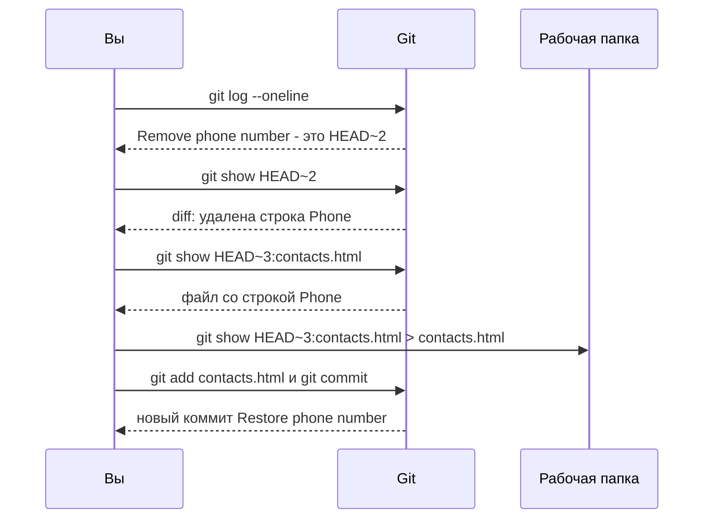
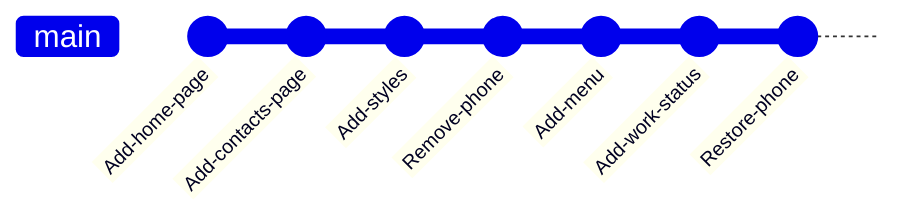

# История и изменения

[Содержание](../../README.md) · [← Назад](../../Lesson-2/ru/%D0%9F%D0%B5%D1%80%D0%B2%D1%8B%D0%B9%20%D0%BA%D0%BE%D0%BC%D0%BC%D0%B8%D1%82.md) · [Вперёд →](../../Lesson-4/ru/%D0%9E%D1%82%D0%BC%D0%B5%D0%BD%D0%B0%20%D0%B8%D0%B7%D0%BC%D0%B5%D0%BD%D0%B5%D0%BD%D0%B8%D0%B9.md) · [RU](%D0%98%D1%81%D1%82%D0%BE%D1%80%D0%B8%D1%8F%20%D0%B8%20%D0%B8%D0%B7%D0%BC%D0%B5%D0%BD%D0%B5%D0%BD%D0%B8%D1%8F.md) · [EN](../en/History%20and%20changes.md) · [UZ](../uz/Tarix%20va%20o'zgarishlar.md)

> **Связь с уроком 2:** вы научились сохранять снимки проекта: `git add` кладёт изменения в индекс, `git commit` сохраняет их в репозиторий. Коммиты копятся, но пока вы их не открывали. Сегодня вы научитесь читать историю, видеть каждую изменённую строку и доставать из прошлого старую версию файла.

---

## Зачем это вам

Понедельник. Вы открываете свой сайт и видите, что со страницы контактов пропал номер телефона. Кто его удалил? Когда? Каким был номер? Вы точно помните, что он был.

Без Git остаётся гадать и искать старую копию на флешке. С Git - три команды: `git log --oneline`, `git show e35750c` и `git show HEAD~3:contacts.html`. Первая покажет список всех коммитов, вторая - что именно изменил подозрительный коммит, третья - файл таким, каким он был до удаления. На работе вы будете делать это постоянно: «что поменялось со вчерашнего дня?», «кто сломал меню?», «что я сейчас отправляю в коммит?». Отвечать на такие вопросы - половина работы с Git.

---

## Чему вы научитесь

- Смотреть историю командой `git log` и её вариантами: `--oneline`, `-n`, `--stat`, `-p`, `--graph`.
- Читать вывод `git log`: хеш, автор, дата, сообщение.
- Выходить из постраничного просмотра клавишей `q`.
- Понимать, что такое хеш коммита, короткий хеш и чем SHA-1 отличается от SHA-256 в Git 3.0.
- Указывать на коммиты через `HEAD`, `HEAD~1`, `HEAD~2`.
- Открывать коммит командой `git show` и старую версию файла - `git show HEAD~2:файл`.
- Различать `git diff` и `git diff --staged`, сравнивать два коммита.
- Читать unified diff: `---`, `+++`, `@@`, `-`, `+`.
- Возвращать удалённый текст из истории в новом коммите.

---

## Повторение: 3 вопроса из урока 2

1. Назовите три зоны Git и команды, которые переносят изменения между ними.
2. Чем `git add .` отличается от `git commit -am "..."`? Когда `-am` не сработает?
3. Что означают строки `M  index.html` и ` M index.html` в ответе `git status -s`?

Ответы - в конце урока.

---

## План урока

| Раздел | Что делаем |
| --- | --- |
| `git log` | Читаем журнал коммитов, выходим из просмотра |
| Хеш коммита | Имя коммита: SHA-1 сейчас, SHA-256 в Git 3.0 |
| `HEAD`, `HEAD~1` | Указываем на коммиты без хеша |
| Мини-задание 1 | Своя история и её просмотр |
| `git show` | Один коммит целиком и старая версия файла |
| Unified diff | Учимся читать `-` и `+` |
| `git diff` | Рабочая папка, индекс, два коммита |
| Возврат текста | Находим удалённое и возвращаем новым коммитом |
| Мини-задание 2 | Сравнить, найти, вернуть |
| Самостоятельная работа | Задание в учебном терминале и на компьютере |

---

## `git log`: журнал проекта

**Простыми словами:** `git log` - это бортовой журнал корабля. Каждая запись: кто, когда и что сделал. Записи никто не стирает, а самая свежая всегда сверху.

Для примеров урока возьмём проект `site`: Анна сделала главную страницу и страницу контактов, Азиз добавил стили и удалил номер телефона, потом Анна добавила меню. Посмотрим историю:

```bash
git log
```

```text
commit 7c7963cc35a65bbb9832fd5d6439f853ca36431d (HEAD -> main)
Author: Anna Karimova <anna@example.com>
Date:   Tue Sep 1 10:05:00 2026 +0500

    Add menu

commit e35750c1c66ed0c2c556e7c18f9a05f89a93720c
Author: Aziz Rakhimov <aziz@example.com>
Date:   Tue Sep 1 10:04:00 2026 +0500

    Remove phone number

commit 5b475b7de4c5aae03a92685a35470ea5117a2108
Author: Aziz Rakhimov <aziz@example.com>
Date:   Tue Sep 1 10:03:00 2026 +0500

    Add styles

commit a2532c488b61adacfa6bb9229fe21950608670af
Author: Anna Karimova <anna@example.com>
Date:   Tue Sep 1 10:02:00 2026 +0500

    Add contacts page

commit 158a0b98afc0c6c0c51d5ae6992ab0fe79688ad7
Author: Anna Karimova <anna@example.com>
Date:   Tue Sep 1 10:01:00 2026 +0500

    Add home page
```

### Как читать вывод `git log`

Порядок - от новых к старым: `Add menu` сделан последним, `Add home page` - первым. Разберём одну запись:

| Строка | Перевод и смысл |
| --- | --- |
| `commit 7c7963cc35a6...` | Хеш коммита - его уникальное имя из 40 символов (подробно - в следующем разделе) |
| `(HEAD -> main)` | Это последний коммит ветки `main`, и вы сейчас на нём |
| `Author: Anna Karimova <anna@example.com>` | Автор: имя и email из `git config` (урок 1) |
| `Date:   Tue Sep 1 10:05:00 2026 +0500` | Дата: вторник, 1 сентября 2026, 10:05; `+0500` - часовой пояс (UTC+5, Ташкент) |
| `    Add menu` | Сообщение коммита - с отступом в 4 пробела |

### Выход из просмотра: клавиша `q`

В учебном терминале вывод просто печатается. В **настоящем** терминале длинную историю Git открывает в программе постраничного просмотра (она называется `less`). Это выглядит так: история заняла весь экран, в самом низу - двоеточие `:` или надпись `(END)`, и терминал «не принимает команды».

Терминал не завис - он ждёт клавиш просмотра:

| Клавиша | Что делает |
| --- | --- |
| `Пробел` | Следующая страница |
| `↓` / `↑`, `b` | На строку вниз / вверх, страница назад |
| `/текст` и `Enter` | Найти текст, например `/Remove` |
| `q` | **Выйти** и вернуться к командной строке |

> **Важно:** если после `git log`, `git show` или `git diff` терминал перестал реагировать, а внизу `:` или `(END)` - нажмите `q` (quit, «выйти»). Не закрывайте окно терминала. То же правило работает в Git Bash на Windows, в macOS и Linux.

### Варианты `git log`

Полный вывод подробный, но длинный. Чаще всего нужен краткий:

```bash
git log --oneline
```

```text
7c7963c (HEAD -> main) Add menu
e35750c Remove phone number
5b475b7 Add styles
a2532c4 Add contacts page
158a0b9 Add home page
```

Каждый коммит - одна строка: **короткий хеш** (первые 7 символов) и сообщение. Сразу видно, зачем нужны хорошие сообщения из урока 2: по `Remove phone number` понятно, где искать пропавший телефон.

Ограничить количество коммитов - `-n` и число: `git log --oneline -n 3` покажет только три верхние строки. Число можно писать и так: `git log -3`. Параметры сочетаются: `git log --stat -n 2`.

Какие файлы менял каждый коммит - `--stat` (statistics). Посмотрим один коммит - `Remove phone number` (запись `HEAD~1` означает «предпоследний коммит», подробно - чуть ниже):

```bash
git log --stat -n 1 HEAD~1
```

```text
commit e35750c1c66ed0c2c556e7c18f9a05f89a93720c
Author: Aziz Rakhimov <aziz@example.com>
Date:   Tue Sep 1 10:04:00 2026 +0500

    Remove phone number

 contacts.html | 1 -
 1 file changed, 1 deletion(-)
```

| Строка | Перевод и смысл |
| --- | --- |
| `contacts.html \| 1 -` | В `contacts.html` изменилась 1 строка, минус - удалена (плюс означал бы «добавлена») |
| `1 file changed, 1 deletion(-)` | Итого: изменён 1 файл, удалена 1 строка |

Все изменённые строки каждого коммита - `-p` (patch, «заплатка»):

```bash
git log -p -n 1
```

Под заголовком коммита появится **diff** - список изменённых строк с `-` и `+`. Такой же вывод даёт `git show`, его мы разберём подробно ниже. Последний вариант - `--graph`, рисунок истории:

```bash
git log --oneline --graph
```

```text
* 7c7963c (HEAD -> main) Add menu
* e35750c Remove phone number
* 5b475b7 Add styles
* a2532c4 Add contacts page
* 158a0b9 Add home page
```

Сейчас история - прямая линия, и звёздочки `*` просто стоят столбиком. Граф станет интересным в уроке 6, когда появятся ветки.

---

## Хеш коммита: SHA-1 и SHA-256

**Простыми словами:** хеш - это отпечаток пальца коммита. Git вычисляет его из всего содержимого коммита: файлов, автора, даты, сообщения и ссылки на предыдущий коммит. Измените хоть одну букву - получится совсем другой отпечаток. Два разных коммита с одинаковым хешем на практике не встречаются.

Хеш записывается шестнадцатеричными цифрами: `0-9` и `a-f`.

| Запись | Пример | Где встречается |
| --- | --- | --- |
| Полный хеш SHA-1 (Git 2.x) | `e35750c1c66ed0c2c556e7c18f9a05f89a93720c` - 40 символов | `git log`, `git show` |
| Короткий хеш | `e35750c` - первые 7 символов | `git log --oneline`, ответ `git commit` |
| Полный хеш SHA-256 (Git 3.0) | 64 символа | Новые репозитории в Git 3.0 |

В командах можно писать короткий хеш: Git сам найдёт коммит, если начало хеша единственное в репозитории. В очень больших проектах Git показывает 8–12 символов, чтобы начало оставалось уникальным.

**SHA-1 и SHA-256.** SHA-1 - алгоритм, которым Git считает хеши с 2005 года. Он устарел: учёные научились подбирать разные данные с одинаковым SHA-1. Поэтому в **Git 3.0** (запланирован на весну 2027) новые репозитории по умолчанию будут использовать **SHA-256** - хеш длиной 64 символа. Для вас почти ничего не изменится: команды те же, просто хеши длиннее, а короткий хеш по-прежнему 7 символов. Попробовать уже сейчас можно так: `git init --object-format=sha256` - но такие репозитории пока поддерживают не все сервисы и программы, поэтому в курсе мы используем обычные.

> **Важно:** хеши у вас будут другими, чем в примерах урока: в них входят ваше имя, email и время коммита. Поэтому в инструкциях и заданиях не переписывайте чужой хеш - смотрите свой в `git log --oneline`.

---

## `HEAD`, `HEAD~1`, `HEAD~2`: адреса в истории

Переписывать хеши неудобно. Для свежих коммитов есть короткие имена.

**Простыми словами:** `HEAD` - это значок «Вы здесь» на карте торгового центра. Обычно он стоит на последнем коммите текущей ветки. `HEAD~1` - «на один шаг назад от вас», `HEAD~2` - «на два шага назад».



**Как читать схему.** Каждый коммит помнит своего **родителя** - предыдущий коммит, стрелка ведёт от потомка к родителю. `HEAD~N` значит «от `HEAD` пройти N шагов к родителям». Сравните со строками `git log --oneline`: верхняя строка - `HEAD`, вторая - `HEAD~1`, третья - `HEAD~2` и так далее.

| Запись | Что означает | В нашем проекте |
| --- | --- | --- |
| `HEAD` | Текущий коммит | `7c7963c Add menu` |
| `HEAD~1` или `HEAD^` | Родитель текущего | `e35750c Remove phone number` |
| `HEAD~2` | Два шага назад | `5b475b7 Add styles` |
| `e35750c` | Коммит по короткому хешу | `Remove phone number` |
| `e35750c~1` | Родитель коммита `e35750c` | `5b475b7 Add styles` |

`HEAD` - подвижный: после каждого нового коммита он переходит на него, и номера `~N` сдвигаются.

`HEAD~2` - это адрес «относительно сейчас»: после следующего коммита `Add work status` значок «Вы здесь» переедет на него, и `Remove phone number` станет `HEAD~2`. Хеш коммита не меняется никогда, а его номер `~N` растёт с каждым новым коммитом. Поэтому перед командой с `HEAD~N` всегда сверяйтесь с `git log --oneline`.

---

## Мини-задание 1

В учебном терминале (Git уже настроен по уроку 1; если терминал новый - сначала выполните `git config --global` для имени, email и `init.defaultBranch main`):

1. Создайте папку `notes`, перейдите в неё и создайте репозиторий.
2. Сделайте три коммита: файл `todo.txt` со строкой `Learn Git` (`Add todo list`), затем допишите `Learn terminal` (`Add terminal task`), затем допишите `Make website` (`Add website task`). Дописывайте знаком `>>` из урока 2.
3. Посмотрите историю тремя способами: `git log`, `git log --oneline`, `git log --oneline -n 2`.
4. Посмотрите `git log --stat`: сколько строк добавил каждый коммит?
5. Найдите короткий хеш самого первого коммита. Каким номером `HEAD~N` его можно назвать?

---

## `git show`: один коммит целиком

`git log` показывает список, а `git show` - один коммит подробно: заголовок и все изменения. Без аргумента - последний коммит. Посмотрим подозрительный коммит Азиза по номеру:

```bash
git show HEAD~1
```

```text
commit e35750c1c66ed0c2c556e7c18f9a05f89a93720c
Author: Aziz Rakhimov <aziz@example.com>
Date:   Tue Sep 1 10:04:00 2026 +0500

    Remove phone number

diff --git a/contacts.html b/contacts.html
index 5228743..c197d12 100644
--- a/contacts.html
+++ b/contacts.html
@@ -1,3 +1,2 @@
 <h1>Contacts</h1>
 <p>Email: anna@example.com</p>
-<p>Phone: +998 90 123-45-67</p>
```

Тот же коммит можно открыть по хешу - результат одинаковый: `git show e35750c`. Строка с минусом и есть пропавший телефон.

**Простыми словами:** `git log` - оглавление книги, `git show` - открыть одну главу.

### `git show HEAD~2:файл`: файл из прошлого

Если после коммита поставить двоеточие и имя файла, Git покажет **не изменения, а сам файл** - каким он был в этом коммите:

```bash
git show HEAD~2:contacts.html
```

```text
<h1>Contacts</h1>
<p>Email: anna@example.com</p>
<p>Phone: +998 90 123-45-67</p>
```

Без двоеточия `git show HEAD~1` выводит коммит (заголовок и diff), с двоеточием `git show HEAD~1:contacts.html` - только файл. Коммит можно указать и хешем: `git show e35750c:contacts.html`.

> **Важно:** `git show` только **показывает**. Файлы в рабочей папке и история не меняются. Как записать старую версию в файл - в разделе «Возвращаем удалённый текст».

---

## Как читать unified diff

Формат, в котором Git показывает изменения, называется **unified diff** («объединённый diff»). Он одинаковый в `git show`, `git log -p` и `git diff`, а ещё на GitHub.

**Простыми словами:** diff - это проверенная учителем тетрадь. Зачёркнутое красным - удалено, вписанное зелёным - добавлено, остальное - текст вокруг, чтобы было понятно, где правка. В настоящем терминале Git так и раскрашивает: `-` красным, `+` зелёным.

Разберём diff коммита `Remove phone number` построчно:

| Строка | Перевод и смысл |
| --- | --- |
| `diff --git a/contacts.html b/contacts.html` | Сравнивается файл `contacts.html`: `a/` - старая версия, `b/` - новая |
| `index 5228743..c197d12 100644` | Служебная строка: короткие хеши двух версий файла и тип файла. Обычно её пропускают |
| `--- a/contacts.html` | Старая версия («было») |
| `+++ b/contacts.html` | Новая версия («стало») |
| `@@ -1,3 +1,2 @@` | Заголовок фрагмента: в старой версии 3 строки начиная с 1-й, в новой - 2 строки начиная с 1-й |
| ` <h1>Contacts</h1>` (пробел в начале) | Строка без изменений - контекст |
| `-<p>Phone: +998 90 123-45-67</p>` | Строка **удалена** |
| `+...` (в этом diff их нет) | Строка **добавлена** |

Изменённая строка в diff выглядит как пара: старый вариант с `-` и новый с `+`. Например, если в `<h1>Anna</h1>` поменять имя, будет:

```text
-<h1>Anna</h1>
+<h1>Anna Karimova</h1>
```

Заголовок `@@` полезен в больших файлах: `@@ -40,6 +40,7 @@` значит «смотрите около 40-й строки». Изменений в файле может быть несколько - тогда и фрагментов `@@` несколько.

---

## `git diff`: что изменилось и где

`git show` показывает изменения **уже сохранённого** коммита. А что вы поменяли сейчас и ещё не закоммитили? Для этого - `git diff`.

Вспомним три зоны из урока 2 и посмотрим, какие из них сравнивает каждая команда:



**Как читать схему.** Сплошные стрелки - путь изменений из урока 2. Пунктир - что с чем сравнивает команда: `git diff` - рабочую папку с индексом («что я изменил, но ещё не добавил»), `git diff --staged` - индекс с последним коммитом («что войдёт в следующий коммит»).

### `git diff`: изменения, которые ещё не в индексе

Допишем строку на главную страницу и спросим Git:

```bash
echo "<p>Open to work</p>" >> index.html
git diff
```

```text
diff --git a/index.html b/index.html
index a679213..6f5b66d 100644
--- a/index.html
+++ b/index.html
@@ -1,2 +1,3 @@
 <h1>Anna Karimova</h1>
 <nav><a href="contacts.html">Contacts</a></nav>
+<p>Open to work</p>
```

Новая строка с `+`, две старые - контекст. Теперь добавим файл в индекс и повторим:

```bash
git add index.html
git diff
```

`git diff` ответил **пустотой**. Это не ошибка: между рабочей папкой и индексом больше нет разницы - всё уже в индексе.

### `git diff --staged`: что войдёт в коммит

```bash
git diff --staged
```

```text
diff --git a/index.html b/index.html
index a679213..6f5b66d 100644
--- a/index.html
+++ b/index.html
@@ -1,2 +1,3 @@
 <h1>Anna Karimova</h1>
 <nav><a href="contacts.html">Contacts</a></nav>
+<p>Open to work</p>
```

Это то, что попадёт в коммит. Хорошая привычка: **перед каждым `git commit` смотреть `git diff --staged`** - так в коммит не попадёт случайная строка. У `--staged` есть старое название `--cached`, оно работает так же.

Пошагово - где находится строка `Open to work` и что показывают команды:

| Шаг | Команда | Рабочая папка | Индекс | Репозиторий |
| --- | --- | --- | --- | --- |
| 1 | `echo "<p>Open to work</p>" >> index.html` | Строка есть | Строки нет | Строки нет. `git diff` - показывает строку, `git diff --staged` - пусто |
| 2 | `git add index.html` | Строка есть | Строка есть | Строки нет. `git diff` - пусто, `git diff --staged` - показывает строку |
| 3 | `git commit -m "Add work status"` | Строка есть | Строка есть | Строка в новом коммите `HEAD`. Обе команды - пусто |

### Сравнить два коммита

`git diff A B` показывает, как из снимка `A` получить снимок `B`: строки с `-` были в `A`, строки с `+` появились в `B`. После коммита `Add work status` история сдвинулась: `Remove phone number` стал `HEAD~2`. Сравним коммит до него и после:

```bash
git diff HEAD~3 HEAD~2
```

```text
diff --git a/contacts.html b/contacts.html
index 5228743..c197d12 100644
--- a/contacts.html
+++ b/contacts.html
@@ -1,3 +1,2 @@
 <h1>Contacts</h1>
 <p>Email: anna@example.com</p>
-<p>Phone: +998 90 123-45-67</p>
```

Это ровно изменения коммита `HEAD~2` - то же, что показал бы `git show HEAD~2`. Сравнивать можно и далёкие коммиты: `git diff HEAD~4 HEAD` покажет всё, что изменилось за последние четыре коммита, одним списком. Вместо `HEAD~N` можно писать хеши: `git diff a2532c4 e35750c`.

Порядок важен: `git diff HEAD~2 HEAD~3` покажет то же «наоборот», телефон будет со знаком `+`. Пишите сначала старый коммит, потом новый.

---

## Возвращаем удалённый текст

Соберём всё вместе и вернём телефон на страницу контактов. После коммита `Add work status` история сдвинулась: сверху `Add work status`, затем `Add menu`, затем `Remove phone number`.

План: найти коммит, который удалил текст, взять файл из коммита **перед ним**, записать в рабочую папку и сделать **новый** коммит.



**Как читать схему.** Сначала вы только смотрите: `git log` и `git show` ничего не меняют. Единственное изменение файла - запись знаком `>`, который вы знаете с урока 1: вывод команды попадает не на экран, а в файл. Затем обычный коммит из урока 2.

Шаг 1. Найти коммит. В `git log --oneline` `Remove phone number` стоит третьим сверху - это `HEAD~2`. Проверяем его изменения: `git show HEAD~2` - удалена строка `Phone`.

Шаг 2. Нужная версия - в коммите **перед** удалением, то есть `HEAD~3` (или `e35750c~1`). Сначала посмотрите её, ничего не записывая: `git show HEAD~3:contacts.html` выведет тот же файл со строкой `Phone`, что мы видели в разделе про `git show`.

Шаг 3. Телефон на месте - записываем эту версию в файл и проверяем:

```bash
git show HEAD~3:contacts.html > contacts.html
git status -s
git diff
```

```text
 M contacts.html
diff --git a/contacts.html b/contacts.html
index c197d12..5228743 100644
--- a/contacts.html
+++ b/contacts.html
@@ -1,2 +1,3 @@
 <h1>Contacts</h1>
 <p>Email: anna@example.com</p>
+<p>Phone: +998 90 123-45-67</p>
```

`git diff` подтверждает: изменилась ровно одна строка - вернулся телефон. Ничего лишнего.

Шаг 4. Коммит с понятным сообщением:

```bash
git add contacts.html
git commit -m "Restore phone number"
git log --oneline -n 3
```

```text
[main 4769e07] Restore phone number
 1 file changed, 1 insertion(+)
4769e07 (HEAD -> main) Restore phone number
4a87916 Add work status
7c7963c Add menu
```

| Шаг | Команда | Что изменилось / куда указывает HEAD |
| --- | --- | --- |
| 1 | `git log --oneline` | Ничего. `HEAD` = `Add work status`, удаление - `HEAD~2` |
| 2 | `git show HEAD~3:contacts.html` | Ничего, файл только показан на экране |
| 3 | `git show HEAD~3:contacts.html > contacts.html` | Рабочая папка: в `contacts.html` вернулся телефон. История та же |
| 4 | `git add contacts.html` | Индекс: в нём новая версия файла |
| 5 | `git commit -m "Restore phone number"` | Новый коммит, `HEAD` = `Restore phone number`, удаление стало `HEAD~3` |



**Как читать схему.** Это история проекта: коммиты слева направо, от старых к новым. Обратите внимание - коммит `Remove-phone` никуда не делся. Мы не стирали прошлое, а добавили новый коммит, который возвращает строку. В истории честно видно: телефон удалили, потом вернули. Так безопасно делать даже в проекте, который видят другие люди. Другие способы отмены - `git restore`, `git revert` и `git reset` - разберём в уроке 4.

> **Важно:** если удаление было давно и **после** него файл ещё менялся, `git show HEAD~N:файл > файл` вернёт файл целиком и сотрёт эти поздние правки. Тогда скопируйте из `git show HEAD~N:файл` только нужные строки и допишите их через `>>`, а затем обязательно проверьте `git diff`.

### Попробуйте сломать

1. Попросите коммит, которого нет: `git show HEAD~20`. Что ответит Git?
2. Создайте новый пустой репозиторий и выполните в нём `git log`. Почему ошибка?
3. Ошибитесь в имени файла: `git show HEAD~1:contact.html` (без `s`). Что подскажет Git?
4. Измените файл, выполните `git add` и сразу `git diff`. Почему пусто? Что покажет `git diff --staged`?
5. Забудьте двоеточие: `git show HEAD~1 > old.txt`, затем `cat old.txt`. Что оказалось в файле?
6. Поменяйте местами коммиты: `git diff HEAD HEAD~1`. Чем ответ отличается от `git diff HEAD~1 HEAD`?

### Частые ошибки новичков

| Ошибка | Что получится | Как исправить |
| --- | --- | --- |
| После `git log` в настоящем терминале внизу `:` или `(END)` | Кажется, что терминал завис | Нажать `q` |
| Номер больше, чем коммитов: `git show HEAD~9` | `fatal: ambiguous argument 'HEAD~9': unknown revision or path not in the working tree.` | Посмотреть `git log --oneline` и посчитать строки |
| Опечатка в имени файла: `git show HEAD~1:contact.html` | `fatal: path 'contact.html' does not exist in 'HEAD~1'` | Проверить имя: `ls` или `git log --stat -n 3` |
| `git log` в репозитории без коммитов | `fatal: your current branch 'main' does not have any commits yet` | Сначала сделать коммит (урок 2) |
| Ждали изменения от `git diff` после `git add` | Пустой ответ | Изменения уже в индексе: `git diff --staged` |
| Взяли версию **после** удаления (`HEAD~2` вместо `HEAD~3`) | Файл не изменился, `git commit` отвечает `nothing to commit, working tree clean` | Взять коммит **перед** удалением: на один номер больше |
| Забыли `:файл`: `git show HEAD~3 > contacts.html` | В файле оказались строки `commit ...`, `Author:` и diff | Повторить с `HEAD~3:contacts.html` |
| Думали, что `git show HEAD~3:файл` восстановил файл | Текст появился на экране, файл прежний | Записать знаком `>`, затем `git add` и `git commit` |
| Переписали хеш из чужого примера | `fatal: ambiguous argument 'e35750c': unknown revision...` | Брать хеш из своего `git log --oneline` |

---

## Мини-задание 2

Продолжайте в репозитории `notes` из мини-задания 1:

1. Допишите в `todo.txt` строку `Read lesson 3`. Посмотрите `git diff`.
2. Добавьте файл в индекс. Снова выполните `git diff` и `git diff --staged` - объясните разницу.
3. Сделайте коммит `Add lesson task`.
4. Сравните первый и последний коммит: `git diff HEAD~3 HEAD`. Сколько строк добавлено?
5. Покажите `todo.txt` из самого первого коммита, запишите эту версию в файл и сделайте коммит `Restore first todo list`. Проверьте `git log --oneline`.

---

## Итоги урока: шпаргалка

| Задача | Команда |
| --- | --- |
| История подробно | `git log` |
| История кратко | `git log --oneline` |
| Последние N коммитов | `git log -n 3` или `git log -3` |
| Какие файлы менял каждый коммит | `git log --stat` |
| Все изменённые строки | `git log -p` |
| Рисунок истории | `git log --oneline --graph` |
| Выйти из просмотра | Клавиша `q` |
| Один коммит целиком | `git show HEAD~1` или `git show e35750c` |
| Файл из прошлого коммита | `git show HEAD~2:файл` |
| Изменения, ещё не добавленные в индекс | `git diff` |
| Что войдёт в коммит | `git diff --staged` |
| Разница между коммитами | `git diff HEAD~3 HEAD` |
| Вернуть старую версию файла новым коммитом | `git show HEAD~3:файл > файл`, `git add файл`, `git commit -m "Restore ..."` |

---

## Самостоятельная работа

### Часть 1. Задание в IDE (засчитывается платформой)

Вы в папке `~/portfolio`, Git настроен. В истории несколько коммитов разных авторов, и один из них удалил часть текста из `about.html` - его сообщение начинается со слова `Remove`. Номер и хеш этого коммита заранее не известны: найдите его по истории. Напишите команды по одной на строке:

1. Посмотрите историю командами `git log` и `git log --oneline`.
2. Найдите коммит, сообщение которого начинается с `Remove`, и посмотрите его изменения (`git show`).
3. Выведите `about.html` из коммита **перед** ним (`git show HEAD~N:about.html`).
4. Запишите эту версию в `about.html` (знак `>`) и проверьте `git status` и `git diff`.
5. Добавьте `about.html` в индекс и проверьте `git diff --staged`.
6. Сделайте коммит с сообщением, которое начинается с `Restore` (например, `Restore team section`).
7. Проверьте историю: `git log --oneline -n 3`.

Что проверяет платформа: что добавлен ровно один новый коммит, а старые не изменены; что `about.html` в новом коммите и в рабочей папке совпадает с версией до удаления целиком; что новый коммит меняет только `about.html`; что сообщение начинается с `Restore` и не длиннее 50 символов; что рабочая папка чистая; что вы смотрели историю (`git log`) и изменения (`git show` или `git diff`); что сценарий выполняется без ошибок. Решение проверяется ещё и на **другой** истории - с другим удалённым текстом, другими хешами и другим числом коммитов. Поэтому не вписывайте текст вручную и не используйте хеши: ссылайтесь на коммиты через `HEAD~N`.

### Часть 2. Проект на компьютере

1. В репозитории своего сайта (уроки 1–2) выполните `git log`, затем `git log --oneline` и `git log --stat`. Если вывод открылся постранично - выйдите клавишей `q`.
2. Измените любую страницу сайта, посмотрите `git diff`, добавьте в индекс и посмотрите `git diff --staged`. Сделайте коммит.
3. Удалите со страницы абзац и сделайте коммит `Remove ...`. Затем найдите этот коммит в истории и верните абзац новым коммитом `Restore ...` по рецепту урока.
4. Сравните первый и последний коммит проекта: `git diff <хеш первого> HEAD --stat`.
5. Посчитайте символы в полном хеше любого коммита: 40 - значит, ваш репозиторий использует SHA-1.

### Критерии готовности

- [ ] Задание в IDE засчитано.
- [ ] Вы умеете выйти из постраничного просмотра `git log` клавишей `q`.
- [ ] В истории вашего сайта есть пара коммитов `Remove ...` и `Restore ...`, а `git status` после них чистый.
- [ ] Вы можете объяснить разницу между `git diff` и `git diff --staged` на своём примере.
- [ ] Вы читаете строки `---`, `+++`, `@@`, `-`, `+` в любом diff без подсказки.

---

## Вопросы для самопроверки

1. Какие четыре сведения о коммите показывает `git log`? В каком порядке идут коммиты?
2. Чем отличаются `git log --oneline`, `git log --stat` и `git log -p`?
3. Что делать, если после `git log` внизу терминала появились `:` или `(END)`?
4. Что такое хеш коммита и почему можно писать только 7 первых символов?
5. Чем SHA-256 в Git 3.0 отличается от SHA-1 для пользователя?
6. На какие коммиты указывают `HEAD`, `HEAD~1` и `HEAD~2`? Почему `HEAD~2` завтра может означать другой коммит?
7. Чем `git show HEAD~2` отличается от `git show HEAD~2:index.html`?
8. Что означают в diff строки `---`, `+++`, `@@ -1,3 +1,2 @@` и знаки `-` и `+`?
9. Что сравнивают `git diff` и `git diff --staged`? Почему `git diff` бывает пустым, хотя файл изменён?
10. Как вернуть текст, удалённый три коммита назад, не стирая историю?

После вопросов пройдите **тест урока** на платформе: 12 вопросов, порог 70%.

---

## Что дальше

Сегодня вы вернули старый текст «вручную»: нашли версию в истории и сделали новый коммит. В уроке 4 вы узнаете специальные команды отмены: `git restore` - отменить правки в файле, `git commit --amend` - исправить последний коммит, `git revert` - отменить коммит новым коммитом, `git reset` - передвинуть ветку назад, и `git reflog` - найти «потерянные» коммиты. И главное правило: что можно переписывать, а что - нельзя.

---

## Ответы

**Повторение**

1. Рабочая папка, индекс и репозиторий. `git add` переносит изменения из рабочей папки в индекс, `git commit` - из индекса в репозиторий.
2. `git add .` только добавляет все изменения в индекс. `git commit -am "..."` добавляет изменения **отслеживаемых** файлов и сразу делает коммит. Новые (неотслеживаемые) файлы `-am` не добавит - для них нужен `git add`.
3. `M  index.html` (буква в первой колонке) - изменения добавлены в индекс. ` M index.html` (буква во второй колонке) - файл изменён, но не добавлен.

**Мини-задание 1**

```bash
mkdir notes
cd notes
git init
echo "Learn Git" > todo.txt
git add todo.txt
git commit -m "Add todo list"
echo "Learn terminal" >> todo.txt
git commit -am "Add terminal task"
echo "Make website" >> todo.txt
git commit -am "Add website task"
git log
git log --oneline
git log --oneline -n 2
git log --stat
```

Каждый коммит добавил 1 строку (`1 insertion(+)`). Первый коммит - нижняя строка `git log --oneline`, это `HEAD~2`.

**Мини-задание 2**

```bash
echo "Read lesson 3" >> todo.txt
git diff
git add todo.txt
git diff
git diff --staged
git commit -m "Add lesson task"
git diff HEAD~3 HEAD
git show HEAD~3:todo.txt
git show HEAD~3:todo.txt > todo.txt
git diff
git add todo.txt
git commit -m "Restore first todo list"
git log --oneline
```

После `git add` обычный `git diff` пуст, а `git diff --staged` показывает строку `Read lesson 3`. Между первым и последним коммитом добавлено 3 строки.

**Вопросы для самопроверки**

1. Хеш, автор, дата и сообщение. От новых к старым: последний коммит сверху.
2. `--oneline` - одна строка на коммит (короткий хеш и сообщение), `--stat` - какие файлы и сколько строк изменено, `-p` - все изменённые строки.
3. Это постраничный просмотр. Нажать `q`.
4. Уникальное имя коммита, которое Git вычисляет из его содержимого. 7 первых символов достаточно, если такое начало хеша в репозитории одно.
5. Хеш длиннее - 64 символа вместо 40 - и надёжнее. Команды те же.
6. `HEAD` - текущий коммит, `HEAD~1` - его родитель, `HEAD~2` - на два шага назад. После нового коммита `HEAD` сдвинется, и все номера тоже.
7. Первая показывает коммит: заголовок и diff. Вторая - только содержимое `index.html` в этом коммите.
8. `---` - старая версия файла, `+++` - новая, `@@ -1,3 +1,2 @@` - фрагмент: было 3 строки с 1-й, стало 2 с 1-й. `-` - строка удалена, `+` - добавлена.
9. `git diff` - рабочую папку с индексом, `git diff --staged` - индекс с последним коммитом. `git diff` пуст, если все изменения уже добавлены в индекс.
10. Найти коммит удаления в `git log --oneline`, вывести файл из коммита перед ним (`git show HEAD~N:файл > файл`), проверить `git diff`, затем `git add` и `git commit -m "Restore ..."`.

---

[Содержание](../../README.md) · [← Назад](../../Lesson-2/ru/%D0%9F%D0%B5%D1%80%D0%B2%D1%8B%D0%B9%20%D0%BA%D0%BE%D0%BC%D0%BC%D0%B8%D1%82.md) · [Вперёд →](../../Lesson-4/ru/%D0%9E%D1%82%D0%BC%D0%B5%D0%BD%D0%B0%20%D0%B8%D0%B7%D0%BC%D0%B5%D0%BD%D0%B5%D0%BD%D0%B8%D0%B9.md) · [RU](%D0%98%D1%81%D1%82%D0%BE%D1%80%D0%B8%D1%8F%20%D0%B8%20%D0%B8%D0%B7%D0%BC%D0%B5%D0%BD%D0%B5%D0%BD%D0%B8%D1%8F.md) · [EN](../en/History%20and%20changes.md) · [UZ](../uz/Tarix%20va%20o'zgarishlar.md)
