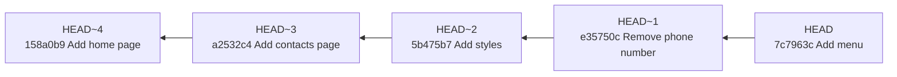
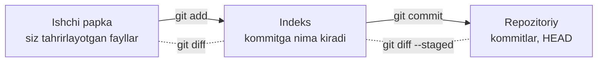
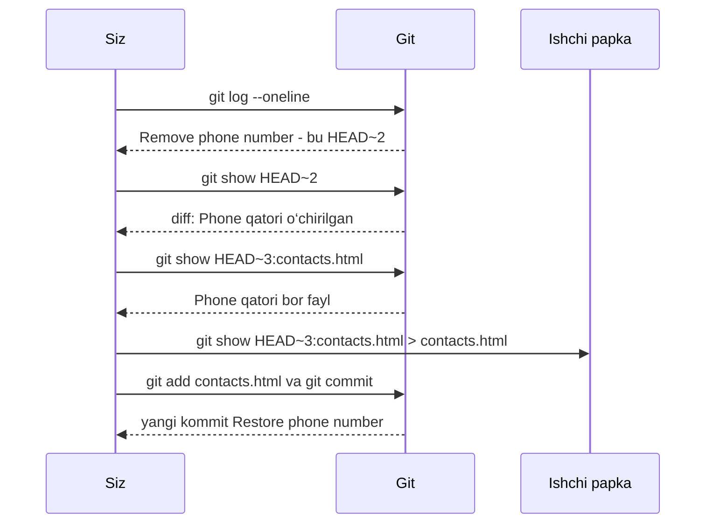
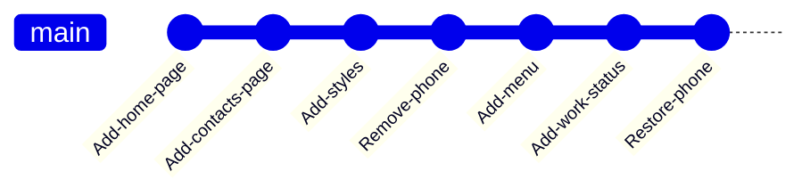

# Tarix va o‘zgarishlar

[Mundarija](../../README.md) · [← Orqaga](../../Lesson-2/uz/Birinchi%20kommit.md) · [Keyingi →](../../Lesson-4/uz/O'zgarishlarni%20bekor%20qilish.md) · [RU](../ru/%D0%98%D1%81%D1%82%D0%BE%D1%80%D0%B8%D1%8F%20%D0%B8%20%D0%B8%D0%B7%D0%BC%D0%B5%D0%BD%D0%B5%D0%BD%D0%B8%D1%8F.md) · [EN](../en/History%20and%20changes.md) · [UZ](Tarix%20va%20o'zgarishlar.md)

> **2-dars bilan bog‘liqlik:** siz loyiha suratlarini saqlashni o‘rgandingiz: `git add` o‘zgarishlarni indeksga qo‘yadi, `git commit` esa ularni repozitoriyga saqlaydi. Kommitlar to‘planib bormoqda, lekin siz ularni hali ochib ko‘rmadingiz. Bugun tarixni o‘qishni, har bir o‘zgargan qatorni ko‘rishni va faylning eski versiyasini o‘tmishdan olib chiqishni o‘rganasiz.

---

## Bu sizga nima uchun kerak

Dushanba. Saytingizni ochasiz va kontaktlar sahifasidan telefon raqami yo‘qolganini ko‘rasiz. Uni kim o‘chirdi? Qachon? Raqam qanday edi? Uning borligini aniq eslaysiz.

Git’siz faqat taxmin qilish va fleshkadan eski nusxani qidirish qoladi. Git bilan esa - uchta buyruq: `git log --oneline`, `git show e35750c` va `git show HEAD~3:contacts.html`. Birinchisi barcha kommitlar ro‘yxatini ko‘rsatadi, ikkinchisi - shubhali kommit aynan nimani o‘zgartirganini, uchinchisi - faylni o‘chirishdan oldingi holatida. Ishda buni doimo qilasiz: «kechadan beri nima o‘zgardi?», «menyuni kim buzdi?», «hozir kommitga nimani yuboryapman?». Shunday savollarga javob berish - Git bilan ishlashning yarmi.

---

## Nimani o‘rganasiz

- Tarixni `git log` buyrug‘i va uning variantlari bilan ko‘rish: `--oneline`, `-n`, `--stat`, `-p`, `--graph`.
- `git log` chiqishini o‘qish: xesh, muallif, sana, xabar.
- Sahifalab ko‘rish rejimidan `q` tugmasi bilan chiqish.
- Kommit xeshi, qisqa xesh nima ekanini va Git 3.0 dagi SHA-256 SHA-1 dan nimasi bilan farq qilishini tushunish.
- Kommitlarga `HEAD`, `HEAD~1`, `HEAD~2` orqali murojaat qilish.
- Kommitni `git show` buyrug‘i bilan, faylning eski versiyasini esa `git show HEAD~2:fayl` bilan ochish.
- `git diff` va `git diff --staged` ni farqlash, ikki kommitni solishtirish.
- Unified diff’ni o‘qish: `---`, `+++`, `@@`, `-`, `+`.
- O‘chirilgan matnni tarixdan yangi kommit bilan qaytarish.

---

## Takrorlash: 2-darsdan 3 savol

1. Git’ning uchta zonasini va o‘zgarishlarni ular orasida ko‘chiradigan buyruqlarni ayting.
2. `git add .` va `git commit -am "..."` nimasi bilan farq qiladi? `-am` qachon ishlamaydi?
3. `git status -s` javobidagi `M  index.html` va ` M index.html` qatorlari nimani bildiradi?

Javoblar - dars oxirida.

---

## Reja

| Bo‘lim | Nima qilamiz |
| --- | --- |
| `git log` | Kommitlar jurnalini o‘qiymiz, ko‘rish rejimidan chiqamiz |
| Kommit xeshi | Kommit nomi: hozir SHA-1, Git 3.0 da SHA-256 |
| `HEAD`, `HEAD~1` | Kommitlarga xeshsiz murojaat qilamiz |
| Mini-topshiriq 1 | O‘z tarixingiz va uni ko‘rish |
| `git show` | Bitta kommit to‘liq va faylning eski versiyasi |
| Unified diff | `-` va `+` ni o‘qishni o‘rganamiz |
| `git diff` | Ishchi papka, indeks, ikki kommit |
| Matnni qaytarish | O‘chirilganini topamiz va yangi kommit bilan qaytaramiz |
| Mini-topshiriq 2 | Solishtirish, topish, qaytarish |
| Mustaqil ish | O‘quv terminalidagi va kompyuterdagi topshiriq |

---

## `git log`: loyiha jurnali

**Oddiy so‘z bilan:** `git log` - bu kemaning bort jurnali. Har bir yozuv: kim, qachon va nima qilgan. Yozuvlarni hech kim o‘chirmaydi, eng yangisi esa doim tepada turadi.

Dars misollari uchun `site` loyihasini olamiz: Anna bosh sahifa va kontaktlar sahifasini yaratdi, Aziz stillarni qo‘shdi va telefon raqamini o‘chirdi, keyin Anna menyu qo‘shdi. Tarixni ko‘ramiz:

```bash
git log
```

```text
commit 7c7963cc35a65bbb9832fd5d6439f853ca36431d (HEAD -> main)
Author: Anna Karimova <anna@example.com>
Date:   Tue Sep 1 10:05:00 2026 +0500

    Add menu

commit e35750c1c66ed0c2c556e7c18f9a05f89a93720c
Author: Aziz Rakhimov <aziz@example.com>
Date:   Tue Sep 1 10:04:00 2026 +0500

    Remove phone number

commit 5b475b7de4c5aae03a92685a35470ea5117a2108
Author: Aziz Rakhimov <aziz@example.com>
Date:   Tue Sep 1 10:03:00 2026 +0500

    Add styles

commit a2532c488b61adacfa6bb9229fe21950608670af
Author: Anna Karimova <anna@example.com>
Date:   Tue Sep 1 10:02:00 2026 +0500

    Add contacts page

commit 158a0b98afc0c6c0c51d5ae6992ab0fe79688ad7
Author: Anna Karimova <anna@example.com>
Date:   Tue Sep 1 10:01:00 2026 +0500

    Add home page
```

### `git log` chiqishini qanday o‘qish kerak

Tartib - yangisidan eskisiga: `Add menu` eng oxirida, `Add home page` esa birinchi bo‘lib qilingan. Bitta yozuvni tahlil qilamiz:

| Qator | Tarjimasi va ma’nosi |
| --- | --- |
| `commit 7c7963cc35a6...` | Kommit xeshi - uning 40 belgidan iborat noyob nomi (batafsil - keyingi bo‘limda) |
| `(HEAD -> main)` | Bu `main` tarmog‘ining oxirgi kommiti va siz hozir shu kommitdasiz |
| `Author: Anna Karimova <anna@example.com>` | Muallif: `git config` dagi ism va email (1-dars) |
| `Date:   Tue Sep 1 10:05:00 2026 +0500` | Sana: seshanba, 2026-yil 1-sentabr, 10:05; `+0500` - vaqt mintaqasi (UTC+5, Toshkent) |
| `    Add menu` | Kommit xabari - 4 ta probel bilan surilgan |

### Ko‘rish rejimidan chiqish: `q` tugmasi

O‘quv terminalida chiqish shunchaki ekranga bosiladi. **Haqiqiy** terminalda esa Git uzun tarixni sahifalab ko‘rish dasturida ochadi (u `less` deb ataladi). Bu shunday ko‘rinadi: tarix butun ekranni egalladi, eng pastda ikki nuqta `:` yoki `(END)` yozuvi turibdi va terminal «buyruqlarni qabul qilmayapti».

Terminal qotib qolgani yo‘q - u ko‘rish tugmalarini kutyapti:

| Tugma | Nima qiladi |
| --- | --- |
| `Probel` | Keyingi sahifa |
| `↓` / `↑`, `b` | Bir qator pastga / yuqoriga, bir sahifa orqaga |
| `/matn` va `Enter` | Matnni qidirish, masalan `/Remove` |
| `q` | **Chiqish** va buyruq qatoriga qaytish |

> **Muhim:** agar `git log`, `git show` yoki `git diff` dan keyin terminal javob bermay qolsa, pastda esa `:` yoki `(END)` tursa - `q` ni bosing (quit, «chiqish»). Terminal oynasini yopmang. Bu qoida Windows’dagi Git Bash’da, macOS va Linux’da ham ishlaydi.

### `git log` variantlari

To‘liq chiqish batafsil, lekin uzun. Ko‘pincha qisqasi kerak bo‘ladi:

```bash
git log --oneline
```

```text
7c7963c (HEAD -> main) Add menu
e35750c Remove phone number
5b475b7 Add styles
a2532c4 Add contacts page
158a0b9 Add home page
```

Har bir kommit - bitta qator: **qisqa xesh** (birinchi 7 belgi) va xabar. 2-darsdagi yaxshi xabarlar nima uchun kerakligi darhol ko‘rinadi: `Remove phone number` ga qarab yo‘qolgan telefonni qayerdan qidirish kerakligi tushunarli.

Kommitlar sonini cheklash - `-n` va son: `git log --oneline -n 3` faqat yuqoridagi uchta qatorni ko‘rsatadi. Sonni bunday ham yozish mumkin: `git log -3`. Parametrlarni birga ishlatish mumkin: `git log --stat -n 2`.

Har bir kommit qaysi fayllarni o‘zgartirgani - `--stat` (statistics). Bitta kommitni ko‘ramiz - `Remove phone number` (`HEAD~1` yozuvi «oxiridan oldingi kommit» degani, batafsil - sal pastroqda):

```bash
git log --stat -n 1 HEAD~1
```

```text
commit e35750c1c66ed0c2c556e7c18f9a05f89a93720c
Author: Aziz Rakhimov <aziz@example.com>
Date:   Tue Sep 1 10:04:00 2026 +0500

    Remove phone number

 contacts.html | 1 -
 1 file changed, 1 deletion(-)
```

| Qator | Tarjimasi va ma’nosi |
| --- | --- |
| `contacts.html \| 1 -` | `contacts.html` da 1 qator o‘zgardi, minus - o‘chirilgan (plyus «qo‘shilgan» degani bo‘lardi) |
| `1 file changed, 1 deletion(-)` | Jami: 1 fayl o‘zgardi, 1 qator o‘chirildi |

Har bir kommitning barcha o‘zgargan qatorlari - `-p` (patch, «yamoq»):

```bash
git log -p -n 1
```

Kommit sarlavhasi ostida **diff** paydo bo‘ladi - `-` va `+` bilan belgilangan o‘zgargan qatorlar ro‘yxati. Xuddi shunday chiqishni `git show` beradi, uni quyida batafsil ko‘rib chiqamiz. Oxirgi variant - `--graph`, tarix rasmi:

```bash
git log --oneline --graph
```

```text
* 7c7963c (HEAD -> main) Add menu
* e35750c Remove phone number
* 5b475b7 Add styles
* a2532c4 Add contacts page
* 158a0b9 Add home page
```

Hozir tarix - to‘g‘ri chiziq, `*` yulduzchalar esa shunchaki ustun bo‘lib turibdi. Graf 6-darsda, tarmoqlar paydo bo‘lganda qiziqarli bo‘ladi.

---

## Kommit xeshi: SHA-1 va SHA-256

**Oddiy so‘z bilan:** xesh - bu kommitning barmoq izi. Git uni kommitning butun mazmunidan hisoblaydi: fayllar, muallif, sana, xabar va oldingi kommitga havola. Bitta harfni o‘zgartirsangiz ham - butunlay boshqa iz chiqadi. Bir xil xeshli ikki xil kommit amalda uchramaydi.

Xesh o‘n oltilik raqamlar bilan yoziladi: `0-9` va `a-f`.

| Yozuv | Misol | Qayerda uchraydi |
| --- | --- | --- |
| To‘liq SHA-1 xeshi (Git 2.x) | `e35750c1c66ed0c2c556e7c18f9a05f89a93720c` - 40 belgi | `git log`, `git show` |
| Qisqa xesh | `e35750c` - birinchi 7 belgi | `git log --oneline`, `git commit` javobi |
| To‘liq SHA-256 xeshi (Git 3.0) | 64 belgi | Git 3.0 dagi yangi repozitoriylar |

Buyruqlarda qisqa xeshni yozish mumkin: agar xeshning boshi repozitoriyda yagona bo‘lsa, Git kommitni o‘zi topadi. Juda katta loyihalarda Git boshi noyob bo‘lib qolishi uchun 8–12 belgi ko‘rsatadi.

**SHA-1 va SHA-256.** SHA-1 - Git 2005-yildan beri xeshlarni hisoblaydigan algoritm. U eskirgan: olimlar bir xil SHA-1 ga ega turli ma’lumotlarni topishni o‘rganishdi. Shuning uchun **Git 3.0** da (2027-yil bahoriga rejalashtirilgan) yangi repozitoriylar sukut bo‘yicha **SHA-256** dan - 64 belgili xeshdan foydalanadi. Siz uchun deyarli hech narsa o‘zgarmaydi: buyruqlar o‘sha-o‘sha, faqat xeshlar uzunroq, qisqa xesh esa avvalgidek 7 belgi. Hozirning o‘zida sinab ko‘rish mumkin: `git init --object-format=sha256` - lekin bunday repozitoriylarni hali hamma servis va dasturlar qo‘llab-quvvatlamaydi, shuning uchun kursda oddiy repozitoriylardan foydalanamiz.

> **Muhim:** sizdagi xeshlar dars misollaridagidan boshqacha bo‘ladi: ularga ismingiz, email’ingiz va kommit vaqti kiradi. Shuning uchun ko‘rsatmalar va topshiriqlarda birovning xeshini ko‘chirib yozmang - o‘zingiznikini `git log --oneline` da ko‘ring.

---

## `HEAD`, `HEAD~1`, `HEAD~2`: tarixdagi manzillar

Xeshlarni ko‘chirib yozish noqulay. Yangi kommitlar uchun qisqa nomlar bor.

**Oddiy so‘z bilan:** `HEAD` - bu savdo markazi xaritasidagi «Siz shu yerdasiz» belgisi. Odatda u joriy tarmoqning oxirgi kommitida turadi. `HEAD~1` - «sizdan bir qadam orqada», `HEAD~2` - «ikki qadam orqada».



**Sxemani qanday o‘qish kerak.** Har bir kommit o‘zining **ota kommitini** - oldingi kommitni eslab qoladi, strelka avloddan ota kommitga qarab boradi. `HEAD~N` - «`HEAD` dan ota kommitlar tomon N qadam yurish» degani. `git log --oneline` qatorlari bilan solishtiring: yuqoridagi qator - `HEAD`, ikkinchisi - `HEAD~1`, uchinchisi - `HEAD~2` va hokazo.

| Yozuv | Nimani bildiradi | Bizning loyihada |
| --- | --- | --- |
| `HEAD` | Joriy kommit | `7c7963c Add menu` |
| `HEAD~1` yoki `HEAD^` | Joriy kommitning ota kommiti | `e35750c Remove phone number` |
| `HEAD~2` | Ikki qadam orqada | `5b475b7 Add styles` |
| `e35750c` | Qisqa xesh bo‘yicha kommit | `Remove phone number` |
| `e35750c~1` | `e35750c` kommitining ota kommiti | `5b475b7 Add styles` |

`HEAD` harakatlanuvchan: har bir yangi kommitdan keyin u o‘sha kommitga o‘tadi va `~N` raqamlari suriladi.

`HEAD~2` - bu «hozirga nisbatan» manzil: keyingi `Add work status` kommitidan so‘ng «Siz shu yerdasiz» belgisi unga ko‘chadi va `Remove phone number` `HEAD~2` ga aylanadi. Kommit xeshi hech qachon o‘zgarmaydi, uning `~N` raqami esa har bir yangi kommit bilan o‘sib boradi. Shuning uchun `HEAD~N` li buyruqdan oldin doim `git log --oneline` bilan solishtiring.

---

## Mini-topshiriq 1

O‘quv terminalida (Git 1-darsdagidek sozlangan; agar terminal yangi bo‘lsa - avval ism, email va `init.defaultBranch main` uchun `git config --global` ni bajaring):

1. `notes` papkasini yarating, unga o‘ting va repozitoriy yarating.
2. Uchta kommit qiling: `Learn Git` qatorli `todo.txt` fayli (`Add todo list`), keyin `Learn terminal` ni qo‘shing (`Add terminal task`), keyin `Make website` ni qo‘shing (`Add website task`). 2-darsdagi `>>` belgisi bilan qo‘shing.
3. Tarixni uch xil usulda ko‘ring: `git log`, `git log --oneline`, `git log --oneline -n 2`.
4. `git log --stat` ni ko‘ring: har bir kommit nechta qator qo‘shdi?
5. Eng birinchi kommitning qisqa xeshini toping. Uni qaysi `HEAD~N` raqami bilan atash mumkin?

---

## `git show`: bitta kommit to‘liq

`git log` ro‘yxatni ko‘rsatadi, `git show` esa bitta kommitni batafsil: sarlavha va barcha o‘zgarishlar. Argumentsiz - oxirgi kommitni. Aziz’ning shubhali kommitini raqami bo‘yicha ko‘ramiz:

```bash
git show HEAD~1
```

```text
commit e35750c1c66ed0c2c556e7c18f9a05f89a93720c
Author: Aziz Rakhimov <aziz@example.com>
Date:   Tue Sep 1 10:04:00 2026 +0500

    Remove phone number

diff --git a/contacts.html b/contacts.html
index 5228743..c197d12 100644
--- a/contacts.html
+++ b/contacts.html
@@ -1,3 +1,2 @@
 <h1>Contacts</h1>
 <p>Email: anna@example.com</p>
-<p>Phone: +998 90 123-45-67</p>
```

Xuddi shu kommitni xesh bo‘yicha ham ochish mumkin - natija bir xil: `git show e35750c`. Minusli qator - aynan yo‘qolgan telefon.

**Oddiy so‘z bilan:** `git log` - kitobning mundarijasi, `git show` - bitta bobni ochish.

### `git show HEAD~2:fayl`: o‘tmishdagi fayl

Agar kommitdan keyin ikki nuqta va fayl nomini qo‘ysangiz, Git **o‘zgarishlarni emas, faylning o‘zini** ko‘rsatadi - u shu kommitda qanday bo‘lgan bo‘lsa:

```bash
git show HEAD~2:contacts.html
```

```text
<h1>Contacts</h1>
<p>Email: anna@example.com</p>
<p>Phone: +998 90 123-45-67</p>
```

Ikki nuqtasiz `git show HEAD~1` kommitni (sarlavha va diff) chiqaradi, ikki nuqta bilan `git show HEAD~1:contacts.html` esa faqat faylni. Kommitni xesh bilan ham ko‘rsatish mumkin: `git show e35750c:contacts.html`.

> **Muhim:** `git show` faqat **ko‘rsatadi**. Ishchi papkadagi fayllar ham, tarix ham o‘zgarmaydi. Eski versiyani faylga qanday yozish - «O‘chirilgan matnni qaytaramiz» bo‘limida.

---

## Unified diff’ni qanday o‘qish kerak

Git o‘zgarishlarni ko‘rsatadigan format **unified diff** («birlashtirilgan diff») deb ataladi. U `git show`, `git log -p` va `git diff` da, shuningdek GitHub’da bir xil.

**Oddiy so‘z bilan:** diff - bu o‘qituvchi tekshirgan daftar. Qizil bilan chizilgani - o‘chirilgan, yashil bilan yozilgani - qo‘shilgan, qolgani - tahrir qayerdaligi tushunarli bo‘lishi uchun atrofdagi matn. Haqiqiy terminalda Git aynan shunday bo‘yaydi: `-` qizil, `+` yashil.

`Remove phone number` kommiti diff’ini qatorma-qator tahlil qilamiz:

| Qator | Tarjimasi va ma’nosi |
| --- | --- |
| `diff --git a/contacts.html b/contacts.html` | `contacts.html` fayli solishtirilmoqda: `a/` - eski versiya, `b/` - yangisi |
| `index 5228743..c197d12 100644` | Xizmat qatori: faylning ikki versiyasi qisqa xeshlari va fayl turi. Odatda uni o‘tkazib yuborishadi |
| `--- a/contacts.html` | Eski versiya («edi») |
| `+++ b/contacts.html` | Yangi versiya («bo‘ldi») |
| `@@ -1,3 +1,2 @@` | Bo‘lak sarlavhasi: eski versiyada 1-qatordan boshlab 3 qator, yangisida - 1-qatordan boshlab 2 qator |
| ` <h1>Contacts</h1>` (boshida probel) | O‘zgarishsiz qator - kontekst |
| `-<p>Phone: +998 90 123-45-67</p>` | Qator **o‘chirilgan** |
| `+...` (bu diff’da ular yo‘q) | Qator **qo‘shilgan** |

O‘zgargan qator diff’da juftlik bo‘lib ko‘rinadi: `-` bilan eski varianti va `+` bilan yangisi. Masalan, `<h1>Anna</h1>` dagi ismni o‘zgartirsangiz, shunday bo‘ladi:

```text
-<h1>Anna</h1>
+<h1>Anna Karimova</h1>
```

`@@` sarlavhasi katta fayllarda foydali: `@@ -40,6 +40,7 @@` «40-qator atrofiga qarang» degani. Faylda o‘zgarishlar bir nechta bo‘lishi mumkin - unda `@@` bo‘laklari ham bir nechta bo‘ladi.

---

## `git diff`: nima va qayerda o‘zgardi

`git show` **allaqachon saqlangan** kommitning o‘zgarishlarini ko‘rsatadi. Hozir o‘zgartirib, hali kommit qilmagan narsangiz-chi? Buning uchun - `git diff`.

2-darsdagi uchta zonani eslaymiz va har bir buyruq ulardan qaysilarini solishtirishini ko‘ramiz:



**Sxemani qanday o‘qish kerak.** Uzluksiz strelkalar - 2-darsdagi o‘zgarishlar yo‘li. Punktir - buyruq nimani nima bilan solishtirishi: `git diff` - ishchi papkani indeks bilan («nimani o‘zgartirdim, lekin hali qo‘shmadim»), `git diff --staged` - indeksni oxirgi kommit bilan («keyingi kommitga nima kiradi»).

### `git diff`: hali indeksda bo‘lmagan o‘zgarishlar

Bosh sahifaga qator qo‘shamiz va Git’dan so‘raymiz:

```bash
echo "<p>Open to work</p>" >> index.html
git diff
```

```text
diff --git a/index.html b/index.html
index a679213..6f5b66d 100644
--- a/index.html
+++ b/index.html
@@ -1,2 +1,3 @@
 <h1>Anna Karimova</h1>
 <nav><a href="contacts.html">Contacts</a></nav>
+<p>Open to work</p>
```

Yangi qator `+` bilan, ikkita eski qator - kontekst. Endi faylni indeksga qo‘shamiz va takrorlaymiz:

```bash
git add index.html
git diff
```

`git diff` **bo‘sh** javob berdi. Bu xato emas: ishchi papka va indeks o‘rtasida endi farq yo‘q - hammasi allaqachon indeksda.

### `git diff --staged`: kommitga nima kiradi

```bash
git diff --staged
```

```text
diff --git a/index.html b/index.html
index a679213..6f5b66d 100644
--- a/index.html
+++ b/index.html
@@ -1,2 +1,3 @@
 <h1>Anna Karimova</h1>
 <nav><a href="contacts.html">Contacts</a></nav>
+<p>Open to work</p>
```

Kommitga aynan shu tushadi. Yaxshi odat: **har bir `git commit` dan oldin `git diff --staged` ni ko‘rish** - shunda kommitga tasodifiy qator tushmaydi. `--staged` ning eski nomi `--cached` bor, u ham xuddi shunday ishlaydi.

Qadamma-qadam - `Open to work` qatori qayerda va buyruqlar nimani ko‘rsatadi:

| Qadam | Buyruq | Ishchi papka | Indeks | Repozitoriy |
| --- | --- | --- | --- | --- |
| 1 | `echo "<p>Open to work</p>" >> index.html` | Qator bor | Qator yo‘q | Qator yo‘q. `git diff` - qatorni ko‘rsatadi, `git diff --staged` - bo‘sh |
| 2 | `git add index.html` | Qator bor | Qator bor | Qator yo‘q. `git diff` - bo‘sh, `git diff --staged` - qatorni ko‘rsatadi |
| 3 | `git commit -m "Add work status"` | Qator bor | Qator bor | Qator yangi `HEAD` kommitida. Ikkala buyruq - bo‘sh |

### Ikki kommitni solishtirish

`git diff A B` `A` suratidan `B` suratini qanday olish mumkinligini ko‘rsatadi: `-` li qatorlar `A` da bor edi, `+` li qatorlar `B` da paydo bo‘ldi. `Add work status` kommitidan keyin tarix surildi: `Remove phone number` `HEAD~2` ga aylandi. Undan oldingi va keyingi kommitni solishtiramiz:

```bash
git diff HEAD~3 HEAD~2
```

```text
diff --git a/contacts.html b/contacts.html
index 5228743..c197d12 100644
--- a/contacts.html
+++ b/contacts.html
@@ -1,3 +1,2 @@
 <h1>Contacts</h1>
 <p>Email: anna@example.com</p>
-<p>Phone: +998 90 123-45-67</p>
```

Bu aynan `HEAD~2` kommitining o‘zgarishlari - `git show HEAD~2` ko‘rsatadigan narsaning o‘zi. Uzoqdagi kommitlarni ham solishtirish mumkin: `git diff HEAD~4 HEAD` oxirgi to‘rtta kommitda o‘zgargan hamma narsani bitta ro‘yxatda ko‘rsatadi. `HEAD~N` o‘rniga xeshlarni yozish mumkin: `git diff a2532c4 e35750c`.

Tartib muhim: `git diff HEAD~2 HEAD~3` xuddi shuni «teskari» ko‘rsatadi, telefon `+` belgisi bilan chiqadi. Avval eski kommitni, keyin yangisini yozing.

---

## O‘chirilgan matnni qaytaramiz

Hammasini birlashtiramiz va telefonni kontaktlar sahifasiga qaytaramiz. `Add work status` kommitidan keyin tarix surildi: tepada `Add work status`, keyin `Add menu`, keyin `Remove phone number`.

Reja: matnni o‘chirgan kommitni topish, faylni **undan oldingi** kommitdan olish, ishchi papkaga yozish va **yangi** kommit qilish.



**Sxemani qanday o‘qish kerak.** Avval siz faqat ko‘rasiz: `git log` va `git show` hech narsani o‘zgartirmaydi. Faylning yagona o‘zgarishi - 1-darsdan tanish `>` belgisi bilan yozish: buyruq chiqishi ekranga emas, faylga tushadi. Keyin 2-darsdagi oddiy kommit.

1-qadam. Kommitni topish. `git log --oneline` da `Remove phone number` yuqoridan uchinchi turibdi - bu `HEAD~2`. Uning o‘zgarishlarini tekshiramiz: `git show HEAD~2` - `Phone` qatori o‘chirilgan.

2-qadam. Kerakli versiya - o‘chirishdan **oldingi** kommitda, ya’ni `HEAD~3` da (yoki `e35750c~1` da). Avval uni hech narsa yozmasdan ko‘ring: `git show HEAD~3:contacts.html` biz `git show` haqidagi bo‘limda ko‘rgan `Phone` qatorli faylni chiqaradi.

3-qadam. Telefon joyida - bu versiyani faylga yozamiz va tekshiramiz:

```bash
git show HEAD~3:contacts.html > contacts.html
git status -s
git diff
```

```text
 M contacts.html
diff --git a/contacts.html b/contacts.html
index c197d12..5228743 100644
--- a/contacts.html
+++ b/contacts.html
@@ -1,2 +1,3 @@
 <h1>Contacts</h1>
 <p>Email: anna@example.com</p>
+<p>Phone: +998 90 123-45-67</p>
```

`git diff` tasdiqlaydi: roppa-rosa bitta qator o‘zgardi - telefon qaytdi. Ortiqcha hech narsa yo‘q.

4-qadam. Tushunarli xabarli kommit:

```bash
git add contacts.html
git commit -m "Restore phone number"
git log --oneline -n 3
```

```text
[main 4769e07] Restore phone number
 1 file changed, 1 insertion(+)
4769e07 (HEAD -> main) Restore phone number
4a87916 Add work status
7c7963c Add menu
```

| Qadam | Buyruq | Nima o‘zgardi / HEAD qayerni ko‘rsatadi |
| --- | --- | --- |
| 1 | `git log --oneline` | Hech narsa. `HEAD` = `Add work status`, o‘chirish - `HEAD~2` |
| 2 | `git show HEAD~3:contacts.html` | Hech narsa, fayl faqat ekranda ko‘rsatildi |
| 3 | `git show HEAD~3:contacts.html > contacts.html` | Ishchi papka: `contacts.html` ga telefon qaytdi. Tarix o‘sha-o‘sha |
| 4 | `git add contacts.html` | Indeks: unda faylning yangi versiyasi |
| 5 | `git commit -m "Restore phone number"` | Yangi kommit, `HEAD` = `Restore phone number`, o‘chirish `HEAD~3` ga aylandi |



**Sxemani qanday o‘qish kerak.** Bu loyiha tarixi: kommitlar chapdan o‘ngga, eskisidan yangisiga. E’tibor bering - `Remove-phone` kommiti hech qayerga yo‘qolmadi. Biz o‘tmishni o‘chirmadik, balki qatorni qaytaradigan yangi kommit qo‘shdik. Tarixda halol ko‘rinib turibdi: telefon o‘chirildi, keyin qaytarildi. Buni boshqa odamlar ko‘radigan loyihada ham xavfsiz qilish mumkin. Bekor qilishning boshqa usullari - `git restore`, `git revert` va `git reset` - 4-darsda.

> **Muhim:** agar o‘chirish ancha oldin bo‘lgan va **undan keyin** fayl yana o‘zgargan bo‘lsa, `git show HEAD~N:fayl > fayl` faylni butunligicha qaytaradi va o‘sha keyingi tahrirlarni o‘chirib yuboradi. Bunday holda `git show HEAD~N:fayl` dan faqat kerakli qatorlarni nusxalab, ularni `>>` orqali qo‘shing, keyin esa albatta `git diff` ni tekshiring.

### Buzib ko‘ring

1. Mavjud bo‘lmagan kommitni so‘rang: `git show HEAD~20`. Git nima deb javob beradi?
2. Yangi bo‘sh repozitoriy yarating va unda `git log` ni bajaring. Nima uchun xato?
3. Fayl nomida xato qiling: `git show HEAD~1:contact.html` (`s` siz). Git nimani maslahat beradi?
4. Faylni o‘zgartiring, `git add` ni va darhol `git diff` ni bajaring. Nima uchun bo‘sh? `git diff --staged` nimani ko‘rsatadi?
5. Ikki nuqtani unuting: `git show HEAD~1 > old.txt`, keyin `cat old.txt`. Faylga nima tushdi?
6. Kommitlarning o‘rnini almashtiring: `git diff HEAD HEAD~1`. Javob `git diff HEAD~1 HEAD` dan nimasi bilan farq qiladi?

### Yangi o‘rganuvchilarning tipik xatolari

| Xato | Nima bo‘ladi | Qanday tuzatish |
| --- | --- | --- |
| Haqiqiy terminalda `git log` dan keyin pastda `:` yoki `(END)` | Terminal qotib qolganga o‘xshaydi | `q` ni bosish |
| Raqam kommitlar sonidan katta: `git show HEAD~9` | `fatal: ambiguous argument 'HEAD~9': unknown revision or path not in the working tree.` | `git log --oneline` ni ko‘rib, qatorlarni sanash |
| Fayl nomida xato: `git show HEAD~1:contact.html` | `fatal: path 'contact.html' does not exist in 'HEAD~1'` | Nomni tekshirish: `ls` yoki `git log --stat -n 3` |
| Kommitsiz repozitoriyda `git log` | `fatal: your current branch 'main' does not have any commits yet` | Avval kommit qilish (2-dars) |
| `git add` dan keyin `git diff` dan o‘zgarishlarni kutish | Bo‘sh javob | O‘zgarishlar allaqachon indeksda: `git diff --staged` |
| O‘chirishdan **keyingi** versiya olindi (`HEAD~3` o‘rniga `HEAD~2`) | Fayl o‘zgarmadi, `git commit` `nothing to commit, working tree clean` deb javob beradi | O‘chirishdan **oldingi** kommitni olish: raqami bittaga katta |
| `:fayl` unutildi: `git show HEAD~3 > contacts.html` | Faylga `commit ...`, `Author:` qatorlari va diff tushdi | `HEAD~3:contacts.html` bilan takrorlash |
| `git show HEAD~3:fayl` faylni tiklagan deb o‘ylash | Matn ekranda chiqdi, fayl avvalgidek | `>` belgisi bilan yozish, keyin `git add` va `git commit` |
| Birovning misolidagi xesh ko‘chirildi | `fatal: ambiguous argument 'e35750c': unknown revision...` | Xeshni o‘z `git log --oneline` ingizdan olish |

---

## Mini-topshiriq 2

1-mini-topshiriqdagi `notes` repozitoriysida davom eting:

1. `todo.txt` ga `Read lesson 3` qatorini qo‘shing. `git diff` ni ko‘ring.
2. Faylni indeksga qo‘shing. Yana `git diff` va `git diff --staged` ni bajaring - farqini tushuntiring.
3. `Add lesson task` kommitini qiling.
4. Birinchi va oxirgi kommitni solishtiring: `git diff HEAD~3 HEAD`. Nechta qator qo‘shilgan?
5. Eng birinchi kommitdagi `todo.txt` ni ko‘rsating, bu versiyani faylga yozing va `Restore first todo list` kommitini qiling. `git log --oneline` ni tekshiring.

---

## Dars yakuni: shpargalka

| Vazifa | Buyruq |
| --- | --- |
| Batafsil tarix | `git log` |
| Qisqa tarix | `git log --oneline` |
| Oxirgi N ta kommit | `git log -n 3` yoki `git log -3` |
| Har bir kommit qaysi fayllarni o‘zgartirgan | `git log --stat` |
| Barcha o‘zgargan qatorlar | `git log -p` |
| Tarix rasmi | `git log --oneline --graph` |
| Ko‘rish rejimidan chiqish | `q` tugmasi |
| Bitta kommit to‘liq | `git show HEAD~1` yoki `git show e35750c` |
| O‘tgan kommitdagi fayl | `git show HEAD~2:fayl` |
| Hali indeksga qo‘shilmagan o‘zgarishlar | `git diff` |
| Kommitga nima kiradi | `git diff --staged` |
| Kommitlar orasidagi farq | `git diff HEAD~3 HEAD` |
| Faylning eski versiyasini yangi kommit bilan qaytarish | `git show HEAD~3:fayl > fayl`, `git add fayl`, `git commit -m "Restore ..."` |

---

## Mustaqil ish

### 1-qism. IDE topshirig‘i (platforma hisoblaydi)

Siz `~/portfolio` papkasidasiz, Git sozlangan. Tarixda turli mualliflarning bir nechta kommiti bor va ulardan biri `about.html` dan matnning bir qismini o‘chirgan - uning xabari `Remove` so‘zi bilan boshlanadi. Bu kommitning raqami va xeshi oldindan noma’lum: uni tarixdan toping. Buyruqlarni har qatorga bittadan yozing:

1. Tarixni `git log` va `git log --oneline` buyruqlari bilan ko‘ring.
2. Xabari `Remove` bilan boshlanadigan kommitni toping va uning o‘zgarishlarini ko‘ring (`git show`).
3. `about.html` ni **undan oldingi** kommitdan chiqaring (`git show HEAD~N:about.html`).
4. Bu versiyani `about.html` ga yozing (`>` belgisi) va `git status` hamda `git diff` ni tekshiring.
5. `about.html` ni indeksga qo‘shing va `git diff --staged` ni tekshiring.
6. Xabari `Restore` bilan boshlanadigan kommit qiling (masalan, `Restore team section`).
7. Tarixni tekshiring: `git log --oneline -n 3`.

Platforma nimani tekshiradi: roppa-rosa bitta yangi kommit qo‘shilgani, eskilari esa o‘zgarmaganini; yangi kommitdagi va ishchi papkadagi `about.html` o‘chirishdan oldingi versiya bilan to‘liq mos kelishini; yangi kommit faqat `about.html` ni o‘zgartirishini; xabar `Restore` bilan boshlanishi va 50 belgidan uzun emasligini; ishchi papka tozaligini; siz tarixni (`git log`) va o‘zgarishlarni (`git show` yoki `git diff`) ko‘rganingizni; ssenariy xatosiz bajarilishini. Yechim **boshqa** tarixda ham tekshiriladi - boshqa o‘chirilgan matn, boshqa xeshlar va kommitlarning boshqa soni bilan. Shuning uchun matnni qo‘lda yozmang va xeshlardan foydalanmang: kommitlarga `HEAD~N` orqali murojaat qiling.

### 2-qism. Kompyuterdagi loyiha

1. Saytingiz repozitoriysida (1–2-darslar) `git log` ni, keyin `git log --oneline` va `git log --stat` ni bajaring. Agar chiqish sahifalab ochilsa - `q` tugmasi bilan chiqing.
2. Saytning istalgan sahifasini o‘zgartiring, `git diff` ni ko‘ring, indeksga qo‘shing va `git diff --staged` ni ko‘ring. Kommit qiling.
3. Sahifadan bitta abzasni o‘chiring va `Remove ...` kommitini qiling. Keyin bu kommitni tarixdan toping va abzasni dars retsepti bo‘yicha yangi `Restore ...` kommiti bilan qaytaring.
4. Loyihaning birinchi va oxirgi kommitini solishtiring: `git diff <birinchisining xeshi> HEAD --stat`.
5. Istalgan kommitning to‘liq xeshidagi belgilarni sanang: 40 ta bo‘lsa - repozitoriyingiz SHA-1 dan foydalanadi.

### Tayyorlik mezonlari

- [ ] IDE topshirig‘i qabul qilindi.
- [ ] Siz `git log` ning sahifalab ko‘rish rejimidan `q` tugmasi bilan chiqa olasiz.
- [ ] Saytingiz tarixida `Remove ...` va `Restore ...` kommitlari jufti bor, ulardan keyin `git status` toza.
- [ ] Siz `git diff` va `git diff --staged` orasidagi farqni o‘z misolingizda tushuntira olasiz.
- [ ] Siz istalgan diff’dagi `---`, `+++`, `@@`, `-`, `+` qatorlarini yordamsiz o‘qiysiz.

---

## O‘zini tekshirish uchun savollar

1. `git log` kommit haqida qaysi to‘rtta ma’lumotni ko‘rsatadi? Kommitlar qanday tartibda keladi?
2. `git log --oneline`, `git log --stat` va `git log -p` nimasi bilan farq qiladi?
3. Agar `git log` dan keyin terminal pastida `:` yoki `(END)` paydo bo‘lsa, nima qilish kerak?
4. Kommit xeshi nima va nima uchun faqat birinchi 7 belgini yozish mumkin?
5. Foydalanuvchi uchun Git 3.0 dagi SHA-256 SHA-1 dan nimasi bilan farq qiladi?
6. `HEAD`, `HEAD~1` va `HEAD~2` qaysi kommitlarni ko‘rsatadi? Nima uchun ertaga `HEAD~2` boshqa kommitni bildirishi mumkin?
7. `git show HEAD~2` `git show HEAD~2:index.html` dan nimasi bilan farq qiladi?
8. Diff’dagi `---`, `+++`, `@@ -1,3 +1,2 @@` qatorlari va `-` hamda `+` belgilari nimani bildiradi?
9. `git diff` va `git diff --staged` nimalarni solishtiradi? Nima uchun fayl o‘zgargan bo‘lsa ham `git diff` bo‘sh bo‘lishi mumkin?
10. Uch kommit oldin o‘chirilgan matnni tarixni o‘chirmasdan qanday qaytarish mumkin?

Savollardan keyin platformada **dars testini** topshiring: 12 ta savol, o‘tish chegarasi 70%.

---

## Keyin nima

Bugun siz eski matnni «qo‘lda» qaytardingiz: versiyani tarixdan topdingiz va yangi kommit qildingiz. 4-darsda bekor qilishning maxsus buyruqlarini bilib olasiz: `git restore` - fayldagi tahrirlarni bekor qilish, `git commit --amend` - oxirgi kommitni tuzatish, `git revert` - kommitni yangi kommit bilan bekor qilish, `git reset` - tarmoqni orqaga surish va `git reflog` - «yo‘qolgan» kommitlarni topish. Va eng asosiy qoida: nimani qayta yozish mumkin, nimani esa - yo‘q.

---

## Javoblar

**Takrorlash**

1. Ishchi papka, indeks va repozitoriy. `git add` o‘zgarishlarni ishchi papkadan indeksga, `git commit` esa indeksdan repozitoriyga o‘tkazadi.
2. `git add .` faqat barcha o‘zgarishlarni indeksga qo‘shadi. `git commit -am "..."` **kuzatiladigan** fayllarning o‘zgarishlarini qo‘shadi va darhol kommit qiladi. Yangi (kuzatilmaydigan) fayllarni `-am` qo‘shmaydi - ular uchun `git add` kerak.
3. `M  index.html` (harf birinchi ustunda) - o‘zgarishlar indeksga qo‘shilgan. ` M index.html` (harf ikkinchi ustunda) - fayl o‘zgargan, lekin qo‘shilmagan.

**Mini-topshiriq 1**

```bash
mkdir notes
cd notes
git init
echo "Learn Git" > todo.txt
git add todo.txt
git commit -m "Add todo list"
echo "Learn terminal" >> todo.txt
git commit -am "Add terminal task"
echo "Make website" >> todo.txt
git commit -am "Add website task"
git log
git log --oneline
git log --oneline -n 2
git log --stat
```

Har bir kommit 1 qator qo‘shdi (`1 insertion(+)`). Birinchi kommit - `git log --oneline` ning pastki qatori, bu `HEAD~2`.

**Mini-topshiriq 2**

```bash
echo "Read lesson 3" >> todo.txt
git diff
git add todo.txt
git diff
git diff --staged
git commit -m "Add lesson task"
git diff HEAD~3 HEAD
git show HEAD~3:todo.txt
git show HEAD~3:todo.txt > todo.txt
git diff
git add todo.txt
git commit -m "Restore first todo list"
git log --oneline
```

`git add` dan keyin oddiy `git diff` bo‘sh, `git diff --staged` esa `Read lesson 3` qatorini ko‘rsatadi. Birinchi va oxirgi kommit orasida 3 qator qo‘shilgan.

**O‘zini tekshirish uchun savollar**

1. Xesh, muallif, sana va xabar. Yangisidan eskisiga: oxirgi kommit tepada.
2. `--oneline` - har bir kommitga bitta qator (qisqa xesh va xabar), `--stat` - qaysi fayllar va nechta qator o‘zgargani, `-p` - barcha o‘zgargan qatorlar.
3. Bu sahifalab ko‘rish rejimi. `q` ni bosish kerak.
4. Git kommit mazmunidan hisoblaydigan noyob kommit nomi. Agar xeshning bunday boshi repozitoriyda bitta bo‘lsa, birinchi 7 belgi yetarli.
5. Xesh uzunroq - 40 o‘rniga 64 belgi - va ishonchliroq. Buyruqlar o‘sha-o‘sha.
6. `HEAD` - joriy kommit, `HEAD~1` - uning ota kommiti, `HEAD~2` - ikki qadam orqada. Yangi kommitdan keyin `HEAD` suriladi, barcha raqamlar ham.
7. Birinchisi kommitni ko‘rsatadi: sarlavha va diff. Ikkinchisi - faqat shu kommitdagi `index.html` mazmunini.
8. `---` - faylning eski versiyasi, `+++` - yangisi, `@@ -1,3 +1,2 @@` - bo‘lak: 1-qatordan 3 qator edi, 1-qatordan 2 qator bo‘ldi. `-` - qator o‘chirilgan, `+` - qo‘shilgan.
9. `git diff` - ishchi papkani indeks bilan, `git diff --staged` - indeksni oxirgi kommit bilan. Agar barcha o‘zgarishlar allaqachon indeksga qo‘shilgan bo‘lsa, `git diff` bo‘sh bo‘ladi.
10. O‘chirish kommitini `git log --oneline` da topish, faylni undan oldingi kommitdan chiqarish (`git show HEAD~N:fayl > fayl`), `git diff` ni tekshirish, keyin `git add` va `git commit -m "Restore ..."`.

---

[Mundarija](../../README.md) · [← Orqaga](../../Lesson-2/uz/Birinchi%20kommit.md) · [Keyingi →](../../Lesson-4/uz/O'zgarishlarni%20bekor%20qilish.md) · [RU](../ru/%D0%98%D1%81%D1%82%D0%BE%D1%80%D0%B8%D1%8F%20%D0%B8%20%D0%B8%D0%B7%D0%BC%D0%B5%D0%BD%D0%B5%D0%BD%D0%B8%D1%8F.md) · [EN](../en/History%20and%20changes.md) · [UZ](Tarix%20va%20o'zgarishlar.md)
