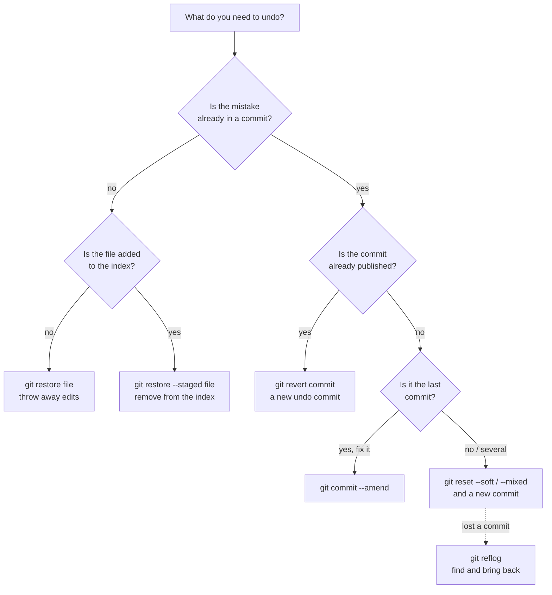
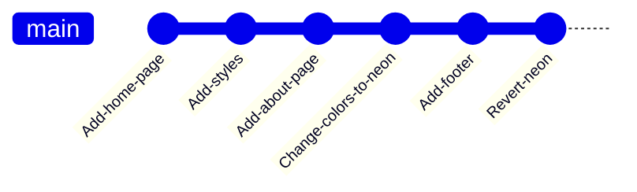
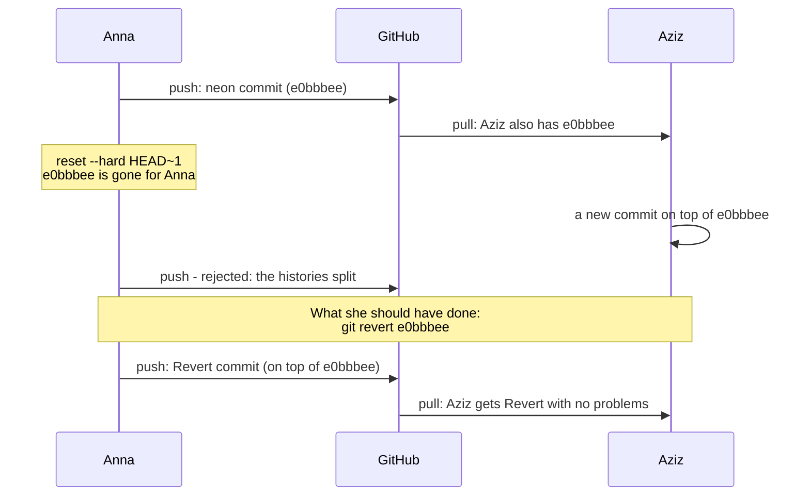

# Undoing changes

[Contents](../../README.md) · [← Back](../../Lesson-3/en/History%20and%20changes.md) · [Next →](../../Lesson-5/en/Ignoring%20files%20and%20keeping%20the%20project%20tidy.md) · [RU](../ru/%D0%9E%D1%82%D0%BC%D0%B5%D0%BD%D0%B0%20%D0%B8%D0%B7%D0%BC%D0%B5%D0%BD%D0%B5%D0%BD%D0%B8%D0%B9.md) · [EN](Undoing%20changes.md) · [UZ](../uz/O'zgarishlarni%20bekor%20qilish.md)

> **Link to lesson 3:** you learned to read the history - `git log`, `git show`, `git diff` - and to name commits with `HEAD`, `HEAD~1`, `HEAD~2`. Today this knowledge becomes a tool: you will not only look at the history but also fix mistakes - in files, in the index and in the commits themselves.

---

## Why you need this

Friday evening. You are finishing your portfolio website, and in half an hour you manage to:

- accidentally wipe half of `index.html` with a careless `echo ... > index.html` command;
- run `git add .`, and the file `passwords.txt` gets into the index together with the website;
- make a commit with the message `Add contatcs page` - with a typo;
- realize that the "neon colors" commit you already sent to GitHub yesterday was a mistake: the client didn't like it.

Without Git, you would restore everything by hand and hope for the best. With Git, every mistake has its own command, and almost all of them are safe. The key is to know **which** command fits which mistake. That is what this lesson is about.

---

## What you will learn

- Choose an undo command by **where** the mistake is: in the working directory, in the index, in the last commit or in an older commit.
- Throw away bad edits to a file: `git restore`.
- Remove a file from the index without deleting it: `git restore --staged`.
- Fix the last commit: `git commit --amend` - and understand when you **must not** do it.
- Undo a published commit with a new commit: `git revert`.
- Move a branch back (`git reset --soft`, `--mixed`, `--hard`) and rescue "lost" commits with `git reflog`.
- Follow the main rule: don't rewrite history that others have already seen.

---

## Review: 3 questions from lesson 3

1. What does `git log --oneline` show, and what does `(HEAD -> main)` in the first line mean?
2. How can you name the commit that is two commits older than the last one without copying its hash?
3. What is the difference between `git diff` and `git diff --staged`?

Answers are at the end of the lesson.

---

## Lesson plan

| Section | What we do |
| --- | --- |
| The undo map | The command depends on where the mistake is |
| `git restore`, `--staged` | Throw away edits in a file, remove a file from the index |
| `git commit --amend` | Fix the last commit |
| Mini-task 1 | The first three commands in the learning terminal |
| `git revert` | Undo a published commit |
| `git reset` | Three modes and three areas |
| `git reflog` and published history | A time machine; why you can't rewrite what is published |
| Mini-task 2 | revert, reset and reflog in practice |
| Independent work | A task in the learning terminal and on your computer |

---

## The undo map

**In simple words:** mistakes in Git are like typos in a letter. While the letter is a draft, just erase the word. If it is already in the envelope but not sent, take it out and rewrite it. And if the letter has already been received, you can't get it back: all you can do is send a second letter saying "Please consider the previous one invalid...". Git works the same way: how you fix a mistake depends on how far it has gone.

Remember the three areas from lesson 2: the **working directory** (files on disk), the **index** (what is being prepared for the commit) and the **repository** (commits). Let's add a fourth place - **published commits** that other people have already seen (for example, on GitHub - lesson 8).

| What we undo | Command | Is it safe |
| --- | --- | --- |
| Edits to a file that are not in the index yet | `git restore file` | The edits are lost forever - Git never saved them |
| A file added to the index by accident | `git restore --staged file` | Yes: the file stays on disk |
| The message or contents of the **last** commit (not published) | `git commit --amend` | Yes, as long as only you have the commit |
| Any commit that is **already published** | `git revert commit` | Yes: the history doesn't change, an undo commit is added |
| Several last unpublished commits - redo them | `git reset --soft` or `--mixed` | Yes: the changes stay in the files |
| Everything after a commit - throw it all away | `git reset --hard` | **Dangerous:** it erases uncommitted work |
| "I broke everything, bring it back" | `git reflog` + `git reset --hard` | Rescues commits, but not uncommitted edits |



**How to read the diagram.** Start at the top and answer the questions. The first question is whether the mistake got into a commit. If not, we work with files and the index (`restore`). If yes, the second question decides - have others seen the commit. We undo published commits only with `revert`. The dashed arrow is an emergency exit: if something goes wrong, `reflog` helps you find a lost commit. Come back to this diagram when you do the task.

---

## `git restore`: throw away edits in a file

The situation: you made a mistake in `index.html` and want to bring it back to the version from the last commit. Our portfolio has two commits so far: `a85b320 Add home page` and `c8a4ab7 Add styles` (the last one). Let's break the file - `>` replaces all of its contents (lesson 1):

```bash
echo "<h1>Portflio</h1><<<" > index.html
git status
```

```text
On branch main
Changes not staged for commit:
  (use "git add <file>..." to update what will be committed)
  (use "git restore <file>..." to discard changes in working directory)
	modified:   index.html

no changes added to commit (use "git add" and/or "git commit -a")
```

| Line | Meaning |
| --- | --- |
| `Changes not staged for commit` | Changes that are **not** added to the index |
| `use "git restore <file>..." to discard changes` | Git's hint: `git restore file` will **discard** the changes in the working directory |
| `modified: index.html` | The file has changed compared to the last commit |

Git suggested the command itself. Let's run it:

```bash
git restore index.html
git status
cat index.html
```

```text
On branch main
nothing to commit, working tree clean
<h1>Portfolio</h1>
```

`git restore` printed nothing - in the terminal this usually means "it worked". The file is again the same as in the last commit, and `git status` says that the working directory is clean.

**In simple words:** `git restore` is the "Undo all changes since the last save" button. You can give it one file or all of them at once: `git restore .` (the dot is the current folder). In other people's guides you will see the old form `git checkout -- index.html` - it does the same thing.

> **Important:** `git restore` deletes edits **with no way to get them back**. Git has never seen them in a commit, so they won't be in `reflog` either. Before running the command, look at `git diff` (lesson 3) - are you sure you don't need these changes?

---

## `git restore --staged`: remove a file from the index

The situation: you ran `git add .`, and a file that shouldn't be there got into the index.

```bash
echo "admin: qwerty123" > passwords.txt
git add .
git status
```

```text
On branch main
Changes to be committed:
  (use "git restore --staged <file>..." to unstage)
	new file:   passwords.txt
```

| Line | Meaning |
| --- | --- |
| `Changes to be committed` | Changes that will go into the next commit |
| `use "git restore --staged <file>..." to unstage` | A hint: `--staged` will **remove** the file from the index (unstage) |
| `new file: passwords.txt` | A new file, already in the index. One more `git commit` - and the password ends up in the history |

```bash
git restore --staged passwords.txt
git status -s
```

```text
?? passwords.txt
```

`??` in the short status (lesson 2) means an untracked file. The file **stayed on disk**, but Git doesn't track it again and won't take it into a commit. The old form of this command is `git reset HEAD passwords.txt`.

**In simple words:** the index is a shopping basket, a commit is the checkout. `git restore --staged` means taking an item out of the basket and putting it back on the shelf. The item hasn't disappeared, you just aren't buying it.

Step by step - what happens in the three areas:

| Step | Command | Working directory | Index | Repository |
| --- | --- | --- | --- | --- |
| 1 | (start) | `index.html`, `style.css` | same as in the commit | `Add styles` - the last one |
| 2 | `echo "admin..." > passwords.txt` | + `passwords.txt` | same as in the commit | no changes |
| 3 | `git add .` | + `passwords.txt` | + `passwords.txt` | no changes |
| 4 | `git restore --staged passwords.txt` | + `passwords.txt` (stayed) | same as in the commit | no changes |

Look at the last column: `restore` commands **never touch commits**. `git restore file` takes the version from the index and changes the working directory, and `git restore --staged file` takes the version from the last commit and changes the index.

> **Important:** to make sure a password file never gets into the index by accident again, you add it to `.gitignore`. This is the topic of lesson 5.

---

## `git commit --amend`: fix the last commit

### Fix the message

The situation: you made a commit and noticed a typo.

```bash
echo "<h2>About me</h2>" > about.html
git add about.html
git commit -m "Add abuot page"
git commit --amend -m "Add about page"
git log --oneline
```

```text
[main 73f91dd] Add abuot page
 1 file changed, 1 insertion(+)
 create mode 100644 about.html
[main 24367f8] Add about page
 Date: Tue Sep 1 10:03:00 2026 +0500
 1 file changed, 1 insertion(+)
 create mode 100644 about.html
24367f8 (HEAD -> main) Add about page
c8a4ab7 Add styles
a85b320 Add home page
```

| Line | Meaning |
| --- | --- |
| `[main 24367f8] Add about page` | A new commit on the `main` branch - the hash is **different** (it was `73f91dd`) |
| `Date: Tue Sep 1 10:03:00 2026` | The date of the **original** commit: amend keeps the time when the work was done |
| `24367f8 (HEAD -> main) Add about page` | The history still has 3 commits, not 4: the old commit was replaced |

**In simple words:** amend ("to correct") is not an eraser but a reprint of the page. Git doesn't edit the old commit; it makes a new one in its place and moves the branch to it. That's why the commit has a new hash.

### Add a forgotten file

The situation: you forgot to put a change into the commit. Add it to the index and run `--amend --no-edit` - "same message, don't change it":

```bash
echo "<a href=\"about.html\">About me</a>" >> index.html
git add index.html
git commit --amend --no-edit
```

```text
[main f5ba9c4] Add about page
 Date: Tue Sep 1 10:04:00 2026 +0500
 2 files changed, 2 insertions(+)
 create mode 100644 about.html
```

Now the commit `Add about page` has two files: `about.html` and the changed `index.html`.

> **Important:** `--amend` takes **everything that is in the index** into the commit. If `passwords.txt` is still in the index, it will end up in the "fixed" commit. Always check `git status` before amend.

**In real Git,** `git commit --amend` without `-m` opens a text editor so that you can fix the message. The learning terminal has no editor, so write `-m "..."` or `--no-edit`.

### When you can't amend

| Situation | Can you amend | Why |
| --- | --- | --- |
| You need to fix a commit that is **not the last one** | No | amend changes only the last one; for older ones - `revert` |
| The commit is already sent to GitHub (`git push`, lesson 8) | **No** | Others still have the old hash, the histories will split |

---

## Mini-task 1

In the learning terminal, in your home folder:

1. Create a folder `undo`, go into it and create a repository. Create a file `notes.txt` with the text `Day 1` and commit it with the message `Add notes`.
2. Break the file: `echo "oops" > notes.txt`. Look at `git status` and bring the file back with the command from Git's hint. Check with `cat notes.txt`.
3. Create `secret.txt` with the text `my password`, run `git add .`, and then remove `secret.txt` from the index. Check `git status -s` - what is in front of the file name?
4. Add the line `Day 2` to `notes.txt` and make a commit with the typo `Add dya 2` (with the command `git commit -am`). Fix the message to `Add day 2` and check `git log --oneline`: how many commits are in the history?

---

## `git revert`: undo a published commit

The situation: the history has a bad commit, and after it some good ones. The commit is already on GitHub, and your teammates have downloaded it. You can't delete it (why - see below). But you can make a **new** commit with the opposite changes.

Let's say you made the commit `Change colors to neon` (`style.css` contains `body { color: lime; background: magenta; }`), published it, and then made one more commit, `Add footer`:

```bash
git log --oneline
```

```text
ffdfca7 (HEAD -> main) Add footer
e0bbbee Change colors to neon
f5ba9c4 Add about page
c8a4ab7 Add styles
a85b320 Add home page
```

The bad commit `Change colors to neon` is second from the top, that is `HEAD~1` (lesson 3). Let's undo it:

```bash
git revert --no-edit HEAD~1
git log --oneline
cat style.css
```

```text
[main 9a1154a] Revert "Change colors to neon"
 1 file changed, 1 insertion(+), 1 deletion(-)
9a1154a (HEAD -> main) Revert "Change colors to neon"
ffdfca7 Add footer
e0bbbee Change colors to neon
f5ba9c4 Add about page
c8a4ab7 Add styles
a85b320 Add home page
body { color: navy; }
```

| Line | Meaning |
| --- | --- |
| `Revert "Change colors to neon"` | A new commit "Undo the commit ...". Git wrote the message itself and added the line `This reverts commit <full hash>.` - you can see it in `git log` |
| `e0bbbee Change colors to neon` | The old commit **stayed** in the history: you can see what was done and what was undone |
| `body { color: navy; }` | The file is again as it was before the bad commit, and the footer from `Add footer` is still there |

**In simple words:** revert is a "correction" in a newspaper. You can't cut yesterday's article out of the printed papers. So today they print a note: "Yesterday's news was a mistake". Both stay in the archive.

**In real Git,** `git revert HEAD~1` without `--no-edit` opens an editor with a ready message. Close it without changing anything - or just write `--no-edit`, as in the lesson. You can also give the commit by its hash: `git revert --no-edit e0bbbee`.



**How to read the diagram.** The history only grows: six commits, none of them disappeared. The commit `Revert-neon` contains the opposite changes to `Change-colors-to-neon`. Anyone who has already downloaded the first five commits simply gets one more - no conflicts with their copy of the history.

> **Important:** `git revert` doesn't like uncommitted changes. Run `git status` before it: if there are changed files or files added to the index, commit or undo them first (`restore`). Otherwise Git will refuse to revert and ask you to deal with the changes first.

---

## `git reset`: move a branch back

`git reset` is a powerful command for **unpublished** commits. It moves the branch (and `HEAD`) to the given commit. The mode (`--soft`, `--mixed`, `--hard`) decides what happens to the index and the working directory.

**In simple words:** imagine a bookmark in a book. `reset` moves the bookmark a few pages back. `--soft` - the pages after the bookmark lie next to you on the table, ready to be glued back in. `--mixed` - the pages are scattered over the table, and you have to put them together again. `--hard` - the pages went into the shredder.

To keep the examples short, let's take a repository that has only two commits so far - `Add home page` and `Add styles` (as at the start of the lesson) - and make the commit `Add footer` on top of them.

```bash
echo "<footer>Anna Karimova, 2026</footer>" >> index.html
git commit -am "Add footer"
git log --oneline
```

```text
[main 3994cd9] Add footer
 1 file changed, 1 insertion(+)
3994cd9 (HEAD -> main) Add footer
c8a4ab7 Add styles
a85b320 Add home page
```

### `--soft`: undo the commit, keep everything in the index

```bash
git reset --soft HEAD~1
git log --oneline
git status
```

```text
c8a4ab7 (HEAD -> main) Add styles
a85b320 Add home page
On branch main
Changes to be committed:
  (use "git restore --staged <file>..." to unstage)
	modified:   index.html
```

The commit `Add footer` is no longer in `git log`, but the changes to `index.html` are in the index (`Changes to be committed`) - you can commit them again right away, for example with a different message. This is how you turn several last commits into one. Let's bring the commit back with `git commit -m "Add footer"` - it gets the new hash `26d99aa`.

### `--mixed`: undo the commit and the index, keep the files

`--mixed` is the default mode: `git reset HEAD~1` and `git reset --mixed HEAD~1` are the same thing.

```bash
git reset HEAD~1
```

```text
Unstaged changes after reset:
M	index.html
```

| Line | Meaning |
| --- | --- |
| `Unstaged changes after reset:` | "Changes outside the index after reset" - what is left in the working directory |
| `M index.html` | `M` - modified: the edits in the file are kept, but they are not in the index |

`git status` will now show `index.html` under `Changes not staged for commit`: to commit again, you need `git add` (or `git commit -am`). Let's bring the commit back: `git commit -am "Add footer"` - the new hash is `4cb89f6`.

### `--hard`: undo everything

> **Important:** `git reset --hard` erases changes in the index **and in the working directory**. Uncommitted edits are lost forever. Always run `git status` before `--hard`. Never use `--hard` to "remove" a commit that is already published.

```bash
git reset --hard HEAD~1
git log --oneline
cat index.html
```

```text
HEAD is now at c8a4ab7 Add styles
c8a4ab7 (HEAD -> main) Add styles
a85b320 Add home page
<h1>Portfolio</h1>
```

| Line | Meaning |
| --- | --- |
| `HEAD is now at c8a4ab7 Add styles` | "HEAD is now at commit c8a4ab7" - both the branch and the files were moved there |
| `<h1>Portfolio</h1>` | The footer is no longer in the file: the working directory went back too |

### Three modes - step by step

For all three modes the starting state is the same: the last commit is `Add footer`, the working directory is clean. The command is `git reset <mode> HEAD~1`.

| Step | Command | Working directory | Index | Repository (branch `main`) |
| --- | --- | --- | --- | --- |
| 0 | (start) | with the footer | with the footer | `Add footer` |
| 1 | `git reset --soft HEAD~1` | with the footer | with the footer | `Add styles` |
| 2 | `git reset --mixed HEAD~1` | with the footer | **without** the footer | `Add styles` |
| 3 | `git reset --hard HEAD~1` | **without** the footer | **without** the footer | `Add styles` |

When to use which: `--soft` - redo the last commits as one or with a different message; `--mixed` - redo a commit and decide again what to put into it; `--hard` - throw away bad **unpublished** commits completely.

---

## `git reflog`: a time machine

You ran `git reset --hard` and realized that you need the commit `Add footer` after all. It isn't in `git log`. Is it lost?

No. Git keeps a **reference log** (reflog): it records where `HEAD` pointed after every commit, amend, reset and revert.

```bash
git reflog
```

```text
c8a4ab7 (HEAD -> main) HEAD@{0}: reset: moving to HEAD~1
4cb89f6 HEAD@{1}: commit: Add footer
c8a4ab7 HEAD@{2}: reset: moving to HEAD~1
26d99aa HEAD@{3}: commit: Add footer
c8a4ab7 HEAD@{4}: reset: moving to HEAD~1
3994cd9 HEAD@{5}: commit: Add footer
c8a4ab7 HEAD@{6}: commit: Add styles
a85b320 HEAD@{7}: commit (initial): Add home page
```

| Part of the line | Meaning |
| --- | --- |
| `c8a4ab7` | The hash of the commit `HEAD` pointed to |
| `HEAD@{0}` | "Where HEAD was 0 steps ago" - that is, now |
| `HEAD@{1}` | Where `HEAD` was one step ago: at the commit `Add footer` |
| `reset: moving to HEAD~1` | Which action moved `HEAD`: here it is our `reset` |

Read the reflog from top to bottom, like your browser history: the latest action is at the top. The three lines `commit: Add footer` are the three times we made this commit in the section about reset: each has its own hash. The commit we need, `4cb89f6`, is on the line `HEAD@{1}`. Let's go back:

```bash
git reset --hard HEAD@{1}
git log --oneline
```

```text
HEAD is now at 4cb89f6 Add footer
4cb89f6 (HEAD -> main) Add footer
c8a4ab7 Add styles
a85b320 Add home page
```

The commit is back, and the footer in `index.html` with it. Instead of `HEAD@{1}`, you could give the hash: `git reset --hard 4cb89f6`.

**In simple words:** `git log` is the table of contents of a book as it is now. `git reflog` is a video of you flipping through the book. Even if you tore a chapter out of the table of contents, the video shows where it was.

> **Important:** reflog only keeps what was in **commits**. Edits that you didn't commit and erased with `restore` or `reset --hard` won't come back. Hence the rule: commit often. Also, the reflog exists only on your computer, and Git cleans up old entries over time (by default after about 90 days).

---

## Don't rewrite published history

`amend` and `reset` **rewrite** history: old commits disappear from the branch, and new ones with different hashes appear in their place. As long as only you have the commits, this is fine. But if a commit is already on GitHub and a teammate has downloaded it, you and they end up with two different histories.



**How to read the diagram.** Read it from top to bottom, in time order. Anna published a commit, Aziz downloaded it and kept working. If Anna "deletes" the commit with `reset`, her history no longer matches the history of Aziz and GitHub - rejections and confusion begin (how to sort them out - lesson 9). If Anna uses `revert`, the history only grows, and everything matches for everyone. We will look at `push` and `pull` in detail in lesson 8.

`git commit --amend` and `git reset` (any mode) rewrite history. `git restore` (doesn't touch commits) and `git revert` (only adds a commit) don't. The rule in one sentence: **what went to GitHub is undone only with `revert`**.

---

### Try to break it

1. In a new empty repository (with no commits), run `git commit --amend -m "x"`. What does Git say?
2. Make a mistake in the file name: `git restore indx.html`. What message does Git show?
3. Make a mistake in the command: `git revrt HEAD`. What does Git suggest?
4. Run `git commit --amend --no-edit` twice in a row and compare the hash of the last commit in `git log --oneline` after each time. Why does it change if you didn't change anything? Find both `commit (amend)` entries in `git reflog`.
5. Make a commit, then `git reset --hard HEAD~1`, check in `git log` that the commit has "disappeared", and bring it back with `git reflog`. (It is safe in the learning terminal; in your own project, check `git status` first!)

### Typical beginner mistakes

| Mistake | What you get | How to fix |
| --- | --- | --- |
| `git restore passwords.txt` instead of `--staged` | The file stays in the index and goes into the commit | `git restore --staged passwords.txt` |
| A typo in the file name: `git restore indx.html` | `error: pathspec 'indx.html' did not match any file(s) known to git` | Check the name in `git status`, use `Tab` |
| `git commit --amend` with an extra file in the index | The extra file got into the "fixed" commit | First `git restore --staged file`, then amend; if it's too late - `git reset --soft HEAD~1` and commit again |
| amend or reset for a commit that is already on GitHub | Your history and your teammates' histories split, `push` is rejected | For published commits - only `git revert` |
| `git revert HEAD` when you need an older commit | The last (correct) commit is undone | Find the right one in `git log --oneline`, give `HEAD~N` or the hash; undo the extra revert with one more `revert` |
| `git reset --hard` with uncommitted edits | The edits are erased, reflog won't bring them back | Before `--hard` - `git status`; for one commit, `--soft` is better |
| `git restore --staged` without a file name | `fatal: you must specify path(s) to restore` | Give the file: `git restore --staged passwords.txt` or all of them: `git restore --staged .` |

---

## Mini-task 2

Continue in the `undo` repository from mini-task 1:

1. Create a file `todo.txt` with the text `Buy coffee` and commit it with the message `Add todo list`. Then add the line `Day 3` to `notes.txt` and commit it with the message `Add day 3`.
2. Imagine that the commit `Add todo list` is already published. Undo it with `git revert` (which `HEAD~N` is it?). Check `git log --oneline` and `ls`: is `notes.txt` still there, and is `todo.txt` gone?
3. Undo the undo commit with `git reset --soft HEAD~1` and look at `git status`: in which section is the deletion of `todo.txt`? Commit it again with the message `Revert todo list`.
4. Run `git reset --hard HEAD~1`. Check in `git log --oneline` that the commit `Revert todo list` is gone.
5. Find it in `git reflog` and bring it back with `git reset --hard`.

---

## Lesson summary: cheat sheet

| Task | Command |
| --- | --- |
| Throw away edits in a file (not in the index) | `git restore file` |
| Throw away edits in all files | `git restore .` |
| Remove a file from the index, keep it on disk | `git restore --staged file` |
| Fix the message of the last commit | `git commit --amend -m "New message"` |
| Add something forgotten to the last commit | `git add file`, then `git commit --amend --no-edit` |
| Undo a published commit | `git revert --no-edit commit` |
| Remove the last commit, changes go to the index | `git reset --soft HEAD~1` |
| Remove the last commit, changes go to the files | `git reset HEAD~1` (`--mixed`) |
| Throw away the last commit completely (dangerous) | `git reset --hard HEAD~1` |
| Log of HEAD movements | `git reflog` |
| Go back to a state from the reflog | `git reset --hard HEAD@{N}` or the hash |
| Old forms from other people's guides (= `restore` and `restore --staged`) | `git checkout -- file`, `git reset HEAD file` |

---

## Independent work

### Part 1. IDE task (graded by the platform)

You are in the folder `~/portfolio`. The repository has four mistakes - fix each one with the right command. Write the commands one per line:

1. Look at `git status` and `git log --oneline`.
2. The file `index.html` is broken and not added to the index yet - bring it back to the version from the last commit.
3. The file `passwords.txt` was added to the index by accident - remove it from the index, but don't delete the file itself.
4. The message of the last commit has a typo (`contatcs`) - fix the message to `Add contacts page` without creating a new commit.
5. The commit `Change colors to neon` is already published on GitHub - undo it with `git revert` without deleting it from the history (don't use `reset --hard`).
6. Check the result: `git log --oneline` and `git status`.

What the platform checks: that `index.html` matches the version from the commit and was brought back with `git restore`; that `passwords.txt` stayed in the folder, is not in the index and did not get into any commit; that the typo was fixed by replacing the last commit, not with a new commit; that the commit `Change colors to neon` stayed in the history and the last one is `Revert "Change colors to neon"`; that `style.css` is back to the version from `Add styles`, and `about.html` and `contacts.html` are in place (6 commits in total); that `git reset --hard` was not used; that at the end `git status` shows only the untracked `passwords.txt`; that the solution also works with different starting data; that the script runs without errors.

### Part 2. Project on your computer

Work in real Git, in the repository of your website from lesson 1.

1. Break any file of your website (for example, delete a line in `index.html` in the editor), look at `git diff` and bring the file back with `git restore`.
2. Create a file `notes-private.txt`, run `git add .`, remove it from the index with `git restore --staged`, and then delete the file itself the usual way.
3. Make a small change and a commit with a deliberate typo in the message. Fix it with `git commit --amend` - in real Git an editor opens: fix the message, save and close it (or use `-m`).
4. Make a commit that changes the background color in the CSS, and then undo it with `git revert`. Look at `git log --oneline` and `git show HEAD`.
5. Run `git reflog` and find the `commit (amend)` and `revert` entries in it.

### Acceptance criteria

- [ ] The IDE task is accepted.
- [ ] Looking at `git status`, you can say which command undoes each change.
- [ ] The history of your website has a commit `Revert "..."`, and the undone commit is still there.
- [ ] You can explain the difference between `reset --soft`, `--mixed` and `--hard` using the three areas.
- [ ] You can find a commit in `git reflog` that is not in `git log` and bring it back.

---

## Self-check questions

1. What is the difference between `git restore file` and `git restore --staged file`? What does each one change and what does it keep?
2. Why can't edits thrown away with `git restore` be brought back, even with `reflog`?
3. What does `git commit --amend` do? Why does the commit have a different hash after it?
4. What happens if you run `git commit --amend` when there is an extra file in the index?
5. In which cases must you not use `git commit --amend`?
6. How does `git revert` work? What happens to the undone commit in the history?
7. What is the difference between `git reset --soft HEAD~1` and `git reset --mixed HEAD~1`? What does `git status` show after each one?
8. Why is `git reset --hard` called a dangerous command? What should you do before running it?
9. What is `git reflog`, and how do you use it to bring back a commit after `reset --hard`?
10. Why must you not rewrite published history, and which command should you use instead?

After the questions, take the **lesson test** on the platform: 12 questions, pass mark 70%.

---

## What's next

Now you can fix mistakes - but it's better not to make them. In lesson 5 you will teach Git to **ignore** files that don't belong in the repository: passwords, `node_modules`, temporary files. You will set up `.gitignore`, learn how to stop tracking a file that is already committed (`git rm --cached`), and tidy up your project.

---

## Answers

**Review**

1. A short history: one commit per line - a short hash and the message, the newest at the top. `(HEAD -> main)` means you are on the `main` branch, and this commit is the last one on it.
2. `HEAD~2` - "two steps back from HEAD".
3. `git diff` shows changes in the working directory that are not in the index yet. `git diff --staged` shows changes in the index that will go into the next commit.

**Mini-task 1**

```bash
mkdir undo
cd undo
git init
echo "Day 1" > notes.txt
git add notes.txt
git commit -m "Add notes"
echo "oops" > notes.txt
git status
git restore notes.txt
cat notes.txt
echo "my password" > secret.txt
git add .
git restore --staged secret.txt
git status -s
echo "Day 2" >> notes.txt
git commit -am "Add dya 2"
git commit --amend -m "Add day 2"
git log --oneline
```

In front of `secret.txt` there is `??` - the file is not tracked. The history has 2 commits: amend replaced the commit with the typo instead of adding a new one.

**Mini-task 2**

```bash
echo "Buy coffee" > todo.txt
git add todo.txt
git commit -m "Add todo list"
echo "Day 3" >> notes.txt
git commit -am "Add day 3"
git revert --no-edit HEAD~1
git log --oneline
ls
git reset --soft HEAD~1
git status
git commit -m "Revert todo list"
git reset --hard HEAD~1
git log --oneline
git reflog
git reset --hard HEAD@{1}
git log --oneline
```

The commit `Add todo list` is `HEAD~1`. After `reset --soft`, the deletion of `todo.txt` is under `Changes to be committed` (`deleted: todo.txt`). In `reflog`, the commit `Revert todo list` is on the line `HEAD@{1}`.

**Self-check questions**

1. `git restore file` brings the file in the working directory back to the version from the index - the edits are lost. `git restore --staged file` removes the changes from the index and doesn't touch the file on disk.
2. reflog records only the movements of `HEAD` between commits. Git never saved the uncommitted edits, so there is nowhere to bring them back from.
3. It creates a new commit in place of the last one: with a new message and/or with what is in the index now. The hash is calculated from the contents and the message, so it is different.
4. The extra file will get into the fixed commit. That's why you check `git status` before amend and remove anything extra with `git restore --staged`.
5. When the commit is already published (sent to GitHub), and when you need to fix a commit that is not the last one.
6. It creates a new commit with the opposite changes. The undone commit stays in the history, and the message of the new one is `Revert "..."` and `This reverts commit <hash>`.
7. Both remove the commit from the branch. After `--soft` the changes are in the index (`Changes to be committed`), after `--mixed` - only in the working directory (`Changes not staged for commit`).
8. It erases changes in the index and the working directory with no way to get back what was not committed. Before it - `git status`, and for published commits you don't use it at all.
9. A log of all movements of `HEAD`. We find the line with the commit we need (`HEAD@{N}` or the hash) in it and run `git reset --hard HEAD@{N}`.
10. Other people already have these commits; if you replace or remove them, the histories split, and `push` and `pull` start to fail. Use `git revert` instead.

---

[Contents](../../README.md) · [← Back](../../Lesson-3/en/History%20and%20changes.md) · [Next →](../../Lesson-5/en/Ignoring%20files%20and%20keeping%20the%20project%20tidy.md) · [RU](../ru/%D0%9E%D1%82%D0%BC%D0%B5%D0%BD%D0%B0%20%D0%B8%D0%B7%D0%BC%D0%B5%D0%BD%D0%B5%D0%BD%D0%B8%D0%B9.md) · [EN](Undoing%20changes.md) · [UZ](../uz/O'zgarishlarni%20bekor%20qilish.md)
