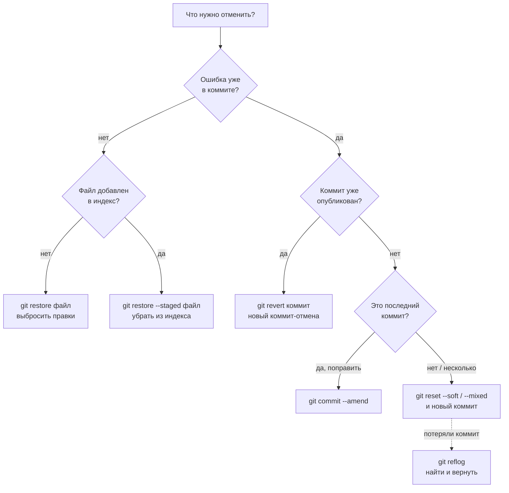
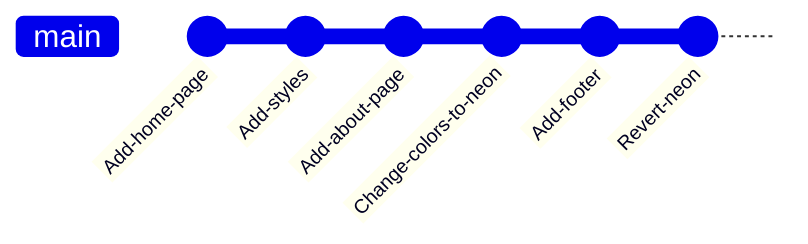
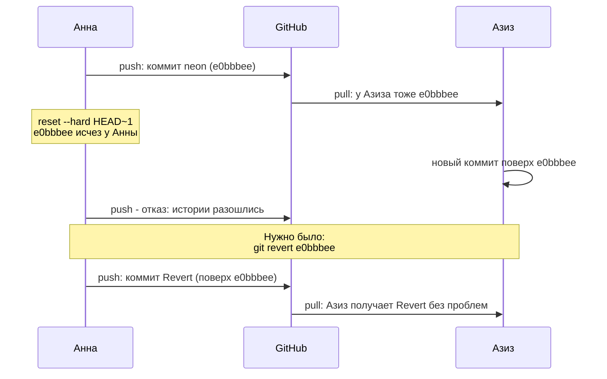

# Отмена изменений

[Содержание](../../README.md) · [← Назад](../../Lesson-3/ru/%D0%98%D1%81%D1%82%D0%BE%D1%80%D0%B8%D1%8F%20%D0%B8%20%D0%B8%D0%B7%D0%BC%D0%B5%D0%BD%D0%B5%D0%BD%D0%B8%D1%8F.md) · [Вперёд →](../../Lesson-5/ru/%D0%98%D0%B3%D0%BD%D0%BE%D1%80%D0%B8%D1%80%D0%BE%D0%B2%D0%B0%D0%BD%D0%B8%D0%B5%20%D1%84%D0%B0%D0%B9%D0%BB%D0%BE%D0%B2%20%D0%B8%20%D0%BF%D0%BE%D1%80%D1%8F%D0%B4%D0%BE%D0%BA%20%D0%B2%20%D0%BF%D1%80%D0%BE%D0%B5%D0%BA%D1%82%D0%B5.md) · [RU](%D0%9E%D1%82%D0%BC%D0%B5%D0%BD%D0%B0%20%D0%B8%D0%B7%D0%BC%D0%B5%D0%BD%D0%B5%D0%BD%D0%B8%D0%B9.md) · [EN](../en/Undoing%20changes.md) · [UZ](../uz/O'zgarishlarni%20bekor%20qilish.md)

> **Связь с уроком 3:** вы научились читать историю - `git log`, `git show`, `git diff`, - и называть коммиты через `HEAD`, `HEAD~1`, `HEAD~2`. Сегодня эти знания станут инструментом: вы будете не только смотреть на историю, но и исправлять ошибки - в файлах, в индексе и в самих коммитах.

---

## Зачем это вам

Пятница, вечер. Вы доделываете сайт-портфолио и за полчаса успеваете:

- случайно стереть половину `index.html` неудачной командой `echo ... > index.html`;
- выполнить `git add .`, а вместе с сайтом в индекс попадает файл `passwords.txt`;
- сделать коммит с сообщением `Add contatcs page` - с опечаткой;
- понять, что коммит «неоновые цвета», который вы вчера уже отправили на GitHub, был ошибкой: заказчику не понравилось.

Без Git вы бы восстанавливали всё руками и надеялись на удачу. С Git для каждой ошибки есть своя команда, и почти все они безопасны. Главное - знать, **какая** команда к какой ошибке подходит. Этому и посвящён урок.

---

## Чему вы научитесь

- Выбирать команду отмены по тому, **где** находится ошибка: в рабочей папке, в индексе, в последнем коммите или в старом коммите.
- Выбрасывать неудачные правки файла: `git restore`.
- Убирать файл из индекса, не удаляя его: `git restore --staged`.
- Исправлять последний коммит: `git commit --amend` - и понимать, когда так делать **нельзя**.
- Отменять опубликованный коммит новым коммитом: `git revert`.
- Перемещать ветку назад (`git reset --soft`, `--mixed`, `--hard`) и спасать «потерянные» коммиты через `git reflog`.
- Соблюдать главное правило: не переписывать историю, которую уже видели другие.

---

## Повторение: 3 вопроса из урока 3

1. Что показывает `git log --oneline` и что означает `(HEAD -> main)` в первой строке?
2. Как назвать коммит, который на два коммита старше последнего, не копируя его хеш?
3. Чем `git diff` отличается от `git diff --staged`?

Ответы - в конце урока.

---

## План урока

| Раздел | Что делаем |
| --- | --- |
| Карта отмены | Где ошибка - такая и команда |
| `git restore`, `--staged` | Выбросить правки в файле, убрать файл из индекса |
| `git commit --amend` | Исправить последний коммит |
| Мини-задание 1 | Три первые команды в учебном терминале |
| `git revert` | Отменить опубликованный коммит |
| `git reset` | Три режима и три зоны |
| `git reflog` и опубликованная история | Машина времени; почему нельзя переписывать опубликованное |
| Мини-задание 2 | revert, reset и reflog на практике |
| Самостоятельная работа | Задание в учебном терминале и на компьютере |

---

## Карта отмены

**Простыми словами:** ошибки в Git похожи на опечатки в письме. Пока письмо в черновике - просто сотрите слово. Если оно уже в конверте, но не отправлено - достаньте и перепишите. А если письмо уже получено, его не вернуть: остаётся отправить второе письмо «Прошу считать недействительным...». В Git так же: чем дальше ушла ошибка, тем другой способ исправления.

Вспомните три зоны из урока 2: **рабочая папка** (файлы на диске), **индекс** (то, что готовится к коммиту) и **репозиторий** (коммиты). Добавим четвёртое место - **опубликованные коммиты**, которые уже видели другие люди (например, на GitHub - урок 8).

| Что отменяем | Команда | Безопасно ли |
| --- | --- | --- |
| Правки файла, ещё не добавленные в индекс | `git restore файл` | Правки пропадут навсегда - Git их не сохранял |
| Файл, случайно добавленный в индекс | `git restore --staged файл` | Да: файл остаётся на диске |
| Сообщение или содержимое **последнего** коммита (не опубликован) | `git commit --amend` | Да, пока коммит есть только у вас |
| Любой коммит, который **уже опубликован** | `git revert коммит` | Да: история не меняется, добавляется коммит-отмена |
| Несколько последних неопубликованных коммитов - переделать | `git reset --soft` или `--mixed` | Да: изменения остаются в файлах |
| Всё после коммита - выбросить целиком | `git reset --hard` | **Опасно:** стирает незакоммиченную работу |
| «Я всё сломал, верните как было» | `git reflog` + `git reset --hard` | Спасает коммиты, но не незакоммиченные правки |



**Как читать схему.** Начинайте сверху и отвечайте на вопросы. Первый вопрос - попала ли ошибка в коммит. Если нет, работаем с файлами и индексом (`restore`). Если да, решает второй вопрос - видели ли коммит другие. Опубликованное отменяем только через `revert`. Пунктирная стрелка - запасной выход: если что-то пошло не так, `reflog` помогает найти потерянный коммит. Вернитесь к этой схеме, когда будете делать задание.

---

## `git restore`: выбросить правки в файле

Ситуация: вы ошиблись в `index.html` и хотите вернуть его к версии из последнего коммита. В нашем портфолио пока два коммита: `a85b320 Add home page` и `c8a4ab7 Add styles` (последний). Испортим файл - `>` целиком заменяет содержимое (урок 1):

```bash
echo "<h1>Portflio</h1><<<" > index.html
git status
```

```text
On branch main
Changes not staged for commit:
  (use "git add <file>..." to update what will be committed)
  (use "git restore <file>..." to discard changes in working directory)
	modified:   index.html

no changes added to commit (use "git add" and/or "git commit -a")
```

| Строка | Перевод и смысл |
| --- | --- |
| `Changes not staged for commit` | Изменения, **не** добавленные в индекс |
| `use "git restore <file>..." to discard changes` | Подсказка Git: `git restore файл` **отбросит** изменения в рабочей папке |
| `modified: index.html` | Файл изменён по сравнению с последним коммитом |

Git сам подсказал команду. Выполним её:

```bash
git restore index.html
git status
cat index.html
```

```text
On branch main
nothing to commit, working tree clean
<h1>Portfolio</h1>
```

`git restore` ничего не ответила - в терминале это обычно значит «всё получилось». Файл снова такой, как в последнем коммите, и `git status` говорит, что рабочая папка чистая.

**Простыми словами:** `git restore` - кнопка «Отменить все изменения с последнего сохранения». Можно указать один файл или все сразу: `git restore .` (точка - текущая папка). В чужих инструкциях вы встретите старую форму `git checkout -- index.html` - это то же самое.

> **Важно:** `git restore` удаляет правки **без возможности вернуть**. Git ещё не видел их в коммите, поэтому и в `reflog` их не будет. Перед командой посмотрите `git diff` (урок 3) - точно ли эти изменения не нужны?

---

## `git restore --staged`: убрать файл из индекса

Ситуация: вы выполнили `git add .`, и в индекс попал файл, которого там не должно быть.

```bash
echo "admin: qwerty123" > passwords.txt
git add .
git status
```

```text
On branch main
Changes to be committed:
  (use "git restore --staged <file>..." to unstage)
	new file:   passwords.txt
```

| Строка | Перевод и смысл |
| --- | --- |
| `Changes to be committed` | Изменения, которые войдут в следующий коммит |
| `use "git restore --staged <file>..." to unstage` | Подсказка: `--staged` **уберёт** файл из индекса (unstage) |
| `new file: passwords.txt` | Новый файл, уже в индексе. Ещё один `git commit` - и пароль окажется в истории |

```bash
git restore --staged passwords.txt
git status -s
```

```text
?? passwords.txt
```

`??` в коротком статусе (урок 2) - неотслеживаемый файл. Файл **остался на диске**, но Git снова за ним не следит и в коммит его не возьмёт. Старая форма этой команды - `git reset HEAD passwords.txt`.

**Простыми словами:** индекс - корзина в магазине, коммит - касса. `git restore --staged` - вынуть товар из корзины и вернуть на полку. Товар никуда не исчез, просто вы его не покупаете.

Пошагово - что происходит в трёх зонах:

| Шаг | Команда | Рабочая папка | Индекс | Репозиторий |
| --- | --- | --- | --- | --- |
| 1 | (начало) | `index.html`, `style.css` | как в коммите | `Add styles` - последний |
| 2 | `echo "admin..." > passwords.txt` | + `passwords.txt` | как в коммите | без изменений |
| 3 | `git add .` | + `passwords.txt` | + `passwords.txt` | без изменений |
| 4 | `git restore --staged passwords.txt` | + `passwords.txt` (остался) | как в коммите | без изменений |

Обратите внимание на последний столбец: команды `restore` **никогда не трогают коммиты**. `git restore файл` берёт версию из индекса и меняет рабочую папку, а `git restore --staged файл` берёт версию из последнего коммита и меняет индекс.

> **Важно:** чтобы файл с паролями больше никогда случайно не попадал в индекс, его вносят в `.gitignore`. Это тема урока 5.

---

## `git commit --amend`: исправить последний коммит

### Исправить сообщение

Ситуация: сделали коммит и заметили опечатку.

```bash
echo "<h2>About me</h2>" > about.html
git add about.html
git commit -m "Add abuot page"
git commit --amend -m "Add about page"
git log --oneline
```

```text
[main 73f91dd] Add abuot page
 1 file changed, 1 insertion(+)
 create mode 100644 about.html
[main 24367f8] Add about page
 Date: Tue Sep 1 10:03:00 2026 +0500
 1 file changed, 1 insertion(+)
 create mode 100644 about.html
24367f8 (HEAD -> main) Add about page
c8a4ab7 Add styles
a85b320 Add home page
```

| Строка | Перевод и смысл |
| --- | --- |
| `[main 24367f8] Add about page` | Новый коммит на ветке `main` - хеш **другой** (было `73f91dd`) |
| `Date: Tue Sep 1 10:03:00 2026` | Дата **исходного** коммита: amend сохраняет время, когда работа была сделана |
| `24367f8 (HEAD -> main) Add about page` | В истории по-прежнему 3 коммита, а не 4: старый коммит заменён |

**Простыми словами:** amend (англ. «исправить») - не ластик, а перепечатка страницы. Git не правит старый коммит, а делает новый вместо него и переставляет на него ветку. Поэтому у коммита новый хеш.

### Добавить забытый файл

Ситуация: в коммит забыли положить изменение. Добавьте его в индекс и выполните `--amend --no-edit` - «то же сообщение, не меняй»:

```bash
echo "<a href=\"about.html\">About me</a>" >> index.html
git add index.html
git commit --amend --no-edit
```

```text
[main f5ba9c4] Add about page
 Date: Tue Sep 1 10:04:00 2026 +0500
 2 files changed, 2 insertions(+)
 create mode 100644 about.html
```

Теперь в коммите `Add about page` два файла: `about.html` и изменённый `index.html`.

> **Важно:** `--amend` забирает в коммит **всё, что лежит в индексе**. Если в индексе остался `passwords.txt`, он попадёт в «исправленный» коммит. Перед amend всегда смотрите `git status`.

**В настоящем Git** команда `git commit --amend` без `-m` открывает текстовый редактор, чтобы вы поправили сообщение. В учебном терминале редактора нет, поэтому пишите `-m "..."` или `--no-edit`.

### Когда amend нельзя

| Ситуация | Можно ли amend | Почему |
| --- | --- | --- |
| Нужно поправить **не последний** коммит | Нет | amend меняет только последний; для старых - `revert` |
| Коммит уже отправлен на GitHub (`git push`, урок 8) | **Нет** | У других остался старый хеш, истории разойдутся |

---

## Мини-задание 1

В учебном терминале, в домашней папке:

1. Создайте папку `undo`, перейдите в неё, создайте репозиторий. Создайте файл `notes.txt` с текстом `Day 1` и закоммитьте его с сообщением `Add notes`.
2. Испортите файл: `echo "oops" > notes.txt`. Посмотрите `git status` и верните файл командой из подсказки Git. Проверьте `cat notes.txt`.
3. Создайте `secret.txt` с текстом `my password`, выполните `git add .`, а затем уберите `secret.txt` из индекса. Проверьте `git status -s` - что стоит перед именем файла?
4. Допишите в `notes.txt` строку `Day 2` и сделайте коммит с опечаткой `Add dya 2` (командой `git commit -am`). Исправьте сообщение на `Add day 2` и проверьте `git log --oneline`: сколько коммитов в истории?

---

## `git revert`: отменить опубликованный коммит

Ситуация: в истории есть неудачный коммит, а после него - нужные. Коммит уже на GitHub, его скачали товарищи. Удалять его нельзя (почему - ниже). Зато можно сделать **новый** коммит с обратными изменениями.

Допустим, вы сделали коммит `Change colors to neon` (в `style.css` записано `body { color: lime; background: magenta; }`), опубликовали его, а потом ещё коммит `Add footer`:

```bash
git log --oneline
```

```text
ffdfca7 (HEAD -> main) Add footer
e0bbbee Change colors to neon
f5ba9c4 Add about page
c8a4ab7 Add styles
a85b320 Add home page
```

Неудачный коммит `Change colors to neon` - второй сверху, то есть `HEAD~1` (урок 3). Отменяем:

```bash
git revert --no-edit HEAD~1
git log --oneline
cat style.css
```

```text
[main 9a1154a] Revert "Change colors to neon"
 1 file changed, 1 insertion(+), 1 deletion(-)
9a1154a (HEAD -> main) Revert "Change colors to neon"
ffdfca7 Add footer
e0bbbee Change colors to neon
f5ba9c4 Add about page
c8a4ab7 Add styles
a85b320 Add home page
body { color: navy; }
```

| Строка | Перевод и смысл |
| --- | --- |
| `Revert "Change colors to neon"` | Новый коммит «Отмена коммита ...». Сообщение Git составил сам и добавил строку `This reverts commit <полный хеш>.` - её видно в `git log` |
| `e0bbbee Change colors to neon` | Старый коммит **остался** в истории: видно, что было и что отменили |
| `body { color: navy; }` | Файл снова как до неудачного коммита, а футер из `Add footer` на месте |

**Простыми словами:** revert - это «опровержение» в газете. Вчерашнюю статью из напечатанных газет не вырежешь. Поэтому сегодня печатают заметку: «Вчерашняя новость была ошибкой». Обе остаются в подшивке.

**В настоящем Git** `git revert HEAD~1` без `--no-edit` открывает редактор с готовым сообщением. Закройте его, ничего не меняя, - или сразу пишите `--no-edit`, как в уроке. Коммит можно указать и хешем: `git revert --no-edit e0bbbee`.



**Как читать схему.** История только растёт: шесть коммитов, ни один не исчез. Коммит `Revert-neon` содержит обратные изменения к `Change-colors-to-neon`. Тот, кто уже скачал первые пять коммитов, просто получит ещё один - никаких конфликтов с его копией истории.

> **Важно:** `git revert` не любит незакоммиченные изменения. Перед ним сделайте `git status`: если есть изменённые или добавленные в индекс файлы - сначала закоммитьте их или отмените (`restore`). Иначе Git откажется выполнять revert и попросит сначала разобраться с изменениями.

---

## `git reset`: перенести ветку назад

`git reset` - мощная команда для **неопубликованных** коммитов. Она передвигает ветку (и `HEAD`) на указанный коммит. Режим (`--soft`, `--mixed`, `--hard`) решает, что станет с индексом и рабочей папкой.

**Простыми словами:** представьте закладку в книге. `reset` переносит закладку на несколько страниц назад. `--soft` - страницы после закладки лежат рядом на столе, готовые снова вклеиться. `--mixed` - страницы рассыпаны по столу, их нужно собрать заново. `--hard` - страницы отправлены в шредер.

Чтобы примеры были короче, возьмём репозиторий, где пока только два коммита - `Add home page` и `Add styles` (как в начале урока), - и сделаем поверх них коммит `Add footer`.

```bash
echo "<footer>Anna Karimova, 2026</footer>" >> index.html
git commit -am "Add footer"
git log --oneline
```

```text
[main 3994cd9] Add footer
 1 file changed, 1 insertion(+)
3994cd9 (HEAD -> main) Add footer
c8a4ab7 Add styles
a85b320 Add home page
```

### `--soft`: отменить коммит, оставить всё в индексе

```bash
git reset --soft HEAD~1
git log --oneline
git status
```

```text
c8a4ab7 (HEAD -> main) Add styles
a85b320 Add home page
On branch main
Changes to be committed:
  (use "git restore --staged <file>..." to unstage)
	modified:   index.html
```

Коммита `Add footer` больше нет в `git log`, но изменения в `index.html` лежат в индексе (`Changes to be committed`) - можно сразу сделать коммит заново, например с другим сообщением. Так переделывают несколько последних коммитов в один. Вернём коммит командой `git commit -m "Add footer"` - он получит новый хеш `26d99aa`.

### `--mixed`: отменить коммит и индекс, оставить файлы

`--mixed` - режим по умолчанию: `git reset HEAD~1` и `git reset --mixed HEAD~1` - одно и то же.

```bash
git reset HEAD~1
```

```text
Unstaged changes after reset:
M	index.html
```

| Строка | Перевод и смысл |
| --- | --- |
| `Unstaged changes after reset:` | «Изменения вне индекса после reset» - что осталось в рабочей папке |
| `M index.html` | `M` - modified: правки в файле сохранены, но в индексе их нет |

`git status` теперь покажет `index.html` в разделе `Changes not staged for commit`: чтобы закоммитить снова, нужен `git add` (или `git commit -am`). Вернём коммит: `git commit -am "Add footer"` - новый хеш `4cb89f6`.

### `--hard`: отменить всё

> **Важно:** `git reset --hard` стирает изменения в индексе **и в рабочей папке**. Незакоммиченные правки пропадут навсегда. Перед `--hard` всегда делайте `git status`. Никогда не используйте `--hard`, чтобы «убрать» коммит, который уже опубликован.

```bash
git reset --hard HEAD~1
git log --oneline
cat index.html
```

```text
HEAD is now at c8a4ab7 Add styles
c8a4ab7 (HEAD -> main) Add styles
a85b320 Add home page
<h1>Portfolio</h1>
```

| Строка | Перевод и смысл |
| --- | --- |
| `HEAD is now at c8a4ab7 Add styles` | «HEAD теперь на коммите c8a4ab7» - и ветка, и файлы перенесены туда |
| `<h1>Portfolio</h1>` | Футера в файле больше нет: рабочая папка тоже откатилась |

### Три режима - пошагово

Для всех трёх режимов исходное состояние одинаковое: последний коммит `Add footer`, рабочая папка чистая. Команда - `git reset <режим> HEAD~1`.

| Шаг | Команда | Рабочая папка | Индекс | Репозиторий (ветка `main`) |
| --- | --- | --- | --- | --- |
| 0 | (начало) | с футером | с футером | `Add footer` |
| 1 | `git reset --soft HEAD~1` | с футером | с футером | `Add styles` |
| 2 | `git reset --mixed HEAD~1` | с футером | **без** футера | `Add styles` |
| 3 | `git reset --hard HEAD~1` | **без** футера | **без** футера | `Add styles` |

Когда что использовать: `--soft` - переделать последние коммиты в один или с другим сообщением; `--mixed` - переделать коммит и заново решить, что в него добавить; `--hard` - выбросить неудачные **неопубликованные** коммиты целиком.

---

## `git reflog`: машина времени

Вы сделали `git reset --hard` и поняли, что коммит `Add footer` всё-таки нужен. В `git log` его нет. Он потерян?

Нет. Git ведёт **журнал ссылок** (reference log, reflog): записывает, куда указывал `HEAD` после каждого коммита, amend, reset и revert.

```bash
git reflog
```

```text
c8a4ab7 (HEAD -> main) HEAD@{0}: reset: moving to HEAD~1
4cb89f6 HEAD@{1}: commit: Add footer
c8a4ab7 HEAD@{2}: reset: moving to HEAD~1
26d99aa HEAD@{3}: commit: Add footer
c8a4ab7 HEAD@{4}: reset: moving to HEAD~1
3994cd9 HEAD@{5}: commit: Add footer
c8a4ab7 HEAD@{6}: commit: Add styles
a85b320 HEAD@{7}: commit (initial): Add home page
```

| Часть строки | Перевод и смысл |
| --- | --- |
| `c8a4ab7` | Хеш коммита, на который указывал `HEAD` |
| `HEAD@{0}` | «Где HEAD был 0 шагов назад» - то есть сейчас |
| `HEAD@{1}` | Где `HEAD` был один шаг назад: на коммите `Add footer` |
| `reset: moving to HEAD~1` | Какое действие перенесло `HEAD`: здесь наш `reset` |

Читайте reflog сверху вниз, как историю браузера: сверху - последнее действие. Три строки `commit: Add footer` - это три раза, когда мы делали этот коммит в разделе про reset: у каждого свой хеш. Нужный коммит `4cb89f6` - на строке `HEAD@{1}`. Возвращаемся:

```bash
git reset --hard HEAD@{1}
git log --oneline
```

```text
HEAD is now at 4cb89f6 Add footer
4cb89f6 (HEAD -> main) Add footer
c8a4ab7 Add styles
a85b320 Add home page
```

Коммит вернулся, а с ним и футер в `index.html`. Вместо `HEAD@{1}` можно было указать хеш: `git reset --hard 4cb89f6`.

**Простыми словами:** `git log` - это оглавление книги в её нынешнем виде. `git reflog` - видеозапись того, как вы листали книгу. Даже если вы вырвали главу из оглавления, на видео видно, где она была.

> **Важно:** reflog хранит только то, что было в **коммитах**. Правки, которые вы не закоммитили и стёрли через `restore` или `reset --hard`, он не вернёт. Отсюда правило: коммитьте чаще. Кроме того, reflog есть только на вашем компьютере и старые записи Git со временем очищает (по умолчанию примерно через 90 дней).

---

## Не переписывайте опубликованную историю

`amend` и `reset` **переписывают** историю: старые коммиты исчезают из ветки, вместо них появляются новые с другими хешами. Пока коммиты есть только у вас - это нормально. Но если коммит уже на GitHub и его скачал товарищ, у вас с ним окажутся две разные истории.



**Как читать схему.** Читайте сверху вниз по времени. Анна опубликовала коммит, Азиз его скачал и продолжил работу. Если Анна «удаляет» коммит через `reset`, её история больше не совпадает с историей Азиза и GitHub - начинаются отказы и путаница (как их разбирать - урок 9). Если Анна делает `revert`, история только растёт, и у всех всё сходится. `push` и `pull` мы подробно разберём в уроке 8.

Переписывают историю `git commit --amend` и `git reset` (любой режим). Не переписывают `git restore` (коммиты не трогает) и `git revert` (только добавляет коммит). Правило одной фразой: **что ушло на GitHub - отменяем только через `revert`**.

---

### Попробуйте сломать

1. В новом пустом репозитории (без коммитов) выполните `git commit --amend -m "x"`. Что ответит Git?
2. Ошибитесь в имени файла: `git restore indx.html`. Какое сообщение покажет Git?
3. Ошибитесь в команде: `git revrt HEAD`. Что предложит Git?
4. Выполните `git commit --amend --no-edit` два раза подряд и сравните хеш последнего коммита в `git log --oneline` после каждого раза. Почему он меняется, если вы ничего не меняли? Найдите обе записи `commit (amend)` в `git reflog`.
5. Сделайте коммит, затем `git reset --hard HEAD~1`, убедитесь по `git log`, что коммит «пропал», и верните его через `git reflog`. (В учебном терминале это безопасно, на своём проекте сначала проверьте `git status`!)

### Частые ошибки новичков

| Ошибка | Что получится | Как исправить |
| --- | --- | --- |
| `git restore passwords.txt` вместо `--staged` | Файл остался в индексе и попадёт в коммит | `git restore --staged passwords.txt` |
| Опечатка в имени файла: `git restore indx.html` | `error: pathspec 'indx.html' did not match any file(s) known to git` | Проверить имя в `git status`, использовать `Tab` |
| `git commit --amend` с лишним файлом в индексе | Лишний файл попал в «исправленный» коммит | Сначала `git restore --staged файл`, потом amend; если уже поздно - `git reset --soft HEAD~1` и коммит заново |
| amend или reset для коммита, который уже на GitHub | Истории у вас и у товарищей разошлись, `push` отклоняется | Для опубликованного - только `git revert` |
| `git revert HEAD`, когда нужен коммит постарше | Отменён последний (правильный) коммит | Найти нужный в `git log --oneline`, указать `HEAD~N` или хеш; лишний revert отменить ещё одним `revert` |
| `git reset --hard` при незакоммиченных правках | Правки стёрты, reflog их не вернёт | Перед `--hard` - `git status`; для одного коммита лучше `--soft` |
| `git restore --staged` без имени файла | `fatal: you must specify path(s) to restore` | Указать файл: `git restore --staged passwords.txt` или все: `git restore --staged .` |

---

## Мини-задание 2

Продолжайте в репозитории `undo` из мини-задания 1:

1. Создайте файл `todo.txt` с текстом `Buy coffee` и закоммитьте его с сообщением `Add todo list`. Затем допишите в `notes.txt` строку `Day 3` и закоммитьте с сообщением `Add day 3`.
2. Представьте, что коммит `Add todo list` уже опубликован. Отмените его через `git revert` (какой это `HEAD~N`?). Проверьте `git log --oneline` и `ls`: на месте ли `notes.txt` и исчез ли `todo.txt`?
3. Отмените коммит-отмену через `git reset --soft HEAD~1` и посмотрите `git status`: в каком разделе удаление `todo.txt`? Закоммитьте его заново с сообщением `Revert todo list`.
4. Выполните `git reset --hard HEAD~1`. Убедитесь по `git log --oneline`, что коммит `Revert todo list` исчез.
5. Найдите его в `git reflog` и верните командой `git reset --hard`.

---

## Итоги урока: шпаргалка

| Задача | Команда |
| --- | --- |
| Выбросить правки в файле (не в индексе) | `git restore файл` |
| Выбросить правки во всех файлах | `git restore .` |
| Убрать файл из индекса, оставить на диске | `git restore --staged файл` |
| Исправить сообщение последнего коммита | `git commit --amend -m "Новое сообщение"` |
| Добавить забытое в последний коммит | `git add файл`, затем `git commit --amend --no-edit` |
| Отменить опубликованный коммит | `git revert --no-edit коммит` |
| Убрать последний коммит, изменения - в индекс | `git reset --soft HEAD~1` |
| Убрать последний коммит, изменения - в файлы | `git reset HEAD~1` (`--mixed`) |
| Выбросить последний коммит целиком (опасно) | `git reset --hard HEAD~1` |
| Журнал перемещений HEAD | `git reflog` |
| Вернуться к состоянию из reflog | `git reset --hard HEAD@{N}` или хеш |
| Старые формы из чужих инструкций (= `restore` и `restore --staged`) | `git checkout -- файл`, `git reset HEAD файл` |

---

## Самостоятельная работа

### Часть 1. Задание в IDE (засчитывается платформой)

Вы в папке `~/portfolio`. В репозитории четыре ошибки - исправьте каждую подходящей командой. Напишите команды по одной на строке:

1. Посмотрите `git status` и `git log --oneline`.
2. Файл `index.html` испорчен и ещё не добавлен в индекс - верните его к версии из последнего коммита.
3. Файл `passwords.txt` случайно добавлен в индекс - уберите его из индекса, но сам файл не удаляйте.
4. В сообщении последнего коммита опечатка (`contatcs`) - исправьте сообщение на `Add contacts page`, не создавая новый коммит.
5. Коммит `Change colors to neon` уже опубликован на GitHub - отмените его командой `git revert`, не удаляя из истории (`reset --hard` не используйте).
6. Проверьте результат: `git log --oneline` и `git status`.

Что проверяет платформа: что `index.html` совпадает с версией из коммита и возвращён командой `git restore`; что `passwords.txt` остался в папке, не находится в индексе и не попал ни в один коммит; что опечатка исправлена заменой последнего коммита, а не новым коммитом; что коммит `Change colors to neon` остался в истории, а последним стал `Revert "Change colors to neon"`; что `style.css` вернулся к версии из `Add styles`, а `about.html` и `contacts.html` на месте (всего 6 коммитов); что не использован `git reset --hard`; что в конце `git status` показывает только неотслеживаемый `passwords.txt`; что решение работает и на других исходных данных; что сценарий выполняется без ошибок.

### Часть 2. Проект на компьютере

Работайте в настоящем Git, в репозитории своего сайта из урока 1.

1. Испортите любой файл сайта (например, сотрите строку в `index.html` в редакторе), посмотрите `git diff` и верните файл через `git restore`.
2. Создайте файл `notes-private.txt`, выполните `git add .`, уберите его из индекса через `git restore --staged`, а затем удалите сам файл обычным способом.
3. Сделайте небольшое изменение и коммит с намеренной опечаткой в сообщении. Исправьте её через `git commit --amend` - в настоящем Git откроется редактор: поправьте сообщение, сохраните и закройте (или используйте `-m`).
4. Сделайте коммит, который меняет цвет фона в CSS, а затем отмените его через `git revert`. Посмотрите `git log --oneline` и `git show HEAD`.
5. Выполните `git reflog` и найдите в нём записи `commit (amend)` и `revert`.

### Критерии готовности

- [ ] Задание в IDE засчитано.
- [ ] Вы можете по `git status` сказать, какой командой отменить каждое изменение.
- [ ] В истории вашего сайта есть коммит `Revert "..."`, а отменённый коммит остался.
- [ ] Вы можете объяснить разницу между `reset --soft`, `--mixed` и `--hard` на примере трёх зон.
- [ ] Вы можете найти в `git reflog` коммит, которого нет в `git log`, и вернуть его.

---

## Вопросы для самопроверки

1. Чем отличаются `git restore файл` и `git restore --staged файл`? Что каждая меняет и что оставляет?
2. Почему правки, выброшенные через `git restore`, нельзя вернуть даже через `reflog`?
3. Что делает `git commit --amend`? Почему после него у коммита другой хеш?
4. Что произойдёт, если сделать `git commit --amend`, когда в индексе лежит лишний файл?
5. В каких случаях `git commit --amend` использовать нельзя?
6. Как работает `git revert`? Что будет с отменённым коммитом в истории?
7. Чем `git reset --soft HEAD~1` отличается от `git reset --mixed HEAD~1`? Что покажет `git status` после каждой?
8. Почему `git reset --hard` называют опасной командой? Что нужно сделать перед ней?
9. Что такое `git reflog` и как с его помощью вернуть коммит после `reset --hard`?
10. Почему опубликованную историю нельзя переписывать и какую команду использовать вместо этого?

После вопросов пройдите **тест урока** на платформе: 12 вопросов, порог 70%.

---

## Что дальше

Теперь вы умеете исправлять ошибки - но лучше их не допускать. В уроке 5 вы научите Git **не замечать** файлы, которым не место в репозитории: пароли, `node_modules`, временные файлы. Вы настроите `.gitignore`, узнаете, как убрать из отслеживания уже закоммиченный файл (`git rm --cached`), и наведёте порядок в проекте.

---

## Ответы

**Повторение**

1. Краткую историю: по одному коммиту в строке - короткий хеш и сообщение, сверху самый новый. `(HEAD -> main)` - вы на ветке `main`, и этот коммит последний в ней.
2. `HEAD~2` - «два шага назад от HEAD».
3. `git diff` показывает изменения в рабочей папке, которых ещё нет в индексе. `git diff --staged` - изменения в индексе, которые войдут в следующий коммит.

**Мини-задание 1**

```bash
mkdir undo
cd undo
git init
echo "Day 1" > notes.txt
git add notes.txt
git commit -m "Add notes"
echo "oops" > notes.txt
git status
git restore notes.txt
cat notes.txt
echo "my password" > secret.txt
git add .
git restore --staged secret.txt
git status -s
echo "Day 2" >> notes.txt
git commit -am "Add dya 2"
git commit --amend -m "Add day 2"
git log --oneline
```

Перед `secret.txt` стоит `??` - файл не отслеживается. В истории 2 коммита: amend заменил коммит с опечаткой, а не добавил новый.

**Мини-задание 2**

```bash
echo "Buy coffee" > todo.txt
git add todo.txt
git commit -m "Add todo list"
echo "Day 3" >> notes.txt
git commit -am "Add day 3"
git revert --no-edit HEAD~1
git log --oneline
ls
git reset --soft HEAD~1
git status
git commit -m "Revert todo list"
git reset --hard HEAD~1
git log --oneline
git reflog
git reset --hard HEAD@{1}
git log --oneline
```

Коммит `Add todo list` - это `HEAD~1`. После `reset --soft` удаление `todo.txt` - в разделе `Changes to be committed` (`deleted: todo.txt`). В `reflog` коммит `Revert todo list` - на строке `HEAD@{1}`.

**Вопросы для самопроверки**

1. `git restore файл` возвращает файл в рабочей папке к версии из индекса - правки пропадают. `git restore --staged файл` убирает изменения из индекса, а файл на диске не трогает.
2. reflog записывает только перемещения `HEAD` между коммитами. Незакоммиченные правки Git никогда не сохранял, поэтому вернуть их неоткуда.
3. Создаёт новый коммит вместо последнего: с новым сообщением и/или с тем, что сейчас в индексе. Хеш вычисляется из содержимого и сообщения, поэтому он другой.
4. Лишний файл попадёт в исправленный коммит. Поэтому перед amend смотрят `git status` и убирают лишнее через `git restore --staged`.
5. Когда коммит уже опубликован (отправлен на GitHub), и когда нужно исправить не последний коммит.
6. Создаёт новый коммит с обратными изменениями. Отменённый коммит остаётся в истории, а сообщение нового - `Revert "..."` и `This reverts commit <хеш>`.
7. Обе убирают коммит из ветки. После `--soft` изменения в индексе (`Changes to be committed`), после `--mixed` - только в рабочей папке (`Changes not staged for commit`).
8. Он стирает изменения в индексе и рабочей папке без возможности вернуть незакоммиченное. Перед ним - `git status`, а для опубликованных коммитов его не используют вовсе.
9. Журнал всех перемещений `HEAD`. Находим в нём строку с нужным коммитом (`HEAD@{N}` или хеш) и выполняем `git reset --hard HEAD@{N}`.
10. У других людей уже есть эти коммиты; если их заменить или убрать, истории разойдутся, `push` и `pull` начнут отказывать. Вместо этого используют `git revert`.

---

[Содержание](../../README.md) · [← Назад](../../Lesson-3/ru/%D0%98%D1%81%D1%82%D0%BE%D1%80%D0%B8%D1%8F%20%D0%B8%20%D0%B8%D0%B7%D0%BC%D0%B5%D0%BD%D0%B5%D0%BD%D0%B8%D1%8F.md) · [Вперёд →](../../Lesson-5/ru/%D0%98%D0%B3%D0%BD%D0%BE%D1%80%D0%B8%D1%80%D0%BE%D0%B2%D0%B0%D0%BD%D0%B8%D0%B5%20%D1%84%D0%B0%D0%B9%D0%BB%D0%BE%D0%B2%20%D0%B8%20%D0%BF%D0%BE%D1%80%D1%8F%D0%B4%D0%BE%D0%BA%20%D0%B2%20%D0%BF%D1%80%D0%BE%D0%B5%D0%BA%D1%82%D0%B5.md) · [RU](%D0%9E%D1%82%D0%BC%D0%B5%D0%BD%D0%B0%20%D0%B8%D0%B7%D0%BC%D0%B5%D0%BD%D0%B5%D0%BD%D0%B8%D0%B9.md) · [EN](../en/Undoing%20changes.md) · [UZ](../uz/O'zgarishlarni%20bekor%20qilish.md)
