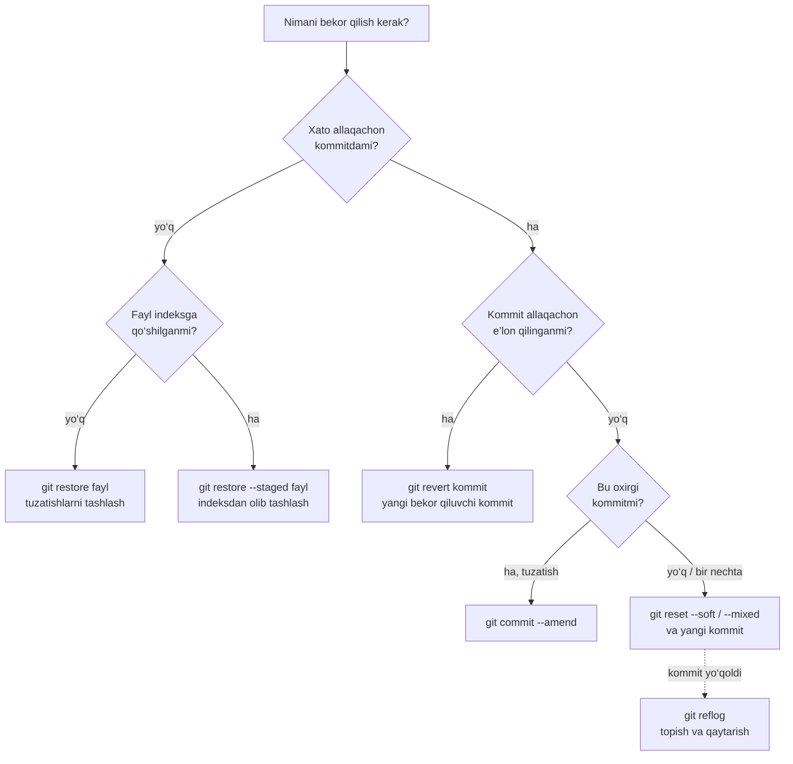
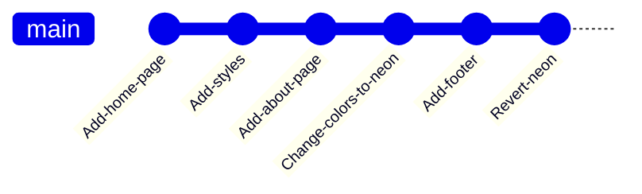
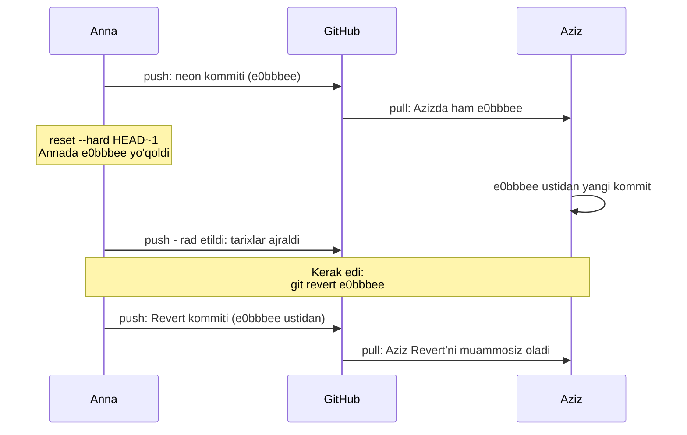

# O‘zgarishlarni bekor qilish

[Mundarija](../../README.md) · [← Orqaga](../../Lesson-3/uz/Tarix%20va%20o'zgarishlar.md) · [Keyingi →](../../Lesson-5/uz/Fayllarni%20e'tiborsiz%20qoldirish%20va%20loyihada%20tartib.md) · [RU](../ru/%D0%9E%D1%82%D0%BC%D0%B5%D0%BD%D0%B0%20%D0%B8%D0%B7%D0%BC%D0%B5%D0%BD%D0%B5%D0%BD%D0%B8%D0%B9.md) · [EN](../en/Undoing%20changes.md) · [UZ](O'zgarishlarni%20bekor%20qilish.md)

> **3-dars bilan bog‘liqlik:** siz tarixni o‘qishni - `git log`, `git show`, `git diff` - va kommitlarni `HEAD`, `HEAD~1`, `HEAD~2` orqali nomlashni o‘rgandingiz. Bugun bu bilimlar asbobga aylanadi: siz tarixga shunchaki qarab qolmay, xatolarni ham tuzatasiz - fayllarda, indeksda va kommitlarning o‘zida.

---

## Bu sizga nima uchun kerak

Juma, kechqurun. Siz portfolio saytini yakunlayapsiz va yarim soat ichida quyidagilarga ulgurasiz:

- noto‘g‘ri `echo ... > index.html` buyrug‘i bilan `index.html` ning yarmini tasodifan o‘chirib yuborish;
- `git add .` ni bajarish - sayt bilan birga indeksga `passwords.txt` fayli ham tushadi;
- `Add contatcs page` xabari bilan - xato yozilgan holda - kommit qilish;
- kecha GitHub’ga yuborib qo‘ygan «neon ranglar» kommitingiz xato bo‘lganini tushunish: buyurtmachiga yoqmadi.

Git bo‘lmaganda hammasini qo‘lda tiklab, omadga umid qilgan bo‘lardingiz. Git’da har bir xato uchun o‘z buyrug‘i bor va ularning deyarli barchasi xavfsiz. Asosiysi - **qaysi** buyruq qaysi xatoga mos kelishini bilish. Dars aynan shunga bag‘ishlangan.

---

## Nimani o‘rganasiz

- Bekor qilish buyrug‘ini xato **qayerda** ekaniga qarab tanlash: ishchi papkada, indeksda, oxirgi kommitda yoki eski kommitda.
- Faylga kiritilgan muvaffaqiyatsiz tuzatishlarni tashlab yuborish: `git restore`.
- Faylni o‘chirmasdan indeksdan olib tashlash: `git restore --staged`.
- Oxirgi kommitni tuzatish: `git commit --amend` - va buni qachon qilish **mumkin emasligini** tushunish.
- E’lon qilingan kommitni yangi kommit bilan bekor qilish: `git revert`.
- Tarmoqni orqaga surish (`git reset --soft`, `--mixed`, `--hard`) va «yo‘qolgan» kommitlarni `git reflog` orqali qutqarish.
- Asosiy qoidaga amal qilish: boshqalar allaqachon ko‘rgan tarixni qayta yozmaslik.

---

## Takrorlash: 3-darsdan 3 savol

1. `git log --oneline` nimani ko‘rsatadi va birinchi qatordagi `(HEAD -> main)` nimani bildiradi?
2. Oxirgisidan ikki kommit eskiroq kommitni uning xeshini nusxalamasdan qanday nomlash mumkin?
3. `git diff` ning `git diff --staged` dan farqi nimada?

Javoblar - dars oxirida.

---

## Reja

| Bo‘lim | Nima qilamiz |
| --- | --- |
| Bekor qilish xaritasi | Xato qayerda bo‘lsa - buyruq ham shunga qarab |
| `git restore`, `--staged` | Fayldagi tuzatishlarni tashlab yuborish, faylni indeksdan olib tashlash |
| `git commit --amend` | Oxirgi kommitni tuzatish |
| Mini-topshiriq 1 | O‘quv terminalida dastlabki uchta buyruq |
| `git revert` | E’lon qilingan kommitni bekor qilish |
| `git reset` | Uchta rejim va uchta zona |
| `git reflog` va e’lon qilingan tarix | Vaqt mashinasi; nega e’lon qilinganni qayta yozish mumkin emas |
| Mini-topshiriq 2 | revert, reset va reflog amalda |
| Mustaqil ish | O‘quv terminalida va kompyuterda topshiriq |

---

## Bekor qilish xaritasi

**Oddiy so‘z bilan:** Git’dagi xatolar xatdagi imlo xatolariga o‘xshaydi. Xat qoralamada ekan - so‘zni shunchaki o‘chirib tashlang. Agar u konvertga solingan, lekin hali yuborilmagan bo‘lsa - chiqarib, qayta yozing. Agar xat allaqachon yetib borgan bo‘lsa, uni qaytarib bo‘lmaydi: «Iltimos, haqiqiy emas deb hisoblang...» degan ikkinchi xatni yuborish qoladi. Git’da ham shunday: xato qanchalik uzoqqa ketgan bo‘lsa, tuzatish usuli ham shunchalik boshqacha.

2-darsdagi uchta zonani eslang: **ishchi papka** (diskdagi fayllar), **indeks** (kommitga tayyorlanayotgan narsa) va **repozitoriy** (kommitlar). To‘rtinchi joyni qo‘shamiz - boshqa odamlar allaqachon ko‘rgan **e’lon qilingan kommitlar** (masalan, GitHub’da - 8-dars).

| Nimani bekor qilamiz | Buyruq | Xavfsizmi |
| --- | --- | --- |
| Faylga kiritilgan, hali indeksga qo‘shilmagan tuzatishlar | `git restore fayl` | Tuzatishlar butunlay yo‘qoladi - Git ularni saqlamagan |
| Indeksga tasodifan qo‘shilgan fayl | `git restore --staged fayl` | Ha: fayl diskda qoladi |
| **Oxirgi** kommitning xabari yoki tarkibi (e’lon qilinmagan) | `git commit --amend` | Ha, kommit faqat sizda ekan |
| **Allaqachon e’lon qilingan** istalgan kommit | `git revert kommit` | Ha: tarix o‘zgarmaydi, bekor qiluvchi kommit qo‘shiladi |
| Bir nechta oxirgi e’lon qilinmagan kommit - qayta qilish | `git reset --soft` yoki `--mixed` | Ha: o‘zgarishlar fayllarda qoladi |
| Kommitdan keyingi hamma narsani - butunlay tashlab yuborish | `git reset --hard` | **Xavfli:** kommit qilinmagan ishni o‘chiradi |
| «Hammasini buzib qo‘ydim, avvalgidek qaytaring» | `git reflog` + `git reset --hard` | Kommitlarni qutqaradi, lekin kommit qilinmagan tuzatishlarni emas |



**Sxemani qanday o‘qish kerak.** Yuqoridan boshlang va savollarga javob bering. Birinchi savol - xato kommitga tushganmi. Agar yo‘q bo‘lsa, fayllar va indeks bilan ishlaymiz (`restore`). Agar ha bo‘lsa, ikkinchi savol hal qiladi - kommitni boshqalar ko‘rganmi. E’lon qilinganini faqat `revert` orqali bekor qilamiz. Punktir strelka - zaxira chiqish: biror narsa noto‘g‘ri ketsa, `reflog` yo‘qolgan kommitni topishga yordam beradi. Topshiriqni bajarayotganda shu sxemaga qayting.

---

## `git restore`: fayldagi tuzatishlarni tashlab yuborish

Vaziyat: siz `index.html` da xato qildingiz va uni oxirgi kommitdagi versiyaga qaytarmoqchisiz. Portfoliomizda hozircha ikkita kommit bor: `a85b320 Add home page` va `c8a4ab7 Add styles` (oxirgisi). Faylni buzamiz - `>` ichidagini butunlay almashtiradi (1-dars):

```bash
echo "<h1>Portflio</h1><<<" > index.html
git status
```

```text
On branch main
Changes not staged for commit:
  (use "git add <file>..." to update what will be committed)
  (use "git restore <file>..." to discard changes in working directory)
	modified:   index.html

no changes added to commit (use "git add" and/or "git commit -a")
```

| Qator | Tarjimasi va ma’nosi |
| --- | --- |
| `Changes not staged for commit` | Indeksga qo‘shil**magan** o‘zgarishlar |
| `use "git restore <file>..." to discard changes` | Git maslahati: `git restore fayl` ishchi papkadagi o‘zgarishlarni **tashlab yuboradi** |
| `modified: index.html` | Fayl oxirgi kommitga nisbatan o‘zgargan |

Git buyruqni o‘zi aytib berdi. Uni bajaramiz:

```bash
git restore index.html
git status
cat index.html
```

```text
On branch main
nothing to commit, working tree clean
<h1>Portfolio</h1>
```

`git restore` hech narsa javob bermadi - terminalda bu odatda «hammasi joyida» degani. Fayl yana oxirgi kommitdagidek, `git status` esa ishchi papka toza ekanini aytyapti.

**Oddiy so‘z bilan:** `git restore` - «Oxirgi saqlashdan keyingi barcha o‘zgarishlarni bekor qilish» tugmasi. Bitta faylni yoki hammasini birdaniga ko‘rsatish mumkin: `git restore .` (nuqta - joriy papka). Boshqalarning yo‘riqnomalarida eski shaklni uchratasiz: `git checkout -- index.html` - bu ham xuddi shu.

> **Muhim:** `git restore` tuzatishlarni **qaytarib bo‘lmaydigan qilib** o‘chiradi. Git ularni hali kommitda ko‘rmagan, shuning uchun ular `reflog` da ham bo‘lmaydi. Buyruqdan oldin `git diff` ni ko‘ring (3-dars) - bu o‘zgarishlar rostdan ham keraksizmi?

---

## `git restore --staged`: faylni indeksdan olib tashlash

Vaziyat: siz `git add .` ni bajardingiz va indeksga u yerda bo‘lmasligi kerak bo‘lgan fayl tushib qoldi.

```bash
echo "admin: qwerty123" > passwords.txt
git add .
git status
```

```text
On branch main
Changes to be committed:
  (use "git restore --staged <file>..." to unstage)
	new file:   passwords.txt
```

| Qator | Tarjimasi va ma’nosi |
| --- | --- |
| `Changes to be committed` | Keyingi kommitga kiradigan o‘zgarishlar |
| `use "git restore --staged <file>..." to unstage` | Maslahat: `--staged` faylni indeksdan **olib tashlaydi** (unstage) |
| `new file: passwords.txt` | Yangi fayl, allaqachon indeksda. Yana bitta `git commit` - va parol tarixga tushadi |

```bash
git restore --staged passwords.txt
git status -s
```

```text
?? passwords.txt
```

Qisqa statusdagi `??` (2-dars) - kuzatilmaydigan fayl. Fayl **diskda qoldi**, lekin Git uni yana kuzatmaydi va kommitga olmaydi. Bu buyruqning eski shakli - `git reset HEAD passwords.txt`.

**Oddiy so‘z bilan:** indeks - do‘kondagi savat, kommit - kassa. `git restore --staged` - mahsulotni savatdan olib, javonga qaytarish. Mahsulot hech qayerga yo‘qolmadi, shunchaki siz uni sotib olmayapsiz.

Bosqichma-bosqich - uchta zonada nima bo‘ladi:

| Qadam | Buyruq | Ishchi papka | Indeks | Repozitoriy |
| --- | --- | --- | --- | --- |
| 1 | (boshlanish) | `index.html`, `style.css` | kommitdagidek | `Add styles` - oxirgisi |
| 2 | `echo "admin..." > passwords.txt` | + `passwords.txt` | kommitdagidek | o‘zgarishsiz |
| 3 | `git add .` | + `passwords.txt` | + `passwords.txt` | o‘zgarishsiz |
| 4 | `git restore --staged passwords.txt` | + `passwords.txt` (qoldi) | kommitdagidek | o‘zgarishsiz |

Oxirgi ustunga e’tibor bering: `restore` buyruqlari **hech qachon kommitlarga tegmaydi**. `git restore fayl` indeksdagi versiyani olib, ishchi papkani o‘zgartiradi, `git restore --staged fayl` esa oxirgi kommitdagi versiyani olib, indeksni o‘zgartiradi.

> **Muhim:** parollar fayli boshqa hech qachon indeksga tasodifan tushmasligi uchun u `.gitignore` ga yoziladi. Bu 5-dars mavzusi.

---

## `git commit --amend`: oxirgi kommitni tuzatish

### Xabarni tuzatish

Vaziyat: kommit qildingiz va xato yozilganini payqadingiz.

```bash
echo "<h2>About me</h2>" > about.html
git add about.html
git commit -m "Add abuot page"
git commit --amend -m "Add about page"
git log --oneline
```

```text
[main 73f91dd] Add abuot page
 1 file changed, 1 insertion(+)
 create mode 100644 about.html
[main 24367f8] Add about page
 Date: Tue Sep 1 10:03:00 2026 +0500
 1 file changed, 1 insertion(+)
 create mode 100644 about.html
24367f8 (HEAD -> main) Add about page
c8a4ab7 Add styles
a85b320 Add home page
```

| Qator | Tarjimasi va ma’nosi |
| --- | --- |
| `[main 24367f8] Add about page` | `main` tarmog‘idagi yangi kommit - xesh **boshqa** (`73f91dd` edi) |
| `Date: Tue Sep 1 10:03:00 2026` | **Asl** kommit sanasi: amend ish qilingan vaqtni saqlab qoladi |
| `24367f8 (HEAD -> main) Add about page` | Tarixda avvalgidek 3 ta kommit, 4 ta emas: eski kommit almashtirilgan |

**Oddiy so‘z bilan:** amend (ingl. «tuzatmoq») - o‘chirg‘ich emas, sahifani qayta chop etish. Git eski kommitni tahrirlamaydi, balki uning o‘rniga yangisini yaratadi va tarmoqni unga o‘tkazadi. Shuning uchun kommitning xeshi yangi.

### Unutilgan faylni qo‘shish

Vaziyat: kommitga o‘zgarishni qo‘shish esdan chiqdi. Uni indeksga qo‘shing va `--amend --no-edit` ni bajaring - «xabar o‘sha, o‘zgartirma»:

```bash
echo "<a href=\"about.html\">About me</a>" >> index.html
git add index.html
git commit --amend --no-edit
```

```text
[main f5ba9c4] Add about page
 Date: Tue Sep 1 10:04:00 2026 +0500
 2 files changed, 2 insertions(+)
 create mode 100644 about.html
```

Endi `Add about page` kommitida ikkita fayl bor: `about.html` va o‘zgartirilgan `index.html`.

> **Muhim:** `--amend` kommitga **indeksdagi hamma narsani** oladi. Agar indeksda `passwords.txt` qolgan bo‘lsa, u «tuzatilgan» kommitga tushadi. Amend’dan oldin doim `git status` ni ko‘ring.

**Haqiqiy Git’da** `git commit --amend` buyrug‘i `-m` siz xabarni tuzatishingiz uchun matn muharririni ochadi. O‘quv terminalida muharrir yo‘q, shuning uchun `-m "..."` yoki `--no-edit` deb yozing.

### Amend qachon mumkin emas

| Vaziyat | Amend mumkinmi | Nima uchun |
| --- | --- | --- |
| **Oxirgi bo‘lmagan** kommitni tuzatish kerak | Yo‘q | amend faqat oxirgisini o‘zgartiradi; eskilari uchun - `revert` |
| Kommit allaqachon GitHub’ga yuborilgan (`git push`, 8-dars) | **Yo‘q** | Boshqalarda eski xesh qolgan, tarixlar ajralib ketadi |

---

## Mini-topshiriq 1

O‘quv terminalida, uy papkasida:

1. `undo` papkasini yarating, unga o‘ting, repozitoriy yarating. `Day 1` matnli `notes.txt` faylini yarating va uni `Add notes` xabari bilan kommit qiling.
2. Faylni buzing: `echo "oops" > notes.txt`. `git status` ni ko‘ring va faylni Git maslahatidagi buyruq bilan qaytaring. `cat notes.txt` bilan tekshiring.
3. `my password` matnli `secret.txt` ni yarating, `git add .` ni bajaring, so‘ng `secret.txt` ni indeksdan olib tashlang. `git status -s` bilan tekshiring - fayl nomi oldida nima turibdi?
4. `notes.txt` ga `Day 2` qatorini qo‘shing va `Add dya 2` xato xabari bilan kommit qiling (`git commit -am` buyrug‘i bilan). Xabarni `Add day 2` ga tuzating va `git log --oneline` ni tekshiring: tarixda nechta kommit bor?

---

## `git revert`: e’lon qilingan kommitni bekor qilish

Vaziyat: tarixda muvaffaqiyatsiz kommit bor, undan keyin esa keraklilari. Kommit allaqachon GitHub’da, jamoadoshlaringiz uni yuklab olgan. Uni o‘chirish mumkin emas (nima uchun - quyida). Lekin teskari o‘zgarishlar bilan **yangi** kommit qilish mumkin.

Aytaylik, siz `Change colors to neon` kommitini qildingiz (`style.css` ga `body { color: lime; background: magenta; }` yozilgan), uni e’lon qildingiz, keyin yana `Add footer` kommitini qildingiz:

```bash
git log --oneline
```

```text
ffdfca7 (HEAD -> main) Add footer
e0bbbee Change colors to neon
f5ba9c4 Add about page
c8a4ab7 Add styles
a85b320 Add home page
```

Muvaffaqiyatsiz `Change colors to neon` kommiti - yuqoridan ikkinchi, ya’ni `HEAD~1` (3-dars). Bekor qilamiz:

```bash
git revert --no-edit HEAD~1
git log --oneline
cat style.css
```

```text
[main 9a1154a] Revert "Change colors to neon"
 1 file changed, 1 insertion(+), 1 deletion(-)
9a1154a (HEAD -> main) Revert "Change colors to neon"
ffdfca7 Add footer
e0bbbee Change colors to neon
f5ba9c4 Add about page
c8a4ab7 Add styles
a85b320 Add home page
body { color: navy; }
```

| Qator | Tarjimasi va ma’nosi |
| --- | --- |
| `Revert "Change colors to neon"` | «... kommitini bekor qilish» degan yangi kommit. Xabarni Git o‘zi tuzdi va `This reverts commit <to‘liq xesh>.` qatorini qo‘shdi - u `git log` da ko‘rinadi |
| `e0bbbee Change colors to neon` | Eski kommit tarixda **qoldi**: nima bo‘lgani va nima bekor qilingani ko‘rinib turibdi |
| `body { color: navy; }` | Fayl yana muvaffaqiyatsiz kommitdan oldingidek, `Add footer` dagi futer esa joyida |

**Oddiy so‘z bilan:** revert - gazetadagi «raddiya». Kechagi maqolani bosilgan gazetalardan qirqib olib bo‘lmaydi. Shuning uchun bugun «Kechagi xabar xato edi» degan qayd chop etiladi. Ikkalasi ham tikilgan gazetalar to‘plamida qoladi.

**Haqiqiy Git’da** `git revert HEAD~1` buyrug‘i `--no-edit` siz tayyor xabar bilan muharrirni ochadi. Hech narsani o‘zgartirmasdan uni yoping - yoki darsdagidek darhol `--no-edit` deb yozing. Kommitni xesh bilan ham ko‘rsatish mumkin: `git revert --no-edit e0bbbee`.



**Sxemani qanday o‘qish kerak.** Tarix faqat o‘sadi: oltita kommit, birortasi ham yo‘qolmadi. `Revert-neon` kommitida `Change-colors-to-neon` ga teskari o‘zgarishlar bor. Dastlabki beshta kommitni allaqachon yuklab olgan kishi shunchaki yana bittasini oladi - uning tarix nusxasi bilan hech qanday konflikt bo‘lmaydi.

> **Muhim:** `git revert` kommit qilinmagan o‘zgarishlarni yoqtirmaydi. Undan oldin `git status` ni bajaring: o‘zgargan yoki indeksga qo‘shilgan fayllar bo‘lsa - avval ularni kommit qiling yoki bekor qiling (`restore`). Aks holda Git revert’ni bajarishdan bosh tortadi va avval o‘zgarishlarni hal qilishni so‘raydi.

---

## `git reset`: tarmoqni orqaga surish

`git reset` - **e’lon qilinmagan** kommitlar uchun kuchli buyruq. U tarmoqni (va `HEAD` ni) ko‘rsatilgan kommitga suradi. Rejim (`--soft`, `--mixed`, `--hard`) indeks va ishchi papka bilan nima bo‘lishini hal qiladi.

**Oddiy so‘z bilan:** kitobdagi xatcho‘pni tasavvur qiling. `reset` xatcho‘pni bir necha sahifa orqaga o‘tkazadi. `--soft` - xatcho‘pdan keyingi sahifalar stol ustida yonma-yon turibdi, qayta yopishtirishga tayyor. `--mixed` - sahifalar stol bo‘ylab sochilib ketgan, ularni qaytadan yig‘ish kerak. `--hard` - sahifalar maydalagichga tashlangan.

Misollar qisqaroq bo‘lishi uchun hozircha faqat ikkita kommit - `Add home page` va `Add styles` (dars boshidagidek) - bo‘lgan repozitoriyni olamiz va ularning ustiga `Add footer` kommitini qilamiz.

```bash
echo "<footer>Anna Karimova, 2026</footer>" >> index.html
git commit -am "Add footer"
git log --oneline
```

```text
[main 3994cd9] Add footer
 1 file changed, 1 insertion(+)
3994cd9 (HEAD -> main) Add footer
c8a4ab7 Add styles
a85b320 Add home page
```

### `--soft`: kommitni bekor qilish, hammasini indeksda qoldirish

```bash
git reset --soft HEAD~1
git log --oneline
git status
```

```text
c8a4ab7 (HEAD -> main) Add styles
a85b320 Add home page
On branch main
Changes to be committed:
  (use "git restore --staged <file>..." to unstage)
	modified:   index.html
```

`Add footer` kommiti endi `git log` da yo‘q, lekin `index.html` dagi o‘zgarishlar indeksda turibdi (`Changes to be committed`) - darhol qaytadan kommit qilish mumkin, masalan boshqa xabar bilan. Bir nechta oxirgi kommitni bittaga aylantirish shunday qilinadi. Kommitni `git commit -m "Add footer"` buyrug‘i bilan qaytaramiz - u yangi `26d99aa` xeshini oladi.

### `--mixed`: kommit va indeksni bekor qilish, fayllarni qoldirish

`--mixed` - standart rejim: `git reset HEAD~1` va `git reset --mixed HEAD~1` - bir xil narsa.

```bash
git reset HEAD~1
```

```text
Unstaged changes after reset:
M	index.html
```

| Qator | Tarjimasi va ma’nosi |
| --- | --- |
| `Unstaged changes after reset:` | «reset’dan keyin indeksdan tashqaridagi o‘zgarishlar» - ishchi papkada nima qolgani |
| `M index.html` | `M` - modified: fayldagi tuzatishlar saqlangan, lekin indeksda ular yo‘q |

`git status` endi `index.html` ni `Changes not staged for commit` bo‘limida ko‘rsatadi: qayta kommit qilish uchun `git add` (yoki `git commit -am`) kerak. Kommitni qaytaramiz: `git commit -am "Add footer"` - yangi xesh `4cb89f6`.

### `--hard`: hammasini bekor qilish

> **Muhim:** `git reset --hard` indeksdagi **va ishchi papkadagi** o‘zgarishlarni o‘chiradi. Kommit qilinmagan tuzatishlar butunlay yo‘qoladi. `--hard` dan oldin doim `git status` ni bajaring. Allaqachon e’lon qilingan kommitni «olib tashlash» uchun hech qachon `--hard` ishlatmang.

```bash
git reset --hard HEAD~1
git log --oneline
cat index.html
```

```text
HEAD is now at c8a4ab7 Add styles
c8a4ab7 (HEAD -> main) Add styles
a85b320 Add home page
<h1>Portfolio</h1>
```

| Qator | Tarjimasi va ma’nosi |
| --- | --- |
| `HEAD is now at c8a4ab7 Add styles` | «HEAD endi c8a4ab7 kommitida» - tarmoq ham, fayllar ham o‘sha yerga o‘tkazildi |
| `<h1>Portfolio</h1>` | Faylda endi futer yo‘q: ishchi papka ham orqaga qaytdi |

### Uchta rejim - bosqichma-bosqich

Uchala rejim uchun boshlang‘ich holat bir xil: oxirgi kommit `Add footer`, ishchi papka toza. Buyruq - `git reset <rejim> HEAD~1`.

| Qadam | Buyruq | Ishchi papka | Indeks | Repozitoriy (`main` tarmog‘i) |
| --- | --- | --- | --- | --- |
| 0 | (boshlanish) | futer bilan | futer bilan | `Add footer` |
| 1 | `git reset --soft HEAD~1` | futer bilan | futer bilan | `Add styles` |
| 2 | `git reset --mixed HEAD~1` | futer bilan | futer**siz** | `Add styles` |
| 3 | `git reset --hard HEAD~1` | futer**siz** | futer**siz** | `Add styles` |

Qaysi birini qachon ishlatish kerak: `--soft` - oxirgi kommitlarni bittaga birlashtirish yoki boshqa xabar bilan qayta qilish; `--mixed` - kommitni qayta qilish va unga nima qo‘shishni qaytadan hal qilish; `--hard` - muvaffaqiyatsiz **e’lon qilinmagan** kommitlarni butunlay tashlab yuborish.

---

## `git reflog`: vaqt mashinasi

Siz `git reset --hard` ni bajardingiz va `Add footer` kommiti baribir kerakligini tushundingiz. `git log` da u yo‘q. U yo‘qoldimi?

Yo‘q. Git **havolalar jurnalini** (reference log, reflog) yuritadi: har bir kommit, amend, reset va revert’dan keyin `HEAD` qayerni ko‘rsatganini yozib boradi.

```bash
git reflog
```

```text
c8a4ab7 (HEAD -> main) HEAD@{0}: reset: moving to HEAD~1
4cb89f6 HEAD@{1}: commit: Add footer
c8a4ab7 HEAD@{2}: reset: moving to HEAD~1
26d99aa HEAD@{3}: commit: Add footer
c8a4ab7 HEAD@{4}: reset: moving to HEAD~1
3994cd9 HEAD@{5}: commit: Add footer
c8a4ab7 HEAD@{6}: commit: Add styles
a85b320 HEAD@{7}: commit (initial): Add home page
```

| Qator qismi | Tarjimasi va ma’nosi |
| --- | --- |
| `c8a4ab7` | `HEAD` ko‘rsatgan kommit xeshi |
| `HEAD@{0}` | «0 qadam oldin HEAD qayerda edi» - ya’ni hozir |
| `HEAD@{1}` | Bir qadam oldin `HEAD` qayerda edi: `Add footer` kommitida |
| `reset: moving to HEAD~1` | `HEAD` ni qaysi amal surgan: bu yerda bizning `reset` |

Reflog’ni brauzer tarixi kabi yuqoridan pastga o‘qing: yuqorida - oxirgi amal. Uchta `commit: Add footer` qatori - reset bo‘limida bu kommitni uch marta qilganimiz: har birining o‘z xeshi bor. Kerakli `4cb89f6` kommiti - `HEAD@{1}` qatorida. Qaytamiz:

```bash
git reset --hard HEAD@{1}
git log --oneline
```

```text
HEAD is now at 4cb89f6 Add footer
4cb89f6 (HEAD -> main) Add footer
c8a4ab7 Add styles
a85b320 Add home page
```

Kommit qaytdi, u bilan birga `index.html` dagi futer ham. `HEAD@{1}` o‘rniga xeshni ko‘rsatish mumkin edi: `git reset --hard 4cb89f6`.

**Oddiy so‘z bilan:** `git log` - kitobning hozirgi ko‘rinishidagi mundarijasi. `git reflog` - kitobni qanday varaqlaganingizning videoyozuvi. Hatto mundarijadan bobni yirtib tashlagan bo‘lsangiz ham, videoda u qayerda bo‘lgani ko‘rinadi.

> **Muhim:** reflog faqat **kommitlarda** bo‘lgan narsani saqlaydi. Siz kommit qilmagan va `restore` yoki `reset --hard` orqali o‘chirgan tuzatishlarni u qaytarmaydi. Bundan qoida kelib chiqadi: tez-tez kommit qiling. Bundan tashqari, reflog faqat sizning kompyuteringizda bo‘ladi va Git eski yozuvlarni vaqt o‘tishi bilan tozalaydi (standart bo‘yicha taxminan 90 kundan keyin).

---

## E’lon qilingan tarixni qayta yozmang

`amend` va `reset` tarixni **qayta yozadi**: eski kommitlar tarmoqdan yo‘qoladi, ularning o‘rniga boshqa xeshli yangilari paydo bo‘ladi. Kommitlar faqat sizda ekan - bu normal. Lekin kommit allaqachon GitHub’da bo‘lsa va uni jamoadoshingiz yuklab olgan bo‘lsa, sizda va unda ikki xil tarix bo‘lib qoladi.



**Sxemani qanday o‘qish kerak.** Vaqt bo‘yicha yuqoridan pastga o‘qing. Anna kommitni e’lon qildi, Aziz uni yuklab oldi va ishni davom ettirdi. Agar Anna kommitni `reset` orqali «o‘chirsa», uning tarixi endi Aziz va GitHub tarixiga mos kelmaydi - rad etishlar va chalkashlik boshlanadi (ularni qanday hal qilish - 9-dars). Agar Anna `revert` qilsa, tarix faqat o‘sadi va hammada hammasi mos keladi. `push` va `pull` ni 8-darsda batafsil ko‘rib chiqamiz.

Tarixni `git commit --amend` va `git reset` (istalgan rejim) qayta yozadi. `git restore` (kommitlarga tegmaydi) va `git revert` (faqat kommit qo‘shadi) qayta yozmaydi. Qoida bir jumlada: **GitHub’ga ketgan narsani faqat `revert` orqali bekor qilamiz**.

---

### Buzib ko‘ring

1. Yangi bo‘sh repozitoriyda (kommitlarsiz) `git commit --amend -m "x"` ni bajaring. Git nima deb javob beradi?
2. Fayl nomida xato qiling: `git restore indx.html`. Git qanday xabar ko‘rsatadi?
3. Buyruqda xato qiling: `git revrt HEAD`. Git nimani taklif qiladi?
4. `git commit --amend --no-edit` ni ketma-ket ikki marta bajaring va har safardan keyin `git log --oneline` dagi oxirgi kommit xeshini solishtiring. Hech narsani o‘zgartirmagan bo‘lsangiz, nega u o‘zgaradi? `git reflog` da ikkala `commit (amend)` yozuvini toping.
5. Kommit qiling, keyin `git reset --hard HEAD~1`, `git log` bo‘yicha kommit «yo‘qolganiga» ishonch hosil qiling va uni `git reflog` orqali qaytaring. (O‘quv terminalida bu xavfsiz, o‘z loyihangizda avval `git status` ni tekshiring!)

### Yangi o‘rganuvchilarning tipik xatolari

| Xato | Nima bo‘ladi | Qanday tuzatish |
| --- | --- | --- |
| `--staged` o‘rniga `git restore passwords.txt` | Fayl indeksda qoldi va kommitga tushadi | `git restore --staged passwords.txt` |
| Fayl nomida xato: `git restore indx.html` | `error: pathspec 'indx.html' did not match any file(s) known to git` | Nomni `git status` da tekshirish, `Tab` dan foydalanish |
| Indeksda ortiqcha fayl bilan `git commit --amend` | Ortiqcha fayl «tuzatilgan» kommitga tushdi | Avval `git restore --staged fayl`, keyin amend; agar kech bo‘lsa - `git reset --soft HEAD~1` va qaytadan kommit |
| Allaqachon GitHub’dagi kommit uchun amend yoki reset | Sizda va jamoadoshlaringizda tarixlar ajraldi, `push` rad etiladi | E’lon qilingan uchun - faqat `git revert` |
| Eskiroq kommit kerak bo‘lganda `git revert HEAD` | Oxirgi (to‘g‘ri) kommit bekor qilindi | Keraklisini `git log --oneline` da topish, `HEAD~N` yoki xeshni ko‘rsatish; ortiqcha revert’ni yana bitta `revert` bilan bekor qilish |
| Kommit qilinmagan tuzatishlar bor paytda `git reset --hard` | Tuzatishlar o‘chdi, reflog ularni qaytarmaydi | `--hard` dan oldin - `git status`; bitta kommit uchun `--soft` yaxshiroq |
| Fayl nomisiz `git restore --staged` | `fatal: you must specify path(s) to restore` | Faylni ko‘rsatish: `git restore --staged passwords.txt` yoki hammasini: `git restore --staged .` |

---

## Mini-topshiriq 2

1-mini-topshiriqdagi `undo` repozitoriysida davom eting:

1. `Buy coffee` matnli `todo.txt` faylini yarating va uni `Add todo list` xabari bilan kommit qiling. So‘ng `notes.txt` ga `Day 3` qatorini qo‘shing va `Add day 3` xabari bilan kommit qiling.
2. `Add todo list` kommiti allaqachon e’lon qilingan deb tasavvur qiling. Uni `git revert` orqali bekor qiling (bu qaysi `HEAD~N`?). `git log --oneline` va `ls` ni tekshiring: `notes.txt` joyidami va `todo.txt` yo‘qoldimi?
3. Bekor qiluvchi kommitni `git reset --soft HEAD~1` orqali bekor qiling va `git status` ni ko‘ring: `todo.txt` ning o‘chirilishi qaysi bo‘limda? Uni `Revert todo list` xabari bilan qaytadan kommit qiling.
4. `git reset --hard HEAD~1` ni bajaring. `git log --oneline` bo‘yicha `Revert todo list` kommiti yo‘qolganiga ishonch hosil qiling.
5. Uni `git reflog` da toping va `git reset --hard` buyrug‘i bilan qaytaring.

---

## Dars yakuni: shpargalka

| Vazifa | Buyruq |
| --- | --- |
| Fayldagi tuzatishlarni tashlab yuborish (indeksda emas) | `git restore fayl` |
| Barcha fayllardagi tuzatishlarni tashlab yuborish | `git restore .` |
| Faylni indeksdan olib tashlash, diskda qoldirish | `git restore --staged fayl` |
| Oxirgi kommit xabarini tuzatish | `git commit --amend -m "Yangi xabar"` |
| Unutilganini oxirgi kommitga qo‘shish | `git add fayl`, so‘ng `git commit --amend --no-edit` |
| E’lon qilingan kommitni bekor qilish | `git revert --no-edit kommit` |
| Oxirgi kommitni olib tashlash, o‘zgarishlar - indeksga | `git reset --soft HEAD~1` |
| Oxirgi kommitni olib tashlash, o‘zgarishlar - fayllarga | `git reset HEAD~1` (`--mixed`) |
| Oxirgi kommitni butunlay tashlab yuborish (xavfli) | `git reset --hard HEAD~1` |
| HEAD surilishlari jurnali | `git reflog` |
| Reflog’dagi holatga qaytish | `git reset --hard HEAD@{N}` yoki xesh |
| Boshqalarning yo‘riqnomalaridagi eski shakllar (= `restore` va `restore --staged`) | `git checkout -- fayl`, `git reset HEAD fayl` |

---

## Mustaqil ish

### 1-qism. IDE topshirig‘i (platforma hisoblaydi)

Siz `~/portfolio` papkasidasiz. Repozitoriyda to‘rtta xato bor - har birini mos buyruq bilan tuzating. Buyruqlarni har bir qatorga bittadan yozing:

1. `git status` va `git log --oneline` ni ko‘ring.
2. `index.html` fayli buzilgan va hali indeksga qo‘shilmagan - uni oxirgi kommitdagi versiyaga qaytaring.
3. `passwords.txt` fayli tasodifan indeksga qo‘shilgan - uni indeksdan olib tashlang, lekin faylning o‘zini o‘chirmang.
4. Oxirgi kommit xabarida xato bor (`contatcs`) - yangi kommit yaratmasdan, xabarni `Add contacts page` ga tuzating.
5. `Change colors to neon` kommiti allaqachon GitHub’da e’lon qilingan - uni tarixdan o‘chirmasdan `git revert` buyrug‘i bilan bekor qiling (`reset --hard` ishlatmang).
6. Natijani tekshiring: `git log --oneline` va `git status`.

Platforma nimani tekshiradi: `index.html` kommitdagi versiyaga mos kelishini va `git restore` buyrug‘i bilan qaytarilganini; `passwords.txt` papkada qolganini, indeksda emasligini va birorta kommitga tushmaganini; xato yangi kommit bilan emas, oxirgi kommitni almashtirish orqali tuzatilganini; `Change colors to neon` kommiti tarixda qolganini, oxirgisi esa `Revert "Change colors to neon"` bo‘lganini; `style.css` `Add styles` dagi versiyaga qaytganini, `about.html` va `contacts.html` esa joyida ekanini (jami 6 ta kommit); `git reset --hard` ishlatilmaganini; oxirida `git status` faqat kuzatilmaydigan `passwords.txt` ni ko‘rsatishini; yechim boshqa boshlang‘ich ma’lumotlarda ham ishlashini; ssenariy xatolarsiz bajarilishini.

### 2-qism. Kompyuterdagi loyiha

1-darsdagi saytingiz repozitoriysida, haqiqiy Git’da ishlang.

1. Saytning istalgan faylini buzing (masalan, muharrirda `index.html` dagi qatorni o‘chiring), `git diff` ni ko‘ring va faylni `git restore` orqali qaytaring.
2. `notes-private.txt` faylini yarating, `git add .` ni bajaring, uni `git restore --staged` orqali indeksdan olib tashlang, so‘ng faylning o‘zini oddiy usulda o‘chiring.
3. Kichik o‘zgarish kiriting va xabarida ataylab xato bilan kommit qiling. Uni `git commit --amend` orqali tuzating - haqiqiy Git’da muharrir ochiladi: xabarni tuzating, saqlang va yoping (yoki `-m` dan foydalaning).
4. CSS’da fon rangini o‘zgartiradigan kommit qiling, so‘ng uni `git revert` orqali bekor qiling. `git log --oneline` va `git show HEAD` ni ko‘ring.
5. `git reflog` ni bajaring va undan `commit (amend)` va `revert` yozuvlarini toping.

### Tayyorlik mezonlari

- [ ] IDE topshirig‘i qabul qilindi.
- [ ] `git status` bo‘yicha har bir o‘zgarishni qaysi buyruq bilan bekor qilishni ayta olasiz.
- [ ] Saytingiz tarixida `Revert "..."` kommiti bor, bekor qilingan kommit esa qolgan.
- [ ] `reset --soft`, `--mixed` va `--hard` orasidagi farqni uchta zona misolida tushuntira olasiz.
- [ ] `git reflog` dan `git log` da yo‘q kommitni topib, uni qaytara olasiz.

---

## O‘zini tekshirish uchun savollar

1. `git restore fayl` va `git restore --staged fayl` nimasi bilan farq qiladi? Har biri nimani o‘zgartiradi va nimani qoldiradi?
2. Nega `git restore` orqali tashlab yuborilgan tuzatishlarni hatto `reflog` orqali ham qaytarib bo‘lmaydi?
3. `git commit --amend` nima qiladi? Nega undan keyin kommitning xeshi boshqa bo‘ladi?
4. Indeksda ortiqcha fayl turgan paytda `git commit --amend` qilinsa nima bo‘ladi?
5. Qaysi hollarda `git commit --amend` ishlatish mumkin emas?
6. `git revert` qanday ishlaydi? Bekor qilingan kommit tarixda nima bo‘ladi?
7. `git reset --soft HEAD~1` ning `git reset --mixed HEAD~1` dan farqi nimada? Har biridan keyin `git status` nimani ko‘rsatadi?
8. Nega `git reset --hard` xavfli buyruq deb ataladi? Undan oldin nima qilish kerak?
9. `git reflog` nima va uning yordamida `reset --hard` dan keyin kommitni qanday qaytarish mumkin?
10. Nega e’lon qilingan tarixni qayta yozish mumkin emas va uning o‘rniga qaysi buyruqdan foydalanish kerak?

Savollardan keyin platformada **dars testini** topshiring: 12 ta savol, o‘tish chegarasi 70%.

---

## Keyin nima

Endi siz xatolarni tuzatishni bilasiz - lekin ularga yo‘l qo‘ymagan yaxshiroq. 5-darsda Git’ni repozitoriyda joyi bo‘lmagan fayllarni **sezmaslikka** o‘rgatasiz: parollar, `node_modules`, vaqtinchalik fayllar. `.gitignore` ni sozlaysiz, allaqachon kommit qilingan faylni kuzatuvdan qanday olib tashlashni (`git rm --cached`) bilib olasiz va loyihada tartib o‘rnatasiz.

---

## Javoblar

**Takrorlash**

1. Qisqa tarixni: har bir qatorda bitta kommit - qisqa xesh va xabar, eng yangisi yuqorida. `(HEAD -> main)` - siz `main` tarmog‘idasiz va bu kommit undagi oxirgisi.
2. `HEAD~2` - «HEAD’dan ikki qadam orqaga».
3. `git diff` ishchi papkadagi hali indeksda yo‘q o‘zgarishlarni ko‘rsatadi. `git diff --staged` - indeksdagi, keyingi kommitga kiradigan o‘zgarishlarni.

**Mini-topshiriq 1**

```bash
mkdir undo
cd undo
git init
echo "Day 1" > notes.txt
git add notes.txt
git commit -m "Add notes"
echo "oops" > notes.txt
git status
git restore notes.txt
cat notes.txt
echo "my password" > secret.txt
git add .
git restore --staged secret.txt
git status -s
echo "Day 2" >> notes.txt
git commit -am "Add dya 2"
git commit --amend -m "Add day 2"
git log --oneline
```

`secret.txt` oldida `??` turibdi - fayl kuzatilmaydi. Tarixda 2 ta kommit: amend xato yozilgan kommitni almashtirdi, yangisini qo‘shmadi.

**Mini-topshiriq 2**

```bash
echo "Buy coffee" > todo.txt
git add todo.txt
git commit -m "Add todo list"
echo "Day 3" >> notes.txt
git commit -am "Add day 3"
git revert --no-edit HEAD~1
git log --oneline
ls
git reset --soft HEAD~1
git status
git commit -m "Revert todo list"
git reset --hard HEAD~1
git log --oneline
git reflog
git reset --hard HEAD@{1}
git log --oneline
```

`Add todo list` kommiti - bu `HEAD~1`. `reset --soft` dan keyin `todo.txt` ning o‘chirilishi `Changes to be committed` bo‘limida (`deleted: todo.txt`). `reflog` da `Revert todo list` kommiti `HEAD@{1}` qatorida.

**O‘zini tekshirish uchun savollar**

1. `git restore fayl` ishchi papkadagi faylni indeksdagi versiyaga qaytaradi - tuzatishlar yo‘qoladi. `git restore --staged fayl` o‘zgarishlarni indeksdan olib tashlaydi, diskdagi faylga esa tegmaydi.
2. reflog faqat `HEAD` ning kommitlar orasidagi surilishlarini yozadi. Kommit qilinmagan tuzatishlarni Git hech qachon saqlamagan, shuning uchun ularni qaytaradigan joy yo‘q.
3. Oxirgi kommit o‘rniga yangisini yaratadi: yangi xabar va/yoki hozir indeksda turgan narsa bilan. Xesh tarkib va xabardan hisoblanadi, shuning uchun u boshqa.
4. Ortiqcha fayl tuzatilgan kommitga tushadi. Shuning uchun amend’dan oldin `git status` ko‘riladi va ortiqchasi `git restore --staged` orqali olib tashlanadi.
5. Kommit allaqachon e’lon qilingan (GitHub’ga yuborilgan) bo‘lsa va oxirgi bo‘lmagan kommitni tuzatish kerak bo‘lsa.
6. Teskari o‘zgarishlar bilan yangi kommit yaratadi. Bekor qilingan kommit tarixda qoladi, yangisining xabari esa - `Revert "..."` va `This reverts commit <xesh>`.
7. Ikkalasi ham kommitni tarmoqdan olib tashlaydi. `--soft` dan keyin o‘zgarishlar indeksda (`Changes to be committed`), `--mixed` dan keyin - faqat ishchi papkada (`Changes not staged for commit`).
8. U indeks va ishchi papkadagi o‘zgarishlarni kommit qilinmaganini qaytarish imkonisiz o‘chiradi. Undan oldin - `git status`, e’lon qilingan kommitlar uchun esa u umuman ishlatilmaydi.
9. `HEAD` ning barcha surilishlari jurnali. Unda kerakli kommit qatorini (`HEAD@{N}` yoki xesh) topamiz va `git reset --hard HEAD@{N}` ni bajaramiz.
10. Boshqa odamlarda bu kommitlar allaqachon bor; agar ularni almashtirsangiz yoki olib tashlasangiz, tarixlar ajralib ketadi, `push` va `pull` rad eta boshlaydi. Buning o‘rniga `git revert` ishlatiladi.

---

[Mundarija](../../README.md) · [← Orqaga](../../Lesson-3/uz/Tarix%20va%20o'zgarishlar.md) · [Keyingi →](../../Lesson-5/uz/Fayllarni%20e'tiborsiz%20qoldirish%20va%20loyihada%20tartib.md) · [RU](../ru/%D0%9E%D1%82%D0%BC%D0%B5%D0%BD%D0%B0%20%D0%B8%D0%B7%D0%BC%D0%B5%D0%BD%D0%B5%D0%BD%D0%B8%D0%B9.md) · [EN](../en/Undoing%20changes.md) · [UZ](O'zgarishlarni%20bekor%20qilish.md)
