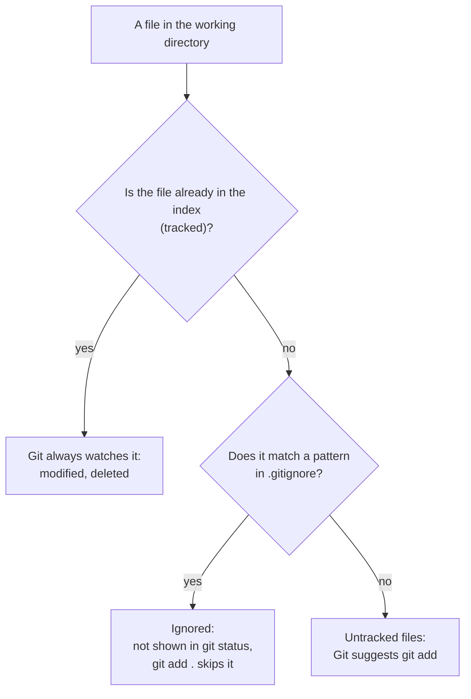
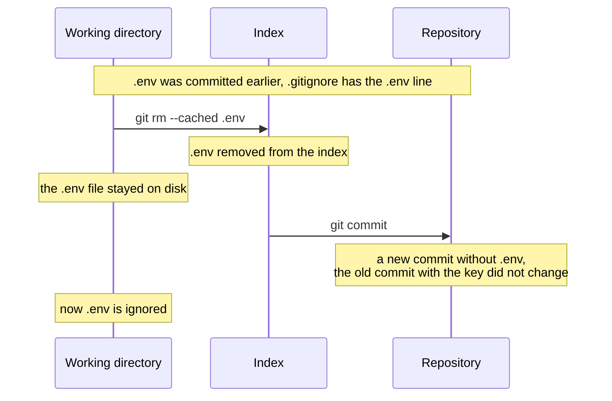

# Ignoring files and keeping the project tidy

[Contents](../../README.md) · [← Back](../../Lesson-4/en/Undoing%20changes.md) · [Next →](../../Lesson-6/en/Branches.md) · [RU](../ru/%D0%98%D0%B3%D0%BD%D0%BE%D1%80%D0%B8%D1%80%D0%BE%D0%B2%D0%B0%D0%BD%D0%B8%D0%B5%20%D1%84%D0%B0%D0%B9%D0%BB%D0%BE%D0%B2%20%D0%B8%20%D0%BF%D0%BE%D1%80%D1%8F%D0%B4%D0%BE%D0%BA%20%D0%B2%20%D0%BF%D1%80%D0%BE%D0%B5%D0%BA%D1%82%D0%B5.md) · [EN](Ignoring%20files%20and%20keeping%20the%20project%20tidy.md) · [UZ](../uz/Fayllarni%20e'tiborsiz%20qoldirish%20va%20loyihada%20tartib.md)

> **Link to lesson 4:** you learned to undo changes - `git restore`, `git revert`, `git reset` - and remembered the rule: published history is not rewritten. Today is about preventing mistakes in advance: what should never get into a repository, how to tell Git "do not notice these files" and how to keep a project in order.

---

## Why you need this

A student built the weather forecast website from the JavaScript course, ran `git add .` and pushed the project to GitHub. Together with the website, these got into the repository:

```text
weather/
├── .env              ← API key: WEATHER_API_KEY=a1b2c3d4e5
├── node_modules/     ← 18,000 files of other people's libraries, 200 MB
├── dist/             ← a minified build that can be recreated
├── error.log         ← the error log from his computer
└── .DS_Store         ← a macOS service file
```

A few minutes later, robot programs that search public repositories for keys around the clock found the key - and used up the whole request limit. Colleagues cannot download the repository: it weighs as much as a movie. All of this is solved by one `.gitignore` file and a few commands from this lesson. A tidy repository with `.gitignore` and `README.md` is the first thing an employer looks at on your GitHub.

---

## What you will learn

- List what must not be stored in Git: secrets, API keys, dependencies, builds, logs, system files.
- Create a `.gitignore` file and check it with `git status`.
- Write patterns: `*`, `?`, `folder/`, `/at-root`, `**`, `!exception`, `#comment`.
- Explain why `.gitignore` does not affect files that are already tracked.
- Stop tracking a file with `git rm --cached` without deleting it from disk.
- Understand that a secret that got into the history stays in old commits and must be changed.
- Delete and rename files with `git rm` and `git mv`.
- Write a `README.md` and keep empty folders with `.gitkeep`.

---

## Review: 3 questions from lesson 4

1. How is `git restore index.html` different from `git restore --staged index.html`?
2. How is `git revert` different from `git reset --hard HEAD~1`? Which of them can be used with published commits?
3. You accidentally ran `git reset --hard`. Which command will help you find the lost commit?

Answers are at the end of the lesson.

---

## Lesson plan

| Section | What we do |
| --- | --- |
| What not to store in Git | Secrets, dependencies, builds, logs, system files |
| The `.gitignore` file | We create it and check it with `git status` |
| Patterns | `*`, `?`, `/`, `**`, `!`, `#` - with a table of examples |
| Mini-task 1 | Your own `.gitignore` for a practice project |
| Already tracked files | `git rm --cached` and a secret in the history |
| `git rm` and `git mv` | Deleting and renaming "the Git way" |
| README and project structure | The repository's business card, empty folders and `.gitkeep` |
| Mini-task 2 | We tidy up a blog repository |
| Independent work | A task in the learning terminal and on your computer |

---

## What should not get into a repository

**In simple words:** a repository is a suitcase that you give to other people. You put into it what the project needs: source code, images, styles. But you do not put in your flat keys (passwords), rubbish from your pockets (logs) or things that are easy to buy on the spot (libraries that are downloaded with one command).

| What | Examples | Why not store it |
| --- | --- | --- |
| Secrets | `.env`, `config.env`, files with passwords, API keys, `*.pem` | Anyone who sees the repository gets access to your services and your money |
| Dependencies | `node_modules/`, `vendor/` | Thousands of other people's files; restored with `npm install` from the `package.json` file |
| Builds | `dist/`, `build/`, `*.min.js` | Created automatically from the source code; they change with every build |
| Logs and temporary files | `*.log`, `*.tmp`, `logs/` | A log of how a program ran on your computer, others do not need it |
| System files | `.DS_Store` (macOS), `Thumbs.db` (Windows) | Created by the operating system, they have nothing to do with the project |
| Editor settings | `.idea/`, personal `.vscode/` settings | Every developer has their own |

> **Important:** if a file can be **recreated** with a command or it is **personal** (your password, your system, your editor) - it has no place in Git. But source code, website images, `package.json`, `README.md` and `.gitignore` itself are committed.

---

## The `.gitignore` file

`.gitignore` is a plain text file in the project root. Each line holds a **pattern**: which files Git should not notice. The name starts with a dot, so the file is hidden: you can see it with `ls -a`.

Let's take a `site` project with one commit. It already has `index.html`, `style.css` and - by mistake - `.env` with a key committed (we will deal with it later). Some rubbish has appeared: libraries, a build, a log and a macOS file.

```bash
git status
```

```text
On branch main
Untracked files:
  (use "git add <file>..." to include in what will be committed)
	.DS_Store
	dist/
	error.log
	node_modules/

nothing added to commit but untracked files present (use "git add" to track)
```

If we run `git add .` now, all of this will go into the next commit. Let's create `.gitignore` with the `cat` command from lesson 2:

```bash
cat > .gitignore << 'EOF'
node_modules/
dist/
*.log
.env
.DS_Store
EOF
git status
```

```text
On branch main
Untracked files:
  (use "git add <file>..." to include in what will be committed)
	.gitignore

nothing added to commit but untracked files present (use "git add" to track)
```

| Line | Translation and meaning |
| --- | --- |
| `Untracked files:` | Files that are not tracked - now there is only one in the list |
| `.gitignore` | The rules file itself. You **must** commit it so that the rules work for everyone on the project |
| `.DS_Store`, `dist/`, `error.log`, `node_modules/` | They disappeared from the list, but not from disk (`ls -a` will show them): Git sees them, but silently skips them according to the rules |

**In simple words:** `.gitignore` is a "Do not clear away" sign on a desk. The cleaner (Git) sees the things under the sign, but does not pack them into the moving box (the commit).



**How to read the diagram.** First Git checks whether the file is tracked. Only for **untracked** files does it look into `.gitignore`. That is why `.gitignore` is powerless against a file that is already committed - this is the main trap of the lesson, and we will come back to it in the section about `git rm --cached`.

### If you really need it: `git add -f`

You cannot add an ignored file by accident - Git will refuse:

```bash
git add error.log
```

```text
The following paths are ignored by one of your .gitignore files:
error.log
hint: Use -f if you really want to add them.
hint: Disable this message with "git config set advice.addIgnoredFile false"
```

Translation: "these paths are ignored by one of your `.gitignore` files; use `-f` (force) if you really want to add them". The last line shows how to turn the hint off.

`git add -f error.log` adds the file against the rules. Use it rarely and on purpose: after such an add the file becomes tracked, and `.gitignore` no longer affects it.

---

## Pattern syntax

**In simple words:** a pattern is an identikit picture of a file. You do not need to know the exact name: a few features are enough - "ends with `.log`", "lies in the `dist` folder".

| Pattern | What it means | Matches | Does not match |
| --- | --- | --- | --- |
| `secret.txt` | A file with this name in **any** folder | `secret.txt`, `config/secret.txt` | `secret.txt.bak` |
| `*.log` | `*` - any number of any characters | `error.log`, `logs/server.log` | `log.txt` |
| `temp?.txt` | `?` - exactly one character | `temp1.txt`, `tempA.txt` | `temp12.txt`, `temp.txt` |
| `build/` | `/` at the end - only a **folder** with this name and everything inside | `build/app.js`, `src/build/x.js` | a file named `build` |
| `/todo.txt` | `/` at the start - only in the project **root** | `todo.txt` | `docs/todo.txt` |
| `docs/*.pdf` | A slash in the middle - a path from the root; `*` does not cross `/` | `docs/a.pdf` | `docs/sub/b.pdf` |
| `**/cache` | `**` - any number of folders (including zero) | `cache/x`, `a/b/cache/y` | `cached/x` |
| `logs/**` | Everything inside `logs`, at any depth | `logs/x/y.txt` | `logs.txt` |
| `!important.log` | `!` - an **exception**: do not ignore, even if a rule above matched | `important.log` stays visible | |
| `# logs` | `#` - a comment, Git skips the line (and empty lines too) | | |

### `!` exceptions and the order of rules

Git reads `.gitignore` from top to bottom, and for each file **the last matching rule wins**. Let's check it on a `shop` project that has `app.js`, `error.log`, `important.log`, `logs/access.log`, `todo.txt` and `docs/todo.txt`:

```bash
cat > .gitignore << 'EOF'
# all logs except one
*.log
!important.log
# only todo.txt in the root
/todo.txt
EOF
git status -s
```

```text
?? .gitignore
?? app.js
?? docs/
?? important.log
```

| Line | Translation and meaning |
| --- | --- |
| `?? important.log` | `*.log` hid it, but the next rule `!important.log` brought it back |
| `error.log` and `logs/` - not in the list | Both matched `*.log`. The `logs/` folder disappeared completely: all files in it are ignored |
| `?? docs/` | `docs` contains `docs/todo.txt` - the `/todo.txt` rule applies only to the root |
| `todo.txt` - not in the list | The root `todo.txt` is hidden by the `/todo.txt` rule |

> **Important:** an exception does not work inside an ignored **folder**. If you write `logs/` and `!logs/keep.log`, the file stays hidden: Git does not even look into the `logs` folder. The right way is to ignore the contents, not the folder: `logs/*` and then `!logs/keep.log`.

### Ready-made templates and a `.gitignore` for the whole computer

You do not have to write `.gitignore` from scratch. GitHub has an official collection of templates for different languages and tools: [github.com/github/gitignore](https://github.com/github/gitignore) - for example, `Node.gitignore` for projects with `npm`. When you create a repository on GitHub (lesson 8), you can pick a template from a list. System files like `.DS_Store` can be written once into a personal ignore file for the whole computer (the `core.excludesFile` setting), but they are still added to the project's `.gitignore`: your colleagues may not have that setting.

---

## Mini-task 1

In the learning terminal:

1. Create a `practice-ignore` folder, go into it and create a repository.
2. Create the files `app.js`, `debug.log`, `logs/server.log`, `build/app.min.js`, `notes.txt` and `docs/notes.txt` (any text with `echo`) and look at `git status -s`.
3. Create a `.gitignore` that hides all logs, the `build` folder and only the **root** `notes.txt`. Add `#` comments.
4. Run `git status -s` again: the list should contain only `.gitignore`, `app.js` and `docs/`.
5. Create `keep.log` and add an exception for it to `.gitignore`. Check that `keep.log` appeared in `git status -s`.

---

## Already tracked files: `git rm --cached`

Let's go back to the `site` project. The `.env` file with the key was committed **before** `.gitignore` appeared. `.gitignore` has the `.env` line, but let's change the key in the file and see:

```bash
echo "WEATHER_API_KEY=new-key-777" > .env
git status
```

```text
On branch main
Changes not staged for commit:
  (use "git add <file>..." to update what will be committed)
  (use "git restore <file>..." to discard changes in working directory)
	modified:   .env

Untracked files:
  (use "git add <file>..." to include in what will be committed)
	.gitignore

no changes added to commit (use "git add" and/or "git commit -a")
```

`modified:   .env` - Git still watches `.env` and sees the change: `.gitignore` did not help. Why: `.gitignore` is a filter for **new** files. A file that is already in the index is always tracked (remember the diagram above). To make Git stop watching it, you need to remove the file from the index.

**In simple words:** `.gitignore` is a "Staff only" sign on a door. It stops new visitors, but does not throw out those who are already inside. Whoever is inside has to be shown out separately - this is what `git rm --cached` does.

```bash
git rm --cached .env
git status
```

```text
rm '.env'
On branch main
Changes to be committed:
  (use "git restore --staged <file>..." to unstage)
	deleted:    .env

Untracked files:
  (use "git add <file>..." to include in what will be committed)
	.gitignore
```

| Line | Translation and meaning |
| --- | --- |
| `rm '.env'` | Git removed `.env` from the index. `--cached` means "only from the index" (the index used to be called the cache). The file on disk is still there - check with `ls -a` |
| `deleted:    .env` | In the next commit `.env` will be **removed from the repository** - but not from disk |
| `.env` is not in `Untracked files` | Now the file is untracked, which means `.gitignore` finally works |

Let's commit the rules and the removal together:

```bash
git add .gitignore
git commit -m "Add .gitignore, stop tracking .env"
git status
```

```text
[main bb4e781] Add .gitignore, stop tracking .env
 2 files changed, 5 insertions(+), 1 deletion(-)
 create mode 100644 .gitignore
 delete mode 100644 .env
On branch main
nothing to commit, working tree clean
```

`create mode` - the rules file is added, `delete mode` - `.env` is removed from the repository starting from this commit. `working tree clean` - it is clean: the rubbish and `.env` are on disk, but Git ignores them.

Step by step, where `.env` is:

| Step | Command | Working directory | Index | Repository |
| --- | --- | --- | --- | --- |
| 1 | (before the lesson) | `.env` with the old key | `.env` | commit `bd5aeb4` with `.env` |
| 2 | `echo "...new-key-777" > .env` | `.env` with the new key | the old version of `.env` | no changes |
| 3 | `git rm --cached .env` | `.env` is in place | **no** `.env` | no changes |
| 4 | `git commit -m "..."` | `.env` is in place | no `.env` | a new commit `bb4e781` **without** `.env`; it stayed in `bd5aeb4` |



**How to read the diagram.** `git rm --cached` works only on the index: the working directory does not change. The commit records "the file is no longer in the project", and from this moment `.gitignore` hides `.env`. Pay attention to the last note at the repository - the next section is about it.

### A secret stays in the history

You know from lesson 2: a commit is a snapshot, and snapshots do not change. A new commit does not erase an old one. Let's check with a command from lesson 3:

```bash
git log --oneline
git show HEAD~1:.env
```

```text
bb4e781 (HEAD -> main) Add .gitignore, stop tracking .env
bd5aeb4 Add weather page
WEATHER_API_KEY=a1b2c3d4e5
```

The old key is visible to everyone who has a copy of the repository.


**How to read the diagram.** The key got into the first commit, `Add-weather-page`. The `Add-gitignore` commit and all the following ones (for example, a future `Add-about-page`) no longer contain it, but the first one has not gone anywhere: it is part of the history, and `git show` or `git log -p` will show the key to anyone.

> **Important:** if a password or a key got into a commit even once, consider it **stolen**. Change the password or create a new API key in the service right away, and disable the old one. `git rm --cached` only protects future commits. You can remove a file from the whole history with special tools (for example, `git filter-repo`), but that is rewriting history - something you must not do with published commits without agreeing with your team (lesson 4). Besides, other people already have copies of the repository. GitHub can find known kinds of keys in commits and warn you about them, but you cannot rely on that.

---

## `git rm` and `git mv`

### `git rm`: delete a file from the project

For this section we take a practice repository where `index.html`, `old.html`, `contacts.htm` and the `build/` folder are committed.

**In simple words:** `rm` is throwing a sheet of paper out of a folder. `git rm` is throwing the sheet out **and** making a note in the inventory: "we no longer keep this". Without the note, Git sees that something is missing and keeps asking what to do about it.

```bash
git rm old.html
git status
ls
```

```text
rm 'old.html'
On branch main
Changes to be committed:
  (use "git restore --staged <file>..." to unstage)
	deleted:    old.html
build  contacts.htm  index.html
```

`rm 'old.html'` - the file is deleted both from disk (it is not in `ls`) and from the index. `deleted:` in `Changes to be committed` - the deletion is already prepared, only `git commit` is left.

If a file is changed and the changes are not committed, Git protects you from losing work:

```bash
echo "<p>Phone</p>" >> contacts.htm
git rm contacts.htm
```

```text
error: the following file has local modifications:
    contacts.htm
(use --cached to keep the file, or -f to force removal)
```

Translation: "the file has local modifications; use `--cached` to keep the file, or `-f` to force removal". Let's undo the edit with `git restore contacts.htm` from lesson 4.

| Command | Disk | Index | When to use |
| --- | --- | --- | --- |
| `rm file` | deleted | stays - `git status` shows `deleted` in `Changes not staged` | Not recommended: you also need `git add` or `git rm` |
| `git rm file` | deleted | deleted | The project no longer needs the file |
| `git rm --cached file` | **stays** | deleted | You need the file, but it must not be in Git |
| `git rm -r --cached folder` | stays | deleted | The same for a folder |

For a folder (`build/`, `node_modules/`) you need the `-r` option (recursive - "with all its contents"). Without it Git answers `fatal: not removing 'build' recursively without -r`.

### `git mv`: rename or move

Old websites often have files with the `.htm` extension. Let's rename `contacts.htm` to `contacts.html`:

```bash
git mv contacts.htm contacts.html
git status
git commit -m "Rename contacts page"
```

```text
On branch main
Changes to be committed:
  (use "git restore --staged <file>..." to unstage)
	renamed:    contacts.htm -> contacts.html
[main 82a9f55] Rename contacts page
 1 file changed, 0 insertions(+), 0 deletions(-)
 rename contacts.htm => contacts.html (100%)
```

| Line | Translation and meaning |
| --- | --- |
| `renamed:    contacts.htm -> contacts.html` | The rename is already in the index |
| `0 insertions(+), 0 deletions(-)` | The contents did not change - only the name |
| `rename ... (100%)` | The new file matches the old one by 100%: Git understood that it is the same file |

What if you rename with the ordinary `mv` command? Git will see two separate changes:

| Step | Command | What `git status` shows |
| --- | --- | --- |
| 1 | `mv index.html home.html` | `deleted: index.html` (not in the index) and `Untracked files: home.html` |
| 2 | `git add .` | `renamed: index.html -> home.html` - Git matched the deleted and the new file by itself |
| 3 | `git commit -m "..."` | Clean |

The result is the same: `git mv` is `mv` plus `git add` for the old and the new name in one command. Git does not store "the fact of renaming": it compares the contents and guesses by itself that it is the same file. That is why it is better not to rename a file and change it a lot in the same commit - first the rename, then the edits.

> **Important:** on Windows and macOS file names usually do not distinguish letter case: `Index.html` and `index.html` are the same file. To change only the letter case, use `git mv Index.html index.html`, not the file explorer.

---

## README and project structure

### `README.md` - a business card

`README.md` is a file with the project description in Markdown format. GitHub shows it right under the list of files, so it is the first thing a visitor to your repository will read.

**In simple words:** a README is the sign at the entrance to a museum: what is here, how to get around and who the author is. Without it, a visitor sees only locked doors with numbers.

```bash
cat > README.md << 'EOF'
# Weather

Weather forecast website: HTML, CSS and JavaScript.
Open index.html in a browser. Author: Anna Karimova.
EOF
```

What people usually write in a README: a `#` heading and one sentence about the project, how to run it, what it can do (with a screenshot if you like), technologies, the author and contacts.

### Order in folders

A tidy project from the HTML, CSS and JavaScript courses looks like this:

```text
weather/
├── .gitignore
├── README.md
├── index.html
├── about.html
├── css/
│   └── style.css
├── js/
│   └── main.js
└── images/
    └── .gitkeep
```

Everything that is not in the picture - `.env`, `node_modules/`, `dist/`, logs, `.DS_Store` - is on your disk, but listed in `.gitignore`.

### Empty folders and `.gitkeep`

Git stores only **files**, and folders only as part of a file's path. Git does not see an empty folder:

```bash
mkdir images
git status
touch images/.gitkeep
git status
```

```text
On branch main
nothing to commit, working tree clean
On branch main
Untracked files:
  (use "git add <file>..." to include in what will be committed)
	images/

nothing added to commit but untracked files present (use "git add" to track)
```

The first `git status` is clean: Git did not notice the empty `images`. To get the folder into the repository, people put an empty `.gitkeep` file into it (the `touch` command creates an empty file) - and the second `git status` already sees `images/`. Now `git add images/.gitkeep` and a commit. `.gitkeep` is not a Git command or setting, but an agreement among developers: any file would do, but everyone understands this name. When real files appear in the folder, `.gitkeep` can be deleted with `git rm`.

---

### Try to break it

1. Create a `.gitignore` with the line `*.log`, then run `git add debug.log`. What will Git answer? And `git add -f debug.log`?
2. Commit a `secret.txt` file, then add it to `.gitignore` and change the file. Did it disappear from `git status`?
3. Run `git rm` on a changed file without `--cached`. What message will Git show, and which two ways out will it suggest?
4. Write the lines `logs/` and `!logs/keep.log` in `.gitignore`. Is `logs/keep.log` visible in `git status`? Replace the first line with `logs/*`.
5. Create an empty folder and check `git status`. Put `.gitkeep` into it and check again.

### Typical beginner mistakes

| Mistake | What you get | How to fix |
| --- | --- | --- |
| `git add .` before creating `.gitignore` | `node_modules/`, logs and the build get into the commit | `.gitignore` is the **first** file in a project; whatever got in - `git rm -r --cached folder` |
| You added an already committed file to `.gitignore` | `modified: config.env` - Git keeps watching it | `git rm --cached config.env` and a commit |
| `git rm config.env` instead of `git rm --cached` | The file is deleted from disk too | Bring it back: `git restore --staged config.env`, then `git restore config.env` |
| You deleted a secret with a new commit and relaxed | The secret is visible in the old commit: `git show HEAD~1:config.env` | Change the password or the key |
| A typo in a pattern: `node_module/` | `node_modules/` is back in `Untracked files` | Check `.gitignore` with `git status` |
| `.gitignore` is not committed | The rules do not work for your colleagues, and `.gitignore` hangs in your `git status` | `git add .gitignore` and a commit |
| `.gitignore` lines written with `echo "..." >` | Each line erases the previous one, the file has one rule | The first line with `>`, the rest with `>>`; `cat > .gitignore << 'EOF'` is easier |
| `echo "!keep.log" >> .gitignore` in a real terminal | `bash: !keep.log: event not found` - inside double quotes `!` means "repeat a command from the history" | Single quotes: `echo '!keep.log' >> .gitignore` |
| An exception inside an ignored folder: `logs/` and `!logs/keep.log` | `keep.log` is still hidden | `logs/*` instead of `logs/` |

---

## Mini-task 2

In the learning terminal:

1. Create a `blog` repository with the files `index.html`, `post.htm` and `secret.txt` (the text `password=12345`) and commit everything: `Add blog pages`.
2. You realize: `secret.txt` must not be in Git. Add it to `.gitignore`, stop tracking it while keeping it on disk, and commit.
3. Rename `post.htm` to `post.html` with Git and commit.
4. Create `README.md` (a heading and a line of description) and an empty `images` folder with a `.gitkeep` file. Commit both files in one commit.
5. Check `git status` (it should be clean), `git log --oneline` (4 commits) and `ls` (`secret.txt` is in place).

---

## Lesson summary: cheat sheet

| Task | Command |
| --- | --- |
| Create `.gitignore` | `cat > .gitignore << 'EOF'` ... `EOF` |
| Append a rule | `echo 'dist/' >> .gitignore` |
| Patterns | `*.log`, `temp?.txt`, `build/`, `/todo.txt`, `**/cache`, `!keep.log`, `# comment` |
| Force-add an ignored file | `git add -f file` |
| Stop tracking a file, keep it on disk | `git rm --cached file` |
| The same for a folder | `git rm -r --cached folder` |
| Delete a file from the project | `git rm file` |
| Rename or move | `git mv old new` |
| Keep an empty folder | `touch folder/.gitkeep` |
| A secret got into a commit | Change the password or key, then `git rm --cached` and a commit |
| Ready-made templates | [github.com/github/gitignore](https://github.com/github/gitignore) |

---

## Independent work

### Part 1. IDE task (graded by the platform)

You are in the `~/portfolio` folder. The history already has 3 commits, and one of them has `config.env` with a database password committed by mistake. Some rubbish is lying next to it: `node_modules/`, `dist/`, `debug.log`, `.DS_Store`. Write the commands one per line:

1. Check the state of the repository.
2. Create a `.gitignore` that hides `node_modules/`, `dist/`, all `*.log` files, the secret files `.env` and `config.env`, and `.DS_Store` in any folder.
3. Stop tracking `config.env` so that the file stays on disk.
4. Create `README.md`: the first line is the heading `# Portfolio`, below it a line with a project description.
5. Rename `about.htm` to `about.html` with Git.
6. Add `.gitignore` and `README.md` to the index and make a commit.
7. Make sure the working directory is clean. Do not change the earlier commits.

What the platform checks: that `.gitignore` is committed and hides dependencies, the build, logs in any folder, `.env`, `config.env` and `.DS_Store`, but does not hide the needed files (`index.html`, `css/style.css`, `README.md`); that `config.env` is removed from the index and the last commit but stays on disk with the same contents; that the rubbish did not get into the commit; that `README.md` with a heading and a description is committed; that `about.htm` is renamed to `about.html`; that the old commits are in place; that the working directory is clean. A separate test runs your commands on another project, where instead of `debug.log` there are `.env` and `logs/error.log` - the rules must work there too.

### Part 2. Project on your computer

1. Open the repository of your website from lesson 1 and look at `git status` and `git ls-files` (the list of tracked files): is there anything extra?
2. Create a `.gitignore` for your project - take the `Node.gitignore` template from [github.com/github/gitignore](https://github.com/github/gitignore) as a base and add `.DS_Store`, `*.log`, `.env`. Commit it.
3. If something extra is already tracked, remove it with `git rm --cached` (`-r` for folders). If there was a password or a key among it, change it in the service.
4. Real Git has a helper command, `git check-ignore -v file`: it shows which line of `.gitignore` hides a file. Use it to check a couple of your files.
5. Write a `README.md` for the website (what it is, how to open it, the author), rename files with `git mv` if needed, and commit.

### Acceptance criteria

- [ ] The IDE task is accepted.
- [ ] Your repository has a committed `.gitignore`, and `git status` does not show rubbish.
- [ ] `git ls-files` has no secrets, `node_modules/`, builds or logs.
- [ ] The repository has a `README.md` with a project description.
- [ ] You can explain why the password must be changed after `git rm --cached`.

---

## Self-check questions

1. Which five kinds of files are not stored in Git? Give an example of each.
2. What does the `.gitignore` file do, and should it be committed?
3. How are the patterns `build/`, `/build` and `build` different?
4. What do `*`, `?` and `**` mean in patterns?
5. How does `!` work, and why does `!logs/keep.log` not work after the line `logs/`?
6. Why does `.gitignore` not affect a file that is already committed? What should you do?
7. How is `git rm file` different from `git rm --cached file`?
8. A password got into a commit, and you ran `git rm --cached` and made a new commit. Is the password safe? Why?
9. How is `git mv` different from the ordinary `mv`?
10. Why do we need `README.md` and `.gitkeep`?

After the questions, take the **lesson test** on the platform: 12 questions, pass mark 70%.

---

## What's next

Now your project is tidy: only the needed files, a description and a clean history. So far all commits have followed each other in one line. In lesson 6 you will learn how to work on several tasks in parallel without disturbing the main version of the website - with **branches**: `git branch`, `git switch -c` and the history graph `git log --graph`.

---

## Answers

**Review**

1. `git restore index.html` undoes the changes to the file in the working directory (brings back the version from the index). `git restore --staged index.html` removes the file from the index, and the changes in the working directory stay.
2. `git revert` creates a new commit that undoes an old one - the history is not rewritten, so it is safe for published commits. `git reset --hard HEAD~1` throws the commit out of the branch and the changes out of the working directory - only for unpublished commits.
3. `git reflog` - it shows the hash of the lost commit, which you can go back to.

**Mini-task 1**

```bash
mkdir practice-ignore && cd practice-ignore && git init
mkdir logs build docs
echo "console.log(1)" > app.js && echo "error" > debug.log
echo "started" > logs/server.log && echo "min" > build/app.min.js
echo "my notes" > notes.txt && echo "docs" > docs/notes.txt
git status -s
cat > .gitignore << 'EOF'
# logs
*.log
# build
build/
# notes only in root
/notes.txt
EOF
git status -s
echo "keep" > keep.log
echo '!keep.log' >> .gitignore
git status -s
```

**Mini-task 2**

```bash
mkdir blog && cd blog && git init
echo "<h1>My blog</h1>" > index.html
echo "<h2>First post</h2>" > post.htm
echo "password=12345" > secret.txt
git add . && git commit -m "Add blog pages"
echo "secret.txt" > .gitignore
git rm --cached secret.txt
git add .gitignore && git commit -m "Stop tracking secret.txt"
git mv post.htm post.html && git commit -m "Rename post page"
cat > README.md << 'EOF'
# My blog

Simple blog built with HTML and CSS.
EOF
mkdir images && touch images/.gitkeep
git add README.md images/.gitkeep && git commit -m "Add README and images folder"
git status
git log --oneline
ls
```

**Self-check questions**

1. Secrets (`.env`, passwords, API keys), dependencies (`node_modules/`), builds (`dist/`), logs (`*.log`), system files (`.DS_Store`), and also personal editor settings (`.idea/`).
2. It lists patterns of files that Git should not notice among untracked files. It should be committed - then the rules work for everyone on the project.
3. `build/` - only a `build` folder anywhere; `/build` - a `build` file or folder only in the root; `build` - a file or folder with this name anywhere.
4. `*` - any number of any characters (except `/`), `?` - exactly one character, `**` - any number of folders.
5. `!` cancels ignoring for matching files; the last matching rule wins. If a whole folder is ignored, Git does not look into it, and an exception for a file inside does not work - you need `logs/*`.
6. `.gitignore` is checked only for untracked files. A committed file must be removed from the index: `git rm --cached file` and a commit.
7. `git rm` deletes the file both from disk and from the index; `git rm --cached` only from the index, and the file stays on disk.
8. No: the old commit with the password stayed in the history, and it can be seen with `git show`. The password must be changed.
9. `git mv` renames the file and immediately adds the rename to the index. After `mv` you also need `git add` for the old and the new name.
10. `README.md` describes the project, and GitHub shows it on the repository page. `.gitkeep` is an empty file that makes Git keep an empty folder.

---

[Contents](../../README.md) · [← Back](../../Lesson-4/en/Undoing%20changes.md) · [Next →](../../Lesson-6/en/Branches.md) · [RU](../ru/%D0%98%D0%B3%D0%BD%D0%BE%D1%80%D0%B8%D1%80%D0%BE%D0%B2%D0%B0%D0%BD%D0%B8%D0%B5%20%D1%84%D0%B0%D0%B9%D0%BB%D0%BE%D0%B2%20%D0%B8%20%D0%BF%D0%BE%D1%80%D1%8F%D0%B4%D0%BE%D0%BA%20%D0%B2%20%D0%BF%D1%80%D0%BE%D0%B5%D0%BA%D1%82%D0%B5.md) · [EN](Ignoring%20files%20and%20keeping%20the%20project%20tidy.md) · [UZ](../uz/Fayllarni%20e'tiborsiz%20qoldirish%20va%20loyihada%20tartib.md)
