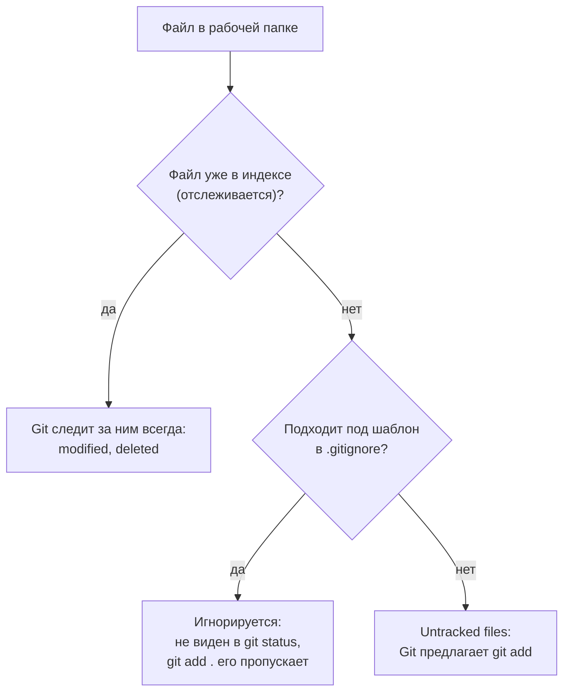
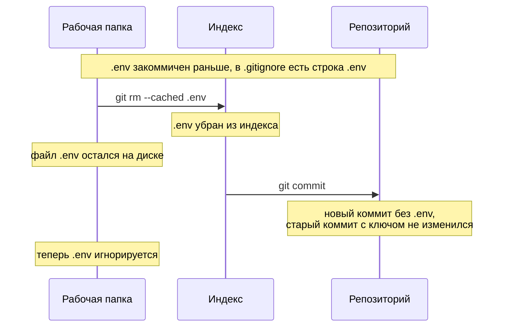
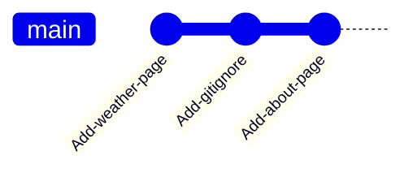

# Игнорирование файлов и порядок в проекте

[Содержание](../../README.md) · [← Назад](../../Lesson-4/ru/%D0%9E%D1%82%D0%BC%D0%B5%D0%BD%D0%B0%20%D0%B8%D0%B7%D0%BC%D0%B5%D0%BD%D0%B5%D0%BD%D0%B8%D0%B9.md) · [Вперёд →](../../Lesson-6/ru/%D0%92%D0%B5%D1%82%D0%BA%D0%B8.md) · [RU](%D0%98%D0%B3%D0%BD%D0%BE%D1%80%D0%B8%D1%80%D0%BE%D0%B2%D0%B0%D0%BD%D0%B8%D0%B5%20%D1%84%D0%B0%D0%B9%D0%BB%D0%BE%D0%B2%20%D0%B8%20%D0%BF%D0%BE%D1%80%D1%8F%D0%B4%D0%BE%D0%BA%20%D0%B2%20%D0%BF%D1%80%D0%BE%D0%B5%D0%BA%D1%82%D0%B5.md) · [EN](../en/Ignoring%20files%20and%20keeping%20the%20project%20tidy.md) · [UZ](../uz/Fayllarni%20e'tiborsiz%20qoldirish%20va%20loyihada%20tartib.md)

> **Связь с уроком 4:** вы научились отменять изменения - `git restore`, `git revert`, `git reset` - и запомнили правило: опубликованную историю не переписывают. Сегодня - о том, как не допустить ошибок заранее: что вообще не должно попадать в репозиторий, как сказать Git «не замечай эти файлы» и как держать проект в порядке.

---

## Зачем это вам

Студент сделал сайт с прогнозом погоды из курса JavaScript, выполнил `git add .` и отправил проект на GitHub. Вместе с сайтом в репозиторий попали:

```text
weather/
├── .env              ← ключ API: WEATHER_API_KEY=a1b2c3d4e5
├── node_modules/     ← 18 000 файлов чужих библиотек, 200 МБ
├── dist/             ← сжатая сборка, которую можно пересоздать
├── error.log         ← журнал ошибок с его компьютера
└── .DS_Store         ← служебный файл macOS
```

Через несколько минут программы-роботы, которые круглосуточно ищут ключи в публичных репозиториях, нашли ключ - и потратили весь лимит запросов. Коллеги не могут скачать репозиторий: он весит как фильм. Всё это решают один файл `.gitignore` и несколько команд из этого урока. Аккуратный репозиторий с `.gitignore` и `README.md` - первое, на что смотрит работодатель на вашем GitHub.

---

## Чему вы научитесь

- Перечислять, что нельзя хранить в Git: секреты, ключи API, зависимости, сборки, логи, системные файлы.
- Создавать файл `.gitignore` и проверять его через `git status`.
- Писать шаблоны: `*`, `?`, `папка/`, `/в-корне`, `**`, `!исключение`, `#комментарий`.
- Объяснять, почему `.gitignore` не действует на уже отслеживаемые файлы.
- Убирать файл из отслеживания командой `git rm --cached`, не удаляя его с диска.
- Понимать, что секрет, попавший в историю, остаётся в старых коммитах и его нужно сменить.
- Удалять и переименовывать файлы через `git rm` и `git mv`.
- Писать `README.md` и сохранять пустые папки с помощью `.gitkeep`.

---

## Повторение: 3 вопроса из урока 4

1. Чем `git restore index.html` отличается от `git restore --staged index.html`?
2. Чем `git revert` отличается от `git reset --hard HEAD~1`? Что из них можно делать с опубликованными коммитами?
3. Вы случайно выполнили `git reset --hard`. Какая команда поможет найти потерянный коммит?

Ответы - в конце урока.

---

## План урока

| Раздел | Что делаем |
| --- | --- |
| Что не хранить в Git | Секреты, зависимости, сборки, логи, системные файлы |
| Файл `.gitignore` | Создаём и проверяем через `git status` |
| Шаблоны | `*`, `?`, `/`, `**`, `!`, `#` - с таблицей примеров |
| Мини-задание 1 | Свой `.gitignore` для учебного проекта |
| Уже отслеживаемые файлы | `git rm --cached` и секрет в истории |
| `git rm` и `git mv` | Удаление и переименование «по правилам Git» |
| README и структура проекта | Визитная карточка репозитория, пустые папки и `.gitkeep` |
| Мини-задание 2 | Наводим порядок в репозитории блога |
| Самостоятельная работа | Задание в учебном терминале и на компьютере |

---

## Что не должно попадать в репозиторий

**Простыми словами:** репозиторий - это чемодан, который вы отдаёте другим людям. В него кладут то, что нужно для проекта: исходный код, картинки, стили. Но не кладут ключи от квартиры (пароли), мусор из карманов (логи) и то, что легко купить на месте (библиотеки, которые скачиваются одной командой).

| Что | Примеры | Почему не хранить |
| --- | --- | --- |
| Секреты | `.env`, `config.env`, файлы с паролями, ключи API, `*.pem` | Любой, кто видит репозиторий, получит доступ к вашим сервисам и деньгам |
| Зависимости | `node_modules/`, `vendor/` | Тысячи чужих файлов; восстанавливаются командой `npm install` по файлу `package.json` |
| Сборки | `dist/`, `build/`, `*.min.js` | Создаются автоматически из исходников; меняются при каждой сборке |
| Логи и временные файлы | `*.log`, `*.tmp`, `logs/` | Журнал работы программы на вашем компьютере, другим не нужен |
| Системные файлы | `.DS_Store` (macOS), `Thumbs.db` (Windows) | Создаются операционной системой, к проекту отношения не имеют |
| Настройки редактора | `.idea/`, личные настройки `.vscode/` | У каждого разработчика свои |

> **Важно:** если файл можно **пересоздать** командой или он **личный** (ваш пароль, ваша система, ваш редактор) - ему не место в Git. А исходный код, картинки сайта, `package.json`, `README.md` и сам `.gitignore` коммитят.

---

## Файл `.gitignore`

`.gitignore` - обычный текстовый файл в корне проекта. В каждой строке - **шаблон**: какие файлы Git должен не замечать. Имя начинается с точки, поэтому файл скрытый: его видно в `ls -a`.

Возьмём проект `site` с одним коммитом. В нём уже закоммичены `index.html`, `style.css` и - по ошибке - `.env` с ключом (с ним разберёмся позже). Появился мусор: библиотеки, сборка, лог и файл macOS.

```bash
git status
```

```text
On branch main
Untracked files:
  (use "git add <file>..." to include in what will be committed)
	.DS_Store
	dist/
	error.log
	node_modules/

nothing added to commit but untracked files present (use "git add" to track)
```

Если сейчас выполнить `git add .`, всё это попадёт в следующий коммит. Создадим `.gitignore` командой `cat` из урока 2:

```bash
cat > .gitignore << 'EOF'
node_modules/
dist/
*.log
.env
.DS_Store
EOF
git status
```

```text
On branch main
Untracked files:
  (use "git add <file>..." to include in what will be committed)
	.gitignore

nothing added to commit but untracked files present (use "git add" to track)
```

| Строка | Перевод и смысл |
| --- | --- |
| `Untracked files:` | Неотслеживаемые файлы - теперь в списке только один |
| `.gitignore` | Сам файл правил. Его **нужно** закоммитить, чтобы правила работали у всех участников проекта |
| `.DS_Store`, `dist/`, `error.log`, `node_modules/` | Исчезли из списка, но не с диска (`ls -a` их покажет): Git их видит, но по правилам молча пропускает |

**Простыми словами:** `.gitignore` - это табличка «Не убирать» на столе. Уборщица (Git) видит вещи под табличкой, но не складывает их в коробку для переезда (коммит).



**Как читать схему.** Сначала Git проверяет, отслеживается ли файл. Только для **неотслеживаемых** файлов он заглядывает в `.gitignore`. Поэтому `.gitignore` бессилен против файла, который уже закоммичен, - это главная ловушка урока, к ней мы вернёмся в разделе про `git rm --cached`.

### Если очень нужно: `git add -f`

Игнорируемый файл нельзя добавить случайно - Git откажет:

```bash
git add error.log
```

```text
The following paths are ignored by one of your .gitignore files:
error.log
hint: Use -f if you really want to add them.
hint: Disable this message with "git config set advice.addIgnoredFile false"
```

Перевод: «эти пути игнорируются одним из ваших файлов `.gitignore`; используйте `-f` (force - «принудительно»), если действительно хотите их добавить». Последняя строка - как отключить подсказку.

`git add -f error.log` добавит файл вопреки правилам. Пользуйтесь этим редко и осознанно: после такого добавления файл становится отслеживаемым, и `.gitignore` на него больше не действует.

---

## Синтаксис шаблонов

**Простыми словами:** шаблон - это фоторобот файла. Не обязательно знать точное имя: достаточно примет - «оканчивается на `.log`», «лежит в папке `dist`».

| Шаблон | Что значит | Подходит | Не подходит |
| --- | --- | --- | --- |
| `secret.txt` | Файл с таким именем в **любой** папке | `secret.txt`, `config/secret.txt` | `secret.txt.bak` |
| `*.log` | `*` - любое количество любых символов | `error.log`, `logs/server.log` | `log.txt` |
| `temp?.txt` | `?` - ровно один любой символ | `temp1.txt`, `tempA.txt` | `temp12.txt`, `temp.txt` |
| `build/` | `/` в конце - только **папка** с таким именем и всё внутри | `build/app.js`, `src/build/x.js` | файл с именем `build` |
| `/todo.txt` | `/` в начале - только в **корне** проекта | `todo.txt` | `docs/todo.txt` |
| `docs/*.pdf` | Слеш в середине - путь от корня; `*` не проходит через `/` | `docs/a.pdf` | `docs/sub/b.pdf` |
| `**/cache` | `**` - любое число папок (и ноль) | `cache/x`, `a/b/cache/y` | `cached/x` |
| `logs/**` | Всё внутри `logs`, на любой глубине | `logs/x/y.txt` | `logs.txt` |
| `!important.log` | `!` - **исключение**: не игнорировать, даже если подошло правило выше | `important.log` остаётся видимым | |
| `# логи` | `#` - комментарий, Git пропускает строку (пустые строки - тоже) | | |

### Исключения `!` и порядок правил

Git читает `.gitignore` сверху вниз, и для каждого файла **побеждает последнее подходящее правило**. Проверим на проекте `shop`, где лежат `app.js`, `error.log`, `important.log`, `logs/access.log`, `todo.txt` и `docs/todo.txt`:

```bash
cat > .gitignore << 'EOF'
# все логи, кроме одного
*.log
!important.log
# только todo.txt в корне
/todo.txt
EOF
git status -s
```

```text
?? .gitignore
?? app.js
?? docs/
?? important.log
```

| Строка | Перевод и смысл |
| --- | --- |
| `?? important.log` | `*.log` его скрыл, но следующее правило `!important.log` вернуло |
| `error.log` и `logs/` - нет в списке | Оба подошли под `*.log`. Папка `logs/` пропала целиком: все файлы в ней игнорируются |
| `?? docs/` | В `docs` лежит `docs/todo.txt` - правило `/todo.txt` касается только корня |
| `todo.txt` - нет в списке | Корневой `todo.txt` скрыт правилом `/todo.txt` |

> **Важно:** исключение не работает внутри игнорируемой **папки**. Если написать `logs/` и `!logs/keep.log`, файл останется скрытым: Git даже не заглядывает в папку `logs`. Правильно - игнорировать содержимое, а не папку: `logs/*` и затем `!logs/keep.log`.

### Готовые шаблоны и `.gitignore` для всего компьютера

Писать `.gitignore` с нуля не обязательно. На GitHub есть официальная коллекция шаблонов для разных языков и инструментов: [github.com/github/gitignore](https://github.com/github/gitignore) - например, `Node.gitignore` для проектов с `npm`. При создании репозитория на GitHub (урок 8) шаблон можно выбрать из списка. Системные файлы вроде `.DS_Store` можно один раз прописать в личном файле игнорирования для всего компьютера (настройка `core.excludesFile`), но в `.gitignore` проекта их всё равно добавляют: коллеги могли эту настройку не сделать.

---

## Мини-задание 1

В учебном терминале:

1. Создайте папку `practice-ignore`, перейдите в неё и создайте репозиторий.
2. Создайте файлы `app.js`, `debug.log`, `logs/server.log`, `build/app.min.js`, `notes.txt` и `docs/notes.txt` (любой текст через `echo`) и посмотрите `git status -s`.
3. Создайте `.gitignore`, который скрывает все логи, папку `build` и только **корневой** `notes.txt`. Добавьте комментарии `#`.
4. Снова `git status -s`: в списке должны остаться `.gitignore`, `app.js` и `docs/`.
5. Создайте `keep.log` и допишите в `.gitignore` исключение для него. Проверьте, что `keep.log` появился в `git status -s`.

---

## Уже отслеживаемые файлы: `git rm --cached`

Вернёмся к проекту `site`. Файл `.env` с ключом был закоммичен **до** появления `.gitignore`. Строка `.env` в `.gitignore` есть, но поменяем ключ в файле и посмотрим:

```bash
echo "WEATHER_API_KEY=new-key-777" > .env
git status
```

```text
On branch main
Changes not staged for commit:
  (use "git add <file>..." to update what will be committed)
  (use "git restore <file>..." to discard changes in working directory)
	modified:   .env

Untracked files:
  (use "git add <file>..." to include in what will be committed)
	.gitignore

no changes added to commit (use "git add" and/or "git commit -a")
```

`modified:   .env` - Git по-прежнему следит за `.env` и видит изменение: `.gitignore` не помог. Почему так: `.gitignore` - это фильтр для **новых** файлов. Файл, который уже лежит в индексе, отслеживается всегда (вспомните схему выше). Чтобы Git перестал за ним следить, файл нужно убрать из индекса.

**Простыми словами:** `.gitignore` - табличка «Посторонним вход воспрещён» на двери. Она останавливает новых посетителей, но не выгоняет тех, кто уже вошёл. Того, кто внутри, нужно вывести отдельно - это и делает `git rm --cached`.

```bash
git rm --cached .env
git status
```

```text
rm '.env'
On branch main
Changes to be committed:
  (use "git restore --staged <file>..." to unstage)
	deleted:    .env

Untracked files:
  (use "git add <file>..." to include in what will be committed)
	.gitignore
```

| Строка | Перевод и смысл |
| --- | --- |
| `rm '.env'` | Git убрал `.env` из индекса. `--cached` значит «только из индекса» (индекс раньше называли cache - «кэш»). Файл на диске остался - проверьте `ls -a` |
| `deleted:    .env` | В следующем коммите `.env` будет **удалён из репозитория** - но не с диска |
| `.env` нет в `Untracked files` | Теперь файл неотслеживаемый, а значит, `.gitignore` наконец действует |

Закоммитим правила и удаление вместе:

```bash
git add .gitignore
git commit -m "Add .gitignore, stop tracking .env"
git status
```

```text
[main bb4e781] Add .gitignore, stop tracking .env
 2 files changed, 5 insertions(+), 1 deletion(-)
 create mode 100644 .gitignore
 delete mode 100644 .env
On branch main
nothing to commit, working tree clean
```

`create mode` - файл правил добавлен, `delete mode` - `.env` удалён из репозитория начиная с этого коммита. `working tree clean` - чисто: мусор и `.env` лежат на диске, но Git их игнорирует.

Пошагово, где находится `.env`:

| Шаг | Команда | Рабочая папка | Индекс | Репозиторий |
| --- | --- | --- | --- | --- |
| 1 | (до урока) | `.env` со старым ключом | `.env` | коммит `bd5aeb4` с `.env` |
| 2 | `echo "...new-key-777" > .env` | `.env` с новым ключом | старая версия `.env` | без изменений |
| 3 | `git rm --cached .env` | `.env` на месте | **нет** `.env` | без изменений |
| 4 | `git commit -m "..."` | `.env` на месте | нет `.env` | новый коммит `bb4e781` **без** `.env`; в `bd5aeb4` он остался |



**Как читать схему.** `git rm --cached` действует только на индекс: рабочая папка не меняется. Коммит фиксирует «файла больше нет в проекте», и с этого момента `.gitignore` скрывает `.env`. Обратите внимание на последнюю заметку у репозитория - о ней следующий раздел.

### Секрет в истории остаётся

Вы знаете из урока 2: коммит - это снимок, а снимки не меняются. Новый коммит не стирает старый. Проверим командой из урока 3:

```bash
git log --oneline
git show HEAD~1:.env
```

```text
bb4e781 (HEAD -> main) Add .gitignore, stop tracking .env
bd5aeb4 Add weather page
WEATHER_API_KEY=a1b2c3d4e5
```

Старый ключ виден всем, у кого есть копия репозитория.



**Как читать схему.** Ключ попал в первый коммит `Add-weather-page`. Коммит `Add-gitignore` и все следующие (например, будущий `Add-about-page`) его уже не содержат, но первый никуда не делся: он - часть истории, и `git show` или `git log -p` покажут ключ любому.

> **Важно:** если пароль или ключ хоть раз попал в коммит, считайте его **украденным**. Сразу смените пароль или создайте новый ключ API в сервисе, а старый отключите. `git rm --cached` только защищает будущие коммиты. Удалить файл из всей истории можно специальными инструментами (например, `git filter-repo`), но это переписывание истории - то, что нельзя делать с опубликованными коммитами без договорённости с командой (урок 4). К тому же копии репозитория у других людей уже существуют. GitHub умеет находить известные виды ключей в коммитах и предупреждать о них, но надеяться на это нельзя.

---

## `git rm` и `git mv`

### `git rm`: удалить файл из проекта

Для этого раздела возьмём учебный репозиторий, где закоммичены `index.html`, `old.html`, `contacts.htm` и папка `build/`.

**Простыми словами:** `rm` - выбросить листок из папки. `git rm` - выбросить листок **и** сделать пометку в описи: «больше не храним». Без пометки Git увидит пропажу и будет каждый раз спрашивать, что с ней делать.

```bash
git rm old.html
git status
ls
```

```text
rm 'old.html'
On branch main
Changes to be committed:
  (use "git restore --staged <file>..." to unstage)
	deleted:    old.html
build  contacts.htm  index.html
```

`rm 'old.html'` - файл удалён и с диска (его нет в `ls`), и из индекса. `deleted:` в `Changes to be committed` - удаление уже подготовлено, осталось `git commit`.

Если файл изменён и изменения не закоммичены, Git защитит вас от потери работы:

```bash
echo "<p>Phone</p>" >> contacts.htm
git rm contacts.htm
```

```text
error: the following file has local modifications:
    contacts.htm
(use --cached to keep the file, or -f to force removal)
```

Перевод: «у файла есть локальные изменения; используйте `--cached`, чтобы сохранить файл, или `-f`, чтобы удалить принудительно». Отменим правку командой `git restore contacts.htm` из урока 4.

| Команда | Диск | Индекс | Когда использовать |
| --- | --- | --- | --- |
| `rm файл` | удалён | остался - `git status` покажет `deleted` в `Changes not staged` | Не рекомендуется: нужен ещё `git add` или `git rm` |
| `git rm файл` | удалён | удалён | Файл больше не нужен проекту |
| `git rm --cached файл` | **остался** | удалён | Файл нужен вам, но не должен быть в Git |
| `git rm -r --cached папка` | осталась | удалена | То же для папки |

Для папки (`build/`, `node_modules/`) нужен ключ `-r` (recursive - «со всем содержимым»). Без него Git ответит `fatal: not removing 'build' recursively without -r`.

### `git mv`: переименовать или переместить

Старые сайты часто содержат файлы с расширением `.htm`. Переименуем `contacts.htm` в `contacts.html`:

```bash
git mv contacts.htm contacts.html
git status
git commit -m "Rename contacts page"
```

```text
On branch main
Changes to be committed:
  (use "git restore --staged <file>..." to unstage)
	renamed:    contacts.htm -> contacts.html
[main 82a9f55] Rename contacts page
 1 file changed, 0 insertions(+), 0 deletions(-)
 rename contacts.htm => contacts.html (100%)
```

| Строка | Перевод и смысл |
| --- | --- |
| `renamed:    contacts.htm -> contacts.html` | Переименование уже в индексе |
| `0 insertions(+), 0 deletions(-)` | Содержимое не менялось - только имя |
| `rename ... (100%)` | Новый файл совпадает со старым на 100%: Git понял, что это тот же файл |

А если переименовать обычной командой `mv`? Git увидит две отдельные перемены:

| Шаг | Команда | Что показывает `git status` |
| --- | --- | --- |
| 1 | `mv index.html home.html` | `deleted: index.html` (не в индексе) и `Untracked files: home.html` |
| 2 | `git add .` | `renamed: index.html -> home.html` - Git сам сопоставил удалённый и новый файл |
| 3 | `git commit -m "..."` | Чисто |

Итог одинаковый: `git mv` - это `mv` плюс `git add` для старого и нового имени одной командой. Git не хранит «факт переименования»: он сравнивает содержимое и сам догадывается, что файл тот же. Поэтому лучше не переименовывать файл и сильно менять его в одном коммите - сначала переименование, потом правки.

> **Важно:** на Windows и macOS имена файлов обычно не различают регистр: `Index.html` и `index.html` - один файл. Чтобы поменять только регистр букв, используйте `git mv Index.html index.html`, а не проводник.

---

## README и структура проекта

### `README.md` - визитная карточка

`README.md` - файл с описанием проекта в формате Markdown. GitHub показывает его прямо под списком файлов, поэтому это первое, что прочитает гость вашего репозитория.

**Простыми словами:** README - это табличка у входа в музей: что здесь, как пройти и кто автор. Без неё посетитель видит только запертые двери с номерами.

```bash
cat > README.md << 'EOF'
# Weather

Weather forecast website: HTML, CSS and JavaScript.
Open index.html in a browser. Author: Anna Karimova.
EOF
```

Что обычно пишут в README: заголовок `#` и одну фразу о проекте, как его запустить, что он умеет (можно со снимком экрана), технологии, автора и контакты.

### Порядок в папках

Аккуратный проект из курсов HTML, CSS и JavaScript выглядит так:

```text
weather/
├── .gitignore
├── README.md
├── index.html
├── about.html
├── css/
│   └── style.css
├── js/
│   └── main.js
└── images/
    └── .gitkeep
```

Всё, чего нет на рисунке, - `.env`, `node_modules/`, `dist/`, логи, `.DS_Store` - лежит у вас на диске, но перечислено в `.gitignore`.

### Пустые папки и `.gitkeep`

Git хранит только **файлы**, а папки - лишь как часть пути к файлу. Пустую папку Git не видит:

```bash
mkdir images
git status
touch images/.gitkeep
git status
```

```text
On branch main
nothing to commit, working tree clean
On branch main
Untracked files:
  (use "git add <file>..." to include in what will be committed)
	images/

nothing added to commit but untracked files present (use "git add" to track)
```

Первый `git status` - чисто: пустую `images` Git не заметил. Чтобы папка попала в репозиторий, в неё кладут пустой файл `.gitkeep` (команда `touch` создаёт пустой файл) - и второй `git status` уже видит `images/`. Теперь `git add images/.gitkeep` и коммит. `.gitkeep` - не команда и не настройка Git, а договорённость разработчиков: подошёл бы любой файл, но это имя всем понятно. Когда в папке появятся настоящие файлы, `.gitkeep` можно удалить через `git rm`.

---

### Попробуйте сломать

1. Создайте `.gitignore` со строкой `*.log`, а затем выполните `git add debug.log`. Что ответит Git? А `git add -f debug.log`?
2. Закоммитьте файл `secret.txt`, потом добавьте его в `.gitignore` и измените файл. Пропал ли он из `git status`?
3. Выполните `git rm` для изменённого файла без `--cached`. Какое сообщение покажет Git и какие два выхода предложит?
4. Напишите в `.gitignore` строки `logs/` и `!logs/keep.log`. Виден ли `logs/keep.log` в `git status`? Замените первую строку на `logs/*`.
5. Создайте пустую папку и проверьте `git status`. Положите в неё `.gitkeep` и проверьте снова.

### Частые ошибки новичков

| Ошибка | Что получится | Как исправить |
| --- | --- | --- |
| `git add .` до создания `.gitignore` | В коммит попадают `node_modules/`, логи, сборка | `.gitignore` - **первым** файлом в проекте; попавшее - `git rm -r --cached папка` |
| Добавили в `.gitignore` уже закоммиченный файл | `modified: config.env` - Git продолжает следить | `git rm --cached config.env` и коммит |
| `git rm config.env` вместо `git rm --cached` | Файл удалён и с диска | Вернуть: `git restore --staged config.env`, затем `git restore config.env` |
| Удалили секрет новым коммитом и успокоились | Секрет виден в старом коммите: `git show HEAD~1:config.env` | Сменить пароль или ключ |
| Опечатка в шаблоне: `node_module/` | `node_modules/` снова в `Untracked files` | Проверять `.gitignore` через `git status` |
| `.gitignore` не закоммичен | У коллег правила не работают, у вас в `git status` висит `.gitignore` | `git add .gitignore` и коммит |
| Строки `.gitignore` через `echo "..." >` | Каждая строка затирает предыдущую, в файле одно правило | Первая строка - `>`, остальные - `>>`; удобнее `cat > .gitignore << 'EOF'` |
| `echo "!keep.log" >> .gitignore` в настоящем терминале | `bash: !keep.log: event not found` - в двойных кавычках `!` значит «повтори команду из истории» | Одинарные кавычки: `echo '!keep.log' >> .gitignore` |
| Исключение внутри игнорируемой папки: `logs/` и `!logs/keep.log` | `keep.log` всё равно скрыт | `logs/*` вместо `logs/` |

---

## Мини-задание 2

В учебном терминале:

1. Создайте репозиторий `blog` с файлами `index.html`, `post.htm` и `secret.txt` (текст `password=12345`) и закоммитьте всё: `Add blog pages`.
2. Спохватились: `secret.txt` не должен быть в Git. Добавьте его в `.gitignore`, уберите из отслеживания, оставив на диске, и закоммитьте.
3. Переименуйте `post.htm` в `post.html` средствами Git и закоммитьте.
4. Создайте `README.md` (заголовок и строка описания) и пустую папку `images` с файлом `.gitkeep`. Закоммитьте оба файла одним коммитом.
5. Проверьте `git status` (должно быть чисто), `git log --oneline` (4 коммита) и `ls` (`secret.txt` на месте).

---

## Итоги урока: шпаргалка

| Задача | Команда |
| --- | --- |
| Создать `.gitignore` | `cat > .gitignore << 'EOF'` ... `EOF` |
| Дописать правило | `echo 'dist/' >> .gitignore` |
| Шаблоны | `*.log`, `temp?.txt`, `build/`, `/todo.txt`, `**/cache`, `!keep.log`, `# комментарий` |
| Добавить игнорируемый файл принудительно | `git add -f файл` |
| Перестать отслеживать файл, оставить на диске | `git rm --cached файл` |
| То же для папки | `git rm -r --cached папка` |
| Удалить файл из проекта | `git rm файл` |
| Переименовать или переместить | `git mv старое новое` |
| Сохранить пустую папку | `touch папка/.gitkeep` |
| Секрет попал в коммит | Сменить пароль или ключ, затем `git rm --cached` и коммит |
| Готовые шаблоны | [github.com/github/gitignore](https://github.com/github/gitignore) |

---

## Самостоятельная работа

### Часть 1. Задание в IDE (засчитывается платформой)

Вы в папке `~/portfolio`. В истории уже есть 3 коммита, и в одном из них по ошибке закоммичен `config.env` с паролем базы данных. Рядом лежит мусор: `node_modules/`, `dist/`, `debug.log`, `.DS_Store`. Напишите команды по одной на строке:

1. Посмотрите состояние репозитория.
2. Создайте `.gitignore`, который скрывает `node_modules/`, `dist/`, все файлы `*.log`, файлы секретов `.env` и `config.env` и `.DS_Store` в любой папке.
3. Уберите `config.env` из отслеживания так, чтобы файл остался на диске.
4. Создайте `README.md`: первая строка - заголовок `# Portfolio`, ниже строка с описанием проекта.
5. Переименуйте `about.htm` в `about.html` средствами Git.
6. Добавьте `.gitignore` и `README.md` в индекс и сделайте коммит.
7. Убедитесь, что рабочая папка чистая. Прошлые коммиты не меняйте.

Что проверяет платформа: что `.gitignore` закоммичен и скрывает зависимости, сборку, логи в любой папке, `.env`, `config.env` и `.DS_Store`, но не скрывает нужные файлы (`index.html`, `css/style.css`, `README.md`); что `config.env` убран из индекса и последнего коммита, но остался на диске с прежним содержимым; что мусор не попал в коммит; что `README.md` с заголовком и описанием закоммичен; что `about.htm` переименован в `about.html`; что старые коммиты на месте; что рабочая папка чистая. Отдельный тест запускает ваши команды на другом проекте, где вместо `debug.log` лежат `.env` и `logs/error.log`, - правила должны сработать и там.

### Часть 2. Проект на компьютере

1. Откройте репозиторий своего сайта из урока 1 и посмотрите `git status` и `git ls-files` (список отслеживаемых файлов): нет ли там лишнего?
2. Создайте `.gitignore` для своего проекта - возьмите за основу шаблон `Node.gitignore` с [github.com/github/gitignore](https://github.com/github/gitignore) и добавьте `.DS_Store`, `*.log`, `.env`. Закоммитьте его.
3. Если что-то лишнее уже отслеживается - уберите через `git rm --cached` (для папок `-r`). Если среди этого был пароль или ключ - смените его в сервисе.
4. В настоящем Git есть команда-помощник `git check-ignore -v файл`: она показывает, какая строка `.gitignore` скрывает файл. Проверьте ею пару своих файлов.
5. Напишите `README.md` для сайта (что это, как открыть, автор), при необходимости переименуйте файлы через `git mv` и закоммитьте.

### Критерии готовности

- [ ] Задание в IDE засчитано.
- [ ] В вашем репозитории есть закоммиченный `.gitignore`, и `git status` не показывает мусор.
- [ ] `git ls-files` не содержит секретов, `node_modules/`, сборок и логов.
- [ ] В репозитории есть `README.md` с описанием проекта.
- [ ] Вы можете объяснить, почему после `git rm --cached` пароль нужно сменить.

---

## Вопросы для самопроверки

1. Какие пять видов файлов не хранят в Git? Приведите пример каждого.
2. Что делает файл `.gitignore` и нужно ли его коммитить?
3. Чем отличаются шаблоны `build/`, `/build` и `build`?
4. Что означают `*`, `?` и `**` в шаблонах?
5. Как работает `!` и почему `!logs/keep.log` не сработает после строки `logs/`?
6. Почему `.gitignore` не действует на уже закоммиченный файл? Что сделать?
7. Чем `git rm файл` отличается от `git rm --cached файл`?
8. Пароль попал в коммит, вы сделали `git rm --cached` и новый коммит. Пароль в безопасности? Почему?
9. Чем `git mv` отличается от обычного `mv`?
10. Зачем нужны `README.md` и `.gitkeep`?

После вопросов пройдите **тест урока** на платформе: 12 вопросов, порог 70%.

---

## Что дальше

Теперь ваш проект аккуратен: только нужные файлы, описание и чистая история. До сих пор все коммиты шли друг за другом в одну линию. В уроке 6 вы узнаете, как работать над несколькими задачами параллельно, не мешая основной версии сайта, - с помощью **веток**: `git branch`, `git switch -c` и граф истории `git log --graph`.

---

## Ответы

**Повторение**

1. `git restore index.html` отменяет изменения файла в рабочей папке (возвращает версию из индекса). `git restore --staged index.html` убирает файл из индекса, а изменения в рабочей папке остаются.
2. `git revert` создаёт новый коммит, отменяющий старый, - история не переписывается, это безопасно для опубликованных коммитов. `git reset --hard HEAD~1` выбрасывает коммит из ветки и изменения из рабочей папки - только для неопубликованных коммитов.
3. `git reflog` - в нём виден хеш потерянного коммита, к которому можно вернуться.

**Мини-задание 1**

```bash
mkdir practice-ignore && cd practice-ignore && git init
mkdir logs build docs
echo "console.log(1)" > app.js && echo "error" > debug.log
echo "started" > logs/server.log && echo "min" > build/app.min.js
echo "my notes" > notes.txt && echo "docs" > docs/notes.txt
git status -s
cat > .gitignore << 'EOF'
# logs
*.log
# build
build/
# notes only in root
/notes.txt
EOF
git status -s
echo "keep" > keep.log
echo '!keep.log' >> .gitignore
git status -s
```

**Мини-задание 2**

```bash
mkdir blog && cd blog && git init
echo "<h1>My blog</h1>" > index.html
echo "<h2>First post</h2>" > post.htm
echo "password=12345" > secret.txt
git add . && git commit -m "Add blog pages"
echo "secret.txt" > .gitignore
git rm --cached secret.txt
git add .gitignore && git commit -m "Stop tracking secret.txt"
git mv post.htm post.html && git commit -m "Rename post page"
cat > README.md << 'EOF'
# My blog

Simple blog built with HTML and CSS.
EOF
mkdir images && touch images/.gitkeep
git add README.md images/.gitkeep && git commit -m "Add README and images folder"
git status
git log --oneline
ls
```

**Вопросы для самопроверки**

1. Секреты (`.env`, пароли, ключи API), зависимости (`node_modules/`), сборки (`dist/`), логи (`*.log`), системные файлы (`.DS_Store`), а также личные настройки редактора (`.idea/`).
2. Перечисляет шаблоны файлов, которые Git не должен замечать среди неотслеживаемых. Коммитить нужно - тогда правила работают у всех участников.
3. `build/` - только папка `build` в любом месте; `/build` - файл или папка `build` только в корне; `build` - файл или папка с таким именем в любом месте.
4. `*` - любое количество любых символов (кроме `/`), `?` - ровно один символ, `**` - любое количество папок.
5. `!` отменяет игнорирование для подходящих файлов; побеждает последнее подходящее правило. Если игнорируется вся папка, Git в неё не заглядывает, и исключение для файла внутри не работает - нужно `logs/*`.
6. `.gitignore` проверяется только для неотслеживаемых файлов. Закоммиченный файл нужно убрать из индекса: `git rm --cached файл` и коммит.
7. `git rm` удаляет файл и с диска, и из индекса; `git rm --cached` - только из индекса, файл остаётся на диске.
8. Нет: старый коммит с паролем остался в истории, и его можно увидеть через `git show`. Пароль нужно сменить.
9. `git mv` переименовывает файл и сразу добавляет переименование в индекс. После `mv` нужно ещё `git add` для старого и нового имени.
10. `README.md` описывает проект, GitHub показывает его на странице репозитория. `.gitkeep` - пустой файл, чтобы Git сохранил пустую папку.

---

[Содержание](../../README.md) · [← Назад](../../Lesson-4/ru/%D0%9E%D1%82%D0%BC%D0%B5%D0%BD%D0%B0%20%D0%B8%D0%B7%D0%BC%D0%B5%D0%BD%D0%B5%D0%BD%D0%B8%D0%B9.md) · [Вперёд →](../../Lesson-6/ru/%D0%92%D0%B5%D1%82%D0%BA%D0%B8.md) · [RU](%D0%98%D0%B3%D0%BD%D0%BE%D1%80%D0%B8%D1%80%D0%BE%D0%B2%D0%B0%D0%BD%D0%B8%D0%B5%20%D1%84%D0%B0%D0%B9%D0%BB%D0%BE%D0%B2%20%D0%B8%20%D0%BF%D0%BE%D1%80%D1%8F%D0%B4%D0%BE%D0%BA%20%D0%B2%20%D0%BF%D1%80%D0%BE%D0%B5%D0%BA%D1%82%D0%B5.md) · [EN](../en/Ignoring%20files%20and%20keeping%20the%20project%20tidy.md) · [UZ](../uz/Fayllarni%20e'tiborsiz%20qoldirish%20va%20loyihada%20tartib.md)
