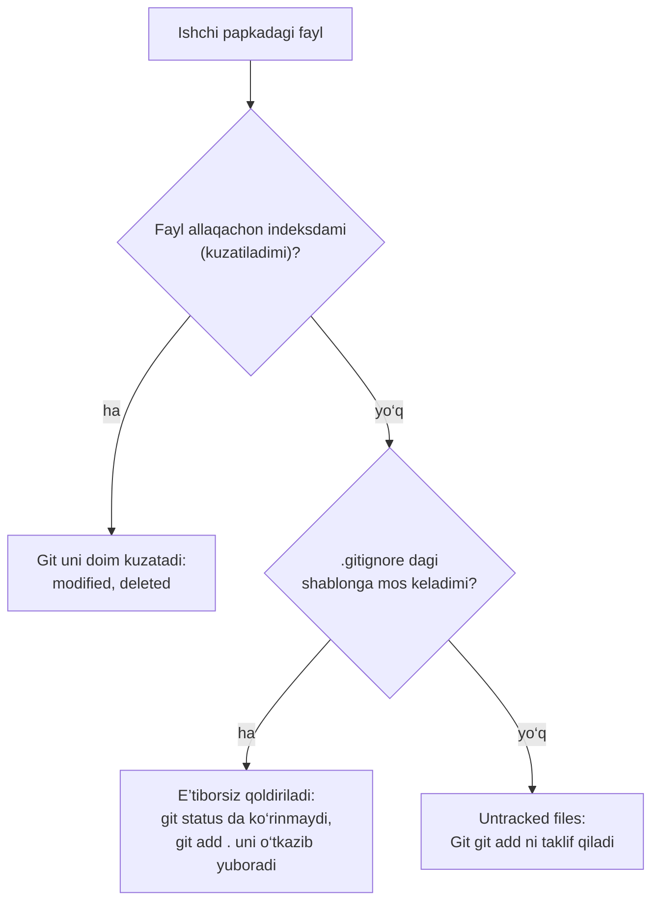
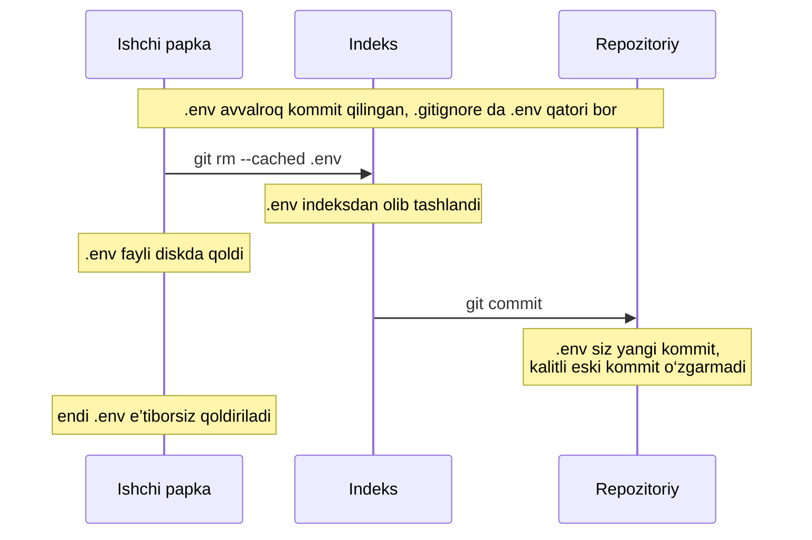
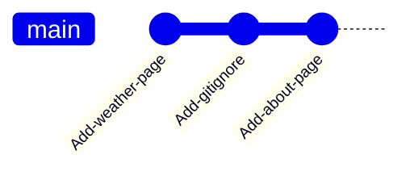

# Fayllarni e’tiborsiz qoldirish va loyihada tartib

[Mundarija](../../README.md) · [← Orqaga](../../Lesson-4/uz/O'zgarishlarni%20bekor%20qilish.md) · [Keyingi →](../../Lesson-6/uz/Tarmoqlar.md) · [RU](../ru/%D0%98%D0%B3%D0%BD%D0%BE%D1%80%D0%B8%D1%80%D0%BE%D0%B2%D0%B0%D0%BD%D0%B8%D0%B5%20%D1%84%D0%B0%D0%B9%D0%BB%D0%BE%D0%B2%20%D0%B8%20%D0%BF%D0%BE%D1%80%D1%8F%D0%B4%D0%BE%D0%BA%20%D0%B2%20%D0%BF%D1%80%D0%BE%D0%B5%D0%BA%D1%82%D0%B5.md) · [EN](../en/Ignoring%20files%20and%20keeping%20the%20project%20tidy.md) · [UZ](Fayllarni%20e'tiborsiz%20qoldirish%20va%20loyihada%20tartib.md)

> **4-dars bilan bog‘liqlik:** siz o‘zgarishlarni bekor qilishni o‘rgandingiz - `git restore`, `git revert`, `git reset` - va qoidani eslab qoldingiz: e’lon qilingan tarix qayta yozilmaydi. Bugun xatolarning oldini oldindan olish haqida: repozitoriyga umuman nima tushmasligi kerak, Git’ga «bu fayllarni sezma» deb qanday aytish va loyihani qanday tartibda saqlash.

---

## Bu sizga nima uchun kerak

Talaba JavaScript kursidagi ob-havo prognozi saytini yasadi, `git add .` ni bajardi va loyihani GitHub’ga yubordi. Sayt bilan birga repozitoriyga quyidagilar ham tushdi:

```text
weather/
├── .env              ← API kaliti: WEATHER_API_KEY=a1b2c3d4e5
├── node_modules/     ← begona kutubxonalarning 18 000 ta fayli, 200 MB
├── dist/             ← qayta yaratish mumkin bo‘lgan siqilgan yig‘ma
├── error.log         ← uning kompyuteridagi xatolar jurnali
└── .DS_Store         ← macOS xizmat fayli
```

Bir necha daqiqadan keyin ommaviy repozitoriylarda kun-u tun kalit qidiradigan robot-dasturlar kalitni topdi - va so‘rovlarning butun limitini sarflab yubordi. Hamkasblar repozitoriyni yuklab ololmaydi: u film kabi og‘ir. Bularning hammasini bitta `.gitignore` fayli va shu darsdagi bir nechta buyruq hal qiladi. `.gitignore` va `README.md` bor tartibli repozitoriy - ish beruvchi GitHub sahifangizda birinchi bo‘lib qaraydigan narsa.

---

## Nimani o‘rganasiz

- Git’da nimani saqlab bo‘lmasligini sanab berish: sirlar, API kalitlari, bog‘liqliklar, yig‘malar, loglar, tizim fayllari.
- `.gitignore` faylini yaratish va uni `git status` orqali tekshirish.
- Shablonlar yozish: `*`, `?`, `papka/`, `/ildizda`, `**`, `!istisno`, `#izoh`.
- `.gitignore` nima uchun allaqachon kuzatiladigan fayllarga ta’sir qilmasligini tushuntirish.
- Faylni diskdan o‘chirmasdan `git rm --cached` buyrug‘i bilan kuzatuvdan chiqarish.
- Tarixga tushgan sir eski kommitlarda qolishini va uni almashtirish kerakligini tushunish.
- Fayllarni `git rm` va `git mv` orqali o‘chirish va qayta nomlash.
- `README.md` yozish va bo‘sh papkalarni `.gitkeep` yordamida saqlash.

---

## Takrorlash: 4-darsdan 3 savol

1. `git restore index.html` buyrug‘i `git restore --staged index.html` dan nimasi bilan farq qiladi?
2. `git revert` buyrug‘i `git reset --hard HEAD~1` dan nimasi bilan farq qiladi? Ulardan qaysi birini e’lon qilingan kommitlar bilan qilish mumkin?
3. Siz tasodifan `git reset --hard` ni bajardingiz. Qaysi buyruq yo‘qolgan kommitni topishga yordam beradi?

Javoblar - dars oxirida.

---

## Reja

| Bo‘lim | Nima qilamiz |
| --- | --- |
| Git’da nimani saqlamaslik kerak | Sirlar, bog‘liqliklar, yig‘malar, loglar, tizim fayllari |
| `.gitignore` fayli | Yaratamiz va `git status` orqali tekshiramiz |
| Shablonlar | `*`, `?`, `/`, `**`, `!`, `#` - misollar jadvali bilan |
| Mini-topshiriq 1 | O‘quv loyihasi uchun o‘z `.gitignore` faylingiz |
| Allaqachon kuzatiladigan fayllar | `git rm --cached` va tarixdagi sir |
| `git rm` va `git mv` | «Git qoidalari bo‘yicha» o‘chirish va qayta nomlash |
| README va loyiha tuzilmasi | Repozitoriyning tashrif qog‘ozi, bo‘sh papkalar va `.gitkeep` |
| Mini-topshiriq 2 | Blog repozitoriysida tartib o‘rnatamiz |
| Mustaqil ish | O‘quv terminalidagi va kompyuterdagi topshiriq |

---

## Repozitoriyga nima tushmasligi kerak

**Oddiy so‘z bilan:** repozitoriy - boshqa odamlarga beradigan chamadoningiz. Unga loyiha uchun kerakli narsalar solinadi: dastlabki kod, rasmlar, stillar. Lekin unga uy kalitlari (parollar), cho‘ntakdagi axlat (loglar) va joyida oson sotib olinadigan narsalar (bitta buyruq bilan yuklab olinadigan kutubxonalar) solinmaydi.

| Nima | Misollar | Nima uchun saqlanmaydi |
| --- | --- | --- |
| Sirlar | `.env`, `config.env`, parolli fayllar, API kalitlari, `*.pem` | Repozitoriyni ko‘rgan har kim xizmatlaringiz va pullaringizga kirish huquqini oladi |
| Bog‘liqliklar | `node_modules/`, `vendor/` | Minglab begona fayllar; `package.json` fayli bo‘yicha `npm install` buyrug‘i bilan tiklanadi |
| Yig‘malar | `dist/`, `build/`, `*.min.js` | Dastlabki koddan avtomatik yaratiladi; har bir yig‘ishda o‘zgaradi |
| Loglar va vaqtinchalik fayllar | `*.log`, `*.tmp`, `logs/` | Dasturning kompyuteringizdagi ish jurnali, boshqalarga kerak emas |
| Tizim fayllari | `.DS_Store` (macOS), `Thumbs.db` (Windows) | Operatsion tizim yaratadi, loyihaga aloqasi yo‘q |
| Muharrir sozlamalari | `.idea/`, shaxsiy `.vscode/` sozlamalari | Har bir dasturchida o‘ziniki |

> **Muhim:** agar faylni buyruq bilan **qayta yaratish** mumkin bo‘lsa yoki u **shaxsiy** bo‘lsa (parolingiz, tizimingiz, muharriringiz) - unga Git’da joy yo‘q. Dastlabki kod, sayt rasmlari, `package.json`, `README.md` va `.gitignore` ning o‘zi esa kommit qilinadi.

---

## `.gitignore` fayli

`.gitignore` - loyiha ildizidagi oddiy matnli fayl. Har bir qatorda - **shablon**: Git qaysi fayllarni sezmasligi kerak. Nomi nuqta bilan boshlanadi, shuning uchun fayl yashirin: u `ls -a` da ko‘rinadi.

Bitta kommitli `site` loyihasini olamiz. Unda `index.html`, `style.css` va - xato tufayli - kalitli `.env` allaqachon kommit qilingan (u bilan keyinroq shug‘ullanamiz). Axlat paydo bo‘ldi: kutubxonalar, yig‘ma, log va macOS fayli.

```bash
git status
```

```text
On branch main
Untracked files:
  (use "git add <file>..." to include in what will be committed)
	.DS_Store
	dist/
	error.log
	node_modules/

nothing added to commit but untracked files present (use "git add" to track)
```

Agar hozir `git add .` ni bajarsak, bularning hammasi keyingi kommitga tushadi. 2-darsdagi `cat` buyrug‘i bilan `.gitignore` ni yaratamiz:

```bash
cat > .gitignore << 'EOF'
node_modules/
dist/
*.log
.env
.DS_Store
EOF
git status
```

```text
On branch main
Untracked files:
  (use "git add <file>..." to include in what will be committed)
	.gitignore

nothing added to commit but untracked files present (use "git add" to track)
```

| Qator | Tarjimasi va ma’nosi |
| --- | --- |
| `Untracked files:` | Kuzatilmaydigan fayllar - endi ro‘yxatda faqat bittasi |
| `.gitignore` | Qoidalar faylining o‘zi. Qoidalar loyihaning barcha ishtirokchilarida ishlashi uchun uni kommit qilish **kerak** |
| `.DS_Store`, `dist/`, `error.log`, `node_modules/` | Ro‘yxatdan yo‘qoldi, lekin diskdan emas (`ls -a` ularni ko‘rsatadi): Git ularni ko‘radi, ammo qoidalarga ko‘ra jimgina o‘tkazib yuboradi |

**Oddiy so‘z bilan:** `.gitignore` - stol ustidagi «Yig‘ishtirilmasin» yozuvi. Farrosh (Git) yozuv ostidagi narsalarni ko‘radi, lekin ularni ko‘chish qutisiga (kommitga) solmaydi.



**Sxemani qanday o‘qish kerak.** Avval Git fayl kuzatiladimi yoki yo‘qmi, shuni tekshiradi. Faqat **kuzatilmaydigan** fayllar uchun u `.gitignore` ga qaraydi. Shuning uchun `.gitignore` allaqachon kommit qilingan fayl oldida ojiz - bu darsning asosiy tuzog‘i, unga `git rm --cached` haqidagi bo‘limda qaytamiz.

### Juda zarur bo‘lsa: `git add -f`

E’tiborsiz qoldirilgan faylni tasodifan qo‘shib bo‘lmaydi - Git rad etadi:

```bash
git add error.log
```

```text
The following paths are ignored by one of your .gitignore files:
error.log
hint: Use -f if you really want to add them.
hint: Disable this message with "git config set advice.addIgnoredFile false"
```

Tarjimasi: «bu yo‘llar `.gitignore` fayllaringizdan biri tomonidan e’tiborsiz qoldirilgan; agar ularni haqiqatan qo‘shmoqchi bo‘lsangiz, `-f` dan (force - «majburan») foydalaning». Oxirgi qator - maslahatni qanday o‘chirish.

`git add -f error.log` faylni qoidalarga qaramay qo‘shadi. Bundan kamdan-kam va ongli ravishda foydalaning: bunday qo‘shishdan keyin fayl kuzatiladigan bo‘ladi va `.gitignore` unga endi ta’sir qilmaydi.

---

## Shablonlar sintaksisi

**Oddiy so‘z bilan:** shablon - faylning identifikatsion portreti. Aniq nomini bilish shart emas: belgilari yetarli - «`.log` bilan tugaydi», «`dist` papkasida yotadi».

| Shablon | Nimani bildiradi | Mos keladi | Mos kelmaydi |
| --- | --- | --- | --- |
| `secret.txt` | **Istalgan** papkadagi shu nomli fayl | `secret.txt`, `config/secret.txt` | `secret.txt.bak` |
| `*.log` | `*` - istalgan miqdordagi istalgan belgilar | `error.log`, `logs/server.log` | `log.txt` |
| `temp?.txt` | `?` - roppa-rosa bitta istalgan belgi | `temp1.txt`, `tempA.txt` | `temp12.txt`, `temp.txt` |
| `build/` | Oxiridagi `/` - faqat shu nomli **papka** va ichidagi hamma narsa | `build/app.js`, `src/build/x.js` | `build` nomli fayl |
| `/todo.txt` | Boshidagi `/` - faqat loyiha **ildizida** | `todo.txt` | `docs/todo.txt` |
| `docs/*.pdf` | O‘rtadagi slesh - ildizdan yo‘l; `*` `/` dan o‘tmaydi | `docs/a.pdf` | `docs/sub/b.pdf` |
| `**/cache` | `**` - istalgan sondagi papkalar (nol ham) | `cache/x`, `a/b/cache/y` | `cached/x` |
| `logs/**` | `logs` ichidagi hamma narsa, istalgan chuqurlikda | `logs/x/y.txt` | `logs.txt` |
| `!important.log` | `!` - **istisno**: yuqoridagi qoida mos kelgan bo‘lsa ham e’tiborsiz qoldirmaslik | `important.log` ko‘rinib qoladi | |
| `# loglar` | `#` - izoh, Git qatorni o‘tkazib yuboradi (bo‘sh qatorlarni ham) | | |

### `!` istisnolari va qoidalar tartibi

Git `.gitignore` ni yuqoridan pastga o‘qiydi va har bir fayl uchun **oxirgi mos kelgan qoida g‘olib bo‘ladi**. Buni `app.js`, `error.log`, `important.log`, `logs/access.log`, `todo.txt` va `docs/todo.txt` yotgan `shop` loyihasida tekshiramiz:

```bash
cat > .gitignore << 'EOF'
# bittasidan tashqari barcha loglar
*.log
!important.log
# faqat ildizdagi todo.txt
/todo.txt
EOF
git status -s
```

```text
?? .gitignore
?? app.js
?? docs/
?? important.log
```

| Qator | Tarjimasi va ma’nosi |
| --- | --- |
| `?? important.log` | `*.log` uni yashirdi, lekin keyingi `!important.log` qoidasi qaytardi |
| `error.log` va `logs/` - ro‘yxatda yo‘q | Ikkalasi ham `*.log` ga mos keldi. `logs/` papkasi butunlay yo‘qoldi: undagi barcha fayllar e’tiborsiz qoldiriladi |
| `?? docs/` | `docs` da `docs/todo.txt` yotibdi - `/todo.txt` qoidasi faqat ildizga tegishli |
| `todo.txt` - ro‘yxatda yo‘q | Ildizdagi `todo.txt` ni `/todo.txt` qoidasi yashirgan |

> **Muhim:** istisno e’tiborsiz qoldirilgan **papka** ichida ishlamaydi. Agar `logs/` va `!logs/keep.log` deb yozsangiz, fayl yashirin qoladi: Git `logs` papkasiga qaramaydi ham. To‘g‘risi - papkani emas, uning ichidagilarni e’tiborsiz qoldirish: `logs/*`, keyin esa `!logs/keep.log`.

### Tayyor shablonlar va butun kompyuter uchun `.gitignore`

`.gitignore` ni noldan yozish shart emas. GitHub’da turli tillar va vositalar uchun shablonlarning rasmiy to‘plami bor: [github.com/github/gitignore](https://github.com/github/gitignore) - masalan, `npm` li loyihalar uchun `Node.gitignore`. GitHub’da repozitoriy yaratishda (8-dars) shablonni ro‘yxatdan tanlash mumkin. `.DS_Store` kabi tizim fayllarini bir marta butun kompyuter uchun shaxsiy e’tiborsiz qoldirish fayliga yozib qo‘yish mumkin (`core.excludesFile` sozlamasi), lekin ular baribir loyihaning `.gitignore` fayliga qo‘shiladi: hamkasblar bu sozlamani qilmagan bo‘lishi mumkin.

---

## Mini-topshiriq 1

O‘quv terminalida:

1. `practice-ignore` papkasini yarating, unga o‘ting va repozitoriy yarating.
2. `app.js`, `debug.log`, `logs/server.log`, `build/app.min.js`, `notes.txt` va `docs/notes.txt` fayllarini yarating (`echo` orqali istalgan matn) va `git status -s` ni ko‘ring.
3. Barcha loglarni, `build` papkasini va faqat **ildizdagi** `notes.txt` ni yashiradigan `.gitignore` yarating. `#` izohlarini qo‘shing.
4. Yana `git status -s`: ro‘yxatda `.gitignore`, `app.js` va `docs/` qolishi kerak.
5. `keep.log` ni yarating va `.gitignore` ga u uchun istisno qo‘shing. `keep.log` `git status -s` da paydo bo‘lganini tekshiring.

---

## Allaqachon kuzatiladigan fayllar: `git rm --cached`

`site` loyihasiga qaytamiz. Kalitli `.env` fayli `.gitignore` paydo bo‘lishidan **oldin** kommit qilingan. `.gitignore` da `.env` qatori bor, lekin fayldagi kalitni o‘zgartirib ko‘ramiz:

```bash
echo "WEATHER_API_KEY=new-key-777" > .env
git status
```

```text
On branch main
Changes not staged for commit:
  (use "git add <file>..." to update what will be committed)
  (use "git restore <file>..." to discard changes in working directory)
	modified:   .env

Untracked files:
  (use "git add <file>..." to include in what will be committed)
	.gitignore

no changes added to commit (use "git add" and/or "git commit -a")
```

`modified:   .env` - Git avvalgidek `.env` ni kuzatadi va o‘zgarishni ko‘radi: `.gitignore` yordam bermadi. Nega shunday: `.gitignore` - **yangi** fayllar uchun filtr. Indeksda allaqachon yotgan fayl doim kuzatiladi (yuqoridagi sxemani eslang). Git uni kuzatishni to‘xtatishi uchun faylni indeksdan olib tashlash kerak.

**Oddiy so‘z bilan:** `.gitignore` - eshikdagi «Begonalarga kirish taqiqlanadi» yozuvi. U yangi tashrifchilarni to‘xtatadi, lekin allaqachon kirganlarni haydab chiqarmaydi. Ichkaridagini alohida olib chiqish kerak - buni `git rm --cached` qiladi.

```bash
git rm --cached .env
git status
```

```text
rm '.env'
On branch main
Changes to be committed:
  (use "git restore --staged <file>..." to unstage)
	deleted:    .env

Untracked files:
  (use "git add <file>..." to include in what will be committed)
	.gitignore
```

| Qator | Tarjimasi va ma’nosi |
| --- | --- |
| `rm '.env'` | Git `.env` ni indeksdan olib tashladi. `--cached` «faqat indeksdan» degani (indeks avval cache - «kesh» deb atalgan). Diskdagi fayl qoldi - `ls -a` bilan tekshiring |
| `deleted:    .env` | Keyingi kommitda `.env` **repozitoriydan o‘chiriladi** - lekin diskdan emas |
| `.env` `Untracked files` da yo‘q | Endi fayl kuzatilmaydi, demak, `.gitignore` nihoyat ta’sir qiladi |

Qoidalarni va o‘chirishni birga kommit qilamiz:

```bash
git add .gitignore
git commit -m "Add .gitignore, stop tracking .env"
git status
```

```text
[main bb4e781] Add .gitignore, stop tracking .env
 2 files changed, 5 insertions(+), 1 deletion(-)
 create mode 100644 .gitignore
 delete mode 100644 .env
On branch main
nothing to commit, working tree clean
```

`create mode` - qoidalar fayli qo‘shildi, `delete mode` - `.env` shu kommitdan boshlab repozitoriydan o‘chirildi. `working tree clean` - toza: axlat va `.env` diskda yotibdi, lekin Git ularni e’tiborsiz qoldiradi.

Qadamma-qadam, `.env` qayerda turibdi:

| Qadam | Buyruq | Ishchi papka | Indeks | Repozitoriy |
| --- | --- | --- | --- | --- |
| 1 | (darsdan oldin) | eski kalitli `.env` | `.env` | `.env` li `bd5aeb4` kommiti |
| 2 | `echo "...new-key-777" > .env` | yangi kalitli `.env` | `.env` ning eski versiyasi | o‘zgarishsiz |
| 3 | `git rm --cached .env` | `.env` joyida | `.env` **yo‘q** | o‘zgarishsiz |
| 4 | `git commit -m "..."` | `.env` joyida | `.env` yo‘q | `.env` **siz** yangi `bb4e781` kommiti; `bd5aeb4` da u qoldi |



**Sxemani qanday o‘qish kerak.** `git rm --cached` faqat indeksga ta’sir qiladi: ishchi papka o‘zgarmaydi. Kommit «fayl endi loyihada yo‘q» degan holatni qayd etadi va shu paytdan boshlab `.gitignore` `.env` ni yashiradi. Repozitoriy yonidagi oxirgi izohga e’tibor bering - keyingi bo‘lim u haqida.

### Tarixdagi sir qoladi

2-darsdan bilasiz: kommit - bu surat, suratlar esa o‘zgarmaydi. Yangi kommit eskisini o‘chirmaydi. 3-darsdagi buyruq bilan tekshiramiz:

```bash
git log --oneline
git show HEAD~1:.env
```

```text
bb4e781 (HEAD -> main) Add .gitignore, stop tracking .env
bd5aeb4 Add weather page
WEATHER_API_KEY=a1b2c3d4e5
```

Eski kalit repozitoriy nusxasi bor hammaga ko‘rinadi.



**Sxemani qanday o‘qish kerak.** Kalit birinchi `Add-weather-page` kommitiga tushgan. `Add-gitignore` kommiti va undan keyingilar (masalan, kelajakdagi `Add-about-page`) uni endi o‘z ichiga olmaydi, lekin birinchisi hech qayerga ketmagan: u tarixning bir qismi va `git show` yoki `git log -p` kalitni har kimga ko‘rsatadi.

> **Muhim:** agar parol yoki kalit bir marta bo‘lsa ham kommitga tushgan bo‘lsa, uni **o‘g‘irlangan** deb hisoblang. Darhol parolni almashtiring yoki xizmatda yangi API kalitini yarating, eskisini esa o‘chirib qo‘ying. `git rm --cached` faqat kelajakdagi kommitlarni himoya qiladi. Faylni butun tarixdan maxsus vositalar bilan o‘chirish mumkin (masalan, `git filter-repo`), lekin bu tarixni qayta yozish - jamoa bilan kelishmasdan e’lon qilingan kommitlar bilan qilib bo‘lmaydigan ish (4-dars). Buning ustiga, boshqa odamlarda repozitoriy nusxalari allaqachon mavjud. GitHub kommitlardagi ma’lum turdagi kalitlarni topib, ular haqida ogohlantira oladi, lekin bunga umid bog‘lab bo‘lmaydi.

---

## `git rm` va `git mv`

### `git rm`: faylni loyihadan o‘chirish

Bu bo‘lim uchun `index.html`, `old.html`, `contacts.htm` va `build/` papkasi kommit qilingan o‘quv repozitoriysini olamiz.

**Oddiy so‘z bilan:** `rm` - papkadan varaqni tashlab yuborish. `git rm` - varaqni tashlab yuborish **va** ro‘yxatga «endi saqlamaymiz» deb belgi qo‘yish. Belgisiz Git yo‘qolganini ko‘radi va har safar u bilan nima qilishni so‘rayveradi.

```bash
git rm old.html
git status
ls
```

```text
rm 'old.html'
On branch main
Changes to be committed:
  (use "git restore --staged <file>..." to unstage)
	deleted:    old.html
build  contacts.htm  index.html
```

`rm 'old.html'` - fayl diskdan ham (u `ls` da yo‘q), indeksdan ham o‘chirildi. `Changes to be committed` dagi `deleted:` - o‘chirish allaqachon tayyorlangan, `git commit` qoldi.

Agar fayl o‘zgargan va o‘zgarishlar kommit qilinmagan bo‘lsa, Git sizni ishni yo‘qotishdan himoya qiladi:

```bash
echo "<p>Phone</p>" >> contacts.htm
git rm contacts.htm
```

```text
error: the following file has local modifications:
    contacts.htm
(use --cached to keep the file, or -f to force removal)
```

Tarjimasi: «faylda mahalliy o‘zgarishlar bor; faylni saqlab qolish uchun `--cached` dan yoki majburan o‘chirish uchun `-f` dan foydalaning». Tahrirni 4-darsdagi `git restore contacts.htm` buyrug‘i bilan bekor qilamiz.

| Buyruq | Disk | Indeks | Qachon ishlatiladi |
| --- | --- | --- | --- |
| `rm fayl` | o‘chirildi | qoldi - `git status` `Changes not staged` da `deleted` ni ko‘rsatadi | Tavsiya etilmaydi: yana `git add` yoki `git rm` kerak |
| `git rm fayl` | o‘chirildi | o‘chirildi | Fayl loyihaga endi kerak emas |
| `git rm --cached fayl` | **qoldi** | o‘chirildi | Fayl sizga kerak, lekin Git’da bo‘lmasligi kerak |
| `git rm -r --cached papka` | qoldi | o‘chirildi | Papka uchun ham xuddi shunday |

Papka uchun (`build/`, `node_modules/`) `-r` kaliti kerak (recursive - «butun ichidagisi bilan»). Usiz Git `fatal: not removing 'build' recursively without -r` deb javob beradi.

### `git mv`: qayta nomlash yoki ko‘chirish

Eski saytlarda ko‘pincha `.htm` kengaytmali fayllar bo‘ladi. `contacts.htm` ni `contacts.html` deb qayta nomlaymiz:

```bash
git mv contacts.htm contacts.html
git status
git commit -m "Rename contacts page"
```

```text
On branch main
Changes to be committed:
  (use "git restore --staged <file>..." to unstage)
	renamed:    contacts.htm -> contacts.html
[main 82a9f55] Rename contacts page
 1 file changed, 0 insertions(+), 0 deletions(-)
 rename contacts.htm => contacts.html (100%)
```

| Qator | Tarjimasi va ma’nosi |
| --- | --- |
| `renamed:    contacts.htm -> contacts.html` | Qayta nomlash allaqachon indeksda |
| `0 insertions(+), 0 deletions(-)` | Tarkib o‘zgarmadi - faqat nom |
| `rename ... (100%)` | Yangi fayl eskisiga 100% mos: Git bu o‘sha fayl ekanini tushundi |

Agar oddiy `mv` buyrug‘i bilan qayta nomlasak-chi? Git ikkita alohida o‘zgarishni ko‘radi:

| Qadam | Buyruq | `git status` nimani ko‘rsatadi |
| --- | --- | --- |
| 1 | `mv index.html home.html` | `deleted: index.html` (indeksda emas) va `Untracked files: home.html` |
| 2 | `git add .` | `renamed: index.html -> home.html` - Git o‘chirilgan va yangi faylni o‘zi solishtirdi |
| 3 | `git commit -m "..."` | Toza |

Natija bir xil: `git mv` - bu `mv` va eski hamda yangi nom uchun `git add` bitta buyruqda. Git «qayta nomlash faktini» saqlamaydi: u tarkibni solishtiradi va bu o‘sha fayl ekanini o‘zi taxmin qiladi. Shuning uchun faylni bitta kommitda ham qayta nomlab, ham kuchli o‘zgartirmagan ma’qul - avval qayta nomlash, keyin tahrirlar.

> **Muhim:** Windows va macOS’da fayl nomlari odatda harflar registrini farqlamaydi: `Index.html` va `index.html` - bitta fayl. Faqat harflar registrini o‘zgartirish uchun Explorer’dan emas, `git mv Index.html index.html` dan foydalaning.

---

## README va loyiha tuzilmasi

### `README.md` - tashrif qog‘ozi

`README.md` - Markdown formatidagi loyiha tavsifi fayli. GitHub uni fayllar ro‘yxatining shundoq ostida ko‘rsatadi, shuning uchun repozitoriyingiz mehmoni birinchi bo‘lib aynan uni o‘qiydi.

**Oddiy so‘z bilan:** README - muzey kirishidagi lavha: bu yerda nima bor, qanday o‘tish mumkin va muallif kim. Usiz tashrifchi faqat raqamli qulflangan eshiklarni ko‘radi.

```bash
cat > README.md << 'EOF'
# Weather

Weather forecast website: HTML, CSS and JavaScript.
Open index.html in a browser. Author: Anna Karimova.
EOF
```

README ga odatda nima yoziladi: `#` sarlavhasi va loyiha haqida bitta jumla, uni qanday ishga tushirish, u nima qila oladi (ekran surati bilan bo‘lishi mumkin), texnologiyalar, muallif va kontaktlar.

### Papkalardagi tartib

HTML, CSS va JavaScript kurslaridagi tartibli loyiha shunday ko‘rinadi:

```text
weather/
├── .gitignore
├── README.md
├── index.html
├── about.html
├── css/
│   └── style.css
├── js/
│   └── main.js
└── images/
    └── .gitkeep
```

Rasmda yo‘q hamma narsa - `.env`, `node_modules/`, `dist/`, loglar, `.DS_Store` - diskingizda yotadi, lekin `.gitignore` da sanab o‘tilgan.

### Bo‘sh papkalar va `.gitkeep`

Git faqat **fayllarni** saqlaydi, papkalarni esa faqat fayl yo‘lining bir qismi sifatida. Bo‘sh papkani Git ko‘rmaydi:

```bash
mkdir images
git status
touch images/.gitkeep
git status
```

```text
On branch main
nothing to commit, working tree clean
On branch main
Untracked files:
  (use "git add <file>..." to include in what will be committed)
	images/

nothing added to commit but untracked files present (use "git add" to track)
```

Birinchi `git status` - toza: bo‘sh `images` ni Git sezmadi. Papka repozitoriyga tushishi uchun unga bo‘sh `.gitkeep` fayli solinadi (`touch` buyrug‘i bo‘sh fayl yaratadi) - va ikkinchi `git status` endi `images/` ni ko‘radi. Endi `git add images/.gitkeep` va kommit. `.gitkeep` - Git buyrug‘i ham, sozlamasi ham emas, balki dasturchilar kelishuvi: istalgan fayl mos kelardi, lekin bu nom hammaga tushunarli. Papkada haqiqiy fayllar paydo bo‘lganda `.gitkeep` ni `git rm` orqali o‘chirish mumkin.

---

### Buzib ko‘ring

1. `*.log` qatorli `.gitignore` yarating, keyin `git add debug.log` ni bajaring. Git nima javob beradi? `git add -f debug.log` chi?
2. `secret.txt` faylini kommit qiling, keyin uni `.gitignore` ga qo‘shing va faylni o‘zgartiring. U `git status` dan yo‘qoldimi?
3. O‘zgargan fayl uchun `--cached` siz `git rm` ni bajaring. Git qanday xabar ko‘rsatadi va qanday ikki yo‘lni taklif qiladi?
4. `.gitignore` ga `logs/` va `!logs/keep.log` qatorlarini yozing. `logs/keep.log` `git status` da ko‘rinadimi? Birinchi qatorni `logs/*` ga almashtiring.
5. Bo‘sh papka yarating va `git status` ni tekshiring. Unga `.gitkeep` ni soling va yana tekshiring.

### Yangi o‘rganuvchilarning tipik xatolari

| Xato | Nima bo‘ladi | Qanday tuzatish |
| --- | --- | --- |
| `.gitignore` yaratilishidan oldin `git add .` | Kommitga `node_modules/`, loglar, yig‘ma tushadi | `.gitignore` - loyihadagi **birinchi** fayl; tushib qolgani - `git rm -r --cached papka` |
| `.gitignore` ga allaqachon kommit qilingan fayl qo‘shildi | `modified: config.env` - Git kuzatishda davom etadi | `git rm --cached config.env` va kommit |
| `git rm --cached` o‘rniga `git rm config.env` | Fayl diskdan ham o‘chirildi | Qaytarish: `git restore --staged config.env`, keyin `git restore config.env` |
| Sirni yangi kommit bilan o‘chirib, xotirjam bo‘ldingiz | Sir eski kommitda ko‘rinadi: `git show HEAD~1:config.env` | Parol yoki kalitni almashtirish |
| Shablonda xato: `node_module/` | `node_modules/` yana `Untracked files` da | `.gitignore` ni `git status` orqali tekshirish |
| `.gitignore` kommit qilinmagan | Hamkasblarda qoidalar ishlamaydi, sizda `git status` da `.gitignore` osilib turadi | `git add .gitignore` va kommit |
| `.gitignore` qatorlari `echo "..." >` orqali | Har bir qator oldingisini o‘chiradi, faylda bitta qoida | Birinchi qator - `>`, qolganlari - `>>`; `cat > .gitignore << 'EOF'` qulayroq |
| Haqiqiy terminalda `echo "!keep.log" >> .gitignore` | `bash: !keep.log: event not found` - qo‘shtirnoq ichida `!` «tarixdagi buyruqni takrorla» degani | Bittalik qo‘shtirnoq: `echo '!keep.log' >> .gitignore` |
| E’tiborsiz qoldirilgan papka ichidagi istisno: `logs/` va `!logs/keep.log` | `keep.log` baribir yashirin | `logs/` o‘rniga `logs/*` |

---

## Mini-topshiriq 2

O‘quv terminalida:

1. `index.html`, `post.htm` va `secret.txt` (`password=12345` matni) fayllari bilan `blog` repozitoriysini yarating va hammasini kommit qiling: `Add blog pages`.
2. Esingizga tushdi: `secret.txt` Git’da bo‘lmasligi kerak. Uni `.gitignore` ga qo‘shing, diskda qoldirgan holda kuzatuvdan chiqaring va kommit qiling.
3. `post.htm` ni Git vositalari bilan `post.html` deb qayta nomlang va kommit qiling.
4. `README.md` (sarlavha va tavsif qatori) va `.gitkeep` fayli bor bo‘sh `images` papkasini yarating. Ikkala faylni bitta kommit bilan kommit qiling.
5. `git status` (toza bo‘lishi kerak), `git log --oneline` (4 ta kommit) va `ls` (`secret.txt` joyida) ni tekshiring.

---

## Dars yakuni: shpargalka

| Vazifa | Buyruq |
| --- | --- |
| `.gitignore` yaratish | `cat > .gitignore << 'EOF'` ... `EOF` |
| Qoida qo‘shish | `echo 'dist/' >> .gitignore` |
| Shablonlar | `*.log`, `temp?.txt`, `build/`, `/todo.txt`, `**/cache`, `!keep.log`, `# izoh` |
| E’tiborsiz qoldirilgan faylni majburan qo‘shish | `git add -f fayl` |
| Faylni kuzatishni to‘xtatish, diskda qoldirish | `git rm --cached fayl` |
| Papka uchun ham xuddi shunday | `git rm -r --cached papka` |
| Faylni loyihadan o‘chirish | `git rm fayl` |
| Qayta nomlash yoki ko‘chirish | `git mv eski yangi` |
| Bo‘sh papkani saqlash | `touch papka/.gitkeep` |
| Sir kommitga tushib qoldi | Parol yoki kalitni almashtirish, keyin `git rm --cached` va kommit |
| Tayyor shablonlar | [github.com/github/gitignore](https://github.com/github/gitignore) |

---

## Mustaqil ish

### 1-qism. IDE topshirig‘i (platforma hisoblaydi)

Siz `~/portfolio` papkasidasiz. Tarixda allaqachon 3 ta kommit bor va ulardan birida xato tufayli ma’lumotlar bazasi paroli yozilgan `config.env` kommit qilingan. Yonida axlat yotibdi: `node_modules/`, `dist/`, `debug.log`, `.DS_Store`. Buyruqlarni har qatorga bittadan yozing:

1. Repozitoriy holatini ko‘ring.
2. `node_modules/`, `dist/`, barcha `*.log` fayllarini, `.env` va `config.env` sir fayllarini va istalgan papkadagi `.DS_Store` ni yashiradigan `.gitignore` yarating.
3. `config.env` ni fayl diskda qoladigan qilib kuzatuvdan chiqaring.
4. `README.md` yarating: birinchi qator - `# Portfolio` sarlavhasi, pastda loyiha tavsifi yozilgan qator.
5. `about.htm` ni Git vositalari bilan `about.html` deb qayta nomlang.
6. `.gitignore` va `README.md` ni indeksga qo‘shing va kommit qiling.
7. Ishchi papka toza ekaniga ishonch hosil qiling. Oldingi kommitlarni o‘zgartirmang.

Platforma nimani tekshiradi: `.gitignore` kommit qilingan va bog‘liqliklarni, yig‘mani, istalgan papkadagi loglarni, `.env`, `config.env` va `.DS_Store` ni yashiradi, lekin kerakli fayllarni (`index.html`, `css/style.css`, `README.md`) yashirmaydi; `config.env` indeksdan va oxirgi kommitdan olib tashlangan, lekin diskda avvalgi tarkibi bilan qolgan; axlat kommitga tushmagan; sarlavha va tavsifli `README.md` kommit qilingan; `about.htm` `about.html` deb qayta nomlangan; eski kommitlar joyida; ishchi papka toza. Alohida test buyruqlaringizni boshqa loyihada ishga tushiradi, unda `debug.log` o‘rniga `.env` va `logs/error.log` yotadi, - qoidalar u yerda ham ishlashi kerak.

### 2-qism. Kompyuterdagi loyiha

1. 1-darsdagi saytingiz repozitoriysini oching va `git status` hamda `git ls-files` (kuzatiladigan fayllar ro‘yxati) ni ko‘ring: u yerda ortiqcha narsa yo‘qmi?
2. Loyihangiz uchun `.gitignore` yarating - asos qilib [github.com/github/gitignore](https://github.com/github/gitignore) dagi `Node.gitignore` shablonini oling va `.DS_Store`, `*.log`, `.env` ni qo‘shing. Uni kommit qiling.
3. Agar biror ortiqcha narsa allaqachon kuzatilayotgan bo‘lsa - `git rm --cached` orqali olib tashlang (papkalar uchun `-r`). Agar ular orasida parol yoki kalit bo‘lgan bo‘lsa - uni xizmatda almashtiring.
4. Haqiqiy Git’da `git check-ignore -v fayl` yordamchi buyrug‘i bor: u faylni `.gitignore` ning qaysi qatori yashirayotganini ko‘rsatadi. U bilan bir nechta faylingizni tekshiring.
5. Sayt uchun `README.md` yozing (bu nima, qanday ochiladi, muallif), kerak bo‘lsa fayllarni `git mv` orqali qayta nomlang va kommit qiling.

### Tayyorlik mezonlari

- [ ] IDE topshirig‘i qabul qilindi.
- [ ] Repozitoriyingizda kommit qilingan `.gitignore` bor va `git status` axlatni ko‘rsatmaydi.
- [ ] `git ls-files` da sirlar, `node_modules/`, yig‘malar va loglar yo‘q.
- [ ] Repozitoriyda loyiha tavsifi yozilgan `README.md` bor.
- [ ] `git rm --cached` dan keyin parolni nima uchun almashtirish kerakligini tushuntira olasiz.

---

## O‘zini tekshirish uchun savollar

1. Git’da qaysi besh turdagi fayllar saqlanmaydi? Har biriga misol keltiring.
2. `.gitignore` fayli nima qiladi va uni kommit qilish kerakmi?
3. `build/`, `/build` va `build` shablonlari nimasi bilan farq qiladi?
4. Shablonlarda `*`, `?` va `**` nimani bildiradi?
5. `!` qanday ishlaydi va nima uchun `logs/` qatoridan keyin `!logs/keep.log` ishlamaydi?
6. Nima uchun `.gitignore` allaqachon kommit qilingan faylga ta’sir qilmaydi? Nima qilish kerak?
7. `git rm fayl` buyrug‘i `git rm --cached fayl` dan nimasi bilan farq qiladi?
8. Parol kommitga tushdi, siz `git rm --cached` va yangi kommit qildingiz. Parol xavfsizmi? Nima uchun?
9. `git mv` oddiy `mv` dan nimasi bilan farq qiladi?
10. `README.md` va `.gitkeep` nima uchun kerak?

Savollardan keyin platformada **dars testini** topshiring: 12 ta savol, o‘tish chegarasi 70%.

---

## Keyin nima

Endi loyihangiz tartibli: faqat kerakli fayllar, tavsif va toza tarix. Hozirgacha barcha kommitlar bitta chiziq bo‘ylab ketma-ket borardi. 6-darsda saytning asosiy versiyasiga xalaqit bermasdan bir nechta vazifa ustida parallel ishlashni o‘rganasiz - **tarmoqlar (branch)** yordamida: `git branch`, `git switch -c` va `git log --graph` tarix grafi.

---

## Javoblar

**Takrorlash**

1. `git restore index.html` ishchi papkadagi fayl o‘zgarishlarini bekor qiladi (indeksdagi versiyani qaytaradi). `git restore --staged index.html` faylni indeksdan olib tashlaydi, ishchi papkadagi o‘zgarishlar esa qoladi.
2. `git revert` eskisini bekor qiladigan yangi kommit yaratadi - tarix qayta yozilmaydi, bu e’lon qilingan kommitlar uchun xavfsiz. `git reset --hard HEAD~1` kommitni tarmoqdan, o‘zgarishlarni esa ishchi papkadan uloqtirib tashlaydi - faqat e’lon qilinmagan kommitlar uchun.
3. `git reflog` - unda yo‘qolgan kommitning xeshi ko‘rinadi, unga qaytish mumkin.

**Mini-topshiriq 1**

```bash
mkdir practice-ignore && cd practice-ignore && git init
mkdir logs build docs
echo "console.log(1)" > app.js && echo "error" > debug.log
echo "started" > logs/server.log && echo "min" > build/app.min.js
echo "my notes" > notes.txt && echo "docs" > docs/notes.txt
git status -s
cat > .gitignore << 'EOF'
# loglar
*.log
# yig‘ma
build/
# faqat ildizdagi notes
/notes.txt
EOF
git status -s
echo "keep" > keep.log
echo '!keep.log' >> .gitignore
git status -s
```

**Mini-topshiriq 2**

```bash
mkdir blog && cd blog && git init
echo "<h1>My blog</h1>" > index.html
echo "<h2>First post</h2>" > post.htm
echo "password=12345" > secret.txt
git add . && git commit -m "Add blog pages"
echo "secret.txt" > .gitignore
git rm --cached secret.txt
git add .gitignore && git commit -m "Stop tracking secret.txt"
git mv post.htm post.html && git commit -m "Rename post page"
cat > README.md << 'EOF'
# My blog

Simple blog built with HTML and CSS.
EOF
mkdir images && touch images/.gitkeep
git add README.md images/.gitkeep && git commit -m "Add README and images folder"
git status
git log --oneline
ls
```

**O‘zini tekshirish uchun savollar**

1. Sirlar (`.env`, parollar, API kalitlari), bog‘liqliklar (`node_modules/`), yig‘malar (`dist/`), loglar (`*.log`), tizim fayllari (`.DS_Store`), shuningdek muharrirning shaxsiy sozlamalari (`.idea/`).
2. Git kuzatilmaydigan fayllar orasida sezmasligi kerak bo‘lgan fayllar shablonlarini sanab o‘tadi. Kommit qilish kerak - shunda qoidalar barcha ishtirokchilarda ishlaydi.
3. `build/` - istalgan joydagi faqat `build` papkasi; `/build` - faqat ildizdagi `build` fayli yoki papkasi; `build` - istalgan joydagi shu nomli fayl yoki papka.
4. `*` - istalgan miqdordagi istalgan belgilar (`/` dan tashqari), `?` - roppa-rosa bitta belgi, `**` - istalgan miqdordagi papkalar.
5. `!` mos fayllar uchun e’tiborsiz qoldirishni bekor qiladi; oxirgi mos kelgan qoida g‘olib bo‘ladi. Agar butun papka e’tiborsiz qoldirilsa, Git unga qaramaydi va ichidagi fayl uchun istisno ishlamaydi - `logs/*` kerak.
6. `.gitignore` faqat kuzatilmaydigan fayllar uchun tekshiriladi. Kommit qilingan faylni indeksdan olib tashlash kerak: `git rm --cached fayl` va kommit.
7. `git rm` faylni diskdan ham, indeksdan ham o‘chiradi; `git rm --cached` - faqat indeksdan, fayl diskda qoladi.
8. Yo‘q: parolli eski kommit tarixda qoldi va uni `git show` orqali ko‘rish mumkin. Parolni almashtirish kerak.
9. `git mv` faylni qayta nomlaydi va qayta nomlashni darhol indeksga qo‘shadi. `mv` dan keyin eski va yangi nom uchun yana `git add` kerak.
10. `README.md` loyihani tavsiflaydi, GitHub uni repozitoriy sahifasida ko‘rsatadi. `.gitkeep` - Git bo‘sh papkani saqlashi uchun bo‘sh fayl.

---

[Mundarija](../../README.md) · [← Orqaga](../../Lesson-4/uz/O'zgarishlarni%20bekor%20qilish.md) · [Keyingi →](../../Lesson-6/uz/Tarmoqlar.md) · [RU](../ru/%D0%98%D0%B3%D0%BD%D0%BE%D1%80%D0%B8%D1%80%D0%BE%D0%B2%D0%B0%D0%BD%D0%B8%D0%B5%20%D1%84%D0%B0%D0%B9%D0%BB%D0%BE%D0%B2%20%D0%B8%20%D0%BF%D0%BE%D1%80%D1%8F%D0%B4%D0%BE%D0%BA%20%D0%B2%20%D0%BF%D1%80%D0%BE%D0%B5%D0%BA%D1%82%D0%B5.md) · [EN](../en/Ignoring%20files%20and%20keeping%20the%20project%20tidy.md) · [UZ](Fayllarni%20e'tiborsiz%20qoldirish%20va%20loyihada%20tartib.md)
