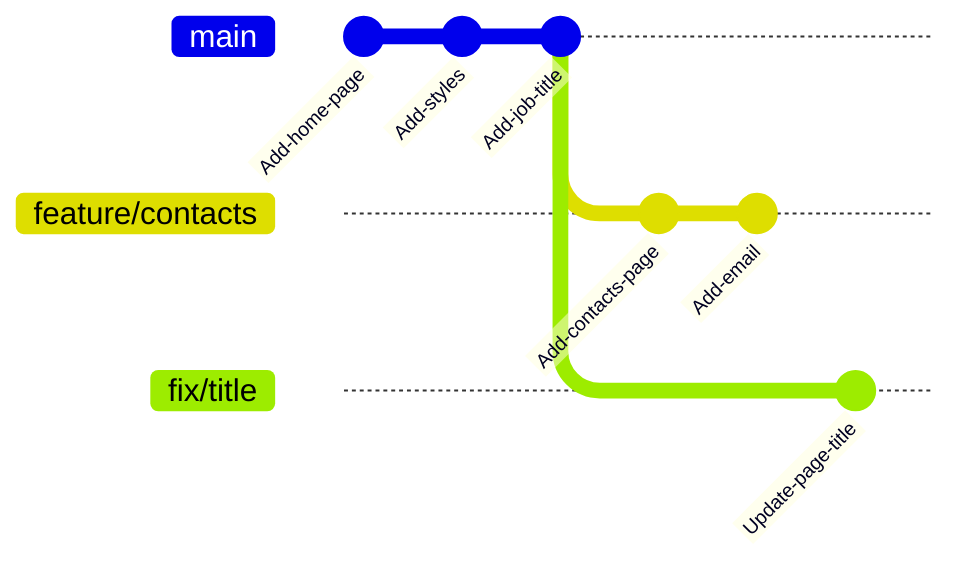
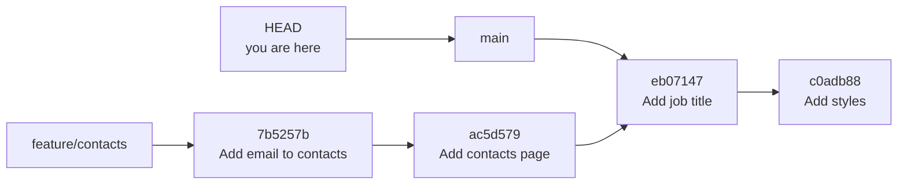
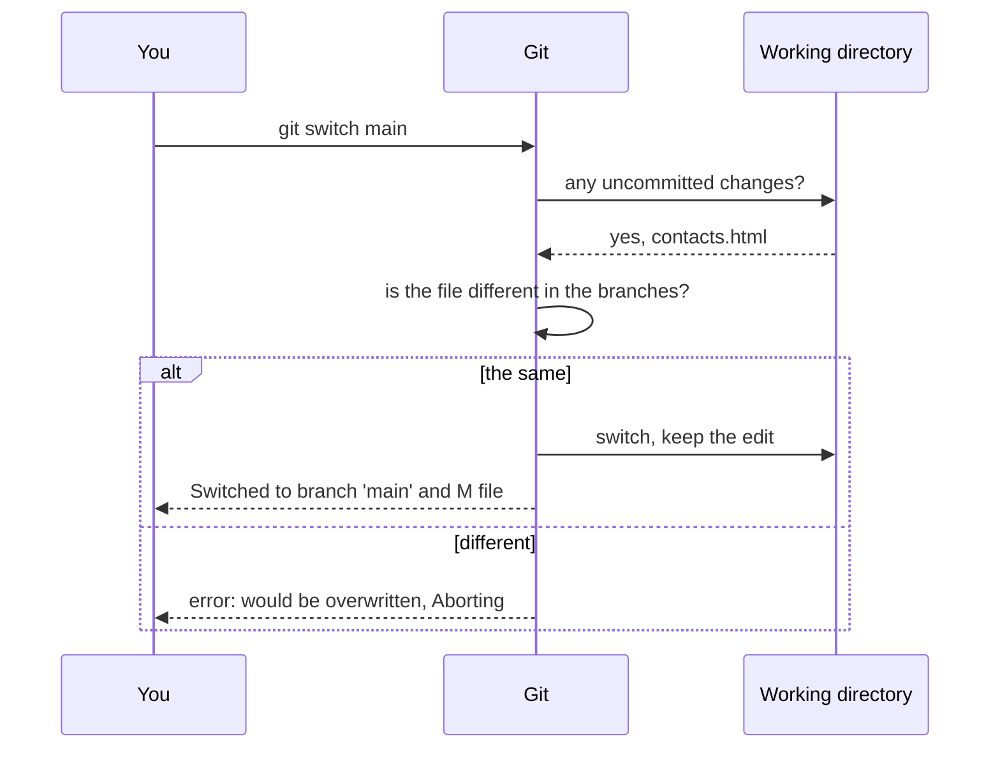

# Branches

[Contents](../../README.md) · [← Back](../../Lesson-5/en/Ignoring%20files%20and%20keeping%20the%20project%20tidy.md) · [Next →](../../Lesson-7/en/Merging%20and%20conflicts.md) · [RU](../ru/%D0%92%D0%B5%D1%82%D0%BA%D0%B8.md) · [EN](Branches.md) · [UZ](../uz/Tarmoqlar.md)

> **Link to lesson 5:** the project is tidy: `.gitignore` hides junk and secrets, `README.md` describes the site, and the history is a neat chain of commits. But there is only one chain: every new commit goes straight into the main version of the site. Today you will learn to run several lines of work in parallel - with **branches**.

---

## Why you need this

You have started building a contacts page on your portfolio site. Half of it is done: the form is there, but the button does not work and the layout is broken. Then a friend writes: "There is a typo in your name on the home page, fix it, I have already sent the link to an employer".

Without branches you would have to either commit the broken page together with the fix, or hide the unfinished work by hand. With branches, the contacts page lives in its own branch `feature/contacts`: you switch to the working `main`, fix the typo in the `fix/title` branch and go back to the contacts.

This is how all development teams work: `main` is always the working version, and each task lives in its own branch. On GitHub (lesson 8) and in teamwork (lesson 9) you cannot do without branches.

---

## What you will learn

- Explain what a branch is and why it "costs nothing".
- Understand `HEAD` as a "you are here" marker and read `HEAD -> main`.
- List and create branches and switch between them: `git branch`, `git switch`, `git switch -c`.
- Predict what happens to the files in the folder when you switch.
- Read the history graph: `git log --oneline --graph --all`.
- Rename and delete branches: `git branch -m`, `-d`, `-D` - and understand when `-D` is dangerous.
- Switch with uncommitted changes and get out of a "detached HEAD".
- Give branches clear names: `feature/...`, `fix/...`.

---

## Review: 3 questions from lesson 5

1. You added `config.env` to `.gitignore`, but `git status` still shows `modified: config.env`. Why, and what should you do?
2. What is the difference between `git rm style.css` and `git rm --cached style.css`?
3. Why do people put a `.gitkeep` file into an empty folder?

Answers are at the end of the lesson.

---

## Lesson plan

| Section | What we do |
| --- | --- |
| A branch and `HEAD` | A bookmark in the history, a "you are here" marker |
| Creating and switching | `git branch`, `git switch -c`; what happens to the files |
| Mini-task 1 | Your first own branch |
| The history graph | `git log --oneline --graph --all` |
| Renaming and deleting | `-m`, `-d`, `-D` |
| Edits and detached HEAD | Switching with changes, a walk through old commits |
| Branch names and `git checkout` | Rules and the old form of the commands |
| Mini-task 2 | The full life cycle of branches |
| Independent work | A task in the learning terminal and on your computer |

---

## What a branch is

**In simple words:** imagine a book with bookmarks. The book is the history of commits, and a bookmark is a branch. A bookmark does not copy pages, it just shows "I am reading here". You can have as many bookmarks as you like, and you can move each of them.

Another analogy is **parallel drafts**. You are writing an essay: the main text lies on the desk, and for a bold idea you take a copy of the last page and keep writing on it. If it works, you move it into the main text. If it does not, you throw the draft away, and the main text is not harmed.

In Git, a **branch** is a movable pointer to a commit that has a name. The `main` branch you have been working with since lesson 2 is a perfectly ordinary branch: `git init` simply created it.



**How to read the diagram.** Time goes from left to right. The first three commits are the shared history. Two lines leave the commit `Add-job-title`: `feature/contacts` has two commits of the contacts page, and `fix/title` has one commit with the heading fix. The `main` branch stayed on `Add-job-title`: work in the branches does not touch it. This is exactly the history you will build in this lesson.

---

## `HEAD`: "you are here"

In lesson 3 you learned `HEAD` as "the current commit". Now let's be more precise: usually `HEAD` points **not to a commit but to a branch**, and the branch points to a commit.

**In simple words:** `HEAD` is the "You are here" marker on a shopping mall map, and branches are the names of the shops. The marker stands next to the `main` shop, and when the shop "moves" (a new commit), the marker moves with it.



**How to read the diagram.** `HEAD` points to the `main` branch, and `main` points to the commit `eb07147`. The `feature/contacts` branch points to its last commit `7b5257b`. The arrows between commits lead to the parent, as in lesson 3. If you make a commit now, it becomes the new commit of `main`, and `feature/contacts` does not move. You have seen `HEAD -> main` in `git log` since lesson 2. Now you can read it: "`HEAD` points to the `main` branch".

---

## Creating and switching branches

### `git branch`: listing and creating branches

We work in the portfolio: `main` has three commits - `Add home page`, `Add styles`, `Add job title`. `git branch` without parameters lists the branches, and with a name it creates a branch:

```bash
git branch
git branch feature/contacts
git branch
git log --oneline
```

```text
* main
  feature/contacts
* main
eb07147 (HEAD -> main, feature/contacts) Add job title
c0adb88 Add styles
33b7941 Add home page
```

| Line | Translation and meaning |
| --- | --- |
| `* main` (first output) | There is only one branch so far. `*` marks the current branch - the one `HEAD` points to |
| `  feature/contacts` | The new branch has appeared. No asterisk - you are not on it |
| `* main` | You are still on `main` |
| `(HEAD -> main, feature/contacts)` | Both branches point to the same commit `eb07147`, and `HEAD` points to `main` |

Notice that `git branch` printed nothing when it created the branch - in Git, silence means success. And the main point: **`git branch` creates a branch but does not switch to it**.

### `git switch`: going to a branch

```bash
git switch feature/contacts
git status
```

```text
Switched to branch 'feature/contacts'
On branch feature/contacts
nothing to commit, working tree clean
```

| Line | Translation and meaning |
| --- | --- |
| `Switched to branch 'feature/contacts'` | "Switched to the feature/contacts branch": `HEAD` now points to it |
| `On branch feature/contacts` | `git status` confirms: you are on the new branch |

Let's make two commits in the branch:

```bash
echo "<h1>Contacts</h1>" > contacts.html
git add contacts.html
git commit -m "Add contacts page"
echo "<p>Email: anna@example.com</p>" >> contacts.html
git commit -am "Add email to contacts"
git log --oneline
```

```text
[feature/contacts ac5d579] Add contacts page
 1 file changed, 1 insertion(+)
 create mode 100644 contacts.html
[feature/contacts 7b5257b] Add email to contacts
 1 file changed, 1 insertion(+)
7b5257b (HEAD -> feature/contacts) Add email to contacts
ac5d579 Add contacts page
eb07147 (main) Add job title
c0adb88 Add styles
33b7941 Add home page
```

The square brackets now show `feature/contacts`, not `main`: Git tells you which branch the commit went to. The `feature/contacts` branch has moved two commits ahead, and `main` stayed on `eb07147`.

### `git switch -c`: create and switch at once

The two commands `git branch name` + `git switch name` are needed so often that there is one command for them:

```bash
git switch main
git switch -c fix/titel
```

```text
Switched to branch 'main'
Switched to a new branch 'fix/titel'
```

`-c` stands for create. `Switched to a new branch` means "switched to a **new** branch". The branch is created from the commit you are on, so before `git switch -c` go back to `main` first. You can also give the starting point explicitly: `git switch -c fix/titel main` creates the branch from `main` wherever you are. One more handy form is `git switch -` (minus): go back to the previous branch, like `cd -` in the terminal.

### Step by step: where `HEAD` points

| Step | Command | What changed / where HEAD points |
| --- | --- | --- |
| 1 | (start) | `HEAD` → `main` → `eb07147` |
| 2 | `git branch feature/contacts` | A branch has appeared → `eb07147`. `HEAD` is still → `main` |
| 3 | `git switch feature/contacts` | `HEAD` → `feature/contacts` → `eb07147` |
| 4 | `git commit -m "Add contacts page"` | `feature/contacts` moved to `ac5d579`, `main` stayed on `eb07147` |
| 5 | `git commit -am "Add email to contacts"` | `feature/contacts` → `7b5257b` |
| 6 | `git switch main` | `HEAD` → `main` → `eb07147` |
| 7 | `git switch -c fix/titel` | New branch → `eb07147`, `HEAD` → `fix/titel` |

> **Important:** the most common beginner mistake is to create a branch with `git branch name` and start committing right away. The commits go to the branch you are on - for example, `main`. Before a commit, look at the first line of `git status`: `On branch ...`.

---

## What happens to the files when you switch

A branch points to a commit, and a commit is a snapshot of all files. So when you switch, Git **makes the working directory match the snapshot of the new branch**: it adds, changes and removes files.

```bash
git switch feature/contacts
ls
git switch main
ls
cat contacts.html
```

```text
Switched to branch 'feature/contacts'
contacts.html  index.html  style.css
Switched to branch 'main'
index.html  style.css
cat: contacts.html: No such file or directory
```

The file `contacts.html` has "disappeared" on `main`. It is not deleted: it is stored in the commits of the `feature/contacts` branch and comes back as soon as you switch to it.

| Step | Command | Working directory | Index | Repository |
| --- | --- | --- | --- | --- |
| 1 | `git switch feature/contacts` | `contacts.html`, `index.html`, `style.css` | As in `7b5257b` | `HEAD` → `feature/contacts` |
| 2 | `git switch main` | `index.html`, `style.css` - `contacts.html` removed | As in `eb07147` | `HEAD` → `main`, the branch commits are safe |
| 3 | `git switch fix/titel` | The same files as on `main`: the branch is still on the same commit | As in `eb07147` | `HEAD` → `fix/titel` |
| 4 | `git switch feature/contacts` | `contacts.html` is back | As in `7b5257b` | `HEAD` → `feature/contacts` |

**In simple words:** the working directory is a desk, and branches are folders with drafts on a shelf. When you switch, you take one draft off the desk and put another one on it. As long as there are no unsaved edits on the desk, Git swaps them silently.

---

## Mini-task 1

In the learning terminal:

1. Create the `recipes` folder, go into it and create a repository.
2. Create `README.md` with the text `# My recipes` and commit it: `Add README`.
3. Create the `feature/soup` branch and switch to it right away.
4. Create `soup.txt` with the text `Tomato soup` and commit it: `Add soup recipe`.
5. Go back to `main` and look at `ls`. Where is `soup.txt`?
6. Look at `git branch -v`: which commits do the branches point to?

---

## The history graph: `git log --oneline --graph --all`

A plain `git log` shows the history of the **current** branch only: on `main` you will not see the commits of `feature/contacts`. The `--all` parameter shows the commits of all branches, and `--graph` draws the branch lines on the left with the symbols `*`, `|` and `/`.

Let's go back to `fix/titel`, fix the heading and look at the graph:

```bash
git switch fix/titel
echo "<h1>Anna Karimova - Frontend Developer</h1>" > index.html
echo "<p>Frontend developer</p>" >> index.html
git commit -am "Update page title"
git log --oneline --graph --all
```

```text
Switched to branch 'fix/titel'
[fix/titel d17b541] Update page title
 1 file changed, 1 insertion(+), 1 deletion(-)
* d17b541 (HEAD -> fix/titel) Update page title
| * 7b5257b (feature/contacts) Add email to contacts
| * ac5d579 Add contacts page
|/
* eb07147 (main) Add job title
* c0adb88 Add styles
* 33b7941 Add home page
```

| Line | Translation and meaning |
| --- | --- |
| `* d17b541 (HEAD -> fix/titel)` | A commit of the `fix/titel` branch, you are on it |
| `\| * 7b5257b (feature/contacts)` | The second line: the commits of the `feature/contacts` branch |
| `\|/` | Here the two lines meet: both branches grew from the same commit |
| `* eb07147 (main)` | The shared commit - `main` is on it |

Compare it with the first diagram of the lesson - it is the same history, only in the terminal the new commits are at the top. If all the `*` are in one column, the branches have not split yet.

---

## Renaming and deleting branches

### `git branch -m`: rename

The branch was named with a typo: `fix/titel`. Let's rename the current branch (`-m` stands for move):

```bash
git branch -m fix/title
git branch -v
```

```text
  feature/contacts 7b5257b Add email to contacts
* fix/title        d17b541 Update page title
  main             eb07147 Add job title
```

`git branch -v` shows the hash and the message of the last commit next to each branch. Renaming does not change the commits - only the name of the bookmark changes. The form `git branch -m old new` renames any branch, wherever you are.

> **Important:** `git branch -m fix/title` run on `main` renames `main` itself. Before `-m` with one name, check which branch you are on.

### `git branch -d` and `-D`: delete a branch

A branch you no longer need is deleted with `git branch -d` (delete). You can only delete a branch you are **not** on. If all commits of the branch are already in the current branch, Git answers `Deleted branch name (was hash).`

Let's try a dark theme idea in the `experiment` branch:

```bash
git switch main
git switch -c experiment
echo "body { background: black; }" > style.css
git commit -am "Try dark theme"
git switch main
git branch -d experiment
```

```text
Switched to branch 'main'
Switched to a new branch 'experiment'
[experiment bcc7b97] Try dark theme
 1 file changed, 1 insertion(+), 1 deletion(-)
Switched to branch 'main'
error: the branch 'experiment' is not fully merged
hint: If you are sure you want to delete it, run 'git branch -D experiment'
hint: Disable this message with "git config set advice.forceDeleteBranch false"
```

| Line | Translation and meaning |
| --- | --- |
| `the branch 'experiment' is not fully merged` | The branch has commits that are not in the current branch |
| `If you are sure ... run 'git branch -D experiment'` | If you are sure, force the deletion with a capital `-D` |

`-d` is a safe deletion: Git protects you from losing work. We did not like the dark theme, so we force the deletion:

```bash
git branch -D experiment
```

```text
Deleted branch experiment (was bcc7b97).
```

> **Important:** `git branch -D` deletes the branch together with the way to reach its commits. Use `-D` only when you are **sure** you do not need the branch commits: a failed experiment, a draft. **Never** use `-D` to "silence" the error on a branch with useful work - merge it first (lesson 7). If you deleted it by mistake, find the hash in `git reflog` (lesson 4) or in the line `(was bcc7b97)` and create the branch again: `git branch experiment bcc7b97`.
>
> Merging branches - `git merge` - is the topic of lesson 7. Then `git branch -d` will calmly delete branches whose work is already in `main`.

---

## Uncommitted changes when switching

What happens if there are unsaved edits on the desk and you switch? There are two cases.

### Case 1: the changes come with you

You appended a line to `style.css` on `main` and did not commit it. The file `style.css` is the same in `main` and `feature/contacts`:

```bash
echo "footer { color: gray; }" >> style.css
git switch feature/contacts
git status -s
```

```text
Switched to branch 'feature/contacts'
M	style.css
 M style.css
```

The line `M	style.css` after `Switched` is a Git warning: the modified file has moved with you; `git status -s` confirms it: ` M style.css` - modified, not in the index.

Uncommitted changes belong to the **working directory**, not to a branch. As long as the file is the same in both branches, Git can safely carry the edit over. This is handy if you started work in the wrong branch: switch to the right one and commit there.

### Case 2: the "would be overwritten" error

First let's undo the edit from case 1: `git restore style.css` (lesson 4). Now on `feature/contacts` you appended a phone number to `contacts.html` and try to go to `main`, where this file does not exist at all:

```bash
echo "<p>Phone: +998 90 123 45 67</p>" >> contacts.html
git switch main
```

```text
error: Your local changes to the following files would be overwritten by checkout:
	contacts.html
Please commit your changes or stash them before you switch branches.
Aborting
```

| Line | Translation and meaning |
| --- | --- |
| `Your local changes ... would be overwritten by checkout` | Switching would overwrite your local changes |
| `Please commit your changes or stash them` | Commit the changes or hide them (`git stash` - lesson 9) |
| `Aborting` | The switch is cancelled: you stayed on the same branch, nothing is lost |

To switch, the file would have to change between the branches, which means your edits would be wiped out. Git refuses. There are three ways out: commit the edit in the current branch, undo it with `git restore contacts.html` (lesson 4) or hide it with `git stash` (lesson 9).



**How to read the diagram.** Before switching, Git checks the working directory. If the modified file is the same in both branches, the edit "moves" with you. If it is different, Git stops and touches nothing. The most reliable way to avoid both cases: before switching, `git status` should answer `working tree clean`.

New **untracked** files (`Untracked files`) also travel with you from branch to branch: Git does not track them, so it does not remove them either. Let's undo the phone edit and go back to `main`: `git restore contacts.html`, `git switch main`.

---

## Detached HEAD

Sometimes you want to see what the site looked like a couple of commits ago - not one file with `git show` (lesson 3), but the whole site, opened in a browser. For this you can put `HEAD` right on a commit:

```bash
git switch --detach c0adb88
git status
cat index.html
```

```text
HEAD is now at c0adb88 Add styles
HEAD detached at c0adb88
nothing to commit, working tree clean
<h1>Anna Karimova</h1>
```

| Line | Translation and meaning |
| --- | --- |
| `HEAD is now at c0adb88 Add styles` | `HEAD` now points to this commit |
| `HEAD detached at c0adb88` | You are not on a branch but right on a commit |
| `<h1>Anna Karimova</h1>` | The files in the folder are as in that commit: the line `Frontend developer` is not there yet |

**In simple words:** usually you stand inside a shop, and the "you are here" marker moves with the shop. In a detached `HEAD` you have stepped out into the corridor and stand at a particular door: you can look, but new commits are not attached to any branch. In `git log --oneline --all` such a commit is marked `(HEAD)` without an arrow: `HEAD` points to a commit, not to a branch.

### How to get out

| Situation | Command |
| --- | --- |
| You had a look and want to go back | `git switch main` (or `git switch -`) |
| You made commits and want to keep them | `git switch -c new-branch` - the branch "picks up" the commits |

After `git switch main` the simulator answers `Switched to branch 'main'`, while real Git adds the line `Previous HEAD position was c0adb88 Add styles` before it. And if you made a commit in a detached `HEAD` and went to a branch, Git warns you: `Warning: you are leaving 1 commit behind, not connected to any of your branches`. Such a commit can be rescued only by its hash (`git branch name hash`) or through `git reflog`.

> **Important:** people also end up in a detached `HEAD` by accident - with the command `git checkout <hash>` from someone else's instructions. If `git status` says `HEAD detached`, do not panic: nothing is broken, just go back to a branch.

---

## Branch names and the old `git checkout` command

### How to name branches

| Rule | Good | Bad |
| --- | --- | --- |
| A prefix by task type | `feature/contacts`, `fix/title` | `contacts2`, `vasya` |
| Latin letters, lowercase | `feature/dark-theme` | `Feature/DarkTheme` |
| A hyphen instead of a space | `fix/header-typo` | `fix header typo` |
| Short and to the point | `feature/contact-form` | `feature/new-page-that-i-made-today` |

Common prefixes: `feature/` - a new feature, `fix/` - a bug fix, `docs/` - documentation, `experiment/` - a try-out. Git will not accept spaces and some symbols at all: `git branch "my branch"` answers `fatal: 'my branch' is not a valid branch name`. Letter case matters: `Feature/Contacts` and `feature/contacts` are different branches. So agree to write names in lowercase.

### `git checkout`: the old all-in-one command

Before 2019 (Git 2.23) there was one command, `git checkout`, for both branches and files. Because of this it was easy to mix things up: the same command both switched branches and wiped out edits in a file. So it was split into `git switch` (branches) and `git restore` (files, lesson 4). You will see `checkout` all the time in other people's instructions and old articles.

| Old form | Modern form |
| --- | --- |
| `git checkout main` | `git switch main` |
| `git checkout -b feature/x` | `git switch -c feature/x` |
| `git checkout c0adb88` | `git switch --detach c0adb88` |
| `git checkout -- index.html` | `git restore index.html` |

Notice that `git switch` without `--detach` will not go to a commit - this is how it protects you from an accidental detached `HEAD`:

```bash
git switch c0adb88
```

```text
fatal: a branch is expected, got commit 'c0adb88'
hint: If you want to detach HEAD at the commit, try again with the --detach option.
hint: Disable this message with "git config set advice.suggestDetachingHead false"
```

Git expected a branch but got a commit, and suggests running the command again with `--detach`. `git checkout c0adb88`, on the other hand, detaches `HEAD` without asking and prints a long explanation `You are in 'detached HEAD' state...` - you can look around and experiment. At the end of the explanation Git itself suggests the ways out: `git switch -c <new-branch-name>` and `git switch -`.

### Try to break it

1. Create a branch that already exists: `git switch -c feature/contacts`. What does Git answer?
2. Make a typo in the name: `git switch feature/contact`. What is the message?
3. Delete the branch you are on: `git branch -d main`.
4. Get the `would be overwritten` error: on a branch, change a file that does not exist on `main`, and switch to `main`.
5. Go to an old commit with `git checkout <hash>`, make a commit and go back with `git switch main`. Where is this commit now in `git log --oneline --all`?

### Typical beginner mistakes

| Mistake | What you get | How to fix |
| --- | --- | --- |
| `git branch name` and a commit right away | The commit went to the current branch (often `main`) | Use `git switch -c name` right away |
| The new branch was not created from `main` | The branch drags other people's commits along | Before `git switch -c` - `git switch main` or `git switch -c name main` |
| A typo in the branch name when switching | `fatal: invalid reference: feature/contact` | List the branches: `git branch` |
| Creating a branch that already exists | `fatal: a branch named 'feature/contacts' already exists` | Switch without `-c`: `git switch feature/contacts` |
| Deleting the current branch | `error: cannot delete branch 'main' used by worktree at ...` | Switch to another branch first |
| `-d` on an unmerged branch | `error: the branch 'experiment' is not fully merged` | Merge it (lesson 7) or, if the work is not needed, `-D` |
| Switching with edits in a file that differs between the branches | `error: Your local changes ... would be overwritten by checkout` | Commit, `git restore` or `git stash` (lesson 9) |
| `git branch -m new` on the wrong branch | The wrong branch was renamed, for example `main` | `git branch -m new main` - give the name back |
| `git checkout <hash>` from instructions | `HEAD detached at ...`, commits are left "hanging" | `git switch main`, keep the needed commits with `git switch -c name` |

---

## Mini-task 2

Continue in the `recipes` repository from mini-task 1 (you are on `main`):

1. Create the `feature/desert` branch (with a typo) and switch to it.
2. Create `dessert.txt` with the text `Apple pie` and commit it: `Add dessert recipe`.
3. Rename the branch to `feature/dessert`.
4. Go back to `main`, create the `experiment` branch, append the line `Draft` to `README.md` and commit it with `commit -am`.
5. Go back to `main` and try to delete `experiment` with `-d`. Read the error and delete it with `-D`.
6. Look at the graph: `git log --oneline --graph --all`.
7. Go to the first commit in a detached `HEAD` (`git switch --detach` and the hash of `Add README`), look at `git status` and go back to `main`.

---

## Lesson summary: cheat sheet

| Task | Command |
| --- | --- |
| List branches / with their last commits | `git branch`, `git branch -v` |
| Create a branch (without switching) | `git branch name` |
| Switch to a branch | `git switch name` |
| Create and switch | `git switch -c name` |
| Create from another branch | `git switch -c name main` |
| Go back to the previous branch | `git switch -` |
| Graph of all branches | `git log --oneline --graph --all` |
| Rename the current / any branch | `git branch -m new`, `git branch -m old new` |
| Delete a merged branch | `git branch -d name` |
| Force-delete a branch (careful!) | `git branch -D name` |
| See an old commit as a whole | `git switch --detach hash` |
| Get out of a detached HEAD | `git switch main` or `git switch -c new-branch` |
| Old form (in other people's instructions) | `git checkout name`, `git checkout -b name` |

---

## Independent work

### Part 1. IDE task (graded by the platform)

You are in the `~/portfolio` folder on the `main` branch, the history has 3 commits, and the heading in `index.html` has a typo: `Ana` instead of `Anna`. Write the commands one per line:

1. Look at the list of branches.
2. Create the `feature/contacts` branch from `main` and switch to it with one command.
3. Create the file `contacts.html` with the text `<h1>Contacts</h1>` and commit it.
4. Append the line `<p>Email: anna@example.com</p>` to `contacts.html` and make the second commit.
5. Go back to `main` and create the `fix/titel` branch (exactly with the typo in the name), switching to it.
6. Overwrite `index.html` with two lines: `<h1>Anna Karimova</h1>` and `<p>Frontend developer</p>` - and make a commit.
7. Rename the `fix/titel` branch to `fix/title`.
8. Go back to `main`, create the `experiment` branch, overwrite `style.css` with the line `body { background: black; }` and make a commit.
9. Go back to `main` and delete the `experiment` branch (it is not merged - you will need to force the deletion).
10. Look at the graph of all branches (`git log --oneline --graph --all`) and at `git status`.

At the end you are on `main`, the repository has exactly three branches: `main`, `feature/contacts`, `fix/title`, the working directory is clean, and `main` itself has not changed.

What the platform checks: that `feature/contacts` has exactly two new commits on top of `main` and both change `contacts.html`; that `fix/title` grew right from `main` and contains the fixed heading; that the branch was created as `fix/titel` and renamed, and `fix/titel` no longer exists; that `main` has no commits from other branches; that `experiment` had a commit and the branch itself is deleted; that there are exactly three branches; that you are on `main`, the working directory is clean and has no `contacts.html`; that you looked at the `--graph --all` graph; that the solution also works for another project with a different `main` history; that the script runs without errors.

### Part 2. Project on your computer

1. In the repository of your website, look at `git branch` and `git log --oneline --graph --all`.
2. Create a `feature/<something-new>` branch (for example, `feature/footer`) and make 1–2 commits in it with a real edit of the site. Switch to `main` and open the site in a browser: the edit is not there. Switch back - the edit has returned.
3. Create the `experiment/colors` branch, change the colors in the CSS, commit, go back to `main` and delete the branch with `-D` - after reading the `-d` error first.
4. Go to the very first commit of the site with `git switch --detach`, open the site in a browser, go back to `main`.
5. Do not delete the `feature/...` branch: in lesson 7 you will merge it into `main`.

### Acceptance criteria

- [ ] The IDE task is accepted.
- [ ] Your website repository has a `feature/...` branch with its own commits, and `main` does not contain them.
- [ ] `git log --oneline --graph --all` shows a fork, and you can explain every line.
- [ ] You have seen the `not fully merged` error and understand the difference between `-d` and `-D`.
- [ ] You can get out of `HEAD detached` and explain how not to lose commits.

---

## Self-check questions

1. What is a branch in Git, and why is creating a branch instant?
2. What does `HEAD` usually point to, and what does `HEAD -> main` mean?
3. What is the difference between `git branch feature/x` and `git switch -c feature/x`?
4. What happens to the files in the working directory on `git switch`? Where does a file that is not in the other branch "disappear" to?
5. What do the `--graph` and `--all` parameters add to `git log`? What does the line `|/` mean?
6. What is the difference between `git branch -d` and `git branch -D`? When must you not use `-D`?
7. How do you rename a branch? Why is `git branch -m new` dangerous when run on the wrong branch?
8. When do uncommitted changes move with you when you switch, and when does Git give `would be overwritten`?
9. What is a detached `HEAD`, how do you get into it, and how do you get out without losing commits?
10. Which commands replaced `git checkout`, and why? How should you name branches?

After the questions, take the **lesson test** on the platform: 12 questions, pass mark 70%.

---

## What's next

You now have two branches with useful work - `feature/contacts` and `fix/title` - but it is not visible on `main`. In lesson 7 you will learn to join branches with `git merge`: you will find out what a fast-forward and a merge commit are, what to do in a **conflict** when two branches changed the same line, and how to delete branches that are already merged.

---

## Answers

**Review**

1. `.gitignore` works only for untracked files, and `config.env` is already in the repository. You need to stop tracking it: `git rm --cached config.env` and a commit.
2. `git rm style.css` deletes the file both from the disk and from the index. `git rm --cached style.css` removes it only from the index - the file stays on the disk and is no longer tracked after the commit.
3. Git stores only files, it does not see an empty folder. An empty `.gitkeep` file lets you keep the folder in the repository.

**Mini-task 1**

```bash
mkdir recipes
cd recipes
git init
echo "# My recipes" > README.md
git add README.md
git commit -m "Add README"
git switch -c feature/soup
echo "Tomato soup" > soup.txt
git add soup.txt
git commit -m "Add soup recipe"
git switch main
ls
git branch -v
```

There is no `soup.txt` on `main`: it is stored in the `feature/soup` branch. `git branch -v` shows that `feature/soup` points to `Add soup recipe`, and `main` points to `Add README`.

**Mini-task 2**

```bash
git switch -c feature/desert
echo "Apple pie" > dessert.txt
git add dessert.txt
git commit -m "Add dessert recipe"
git branch -m feature/dessert
git switch main
git switch -c experiment
echo "Draft" >> README.md
git commit -am "Add draft note"
git switch main
git branch -d experiment
git branch -D experiment
git log --oneline --graph --all
git log --oneline
git switch --detach f841aa3
git status
git switch main
```

The hash `f841aa3` comes from `git log --oneline` in the learning terminal; yours may be different, use your own.

**Self-check questions**

1. A movable pointer with a name that points to a commit. Git does not copy files, it only writes a new "bookmark", so it is instant.
2. Usually to the current branch, and the branch points to a commit. `HEAD -> main` means "you are on the `main` branch, this is its last commit".
3. `git branch feature/x` only creates a branch, and you stay on the previous one. `git switch -c feature/x` creates it and switches to it at once.
4. Git makes the folder match the snapshot of the last commit of the new branch: it adds, changes and removes files. The "missing" file is stored in the commits of its branch and comes back when you switch to it.
5. `--all` shows the commits of all branches, `--graph` shows the branch lines on the left. `|/` is the place where two lines meet: the branches grew from the same commit.
6. `-d` deletes only a branch whose commits are already in the current branch, otherwise it gives `not fully merged`. `-D` deletes by force. You must not use `-D` on a branch with useful work that is not merged yet.
7. `git branch -m new` renames the current branch, `git branch -m old new` renames any branch. Run on the wrong branch, the first form will rename, for example, `main`.
8. They move with you if the modified file is the same in both branches. The error appears if the file differs between the branches and switching would wipe out your edits.
9. It is a state where `HEAD` points right to a commit, not to a branch. To get into it: `git switch --detach hash` or `git checkout hash`. To get out: `git switch main`; to keep the commits you made: `git switch -c new-branch`.
10. `git switch` (branches) and `git restore` (files): the single `checkout` command did too many different things. Names should use Latin letters, lowercase, hyphens, and a prefix `feature/`, `fix/`.

---

[Contents](../../README.md) · [← Back](../../Lesson-5/en/Ignoring%20files%20and%20keeping%20the%20project%20tidy.md) · [Next →](../../Lesson-7/en/Merging%20and%20conflicts.md) · [RU](../ru/%D0%92%D0%B5%D1%82%D0%BA%D0%B8.md) · [EN](Branches.md) · [UZ](../uz/Tarmoqlar.md)
