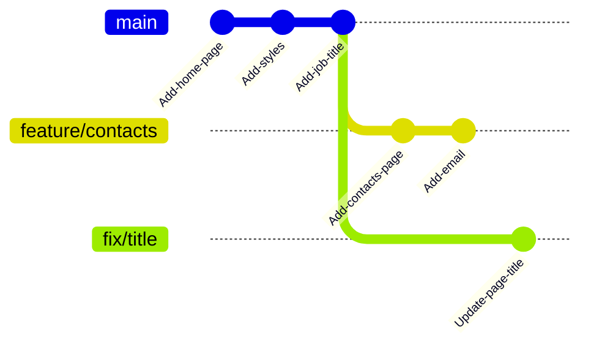
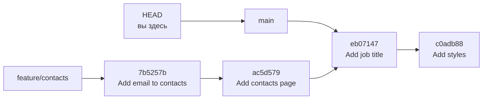
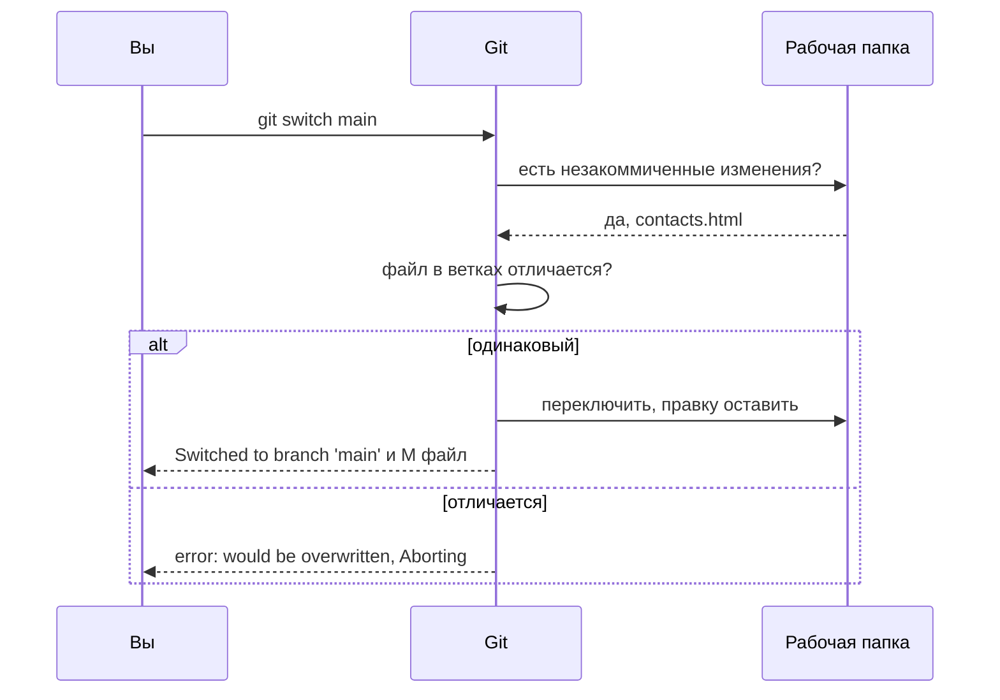

# Ветки

[Содержание](../../README.md) · [← Назад](../../Lesson-5/ru/%D0%98%D0%B3%D0%BD%D0%BE%D1%80%D0%B8%D1%80%D0%BE%D0%B2%D0%B0%D0%BD%D0%B8%D0%B5%20%D1%84%D0%B0%D0%B9%D0%BB%D0%BE%D0%B2%20%D0%B8%20%D0%BF%D0%BE%D1%80%D1%8F%D0%B4%D0%BE%D0%BA%20%D0%B2%20%D0%BF%D1%80%D0%BE%D0%B5%D0%BA%D1%82%D0%B5.md) · [Вперёд →](../../Lesson-7/ru/%D0%A1%D0%BB%D0%B8%D1%8F%D0%BD%D0%B8%D0%B5%20%D0%B8%20%D0%BA%D0%BE%D0%BD%D1%84%D0%BB%D0%B8%D0%BA%D1%82%D1%8B.md) · [RU](%D0%92%D0%B5%D1%82%D0%BA%D0%B8.md) · [EN](../en/Branches.md) · [UZ](../uz/Tarmoqlar.md)

> **Связь с уроком 5:** проект в порядке: `.gitignore` скрывает мусор и секреты, `README.md` описывает сайт, а история - аккуратная цепочка коммитов. Но эта цепочка одна: каждый новый коммит сразу попадает в основную версию сайта. Сегодня вы научитесь вести несколько линий работы параллельно - с помощью **веток**.

---

## Зачем это вам

Вы начали делать на сайте-портфолио страницу контактов. Сделали половину: форма есть, но кнопка не работает и вёрстка разъехалась. И тут друг пишет: «На главной у тебя опечатка в имени, исправь, я уже отправил ссылку работодателю».

Без веток придётся либо закоммитить сломанную страницу вместе с исправлением, либо вручную прятать недоделанное. С ветками страница контактов живёт в своей ветке `feature/contacts`, вы переключаетесь на рабочую `main`, исправляете опечатку в ветке `fix/title` и возвращаетесь к контактам.

Так работают все команды разработчиков: `main` - всегда рабочая версия, а каждая задача - в своей ветке. На GitHub (урок 8) и в командной работе (урок 9) без веток не обойтись.

---

## Чему вы научитесь

- Объяснять, что такое ветка и почему она «ничего не стоит».
- Понимать `HEAD` как значок «вы здесь» и читать `HEAD -> main`.
- Смотреть, создавать ветки и переключаться: `git branch`, `git switch`, `git switch -c`.
- Предсказывать, что произойдёт с файлами в папке при переключении.
- Читать граф истории: `git log --oneline --graph --all`.
- Переименовывать и удалять ветки: `git branch -m`, `-d`, `-D` - и понимать, когда `-D` опасен.
- Переключаться с незакоммиченными изменениями и выходить из «отделённого HEAD».
- Давать веткам понятные имена: `feature/...`, `fix/...`.

---

## Повторение: 3 вопроса из урока 5

1. Вы добавили `config.env` в `.gitignore`, но `git status` всё равно показывает `modified: config.env`. Почему и что сделать?
2. Чем `git rm style.css` отличается от `git rm --cached style.css`?
3. Зачем в пустую папку кладут файл `.gitkeep`?

Ответы - в конце урока.

---

## План урока

| Раздел | Что делаем |
| --- | --- |
| Ветка и `HEAD` | Закладка в истории, значок «вы здесь» |
| Создание и переключение | `git branch`, `git switch -c`; что происходит с файлами |
| Мини-задание 1 | Первая своя ветка |
| Граф истории | `git log --oneline --graph --all` |
| Переименование и удаление | `-m`, `-d`, `-D` |
| Правки и отделённый HEAD | Переключение с изменениями, прогулка по старым коммитам |
| Имена веток и `git checkout` | Правила и старая форма команд |
| Мини-задание 2 | Полный цикл жизни веток |
| Самостоятельная работа | Задание в учебном терминале и на компьютере |

---

## Что такое ветка

**Простыми словами:** представьте книгу с закладками. Книга - это история коммитов, а закладка - ветка. Закладка не копирует страницы, она просто показывает: «я читаю здесь». Закладок может быть сколько угодно, и каждую можно переложить.

Другая аналогия - **параллельные черновики**. Вы пишете сочинение: основной текст лежит на столе, а для смелой идеи берёте копию последней страницы и пишете дальше на ней. Получилось - переносите в основной текст. Не получилось - выбрасываете черновик, основной текст не пострадал.

В Git **ветка** - это подвижный указатель на коммит, у которого есть имя. Ветка `main`, с которой вы работали с урока 2, - самая обычная ветка: её просто создал `git init`.



**Как читать схему.** Время идёт слева направо. Три первых коммита - общая история. От коммита `Add-job-title` отходят две линии: в `feature/contacts` - два коммита страницы контактов, в `fix/title` - один коммит с исправлением заголовка. Ветка `main` осталась на `Add-job-title`: работа в ветках её не трогает. Именно такую историю вы построите в этом уроке.

---

## `HEAD`: «вы здесь»

В уроке 3 вы узнали `HEAD` как «текущий коммит». Теперь уточним: обычно `HEAD` указывает **не на коммит, а на ветку**, а уже ветка - на коммит.

**Простыми словами:** `HEAD` - значок «Вы здесь» на карте торгового центра, а ветки - названия магазинов. Значок стоит у магазина `main`, и когда магазин «переезжает» (новый коммит), значок едет вместе с ним.



**Как читать схему.** `HEAD` указывает на ветку `main`, `main` - на коммит `eb07147`. Ветка `feature/contacts` указывает на свой последний коммит `7b5257b`. Стрелки между коммитами ведут к родителю, как в уроке 3. Сделаете коммит сейчас - он станет новым коммитом `main`, а `feature/contacts` не сдвинется. Запись `HEAD -> main` в `git log` вы видели с урока 2. Теперь вы можете её прочитать: «`HEAD` указывает на ветку `main`».

---

## Создание и переключение веток

### `git branch`: список и создание веток

Работаем в портфолио: на `main` три коммита - `Add home page`, `Add styles`, `Add job title`. `git branch` без параметров показывает список веток, а с именем - создаёт ветку:

```bash
git branch
git branch feature/contacts
git branch
git log --oneline
```

```text
* main
  feature/contacts
* main
eb07147 (HEAD -> main, feature/contacts) Add job title
c0adb88 Add styles
33b7941 Add home page
```

| Строка | Перевод и смысл |
| --- | --- |
| `* main` (первый ответ) | Пока ветка одна. `*` отмечает текущую ветку - ту, на которую указывает `HEAD` |
| `  feature/contacts` | Новая ветка появилась. Звёздочки нет - вы не на ней |
| `* main` | Вы по-прежнему на `main` |
| `(HEAD -> main, feature/contacts)` | Обе ветки указывают на один коммит `eb07147`, `HEAD` - на `main` |

Обратите внимание: `git branch` ничего не ответил на создание ветки - в Git молчание означает успех. И главное: **`git branch` создаёт ветку, но не переключает на неё**.

### `git switch`: перейти на ветку

```bash
git switch feature/contacts
git status
```

```text
Switched to branch 'feature/contacts'
On branch feature/contacts
nothing to commit, working tree clean
```

| Строка | Перевод и смысл |
| --- | --- |
| `Switched to branch 'feature/contacts'` | «Переключились на ветку feature/contacts»: `HEAD` теперь указывает на неё |
| `On branch feature/contacts` | `git status` подтверждает: вы на новой ветке |

Сделаем в ветке два коммита:

```bash
echo "<h1>Contacts</h1>" > contacts.html
git add contacts.html
git commit -m "Add contacts page"
echo "<p>Email: anna@example.com</p>" >> contacts.html
git commit -am "Add email to contacts"
git log --oneline
```

```text
[feature/contacts ac5d579] Add contacts page
 1 file changed, 1 insertion(+)
 create mode 100644 contacts.html
[feature/contacts 7b5257b] Add email to contacts
 1 file changed, 1 insertion(+)
7b5257b (HEAD -> feature/contacts) Add email to contacts
ac5d579 Add contacts page
eb07147 (main) Add job title
c0adb88 Add styles
33b7941 Add home page
```

В квадратных скобках теперь `feature/contacts`, а не `main`: Git сообщает, в какую ветку попал коммит. Ветка `feature/contacts` уехала на два коммита вперёд, а `main` осталась на `eb07147`.

### `git switch -c`: создать и сразу перейти

Две команды `git branch имя` + `git switch имя` нужны так часто, что для них есть одна:

```bash
git switch main
git switch -c fix/titel
```

```text
Switched to branch 'main'
Switched to a new branch 'fix/titel'
```

`-c` - от англ. create, «создать». `Switched to a new branch` - «Переключились на **новую** ветку». Ветка создаётся от того коммита, где вы стоите, поэтому перед `git switch -c` сначала вернитесь на `main`. Можно и указать точку старта явно: `git switch -c fix/titel main` создаст ветку от `main`, где бы вы ни были. Ещё одна удобная форма - `git switch -` (минус): вернуться на предыдущую ветку, как `cd -` в терминале.

### Пошагово: куда указывает `HEAD`

| Шаг | Команда | Что изменилось / куда указывает HEAD |
| --- | --- | --- |
| 1 | (начало) | `HEAD` → `main` → `eb07147` |
| 2 | `git branch feature/contacts` | Появилась ветка → `eb07147`. `HEAD` по-прежнему → `main` |
| 3 | `git switch feature/contacts` | `HEAD` → `feature/contacts` → `eb07147` |
| 4 | `git commit -m "Add contacts page"` | `feature/contacts` сдвинулась на `ac5d579`, `main` осталась на `eb07147` |
| 5 | `git commit -am "Add email to contacts"` | `feature/contacts` → `7b5257b` |
| 6 | `git switch main` | `HEAD` → `main` → `eb07147` |
| 7 | `git switch -c fix/titel` | Новая ветка → `eb07147`, `HEAD` → `fix/titel` |

> **Важно:** самая частая ошибка новичка - создать ветку через `git branch имя` и сразу начать коммитить. Коммиты уйдут в ту ветку, где вы стоите, - например, в `main`. Перед коммитом посмотрите первую строку `git status`: `On branch ...`.

---

## Что происходит с файлами при переключении

Ветка указывает на коммит, а коммит - это снимок всех файлов. Поэтому при переключении Git **приводит рабочую папку к снимку новой ветки**: добавляет, меняет и удаляет файлы.

```bash
git switch feature/contacts
ls
git switch main
ls
cat contacts.html
```

```text
Switched to branch 'feature/contacts'
contacts.html  index.html  style.css
Switched to branch 'main'
index.html  style.css
cat: contacts.html: No such file or directory
```

Файл `contacts.html` «пропал» на `main`. Он не удалён: он хранится в коммитах ветки `feature/contacts` и вернётся, как только вы на неё переключитесь.

| Шаг | Команда | Рабочая папка | Индекс | Репозиторий |
| --- | --- | --- | --- | --- |
| 1 | `git switch feature/contacts` | `contacts.html`, `index.html`, `style.css` | Как в `7b5257b` | `HEAD` → `feature/contacts` |
| 2 | `git switch main` | `index.html`, `style.css` - `contacts.html` убран | Как в `eb07147` | `HEAD` → `main`, коммиты ветки целы |
| 3 | `git switch fix/titel` | Те же файлы, что на `main`: ветка пока стоит на том же коммите | Как в `eb07147` | `HEAD` → `fix/titel` |
| 4 | `git switch feature/contacts` | `contacts.html` снова на месте | Как в `7b5257b` | `HEAD` → `feature/contacts` |

**Простыми словами:** рабочая папка - это стол, а ветки - папки с черновиками на полке. Переключаясь, вы убираете со стола один черновик и кладёте другой. Пока на столе нет несохранённых правок, Git меняет их молча.

---

## Мини-задание 1

В учебном терминале:

1. Создайте папку `recipes`, перейдите в неё, создайте репозиторий.
2. Создайте `README.md` с текстом `# My recipes` и закоммитьте: `Add README`.
3. Создайте ветку `feature/soup` и сразу перейдите в неё.
4. Создайте `soup.txt` с текстом `Tomato soup` и закоммитьте: `Add soup recipe`.
5. Вернитесь на `main` и посмотрите `ls`. Где `soup.txt`?
6. Посмотрите `git branch -v`: на какие коммиты указывают ветки?

---

## Граф истории: `git log --oneline --graph --all`

Обычный `git log` показывает историю только **текущей** ветки: на `main` вы не увидите коммиты `feature/contacts`. Параметр `--all` показывает коммиты всех веток, а `--graph` рисует слева линии веток символами `*`, `|` и `/`.

Вернёмся в `fix/titel`, исправим заголовок и посмотрим граф:

```bash
git switch fix/titel
echo "<h1>Anna Karimova - Frontend Developer</h1>" > index.html
echo "<p>Frontend developer</p>" >> index.html
git commit -am "Update page title"
git log --oneline --graph --all
```

```text
Switched to branch 'fix/titel'
[fix/titel d17b541] Update page title
 1 file changed, 1 insertion(+), 1 deletion(-)
* d17b541 (HEAD -> fix/titel) Update page title
| * 7b5257b (feature/contacts) Add email to contacts
| * ac5d579 Add contacts page
|/
* eb07147 (main) Add job title
* c0adb88 Add styles
* 33b7941 Add home page
```

| Строка | Перевод и смысл |
| --- | --- |
| `* d17b541 (HEAD -> fix/titel)` | Коммит ветки `fix/titel`, вы на ней |
| `\| * 7b5257b (feature/contacts)` | Вторая линия: коммиты ветки `feature/contacts` |
| `\|/` | Здесь две линии сходятся: обе ветки выросли из одного коммита |
| `* eb07147 (main)` | Общий коммит - на нём стоит `main` |

Сравните с первой схемой урока - это та же история, только в терминале новые коммиты сверху. Если все `*` стоят в одном столбике, ветки ещё не разошлись.

---

## Переименование и удаление веток

### `git branch -m`: переименовать

Ветку назвали с опечаткой: `fix/titel`. Переименуем текущую ветку (`-m` - от англ. move):

```bash
git branch -m fix/title
git branch -v
```

```text
  feature/contacts 7b5257b Add email to contacts
* fix/title        d17b541 Update page title
  main             eb07147 Add job title
```

`git branch -v` показывает рядом с каждой веткой хеш и сообщение её последнего коммита. Коммиты при переименовании не меняются - меняется только имя закладки. Форма `git branch -m старое новое` переименует любую ветку, где бы вы ни были.

> **Важно:** `git branch -m fix/title`, выполненная на `main`, переименует саму `main`. Перед `-m` с одним именем проверьте, на какой вы ветке.

### `git branch -d` и `-D`: удалить ветку

Ветка, которая больше не нужна, удаляется командой `git branch -d` (delete). Удалить можно только ту ветку, на которой вы **не** стоите. Если все коммиты ветки уже есть в текущей ветке, Git ответит `Deleted branch имя (was хеш).`

Попробуем идею с тёмной темой в ветке `experiment`:

```bash
git switch main
git switch -c experiment
echo "body { background: black; }" > style.css
git commit -am "Try dark theme"
git switch main
git branch -d experiment
```

```text
Switched to branch 'main'
Switched to a new branch 'experiment'
[experiment bcc7b97] Try dark theme
 1 file changed, 1 insertion(+), 1 deletion(-)
Switched to branch 'main'
error: the branch 'experiment' is not fully merged
hint: If you are sure you want to delete it, run 'git branch -D experiment'
hint: Disable this message with "git config set advice.forceDeleteBranch false"
```

| Строка | Перевод и смысл |
| --- | --- |
| `the branch 'experiment' is not fully merged` | «Ветка не полностью слита»: в ней есть коммиты, которых нет в текущей ветке |
| `If you are sure ... run 'git branch -D experiment'` | Если вы уверены - удалите принудительно, заглавной `-D` |

`-d` - безопасное удаление: Git защищает вас от потери работы. Тёмная тема не понравилась, поэтому удаляем принудительно:

```bash
git branch -D experiment
```

```text
Deleted branch experiment (was bcc7b97).
```

> **Важно:** `git branch -D` удаляет ветку вместе с доступом к её коммитам. Используйте `-D`, только когда коммиты ветки **точно** не нужны: неудачный эксперимент, черновик. **Нельзя** использовать `-D`, чтобы «заглушить» ошибку на ветке с нужной работой - сначала её надо слить (урок 7). Если удалили по ошибке, найдите хеш в `git reflog` (урок 4) или в строке `(was bcc7b97)` и создайте ветку заново: `git branch experiment bcc7b97`.
>
> Слияние веток - `git merge` - тема урока 7. Тогда `git branch -d` будет спокойно удалять ветки, работа из которых уже попала в `main`.

---

## Незакоммиченные изменения при переключении

Что будет, если на столе лежат несохранённые правки, а вы переключаетесь? Есть два случая.

### Случай 1: изменения переносятся

Вы дописали строку в `style.css` на `main` и не закоммитили. В `main` и `feature/contacts` файл `style.css` одинаковый:

```bash
echo "footer { color: gray; }" >> style.css
git switch feature/contacts
git status -s
```

```text
Switched to branch 'feature/contacts'
M	style.css
 M style.css
```

Строка `M	style.css` после `Switched` - предупреждение Git: изменённый файл переехал с вами; `git status -s` подтверждает: ` M style.css` - изменён, не в индексе.

Незакоммиченные изменения принадлежат **рабочей папке**, а не ветке. Пока файл в обеих ветках одинаковый, Git может спокойно перенести правку. Удобно, если вы начали работу не в той ветке: переключитесь в нужную и закоммитьте там.

### Случай 2: ошибка «would be overwritten»

Сначала отменим правку из случая 1: `git restore style.css` (урок 4). Теперь на `feature/contacts` вы дописали телефон в `contacts.html` и пытаетесь уйти на `main`, где этого файла нет совсем:

```bash
echo "<p>Phone: +998 90 123 45 67</p>" >> contacts.html
git switch main
```

```text
error: Your local changes to the following files would be overwritten by checkout:
	contacts.html
Please commit your changes or stash them before you switch branches.
Aborting
```

| Строка | Перевод и смысл |
| --- | --- |
| `Your local changes ... would be overwritten by checkout` | «Ваши локальные изменения будут перезаписаны при переключении» |
| `Please commit your changes or stash them` | Закоммитьте изменения или спрячьте их (`git stash` - урок 9) |
| `Aborting` | Переключение отменено: вы остались на прежней ветке, ничего не потеряно |

Чтобы перейти, файл в ветках должен был бы измениться, а значит, ваши правки затёрлись бы. Git отказывается. Выходов три: закоммитить правку в текущей ветке, отменить её `git restore contacts.html` (урок 4) или спрятать через `git stash` (урок 9).



**Как читать схему.** Перед переключением Git проверяет рабочую папку. Если изменённый файл в обеих ветках одинаковый - правка «переезжает» вместе с вами. Если отличается - Git останавливается и ничего не трогает. Самый надёжный способ избежать обоих случаев: перед переключением `git status` должна отвечать `working tree clean`.

Новые **неотслеживаемые** файлы (`Untracked files`) тоже ездят с вами из ветки в ветку: Git за ними не следит, поэтому и не убирает. Отменим правку телефона и вернёмся на `main`: `git restore contacts.html`, `git switch main`.

---

## Отделённый HEAD

Иногда хочется посмотреть, каким был сайт пару коммитов назад - не одним файлом через `git show` (урок 3), а целиком, открыв в браузере. Для этого `HEAD` можно поставить прямо на коммит:

```bash
git switch --detach c0adb88
git status
cat index.html
```

```text
HEAD is now at c0adb88 Add styles
HEAD detached at c0adb88
nothing to commit, working tree clean
<h1>Anna Karimova</h1>
```

| Строка | Перевод и смысл |
| --- | --- |
| `HEAD is now at c0adb88 Add styles` | `HEAD` теперь указывает на этот коммит |
| `HEAD detached at c0adb88` | «HEAD отделён»: вы не на ветке, а прямо на коммите |
| `<h1>Anna Karimova</h1>` | Файлы в папке - как в том коммите: строки `Frontend developer` ещё нет |

**Простыми словами:** обычно вы стоите в магазине, и значок «вы здесь» едет вместе с магазином. В отделённом `HEAD` вы вышли в коридор и стоите у конкретной двери: смотреть можно, но новые коммиты не прикреплены ни к одной ветке. В `git log --oneline --all` такой коммит помечен `(HEAD)` без стрелки: `HEAD` указывает на коммит, а не на ветку.

### Как выйти

| Ситуация | Команда |
| --- | --- |
| Посмотрели и хотите вернуться | `git switch main` (или `git switch -`) |
| Сделали коммиты и хотите их сохранить | `git switch -c новая-ветка` - ветка «подхватит» коммиты |

После `git switch main` симулятор ответит `Switched to branch 'main'`, а настоящий Git перед этой строкой добавит `Previous HEAD position was c0adb88 Add styles` - «прежняя позиция HEAD». А если вы сделали коммит в отделённом `HEAD` и ушли на ветку, Git предупредит: `Warning: you are leaving 1 commit behind, not connected to any of your branches` - «вы оставляете 1 коммит, не связанный ни с одной веткой». Такой коммит можно спасти только по хешу (`git branch имя хеш`) или через `git reflog`.

> **Важно:** в отделённый `HEAD` попадают и случайно - командой `git checkout <хеш>` из чужой инструкции. Если `git status` пишет `HEAD detached`, не паникуйте: ничего не сломано, просто вернитесь на ветку.

---

## Имена веток и старая команда `git checkout`

### Как называть ветки

| Правило | Хорошо | Плохо |
| --- | --- | --- |
| Префикс по типу задачи | `feature/contacts`, `fix/title` | `contacts2`, `vasya` |
| Латиница, строчные буквы | `feature/dark-theme` | `Feature/ТёмнаяТема` |
| Дефис вместо пробела | `fix/header-typo` | `fix header typo` |
| Коротко и по сути | `feature/contact-form` | `feature/new-page-that-i-made-today` |

Распространённые префиксы: `feature/` - новая возможность, `fix/` - исправление ошибки, `docs/` - документация, `experiment/` - проба. Пробелы и некоторые символы Git вообще не примет: `git branch "my branch"` ответит `fatal: 'my branch' is not a valid branch name`. Регистр букв важен: `Feature/Contacts` и `feature/contacts` - разные ветки. Поэтому договоритесь писать имена строчными.

### `git checkout`: старая универсальная команда

До 2019 года (Git 2.23) и для веток, и для файлов была одна команда `git checkout`. Из-за этого её легко было перепутать: одна и та же команда и переключала ветку, и стирала правки в файле. Поэтому её разделили на `git switch` (ветки) и `git restore` (файлы, урок 4). В чужих инструкциях и старых статьях вы будете встречать `checkout` постоянно.

| Старая форма | Современная |
| --- | --- |
| `git checkout main` | `git switch main` |
| `git checkout -b feature/x` | `git switch -c feature/x` |
| `git checkout c0adb88` | `git switch --detach c0adb88` |
| `git checkout -- index.html` | `git restore index.html` |

Обратите внимание: `git switch` без `--detach` не перейдёт на коммит - так он защищает от случайного отделённого `HEAD`:

```bash
git switch c0adb88
```

```text
fatal: a branch is expected, got commit 'c0adb88'
hint: If you want to detach HEAD at the commit, try again with the --detach option.
hint: Disable this message with "git config set advice.suggestDetachingHead false"
```

Перевод: «Ожидалась ветка, а получен коммит. Если хотите отделить HEAD на этом коммите, повторите с `--detach`». А `git checkout c0adb88` отделит `HEAD` без вопросов и напечатает длинное пояснение `You are in 'detached HEAD' state...` - «вы в состоянии отделённого HEAD: можно осмотреться и поэкспериментировать». В конце пояснения Git сам подсказывает выходы: `git switch -c <new-branch-name>` и `git switch -`.

### Попробуйте сломать

1. Создайте ветку, которая уже есть: `git switch -c feature/contacts`. Что ответит Git?
2. Ошибитесь в имени: `git switch feature/contact`. Какое сообщение?
3. Удалите ветку, на которой стоите: `git branch -d main`.
4. Дойдите до ошибки `would be overwritten`: измените на ветке файл, которого нет на `main`, и переключитесь на `main`.
5. Перейдите на старый коммит через `git checkout <хеш>`, сделайте коммит и вернитесь `git switch main`. Где теперь этот коммит в `git log --oneline --all`?

### Частые ошибки новичков

| Ошибка | Что получится | Как исправить |
| --- | --- | --- |
| `git branch имя` и сразу коммит | Коммит попал в текущую ветку (часто `main`) | Сразу `git switch -c имя` |
| Новая ветка создана не с `main` | Ветка тянет за собой чужие коммиты | Перед `git switch -c` - `git switch main` или `git switch -c имя main` |
| Опечатка в имени ветки при переходе | `fatal: invalid reference: feature/contact` | Список веток: `git branch` |
| Создать уже существующую ветку | `fatal: a branch named 'feature/contacts' already exists` | Перейти без `-c`: `git switch feature/contacts` |
| Удалить текущую ветку | `error: cannot delete branch 'main' used by worktree at ...` | Сначала перейти на другую ветку |
| `-d` на не слитой ветке | `error: the branch 'experiment' is not fully merged` | Слить (урок 7) или, если работа не нужна, `-D` |
| Переключение с правками в файле, который в ветках разный | `error: Your local changes ... would be overwritten by checkout` | Закоммитить, `git restore` или `git stash` (урок 9) |
| `git branch -m новое` не на той ветке | Переименована не та ветка, например `main` | `git branch -m новое main` - вернуть имя |
| `git checkout <хеш>` из инструкции | `HEAD detached at ...`, коммиты «повисают» | `git switch main`, нужные коммиты - `git switch -c имя` |

---

## Мини-задание 2

Продолжите в репозитории `recipes` из мини-задания 1 (вы на `main`):

1. Создайте ветку `feature/desert` (с опечаткой) и перейдите в неё.
2. Создайте `dessert.txt` с текстом `Apple pie` и закоммитьте: `Add dessert recipe`.
3. Переименуйте ветку в `feature/dessert`.
4. Вернитесь на `main`, создайте ветку `experiment`, допишите в `README.md` строку `Draft` и закоммитьте через `commit -am`.
5. Вернитесь на `main` и попробуйте удалить `experiment` через `-d`. Прочитайте ошибку и удалите через `-D`.
6. Посмотрите граф: `git log --oneline --graph --all`.
7. Перейдите на первый коммит в отделённом `HEAD` (`git switch --detach` и хеш `Add README`), посмотрите `git status` и вернитесь на `main`.

---

## Итоги урока: шпаргалка

| Задача | Команда |
| --- | --- |
| Список веток / с последними коммитами | `git branch`, `git branch -v` |
| Создать ветку (не переходя) | `git branch имя` |
| Перейти на ветку | `git switch имя` |
| Создать и перейти | `git switch -c имя` |
| Создать от другой ветки | `git switch -c имя main` |
| Вернуться на предыдущую ветку | `git switch -` |
| Граф всех веток | `git log --oneline --graph --all` |
| Переименовать текущую / любую ветку | `git branch -m новое`, `git branch -m старое новое` |
| Удалить слитую ветку | `git branch -d имя` |
| Удалить ветку принудительно (осторожно!) | `git branch -D имя` |
| Посмотреть старый коммит целиком | `git switch --detach хеш` |
| Выйти из отделённого HEAD | `git switch main` или `git switch -c новая-ветка` |
| Старая форма (в чужих инструкциях) | `git checkout имя`, `git checkout -b имя` |

---

## Самостоятельная работа

### Часть 1. Задание в IDE (засчитывается платформой)

Вы в папке `~/portfolio` на ветке `main`, в истории 3 коммита, в заголовке `index.html` опечатка: `Ana` вместо `Anna`. Напишите команды по одной на строке:

1. Посмотрите список веток.
2. Создайте ветку `feature/contacts` от `main` и перейдите в неё одной командой.
3. Создайте файл `contacts.html` с текстом `<h1>Contacts</h1>` и закоммитьте его.
4. Допишите в `contacts.html` строку `<p>Email: anna@example.com</p>` и сделайте второй коммит.
5. Вернитесь на `main` и создайте ветку `fix/titel` (именно с опечаткой в имени), перейдя в неё.
6. Перезапишите `index.html` двумя строками: `<h1>Anna Karimova</h1>` и `<p>Frontend developer</p>` - и сделайте коммит.
7. Переименуйте ветку `fix/titel` в `fix/title`.
8. Вернитесь на `main`, создайте ветку `experiment`, перезапишите `style.css` строкой `body { background: black; }` и сделайте коммит.
9. Вернитесь на `main` и удалите ветку `experiment` (она не слита - понадобится принудительное удаление).
10. Посмотрите граф всех веток (`git log --oneline --graph --all`) и `git status`.

В конце вы на `main`, в репозитории ровно три ветки: `main`, `feature/contacts`, `fix/title`, рабочая папка чистая, а сама `main` не изменилась.

Что проверяет платформа: что в `feature/contacts` ровно два новых коммита поверх `main` и оба меняют `contacts.html`; что `fix/title` выросла прямо из `main` и содержит исправленный заголовок; что ветка была создана как `fix/titel` и переименована, а `fix/titel` больше нет; что `main` не содержит коммитов из других веток; что в `experiment` был коммит, а сама ветка удалена; что веток ровно три; что вы на `main`, рабочая папка чистая и `contacts.html` в ней нет; что вы смотрели граф `--graph --all`; что решение работает и для другого проекта с другой историей `main`; что сценарий выполняется без ошибок.

### Часть 2. Проект на компьютере

1. В репозитории своего сайта посмотрите `git branch` и `git log --oneline --graph --all`.
2. Создайте ветку `feature/<что-то-новое>` (например, `feature/footer`) и сделайте в ней 1–2 коммита с реальной правкой сайта. Переключитесь на `main` и откройте сайт в браузере: правки нет. Переключитесь обратно - правка вернулась.
3. Создайте ветку `experiment/colors`, поменяйте цвета в CSS, закоммитьте, вернитесь на `main` и удалите ветку через `-D` - прочитав сначала ошибку `-d`.
4. Перейдите на самый первый коммит сайта через `git switch --detach`, откройте сайт в браузере, вернитесь на `main`.
5. Ветку `feature/...` не удаляйте: в уроке 7 вы вольёте её в `main`.

### Критерии готовности

- [ ] Задание в IDE засчитано.
- [ ] В репозитории сайта есть ветка `feature/...` со своими коммитами, а `main` их не содержит.
- [ ] `git log --oneline --graph --all` показывает развилку, и вы можете объяснить каждую строку.
- [ ] Вы видели ошибку `not fully merged` и понимаете, чем `-d` отличается от `-D`.
- [ ] Вы можете выйти из `HEAD detached` и объяснить, как не потерять коммиты.

---

## Вопросы для самопроверки

1. Что такое ветка в Git и почему создание ветки происходит мгновенно?
2. На что указывает `HEAD` обычно и что означает запись `HEAD -> main`?
3. Чем `git branch feature/x` отличается от `git switch -c feature/x`?
4. Что происходит с файлами в рабочей папке при `git switch`? Куда «пропадает» файл, которого нет в другой ветке?
5. Что добавляют к `git log` параметры `--graph` и `--all`? Что означает строка `|/`?
6. Чем `git branch -d` отличается от `git branch -D`? Когда `-D` использовать нельзя?
7. Как переименовать ветку? Чем опасна `git branch -m новое`, выполненная не на той ветке?
8. В каком случае незакоммиченные изменения переезжают вместе с вами при переключении, а в каком Git выдаёт `would be overwritten`?
9. Что такое отделённый `HEAD`, как в него попасть и как выйти, не потеряв коммиты?
10. Какие команды заменили `git checkout` и почему? Как правильно называть ветки?

После вопросов пройдите **тест урока** на платформе: 12 вопросов, порог 70%.

---

## Что дальше

Сейчас у вас две ветки с полезной работой - `feature/contacts` и `fix/title`, - но на `main` её не видно. В уроке 7 вы научитесь соединять ветки командой `git merge`: узнаете, что такое перемотка вперёд и коммит слияния, что делать при **конфликте**, когда две ветки поменяли одну и ту же строку, и как удалять ветки, которые уже влиты.

---

## Ответы

**Повторение**

1. `.gitignore` действует только на неотслеживаемые файлы, а `config.env` уже в репозитории. Нужно убрать его из отслеживания: `git rm --cached config.env` и коммит.
2. `git rm style.css` удаляет файл и с диска, и из индекса. `git rm --cached style.css` убирает его только из индекса - файл остаётся на диске и перестаёт отслеживаться после коммита.
3. Git хранит только файлы, пустую папку он не видит. Пустой файл `.gitkeep` позволяет сохранить папку в репозитории.

**Мини-задание 1**

```bash
mkdir recipes
cd recipes
git init
echo "# My recipes" > README.md
git add README.md
git commit -m "Add README"
git switch -c feature/soup
echo "Tomato soup" > soup.txt
git add soup.txt
git commit -m "Add soup recipe"
git switch main
ls
git branch -v
```

`soup.txt` на `main` нет: он хранится в ветке `feature/soup`. `git branch -v` покажет, что `feature/soup` указывает на `Add soup recipe`, а `main` - на `Add README`.

**Мини-задание 2**

```bash
git switch -c feature/desert
echo "Apple pie" > dessert.txt
git add dessert.txt
git commit -m "Add dessert recipe"
git branch -m feature/dessert
git switch main
git switch -c experiment
echo "Draft" >> README.md
git commit -am "Add draft note"
git switch main
git branch -d experiment
git branch -D experiment
git log --oneline --graph --all
git log --oneline
git switch --detach f841aa3
git status
git switch main
```

Хеш `f841aa3` - из `git log --oneline` в учебном терминале; у вас он может быть другим, подставьте свой.

**Вопросы для самопроверки**

1. Подвижный указатель с именем, который указывает на коммит. Git не копирует файлы, а только записывает новую «закладку», поэтому это мгновенно.
2. Обычно на текущую ветку, а ветка - на коммит. `HEAD -> main` - «вы на ветке `main`, это её последний коммит».
3. `git branch feature/x` только создаёт ветку, вы остаётесь на прежней. `git switch -c feature/x` создаёт и сразу переключает.
4. Git приводит папку к снимку последнего коммита новой ветки: добавляет, меняет и убирает файлы. «Пропавший» файл хранится в коммитах своей ветки и вернётся при переключении на неё.
5. `--all` - коммиты всех веток, `--graph` - линии веток слева. `|/` - место, где две линии сходятся: ветки выросли из одного коммита.
6. `-d` удаляет только ветку, коммиты которой уже есть в текущей ветке, иначе выдаёт `not fully merged`. `-D` удаляет принудительно. Нельзя применять `-D` к ветке с нужной, ещё не слитой работой.
7. `git branch -m новое` - текущую, `git branch -m старое новое` - любую. Выполненная не на той ветке, первая форма переименует, например, `main`.
8. Переезжают, если изменённый файл в обеих ветках одинаковый. Ошибка - если файл в ветках разный и переключение затёрло бы правки.
9. Состояние, когда `HEAD` указывает прямо на коммит, а не на ветку. Попасть: `git switch --detach хеш` или `git checkout хеш`. Выйти: `git switch main`; сохранить сделанные коммиты: `git switch -c новая-ветка`.
10. `git switch` (ветки) и `git restore` (файлы): одна команда `checkout` делала слишком разные вещи. Имена - латиницей, строчными, через дефис, с префиксом `feature/`, `fix/`.

---

[Содержание](../../README.md) · [← Назад](../../Lesson-5/ru/%D0%98%D0%B3%D0%BD%D0%BE%D1%80%D0%B8%D1%80%D0%BE%D0%B2%D0%B0%D0%BD%D0%B8%D0%B5%20%D1%84%D0%B0%D0%B9%D0%BB%D0%BE%D0%B2%20%D0%B8%20%D0%BF%D0%BE%D1%80%D1%8F%D0%B4%D0%BE%D0%BA%20%D0%B2%20%D0%BF%D1%80%D0%BE%D0%B5%D0%BA%D1%82%D0%B5.md) · [Вперёд →](../../Lesson-7/ru/%D0%A1%D0%BB%D0%B8%D1%8F%D0%BD%D0%B8%D0%B5%20%D0%B8%20%D0%BA%D0%BE%D0%BD%D1%84%D0%BB%D0%B8%D0%BA%D1%82%D1%8B.md) · [RU](%D0%92%D0%B5%D1%82%D0%BA%D0%B8.md) · [EN](../en/Branches.md) · [UZ](../uz/Tarmoqlar.md)
